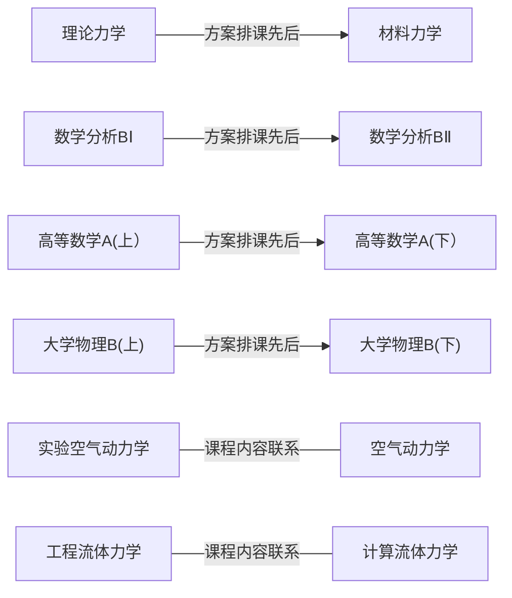

# 2024级飞行器设计与工程专业“2+X”教学培养方案（技术科学试验班交叉科学类学生适用）

智能机器人与先进制造创新学院 · 飞行器设计与工程 · 方案 72560 · 66 个不同课程或科研条目。

[官方 Word](../originals/plan-72560.docx) · [教务详情](https://fdjwgl.fudan.edu.cn/manager/bizType/2/major-program-search/info/72560?skipAuth=1) · [方案快照](../raw/plan-72560.json.gz) · [年级目录](../README.md)

## 修读导读

- **建议先学**　《理论力学》（`AAST20013`） → 《材料力学》（`AAST20009`）。静力学分析有助于理解构件受力。方案分别列在第3、4学期。

- **可以对照着读**　《实验空气动力学》（`AAST30012`）与《空气动力学》（`AAST30034`）。两门课的题名都涉及空气动力学。选一个绕流问题，比较采用的流动假设和压力、速度的描述。

- **查模块选课**　《微分方程》（`AAST20005`）、《CAD与工程图学基础A》（`AAST20007`）列在“专业核心教育课程”中。原表见 `/courseModules/6`。

## 课程关系图

图中展示部分关系。下表保留全部已建立的课程对，来源位置使用本方案 JSON Pointer。

## 先修与内容联系

| 类型 | 起点 | 终点 | 依据 | 原表定位 |
| --- | --- | --- | --- | --- |
| 建议学习顺序 | 理论力学 (AAST20013) | 材料力学 (AAST20009) | 静力学分析有助于理解构件受力。  | `/courseModules/6/planCourses/15`、`/courseModules/6/planCourses/5` |
| 建议学习顺序 | 数学分析BⅠ (MATH10012) | 数学分析BⅡ (MATH10013) | 同方案的课程题名具有连续分册或序号。  | `/courseModules/5/planCourses/0`、`/courseModules/5/planCourses/1` |
| 建议学习顺序 | 高等数学A(上） (MATH10015) | 高等数学A(下） (MATH10016) | 同方案的课程题名具有连续分册或序号。  | `/courseModules/5/planCourses/2`、`/courseModules/5/planCourses/3` |
| 建议学习顺序 | 大学物理B(上) (PHYS10003) | 大学物理B(下) (PHYS10004) | 同方案的课程题名具有连续分册或序号。  | `/courseModules/5/planCourses/6`、`/courseModules/5/planCourses/7` |
| 方案排课先后 | 理论力学 (AAST20013) | 材料力学 (AAST20009) | 同方案该课程全部明确数字学期均早于后者。  | `/courseModules/6/planCourses/15`、`/courseModules/6/planCourses/5` |
| 方案排课先后 | 数学分析BⅠ (MATH10012) | 数学分析BⅡ (MATH10013) | 同方案该课程全部明确数字学期均早于后者。  | `/courseModules/5/planCourses/0`、`/courseModules/5/planCourses/1` |
| 方案排课先后 | 高等数学A(上） (MATH10015) | 高等数学A(下） (MATH10016) | 同方案该课程全部明确数字学期均早于后者。  | `/courseModules/5/planCourses/2`、`/courseModules/5/planCourses/3` |
| 方案排课先后 | 大学物理B(上) (PHYS10003) | 大学物理B(下) (PHYS10004) | 同方案该课程全部明确数字学期均早于后者。  | `/courseModules/5/planCourses/6`、`/courseModules/5/planCourses/7` |
| 课程内容联系 | 工程流体力学 (AAST20006) | 计算流体力学 (AAST30027) | 本方案两门课程的题名均含“流体力学”，可据此对照这一主题。  | `/courseModules/6/planCourses/4`、`/courseModules/12/planCourses/12` |
| 课程内容联系 | 实验空气动力学 (AAST30012) | 空气动力学 (AAST30034) | 本方案两门课程的题名均含“空气动力学”，可据此对照这一主题。  | `/courseModules/6/planCourses/0`、`/courseModules/6/planCourses/12` |

本次未从可定位的明确表述中确认课程对课程预修。学期安排、系列分册与编辑建议均保留各自的依据。

## 按原方案模块阅读

同一模块展示原表中的课程归属。模块内课程之间的先后仍须逐项查阅。

- **必修**　振动实验、结构强度试验、弹性力学、振动基础、设计与制造（原表模块 10）

## 课程表

同一课程在不同模块分别出现时，按原表逐行列出。季节字段保留原值。

| 课程 | 代码 | 学分 | 学期 | 模块 |
| --- | --- | ---: | --- | --- |
| 数学分析BⅠ | MATH10012 | 5.0 | 第1学期 | 培养方案 / 专业培养课程 / 大类基础课程 |
| 数学分析BⅡ | MATH10013 | 5.0 | 第2学期 | 培养方案 / 专业培养课程 / 大类基础课程 |
| 高等数学A(上） | MATH10015 | 5.0 | 第1学期 | 培养方案 / 专业培养课程 / 大类基础课程 |
| 高等数学A(下） | MATH10016 | 5.0 | 第2学期 | 培养方案 / 专业培养课程 / 大类基础课程 |
| 程序设计 | CS10004 | 4.0 | 第1学期 | 培养方案 / 专业培养课程 / 大类基础课程 |
| 线性代数 | CS10003 | 3.0 | 第1学期 | 培养方案 / 专业培养课程 / 大类基础课程 |
| 大学物理B(上) | PHYS10003 | 4.0 | 第1学期 | 培养方案 / 专业培养课程 / 大类基础课程 |
| 大学物理B(下) | PHYS10004 | 4.0 | 第2学期 | 培养方案 / 专业培养课程 / 大类基础课程 |
| 基础物理实验 | PHYS10005 | 2.0 | 第1学期 | 培养方案 / 专业培养课程 / 大类基础课程 |
| 实验空气动力学 | AAST30012 | 2.0 | 第5学期 | 培养方案 / 专业培养课程 / 专业核心教育课程 |
| 微分方程 | AAST20005 | 3.0 | 第3学期 | 培养方案 / 专业培养课程 / 专业核心教育课程 |
| CAD与工程图学基础A | AAST20007 | 3.0 | 第4学期 | 培养方案 / 专业培养课程 / 专业核心教育课程 |
| 数学物理方法 | AAST20004 | 3.0 | 第4学期 | 培养方案 / 专业培养课程 / 专业核心教育课程 |
| 工程流体力学 | AAST20006 | 3.0 | 第4学期 | 培养方案 / 专业培养课程 / 专业核心教育课程 |
| 材料力学 | AAST20009 | 3.0 | 第4学期 | 培养方案 / 专业培养课程 / 专业核心教育课程 |
| 概率论与数理统计 | AAST20012 | 3.0 | 第4学期 | 培养方案 / 专业培养课程 / 专业核心教育课程 |
| 生产实习、实践 | AAST40006 | 1.0 | 第7学期 | 培养方案 / 专业培养课程 / 专业核心教育课程 |
| 毕业论文 | AAST40007 | 6.0 | 第8学期 | 培养方案 / 专业培养课程 / 专业核心教育课程 |
| 航空航天与力学导论 | AAST10002 | 1.0 | 第3学期 | 培养方案 / 专业培养课程 / 专业核心教育课程 |
| 自动控制原理 | AAST30014 | 2.0 | 第5学期 | 培养方案 / 专业培养课程 / 专业核心教育课程 |
| 计算方法与软件 | AAST20003 | 3.0 | 第3学期 | 培养方案 / 专业培养课程 / 专业核心教育课程 |
| 空气动力学 | AAST30034 | 3.0 | 第5学期 | 培养方案 / 专业培养课程 / 专业核心教育课程 |
| 飞行力学与飞行控制 | AAST30013 | 3.0 | 第6学期 | 培养方案 / 专业培养课程 / 专业核心教育课程 |
| 飞行器总体设计 | AAST30022 | 3.0 | 第6学期 | 培养方案 / 专业培养课程 / 专业核心教育课程 |
| 理论力学 | AAST20013 | 4.0 | 第3学期 | 培养方案 / 专业培养课程 / 专业核心教育课程 |
| 设计与制造 | GEEC30008 | 2.0 | 第5学期 | 培养方案 / 专业进阶课程I / 必修 |
| 弹性力学 | AAST30043 | 3.0 | 第5学期 | 培养方案 / 专业进阶课程I / 必修 |
| 振动基础 | AAST30045 | 3.0 | 第5学期 | 培养方案 / 专业进阶课程I / 必修 |
| 振动实验 | AAST30009 | 1.0 | 第6学期 | 培养方案 / 专业进阶课程I / 必修 |
| 结构强度试验 | AAST30011 | 2.0 | 第6学期 | 培养方案 / 专业进阶课程I / 必修 |
| 飞行器结构分析与设计 | AAST30023 | 3.0 | 第7学期 | 培养方案 / 专业进阶课程I / 二选一 |
| 航空发动机原理 | AAST30036 | 3.0 | 第6学期 | 培养方案 / 专业进阶课程I / 二选一 |
| 工程材料 | AAST30015 | 1.0 | SPRING、AUTUMN | 培养方案 / 专业进阶课程II |
| 优化设计 | AAST20008 | 2.0 | SPRING、AUTUMN | 培养方案 / 专业进阶课程II |
| 飞行器的操稳特性 | AAST30030 | 2.0 | SPRING、AUTUMN | 培养方案 / 专业进阶课程II |
| 航空发动机结构分析 | AAST30041 | 3.0 | SPRING、AUTUMN | 培养方案 / 专业进阶课程II |
| 飞行仿真技术 | AAST30042 | 2.0 | SPRING、AUTUMN | 培养方案 / 专业进阶课程II |
| 连续介质力学基础 | AAST40012 | 3.0 | SPRING、AUTUMN | 培养方案 / 专业进阶课程II |
| 机电系统原理及实践 | AAST30039 | 3.0 | SPRING、AUTUMN | 培养方案 / 专业进阶课程II |
| 弹性结构的力学基础 | AAST30040 | 3.0 | SPRING、AUTUMN | 培养方案 / 专业进阶课程II |
| 智柔微纳结构与器件力学 | AAST50013 | 2.0 | SPRING、AUTUMN | 培养方案 / 专业进阶课程II |
| 智柔体导论 | AAST40015 | 2.0 | SPRING、AUTUMN | 培养方案 / 专业进阶课程II |
| 增材制造导论 | AAST40018 | 2.0 | SPRING、AUTUMN | 培养方案 / 专业进阶课程II |
| 涡量与涡动力学基础 | AAST50009 | 2.0 | SPRING、AUTUMN | 培养方案 / 专业进阶课程II |
| 计算流体力学 | AAST30027 | 2.0 | SPRING、AUTUMN | 培养方案 / 专业进阶课程II |
| 医疗器械建模仿真与应用 | AAST40017 | 2.0 | SPRING、AUTUMN | 培养方案 / 专业进阶课程II |
| 生物医学工程概论 | AAST40009 | 2.0 | SPRING、AUTUMN | 培养方案 / 专业进阶课程II |
| 数字信号处理 | AAST30021 | 2.0 | SPRING、AUTUMN | 培养方案 / 专业进阶课程II |
| 粘弹性力学 | AAST40010 | 2.0 | SPRING、AUTUMN | 培养方案 / 专业进阶课程II |
| 飞行器主动控制技术 | AAST30024 | 2.0 | SPRING、AUTUMN | 培养方案 / 专业进阶课程II |
| 工程系统建模与控制 | AAST30025 | 2.0 | SPRING、AUTUMN | 培养方案 / 专业进阶课程II |
| 工程热力学 | AAST30026 | 2.0 | SPRING、AUTUMN | 培养方案 / 专业进阶课程II |
| 张量分析与微分几何基础 | AAST40011 | 2.0 | SPRING、AUTUMN | 培养方案 / 专业进阶课程II |
| 基于Matlab的工程分析 | AAST30028 | 2.0 | SPRING、AUTUMN | 培养方案 / 专业进阶课程II |
| 工程中的数学方法 | AAST30033 | 3.0 | SPRING、AUTUMN | 培养方案 / 专业进阶课程II |
| 应用实变函数与泛函分析基础 | AAST50010 | 3.0 | SPRING、AUTUMN | 培养方案 / 专业进阶课程II |
| 流形上的微积分 | AAST50011 | 2.0 | SPRING、AUTUMN | 培养方案 / 专业进阶课程II |
| 板壳理论 | AAST40013 | 2.0 | SPRING、AUTUMN | 培养方案 / 专业进阶课程II |
| 空天智能方法与实践 | AAST30035 | 2.0 | SPRING、AUTUMN | 培养方案 / 专业进阶课程II |
| 现代飞机先进空气动力设计技术 | AAST30037 | 2.0 | SPRING、AUTUMN | 培养方案 / 专业进阶课程II |
| 复杂动力学系统建模与仿真 | AAST30038 | 3.0 | SPRING、AUTUMN | 培养方案 / 专业进阶课程II |
| 流体物理概论 | AAST40014 | 2.0 | SPRING、AUTUMN | 培养方案 / 专业进阶课程II |
| 几何力学 | AAST50014 | 3.0 | SPRING、AUTUMN | 培养方案 / 专业进阶课程II |
| 光流控技术概论 | AAST40016 | 2.0 | SPRING、AUTUMN | 培养方案 / 专业进阶课程II |
| 基于人工智能方法的航空航天领域典型问题研究 | AIT310028 | 2.0 | SPRING、AUTUMN | 培养方案 / 专业进阶课程II |
| 机械设计基础 | MECH130032 | 2.0 | SPRING、AUTUMN | 培养方案 / 专业进阶课程II |
