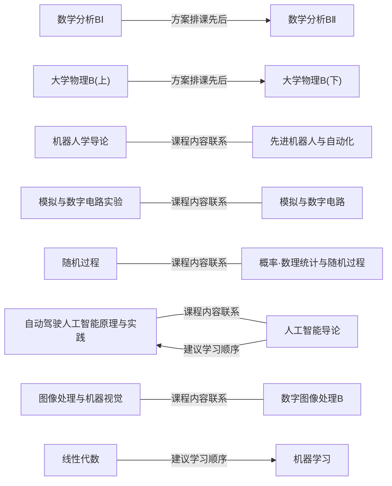

# 2024智能科学与技术2+X@普通本科生

智能机器人与先进制造创新学院 · 智能科学与技术(本研贯通) · 方案 72687 · 44 个不同课程或科研条目。

[官方 Word](../originals/plan-72687.docx) · [教务详情](https://fdjwgl.fudan.edu.cn/manager/bizType/2/major-program-search/info/72687?skipAuth=1) · [方案快照](../raw/plan-72687.json.gz) · [年级目录](../README.md)

## 课程关系图

图中展示部分关系。下表保留全部已建立的课程对，来源位置使用本方案 JSON Pointer。

## 先修与内容联系

| 类型 | 起点 | 终点 | 依据 | 原表定位 |
| --- | --- | --- | --- | --- |
| 建议学习顺序 | 线性代数 (CS10003) | 机器学习 (ICE50015) | 向量、矩阵及线性映射为理解学习模型提供数学准备。  | `/courseModules/7/planCourses/2`、`/courseModules/13/planCourses/7` |
| 建议学习顺序 | 人工智能导论 (IST20002) | 自动驾驶人工智能原理与实践 (AIT410017) | “人工智能导论”题名标明基础层次，前置阅读可帮助了解“自动驾驶人工智能原理与实践”中的人工智能主题。  | `/courseModules/8/planCourses/5`、`/courseModules/13/planCourses/16` |
| 建议学习顺序 | 数学分析BⅠ (MATH10012) | 数学分析BⅡ (MATH10013) | 同方案的课程题名具有连续分册或序号。  | `/courseModules/7/planCourses/0`、`/courseModules/7/planCourses/1` |
| 建议学习顺序 | 大学物理B(上) (PHYS10003) | 大学物理B(下) (PHYS10004) | 同方案的课程题名具有连续分册或序号。  | `/courseModules/7/planCourses/3`、`/courseModules/7/planCourses/4` |
| 方案排课先后 | 数学分析BⅠ (MATH10012) | 数学分析BⅡ (MATH10013) | 同方案该课程全部明确数字学期均早于后者。  | `/courseModules/7/planCourses/0`、`/courseModules/7/planCourses/1` |
| 方案排课先后 | 大学物理B(上) (PHYS10003) | 大学物理B(下) (PHYS10004) | 同方案该课程全部明确数字学期均早于后者。  | `/courseModules/7/planCourses/3`、`/courseModules/7/planCourses/4` |
| 课程内容联系 | 机器人学导论 (AIS410007) | 先进机器人与自动化 (IST70008) | 本方案两门课程的题名均含“机器人”，可据此对照这一主题。  | `/courseModules/11/planCourses/3`、`/courseModules/13/planCourses/12` |
| 课程内容联系 | 自动驾驶人工智能原理与实践 (AIT410017) | 人工智能导论 (IST20002) | 本方案两门课程的题名均含“人工智能”，可据此对照这一主题。  | `/courseModules/13/planCourses/16`、`/courseModules/8/planCourses/5` |
| 课程内容联系 | 随机过程 (EST30008) | 概率、数理统计与随机过程 (IST30005) | 本方案两门课程的题名均含“随机过程”，可据此对照这一主题。  | `/courseModules/13/planCourses/11`、`/courseModules/8/planCourses/2` |
| 课程内容联系 | 模拟与数字电路实验 (EST40012) | 模拟与数字电路 (IST30008) | 题名显示相同主题的课程与实验、实践或实习。  | `/courseModules/13/planCourses/10`、`/courseModules/8/planCourses/3` |
| 课程内容联系 | 图像处理与机器视觉 (EST60008) | 数字图像处理B (ICE40003) | 本方案两门课程的题名均含“图像处理”，可据此对照这一主题。  | `/courseModules/8/planCourses/9`、`/courseModules/13/planCourses/5` |

本次未从可定位的明确表述中确认课程对课程预修。学期安排、系列分册与编辑建议均保留各自的依据。

## 按原方案模块阅读

同一模块展示原表中的课程归属。模块内课程之间的先后仍须逐项查阅。

- **技术科学类基础课程（工科试验班等适用）**　线性代数、程序设计、电路基础、数学分析BⅠ、数学分析BⅡ、大学物理B(上)、大学物理B(下)、基础物理实验（原表模块 7）

## 课程表

同一课程在不同模块分别出现时，按原表逐行列出。季节字段保留原值。

| 课程 | 代码 | 学分 | 学期 | 模块 |
| --- | --- | ---: | --- | --- |
| 数学分析BⅠ | MATH10012 | 5.0 | 第1学期 | 培养方案 / 专业培养课程 / 大类基础课程 / 技术科学类基础课程 / 技术科学类基础课程（工科试验班等适用） |
| 数学分析BⅡ | MATH10013 | 5.0 | 第2学期 | 培养方案 / 专业培养课程 / 大类基础课程 / 技术科学类基础课程 / 技术科学类基础课程（工科试验班等适用） |
| 线性代数 | CS10003 | 3.0 | 第1学期 | 培养方案 / 专业培养课程 / 大类基础课程 / 技术科学类基础课程 / 技术科学类基础课程（工科试验班等适用） |
| 大学物理B(上) | PHYS10003 | 4.0 | 第1学期 | 培养方案 / 专业培养课程 / 大类基础课程 / 技术科学类基础课程 / 技术科学类基础课程（工科试验班等适用） |
| 大学物理B(下) | PHYS10004 | 4.0 | 第2学期 | 培养方案 / 专业培养课程 / 大类基础课程 / 技术科学类基础课程 / 技术科学类基础课程（工科试验班等适用） |
| 基础物理实验 | PHYS10005 | 2.0 | 第2学期 | 培养方案 / 专业培养课程 / 大类基础课程 / 技术科学类基础课程 / 技术科学类基础课程（工科试验班等适用） |
| 程序设计 | CS10004 | 4.0 | 第1学期 | 培养方案 / 专业培养课程 / 大类基础课程 / 技术科学类基础课程 / 技术科学类基础课程（工科试验班等适用） |
| 电路基础 | ICSE10001 | 3.0 | 第2学期 | 培养方案 / 专业培养课程 / 大类基础课程 / 技术科学类基础课程 / 技术科学类基础课程（工科试验班等适用） |
| 脑科学导论 | AIS310018 | 3.0 | 第3学期 | 培养方案 / 专业培养课程 / 专业核心教育课程 |
| 数据结构与算法设计 | EST30006 | 4.0 | 第3学期 | 培养方案 / 专业培养课程 / 专业核心教育课程 |
| 概率、数理统计与随机过程 | IST30005 | 4.0 | 第3学期 | 培养方案 / 专业培养课程 / 专业核心教育课程 |
| 模拟与数字电路 | IST30008 | 4.0 | 第3学期 | 培养方案 / 专业培养课程 / 专业核心教育课程 |
| 智能科学的数学基础 | IST30006 | 4.0 | 第4学期 | 培养方案 / 专业培养课程 / 专业核心教育课程 |
| 人工智能导论 | IST20002 | 4.0 | 第4学期 | 培养方案 / 专业培养课程 / 专业核心教育课程 |
| 计算机原理与体系结构 | EST30007 | 4.0 | 第4学期 | 培养方案 / 专业培养课程 / 专业核心教育课程 |
| 信号与系统 | EST20007 | 4.0 | 第4学期 | 培养方案 / 专业培养课程 / 专业核心教育课程 |
| 统计学习 | IST30007 | 4.0 | 第5学期 | 培养方案 / 专业培养课程 / 专业核心教育课程 |
| 图像处理与机器视觉 | EST60008 | 3.0 | 第6学期 | 培养方案 / 专业培养课程 / 专业核心教育课程 |
| 生产实习 | EST40004 | 1.0 | 第7学期 | 培养方案 / 专业培养课程 / 专业核心教育课程 |
| 毕业论文 | EST40005 | 6.0 | 第8学期 | 培养方案 / 专业培养课程 / 专业核心教育课程 |
| 自然语言处理 | CS30040 | 2.0 | 第6学期 | 培养方案 / 专业进阶模块I（智能信息处理方向） |
| 数据库与数据仓库 | IST50019 | 4.0 | 第5学期 | 培养方案 / 专业进阶模块I（智能信息处理方向） |
| 智能系统设计 | EST40015 | 4.0 | 第7学期 | 培养方案 / 专业进阶模块I（智能信息处理方向） |
| 机器人学导论 | AIS410007 | 4.0 | 第5学期 | 培养方案 / 专业进阶模块I（智能信息处理方向） |
| 自动控制原理 | IST50018 | 4.0 | 第5学期 | 培养方案 / 专业进阶模块I（智能系统与接口方向） |
| 机械设计 | IST70007 | 3.0 | 第6学期 | 培养方案 / 专业进阶模块I（智能系统与接口方向） |
| 智能系统设计 | EST40015 | 4.0 | 第7学期 | 培养方案 / 专业进阶模块I（智能系统与接口方向） |
| 机器人学导论 | AIS410007 | 4.0 | 第5学期 | 培养方案 / 专业进阶模块I（智能系统与接口方向） |
| 认知心理学 | PSYC30004 | 2.0 | AUTUMN | 培养方案 / 专业进阶模块II（智能信息处理方向） |
| 生物医学工程学基础 | BME30003 | 3.0 | SPRING | 培养方案 / 专业进阶模块II（智能信息处理方向） |
| 科技英语 | ICE50003 | 2.0 | AUTUMN | 培养方案 / 专业进阶模块II（智能信息处理方向） |
| 可编程器件与硬件描述语言 | EST50013 | 2.0 | AUTUMN | 培养方案 / 专业进阶模块II（智能信息处理方向） |
| 医学信号处理 | BME50023 | 2.0 | SPRING | 培养方案 / 专业进阶模块II（智能信息处理方向） |
| 数字图像处理B | ICE40003 | 2.0 | AUTUMN | 培养方案 / 专业进阶模块II（智能信息处理方向） |
| 信号检测与估计基础 | EST50014 | 2.0 | SPRING、AUTUMN | 培养方案 / 专业进阶模块II（智能信息处理方向） |
| 机器学习 | ICE50015 | 2.0 | AUTUMN | 培养方案 / 专业进阶模块II（智能信息处理方向） |
| 智能SoC设计 | IST50020 | 3.0 | AUTUMN | 培养方案 / 专业进阶模块II（智能信息处理方向） |
| 群体智能 | EST40016 | 2.0 | AUTUMN | 培养方案 / 专业进阶模块II（智能信息处理方向） |
| 模拟与数字电路实验 | EST40012 | 3.0 | SPRING | 培养方案 / 专业进阶模块II（智能信息处理方向） |
| 随机过程 | EST30008 | 3.0 | AUTUMN | 培养方案 / 专业进阶模块II（智能信息处理方向） |
| 先进机器人与自动化 | IST70008 | 3.0 | SPRING | 培养方案 / 专业进阶模块II（智能信息处理方向） |
| 多媒体技术 | EST40007 | 2.0 | AUTUMN | 培养方案 / 专业进阶模块II（智能信息处理方向） |
| 医学成像技术 | BME50021 | 2.0 | AUTUMN | 培养方案 / 专业进阶模块II（智能信息处理方向） |
| AI增强仿真学：理论与实践 | AIT310027 | 3.0 | AUTUMN | 培养方案 / 专业进阶模块II（智能信息处理方向） |
| 自动驾驶人工智能原理与实践 | AIT410017 | 2.0 | SPRING | 培养方案 / 专业进阶模块II（智能信息处理方向） |
| 计算神经学 | CS50029 | 3.0 | AUTUMN | 培养方案 / 专业进阶模块II（智能信息处理方向） |
| 认知心理学 | PSYC30004 | 2.0 | AUTUMN | 培养方案 / 专业进阶模块II（智能系统与接口方向） |
| 生物医学工程学基础 | BME30003 | 3.0 | SPRING | 培养方案 / 专业进阶模块II（智能系统与接口方向） |
| 科技英语 | ICE50003 | 2.0 | AUTUMN | 培养方案 / 专业进阶模块II（智能系统与接口方向） |
| 可编程器件与硬件描述语言 | EST50013 | 2.0 | AUTUMN | 培养方案 / 专业进阶模块II（智能系统与接口方向） |
| 医学信号处理 | BME50023 | 2.0 | SPRING | 培养方案 / 专业进阶模块II（智能系统与接口方向） |
| 数字图像处理B | ICE40003 | 2.0 | AUTUMN | 培养方案 / 专业进阶模块II（智能系统与接口方向） |
| 信号检测与估计基础 | EST50014 | 2.0 | SPRING、AUTUMN | 培养方案 / 专业进阶模块II（智能系统与接口方向） |
| 机器学习 | ICE50015 | 2.0 | AUTUMN | 培养方案 / 专业进阶模块II（智能系统与接口方向） |
| 智能SoC设计 | IST50020 | 3.0 | AUTUMN | 培养方案 / 专业进阶模块II（智能系统与接口方向） |
| 群体智能 | EST40016 | 2.0 | AUTUMN | 培养方案 / 专业进阶模块II（智能系统与接口方向） |
| 模拟与数字电路实验 | EST40012 | 3.0 | SPRING | 培养方案 / 专业进阶模块II（智能系统与接口方向） |
| 随机过程 | EST30008 | 3.0 | AUTUMN | 培养方案 / 专业进阶模块II（智能系统与接口方向） |
| 先进机器人与自动化 | IST70008 | 3.0 | SPRING | 培养方案 / 专业进阶模块II（智能系统与接口方向） |
| 多媒体技术 | EST40007 | 2.0 | AUTUMN | 培养方案 / 专业进阶模块II（智能系统与接口方向） |
| 医学成像技术 | BME50021 | 2.0 | AUTUMN | 培养方案 / 专业进阶模块II（智能系统与接口方向） |
| AI增强仿真学：理论与实践 | AIT310027 | 3.0 | AUTUMN | 培养方案 / 专业进阶模块II（智能系统与接口方向） |
| 自动驾驶人工智能原理与实践 | AIT410017 | 2.0 | SPRING | 培养方案 / 专业进阶模块II（智能系统与接口方向） |
| 计算神经学 | CS50029 | 3.0 | AUTUMN | 培养方案 / 专业进阶模块II（智能系统与接口方向） |
