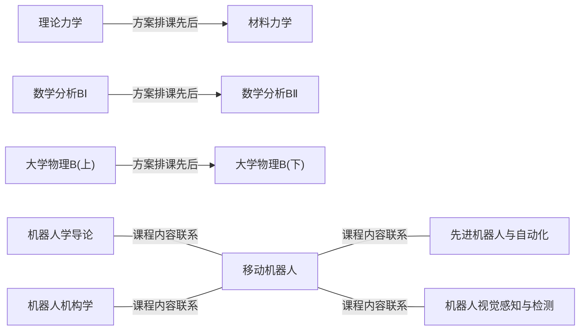

# 2024 智能科学与技术（智能机器人领军人才班）专业教学培养方案（香农计划适用）

智能机器人与先进制造创新学院 · 智能科学与技术(智能机器人领军人才班)(香农计划) · 方案 72983 · 40 个不同课程或科研条目。

[官方 Word](../originals/plan-72983.docx) · [教务详情](https://fdjwgl.fudan.edu.cn/manager/bizType/2/major-program-search/info/72983?skipAuth=1) · [方案快照](../raw/plan-72983.json.gz) · [年级目录](../README.md)

## 修读导读

- **建议先学**　《理论力学》（`ATMO20006`） → 《材料力学》（`AAST20009`）。静力学分析有助于理解构件受力。方案分别列在第3、4学期。

- **可以对照着读**　《机器人学导论》（`AIS410007`）与《移动机器人》（`IST60007`）。两门课的题名都涉及机器人。围绕一个运动任务，比较系统如何描述状态、感知变化和产生动作。

- **查模块选课**　《模拟与数字电路》（`IST30008`）、《自动控制原理》（`IST50018`）列在“专业核心教育课程”中。原表见 `/courseModules/6`。

## 课程关系图

图中展示部分关系。下表保留全部已建立的课程对，来源位置使用本方案 JSON Pointer。

## 先修与内容联系

| 类型 | 起点 | 终点 | 依据 | 原表定位 |
| --- | --- | --- | --- | --- |
| 建议学习顺序 | 理论力学 (ATMO20006) | 材料力学 (AAST20009) | 静力学分析有助于理解构件受力。  | `/courseModules/6/planCourses/1`、`/courseModules/6/planCourses/3` |
| 建议学习顺序 | 数学分析BⅠ (MATH10012) | 数学分析BⅡ (MATH10013) | 同方案的课程题名具有连续分册或序号。  | `/courseModules/5/planCourses/0`、`/courseModules/5/planCourses/1` |
| 建议学习顺序 | 大学物理B(上) (PHYS10003) | 大学物理B(下) (PHYS10004) | 同方案的课程题名具有连续分册或序号。  | `/courseModules/5/planCourses/3`、`/courseModules/5/planCourses/4` |
| 方案排课先后 | 理论力学 (ATMO20006) | 材料力学 (AAST20009) | 同方案该课程全部明确数字学期均早于后者。  | `/courseModules/6/planCourses/1`、`/courseModules/6/planCourses/3` |
| 方案排课先后 | 数学分析BⅠ (MATH10012) | 数学分析BⅡ (MATH10013) | 同方案该课程全部明确数字学期均早于后者。  | `/courseModules/5/planCourses/0`、`/courseModules/5/planCourses/1` |
| 方案排课先后 | 大学物理B(上) (PHYS10003) | 大学物理B(下) (PHYS10004) | 同方案该课程全部明确数字学期均早于后者。  | `/courseModules/5/planCourses/3`、`/courseModules/5/planCourses/4` |
| 课程内容联系 | 机器人学导论 (AIS410007) | 移动机器人 (IST60007) | 本方案两门课程的题名均含“机器人”，可据此对照这一主题。  | `/courseModules/6/planCourses/6`、`/courseModules/9/planCourses/7` |
| 课程内容联系 | 机器人机构学 (IST60006) | 移动机器人 (IST60007) | 本方案两门课程的题名均含“机器人”，可据此对照这一主题。  | `/courseModules/10/planCourses/3`、`/courseModules/9/planCourses/7` |
| 课程内容联系 | 移动机器人 (IST60007) | 先进机器人与自动化 (IST70008) | 本方案两门课程的题名均含“机器人”，可据此对照这一主题。  | `/courseModules/9/planCourses/7`、`/courseModules/10/planCourses/5` |
| 课程内容联系 | 移动机器人 (IST60007) | 机器人视觉感知与检测 (IST80002) | 本方案两门课程的题名均含“机器人”，可据此对照这一主题。  | `/courseModules/9/planCourses/7`、`/courseModules/9/planCourses/3` |

本次未从可定位的明确表述中确认课程对课程预修。学期安排、系列分册与编辑建议均保留各自的依据。

## 课程表

同一课程在不同模块分别出现时，按原表逐行列出。季节字段保留原值。

| 课程 | 代码 | 学分 | 学期 | 模块 |
| --- | --- | ---: | --- | --- |
| 数学分析BⅠ | MATH10012 | 5.0 | 第1学期 | 培养方案 / 专业培养课程 / 大类基础课程 |
| 数学分析BⅡ | MATH10013 | 5.0 | 第2学期 | 培养方案 / 专业培养课程 / 大类基础课程 |
| 线性代数 | CS10003 | 3.0 | 第1学期 | 培养方案 / 专业培养课程 / 大类基础课程 |
| 大学物理B(上) | PHYS10003 | 4.0 | 第1学期 | 培养方案 / 专业培养课程 / 大类基础课程 |
| 大学物理B(下) | PHYS10004 | 4.0 | 第2学期 | 培养方案 / 专业培养课程 / 大类基础课程 |
| 基础物理实验 | PHYS10005 | 2.0 | 第2学期 | 培养方案 / 专业培养课程 / 大类基础课程 |
| 程序设计 | CS10004 | 4.0 | 第1学期 | 培养方案 / 专业培养课程 / 大类基础课程 |
| 电子系统导论 | EST10003 | 3.0 | 第2学期 | 培养方案 / 专业培养课程 / 大类基础课程 |
| 电路基础 | ICSE10001 | 3.0 | 第2学期 | 培养方案 / 专业培养课程 / 大类基础课程 |
| 现代生物科学导论A | BIOL10001 | 3.0 | 第1学期 | 培养方案 / 专业培养课程 / 大类基础课程 |
| 概率论与数理统计 | STAT30014 | 4.0 | 第3学期 | 培养方案 / 专业培养课程 / 专业核心教育课程 |
| 理论力学 | ATMO20006 | 4.0 | 第3学期 | 培养方案 / 专业培养课程 / 专业核心教育课程 |
| 模拟与数字电路 | IST30008 | 4.0 | 第3学期 | 培养方案 / 专业培养课程 / 专业核心教育课程 |
| 材料力学 | AAST20009 | 3.0 | 第4学期 | 培养方案 / 专业培养课程 / 专业核心教育课程 |
| 工程图学及应用 | EST40010 | 2.0 | 第4学期 | 培养方案 / 专业培养课程 / 专业核心教育课程 |
| 自动控制原理 | IST50018 | 4.0 | 第5学期 | 培养方案 / 专业培养课程 / 专业核心教育课程 |
| 机器人学导论 | AIS410007 | 4.0 | 第5学期 | 培养方案 / 专业培养课程 / 专业核心教育课程 |
| 金工实习 | AAST30031 | 1.0 | 第3学期 | 培养方案 / 专业培养课程 / 专业核心教育课程 |
| 智能科学的数学基础 | IST30006 | 4.0 | 第4学期 | 培养方案 / 专业培养课程 / 专业核心教育课程 |
| 信号与系统 | EST20007 | 4.0 | 第4学期 | 培养方案 / 专业培养课程 / 专业核心教育课程 |
| 数据结构与算法设计 | EST30006 | 4.0 | 第5学期 | 培养方案 / 专业培养课程 / 专业核心教育课程 |
| 科研-实践训练1 | IST30001 | 1.0 | 第5学期 | 培养方案 / 专业培养课程 / 专业核心教育课程 |
| 科研-实践训练2 | IST30002 | 1.0 | 第6学期 | 培养方案 / 专业培养课程 / 专业核心教育课程 |
| 科研-实践训练3 | IST30003 | 1.0 | 第7学期 | 培养方案 / 专业培养课程 / 专业核心教育课程 |
| 毕业论文 | IST40004 | 3.0 | 第8学期 | 培养方案 / 专业培养课程 / 专业核心教育课程 |
| 随机过程 | EST30008 | 3.0 | 第4学期 | 培养方案 / 专业进阶模块I（机器人智能感知和认知决策） |
| 计算机原理与体系结构 | EST30007 | 4.0 | 第4学期 | 培养方案 / 专业进阶模块I（机器人智能感知和认知决策） |
| 数据挖掘与机器学习 | IST50022 | 3.0 | 第5学期 | 培养方案 / 专业进阶模块I（机器人智能感知和认知决策） |
| 机器人视觉感知与检测 | IST80002 | 3.0 | 第7学期 | 培养方案 / 专业进阶模块I（机器人智能感知和认知决策） |
| 计算神经学 | IST70010 | 3.0 | 第5学期 | 培养方案 / 专业进阶模块I（机器人智能感知和认知决策） |
| 图像处理与机器视觉 | EST60008 | 3.0 | 第7学期 | 培养方案 / 专业进阶模块I（机器人智能感知和认知决策） |
| 微机原理与接口实验 | EST40017 | 3.0 | 第5学期 | 培养方案 / 专业进阶模块I（机器人智能感知和认知决策） |
| 移动机器人 | IST60007 | 3.0 | 第7学期 | 培养方案 / 专业进阶模块I（机器人智能感知和认知决策） |
| 弹性结构的力学基础 | AAST30040 | 3.0 | 第5学期 | 培养方案 / 专业进阶模块II（机器人机构设计和智能控制） |
| 微机原理与接口实验 | EST40017 | 3.0 | 第5学期 | 培养方案 / 专业进阶模块II（机器人机构设计和智能控制） |
| 电机学 | IST60005 | 3.0 | 第6学期 | 培养方案 / 专业进阶模块II（机器人机构设计和智能控制） |
| 机器人机构学 | IST60006 | 3.0 | 第7学期 | 培养方案 / 专业进阶模块II（机器人机构设计和智能控制） |
| 移动机器人 | IST60007 | 3.0 | 第7学期 | 培养方案 / 专业进阶模块II（机器人机构设计和智能控制） |
| 先进机器人与自动化 | IST70008 | 3.0 | 第7学期 | 培养方案 / 专业进阶模块II（机器人机构设计和智能控制） |
| 现代控制理论 | IST80001 | 3.0 | 第6学期 | 培养方案 / 专业进阶模块II（机器人机构设计和智能控制） |
| 机电一体化系统设计 | IST70009 | 3.0 | 第7学期 | 培养方案 / 专业进阶模块II（机器人机构设计和智能控制） |
| 机械设计 | IST70007 | 3.0 | 第6学期 | 培养方案 / 专业进阶模块II（机器人机构设计和智能控制） |
