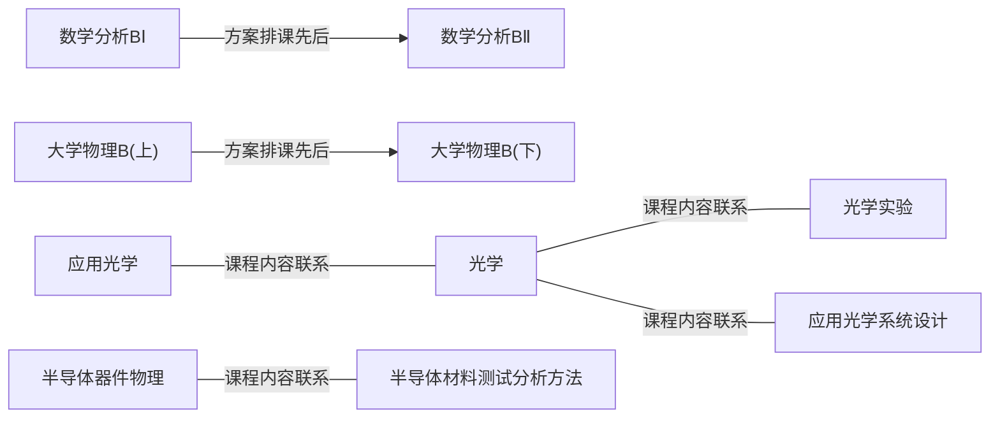

# 2024 智能科学与技术专业“2+X”教学培养方案 （智能光电方向适用）

智能机器人与先进制造创新学院 · 智能科学与技术(智能光电方向) · 方案 96949 · 46 个不同课程或科研条目。

[官方 Word](../originals/plan-96949.docx) · [教务详情](https://fdjwgl.fudan.edu.cn/manager/bizType/2/major-program-search/info/96949?skipAuth=1) · [方案快照](../raw/plan-96949.json.gz) · [年级目录](../README.md)

## 课程关系图

图中展示部分关系。下表保留全部已建立的课程对，来源位置使用本方案 JSON Pointer。

## 先修与内容联系

| 类型 | 起点 | 终点 | 依据 | 原表定位 |
| --- | --- | --- | --- | --- |
| 建议学习顺序 | 数学分析BⅠ (MATH10012) | 数学分析BⅡ (MATH10013) | 同方案的课程题名具有连续分册或序号。  | `/courseModules/5/planCourses/0`、`/courseModules/5/planCourses/1` |
| 建议学习顺序 | 大学物理B(上) (PHYS10003) | 大学物理B(下) (PHYS10004) | 同方案的课程题名具有连续分册或序号。  | `/courseModules/5/planCourses/3`、`/courseModules/5/planCourses/4` |
| 方案排课先后 | 数学分析BⅠ (MATH10012) | 数学分析BⅡ (MATH10013) | 同方案该课程全部明确数字学期均早于后者。  | `/courseModules/5/planCourses/0`、`/courseModules/5/planCourses/1` |
| 方案排课先后 | 大学物理B(上) (PHYS10003) | 大学物理B(下) (PHYS10004) | 同方案该课程全部明确数字学期均早于后者。  | `/courseModules/5/planCourses/3`、`/courseModules/5/planCourses/4` |
| 课程内容联系 | 应用光学 (OPTI20001) | 光学 (OPTI30001) | 本方案两门课程的题名均含“光学”，可据此对照这一主题。  | `/courseModules/6/planCourses/6`、`/courseModules/6/planCourses/3` |
| 课程内容联系 | 光学 (OPTI30001) | 光学实验 (OPTI30003) | 题名显示相同主题的课程与实验、实践或实习。  | `/courseModules/6/planCourses/3`、`/courseModules/6/planCourses/10` |
| 课程内容联系 | 光学 (OPTI30001) | 应用光学系统设计 (OPTI50029) | 本方案两门课程的题名均含“光学”，可据此对照这一主题。  | `/courseModules/6/planCourses/3`、`/courseModules/9/planCourses/14` |
| 课程内容联系 | 半导体器件物理 (OPTI50019) | 半导体材料测试分析方法 (OPTI50028) | 本方案两门课程的题名均含“半导体”，可据此对照这一主题。  | `/courseModules/8/planCourses/0`、`/courseModules/9/planCourses/9` |

本次未从可定位的明确表述中确认课程对课程预修。学期安排、系列分册与编辑建议均保留各自的依据。

## 课程表

同一课程在不同模块分别出现时，按原表逐行列出。季节字段保留原值。

| 课程 | 代码 | 学分 | 学期 | 模块 |
| --- | --- | ---: | --- | --- |
| 数学分析BⅠ | MATH10012 | 5.0 | 第1学期 | 培养方案 / 专业培养课程 / 大类基础课程 |
| 数学分析BⅡ | MATH10013 | 5.0 | 第2学期 | 培养方案 / 专业培养课程 / 大类基础课程 |
| 线性代数 | CS10003 | 3.0 | 第1学期 | 培养方案 / 专业培养课程 / 大类基础课程 |
| 大学物理B(上) | PHYS10003 | 4.0 | 第1学期 | 培养方案 / 专业培养课程 / 大类基础课程 |
| 大学物理B(下) | PHYS10004 | 4.0 | 第2学期 | 培养方案 / 专业培养课程 / 大类基础课程 |
| 基础物理实验 | PHYS10005 | 2.0 | 第2学期 | 培养方案 / 专业培养课程 / 大类基础课程 |
| 程序设计 | CS10004 | 4.0 | 第1学期 | 培养方案 / 专业培养课程 / 大类基础课程 |
| 电子系统导论 | EST10003 | 3.0 | 第2学期 | 培养方案 / 专业培养课程 / 大类基础课程 |
| 数字逻辑基础 | EST20009 | 4.0 | 第3学期 | 培养方案 / 专业培养课程 / 专业核心教育课程 |
| 工程数学 | EST20003 | 4.0 | 第3学期 | 培养方案 / 专业培养课程 / 专业核心教育课程 |
| 模拟电子学基础 | EST20010 | 4.0 | 第3学期 | 培养方案 / 专业培养课程 / 专业核心教育课程 |
| 光学 | OPTI30001 | 4.0 | 第3学期 | 培养方案 / 专业培养课程 / 专业核心教育课程 |
| 模拟与数字电路实验 | EST40012 | 3.0 | 第4学期 | 培养方案 / 专业培养课程 / 专业核心教育课程 |
| 固体物理导论 | OPTI20003 | 3.0 | 第4学期 | 培养方案 / 专业培养课程 / 专业核心教育课程 |
| 应用光学 | OPTI20001 | 3.0 | 第4学期 | 培养方案 / 专业培养课程 / 专业核心教育课程 |
| 电磁场与电磁波A | OPTI30004 | 3.0 | 第4学期 | 培养方案 / 专业培养课程 / 专业核心教育课程 |
| 微机原理与接口实验 | EST40017 | 3.0 | 第5学期 | 培养方案 / 专业培养课程 / 专业核心教育课程 |
| 光电测试技术 | OPTI30002 | 3.0 | 第5学期 | 培养方案 / 专业培养课程 / 专业核心教育课程 |
| 光学实验 | OPTI30003 | 3.0 | 第5学期 | 培养方案 / 专业培养课程 / 专业核心教育课程 |
| 毕业论文 | EST40005 | 6.0 | 第8学期 | 培养方案 / 专业培养课程 / 专业核心教育课程 |
| 半导体器件物理 | OPTI50019 | 3.0 | 第5学期 | 培养方案 / 专业进阶模块I |
| 光源原理 | OPTI50013 | 3.0 | 第5学期 | 培养方案 / 专业进阶模块I |
| 颜色信息科学 | OPTI50023 | 2.0 | 第5学期 | 培养方案 / 专业进阶模块I |
| 光电显示技术基础 | OPTI50024 | 3.0 | 第6学期 | 培养方案 / 专业进阶模块I |
| 智能光电驱动技术 | OPTI50025 | 3.0 | 第6学期 | 培养方案 / 专业进阶模块I |
| 专业实验 | OPTI40003 | 3.0 | 第7学期 | 培养方案 / 专业进阶模块I |
| 生产实习 | EST40004 | 1.0 | 第7学期 | 培养方案 / 专业进阶模块I |
| 现代光子学 | OPTI50017 | 2.0 | SPRING、AUTUMN | 培养方案 / 专业进阶模块II |
| LED器件及应用技术 | OPTI50016 | 2.0 | SPRING、AUTUMN | 培养方案 / 专业进阶模块II |
| 激光雷达技术及应用 | OPTI50030 | 3.0 | SPRING、AUTUMN | 培养方案 / 专业进阶模块II |
| 机器人学导论 | AIS410007 | 4.0 | 第6学期 | 培养方案 / 专业进阶模块II |
| 智能传感与认知 | EST50005 | 2.0 | 第6学期 | 培养方案 / 专业进阶模块II |
| 微纳制造理论和技术 | EST50007 | 2.0 | 第7学期 | 培养方案 / 专业进阶模块II |
| AI增强仿真学：理论与实践 | AIT310027 | 3.0 | AUTUMN | 培养方案 / 专业进阶模块II |
| 自动驾驶人工智能原理与实践 | AIT410017 | 2.0 | SPRING | 培养方案 / 专业进阶模块II |
| 发光材料及其应用 | OPTI50006 | 2.0 | SPRING、AUTUMN | 培养方案 / 专业进阶模块II |
| 半导体材料测试分析方法 | OPTI50028 | 2.0 | SPRING、AUTUMN | 培养方案 / 专业进阶模块II |
| 传感器与信号处理 | OPTI50014 | 3.0 | SPRING、AUTUMN | 培养方案 / 专业进阶模块II |
| 数字图像处理B | ICE40003 | 2.0 | SPRING、AUTUMN | 培养方案 / 专业进阶模块II |
| 数字控制理论与应用 | OPTI50012 | 3.0 | SPRING、AUTUMN | 培养方案 / 专业进阶模块II |
| 照明设计 | OPTI50015 | 3.0 | SPRING、AUTUMN | 培养方案 / 专业进阶模块II |
| 应用光学系统设计 | OPTI50029 | 2.0 | SPRING、AUTUMN | 培养方案 / 专业进阶模块II |
| 照明人体工效学 | OPTI50007 | 2.0 | SPRING、AUTUMN | 培养方案 / 专业进阶模块II |
| 电力电子学 | OPTI50005 | 3.0 | SPRING、AUTUMN | 培养方案 / 专业进阶模块II |
| 专业英语 | OPTI40009 | 2.0 | SPRING、AUTUMN | 培养方案 / 专业进阶模块II |
| 真空与薄膜技术基础 | OPTI50008 | 2.0 | SPRING、AUTUMN | 培养方案 / 专业进阶模块II |
