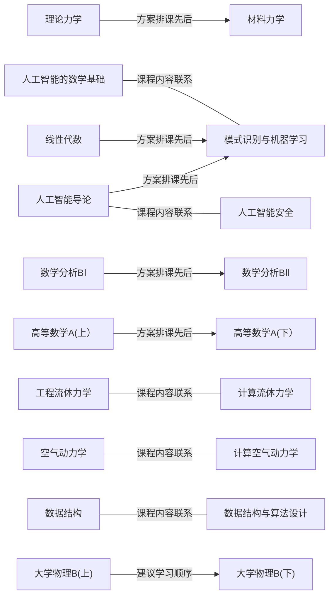

# 2025级飞行器设计与工程-信息与计算科学（人工智能方向）双学士学位项目普通本科培养方案

智能机器人与先进制造创新学院 · 飞行器设计与工程-信息与计算科学(人工智能方向)(双学士学位项目) · 方案 97076 · 64 个不同课程或科研条目。

[官方 Word](../originals/plan-97076.docx) · [教务详情](https://fdjwgl.fudan.edu.cn/manager/bizType/2/major-program-search/info/97076?skipAuth=1) · [方案快照](../raw/plan-97076.json.gz) · [年级目录](../README.md)

## 课程关系图

图中展示部分关系。下表保留全部已建立的课程对，来源位置使用本方案 JSON Pointer。

## 先修与内容联系

| 类型 | 起点 | 终点 | 依据 | 原表定位 |
| --- | --- | --- | --- | --- |
| 建议学习顺序 | 理论力学 (AAST20013) | 材料力学 (AAST20009) | 静力学分析有助于理解构件受力。  | `/courseModules/7/planCourses/1`、`/courseModules/7/planCourses/5` |
| 建议学习顺序 | 人工智能导论 (AIE310005) | 模式识别与机器学习 (AIE410001) | 人工智能问题与模型类别可为学习模式识别作准备。  | `/courseModules/7/planCourses/15`、`/courseModules/7/planCourses/17` |
| 建议学习顺序 | 线性代数 (CS10003) | 模式识别与机器学习 (AIE410001) | 向量表示和矩阵运算支持理解分类、回归等模型。  | `/courseModules/6/planCourses/4`、`/courseModules/7/planCourses/17` |
| 建议学习顺序 | 数学分析BⅠ (MATH10012) | 数学分析BⅡ (MATH10013) | 同方案的课程题名具有连续分册或序号。  | `/courseModules/6/planCourses/0`、`/courseModules/6/planCourses/1` |
| 建议学习顺序 | 高等数学A(上） (MATH10015) | 高等数学A(下） (MATH10016) | 同方案的课程题名具有连续分册或序号。  | `/courseModules/6/planCourses/2`、`/courseModules/6/planCourses/3` |
| 建议学习顺序 | 大学物理B(上) (PHYS10003) | 大学物理B(下) (PHYS10004) | 同方案的课程题名具有连续分册或序号。  | `/courseModules/6/planCourses/5`、`/courseModules/6/planCourses/6` |
| 方案排课先后 | 理论力学 (AAST20013) | 材料力学 (AAST20009) | 同方案该课程全部明确数字学期均早于后者。  | `/courseModules/7/planCourses/1`、`/courseModules/7/planCourses/5` |
| 方案排课先后 | 人工智能导论 (AIE310005) | 模式识别与机器学习 (AIE410001) | 同方案该课程全部明确数字学期均早于后者。  | `/courseModules/7/planCourses/15`、`/courseModules/7/planCourses/17` |
| 方案排课先后 | 线性代数 (CS10003) | 模式识别与机器学习 (AIE410001) | 同方案该课程全部明确数字学期均早于后者。  | `/courseModules/6/planCourses/4`、`/courseModules/7/planCourses/17` |
| 方案排课先后 | 数学分析BⅠ (MATH10012) | 数学分析BⅡ (MATH10013) | 同方案该课程全部明确数字学期均早于后者。  | `/courseModules/6/planCourses/0`、`/courseModules/6/planCourses/1` |
| 方案排课先后 | 高等数学A(上） (MATH10015) | 高等数学A(下） (MATH10016) | 同方案该课程全部明确数字学期均早于后者。  | `/courseModules/6/planCourses/2`、`/courseModules/6/planCourses/3` |
| 方案排课先后 | 大学物理B(上) (PHYS10003) | 大学物理B(下) (PHYS10004) | 同方案该课程全部明确数字学期均早于后者。  | `/courseModules/6/planCourses/5`、`/courseModules/6/planCourses/6` |
| 课程内容联系 | 工程流体力学 (AAST20006) | 计算流体力学 (AAST50016) | 本方案两门课程的题名均含“流体力学”，可据此对照这一主题。  | `/courseModules/7/planCourses/8`、`/courseModules/13/planCourses/1` |
| 课程内容联系 | 空气动力学 (AAST30034) | 计算空气动力学 (AAST60007) | 本方案两门课程的题名均含“空气动力学”，可据此对照这一主题。  | `/courseModules/10/planCourses/0`、`/courseModules/10/planCourses/5` |
| 课程内容联系 | 计算机系统基础 (AIE210006) | 计算机组成与体系结构 (CS30052) | 处理器、存储与系统执行模型具有共同内容。  | `/courseModules/7/planCourses/14`、`/courseModules/15/planCourses/1` |
| 课程内容联系 | 人工智能导论 (AIE310005) | 人工智能安全 (AIE831001) | 本方案两门课程的题名均含“人工智能”，可据此对照这一主题。  | `/courseModules/7/planCourses/15`、`/courseModules/7/planCourses/18` |
| 课程内容联系 | 人工智能的编程基础 (AIE310006) | 人工智能安全 (AIE831001) | 本方案两门课程的题名均含“人工智能”，可据此对照这一主题。  | `/courseModules/7/planCourses/11`、`/courseModules/7/planCourses/18` |
| 课程内容联系 | 数据结构 (AIE310007) | 数据结构与算法设计 (EST30006) | 本方案两门课程的题名均含“数据结构”，可据此对照这一主题。  | `/courseModules/7/planCourses/12`、`/courseModules/7/planCourses/4` |
| 课程内容联系 | 人工智能的软件基础 (AIE310008) | 人工智能安全 (AIE831001) | 本方案两门课程的题名均含“人工智能”，可据此对照这一主题。  | `/courseModules/7/planCourses/16`、`/courseModules/7/planCourses/18` |
| 课程内容联系 | 人工智能的数学基础 (AIE310009) | 模式识别与机器学习 (AIE410001) | 数学表达与学习模型的统计、优化工具可对照。  | `/courseModules/7/planCourses/13`、`/courseModules/7/planCourses/17` |
| 课程内容联系 | 人工智能的数学基础 (AIE310009) | 人工智能安全 (AIE831001) | 本方案两门课程的题名均含“人工智能”，可据此对照这一主题。  | `/courseModules/7/planCourses/13`、`/courseModules/7/planCourses/18` |
| 课程内容联系 | 模式识别与机器学习 (AIE410001) | 机器学习系统 (CS30058) | 本方案两门课程的题名均含“机器学习”，可据此对照这一主题。  | `/courseModules/7/planCourses/17`、`/courseModules/15/planCourses/5` |

本次未从可定位的明确表述中确认课程对课程预修。学期安排、系列分册与编辑建议均保留各自的依据。

## 按原方案模块阅读

同一模块展示原表中的课程归属。模块内课程之间的先后仍须逐项查阅。

- **工学基础课程**　线性代数、程序设计、数学分析BⅠ、数学分析BⅡ、高等数学A(上）、高等数学A(下）、大学物理B(上)、大学物理B(下)（原表模块 6）
- **智能空天飞行器方向**　优化设计、飞行器结构分析与设计、工程中的数学方法、航空发动机结构分析、计算流体力学（原表模块 13）
- **低空智能系统工程方向**　低空飞行器推进系统、工程材料、低空智联系统设计、低空飞行器设计基础、传感器和机载设备、旋翼气动设计基础（原表模块 14）
- **第二主修专业**　数据库引论、软件工程、计算机图形学A、计算机网络、集合与图论、计算机组成与体系结构、机器学习系统（原表模块 15）

## 课程表

同一课程在不同模块分别出现时，按原表逐行列出。季节字段保留原值。

| 课程 | 代码 | 学分 | 学期 | 模块 |
| --- | --- | ---: | --- | --- |
| 数学分析BⅠ | MATH10012 | 5.0 | 第1学期 | 培养方案 / 专业培养课程 / 学科基础课程 / 工学基础课程 |
| 数学分析BⅡ | MATH10013 | 5.0 | 第2学期 | 培养方案 / 专业培养课程 / 学科基础课程 / 工学基础课程 |
| 高等数学A(上） | MATH10015 | 5.0 | 第1学期 | 培养方案 / 专业培养课程 / 学科基础课程 / 工学基础课程 |
| 高等数学A(下） | MATH10016 | 5.0 | 第2学期 | 培养方案 / 专业培养课程 / 学科基础课程 / 工学基础课程 |
| 线性代数 | CS10003 | 3.0 | 第1学期 | 培养方案 / 专业培养课程 / 学科基础课程 / 工学基础课程 |
| 大学物理B(上) | PHYS10003 | 4.0 | 第1学期 | 培养方案 / 专业培养课程 / 学科基础课程 / 工学基础课程 |
| 大学物理B(下) | PHYS10004 | 4.0 | 第2学期 | 培养方案 / 专业培养课程 / 学科基础课程 / 工学基础课程 |
| 程序设计 | CS10004 | 4.0 | 第1学期 | 培养方案 / 专业培养课程 / 学科基础课程 / 工学基础课程 |
| 概率论与数理统计 | AAST20012 | 3.0 | 第3学期 | 培养方案 / 专业培养课程 / 专业核心教育课程 |
| 理论力学 | AAST20013 | 4.0 | 第3学期 | 培养方案 / 专业培养课程 / 专业核心教育课程 |
| 工程图学及应用 | EST40010 | 2.0 | 第3学期 | 培养方案 / 专业培养课程 / 专业核心教育课程 |
| 智能科学的数学基础 | IST30006 | 4.0 | 第3学期 | 培养方案 / 专业培养课程 / 专业核心教育课程 |
| 数据结构与算法设计 | EST30006 | 4.0 | 第4学期 | 培养方案 / 专业培养课程 / 专业核心教育课程 |
| 材料力学 | AAST20009 | 3.0 | 第4学期 | 培养方案 / 专业培养课程 / 专业核心教育课程 |
| 信号与系统 | EST20007 | 4.0 | 第4学期 | 培养方案 / 专业培养课程 / 专业核心教育课程 |
| 自动控制原理 | IST50018 | 4.0 | 第5学期 | 培养方案 / 专业培养课程 / 专业核心教育课程 |
| 工程流体力学 | AAST20006 | 3.0 | 第4学期 | 培养方案 / 专业培养课程 / 专业核心教育课程 |
| 数理方程 | AAST20002 | 3.0 | 第4学期 | 培养方案 / 专业培养课程 / 专业核心教育课程 |
| 飞行力学与飞行控制 | AAST30013 | 3.0 | 第5学期 | 培养方案 / 专业培养课程 / 专业核心教育课程 |
| 人工智能的编程基础 | AIE310006 | 2.0 | 第2学期 | 培养方案 / 专业培养课程 / 专业核心教育课程 |
| 数据结构 | AIE310007 | 4.0 | 第3学期 | 培养方案 / 专业培养课程 / 专业核心教育课程 |
| 人工智能的数学基础 | AIE310009 | 3.0 | 第3学期 | 培养方案 / 专业培养课程 / 专业核心教育课程 |
| 计算机系统基础 | AIE210006 | 3.0 | 第3学期 | 培养方案 / 专业培养课程 / 专业核心教育课程 |
| 人工智能导论 | AIE310005 | 3.0 | 第4学期 | 培养方案 / 专业培养课程 / 专业核心教育课程 |
| 人工智能的软件基础 | AIE310008 | 3.0 | 第4学期 | 培养方案 / 专业培养课程 / 专业核心教育课程 |
| 模式识别与机器学习 | AIE410001 | 3.0 | 第5学期 | 培养方案 / 专业培养课程 / 专业核心教育课程 |
| 人工智能安全 | AIE831001 | 3.0 | 第5学期 | 培养方案 / 专业培养课程 / 专业核心教育课程 |
| 人工智能的伦理与治理 | PHIL50006 | 2.0 | 第6学期 | 培养方案 / 专业培养课程 / 专业核心教育课程 |
| 自然语言处理与大语言模型 | AIE410002 | 3.0 | 第6学期 | 培养方案 / 专业培养课程 / 专业核心教育课程 |
| 计算机视觉 | AIE310004 | 3.0 | 第7学期 | 培养方案 / 专业培养课程 / 专业核心教育课程 |
| 人工智能前沿探索实践 | AIE531001 | 3.0 | 第7学期 | 培养方案 / 专业培养课程 / 专业核心教育课程 |
| 空气动力学 | AAST30034 | 3.0 | 第5学期 | 培养方案 / 专业进阶模块I |
| 智能空天前沿技术 | AAST50005 | 2.0 | 第5学期 | 培养方案 / 专业进阶模块I |
| 基于Matlab的工程分析 | AAST30028 | 2.0 | 第5学期 | 培养方案 / 专业进阶模块I |
| 冲击动力学 | AAST50021 | 3.0 | 第5学期 | 培养方案 / 专业进阶模块I |
| 飞行器总体设计 | AAST30022 | 3.0 | 第6学期 | 培养方案 / 专业进阶模块I |
| 计算空气动力学 | AAST60007 | 3.0 | 第6学期 | 培养方案 / 专业进阶模块I |
| 航空发动机原理 | AAST30036 | 3.0 | 第6学期 | 培养方案 / 专业进阶模块I |
| 旋翼气动设计基础 | AAST60003 | 3.0 | 第6学期 | 培养方案 / 专业进阶模块I |
| 高等大气飞行动力学 | AAST50027 | 3.0 | 第6学期 | 培养方案 / 专业进阶模块I |
| 飞行仿真技术 | AAST30042 | 2.0 | 第6学期 | 培养方案 / 专业进阶模块I |
| 现代飞行控制技术 | AAST50018 | 3.0 | 第6学期 | 培养方案 / 专业进阶模块I |
| 基于人工智能方法的航空航天领域典型问题研究 | AIT310028 | 2.0 | 第7学期 | 培养方案 / 专业进阶模块I |
| 空天复杂系统建模与仿真 | AAST50004 | 3.0 | 第7学期 | 培养方案 / 专业进阶模块I |
| 优化设计 | AAST20008 | 2.0 | 第6学期 | 培养方案 / 专业进阶模块II / 第一主修专业 / 智能空天飞行器方向 |
| 计算流体力学 | AAST50016 | 3.0 | 第7学期 | 培养方案 / 专业进阶模块II / 第一主修专业 / 智能空天飞行器方向 |
| 工程中的数学方法 | AAST30033 | 3.0 | 第7学期 | 培养方案 / 专业进阶模块II / 第一主修专业 / 智能空天飞行器方向 |
| 航空发动机结构分析 | AAST30041 | 3.0 | 第7学期 | 培养方案 / 专业进阶模块II / 第一主修专业 / 智能空天飞行器方向 |
| 飞行器结构分析与设计 | AAST30023 | 3.0 | 第7学期 | 培养方案 / 专业进阶模块II / 第一主修专业 / 智能空天飞行器方向 |
| 工程材料 | AAST30015 | 1.0 | 第7学期 | 培养方案 / 专业进阶模块II / 第一主修专业 / 低空智能系统工程方向 |
| 旋翼气动设计基础 | AAST60003 | 3.0 | 第6学期 | 培养方案 / 专业进阶模块II / 第一主修专业 / 低空智能系统工程方向 |
| 传感器和机载设备 | AAST60002 | 3.0 | 第5学期 | 培养方案 / 专业进阶模块II / 第一主修专业 / 低空智能系统工程方向 |
| 低空飞行器推进系统 | AAST30003 | 3.0 | 第5学期 | 培养方案 / 专业进阶模块II / 第一主修专业 / 低空智能系统工程方向 |
| 低空智联系统设计 | AAST50002 | 3.0 | 第7学期 | 培养方案 / 专业进阶模块II / 第一主修专业 / 低空智能系统工程方向 |
| 低空飞行器设计基础 | AAST50003 | 3.0 | 第7学期 | 培养方案 / 专业进阶模块II / 第一主修专业 / 低空智能系统工程方向 |
| 集合与图论 | CS30043 | 3.0 | 第3学期 | 培养方案 / 专业进阶模块II / 第二主修专业 |
| 计算机组成与体系结构 | CS30052 | 4.0 | 第4学期 | 培养方案 / 专业进阶模块II / 第二主修专业 |
| 数据库引论 | CS20010 | 3.0 | 第4学期 | 培养方案 / 专业进阶模块II / 第二主修专业 |
| 计算机网络 | CS30036 | 3.0 | 第5学期 | 培养方案 / 专业进阶模块II / 第二主修专业 |
| 软件工程 | CS30018 | 3.0 | 第6学期 | 培养方案 / 专业进阶模块II / 第二主修专业 |
| 机器学习系统 | CS30058 | 3.0 | 第6学期 | 培养方案 / 专业进阶模块II / 第二主修专业 |
| 计算机图形学A | CS30019 | 3.0 | 第6学期 | 培养方案 / 专业进阶模块II / 第二主修专业 |
| 复芏计划(FDUROP) | 102 | 0.0 |  | 融合创新能力 |
| 基础物理实验 | PHYS10005 | 2.0 | 第1学期 | 融合创新能力 |
| 毕业论文 | IST40004 | 3.0 | 第8学期 | 融合创新能力 |
