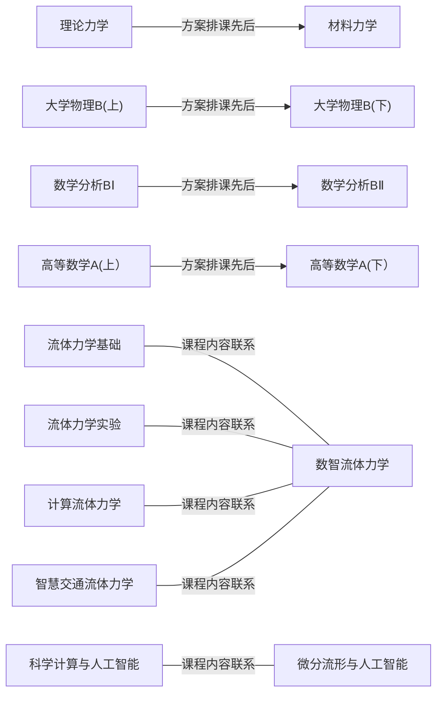

# 2025-智能科学与技术（智能力学方向）-普通本科培养方案

智能机器人与先进制造创新学院 · 智能科学与技术 · 方案 97144 · 60 个不同课程或科研条目。

[官方 Word](../originals/plan-97144.docx) · [教务详情](https://fdjwgl.fudan.edu.cn/manager/bizType/2/major-program-search/info/97144?skipAuth=1) · [方案快照](../raw/plan-97144.json.gz) · [年级目录](../README.md)

## 修读导读

- **建议先学**　《理论力学》（`AAST20013`） → 《材料力学》（`AAST20009`）。静力学分析有助于理解构件受力。方案分别列在第3、4学期。

- **可以对照着读**　《流体力学基础》（`AAST30044`）与《数智流体力学》（`MECH30002`）。两门课的题名都涉及流体力学。用同一流动问题比较控制范围、边界条件与守恒关系。

- **查模块选课**　《概率论与数理统计》（`AAST20012`）、《智能科学的数学基础》（`IST30006`）列在“专业核心教育课程”中。原表见 `/courseModules/9`。

## 课程关系图

图中展示部分关系。下表保留全部已建立的课程对，来源位置使用本方案 JSON Pointer。

## 先修与内容联系

| 类型 | 起点 | 终点 | 依据 | 原表定位 |
| --- | --- | --- | --- | --- |
| 建议学习顺序 | 理论力学 (AAST20013) | 材料力学 (AAST20009) | 静力学分析有助于理解构件受力。  | `/courseModules/9/planCourses/1`、`/courseModules/9/planCourses/5` |
| 建议学习顺序 | 数学分析BⅠ (MATH10012) | 数学分析BⅡ (MATH10013) | 同方案的课程题名具有连续分册或序号。  | `/courseModules/7/planCourses/0`、`/courseModules/7/planCourses/1` |
| 建议学习顺序 | 高等数学A(上） (MATH10015) | 高等数学A(下） (MATH10016) | 同方案的课程题名具有连续分册或序号。  | `/courseModules/8/planCourses/0`、`/courseModules/8/planCourses/1` |
| 建议学习顺序 | 大学物理B(上) (PHYS10003) | 大学物理B(下) (PHYS10004) | 同方案的课程题名具有连续分册或序号。  | `/courseModules/6/planCourses/1`、`/courseModules/6/planCourses/2` |
| 方案排课先后 | 理论力学 (AAST20013) | 材料力学 (AAST20009) | 同方案该课程全部明确数字学期均早于后者。  | `/courseModules/9/planCourses/1`、`/courseModules/9/planCourses/5` |
| 方案排课先后 | 数学分析BⅠ (MATH10012) | 数学分析BⅡ (MATH10013) | 同方案该课程全部明确数字学期均早于后者。  | `/courseModules/7/planCourses/0`、`/courseModules/7/planCourses/1` |
| 方案排课先后 | 高等数学A(上） (MATH10015) | 高等数学A(下） (MATH10016) | 同方案该课程全部明确数字学期均早于后者。  | `/courseModules/8/planCourses/0`、`/courseModules/8/planCourses/1` |
| 方案排课先后 | 大学物理B(上) (PHYS10003) | 大学物理B(下) (PHYS10004) | 同方案该课程全部明确数字学期均早于后者。  | `/courseModules/6/planCourses/1`、`/courseModules/6/planCourses/2` |
| 课程内容联系 | 流体力学实验 (AAST30001) | 数智流体力学 (MECH30002) | 本方案两门课程的题名均含“流体力学”，可据此对照这一主题。  | `/courseModules/21/planCourses/9`、`/courseModules/12/planCourses/3` |
| 课程内容联系 | 流体力学基础 (AAST30044) | 数智流体力学 (MECH30002) | 本方案两门课程的题名均含“流体力学”，可据此对照这一主题。  | `/courseModules/9/planCourses/8`、`/courseModules/12/planCourses/3` |
| 课程内容联系 | 智慧交通流体力学 (AAST40002) | 数智流体力学 (MECH30002) | 本方案两门课程的题名均含“流体力学”，可据此对照这一主题。  | `/courseModules/15/planCourses/6`、`/courseModules/12/planCourses/3` |
| 课程内容联系 | 计算流体力学 (AAST50016) | 数智流体力学 (MECH30002) | 本方案两门课程的题名均含“流体力学”，可据此对照这一主题。  | `/courseModules/15/planCourses/1`、`/courseModules/12/planCourses/3` |
| 课程内容联系 | 科学计算与人工智能 (AAST70017) | 微分流形与人工智能 (IST50006) | 本方案两门课程的题名均含“人工智能”，可据此对照这一主题。  | `/courseModules/13/planCourses/0`、`/courseModules/15/planCourses/0` |
| 课程内容联系 | 人工智能前沿探索实践 (AIE531001) | 微分流形与人工智能 (IST50006) | 本方案两门课程的题名均含“人工智能”，可据此对照这一主题。  | `/courseModules/21/planCourses/3`、`/courseModules/15/planCourses/0` |

本次未从可定位的明确表述中确认课程对课程预修。学期安排、系列分册与编辑建议均保留各自的依据。

## 按原方案模块阅读

同一模块展示原表中的课程归属。模块内课程之间的先后仍须逐项查阅。

- **工学基础课程**　线性代数、程序设计、大学物理B(上)、大学物理B(下)（原表模块 6）
- **数学分析B**　数学分析BⅠ、数学分析BⅡ（原表模块 7）
- **高等数学A**　高等数学A(上）、高等数学A(下）（原表模块 8）
- **数智固体力学**　基于Matlab的工程分析、粘弹性力学、张量分析与微分几何基础、板壳理论、增材制造导论、智柔微纳结构与器件力学、现代数字信号处理、工程系统建模与深度学习（原表模块 14）
- **数智流体力学**　工程热力学、智慧交通流体力学、几何力学、计算流体力学、应用实变函数及泛函分析基础、微分流形与人工智能、矩阵论、智能微流控技术（原表模块 15）

## 课程表

同一课程在不同模块分别出现时，按原表逐行列出。季节字段保留原值。

| 课程 | 代码 | 学分 | 学期 | 模块 |
| --- | --- | ---: | --- | --- |
| 线性代数 | CS10003 | 3.0 | 第1学期 | 培养方案 / 专业培养课程 / 学科基础课程 / 工学基础课程 |
| 大学物理B(上) | PHYS10003 | 4.0 | 第1学期 | 培养方案 / 专业培养课程 / 学科基础课程 / 工学基础课程 |
| 大学物理B(下) | PHYS10004 | 4.0 | 第2学期 | 培养方案 / 专业培养课程 / 学科基础课程 / 工学基础课程 |
| 程序设计 | CS10004 | 4.0 | 第1学期 | 培养方案 / 专业培养课程 / 学科基础课程 / 工学基础课程 |
| 数学分析BⅠ | MATH10012 | 5.0 | 第1学期 | 培养方案 / 专业培养课程 / 学科基础课程 / 工学基础课程 / 数学分析B |
| 数学分析BⅡ | MATH10013 | 5.0 | 第2学期 | 培养方案 / 专业培养课程 / 学科基础课程 / 工学基础课程 / 数学分析B |
| 高等数学A(上） | MATH10015 | 5.0 | 第1学期 | 培养方案 / 专业培养课程 / 学科基础课程 / 工学基础课程 / 高等数学A |
| 高等数学A(下） | MATH10016 | 5.0 | 第2学期 | 培养方案 / 专业培养课程 / 学科基础课程 / 工学基础课程 / 高等数学A |
| 概率论与数理统计 | AAST20012 | 3.0 | 第3学期 | 培养方案 / 专业培养课程 / 专业核心教育课程 |
| 理论力学 | AAST20013 | 4.0 | 第3学期 | 培养方案 / 专业培养课程 / 专业核心教育课程 |
| 工程图学及应用 | EST40010 | 2.0 | 第3学期 | 培养方案 / 专业培养课程 / 专业核心教育课程 |
| 智能科学的数学基础 | IST30006 | 4.0 | 第3学期 | 培养方案 / 专业培养课程 / 专业核心教育课程 |
| 数据结构与算法设计 | EST30006 | 4.0 | 第4学期 | 培养方案 / 专业培养课程 / 专业核心教育课程 |
| 材料力学 | AAST20009 | 3.0 | 第4学期 | 培养方案 / 专业培养课程 / 专业核心教育课程 |
| 信号与系统 | EST20007 | 4.0 | 第4学期 | 培养方案 / 专业培养课程 / 专业核心教育课程 |
| 自动控制原理 | IST50018 | 4.0 | 第5学期 | 培养方案 / 专业培养课程 / 专业核心教育课程 |
| 流体力学基础 | AAST30044 | 3.0 | 第4学期 | 培养方案 / 专业培养课程 / 专业核心教育课程 |
| 数理方程 | AAST20002 | 3.0 | 第4学期 | 培养方案 / 专业培养课程 / 专业核心教育课程 |
| 弹性力学 | AAST30043 | 3.0 | 第5学期 | 培养方案 / 专业培养课程 / 专业核心教育课程 |
| 数智力学导论 | MECH20002 | 2.0 | 第4学期 | 培养方案 / 专业进阶模块I |
| 计算方法与软件 | AAST20003 | 3.0 | 第4学期 | 培养方案 / 专业进阶模块I |
| 智柔体导论 | AAST40015 | 2.0 | 第4学期 | 培养方案 / 专业进阶模块I |
| 数智流体力学 | MECH30002 | 3.0 | 第5学期 | 培养方案 / 专业进阶模块I |
| 机械振动 | IST40007 | 3.0 | 第5学期 | 培养方案 / 专业进阶模块I |
| 具身智能力学 | MECH20004 | 2.0 | 第5学期 | 培养方案 / 专业进阶模块I |
| 数智固体力学基础 | MECH30001 | 3.0 | 第6学期 | 培养方案 / 专业进阶模块I |
| 动力学与智能控制 | MECH30004 | 3.0 | 第6学期 | 培养方案 / 专业进阶模块I |
| 智能流动稳定性 | MECH40004 | 3.0 | 第7学期 | 培养方案 / 专业进阶模块I |
| 科学计算与人工智能 | AAST70017 | 3.0 |  | 培养方案 / 专业进阶模块II |
| 现代分析力学 | MECH60002 | 3.0 |  | 培养方案 / 专业进阶模块II |
| 增材制造导论 | AAST40018 | 2.0 | 第6学期 | 培养方案 / 专业进阶模块II / 数智固体力学 |
| 粘弹性力学 | AAST40010 | 2.0 | 第6学期 | 培养方案 / 专业进阶模块II / 数智固体力学 |
| 工程系统建模与深度学习 | MECH20003 | 2.0 | 第6学期 | 培养方案 / 专业进阶模块II / 数智固体力学 |
| 基于Matlab的工程分析 | AAST30028 | 2.0 | 第7学期 | 培养方案 / 专业进阶模块II / 数智固体力学 |
| 智柔微纳结构与器件力学 | AAST50013 | 2.0 | 第7学期 | 培养方案 / 专业进阶模块II / 数智固体力学 |
| 张量分析与微分几何基础 | AAST40011 | 2.0 | 第7学期 | 培养方案 / 专业进阶模块II / 数智固体力学 |
| 板壳理论 | AAST40013 | 2.0 | 第7学期 | 培养方案 / 专业进阶模块II / 数智固体力学 |
| 现代数字信号处理 | IST40009 | 3.0 | 第7学期 | 培养方案 / 专业进阶模块II / 数智固体力学 |
| 微分流形与人工智能 | IST50006 | 2.0 | 第6学期 | 培养方案 / 专业进阶模块II / 数智流体力学 |
| 计算流体力学 | AAST50016 | 3.0 | 第7学期 | 培养方案 / 专业进阶模块II / 数智流体力学 |
| 矩阵论 | MATH40003 | 3.0 | 第7学期 | 培养方案 / 专业进阶模块II / 数智流体力学 |
| 工程热力学 | AAST30026 | 2.0 | 第7学期 | 培养方案 / 专业进阶模块II / 数智流体力学 |
| 几何力学 | AAST50014 | 3.0 | 第7学期 | 培养方案 / 专业进阶模块II / 数智流体力学 |
| 应用实变函数及泛函分析基础 | AAST50022 | 3.0 | 第7学期 | 培养方案 / 专业进阶模块II / 数智流体力学 |
| 智慧交通流体力学 | AAST40002 | 2.0 | 第7学期 | 培养方案 / 专业进阶模块II / 数智流体力学 |
| 智能微流控技术 | MECH40005 | 2.0 | 第7学期 | 培养方案 / 专业进阶模块II / 数智流体力学 |
| 设计与制造 | GEEC30008 | 2.0 | 第3学期、第4学期、第5学期、第6学期 | 融合创新能力 |
| 复芏计划(FDUROP) | 102 | 0.0 |  | 融合创新能力 |
| 智能机器人与先进制造大讲堂 | IST10001 | 1.0 | 第1学期、第2学期、第3学期 | 融合创新能力 |
| 人工智能前沿探索实践 | AIE531001 | 3.0 | 第7学期 | 融合创新能力 |
| 科研-实践训练1 | IST30001 | 1.0 | 第5学期 | 融合创新能力 |
| 毕业论文 | IST40004 | 3.0 | 第8学期 | 融合创新能力 |
| 基础物理实验 | PHYS10005 | 2.0 | 第2学期 | 融合创新能力 |
| 机电系统原理及实践 | AAST30039 | 3.0 | 第7学期 | 融合创新能力 |
| 科研-实践训练2 | IST30002 | 1.0 | 第6学期 | 融合创新能力 |
| 流体力学实验 | AAST30001 | 2.0 | 第6学期 | 融合创新能力 |
| 科研-实践训练3 | IST30003 | 1.0 | 第7学期 | 融合创新能力 |
| 固体与结构振动实验 | MECH20005 | 3.0 | 第6学期 | 融合创新能力 |
| 3D打印实践 | MASE50001 | 2.0 | 第7学期 | 融合创新能力 |
| 微机原理与接口实验 | EST40017 | 3.0 | 第4学期 | 融合创新能力 |
