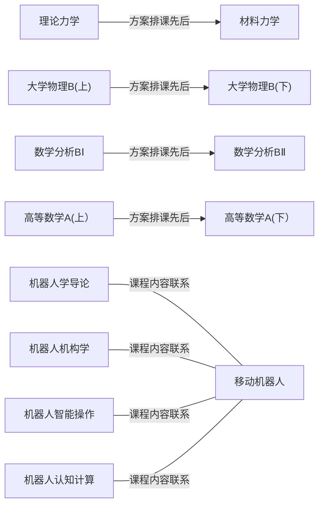

# 2025级智能科学与技术本博融通培养方案（智能机器人与先进制造领军人才班）

智能机器人与先进制造创新学院 · 智能科学与技术(智能机器人领军人才班) · 方案 97216 · 78 个不同课程或科研条目。

[官方 Word](../originals/plan-97216.docx) · [教务详情](https://fdjwgl.fudan.edu.cn/manager/bizType/2/major-program-search/info/97216?skipAuth=1) · [方案快照](../raw/plan-97216.json.gz) · [年级目录](../README.md)

## 修读导读

- **建议先学**　《理论力学》（`AAST20013`） → 《材料力学》（`AAST20009`）。静力学分析有助于理解构件受力。方案分别列在第3、4学期。

- **可以对照着读**　《机器人学导论》（`AIS410007`）与《移动机器人》（`IST60007`）。两门课的题名都涉及机器人。围绕一个运动任务，比较系统如何描述状态、感知变化和产生动作。

- **查模块选课**　《概率论与数理统计》（`AAST20012`）、《模拟与数字电路》（`IST30008`）列在“专业核心教育课程”中。原表见 `/courseModules/9`。

## 课程关系图

图中展示部分关系。下表保留全部已建立的课程对，来源位置使用本方案 JSON Pointer。

## 先修与内容联系

| 类型 | 起点 | 终点 | 依据 | 原表定位 |
| --- | --- | --- | --- | --- |
| 建议学习顺序 | 理论力学 (AAST20013) | 材料力学 (AAST20009) | 静力学分析有助于理解构件受力。  | `/courseModules/9/planCourses/1`、`/courseModules/9/planCourses/6` |
| 建议学习顺序 | 数学分析BⅠ (MATH10012) | 数学分析BⅡ (MATH10013) | 同方案的课程题名具有连续分册或序号。  | `/courseModules/7/planCourses/0`、`/courseModules/7/planCourses/1` |
| 建议学习顺序 | 高等数学A(上） (MATH10015) | 高等数学A(下） (MATH10016) | 同方案的课程题名具有连续分册或序号。  | `/courseModules/8/planCourses/0`、`/courseModules/8/planCourses/1` |
| 建议学习顺序 | 大学物理B(上) (PHYS10003) | 大学物理B(下) (PHYS10004) | 同方案的课程题名具有连续分册或序号。  | `/courseModules/6/planCourses/1`、`/courseModules/6/planCourses/2` |
| 方案排课先后 | 理论力学 (AAST20013) | 材料力学 (AAST20009) | 同方案该课程全部明确数字学期均早于后者。  | `/courseModules/9/planCourses/1`、`/courseModules/9/planCourses/6` |
| 方案排课先后 | 数学分析BⅠ (MATH10012) | 数学分析BⅡ (MATH10013) | 同方案该课程全部明确数字学期均早于后者。  | `/courseModules/7/planCourses/0`、`/courseModules/7/planCourses/1` |
| 方案排课先后 | 高等数学A(上） (MATH10015) | 高等数学A(下） (MATH10016) | 同方案该课程全部明确数字学期均早于后者。  | `/courseModules/8/planCourses/0`、`/courseModules/8/planCourses/1` |
| 方案排课先后 | 大学物理B(上) (PHYS10003) | 大学物理B(下) (PHYS10004) | 同方案该课程全部明确数字学期均早于后者。  | `/courseModules/6/planCourses/1`、`/courseModules/6/planCourses/2` |
| 课程内容联系 | 机器人学导论 (AIS410007) | 移动机器人 (IST60007) | 本方案两门课程的题名均含“机器人”，可据此对照这一主题。  | `/courseModules/9/planCourses/8`、`/courseModules/18/planCourses/2` |
| 课程内容联系 | 机器人认知计算 (FAET737026) | 移动机器人 (IST60007) | 本方案两门课程的题名均含“机器人”，可据此对照这一主题。  | `/courseModules/17/planCourses/4`、`/courseModules/18/planCourses/2` |
| 课程内容联系 | 机器人智能操作 (IST40005) | 移动机器人 (IST60007) | 本方案两门课程的题名均含“机器人”，可据此对照这一主题。  | `/courseModules/18/planCourses/3`、`/courseModules/18/planCourses/2` |
| 课程内容联系 | 机器人机构学 (IST60006) | 移动机器人 (IST60007) | 本方案两门课程的题名均含“机器人”，可据此对照这一主题。  | `/courseModules/15/planCourses/2`、`/courseModules/18/planCourses/2` |

本次未从可定位的明确表述中确认课程对课程预修。学期安排、系列分册与编辑建议均保留各自的依据。

## 按原方案模块阅读

同一模块展示原表中的课程归属。模块内课程之间的先后仍须逐项查阅。

- **工学基础课程**　线性代数、程序设计、大学物理B(上)、大学物理B(下)（原表模块 6）
- **数学分析B**　数学分析BⅠ、数学分析BⅡ（原表模块 7）
- **高等数学A**　高等数学A(上）、高等数学A(下）（原表模块 8）
- **主修方向：具身智能**　自然语言处理与大语言模型、可信大模型、计算机视觉、神经网络与深度学习、计算机原理与体系结构、随机过程、智能人机交互系统、具身智能与控制工程、物理建模理论及机器人仿真应用、具身智能力学（原表模块 14）
- **辅修方向：未来机器人**　弹性力学、数据驱动力学前沿选讲、机械振动、现代数字信号处理、工业机器人与智能制造、先进控制技术、微纳米机器人技术、机器人机构学、机械设计、先进机器人与自动化（原表模块 15）
- **主修方向：具身智能**　多智能体系统及应用、专业英语与科技写作、机器人认知计算、群体智能理论与应用、跨媒体智能计算、脑机智能学、计算神经学、机器人视觉感知与检测（原表模块 17）
- **辅修方向：未来机器人**　智柔体导论、现代智能控制理论、机器人智能操作、电机学、移动机器人、高等机构学、精密运动系统动力学、非线性动力学(工研院)、现代控制理论、柔性机器人技术（原表模块 18）
- **主修方向：未来机器人**　弹性力学、神经网络与深度学习、数据驱动力学前沿选讲、机械振动、现代数字信号处理、工业机器人与智能制造、先进控制技术、微纳米机器人技术、机器人机构学、机械设计、先进机器人与自动化（原表模块 21）
- **辅修方向：具身智能**　自然语言处理与大语言模型、可信大模型、计算机视觉、计算机原理与体系结构、随机过程、智能人机交互系统、具身智能与控制工程、物理建模理论及机器人仿真应用、具身智能力学（原表模块 22）
- **主修方向：未来机器人**　智柔体导论、现代智能控制理论、专业英语与科技写作、机器人智能操作、电机学、移动机器人、高等机构学、精密运动系统动力学、非线性动力学(工研院)、现代控制理论、柔性机器人技术（原表模块 24）
- **辅修方向：具身智能**　多智能体系统及应用、机器人认知计算、群体智能理论与应用、跨媒体智能计算、脑机智能学、计算神经学、机器人视觉感知与检测（原表模块 25）

## 课程表

同一课程在不同模块分别出现时，按原表逐行列出。季节字段保留原值。

| 课程 | 代码 | 学分 | 学期 | 模块 |
| --- | --- | ---: | --- | --- |
| 线性代数 | CS10003 | 3.0 | AUTUMN | 培养方案 / 专业培养课程 / 学科基础课程 / 工学基础课程 |
| 大学物理B(上) | PHYS10003 | 4.0 | 第1学期 | 培养方案 / 专业培养课程 / 学科基础课程 / 工学基础课程 |
| 大学物理B(下) | PHYS10004 | 4.0 | 第2学期 | 培养方案 / 专业培养课程 / 学科基础课程 / 工学基础课程 |
| 程序设计 | CS10004 | 4.0 | 第1学期 | 培养方案 / 专业培养课程 / 学科基础课程 / 工学基础课程 |
| 数学分析BⅠ | MATH10012 | 5.0 | 第1学期 | 培养方案 / 专业培养课程 / 学科基础课程 / 工学基础课程 / 数学分析B |
| 数学分析BⅡ | MATH10013 | 5.0 | 第2学期 | 培养方案 / 专业培养课程 / 学科基础课程 / 工学基础课程 / 数学分析B |
| 高等数学A(上） | MATH10015 | 5.0 | 第1学期 | 培养方案 / 专业培养课程 / 学科基础课程 / 工学基础课程 / 高等数学A |
| 高等数学A(下） | MATH10016 | 5.0 | 第2学期 | 培养方案 / 专业培养课程 / 学科基础课程 / 工学基础课程 / 高等数学A |
| 概率论与数理统计 | AAST20012 | 3.0 | 第3学期 | 培养方案 / 专业培养课程 / 专业核心教育课程 |
| 理论力学 | AAST20013 | 4.0 | 第3学期 | 培养方案 / 专业培养课程 / 专业核心教育课程 |
| 模拟与数字电路 | IST30008 | 4.0 | 第3学期 | 培养方案 / 专业培养课程 / 专业核心教育课程 |
| 工程图学及应用 | EST40010 | 2.0 | 第3学期 | 培养方案 / 专业培养课程 / 专业核心教育课程 |
| 智能科学的数学基础 | IST30006 | 4.0 | 第3学期 | 培养方案 / 专业培养课程 / 专业核心教育课程 |
| 数据结构与算法设计 | EST30006 | 4.0 | 第4学期 | 培养方案 / 专业培养课程 / 专业核心教育课程 |
| 材料力学 | AAST20009 | 3.0 | 第4学期 | 培养方案 / 专业培养课程 / 专业核心教育课程 |
| 信号与系统 | EST20007 | 4.0 | 第4学期 | 培养方案 / 专业培养课程 / 专业核心教育课程 |
| 机器人学导论 | AIS410007 | 4.0 | 第4学期 | 培养方案 / 专业培养课程 / 专业核心教育课程 |
| 自动控制原理 | IST50018 | 4.0 | 第5学期 | 培养方案 / 专业培养课程 / 专业核心教育课程 |
| 矩阵论 | MATH40003 | 3.0 | 第7学期 | 培养方案 / 专业培养课程 / 专业核心教育课程 |
| 高级深度学习 | IST50009 | 3.0 | 第7学期 | 培养方案 / 专业培养课程 / 专业核心教育课程 |
| 高等数理方法 | AAST50028 | 3.0 | 第8学期 | 培养方案 / 专业培养课程 / 专业核心教育课程 |
| 神经网络与深度学习 | CS60010 | 3.0 | 第5学期 | 培养方案 / 专业进阶路径（具身智能方向） / 专业进阶模块I / 主修方向：具身智能 |
| 随机过程 | EST30008 | 3.0 | 第5学期 | 培养方案 / 专业进阶路径（具身智能方向） / 专业进阶模块I / 主修方向：具身智能 |
| 具身智能力学 | MECH20004 | 2.0 | 第5学期 | 培养方案 / 专业进阶路径（具身智能方向） / 专业进阶模块I / 主修方向：具身智能 |
| 自然语言处理与大语言模型 | AIE410002 | 3.0 | 第6学期 | 培养方案 / 专业进阶路径（具身智能方向） / 专业进阶模块I / 主修方向：具身智能 |
| 计算机视觉 | CS30034 | 3.0 | 第6学期 | 培养方案 / 专业进阶路径（具身智能方向） / 专业进阶模块I / 主修方向：具身智能 |
| 计算机原理与体系结构 | EST30007 | 4.0 | 第6学期 | 培养方案 / 专业进阶路径（具身智能方向） / 专业进阶模块I / 主修方向：具身智能 |
| 可信大模型 | AIS631005 | 3.0 | 第7学期 | 培养方案 / 专业进阶路径（具身智能方向） / 专业进阶模块I / 主修方向：具身智能 |
| 智能人机交互系统 | IST30004 | 3.0 | 第7学期 | 培养方案 / 专业进阶路径（具身智能方向） / 专业进阶模块I / 主修方向：具身智能 |
| 具身智能与控制工程 | IST50002 | 3.0 | 第7学期 | 培养方案 / 专业进阶路径（具身智能方向） / 专业进阶模块I / 主修方向：具身智能 |
| 物理建模理论及机器人仿真应用 | IST50015 | 2.0 | 第8学期 | 培养方案 / 专业进阶路径（具身智能方向） / 专业进阶模块I / 主修方向：具身智能 |
| 弹性力学 | AAST30043 | 3.0 | 第5学期 | 培养方案 / 专业进阶路径（具身智能方向） / 专业进阶模块I / 辅修方向：未来机器人 |
| 机械振动 | IST40007 | 3.0 | 第5学期 | 培养方案 / 专业进阶路径（具身智能方向） / 专业进阶模块I / 辅修方向：未来机器人 |
| 机器人机构学 | IST60006 | 3.0 | 第6学期 | 培养方案 / 专业进阶路径（具身智能方向） / 专业进阶模块I / 辅修方向：未来机器人 |
| 机械设计 | IST70007 | 3.0 | 第5学期 | 培养方案 / 专业进阶路径（具身智能方向） / 专业进阶模块I / 辅修方向：未来机器人 |
| 现代数字信号处理 | IST40009 | 3.0 | 第7学期 | 培养方案 / 专业进阶路径（具身智能方向） / 专业进阶模块I / 辅修方向：未来机器人 |
| 数据驱动力学前沿选讲 | IST40003 | 2.0 | 第7学期 | 培养方案 / 专业进阶路径（具身智能方向） / 专业进阶模块I / 辅修方向：未来机器人 |
| 先进机器人与自动化 | IST70008 | 3.0 | 第7学期 | 培养方案 / 专业进阶路径（具身智能方向） / 专业进阶模块I / 辅修方向：未来机器人 |
| 工业机器人与智能制造 | IST50012 | 2.0 | 第8学期 | 培养方案 / 专业进阶路径（具身智能方向） / 专业进阶模块I / 辅修方向：未来机器人 |
| 微纳米机器人技术 | IST60001 | 3.0 | 第8学期 | 培养方案 / 专业进阶路径（具身智能方向） / 专业进阶模块I / 辅修方向：未来机器人 |
| 先进控制技术 | IST50017 | 2.0 | 第8学期 | 培养方案 / 专业进阶路径（具身智能方向） / 专业进阶模块I / 辅修方向：未来机器人 |
| 专业英语与科技写作 | EST60001 | 2.0 | 第7学期 | 培养方案 / 专业进阶路径（具身智能方向） / 专业进阶模块II / 主修方向：具身智能 |
| 跨媒体智能计算 | IST50008 | 3.0 | 第7学期 | 培养方案 / 专业进阶路径（具身智能方向） / 专业进阶模块II / 主修方向：具身智能 |
| 计算神经学 | IST70010 | 3.0 | 第7学期 | 培养方案 / 专业进阶路径（具身智能方向） / 专业进阶模块II / 主修方向：具身智能 |
| 脑机智能学 | IST50016 | 3.0 | 第7学期 | 培养方案 / 专业进阶路径（具身智能方向） / 专业进阶模块II / 主修方向：具身智能 |
| 机器人认知计算 | FAET737026 | 1.0 | 第7学期 | 培养方案 / 专业进阶路径（具身智能方向） / 专业进阶模块II / 主修方向：具身智能 |
| 机器人视觉感知与检测 | IST80002 | 3.0 | 第8学期 | 培养方案 / 专业进阶路径（具身智能方向） / 专业进阶模块II / 主修方向：具身智能 |
| 群体智能理论与应用 | IST40001 | 3.0 | 第8学期 | 培养方案 / 专业进阶路径（具身智能方向） / 专业进阶模块II / 主修方向：具身智能 |
| 多智能体系统及应用 | EIE70002 | 3.0 | 第8学期 | 培养方案 / 专业进阶路径（具身智能方向） / 专业进阶模块II / 主修方向：具身智能 |
| 电机学 | IST60005 | 3.0 | 第6学期 | 培养方案 / 专业进阶路径（具身智能方向） / 专业进阶模块II / 辅修方向：未来机器人 |
| 智柔体导论 | AAST40015 | 2.0 | 第6学期 | 培养方案 / 专业进阶路径（具身智能方向） / 专业进阶模块II / 辅修方向：未来机器人 |
| 移动机器人 | IST60007 | 3.0 | 第6学期 | 培养方案 / 专业进阶路径（具身智能方向） / 专业进阶模块II / 辅修方向：未来机器人 |
| 机器人智能操作 | IST40005 | 3.0 | 第7学期 | 培养方案 / 专业进阶路径（具身智能方向） / 专业进阶模块II / 辅修方向：未来机器人 |
| 柔性机器人技术 | ME70001 | 2.0 | 第7学期 | 培养方案 / 专业进阶路径（具身智能方向） / 专业进阶模块II / 辅修方向：未来机器人 |
| 高等机构学 | IST70002 | 3.0 | 第8学期 | 培养方案 / 专业进阶路径（具身智能方向） / 专业进阶模块II / 辅修方向：未来机器人 |
| 非线性动力学(工研院) | IST70006 | 3.0 | 第8学期 | 培养方案 / 专业进阶路径（具身智能方向） / 专业进阶模块II / 辅修方向：未来机器人 |
| 现代控制理论 | IST80001 | 3.0 | 第8学期 | 培养方案 / 专业进阶路径（具身智能方向） / 专业进阶模块II / 辅修方向：未来机器人 |
| 精密运动系统动力学 | IST70005 | 2.0 | 第9学期 | 培养方案 / 专业进阶路径（具身智能方向） / 专业进阶模块II / 辅修方向：未来机器人 |
| 现代智能控制理论 | CSSE40005 | 3.0 | 第9学期 | 培养方案 / 专业进阶路径（具身智能方向） / 专业进阶模块II / 辅修方向：未来机器人 |
| 神经网络与深度学习 | CS60010 | 3.0 | 第5学期 | 培养方案 / 专业进阶路径（未来机器人方向） / 专业进阶模块I / 主修方向：未来机器人 |
| 弹性力学 | AAST30043 | 3.0 | 第5学期 | 培养方案 / 专业进阶路径（未来机器人方向） / 专业进阶模块I / 主修方向：未来机器人 |
| 机械振动 | IST40007 | 3.0 | 第5学期 | 培养方案 / 专业进阶路径（未来机器人方向） / 专业进阶模块I / 主修方向：未来机器人 |
| 机器人机构学 | IST60006 | 3.0 | 第6学期 | 培养方案 / 专业进阶路径（未来机器人方向） / 专业进阶模块I / 主修方向：未来机器人 |
| 机械设计 | IST70007 | 3.0 | 第6学期 | 培养方案 / 专业进阶路径（未来机器人方向） / 专业进阶模块I / 主修方向：未来机器人 |
| 现代数字信号处理 | IST40009 | 3.0 | 第7学期 | 培养方案 / 专业进阶路径（未来机器人方向） / 专业进阶模块I / 主修方向：未来机器人 |
| 数据驱动力学前沿选讲 | IST40003 | 2.0 | 第7学期 | 培养方案 / 专业进阶路径（未来机器人方向） / 专业进阶模块I / 主修方向：未来机器人 |
| 先进机器人与自动化 | IST70008 | 3.0 | 第7学期 | 培养方案 / 专业进阶路径（未来机器人方向） / 专业进阶模块I / 主修方向：未来机器人 |
| 微纳米机器人技术 | IST60001 | 3.0 | 第8学期 | 培养方案 / 专业进阶路径（未来机器人方向） / 专业进阶模块I / 主修方向：未来机器人 |
| 工业机器人与智能制造 | IST50012 | 2.0 | 第8学期 | 培养方案 / 专业进阶路径（未来机器人方向） / 专业进阶模块I / 主修方向：未来机器人 |
| 先进控制技术 | IST50017 | 2.0 | 第8学期 | 培养方案 / 专业进阶路径（未来机器人方向） / 专业进阶模块I / 主修方向：未来机器人 |
| 随机过程 | EST30008 | 3.0 | 第5学期 | 培养方案 / 专业进阶路径（未来机器人方向） / 专业进阶模块I / 辅修方向：具身智能 |
| 具身智能力学 | MECH20004 | 2.0 | 第5学期 | 培养方案 / 专业进阶路径（未来机器人方向） / 专业进阶模块I / 辅修方向：具身智能 |
| 自然语言处理与大语言模型 | AIE410002 | 3.0 | 第6学期 | 培养方案 / 专业进阶路径（未来机器人方向） / 专业进阶模块I / 辅修方向：具身智能 |
| 计算机视觉 | CS30034 | 3.0 | 第6学期 | 培养方案 / 专业进阶路径（未来机器人方向） / 专业进阶模块I / 辅修方向：具身智能 |
| 计算机原理与体系结构 | EST30007 | 4.0 | 第6学期 | 培养方案 / 专业进阶路径（未来机器人方向） / 专业进阶模块I / 辅修方向：具身智能 |
| 可信大模型 | AIS631005 | 3.0 | 第7学期 | 培养方案 / 专业进阶路径（未来机器人方向） / 专业进阶模块I / 辅修方向：具身智能 |
| 具身智能与控制工程 | IST50002 | 3.0 | 第7学期 | 培养方案 / 专业进阶路径（未来机器人方向） / 专业进阶模块I / 辅修方向：具身智能 |
| 智能人机交互系统 | IST30004 | 3.0 | 第7学期 | 培养方案 / 专业进阶路径（未来机器人方向） / 专业进阶模块I / 辅修方向：具身智能 |
| 物理建模理论及机器人仿真应用 | IST50015 | 2.0 | 第8学期 | 培养方案 / 专业进阶路径（未来机器人方向） / 专业进阶模块I / 辅修方向：具身智能 |
| 专业英语与科技写作 | EST60001 | 2.0 | 第7学期 | 培养方案 / 专业进阶路径（未来机器人方向） / 专业进阶模块II / 主修方向：未来机器人 |
| 电机学 | IST60005 | 3.0 | 第6学期 | 培养方案 / 专业进阶路径（未来机器人方向） / 专业进阶模块II / 主修方向：未来机器人 |
| 智柔体导论 | AAST40015 | 2.0 | 第6学期 | 培养方案 / 专业进阶路径（未来机器人方向） / 专业进阶模块II / 主修方向：未来机器人 |
| 移动机器人 | IST60007 | 3.0 | 第6学期 | 培养方案 / 专业进阶路径（未来机器人方向） / 专业进阶模块II / 主修方向：未来机器人 |
| 机器人智能操作 | IST40005 | 3.0 | 第7学期 | 培养方案 / 专业进阶路径（未来机器人方向） / 专业进阶模块II / 主修方向：未来机器人 |
| 柔性机器人技术 | ME70001 | 2.0 | 第7学期 | 培养方案 / 专业进阶路径（未来机器人方向） / 专业进阶模块II / 主修方向：未来机器人 |
| 高等机构学 | IST70002 | 3.0 | 第8学期 | 培养方案 / 专业进阶路径（未来机器人方向） / 专业进阶模块II / 主修方向：未来机器人 |
| 非线性动力学(工研院) | IST70006 | 3.0 | 第8学期 | 培养方案 / 专业进阶路径（未来机器人方向） / 专业进阶模块II / 主修方向：未来机器人 |
| 现代控制理论 | IST80001 | 3.0 | 第8学期 | 培养方案 / 专业进阶路径（未来机器人方向） / 专业进阶模块II / 主修方向：未来机器人 |
| 精密运动系统动力学 | IST70005 | 2.0 | 第9学期 | 培养方案 / 专业进阶路径（未来机器人方向） / 专业进阶模块II / 主修方向：未来机器人 |
| 现代智能控制理论 | CSSE40005 | 3.0 | 第9学期 | 培养方案 / 专业进阶路径（未来机器人方向） / 专业进阶模块II / 主修方向：未来机器人 |
| 跨媒体智能计算 | IST50008 | 3.0 | 第7学期 | 培养方案 / 专业进阶路径（未来机器人方向） / 专业进阶模块II / 辅修方向：具身智能 |
| 计算神经学 | IST70010 | 3.0 | 第7学期 | 培养方案 / 专业进阶路径（未来机器人方向） / 专业进阶模块II / 辅修方向：具身智能 |
| 脑机智能学 | IST50016 | 3.0 | 第7学期 | 培养方案 / 专业进阶路径（未来机器人方向） / 专业进阶模块II / 辅修方向：具身智能 |
| 机器人认知计算 | FAET737026 | 1.0 | 第7学期 | 培养方案 / 专业进阶路径（未来机器人方向） / 专业进阶模块II / 辅修方向：具身智能 |
| 机器人视觉感知与检测 | IST80002 | 3.0 | 第8学期 | 培养方案 / 专业进阶路径（未来机器人方向） / 专业进阶模块II / 辅修方向：具身智能 |
| 多智能体系统及应用 | EIE70002 | 3.0 | 第8学期 | 培养方案 / 专业进阶路径（未来机器人方向） / 专业进阶模块II / 辅修方向：具身智能 |
| 群体智能理论与应用 | IST40001 | 3.0 | 第8学期 | 培养方案 / 专业进阶路径（未来机器人方向） / 专业进阶模块II / 辅修方向：具身智能 |
| 复芏计划(FDUROP) | 102 | 0.0 |  | 融合创新能力 |
| 研究生学术活动 | 4 | 0.0 |  | 融合创新能力 |
| 研究生实践活动 | 5 | 0.0 |  | 融合创新能力 |
| 国际交流 | 7 | 0.0 |  | 融合创新能力 |
| 博士学位论文开题 | 1 | 0.0 |  | 融合创新能力 |
| 博士生资格考核 | 2 | 0.0 |  | 融合创新能力 |
| 博士论文中期考核 | 3 | 0.0 |  | 融合创新能力 |
| 博士学位论文预审 | 6 | 0.0 |  | 融合创新能力 |
| 智能机器人与先进制造大讲堂 | IST10001 | 1.0 | 第1学期、第2学期、第3学期 | 融合创新能力 |
| 设计与制造 | GEEC30008 | 2.0 | 第4学期 | 融合创新能力 |
| 科研-实践训练1 | IST30001 | 1.0 | 第5学期 | 融合创新能力 |
| 毕业论文 | IST40004 | 3.0 | 第8学期 | 融合创新能力 |
| 基础物理实验 | PHYS10005 | 2.0 | 第2学期 | 融合创新能力 |
| 人工智能前沿探索实践 | AIE531001 | 3.0 | 第7学期 | 融合创新能力 |
| 科研-实践训练2 | IST30002 | 1.0 | 第6学期 | 融合创新能力 |
| 机电一体化系统设计 | IST70009 | 3.0 | 第7学期 | 融合创新能力 |
| 科研-实践训练3 | IST30003 | 1.0 | 第7学期 | 融合创新能力 |
| 机电系统原理及实践 | AAST30039 | 3.0 | 第7学期 | 融合创新能力 |
| 微机原理与接口实验 | EST40017 | 3.0 | 第4学期 | 融合创新能力 |
