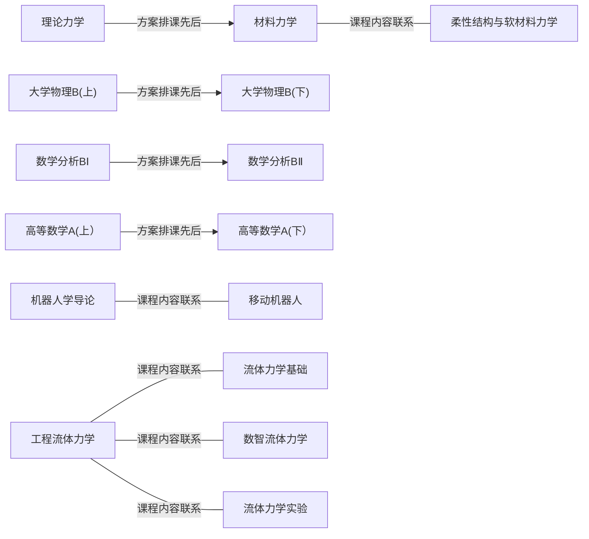

# 2025 工科试验班（智能机器人与先进制造领军人才班）（不区分方向）本博融通培养方案

智能机器人与先进制造创新学院 · 智能科学与技术 · 方案 98146 · 189 个不同课程或科研条目。

[官方 Word](../originals/plan-98146.docx) · [教务详情](https://fdjwgl.fudan.edu.cn/manager/bizType/2/major-program-search/info/98146?skipAuth=1) · [方案快照](../raw/plan-98146.json.gz) · [年级目录](../README.md)

## 课程关系图

图中展示部分关系。下表保留全部已建立的课程对，来源位置使用本方案 JSON Pointer。

## 先修与内容联系

| 类型 | 起点 | 终点 | 依据 | 原表定位 |
| --- | --- | --- | --- | --- |
| 建议学习顺序 | 理论力学 (AAST20013) | 材料力学 (AAST20009) | 静力学分析有助于理解构件受力。  | `/courseModules/10/planCourses/1`、`/courseModules/10/planCourses/5` |
| 建议学习顺序 | 数学分析BⅠ (MATH10012) | 数学分析BⅡ (MATH10013) | 同方案的课程题名具有连续分册或序号。  | `/courseModules/7/planCourses/0`、`/courseModules/7/planCourses/1` |
| 建议学习顺序 | 高等数学A(上） (MATH10015) | 高等数学A(下） (MATH10016) | 同方案的课程题名具有连续分册或序号。  | `/courseModules/8/planCourses/0`、`/courseModules/8/planCourses/1` |
| 建议学习顺序 | 大学物理B(上) (PHYS10003) | 大学物理B(下) (PHYS10004) | 同方案的课程题名具有连续分册或序号。  | `/courseModules/6/planCourses/1`、`/courseModules/6/planCourses/2` |
| 方案排课先后 | 理论力学 (AAST20013) | 材料力学 (AAST20009) | 同方案该课程全部明确数字学期均早于后者。  | `/courseModules/10/planCourses/1`、`/courseModules/10/planCourses/5` |
| 方案排课先后 | 数学分析BⅠ (MATH10012) | 数学分析BⅡ (MATH10013) | 同方案该课程全部明确数字学期均早于后者。  | `/courseModules/7/planCourses/0`、`/courseModules/7/planCourses/1` |
| 方案排课先后 | 高等数学A(上） (MATH10015) | 高等数学A(下） (MATH10016) | 同方案该课程全部明确数字学期均早于后者。  | `/courseModules/8/planCourses/0`、`/courseModules/8/planCourses/1` |
| 方案排课先后 | 大学物理B(上) (PHYS10003) | 大学物理B(下) (PHYS10004) | 同方案该课程全部明确数字学期均早于后者。  | `/courseModules/6/planCourses/1`、`/courseModules/6/planCourses/2` |
| 课程内容联系 | 工程流体力学 (AAST20006) | 流体力学实验 (AAST30001) | 本方案两门课程的题名均含“流体力学”，可据此对照这一主题。  | `/courseModules/14/planCourses/0`、`/courseModules/37/planCourses/21` |
| 课程内容联系 | 工程流体力学 (AAST20006) | 流体力学基础 (AAST30044) | 本方案两门课程的题名均含“流体力学”，可据此对照这一主题。  | `/courseModules/14/planCourses/0`、`/courseModules/15/planCourses/0` |
| 课程内容联系 | 工程流体力学 (AAST20006) | 计算流体力学 (AAST50016) | 本方案两门课程的题名均含“流体力学”，可据此对照这一主题。  | `/courseModules/14/planCourses/0`、`/courseModules/31/planCourses/2` |
| 课程内容联系 | 工程流体力学 (AAST20006) | 数智流体力学 (MECH30002) | 本方案两门课程的题名均含“流体力学”，可据此对照这一主题。  | `/courseModules/14/planCourses/0`、`/courseModules/23/planCourses/3` |
| 课程内容联系 | 材料力学 (AAST20009) | 柔性结构与软材料力学 (AAST70009) | 本方案两门课程的题名均含“材料力学”，可据此对照这一主题。  | `/courseModules/10/planCourses/5`、`/courseModules/30/planCourses/15` |
| 课程内容联系 | 工程热力学 (AAST30026) | 高等工程热力学 (AAST60011) | 本方案两门课程的题名均含“工程热力学”，可据此对照这一主题。  | `/courseModules/30/planCourses/3`、`/courseModules/31/planCourses/13` |
| 课程内容联系 | 空气动力学 (AAST30034) | 计算空气动力学 (AAST60007) | 本方案两门课程的题名均含“空气动力学”，可据此对照这一主题。  | `/courseModules/24/planCourses/0`、`/courseModules/24/planCourses/9` |
| 课程内容联系 | 空气动力学 (AAST30034) | 设计空气动力学 (AAST60010) | 本方案两门课程的题名均含“空气动力学”，可据此对照这一主题。  | `/courseModules/24/planCourses/0`、`/courseModules/14/planCourses/4` |
| 课程内容联系 | 人工智能前沿探索实践 (AIE531001) | 微分流形与人工智能 (IST50006) | 本方案两门课程的题名均含“人工智能”，可据此对照这一主题。  | `/courseModules/37/planCourses/11`、`/courseModules/30/planCourses/12` |
| 课程内容联系 | 机器人学导论 (AIS410007) | 移动机器人 (IST60007) | 本方案两门课程的题名均含“机器人”，可据此对照这一主题。  | `/courseModules/11/planCourses/1`、`/courseModules/26/planCourses/3` |
| 课程内容联系 | 基于人工智能方法的航空航天领域典型问题研究 (AIT310028) | 微分流形与人工智能 (IST50006) | 本方案两门课程的题名均含“人工智能”，可据此对照这一主题。  | `/courseModules/24/planCourses/12`、`/courseModules/30/planCourses/12` |
| 课程内容联系 | 集成电路装备原理与应用 (EIE60002) | 集成电路的分析与设计 (EST30010) | 本方案两门课程的题名均含“集成电路”，可据此对照这一主题。  | `/courseModules/21/planCourses/6`、`/courseModules/21/planCourses/3` |
| 课程内容联系 | 半导体薄膜基础 (EIE70001) | 半导体器件物理 (OPTI50019) | 本方案两门课程的题名均含“半导体”，可据此对照这一主题。  | `/courseModules/29/planCourses/8`、`/courseModules/22/planCourses/1` |
| 课程内容联系 | 模拟与数字电路实验 (EST40012) | 模拟与数字电路 (IST30008) | 题名显示相同主题的课程与实验、实践或实习。  | `/courseModules/37/planCourses/12`、`/courseModules/11/planCourses/0` |
| 课程内容联系 | 先进半导体制造分析技术 (EST50003) | 半导体器件物理 (OPTI50019) | 本方案两门课程的题名均含“半导体”，可据此对照这一主题。  | `/courseModules/21/planCourses/5`、`/courseModules/22/planCourses/1` |
| 课程内容联系 | 功率半导体封装概论 (EST60006) | 半导体器件物理 (OPTI50019) | 本方案两门课程的题名均含“半导体”，可据此对照这一主题。  | `/courseModules/21/planCourses/9`、`/courseModules/22/planCourses/1` |
| 课程内容联系 | 半导体材料基础 (EST70004) | 半导体器件物理 (OPTI50019) | 本方案两门课程的题名均含“半导体”，可据此对照这一主题。  | `/courseModules/28/planCourses/3`、`/courseModules/22/planCourses/1` |
| 课程内容联系 | 机器人认知计算 (FAET737026) | 移动机器人 (IST60007) | 本方案两门课程的题名均含“机器人”，可据此对照这一主题。  | `/courseModules/27/planCourses/4`、`/courseModules/26/planCourses/3` |
| 课程内容联系 | 机器人智能操作 (IST40005) | 移动机器人 (IST60007) | 本方案两门课程的题名均含“机器人”，可据此对照这一主题。  | `/courseModules/26/planCourses/4`、`/courseModules/26/planCourses/3` |
| 课程内容联系 | 微分流形与人工智能 (IST50006) | 计算力学与人工智能 (MECH60001) | 本方案两门课程的题名均含“人工智能”，可据此对照这一主题。  | `/courseModules/30/planCourses/12`、`/courseModules/23/planCourses/9` |
| 课程内容联系 | 机器人机构学 (IST60006) | 移动机器人 (IST60007) | 本方案两门课程的题名均含“机器人”，可据此对照这一主题。  | `/courseModules/19/planCourses/2`、`/courseModules/26/planCourses/3` |

本次未从可定位的明确表述中确认课程对课程预修。学期安排、系列分册与编辑建议均保留各自的依据。

## 按原方案模块阅读

同一模块展示原表中的课程归属。模块内课程之间的先后仍须逐项查阅。

- **工学基础课程**　线性代数、程序设计、大学物理B(上)、大学物理B(下)（原表模块 6）
- **数学分析B**　数学分析BⅠ、数学分析BⅡ（原表模块 7）
- **高等数学A**　高等数学A(上）、高等数学A(下）（原表模块 8）
- **未来机器人方向**　弹性力学、神经网络与深度学习、数据驱动力学前沿选讲、机械振动、现代数字信号处理、工业机器人与智能制造、先进控制技术、微纳米机器人技术、机器人机构学、机械设计、先进机器人与自动化（原表模块 19）
- **具身智能方向**　自然语言处理与大语言模型、可信大模型、计算机视觉、神经网络与深度学习、计算机原理与体系结构、随机过程、智能人机交互系统、具身智能与控制工程、物理建模理论及机器人仿真应用、具身智能力学（原表模块 20）
- **微纳制造方向**　集成电路装备原理与应用、电子材料与器件工艺、集成电路的分析与设计、固体物理导论、离子电子学、先进半导体制造分析技术、微纳制造理论和技术、工程材料电子基础、功率半导体封装概论、现代功率半导体器件基础、电磁场与电磁波A（原表模块 21）
- **智能光电方向**　光源技术与先进制造、智能传感与认知、光通信与激光雷达、智能光电系统、应用光学、电磁场与电磁波A、电力电子学、半导体器件物理、颜色信息科学、光电显示技术基础（原表模块 22）
- **数智力学方向**　计算方法与软件、智柔体导论、现代力学测量技术、机械振动、力学中的数智方法、矩阵论、数智力学导论、具身智能力学、数智固体力学基础、数智流体力学、智柔结构强度与稳定性、动力学与智能控制、智能流动稳定性、计算力学与人工智能（原表模块 23）
- **智能空天方向**　低空飞行器推进系统、飞行器总体设计、基于Matlab的工程分析、空气动力学、航空发动机原理、飞行仿真技术、低空飞行器设计基础、空天复杂系统建模与仿真、智能空天前沿技术、现代飞行控制技术、冲击动力学、高等大气飞行动力学、传感器和机载设备、旋翼气动设计基础、计算空气动力学、基于人工智能方法的航空航天领域典型问题研究（原表模块 24）
- **未来机器人方向**　智柔体导论、现代智能控制理论、专业英语与科技写作、机器人智能操作、自主智能机器人概述、电机学、移动机器人、精密运动系统动力学、现代控制理论、柔性机器人技术（原表模块 26）
- **具身智能方向**　专业英语与科技写作、机器人认知计算、群体智能理论与应用、跨媒体智能计算、脑机智能学、计算神经学、机器人视觉感知与检测（原表模块 27）
- **微纳制造方向**　视觉技术与参数化制造、专业英语与科技写作、微电子制造及可靠性、智能光电与先进制造前沿技术、半导体材料基础、仿生生物电子学、纳米机器人与纳米系统、数字孪生与故障诊断、现代控制理论、复合材料概论（原表模块 28）
- **智能光电方向**　半导体薄膜基础、智能照明、有机电子学、高等固态照明应用、专业英语与科技写作、宽禁带半导体器件及应用、轻质机器人设计、光电测试技术、现代光子学、智能光电驱动技术（原表模块 29）
- **数智力学方向**　工程热力学、基于Matlab的工程分析、智慧交通流体力学、粘弹性力学、张量分析与微分几何基础、板壳理论、流体物理概论、增材制造导论、智柔微纳结构与器件力学、几何力学、应用实变函数及泛函分析基础、柔性结构与软材料力学、高等计算流体力学、专业英语与科技写作、微分流形与人工智能、工程系统建模与深度学习、智能微流控技术、现代分析力学等19项（原表模块 30）
- **智能空天方向**　优化设计、工程材料、飞行器结构分析与设计、工程中的数学方法、航空发动机结构分析、航空结构智能可靠性设计、低空智联系统设计、微纳米流动与传热、计算流体力学、自修复飞行控制系统、高等工程热力学、现代飞机空气动力设计、专业英语与科技写作、流-固耦合振动（原表模块 31）

## 课程表

同一课程在不同模块分别出现时，按原表逐行列出。季节字段保留原值。

| 课程 | 代码 | 学分 | 学期 | 模块 |
| --- | --- | ---: | --- | --- |
| 线性代数 | CS10003 | 3.0 | AUTUMN | 培养方案 / 专业培养课程 / 学科基础课程 / 工学基础课程 |
| 大学物理B(上) | PHYS10003 | 4.0 | 第1学期 | 培养方案 / 专业培养课程 / 学科基础课程 / 工学基础课程 |
| 大学物理B(下) | PHYS10004 | 4.0 | 第2学期 | 培养方案 / 专业培养课程 / 学科基础课程 / 工学基础课程 |
| 程序设计 | CS10004 | 4.0 | 第1学期 | 培养方案 / 专业培养课程 / 学科基础课程 / 工学基础课程 |
| 数学分析BⅠ | MATH10012 | 5.0 | 第1学期 | 培养方案 / 专业培养课程 / 学科基础课程 / 工学基础课程 / 数学分析B |
| 数学分析BⅡ | MATH10013 | 5.0 | 第2学期 | 培养方案 / 专业培养课程 / 学科基础课程 / 工学基础课程 / 数学分析B |
| 高等数学A(上） | MATH10015 | 5.0 | 第1学期 | 培养方案 / 专业培养课程 / 学科基础课程 / 工学基础课程 / 高等数学A |
| 高等数学A(下） | MATH10016 | 5.0 | 第2学期 | 培养方案 / 专业培养课程 / 学科基础课程 / 工学基础课程 / 高等数学A |
| 概率论与数理统计 | AAST20012 | 3.0 | 第3学期 | 培养方案 / 专业培养课程 / 专业核心教育课程 / A组 |
| 理论力学 | AAST20013 | 4.0 | 第3学期 | 培养方案 / 专业培养课程 / 专业核心教育课程 / A组 |
| 工程图学及应用 | EST40010 | 2.0 | 第3学期 | 培养方案 / 专业培养课程 / 专业核心教育课程 / A组 |
| 智能科学的数学基础 | IST30006 | 4.0 | 第3学期 | 培养方案 / 专业培养课程 / 专业核心教育课程 / A组 |
| 数据结构与算法设计 | EST30006 | 4.0 | 第4学期 | 培养方案 / 专业培养课程 / 专业核心教育课程 / A组 |
| 材料力学 | AAST20009 | 3.0 | 第4学期 | 培养方案 / 专业培养课程 / 专业核心教育课程 / A组 |
| 信号与系统 | EST20007 | 4.0 | 第4学期 | 培养方案 / 专业培养课程 / 专业核心教育课程 / A组 |
| 自动控制原理 | IST50018 | 4.0 | 第5学期 | 培养方案 / 专业培养课程 / 专业核心教育课程 / A组 |
| 模拟与数字电路 | IST30008 | 4.0 | 第3学期 | 培养方案 / 专业培养课程 / 专业核心教育课程 / B组 |
| 机器人学导论 | AIS410007 | 4.0 | 第4学期 | 培养方案 / 专业培养课程 / 专业核心教育课程 / B组 |
| 矩阵论 | MATH40003 | 3.0 | 第7学期 | 培养方案 / 专业培养课程 / 专业核心教育课程 / C组 |
| 高级深度学习 | IST50009 | 3.0 | 第7学期 | 培养方案 / 专业培养课程 / 专业核心教育课程 / C组 |
| 高等数理方法 | AAST50028 | 3.0 | 第8学期 | 培养方案 / 专业培养课程 / 专业核心教育课程 / C组 |
| 光电子学基础 | EIE60001 | 3.0 | 第7学期 | 培养方案 / 专业培养课程 / 专业核心教育课程 / D组 |
| 先进制造技术 | IST40002 | 3.0 | 第7学期 | 培养方案 / 专业培养课程 / 专业核心教育课程 / D组 |
| 现代电力电子学 | EST40001 | 3.0 | 第8学期 | 培养方案 / 专业培养课程 / 专业核心教育课程 / D组 |
| 工程流体力学 | AAST20006 | 3.0 | 第4学期 | 培养方案 / 专业培养课程 / 专业核心教育课程 / E组 |
| 数理方程 | AAST20002 | 3.0 | 第4学期 | 培养方案 / 专业培养课程 / 专业核心教育课程 / E组 |
| 飞行力学与飞行控制 | AAST30013 | 3.0 | 第5学期 | 培养方案 / 专业培养课程 / 专业核心教育课程 / E组 |
| 高等数理方法 | AAST50028 | 3.0 | 第8学期 | 培养方案 / 专业培养课程 / 专业核心教育课程 / E组 |
| 设计空气动力学 | AAST60010 | 2.0 | 第7学期 | 培养方案 / 专业培养课程 / 专业核心教育课程 / E组 |
| 航空器智能设计 | AIT631014 | 3.0 | 第7学期 | 培养方案 / 专业培养课程 / 专业核心教育课程 / E组 |
| 流体力学基础 | AAST30044 | 3.0 | 第4学期 | 培养方案 / 专业培养课程 / 专业核心教育课程 / F组 |
| 数理方程 | AAST20002 | 3.0 | 第4学期 | 培养方案 / 专业培养课程 / 专业核心教育课程 / F组 |
| 弹性力学 | AAST30043 | 3.0 | 第5学期 | 培养方案 / 专业培养课程 / 专业核心教育课程 / F组 |
| 连续介质力学 | MECH40003 | 3.0 | 第7学期 | 培养方案 / 专业培养课程 / 专业核心教育课程 / F组 |
| 高等数理方法 | AAST50028 | 3.0 | 第8学期 | 培养方案 / 专业培养课程 / 专业核心教育课程 / F组 |
| 有限元方法 | MECH40002 | 2.0 | 第8学期 | 培养方案 / 专业培养课程 / 专业核心教育课程 / F组 |
| 弹性力学 | AAST30043 | 3.0 | 第5学期 | 培养方案 / 专业进阶模块I / 未来机器人方向 |
| 机械振动 | IST40007 | 3.0 | 第5学期 | 培养方案 / 专业进阶模块I / 未来机器人方向 |
| 机器人机构学 | IST60006 | 3.0 | 第6学期 | 培养方案 / 专业进阶模块I / 未来机器人方向 |
| 机械设计 | IST70007 | 3.0 | 第6学期 | 培养方案 / 专业进阶模块I / 未来机器人方向 |
| 现代数字信号处理 | IST40009 | 3.0 | 第7学期 | 培养方案 / 专业进阶模块I / 未来机器人方向 |
| 数据驱动力学前沿选讲 | IST40003 | 2.0 | 第7学期 | 培养方案 / 专业进阶模块I / 未来机器人方向 |
| 先进机器人与自动化 | IST70008 | 3.0 | 第7学期 | 培养方案 / 专业进阶模块I / 未来机器人方向 |
| 工业机器人与智能制造 | IST50012 | 2.0 | 第8学期 | 培养方案 / 专业进阶模块I / 未来机器人方向 |
| 神经网络与深度学习 | CS60010 | 3.0 | 第5学期 | 培养方案 / 专业进阶模块I / 未来机器人方向 |
| 微纳米机器人技术 | IST60001 | 3.0 | 第8学期 | 培养方案 / 专业进阶模块I / 未来机器人方向 |
| 先进控制技术 | IST50017 | 2.0 | 第8学期 | 培养方案 / 专业进阶模块I / 未来机器人方向 |
| 神经网络与深度学习 | CS60010 | 3.0 | 第5学期 | 培养方案 / 专业进阶模块I / 具身智能方向 |
| 随机过程 | EST30008 | 3.0 | 第4学期 | 培养方案 / 专业进阶模块I / 具身智能方向 |
| 具身智能力学 | MECH20004 | 2.0 | 第5学期 | 培养方案 / 专业进阶模块I / 具身智能方向 |
| 自然语言处理与大语言模型 | AIE410002 | 3.0 | 第6学期 | 培养方案 / 专业进阶模块I / 具身智能方向 |
| 计算机视觉 | CS30034 | 3.0 | 第6学期 | 培养方案 / 专业进阶模块I / 具身智能方向 |
| 计算机原理与体系结构 | EST30007 | 4.0 | 第6学期 | 培养方案 / 专业进阶模块I / 具身智能方向 |
| 可信大模型 | AIS631005 | 3.0 | 第7学期 | 培养方案 / 专业进阶模块I / 具身智能方向 |
| 具身智能与控制工程 | IST50002 | 3.0 | 第7学期 | 培养方案 / 专业进阶模块I / 具身智能方向 |
| 智能人机交互系统 | IST30004 | 3.0 | 第7学期 | 培养方案 / 专业进阶模块I / 具身智能方向 |
| 物理建模理论及机器人仿真应用 | IST50015 | 2.0 | 第8学期 | 培养方案 / 专业进阶模块I / 具身智能方向 |
| 电磁场与电磁波A | OPTI30004 | 3.0 | 第5学期 | 培养方案 / 专业进阶模块I / 微纳制造方向 |
| 固体物理导论 | EST30011 | 4.0 | 第5学期 | 培养方案 / 专业进阶模块I / 微纳制造方向 |
| 电子材料与器件工艺 | EST30009 | 2.0 | 第6学期 | 培养方案 / 专业进阶模块I / 微纳制造方向 |
| 集成电路的分析与设计 | EST30010 | 3.0 | 第6学期 | 培养方案 / 专业进阶模块I / 微纳制造方向 |
| 微纳制造理论和技术 | EST50007 | 2.0 | 第7学期 | 培养方案 / 专业进阶模块I / 微纳制造方向 |
| 先进半导体制造分析技术 | EST50003 | 3.0 | 第7学期 | 培养方案 / 专业进阶模块I / 微纳制造方向 |
| 集成电路装备原理与应用 | EIE60002 | 3.0 | 第7学期 | 培养方案 / 专业进阶模块I / 微纳制造方向 |
| 工程材料电子基础 | EST60002 | 2.0 | 第7学期 | 培养方案 / 专业进阶模块I / 微纳制造方向 |
| 现代功率半导体器件基础 | EST60007 | 2.0 | 第7学期 | 培养方案 / 专业进阶模块I / 微纳制造方向 |
| 功率半导体封装概论 | EST60006 | 2.0 | 第7学期 | 培养方案 / 专业进阶模块I / 微纳制造方向 |
| 离子电子学 | EST40038 | 2.0 | 第5学期 | 培养方案 / 专业进阶模块I / 微纳制造方向 |
| 电磁场与电磁波A | OPTI30004 | 3.0 | 第5学期 | 培养方案 / 专业进阶模块I / 智能光电方向 |
| 半导体器件物理 | OPTI50019 | 3.0 | 第6学期 | 培养方案 / 专业进阶模块I / 智能光电方向 |
| 应用光学 | OPTI20001 | 3.0 | 第5学期 | 培养方案 / 专业进阶模块I / 智能光电方向 |
| 电力电子学 | OPTI50005 | 3.0 | 第5学期 | 培养方案 / 专业进阶模块I / 智能光电方向 |
| 光电显示技术基础 | OPTI50024 | 3.0 | 第5学期 | 培养方案 / 专业进阶模块I / 智能光电方向 |
| 智能传感与认知 | EST50005 | 2.0 | 第6学期 | 培养方案 / 专业进阶模块I / 智能光电方向 |
| 颜色信息科学 | OPTI50023 | 2.0 | 第6学期 | 培养方案 / 专业进阶模块I / 智能光电方向 |
| 光通信与激光雷达 | IST50003 | 3.0 | 第6学期 | 培养方案 / 专业进阶模块I / 智能光电方向 |
| 光源技术与先进制造 | EST50004 | 3.0 | 第7学期 | 培养方案 / 专业进阶模块I / 智能光电方向 |
| 智能光电系统 | IST50004 | 2.0 | 第7学期 | 培养方案 / 专业进阶模块I / 智能光电方向 |
| 数智力学导论 | MECH20002 | 2.0 | 第4学期 | 培养方案 / 专业进阶模块I / 数智力学方向 |
| 计算方法与软件 | AAST20003 | 3.0 | 第4学期 | 培养方案 / 专业进阶模块I / 数智力学方向 |
| 智柔体导论 | AAST40015 | 2.0 | 第4学期 | 培养方案 / 专业进阶模块I / 数智力学方向 |
| 数智流体力学 | MECH30002 | 3.0 | 第5学期 | 培养方案 / 专业进阶模块I / 数智力学方向 |
| 机械振动 | IST40007 | 3.0 | 第5学期 | 培养方案 / 专业进阶模块I / 数智力学方向 |
| 具身智能力学 | MECH20004 | 2.0 | 第5学期 | 培养方案 / 专业进阶模块I / 数智力学方向 |
| 数智固体力学基础 | MECH30001 | 3.0 | 第6学期 | 培养方案 / 专业进阶模块I / 数智力学方向 |
| 动力学与智能控制 | MECH30004 | 3.0 | 第6学期 | 培养方案 / 专业进阶模块I / 数智力学方向 |
| 智能流动稳定性 | MECH40004 | 3.0 | 第7学期 | 培养方案 / 专业进阶模块I / 数智力学方向 |
| 计算力学与人工智能 | MECH60001 | 3.0 | 第7学期 | 培养方案 / 专业进阶模块I / 数智力学方向 |
| 智柔结构强度与稳定性 | MECH30003 | 3.0 | 第7学期 | 培养方案 / 专业进阶模块I / 数智力学方向 |
| 矩阵论 | MATH40003 | 3.0 | 第7学期 | 培养方案 / 专业进阶模块I / 数智力学方向 |
| 力学中的数智方法 | IST70001 | 3.0 | 第8学期 | 培养方案 / 专业进阶模块I / 数智力学方向 |
| 现代力学测量技术 | AAST50024 | 3.0 | 第8学期 | 培养方案 / 专业进阶模块I / 数智力学方向 |
| 空气动力学 | AAST30034 | 3.0 | 第5学期 | 培养方案 / 专业进阶模块I / 智能空天方向 |
| 基于Matlab的工程分析 | AAST30028 | 2.0 | 第5学期 | 培养方案 / 专业进阶模块I / 智能空天方向 |
| 飞行器总体设计 | AAST30022 | 3.0 | 第6学期 | 培养方案 / 专业进阶模块I / 智能空天方向 |
| 航空发动机原理 | AAST30036 | 3.0 | 第6学期 | 培养方案 / 专业进阶模块I / 智能空天方向 |
| 飞行仿真技术 | AAST30042 | 2.0 | 第6学期 | 培养方案 / 专业进阶模块I / 智能空天方向 |
| 智能空天前沿技术 | AAST50005 | 2.0 | 第7学期 | 培养方案 / 专业进阶模块I / 智能空天方向 |
| 传感器和机载设备 | AAST60002 | 3.0 | 第7学期 | 培养方案 / 专业进阶模块I / 智能空天方向 |
| 低空飞行器推进系统 | AAST30003 | 3.0 | 第7学期 | 培养方案 / 专业进阶模块I / 智能空天方向 |
| 冲击动力学 | AAST50021 | 3.0 | 第7学期 | 培养方案 / 专业进阶模块I / 智能空天方向 |
| 计算空气动力学 | AAST60007 | 3.0 | 第7学期 | 培养方案 / 专业进阶模块I / 智能空天方向 |
| 高等大气飞行动力学 | AAST50027 | 3.0 | 第7学期 | 培养方案 / 专业进阶模块I / 智能空天方向 |
| 现代飞行控制技术 | AAST50018 | 3.0 | 第7学期 | 培养方案 / 专业进阶模块I / 智能空天方向 |
| 基于人工智能方法的航空航天领域典型问题研究 | AIT310028 | 2.0 | 第7学期 | 培养方案 / 专业进阶模块I / 智能空天方向 |
| 空天复杂系统建模与仿真 | AAST50004 | 3.0 | 第7学期 | 培养方案 / 专业进阶模块I / 智能空天方向 |
| 低空飞行器设计基础 | AAST50003 | 3.0 | 第7学期 | 培养方案 / 专业进阶模块I / 智能空天方向 |
| 旋翼气动设计基础 | AAST60003 | 3.0 | 第8学期 | 培养方案 / 专业进阶模块I / 智能空天方向 |
| 工业智能感知与具身操作 | EIE70019 | 3.0 |  | 培养方案 / 专业进阶模块II |
| 超材料波动力学 | AAST60018 | 2.0 |  | 培养方案 / 专业进阶模块II |
| 专业英语与科技写作 | EST60001 | 2.0 | 第7学期 | 培养方案 / 专业进阶模块II / 未来机器人方向 |
| 电机学 | IST60005 | 3.0 | 第6学期 | 培养方案 / 专业进阶模块II / 未来机器人方向 |
| 智柔体导论 | AAST40015 | 2.0 | 第6学期 | 培养方案 / 专业进阶模块II / 未来机器人方向 |
| 移动机器人 | IST60007 | 3.0 | 第6学期 | 培养方案 / 专业进阶模块II / 未来机器人方向 |
| 机器人智能操作 | IST40005 | 3.0 | 第7学期 | 培养方案 / 专业进阶模块II / 未来机器人方向 |
| 柔性机器人技术 | ME70001 | 2.0 | 第7学期 | 培养方案 / 专业进阶模块II / 未来机器人方向 |
| 现代控制理论 | IST80001 | 3.0 | 第8学期 | 培养方案 / 专业进阶模块II / 未来机器人方向 |
| 精密运动系统动力学 | IST70005 | 2.0 | 第9学期 | 培养方案 / 专业进阶模块II / 未来机器人方向 |
| 现代智能控制理论 | CSSE40005 | 3.0 | 第9学期 | 培养方案 / 专业进阶模块II / 未来机器人方向 |
| 自主智能机器人概述 | IST40012 | 3.0 |  | 培养方案 / 专业进阶模块II / 未来机器人方向 |
| 专业英语与科技写作 | EST60001 | 2.0 | 第7学期 | 培养方案 / 专业进阶模块II / 具身智能方向 |
| 跨媒体智能计算 | IST50008 | 3.0 | 第7学期 | 培养方案 / 专业进阶模块II / 具身智能方向 |
| 计算神经学 | IST70010 | 3.0 | 第7学期 | 培养方案 / 专业进阶模块II / 具身智能方向 |
| 脑机智能学 | IST50016 | 3.0 | 第7学期 | 培养方案 / 专业进阶模块II / 具身智能方向 |
| 机器人认知计算 | FAET737026 | 1.0 | 第7学期 | 培养方案 / 专业进阶模块II / 具身智能方向 |
| 机器人视觉感知与检测 | IST80002 | 3.0 | 第8学期 | 培养方案 / 专业进阶模块II / 具身智能方向 |
| 群体智能理论与应用 | IST40001 | 3.0 | 第8学期 | 培养方案 / 专业进阶模块II / 具身智能方向 |
| 专业英语与科技写作 | EST60001 | 2.0 | 第7学期 | 培养方案 / 专业进阶模块II / 微纳制造方向 |
| 智能光电与先进制造前沿技术 | EST70002 | 2.0 | 第8学期 | 培养方案 / 专业进阶模块II / 微纳制造方向 |
| 数字孪生与故障诊断 | IST50007 | 2.0 | 第7学期 | 培养方案 / 专业进阶模块II / 微纳制造方向 |
| 半导体材料基础 | EST70004 | 2.0 | 第7学期 | 培养方案 / 专业进阶模块II / 微纳制造方向 |
| 微电子制造及可靠性 | EST60005 | 2.0 | 第7学期 | 培养方案 / 专业进阶模块II / 微纳制造方向 |
| 复合材料概论 | MASE70002 | 2.0 | 第7学期 | 培养方案 / 专业进阶模块II / 微纳制造方向 |
| 视觉技术与参数化制造 | EST50009 | 2.0 | 第8学期 | 培养方案 / 专业进阶模块II / 微纳制造方向 |
| 纳米机器人与纳米系统 | IST50001 | 2.0 | 第8学期 | 培养方案 / 专业进阶模块II / 微纳制造方向 |
| 现代控制理论 | IST80001 | 3.0 | 第9学期 | 培养方案 / 专业进阶模块II / 微纳制造方向 |
| 仿生生物电子学 | EST70065 | 2.0 |  | 培养方案 / 专业进阶模块II / 微纳制造方向 |
| 专业英语与科技写作 | EST60001 | 2.0 | 第7学期 | 培养方案 / 专业进阶模块II / 智能光电方向 |
| 光电测试技术 | OPTI30002 | 3.0 | 第7学期 | 培养方案 / 专业进阶模块II / 智能光电方向 |
| 智能光电驱动技术 | OPTI50025 | 3.0 | 第7学期 | 培养方案 / 专业进阶模块II / 智能光电方向 |
| 宽禁带半导体器件及应用 | EST60025 | 2.0 | 第7学期 | 培养方案 / 专业进阶模块II / 智能光电方向 |
| 有机电子学 | EST50006 | 3.0 | 第7学期 | 培养方案 / 专业进阶模块II / 智能光电方向 |
| 智能照明 | EST50002 | 2.0 | 第8学期 | 培养方案 / 专业进阶模块II / 智能光电方向 |
| 高等固态照明应用 | EST50034 | 3.0 | 第8学期 | 培养方案 / 专业进阶模块II / 智能光电方向 |
| 轻质机器人设计 | MASE50002 | 2.0 | 第8学期 | 培养方案 / 专业进阶模块II / 智能光电方向 |
| 半导体薄膜基础 | EIE70001 | 2.0 | 第8学期 | 培养方案 / 专业进阶模块II / 智能光电方向 |
| 现代光子学 | OPTI50017 | 2.0 | 第8学期 | 培养方案 / 专业进阶模块II / 智能光电方向 |
| 专业英语与科技写作 | EST60001 | 2.0 | 第7学期 | 培养方案 / 专业进阶模块II / 数智力学方向 |
| 增材制造导论 | AAST40018 | 2.0 | 第6学期 | 培养方案 / 专业进阶模块II / 数智力学方向 |
| 智柔微纳结构与器件力学 | AAST50013 | 2.0 | 第7学期 | 培养方案 / 专业进阶模块II / 数智力学方向 |
| 工程热力学 | AAST30026 | 2.0 | 第7学期 | 培养方案 / 专业进阶模块II / 数智力学方向 |
| 张量分析与微分几何基础 | AAST40011 | 2.0 | 第7学期 | 培养方案 / 专业进阶模块II / 数智力学方向 |
| 板壳理论 | AAST40013 | 2.0 | 第7学期 | 培养方案 / 专业进阶模块II / 数智力学方向 |
| 基于Matlab的工程分析 | AAST30028 | 2.0 | 第7学期 | 培养方案 / 专业进阶模块II / 数智力学方向 |
| 几何力学 | AAST50014 | 3.0 | 第7学期 | 培养方案 / 专业进阶模块II / 数智力学方向 |
| 应用实变函数及泛函分析基础 | AAST50022 | 3.0 | 第7学期 | 培养方案 / 专业进阶模块II / 数智力学方向 |
| 智慧交通流体力学 | AAST40002 | 2.0 | 第7学期 | 培养方案 / 专业进阶模块II / 数智力学方向 |
| 流体物理概论 | AAST40014 | 2.0 | 第7学期 | 培养方案 / 专业进阶模块II / 数智力学方向 |
| 智能微流控技术 | MECH40005 | 2.0 | 第7学期 | 培养方案 / 专业进阶模块II / 数智力学方向 |
| 微分流形与人工智能 | IST50006 | 2.0 | 第8学期 | 培养方案 / 专业进阶模块II / 数智力学方向 |
| 粘弹性力学 | AAST40010 | 2.0 | 第8学期 | 培养方案 / 专业进阶模块II / 数智力学方向 |
| 工程系统建模与深度学习 | MECH20003 | 2.0 | 第8学期 | 培养方案 / 专业进阶模块II / 数智力学方向 |
| 柔性结构与软材料力学 | AAST70009 | 3.0 | 第8学期 | 培养方案 / 专业进阶模块II / 数智力学方向 |
| 湍流概论 | MECH620010 | 3.0 | 第9学期 | 培养方案 / 专业进阶模块II / 数智力学方向 |
| 高等计算流体力学 | AAST70014 | 3.0 | 第9学期 | 培养方案 / 专业进阶模块II / 数智力学方向 |
| 现代分析力学 | MECH60002 | 3.0 |  | 培养方案 / 专业进阶模块II / 数智力学方向 |
| 专业英语与科技写作 | EST60001 | 2.0 | 第7学期 | 培养方案 / 专业进阶模块II / 智能空天方向 |
| 优化设计 | AAST20008 | 2.0 | 第6学期 | 培养方案 / 专业进阶模块II / 智能空天方向 |
| 计算流体力学 | AAST50016 | 3.0 | 第7学期 | 培养方案 / 专业进阶模块II / 智能空天方向 |
| 工程材料 | AAST30015 | 1.0 | 第7学期 | 培养方案 / 专业进阶模块II / 智能空天方向 |
| 飞行器结构分析与设计 | AAST30023 | 3.0 | 第7学期 | 培养方案 / 专业进阶模块II / 智能空天方向 |
| 低空智联系统设计 | AAST50002 | 3.0 | 第7学期 | 培养方案 / 专业进阶模块II / 智能空天方向 |
| 航空发动机结构分析 | AAST30041 | 3.0 | 第7学期 | 培养方案 / 专业进阶模块II / 智能空天方向 |
| 工程中的数学方法 | AAST30033 | 3.0 | 第7学期 | 培养方案 / 专业进阶模块II / 智能空天方向 |
| 自修复飞行控制系统 | AAST50026 | 3.0 | 第8学期 | 培养方案 / 专业进阶模块II / 智能空天方向 |
| 现代飞机空气动力设计 | AAST70011 | 3.0 | 第8学期 | 培养方案 / 专业进阶模块II / 智能空天方向 |
| 航空结构智能可靠性设计 | AAST40001 | 3.0 | 第8学期 | 培养方案 / 专业进阶模块II / 智能空天方向 |
| 微纳米流动与传热 | AAST50006 | 2.0 | 第9学期 | 培养方案 / 专业进阶模块II / 智能空天方向 |
| 流-固耦合振动 | MECH820002 | 3.0 | 第9学期 | 培养方案 / 专业进阶模块II / 智能空天方向 |
| 高等工程热力学 | AAST60011 | 3.0 | 第9学期 | 培养方案 / 专业进阶模块II / 智能空天方向 |
| 设计与制造 | GEEC30008 | 2.0 | 第3学期、第4学期、第5学期、第6学期 | 融合创新能力 |
| 复芏计划(FDUROP) | 102 | 0.0 |  | 融合创新能力 |
| 研究生学术活动 | 4 | 0.0 |  | 融合创新能力 |
| 研究生实践活动 | 5 | 0.0 |  | 融合创新能力 |
| 国际交流 | 7 | 0.0 |  | 融合创新能力 |
| 博士学位论文开题 | 1 | 0.0 |  | 融合创新能力 |
| 博士生资格考核 | 2 | 0.0 |  | 融合创新能力 |
| 博士论文中期考核 | 3 | 0.0 |  | 融合创新能力 |
| 博士学位论文预审 | 6 | 0.0 |  | 融合创新能力 |
| 智能机器人与先进制造大讲堂 | IST10001 | 1.0 | 第1学期、第2学期、第3学期 | 融合创新能力 |
| 设计与制造 | GEEC30008 | 2.0 | 第4学期 | 融合创新能力 |
| 人工智能前沿探索实践 | AIE531001 | 3.0 | 第7学期 | 融合创新能力 |
| 模拟与数字电路实验 | EST40012 | 3.0 | 第5学期 | 融合创新能力 |
| 设计与制造 | GEEC30008 | 2.0 | 第3学期、第4学期、第5学期、第6学期 | 融合创新能力 |
| 设计与制造 | GEEC30008 | 2.0 | 第3学期、第4学期、第5学期、第6学期 | 融合创新能力 |
| 科研-实践训练1 | IST30001 | 1.0 | 第5学期 | 融合创新能力 |
| 毕业论文 | IST40004 | 3.0 | 第8学期 | 融合创新能力 |
| 基础物理实验 | PHYS10005 | 2.0 | 第2学期 | 融合创新能力 |
| 人工智能前沿探索实践 | AIE531001 | 3.0 | 第7学期 | 融合创新能力 |
| 机电一体化系统设计 | IST70009 | 3.0 | 第7学期 | 融合创新能力 |
| 智能光电与先进制造综合实验 | IST50005 | 2.0 | 第6学期 | 融合创新能力 |
| 流体力学实验 | AAST30001 | 2.0 | 第6学期 | 融合创新能力 |
| 流体力学实验 | AAST30001 | 2.0 | 第6学期 | 融合创新能力 |
| 科研-实践训练2 | IST30002 | 1.0 | 第6学期 | 融合创新能力 |
| 机电一体化系统设计 | IST70009 | 3.0 | 第7学期 | 融合创新能力 |
| 机电系统原理及实践 | AAST30039 | 3.0 | 第7学期 | 融合创新能力 |
| 人工智能前沿探索实践 | AIE531001 | 3.0 | 第7学期 | 融合创新能力 |
| 3D打印实践 | MASE50001 | 2.0 | 第7学期 | 融合创新能力 |
| 智能无人机设计与实践 | AAST40003 | 3.0 | 第7学期 | 融合创新能力 |
| 科研-实践训练3 | IST30003 | 1.0 | 第7学期 | 融合创新能力 |
| 机电系统原理及实践 | AAST30039 | 3.0 | 第7学期 | 融合创新能力 |
| 机器人学综合实验 | IST30012 | 2.0 | 第4学期 | 融合创新能力 |
| 机电一体化系统设计 | IST70009 | 3.0 | 第7学期 | 融合创新能力 |
| 机电系统原理及实践 | AAST30039 | 3.0 | 第7学期 | 融合创新能力 |
| 机电系统原理及实践 | AAST30039 | 3.0 | 第7学期 | 融合创新能力 |
| 机器人学综合实验 | IST30012 | 2.0 |  | 融合创新能力 |
| 微机原理与接口实验 | EST40017 | 3.0 | 第4学期 | 融合创新能力 |
| 固体与结构振动实验 | MECH20005 | 3.0 | 第7学期 | 融合创新能力 |
