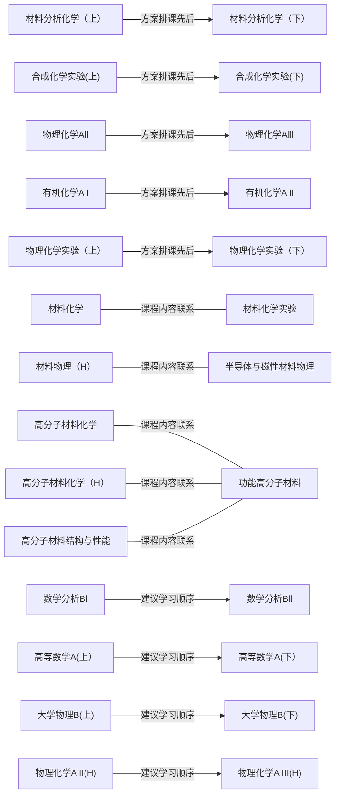

# 2023 材料化学专业“2+X”教学培养方案（技术科学试验班适用）

智能材料与未来能源创新学院 · 材料化学 · 方案 67361 · 73 个不同课程或科研条目。

[官方 Word](../originals/plan-67361.docx) · [教务详情](https://fdjwgl.fudan.edu.cn/manager/bizType/2/major-program-search/info/67361?skipAuth=1) · [方案快照](../raw/plan-67361.json.gz) · [年级目录](../README.md)

## 修读导读

- **建议先学**　《材料分析化学（上）》（`MASE20007`） → 《材料分析化学（下）》（`MASE20008`）。题名列出连续册次或级别。可把测量对象、方法适用条件和误差整理在一起，读下一册时继续比较。方案分别列在第3、4学期。

- **可以对照着读**　《材料化学》（`MASE40015`）与《材料化学实验》（`MASE40021`）。可在实验或实践课中记录用到了哪些课堂概念，再回到相应章节复习。

- **查模块选课**　《生产实习》（`MASE40016`）、《材料科学导论》（`MASE20002`）列在“专业核心教育课程”中。原表见 `/courseModules/12`。

## 课程关系图

图中展示部分关系。下表保留全部已建立的课程对，来源位置使用本方案 JSON Pointer。

## 先修与内容联系

| 类型 | 起点 | 终点 | 依据 | 原表定位 |
| --- | --- | --- | --- | --- |
| 建议学习顺序 | 合成化学实验(上) (CHEM20004) | 合成化学实验(下) (CHEM30003) | 同方案的课程题名具有连续分册或序号。  | `/courseModules/12/planCourses/1`、`/courseModules/12/planCourses/2` |
| 建议学习顺序 | 物理化学AⅡ (CHEM20006) | 物理化学AⅢ (CHEM30004) | 同方案的课程题名具有连续分册或序号。  | `/courseModules/12/planCourses/3`、`/courseModules/12/planCourses/4` |
| 建议学习顺序 | 物理化学A II(H) (CHEM20006h) | 物理化学A III(H) (CHEM30004h) | 同方案的课程题名具有连续分册或序号。  | `/courseModules/18/planCourses/0`、`/courseModules/18/planCourses/1` |
| 建议学习顺序 | 有机化学A I (CHEM20013) | 有机化学A II (CHEM20014) | 同方案的课程题名具有连续分册或序号。  | `/courseModules/12/planCourses/5`、`/courseModules/12/planCourses/6` |
| 建议学习顺序 | 物理化学实验（上） (CHEM30031) | 物理化学实验（下） (CHEM30032) | 同方案的课程题名具有连续分册或序号。  | `/courseModules/12/planCourses/7`、`/courseModules/12/planCourses/8` |
| 建议学习顺序 | 材料分析化学（上） (MASE20007) | 材料分析化学（下） (MASE20008) | 同方案的课程题名具有连续分册或序号。  | `/courseModules/14/planCourses/4`、`/courseModules/14/planCourses/5` |
| 建议学习顺序 | 数学分析BⅠ (MATH10012) | 数学分析BⅡ (MATH10013) | 同方案的课程题名具有连续分册或序号。  | `/courseModules/7/planCourses/0`、`/courseModules/7/planCourses/1` |
| 建议学习顺序 | 高等数学A(上） (MATH10015) | 高等数学A(下） (MATH10016) | 同方案的课程题名具有连续分册或序号。  | `/courseModules/8/planCourses/0`、`/courseModules/8/planCourses/1` |
| 建议学习顺序 | 大学物理B(上) (PHYS10003) | 大学物理B(下) (PHYS10004) | 同方案的课程题名具有连续分册或序号。  | `/courseModules/11/planCourses/2`、`/courseModules/11/planCourses/3` |
| 方案排课先后 | 合成化学实验(上) (CHEM20004) | 合成化学实验(下) (CHEM30003) | 同方案该课程全部明确数字学期均早于后者。  | `/courseModules/12/planCourses/1`、`/courseModules/12/planCourses/2` |
| 方案排课先后 | 物理化学AⅡ (CHEM20006) | 物理化学AⅢ (CHEM30004) | 同方案该课程全部明确数字学期均早于后者。  | `/courseModules/12/planCourses/3`、`/courseModules/12/planCourses/4` |
| 方案排课先后 | 物理化学A II(H) (CHEM20006h) | 物理化学A III(H) (CHEM30004h) | 同方案该课程全部明确数字学期均早于后者。  | `/courseModules/18/planCourses/0`、`/courseModules/18/planCourses/1` |
| 方案排课先后 | 有机化学A I (CHEM20013) | 有机化学A II (CHEM20014) | 同方案该课程全部明确数字学期均早于后者。  | `/courseModules/12/planCourses/5`、`/courseModules/12/planCourses/6` |
| 方案排课先后 | 物理化学实验（上） (CHEM30031) | 物理化学实验（下） (CHEM30032) | 同方案该课程全部明确数字学期均早于后者。  | `/courseModules/12/planCourses/7`、`/courseModules/12/planCourses/8` |
| 方案排课先后 | 材料分析化学（上） (MASE20007) | 材料分析化学（下） (MASE20008) | 同方案该课程全部明确数字学期均早于后者。  | `/courseModules/14/planCourses/4`、`/courseModules/14/planCourses/5` |
| 方案排课先后 | 数学分析BⅠ (MATH10012) | 数学分析BⅡ (MATH10013) | 同方案该课程全部明确数字学期均早于后者。  | `/courseModules/7/planCourses/0`、`/courseModules/7/planCourses/1` |
| 方案排课先后 | 高等数学A(上） (MATH10015) | 高等数学A(下） (MATH10016) | 同方案该课程全部明确数字学期均早于后者。  | `/courseModules/8/planCourses/0`、`/courseModules/8/planCourses/1` |
| 课程内容联系 | 物理化学AⅡ (CHEM20006) | 物理化学A II(H) (CHEM20006h) | 本方案两门课程的题名均含“物理化学”，可据此对照这一主题。  | `/courseModules/12/planCourses/3`、`/courseModules/18/planCourses/0` |
| 课程内容联系 | 物理化学AⅡ (CHEM20006) | 物理化学AⅢ (CHEM30004) | 本方案两门课程的题名均含“物理化学”，可据此对照这一主题。  | `/courseModules/12/planCourses/3`、`/courseModules/12/planCourses/4` |
| 课程内容联系 | 物理化学AⅡ (CHEM20006) | 物理化学实验（上） (CHEM30031) | 本方案两门课程的题名均含“物理化学”，可据此对照这一主题。  | `/courseModules/12/planCourses/3`、`/courseModules/12/planCourses/7` |
| 课程内容联系 | 物理化学AⅡ (CHEM20006) | 物理化学实验（下） (CHEM30032) | 本方案两门课程的题名均含“物理化学”，可据此对照这一主题。  | `/courseModules/12/planCourses/3`、`/courseModules/12/planCourses/8` |
| 课程内容联系 | 有机化学A I (CHEM20013) | 有机化学A II (CHEM20014) | 本方案两门课程的题名均含“有机化学”，可据此对照这一主题。  | `/courseModules/12/planCourses/5`、`/courseModules/12/planCourses/6` |
| 课程内容联系 | 有机化学A I (CHEM20013) | 有机化学A II (H) (CHEM20014h) | 本方案两门课程的题名均含“有机化学”，可据此对照这一主题。  | `/courseModules/12/planCourses/5`、`/courseModules/18/planCourses/2` |
| 课程内容联系 | 线性代数 (CS10003) | 线性代数（理工类） (MATH10014) | 本方案两门课程的题名均含“线性代数”，可据此对照这一主题。  | `/courseModules/10/planCourses/0`、`/courseModules/10/planCourses/1` |
| 课程内容联系 | 材料分析化学（上） (MASE20007) | 材料分析化学（下） (MASE20008) | 本方案两门课程的题名均含“分析化学”，可据此对照这一主题。  | `/courseModules/14/planCourses/4`、`/courseModules/14/planCourses/5` |
| 课程内容联系 | 高分子材料结构与性能 (MASE30010) | 功能高分子材料 (MASE50030) | 本方案两门课程的题名均含“高分子”，可据此对照这一主题。  | `/courseModules/14/planCourses/2`、`/courseModules/16/planCourses/1` |
| 课程内容联系 | 高分子材料化学 (MASE30011) | 功能高分子材料 (MASE50030) | 本方案两门课程的题名均含“高分子”，可据此对照这一主题。  | `/courseModules/14/planCourses/3`、`/courseModules/16/planCourses/1` |
| 课程内容联系 | 高分子材料化学（H） (MASE30011h) | 功能高分子材料 (MASE50030) | 本方案两门课程的题名均含“高分子”，可据此对照这一主题。  | `/courseModules/18/planCourses/3`、`/courseModules/16/planCourses/1` |
| 课程内容联系 | 材料物理（H） (MASE30012h) | 半导体与磁性材料物理 (MASE50058) | 本方案两门课程的题名均含“材料物理”，可据此对照这一主题。  | `/courseModules/18/planCourses/4`、`/courseModules/16/planCourses/11` |
| 课程内容联系 | 材料化学 (MASE40015) | 材料化学实验 (MASE40021) | 题名显示相同主题的课程与实验、实践或实习。  | `/courseModules/12/planCourses/9`、`/courseModules/12/planCourses/16` |

本次未从可定位的明确表述中确认课程对课程预修。学期安排、系列分册与编辑建议均保留各自的依据。

## 按原方案模块阅读

同一模块展示原表中的课程归属。模块内课程之间的先后仍须逐项查阅。

- **其他课程**　程序设计、电子系统导论、大学物理B(上)、大学物理B(下)、基础物理实验（原表模块 11）
- **功能聚合物模块**　材料与器件中的AI应用、生物医学光子学、CAD工程制图、材料失效分析、功能高分子材料、材料科学前沿讲座、复合材料、聚合物材料研究方法、智能材料、材料与环境保护、工程材料、有机光电材料与器件、有机发光材料、有机功能材料微纳结构制备与应用、半导体与磁性材料物理（原表模块 16）
- **新能源材料模块**　材料与器件中的AI应用、生物医学光子学、CAD工程制图、材料失效分析、新型能源材料、电子显微分析技术、无机功能材料、材料科学前沿讲座、纳米功能材料、光电材料、智能材料、锂电池材料、氢能材料与技术、新能源转换材料及应用、有机光电材料与器件、太阳能电池器件物理、半导体与磁性材料物理（原表模块 17）
- **荣誉项目**　物理化学A II(H)、有机化学A II (H)、物理化学A III(H)、固体物理导论（H）、数学物理方法（H）、高分子材料化学（H）、材料物理（H）、材料制备与加工（H）、材料分析（H）、材料综合实验（H）、大学物理A：电磁学(H)（原表模块 18）

## 课程表

同一课程在不同模块分别出现时，按原表逐行列出。季节字段保留原值。

| 课程 | 代码 | 学分 | 学期 | 模块 |
| --- | --- | ---: | --- | --- |
| 数学分析BⅠ | MATH10012 | 5.0 | 第1学期 | 培养方案 / 专业教育课程 / 大类基础课程 / 数学大类基础_二选一 / A组 |
| 数学分析BⅡ | MATH10013 | 5.0 | 第2学期 | 培养方案 / 专业教育课程 / 大类基础课程 / 数学大类基础_二选一 / A组 |
| 高等数学A(上） | MATH10015 | 5.0 | 第1学期 | 培养方案 / 专业教育课程 / 大类基础课程 / 数学大类基础_二选一 / B组 |
| 高等数学A(下） | MATH10016 | 5.0 | 第2学期 | 培养方案 / 专业教育课程 / 大类基础课程 / 数学大类基础_二选一 / B组 |
| 线性代数 | CS10003 | 3.0 | SPRING、AUTUMN | 培养方案 / 专业教育课程 / 大类基础课程 / 必修课程 / 二选一 |
| 线性代数（理工类） | MATH10014 | 3.0 | SPRING、AUTUMN | 培养方案 / 专业教育课程 / 大类基础课程 / 必修课程 / 二选一 |
| 程序设计 | CS10004 | 4.0 | AUTUMN | 培养方案 / 专业教育课程 / 大类基础课程 / 必修课程 / 其他课程 |
| 电子系统导论 | EST10003 | 3.0 | SPRING | 培养方案 / 专业教育课程 / 大类基础课程 / 必修课程 / 其他课程 |
| 大学物理B(上) | PHYS10003 | 4.0 | AUTUMN | 培养方案 / 专业教育课程 / 大类基础课程 / 必修课程 / 其他课程 |
| 大学物理B(下) | PHYS10004 | 4.0 | SPRING | 培养方案 / 专业教育课程 / 大类基础课程 / 必修课程 / 其他课程 |
| 基础物理实验 | PHYS10005 | 2.0 | SPRING | 培养方案 / 专业教育课程 / 大类基础课程 / 必修课程 / 其他课程 |
| 普通化学实验I | CHEM10005 | 1.0 | 第3学期 | 培养方案 / 专业教育课程 / 专业核心教育课程 |
| 合成化学实验(上) | CHEM20004 | 2.0 | 第4学期 | 培养方案 / 专业教育课程 / 专业核心教育课程 |
| 合成化学实验(下) | CHEM30003 | 2.0 | 第5学期 | 培养方案 / 专业教育课程 / 专业核心教育课程 |
| 物理化学AⅡ | CHEM20006 | 3.0 | 第4学期 | 培养方案 / 专业教育课程 / 专业核心教育课程 |
| 物理化学AⅢ | CHEM30004 | 3.0 | 第5学期 | 培养方案 / 专业教育课程 / 专业核心教育课程 |
| 有机化学A I | CHEM20013 | 4.0 | 第3学期 | 培养方案 / 专业教育课程 / 专业核心教育课程 |
| 有机化学A II | CHEM20014 | 2.0 | 第4学期 | 培养方案 / 专业教育课程 / 专业核心教育课程 |
| 物理化学实验（上） | CHEM30031 | 2.0 | 第5学期 | 培养方案 / 专业教育课程 / 专业核心教育课程 |
| 物理化学实验（下） | CHEM30032 | 2.0 | 第6学期 | 培养方案 / 专业教育课程 / 专业核心教育课程 |
| 材料化学 | MASE40015 | 2.0 | 第7学期 | 培养方案 / 专业教育课程 / 专业核心教育课程 |
| 生产实习 | MASE40016 | 1.0 | 第7学期 | 培养方案 / 专业教育课程 / 专业核心教育课程 |
| 毕业论文 | MASE40017 | 6.0 | 第8学期 | 培养方案 / 专业教育课程 / 专业核心教育课程 |
| 材料科学导论 | MASE20002 | 3.0 | 第3学期 | 培养方案 / 专业教育课程 / 专业核心教育课程 |
| 材料制备与加工 | MASE30022 | 3.0 | 第5学期 | 培养方案 / 专业教育课程 / 专业核心教育课程 |
| 材料分析 | MASE30023 | 3.0 | 第6学期 | 培养方案 / 专业教育课程 / 专业核心教育课程 |
| 材料综合实验 | MASE30024 | 2.0 | 第6学期 | 培养方案 / 专业教育课程 / 专业核心教育课程 |
| 材料化学实验 | MASE40021 | 3.0 | 第7学期 | 培养方案 / 专业教育课程 / 专业核心教育课程 |
| 普通化学 | MASE20009 | 2.0 | 第3学期 | 培养方案 / 专业教育课程 / 专业核心教育课程 |
| 材料结构与性能 | MASE20010 | 3.0 | 第4学期 | 培养方案 / 专业教育课程 / 专业核心教育课程 |
| 无机化学和化学分析实验Ⅰ | CHEM20003 | 2.0 | 第3学期 | 培养方案 / 专业进阶模块I |
| 仪器分析和物理化学实验A上 | CHEM130005 | 2.0 | 第4学期 | 培养方案 / 专业进阶模块I |
| 高分子材料结构与性能 | MASE30010 | 3.0 | 第6学期 | 培养方案 / 专业进阶模块I |
| 高分子材料化学 | MASE30011 | 2.0 | 第5学期 | 培养方案 / 专业进阶模块I |
| 材料分析化学（上） | MASE20007 | 2.0 | 第3学期 | 培养方案 / 专业进阶模块I |
| 材料分析化学（下） | MASE20008 | 2.0 | 第4学期 | 培养方案 / 专业进阶模块I |
| 精细化工工艺学 | MASE50043 | 2.0 | 第7学期 | 培养方案 / 专业进阶模块I |
| 专业英语（材料化学） | MASE30025 | 2.0 | 第5学期 | 培养方案 / 专业进阶模块I |
| 材料失效分析 | MASE50020 | 2.0 | SPRING | 培养方案 / 专业进阶模块II / 功能聚合物模块 |
| 功能高分子材料 | MASE50030 | 2.0 | SPRING | 培养方案 / 专业进阶模块II / 功能聚合物模块 |
| 材料科学前沿讲座 | MASE50032 | 2.0 | SPRING | 培养方案 / 专业进阶模块II / 功能聚合物模块 |
| 复合材料 | MASE50042 | 2.0 | SPRING、AUTUMN | 培养方案 / 专业进阶模块II / 功能聚合物模块 |
| 聚合物材料研究方法 | MASE50044 | 2.0 | SPRING、AUTUMN | 培养方案 / 专业进阶模块II / 功能聚合物模块 |
| 智能材料 | MASE50045 | 2.0 | AUTUMN | 培养方案 / 专业进阶模块II / 功能聚合物模块 |
| 材料与环境保护 | MASE50046 | 2.0 | AUTUMN | 培养方案 / 专业进阶模块II / 功能聚合物模块 |
| 工程材料 | MASE50047 | 2.0 | AUTUMN | 培养方案 / 专业进阶模块II / 功能聚合物模块 |
| 有机光电材料与器件 | MASE50051 | 2.0 | SPRING | 培养方案 / 专业进阶模块II / 功能聚合物模块 |
| 有机发光材料 | MASE50053 | 2.0 | AUTUMN | 培养方案 / 专业进阶模块II / 功能聚合物模块 |
| 有机功能材料微纳结构制备与应用 | MASE50054 | 2.0 | SPRING、AUTUMN | 培养方案 / 专业进阶模块II / 功能聚合物模块 |
| 半导体与磁性材料物理 | MASE50058 | 3.0 | SPRING、AUTUMN | 培养方案 / 专业进阶模块II / 功能聚合物模块 |
| CAD工程制图 | MASE30026 | 2.0 | SPRING、AUTUMN | 培养方案 / 专业进阶模块II / 功能聚合物模块 |
| 生物医学光子学 | CHEM30044 | 2.0 | SPRING、AUTUMN | 培养方案 / 专业进阶模块II / 功能聚合物模块 |
| 材料与器件中的AI应用 | AIS310015 | 2.0 | SPRING | 培养方案 / 专业进阶模块II / 功能聚合物模块 |
| 材料失效分析 | MASE50020 | 2.0 | SPRING | 培养方案 / 专业进阶模块II / 新能源材料模块 |
| 新型能源材料 | MASE50024 | 2.0 | SPRING、AUTUMN | 培养方案 / 专业进阶模块II / 新能源材料模块 |
| 电子显微分析技术 | MASE50025 | 2.0 | AUTUMN | 培养方案 / 专业进阶模块II / 新能源材料模块 |
| 无机功能材料 | MASE50031 | 2.0 | SPRING | 培养方案 / 专业进阶模块II / 新能源材料模块 |
| 材料科学前沿讲座 | MASE50032 | 2.0 | SPRING | 培养方案 / 专业进阶模块II / 新能源材料模块 |
| 纳米功能材料 | MASE50037 | 2.0 | AUTUMN | 培养方案 / 专业进阶模块II / 新能源材料模块 |
| 光电材料 | MASE50038 | 2.0 | SPRING | 培养方案 / 专业进阶模块II / 新能源材料模块 |
| 智能材料 | MASE50045 | 2.0 | AUTUMN | 培养方案 / 专业进阶模块II / 新能源材料模块 |
| 锂电池材料 | MASE50048 | 2.0 | SPRING、AUTUMN | 培养方案 / 专业进阶模块II / 新能源材料模块 |
| 氢能材料与技术 | MASE50049 | 2.0 | SPRING | 培养方案 / 专业进阶模块II / 新能源材料模块 |
| 新能源转换材料及应用 | MASE50050 | 2.0 | SPRING | 培养方案 / 专业进阶模块II / 新能源材料模块 |
| 有机光电材料与器件 | MASE50051 | 2.0 | SPRING | 培养方案 / 专业进阶模块II / 新能源材料模块 |
| 太阳能电池器件物理 | MASE50052 | 2.0 | SPRING | 培养方案 / 专业进阶模块II / 新能源材料模块 |
| 半导体与磁性材料物理 | MASE50058 | 3.0 | SPRING、AUTUMN | 培养方案 / 专业进阶模块II / 新能源材料模块 |
| CAD工程制图 | MASE30026 | 2.0 | SPRING、AUTUMN | 培养方案 / 专业进阶模块II / 新能源材料模块 |
| 生物医学光子学 | CHEM30044 | 2.0 | SPRING、AUTUMN | 培养方案 / 专业进阶模块II / 新能源材料模块 |
| 材料与器件中的AI应用 | AIS310015 | 2.0 | SPRING | 培养方案 / 专业进阶模块II / 新能源材料模块 |
| 物理化学A II(H) | CHEM20006h | 4.0 | 第4学期 | 培养方案 / 荣誉项目 |
| 物理化学A III(H) | CHEM30004h | 4.0 | 第5学期 | 培养方案 / 荣誉项目 |
| 有机化学A II (H) | CHEM20014h | 4.0 | 第4学期 | 培养方案 / 荣誉项目 |
| 高分子材料化学（H） | MASE30011h | 3.0 | 第5学期 | 培养方案 / 荣誉项目 |
| 材料物理（H） | MASE30012h | 4.0 | 第5学期 | 培养方案 / 荣誉项目 |
| 数学物理方法（H） | MASE20003h | 5.0 | 第3学期 | 培养方案 / 荣誉项目 |
| 材料制备与加工（H） | MASE30022h | 4.0 | 第5学期 | 培养方案 / 荣誉项目 |
| 材料分析（H） | MASE30023h | 4.0 | 第6学期 | 培养方案 / 荣誉项目 |
| 固体物理导论（H） | EST30011h | 5.0 | 第5学期 | 培养方案 / 荣誉项目 |
| 材料综合实验（H） | MASE30024h | 3.0 | 第6学期 | 培养方案 / 荣誉项目 |
| 大学物理A：电磁学(H) | PHYS10008h | 5.0 | 第2学期 | 培养方案 / 荣誉项目 |
