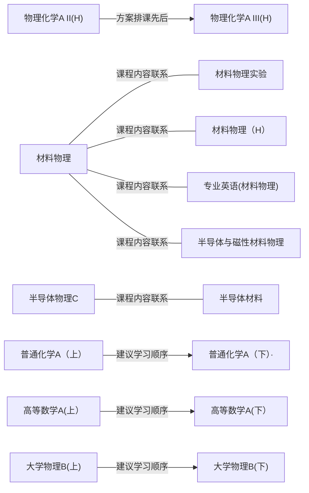

# 2023 材料物理专业“2+X”教学培养方案（自然科学试验班适用）

智能材料与未来能源创新学院 · 材料物理 · 方案 67364 · 77 个不同课程或科研条目。

[官方 Word](../originals/plan-67364.docx) · [教务详情](https://fdjwgl.fudan.edu.cn/manager/bizType/2/major-program-search/info/67364?skipAuth=1) · [方案快照](../raw/plan-67364.json.gz) · [年级目录](../README.md)

## 修读导读

- **建议先学**　《普通化学A（上）》（`CHEM10003`） → 《普通化学A（下）》（`CHEM10004`）。题名列出连续册次或级别。可将前一册用到的结构、性质和变化条件做成索引，读后一册时回查。

- **可以对照着读**　《材料物理》（`MASE30012`）与《材料物理实验》（`MASE40022`）。可在实验或实践课中记录用到了哪些课堂概念，再回到相应章节复习。

- **查模块选课**　《生产实习》（`MASE40016`）、《半导体物理C》（`MASE30013`）列在“专业核心教育课程”中。原表见 `/courseModules/5`。

## 课程关系图

图中展示部分关系。下表保留全部已建立的课程对，来源位置使用本方案 JSON Pointer。

## 先修与内容联系

| 类型 | 起点 | 终点 | 依据 | 原表定位 |
| --- | --- | --- | --- | --- |
| 建议学习顺序 | 普通化学A（上） (CHEM10003) | 普通化学A（下） (CHEM10004) | 同方案的课程题名具有连续分册或序号。  | `/courseModules/8/planCourses/1`、`/courseModules/8/planCourses/2` |
| 建议学习顺序 | 物理化学A II(H) (CHEM20006h) | 物理化学A III(H) (CHEM30004h) | 同方案的课程题名具有连续分册或序号。  | `/courseModules/15/planCourses/0`、`/courseModules/15/planCourses/1` |
| 建议学习顺序 | 高等数学A(上） (MATH10015) | 高等数学A(下） (MATH10016) | 同方案的课程题名具有连续分册或序号。  | `/courseModules/8/planCourses/4`、`/courseModules/8/planCourses/5` |
| 建议学习顺序 | 大学物理B(上) (PHYS10003) | 大学物理B(下) (PHYS10004) | 同方案的课程题名具有连续分册或序号。  | `/courseModules/8/planCourses/6`、`/courseModules/8/planCourses/7` |
| 方案排课先后 | 物理化学A II(H) (CHEM20006h) | 物理化学A III(H) (CHEM30004h) | 同方案该课程全部明确数字学期均早于后者。  | `/courseModules/15/planCourses/0`、`/courseModules/15/planCourses/1` |
| 课程内容联系 | 物理化学A II(H) (CHEM20006h) | 物理化学A III(H) (CHEM30004h) | 本方案两门课程的题名均含“物理化学”，可据此对照这一主题。  | `/courseModules/15/planCourses/0`、`/courseModules/15/planCourses/1` |
| 课程内容联系 | 有机化学A II (H) (CHEM20014h) | 有机化学与聚合物引论 (MASE50027) | 本方案两门课程的题名均含“有机化学”，可据此对照这一主题。  | `/courseModules/15/planCourses/2`、`/courseModules/14/planCourses/5` |
| 课程内容联系 | 线性代数 (CS10003) | 线性代数（理工类） (MATH10014) | 本方案两门课程的题名均含“线性代数”，可据此对照这一主题。  | `/courseModules/7/planCourses/0`、`/courseModules/7/planCourses/1` |
| 课程内容联系 | 集成电路的分析与设计 (EST30010) | 器件与集成电路原理 (MASE30014) | 本方案两门课程的题名均含“集成电路”，可据此对照这一主题。  | `/courseModules/10/planCourses/2`、`/courseModules/10/planCourses/0` |
| 课程内容联系 | 材料物理 (MASE30012) | 材料物理（H） (MASE30012h) | 本方案两门课程的题名均含“材料物理”，可据此对照这一主题。  | `/courseModules/5/planCourses/2`、`/courseModules/15/planCourses/4` |
| 课程内容联系 | 材料物理 (MASE30012) | 专业英语(材料物理) (MASE30016) | 本方案两门课程的题名均含“材料物理”，可据此对照这一主题。  | `/courseModules/5/planCourses/2`、`/courseModules/10/planCourses/4` |
| 课程内容联系 | 材料物理 (MASE30012) | 材料物理实验 (MASE40022) | 题名显示相同主题的课程与实验、实践或实习。  | `/courseModules/5/planCourses/2`、`/courseModules/5/planCourses/11` |
| 课程内容联系 | 材料物理 (MASE30012) | 半导体与磁性材料物理 (MASE50058) | 本方案两门课程的题名均含“材料物理”，可据此对照这一主题。  | `/courseModules/5/planCourses/2`、`/courseModules/12/planCourses/15` |
| 课程内容联系 | 半导体物理C (MASE30013) | 半导体材料 (MASE50023) | 本方案两门课程的题名均含“半导体”，可据此对照这一主题。  | `/courseModules/5/planCourses/3`、`/courseModules/12/planCourses/4` |
| 课程内容联系 | 半导体材料 (MASE50023) | 有机半导体材料与器件概论 (MASE50040) | 本方案两门课程的题名均含“半导体”，可据此对照这一主题。  | `/courseModules/12/planCourses/4`、`/courseModules/12/planCourses/10` |
| 课程内容联系 | 半导体材料 (MASE50023) | 半导体与磁性材料物理 (MASE50058) | 本方案两门课程的题名均含“半导体”，可据此对照这一主题。  | `/courseModules/12/planCourses/4`、`/courseModules/12/planCourses/15` |

本次未从可定位的明确表述中确认课程对课程预修。学期安排、系列分册与编辑建议均保留各自的依据。

## 按原方案模块阅读

同一模块展示原表中的课程归属。模块内课程之间的先后仍须逐项查阅。

- **其他课程**　现代生物科学导论A、普通化学A（上）、普通化学A（下）、普通化学实验I、高等数学A(上）、高等数学A(下）、大学物理B(上)、大学物理B(下)、基础物理实验（原表模块 8）
- **电子材料与器件模块**　材料与器件中的AI应用、智能感知材料与器件、CAD工程制图、电子封装材料与工艺、材料化学基础、薄膜材料工艺学、工程材料的电学性质、半导体材料、电子显微分析技术、电子与信息材料、材料科学前沿讲座、光子晶体导论、光电材料、有机半导体材料与器件概论、电子材料的化学处理、智能材料、有机光电材料与器件、太阳能电池器件物理等19项（原表模块 12）
- **新能源材料模块**　材料与器件中的AI应用、智能感知材料与器件、CAD工程制图、材料失效分析、新型能源材料、电子显微分析技术、无机功能材料、材料科学前沿讲座、纳米功能材料、光电材料、智能材料、锂电池材料、氢能材料与技术、新能源转换材料及应用、有机光电材料与器件、太阳能电池器件物理、半导体与磁性材料物理（原表模块 13）
- **信息材料模块**　材料与器件中的AI应用、数字信号处理A、智能感知材料与器件、CAD工程制图、材料失效分析、半导体材料、电子显微分析技术、电子与信息材料、有机化学与聚合物引论、纳米科技导论、液晶物理学、材料科学前沿讲座、扫描探针显微技术及其应用、薄膜材料与器件、柔性光电子学、光电材料、计算物理、半导体与磁性材料物理（原表模块 14）
- **荣誉项目**　物理化学A II(H)、有机化学A II (H)、物理化学A III(H)、固体物理导论（H）、数学物理方法（H）、高分子材料化学（H）、材料物理（H）、材料制备与加工（H）、材料分析（H）、材料综合实验（H）、大学物理A：电磁学(H)（原表模块 15）

## 课程表

同一课程在不同模块分别出现时，按原表逐行列出。季节字段保留原值。

| 课程 | 代码 | 学分 | 学期 | 模块 |
| --- | --- | ---: | --- | --- |
| 生产实习 | MASE40016 | 1.0 | 第7学期 | 培养方案 / 专业教育课程 / 专业核心教育课程 |
| 毕业论文 | MASE40017 | 6.0 | 第8学期 | 培养方案 / 专业教育课程 / 专业核心教育课程 |
| 材料物理 | MASE30012 | 3.0 | 第5学期 | 培养方案 / 专业教育课程 / 专业核心教育课程 |
| 半导体物理C | MASE30013 | 3.0 | 第5学期 | 培养方案 / 专业教育课程 / 专业核心教育课程 |
| 材料科学导论 | MASE20002 | 3.0 | 第3学期 | 培养方案 / 专业教育课程 / 专业核心教育课程 |
| 数学物理方法 | MASE20003 | 4.0 | 第3学期 | 培养方案 / 专业教育课程 / 专业核心教育课程 |
| 材料制备与加工 | MASE30022 | 3.0 | 第5学期 | 培养方案 / 专业教育课程 / 专业核心教育课程 |
| 材料分析 | MASE30023 | 3.0 | 第6学期 | 培养方案 / 专业教育课程 / 专业核心教育课程 |
| 材料综合实验 | MASE30024 | 2.0 | 第6学期 | 培养方案 / 专业教育课程 / 专业核心教育课程 |
| 材料力学 | MASE20006 | 2.0 | 第4学期 | 培养方案 / 专业教育课程 / 专业核心教育课程 |
| 材料结构与性能 | MASE20010 | 3.0 | 第4学期 | 培养方案 / 专业教育课程 / 专业核心教育课程 |
| 材料物理实验 | MASE40022 | 3.0 | 第6学期 | 培养方案 / 专业教育课程 / 专业核心教育课程 |
| 近代物理A | PHYS20007 | 4.0 | 第3学期 | 培养方案 / 专业教育课程 / 专业核心教育课程 |
| 近代物理实验A | PHYS30012 | 3.0 | 第5学期 | 培养方案 / 专业教育课程 / 专业核心教育课程 |
| 经典物理A | PHYS20008 | 4.0 | 第4学期 | 培养方案 / 专业教育课程 / 专业核心教育课程 |
| 线性代数 | CS10003 | 3.0 | SPRING、AUTUMN | 培养方案 / 专业教育课程 / 大类基础课程 / 二选一 |
| 线性代数（理工类） | MATH10014 | 3.0 | SPRING、AUTUMN | 培养方案 / 专业教育课程 / 大类基础课程 / 二选一 |
| 现代生物科学导论A | BIOL10001 | 3.0 | AUTUMN | 培养方案 / 专业教育课程 / 大类基础课程 / 其他课程 |
| 普通化学A（上） | CHEM10003 | 2.0 | AUTUMN | 培养方案 / 专业教育课程 / 大类基础课程 / 其他课程 |
| 普通化学A（下） | CHEM10004 | 2.0 | SPRING | 培养方案 / 专业教育课程 / 大类基础课程 / 其他课程 |
| 普通化学实验I | CHEM10005 | 1.0 | AUTUMN | 培养方案 / 专业教育课程 / 大类基础课程 / 其他课程 |
| 高等数学A(上） | MATH10015 | 5.0 | AUTUMN | 培养方案 / 专业教育课程 / 大类基础课程 / 其他课程 |
| 高等数学A(下） | MATH10016 | 5.0 | SPRING | 培养方案 / 专业教育课程 / 大类基础课程 / 其他课程 |
| 大学物理B(上) | PHYS10003 | 4.0 | AUTUMN | 培养方案 / 专业教育课程 / 大类基础课程 / 其他课程 |
| 大学物理B(下) | PHYS10004 | 4.0 | SPRING | 培养方案 / 专业教育课程 / 大类基础课程 / 其他课程 |
| 基础物理实验 | PHYS10005 | 2.0 | SPRING | 培养方案 / 专业教育课程 / 大类基础课程 / 其他课程 |
| 器件与集成电路原理 | MASE30014 | 4.0 | 第6学期 | 培养方案 / 专业进阶模块I |
| 电子材料与器件工艺 | EST30009 | 2.0 | 第6学期 | 培养方案 / 专业进阶模块I |
| 集成电路的分析与设计 | EST30010 | 3.0 | 第7学期 | 培养方案 / 专业进阶模块I |
| 电子材料分析 | MASE30015 | 3.0 | 第5学期 | 培养方案 / 专业进阶模块I |
| 专业英语(材料物理) | MASE30016 | 2.0 | 第5学期 | 培养方案 / 专业进阶模块I |
| 模拟与数字电子线路 | MASE20004 | 3.0 | 第4学期 | 培养方案 / 专业进阶模块I |
| 电子封装材料与工艺 | MASE50017 | 2.0 | SPRING | 培养方案 / 专业进阶模块II / 电子材料与器件模块 |
| 材料化学基础 | MASE50019 | 3.0 | SPRING | 培养方案 / 专业进阶模块II / 电子材料与器件模块 |
| 薄膜材料工艺学 | MASE50021 | 2.0 | SPRING | 培养方案 / 专业进阶模块II / 电子材料与器件模块 |
| 工程材料的电学性质 | MASE50022 | 2.0 | AUTUMN | 培养方案 / 专业进阶模块II / 电子材料与器件模块 |
| 半导体材料 | MASE50023 | 2.0 | AUTUMN | 培养方案 / 专业进阶模块II / 电子材料与器件模块 |
| 电子显微分析技术 | MASE50025 | 2.0 | SPRING | 培养方案 / 专业进阶模块II / 电子材料与器件模块 |
| 电子与信息材料 | MASE50026 | 3.0 | AUTUMN | 培养方案 / 专业进阶模块II / 电子材料与器件模块 |
| 材料科学前沿讲座 | MASE50032 | 2.0 | SPRING | 培养方案 / 专业进阶模块II / 电子材料与器件模块 |
| 光子晶体导论 | MASE50033 | 2.0 | AUTUMN | 培养方案 / 专业进阶模块II / 电子材料与器件模块 |
| 光电材料 | MASE50038 | 2.0 | SPRING | 培养方案 / 专业进阶模块II / 电子材料与器件模块 |
| 有机半导体材料与器件概论 | MASE50040 | 2.0 | AUTUMN | 培养方案 / 专业进阶模块II / 电子材料与器件模块 |
| 电子材料的化学处理 | MASE50041 | 2.0 | AUTUMN | 培养方案 / 专业进阶模块II / 电子材料与器件模块 |
| 智能材料 | MASE50045 | 2.0 | AUTUMN | 培养方案 / 专业进阶模块II / 电子材料与器件模块 |
| 有机光电材料与器件 | MASE50051 | 2.0 | SPRING | 培养方案 / 专业进阶模块II / 电子材料与器件模块 |
| 太阳能电池器件物理 | MASE50052 | 2.0 | SPRING | 培养方案 / 专业进阶模块II / 电子材料与器件模块 |
| 半导体与磁性材料物理 | MASE50058 | 3.0 | SPRING、AUTUMN | 培养方案 / 专业进阶模块II / 电子材料与器件模块 |
| CAD工程制图 | MASE30026 | 2.0 | SPRING、AUTUMN | 培养方案 / 专业进阶模块II / 电子材料与器件模块 |
| 智能感知材料与器件 | MASE20012 | 3.0 | SPRING、AUTUMN | 培养方案 / 专业进阶模块II / 电子材料与器件模块 |
| 材料与器件中的AI应用 | AIS310015 | 2.0 | SPRING | 培养方案 / 专业进阶模块II / 电子材料与器件模块 |
| 材料失效分析 | MASE50020 | 2.0 | SPRING | 培养方案 / 专业进阶模块II / 新能源材料模块 |
| 新型能源材料 | MASE50024 | 2.0 | SPRING、AUTUMN | 培养方案 / 专业进阶模块II / 新能源材料模块 |
| 电子显微分析技术 | MASE50025 | 2.0 | AUTUMN | 培养方案 / 专业进阶模块II / 新能源材料模块 |
| 无机功能材料 | MASE50031 | 2.0 | SPRING | 培养方案 / 专业进阶模块II / 新能源材料模块 |
| 材料科学前沿讲座 | MASE50032 | 2.0 | SPRING | 培养方案 / 专业进阶模块II / 新能源材料模块 |
| 纳米功能材料 | MASE50037 | 2.0 | AUTUMN | 培养方案 / 专业进阶模块II / 新能源材料模块 |
| 光电材料 | MASE50038 | 2.0 | SPRING | 培养方案 / 专业进阶模块II / 新能源材料模块 |
| 智能材料 | MASE50045 | 2.0 | AUTUMN | 培养方案 / 专业进阶模块II / 新能源材料模块 |
| 锂电池材料 | MASE50048 | 2.0 | SPRING、AUTUMN | 培养方案 / 专业进阶模块II / 新能源材料模块 |
| 氢能材料与技术 | MASE50049 | 2.0 | SPRING | 培养方案 / 专业进阶模块II / 新能源材料模块 |
| 新能源转换材料及应用 | MASE50050 | 2.0 | SPRING | 培养方案 / 专业进阶模块II / 新能源材料模块 |
| 有机光电材料与器件 | MASE50051 | 2.0 | SPRING | 培养方案 / 专业进阶模块II / 新能源材料模块 |
| 太阳能电池器件物理 | MASE50052 | 2.0 | SPRING | 培养方案 / 专业进阶模块II / 新能源材料模块 |
| 半导体与磁性材料物理 | MASE50058 | 3.0 | SPRING、AUTUMN | 培养方案 / 专业进阶模块II / 新能源材料模块 |
| CAD工程制图 | MASE30026 | 2.0 | SPRING、AUTUMN | 培养方案 / 专业进阶模块II / 新能源材料模块 |
| 智能感知材料与器件 | MASE20012 | 3.0 | SPRING、AUTUMN | 培养方案 / 专业进阶模块II / 新能源材料模块 |
| 材料与器件中的AI应用 | AIS310015 | 2.0 | SPRING | 培养方案 / 专业进阶模块II / 新能源材料模块 |
| 数字信号处理A | EST30002 | 3.0 | AUTUMN | 培养方案 / 专业进阶模块II / 信息材料模块 |
| 材料失效分析 | MASE50020 | 2.0 | SPRING | 培养方案 / 专业进阶模块II / 信息材料模块 |
| 半导体材料 | MASE50023 | 2.0 | AUTUMN | 培养方案 / 专业进阶模块II / 信息材料模块 |
| 电子显微分析技术 | MASE50025 | 2.0 | AUTUMN | 培养方案 / 专业进阶模块II / 信息材料模块 |
| 电子与信息材料 | MASE50026 | 3.0 | AUTUMN | 培养方案 / 专业进阶模块II / 信息材料模块 |
| 有机化学与聚合物引论 | MASE50027 | 3.0 | AUTUMN | 培养方案 / 专业进阶模块II / 信息材料模块 |
| 纳米科技导论 | MASE50028 | 2.0 | SPRING | 培养方案 / 专业进阶模块II / 信息材料模块 |
| 液晶物理学 | MASE50029 | 2.0 | SPRING | 培养方案 / 专业进阶模块II / 信息材料模块 |
| 材料科学前沿讲座 | MASE50032 | 2.0 | SPRING | 培养方案 / 专业进阶模块II / 信息材料模块 |
| 扫描探针显微技术及其应用 | MASE50034 | 2.0 | SPRING | 培养方案 / 专业进阶模块II / 信息材料模块 |
| 薄膜材料与器件 | MASE50035 | 2.0 | SPRING、AUTUMN | 培养方案 / 专业进阶模块II / 信息材料模块 |
| 柔性光电子学 | MASE50036 | 2.0 | SPRING | 培养方案 / 专业进阶模块II / 信息材料模块 |
| 光电材料 | MASE50038 | 2.0 | SPRING | 培养方案 / 专业进阶模块II / 信息材料模块 |
| 计算物理 | MASE50039 | 2.0 | SPRING | 培养方案 / 专业进阶模块II / 信息材料模块 |
| 半导体与磁性材料物理 | MASE50058 | 3.0 | SPRING、AUTUMN | 培养方案 / 专业进阶模块II / 信息材料模块 |
| CAD工程制图 | MASE30026 | 2.0 | SPRING、AUTUMN | 培养方案 / 专业进阶模块II / 信息材料模块 |
| 智能感知材料与器件 | MASE20012 | 3.0 | SPRING、AUTUMN | 培养方案 / 专业进阶模块II / 信息材料模块 |
| 材料与器件中的AI应用 | AIS310015 | 2.0 | SPRING | 培养方案 / 专业进阶模块II / 信息材料模块 |
| 物理化学A II(H) | CHEM20006h | 4.0 | 第4学期 | 培养方案 / 荣誉项目 |
| 物理化学A III(H) | CHEM30004h | 4.0 | 第5学期 | 培养方案 / 荣誉项目 |
| 有机化学A II (H) | CHEM20014h | 4.0 | 第4学期 | 培养方案 / 荣誉项目 |
| 高分子材料化学（H） | MASE30011h | 3.0 | 第5学期 | 培养方案 / 荣誉项目 |
| 材料物理（H） | MASE30012h | 4.0 | 第5学期 | 培养方案 / 荣誉项目 |
| 数学物理方法（H） | MASE20003h | 5.0 | 第3学期 | 培养方案 / 荣誉项目 |
| 材料制备与加工（H） | MASE30022h | 4.0 | 第5学期 | 培养方案 / 荣誉项目 |
| 材料分析（H） | MASE30023h | 4.0 | 第6学期 | 培养方案 / 荣誉项目 |
| 固体物理导论（H） | EST30011h | 5.0 | 第5学期 | 培养方案 / 荣誉项目 |
| 材料综合实验（H） | MASE30024h | 3.0 | 第6学期 | 培养方案 / 荣誉项目 |
| 大学物理A：电磁学(H) | PHYS10008h | 5.0 | 第2学期 | 培养方案 / 荣誉项目 |
