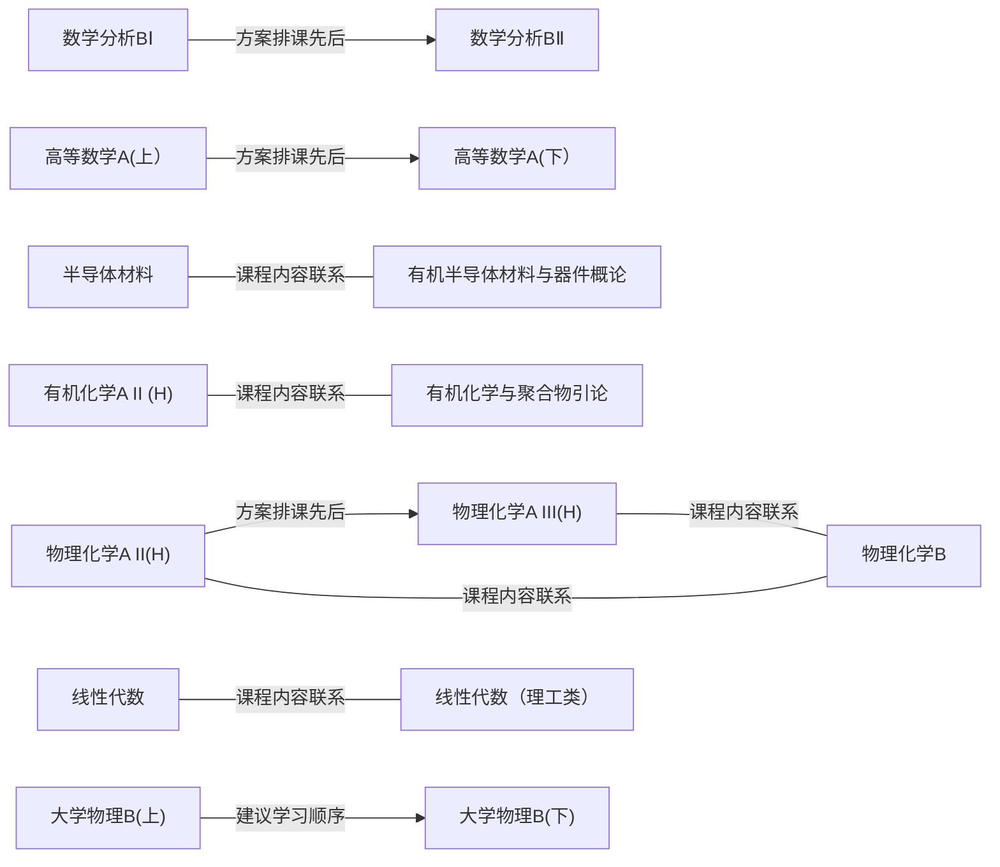

# 2023 电子科学与技术专业“2+X”教学培养方案(技术科学试验班适用）

智能材料与未来能源创新学院 · 电子科学与技术 · 方案 67370 · 216 个不同课程或科研条目。

[官方 Word](../originals/plan-67370.docx) · [教务详情](https://fdjwgl.fudan.edu.cn/manager/bizType/2/major-program-search/info/67370?skipAuth=1) · [方案快照](../raw/plan-67370.json.gz) · [年级目录](../README.md)

## 课程关系图

图中展示部分关系。下表保留全部已建立的课程对，来源位置使用本方案 JSON Pointer。

## 先修与内容联系

| 类型 | 起点 | 终点 | 依据 | 原表定位 |
| --- | --- | --- | --- | --- |
| 建议学习顺序 | 物理化学A II(H) (CHEM20006h) | 物理化学A III(H) (CHEM30004h) | 同方案的课程题名具有连续分册或序号。  | `/courseModules/20/planCourses/0`、`/courseModules/20/planCourses/1` |
| 建议学习顺序 | 数学分析BⅠ (MATH10012) | 数学分析BⅡ (MATH10013) | 同方案的课程题名具有连续分册或序号。  | `/courseModules/8/planCourses/0`、`/courseModules/8/planCourses/1` |
| 建议学习顺序 | 高等数学A(上） (MATH10015) | 高等数学A(下） (MATH10016) | 同方案的课程题名具有连续分册或序号。  | `/courseModules/9/planCourses/0`、`/courseModules/9/planCourses/1` |
| 建议学习顺序 | 大学物理B(上) (PHYS10003) | 大学物理B(下) (PHYS10004) | 同方案的课程题名具有连续分册或序号。  | `/courseModules/12/planCourses/2`、`/courseModules/12/planCourses/3` |
| 方案排课先后 | 物理化学A II(H) (CHEM20006h) | 物理化学A III(H) (CHEM30004h) | 同方案该课程全部明确数字学期均早于后者。  | `/courseModules/20/planCourses/0`、`/courseModules/20/planCourses/1` |
| 方案排课先后 | 数学分析BⅠ (MATH10012) | 数学分析BⅡ (MATH10013) | 同方案该课程全部明确数字学期均早于后者。  | `/courseModules/8/planCourses/0`、`/courseModules/8/planCourses/1` |
| 方案排课先后 | 高等数学A(上） (MATH10015) | 高等数学A(下） (MATH10016) | 同方案该课程全部明确数字学期均早于后者。  | `/courseModules/9/planCourses/0`、`/courseModules/9/planCourses/1` |
| 课程内容联系 | 物理化学A II(H) (CHEM20006h) | 物理化学B (MASE20005) | 本方案两门课程的题名均含“物理化学”，可据此对照这一主题。  | `/courseModules/20/planCourses/0`、`/courseModules/13/planCourses/6` |
| 课程内容联系 | 有机化学A II (H) (CHEM20014h) | 有机化学与聚合物引论 (MASE50027) | 本方案两门课程的题名均含“有机化学”，可据此对照这一主题。  | `/courseModules/20/planCourses/2`、`/courseModules/17/planCourses/5` |
| 课程内容联系 | 物理化学A III(H) (CHEM30004h) | 物理化学B (MASE20005) | 本方案两门课程的题名均含“物理化学”，可据此对照这一主题。  | `/courseModules/20/planCourses/1`、`/courseModules/13/planCourses/6` |
| 课程内容联系 | 线性代数 (CS10003) | 线性代数（理工类） (MATH10014) | 本方案两门课程的题名均含“线性代数”，可据此对照这一主题。  | `/courseModules/11/planCourses/0`、`/courseModules/11/planCourses/1` |
| 课程内容联系 | 半导体材料 (MASE50023) | 有机半导体材料与器件概论 (MASE50040) | 本方案两门课程的题名均含“半导体”，可据此对照这一主题。  | `/courseModules/17/planCourses/2`、`/courseModules/18/planCourses/10` |

本次未从可定位的明确表述中确认课程对课程预修。学期安排、系列分册与编辑建议均保留各自的依据。

## 按原方案模块阅读

同一模块展示原表中的课程归属。模块内课程之间的先后仍须逐项查阅。

- **其他课程**　程序设计、电子系统导论、大学物理B(上)、大学物理B(下)、基础物理实验（原表模块 12）
- **信息材料模块**　材料与器件中的AI应用、数字信号处理A、材料失效分析、半导体材料、电子显微分析技术、电子与信息材料、有机化学与聚合物引论、纳米科技导论、液晶物理学、材料科学前沿讲座、扫描探针显微技术及其应用、薄膜材料与器件、柔性光电子学、光电材料、计算物理（原表模块 17）
- **电子材料与器件模块**　材料与器件中的AI应用、电子封装材料与工艺、材料化学基础、薄膜材料工艺学、工程材料的电学性质、半导体材料、电子显微分析技术、电子与信息材料、材料科学前沿讲座、光子晶体导论、光电材料、有机半导体材料与器件概论、电子材料的化学处理、智能材料、有机光电材料与器件、太阳能电池器件物理（原表模块 18）
- **新能源材料模块**　材料与器件中的AI应用、材料失效分析、新型能源材料、电子显微分析技术、无机功能材料、材料科学前沿讲座、纳米功能材料、光电材料、智能材料、锂电池材料、氢能材料与技术、新能源转换材料及应用、有机光电材料与器件、太阳能电池器件物理（原表模块 19）
- **荣誉项目**　物理化学A II(H)、有机化学A II (H)、物理化学A III(H)、固体物理导论（H）、数学物理方法（H）、高分子材料化学（H）、材料物理（H）、材料制备与加工（H）、材料分析（H）、材料综合实验（H）、大学物理A：电磁学(H)（原表模块 20）

## 课程表

同一课程在不同模块分别出现时，按原表逐行列出。季节字段保留原值。

| 课程 | 代码 | 学分 | 学期 | 模块 |
| --- | --- | ---: | --- | --- |
| 哲学视野下的价值关怀与创业实践 | GEIN10045 | 1.0 | SPRING、AUTUMN | 培养方案 / 通识教育课程 / 通识教育专项教育课程 / 创新创意创业 |
| 物理学的新启示 | GEIN20012 | 1.0 | SPRING、AUTUMN | 培养方案 / 通识教育课程 / 通识教育专项教育课程 / 创新创意创业 |
| 外语专业创新创业理论与实践 | GEIN10021 | 1.0 | SPRING、AUTUMN | 培养方案 / 通识教育课程 / 通识教育专项教育课程 / 创新创意创业 |
| 核事业与行业发展 | GEIN10054 | 1.0 | SPRING、AUTUMN | 培养方案 / 通识教育课程 / 通识教育专项教育课程 / 创新创意创业 |
| 大学生创新创意创业实践B(二) | GEIN30003 | 2.0 | SPRING、AUTUMN | 培养方案 / 通识教育课程 / 通识教育专项教育课程 / 创新创意创业 |
| 航空航天技术发展导论 | MECH115001 | 1.0 | SPRING、AUTUMN | 培养方案 / 通识教育课程 / 通识教育专项教育课程 / 创新创意创业 |
| 大学生创新创意创业实践B(三) | GEIN30004 | 2.0 | SPRING、AUTUMN | 培养方案 / 通识教育课程 / 通识教育专项教育课程 / 创新创意创业 |
| 人本视角下的创业实践 | NURS115001 | 1.0 | SPRING、AUTUMN | 培养方案 / 通识教育课程 / 通识教育专项教育课程 / 创新创意创业 |
| 人工智能在企业中的应用与创新A | DATA115003 | 2.0 | SPRING、AUTUMN | 培养方案 / 通识教育课程 / 通识教育专项教育课程 / 创新创意创业 |
| 大学生创业:思维、能力与方法 | GEIN10051 | 2.0 | SPRING、AUTUMN | 培养方案 / 通识教育课程 / 通识教育专项教育课程 / 创新创意创业 |
| 文物艺术品保护与修复 | GEIN10039 | 1.0 | SPRING、AUTUMN | 培养方案 / 通识教育课程 / 通识教育专项教育课程 / 创新创意创业 |
| 旅游创新创业理论与实践 | GEIN10055 | 1.0 | SPRING、AUTUMN | 培养方案 / 通识教育课程 / 通识教育专项教育课程 / 创新创意创业 |
| 大数据在健康产业中的应用 | GEIN10046 | 1.0 | SPRING、AUTUMN | 培养方案 / 通识教育课程 / 通识教育专项教育课程 / 创新创意创业 |
| 生物技术产业与大学生生涯发展 | GEIN20003 | 1.0 | SPRING、AUTUMN | 培养方案 / 通识教育课程 / 通识教育专项教育课程 / 创新创意创业 |
| 数字影视动画 | GEIN10018 | 2.0 | SPRING、AUTUMN | 培养方案 / 通识教育课程 / 通识教育专项教育课程 / 创新创意创业 |
| 大气与海洋科学的行业创新与创业 | GEIN20002 | 1.0 | SPRING、AUTUMN | 培养方案 / 通识教育课程 / 通识教育专项教育课程 / 创新创意创业 |
| 医学科学的前沿创新和实践 | GEIN10036 | 1.0 | SPRING、AUTUMN | 培养方案 / 通识教育课程 / 通识教育专项教育课程 / 创新创意创业 |
| 创意网络视频策划、制作与营销A | GEIN10019 | 2.0 | SPRING、AUTUMN | 培养方案 / 通识教育课程 / 通识教育专项教育课程 / 创新创意创业 |
| 工程创新思维与方法 | GEIN10014 | 1.0 | SPRING、AUTUMN | 培养方案 / 通识教育课程 / 通识教育专项教育课程 / 创新创意创业 |
| 设计色彩与创意思维 | GEIN10017 | 2.0 | SPRING、AUTUMN | 培养方案 / 通识教育课程 / 通识教育专项教育课程 / 创新创意创业 |
| 会计学原理 | GEIN10011 | 2.0 | SPRING、AUTUMN | 培养方案 / 通识教育课程 / 通识教育专项教育课程 / 创新创意创业 |
| 扩展现实艺术与数字人文 | GEIN10020 | 2.0 | SPRING、AUTUMN | 培养方案 / 通识教育课程 / 通识教育专项教育课程 / 创新创意创业 |
| 智能硬件创新与创业 | GEIN10037 | 1.0 | SPRING、AUTUMN | 培养方案 / 通识教育课程 / 通识教育专项教育课程 / 创新创意创业 |
| 创新创业大讲堂 | GEIN20007 | 2.0 | SPRING、AUTUMN | 培养方案 / 通识教育课程 / 通识教育专项教育课程 / 创新创意创业 |
| 设计思维 I | INFO115002 | 2.0 | SPRING、AUTUMN | 培养方案 / 通识教育课程 / 通识教育专项教育课程 / 创新创意创业 |
| 环境空间健康与生活安全 | CHEM115003 | 1.0 | SPRING、AUTUMN | 培养方案 / 通识教育课程 / 通识教育专项教育课程 / 创新创意创业 |
| 创业企业金融与会计 | GEIN10029 | 2.0 | SPRING、AUTUMN | 培养方案 / 通识教育课程 / 通识教育专项教育课程 / 创新创意创业 |
| 互联网公共服务创新创意 | POLI115002 | 1.0 | SPRING、AUTUMN | 培养方案 / 通识教育课程 / 通识教育专项教育课程 / 创新创意创业 |
| 心理健康教育行业创业与发展A | SOCI115006 | 2.0 | SPRING、AUTUMN | 培养方案 / 通识教育课程 / 通识教育专项教育课程 / 创新创意创业 |
| 生物医学信息技术的变革与展望 | MED115001 | 1.0 | SPRING、AUTUMN | 培养方案 / 通识教育课程 / 通识教育专项教育课程 / 创新创意创业 |
| 保险科技 | GEIN10009 | 2.0 | SPRING、AUTUMN | 培养方案 / 通识教育课程 / 通识教育专项教育课程 / 创新创意创业 |
| 像经济学家那样思考：信息、激励与政策 | GEIN10010 | 2.0 | SPRING、AUTUMN | 培养方案 / 通识教育课程 / 通识教育专项教育课程 / 创新创意创业 |
| 智慧医疗概论与案例解析 | MED115003 | 1.0 | SPRING、AUTUMN | 培养方案 / 通识教育课程 / 通识教育专项教育课程 / 创新创意创业 |
| 大数据在健康产业中的应用A | GEIN10047 | 2.0 | SPRING、AUTUMN | 培养方案 / 通识教育课程 / 通识教育专项教育课程 / 创新创意创业 |
| 社会问题和社会创新A | GEIN10052 | 2.0 | SPRING、AUTUMN | 培养方案 / 通识教育课程 / 通识教育专项教育课程 / 创新创意创业 |
| 社会问题和社会创新 | GEIN10049 | 1.0 | SPRING、AUTUMN | 培养方案 / 通识教育课程 / 通识教育专项教育课程 / 创新创意创业 |
| 传统文化资源的保护与利用 | GEIN10003 | 1.0 | SPRING、AUTUMN | 培养方案 / 通识教育课程 / 通识教育专项教育课程 / 创新创意创业 |
| 心理健康教育行业创业与发展 | GEIN10050 | 1.0 | SPRING、AUTUMN | 培养方案 / 通识教育课程 / 通识教育专项教育课程 / 创新创意创业 |
| 社会组织公益创新与创业设计 | GEIN40004 | 1.0 | SPRING、AUTUMN | 培养方案 / 通识教育课程 / 通识教育专项教育课程 / 创新创意创业 |
| 创意网络视频策划、制作与营销 | FINE115002 | 1.0 | SPRING、AUTUMN | 培养方案 / 通识教育课程 / 通识教育专项教育课程 / 创新创意创业 |
| 智慧医疗概论与案例解析A | GEIN20011 | 2.0 | SPRING | 培养方案 / 通识教育课程 / 通识教育专项教育课程 / 创新创意创业 |
| 科普创作 | GEIN10048 | 2.0 | SPRING、AUTUMN | 培养方案 / 通识教育课程 / 通识教育专项教育课程 / 创新创意创业 |
| 科技创新创业 | GEIN10012 | 2.0 | SPRING、AUTUMN | 培养方案 / 通识教育课程 / 通识教育专项教育课程 / 创新创意创业 |
| 智能硬件创新与创业A | GEIN10038 | 2.0 | SPRING | 培养方案 / 通识教育课程 / 通识教育专项教育课程 / 创新创意创业 |
| 电子信息与材料创新 | GEIN20010 | 2.0 | SPRING、AUTUMN | 培养方案 / 通识教育课程 / 通识教育专项教育课程 / 创新创意创业 |
| 留学生创新与创业 | GEIN30001 | 1.0 | SPRING、AUTUMN | 培养方案 / 通识教育课程 / 通识教育专项教育课程 / 创新创意创业 |
| 大学生创新创意创业实践A | GEIN20004 | 1.0 | SPRING、AUTUMN | 培养方案 / 通识教育课程 / 通识教育专项教育课程 / 创新创意创业 |
| 创新创业与职业伦理A | PTSS115002 | 2.0 | SPRING、AUTUMN | 培养方案 / 通识教育课程 / 通识教育专项教育课程 / 创新创意创业 |
| 计算机与互联网的未来 | GEIN10004 | 1.0 | SPRING、AUTUMN | 培养方案 / 通识教育课程 / 通识教育专项教育课程 / 创新创意创业 |
| 智能可穿戴材料导论 | GEIN10032 | 2.0 | SPRING、AUTUMN | 培养方案 / 通识教育课程 / 通识教育专项教育课程 / 创新创意创业 |
| 技术进步与专利制度发展 | GEIN10033 | 2.0 | SPRING、AUTUMN | 培养方案 / 通识教育课程 / 通识教育专项教育课程 / 创新创意创业 |
| 纳米艺术的思维、审美与创造 | FINE115004 | 1.0 | SPRING、AUTUMN | 培养方案 / 通识教育课程 / 通识教育专项教育课程 / 创新创意创业 |
| 大学生创业实训 | GEIN20005 | 2.0 | SPRING、AUTUMN | 培养方案 / 通识教育课程 / 通识教育专项教育课程 / 创新创意创业 |
| 行业大数据的应用与创新 | GEIN10005 | 1.0 | SPRING、AUTUMN | 培养方案 / 通识教育课程 / 通识教育专项教育课程 / 创新创意创业 |
| 思辨与创新 | GEIN10025 | 1.0 | SPRING、AUTUMN | 培养方案 / 通识教育课程 / 通识教育专项教育课程 / 创新创意创业 |
| 创业企业战略与机会选择 | GEIN10028 | 2.0 | SPRING、AUTUMN | 培养方案 / 通识教育课程 / 通识教育专项教育课程 / 创新创意创业 |
| 设计创新思维下的精益创业A | GEIN10027 | 2.0 | SPRING、AUTUMN | 培养方案 / 通识教育课程 / 通识教育专项教育课程 / 创新创意创业 |
| 营销创新 | GEIN10026 | 2.0 | SPRING、AUTUMN | 培养方案 / 通识教育课程 / 通识教育专项教育课程 / 创新创意创业 |
| 微电影编剧的方法与实践 | FINE115003 | 1.0 | SPRING、AUTUMN | 培养方案 / 通识教育课程 / 通识教育专项教育课程 / 创新创意创业 |
| 材料科学前沿与商业应用 | GEIN10030 | 1.0 | SPRING、AUTUMN | 培养方案 / 通识教育课程 / 通识教育专项教育课程 / 创新创意创业 |
| 信息科学技术的创新创业与发展 | GEIN10022 | 1.0 | SPRING、AUTUMN | 培养方案 / 通识教育课程 / 通识教育专项教育课程 / 创新创意创业 |
| 创意设计前沿 | GEIN10016 | 2.0 | SPRING、AUTUMN | 培养方案 / 通识教育课程 / 通识教育专项教育课程 / 创新创意创业 |
| 石墨烯：神奇材料的新机遇 | GEIN20009 | 1.0 | SPRING、AUTUMN | 培养方案 / 通识教育课程 / 通识教育专项教育课程 / 创新创意创业 |
| 大学生创业概论与实践 | MANA115002 | 2.0 | SPRING、AUTUMN | 培养方案 / 通识教育课程 / 通识教育专项教育课程 / 创新创意创业 |
| 保险企业经营管理 | GEIN10008 | 2.0 | SPRING、AUTUMN | 培养方案 / 通识教育课程 / 通识教育专项教育课程 / 创新创意创业 |
| 设计驱动创新与创业 | GEIN10013 | 2.0 | SPRING、AUTUMN | 培养方案 / 通识教育课程 / 通识教育专项教育课程 / 创新创意创业 |
| 互联网医药与大健康 | GEIN10043 | 2.0 | SPRING、AUTUMN | 培养方案 / 通识教育课程 / 通识教育专项教育课程 / 创新创意创业 |
| 人本视角下的创业实践A | GEIN10041 | 2.0 | SPRING、AUTUMN | 培养方案 / 通识教育课程 / 通识教育专项教育课程 / 创新创意创业 |
| 企业商战创新 | GEIN20006 | 2.0 | SPRING、AUTUMN | 培养方案 / 通识教育课程 / 通识教育专项教育课程 / 创新创意创业 |
| 基于数学建模的创新实践 | GEIN10035 | 2.0 | SPRING、AUTUMN | 培养方案 / 通识教育课程 / 通识教育专项教育课程 / 创新创意创业 |
| 设计创新思维下的精益创业 | MANA115001 | 1.0 | SPRING、AUTUMN | 培养方案 / 通识教育课程 / 通识教育专项教育课程 / 创新创意创业 |
| 文化创意产业 | GEIN10024 | 1.0 | SPRING、AUTUMN | 培养方案 / 通识教育课程 / 通识教育专项教育课程 / 创新创意创业 |
| 大学生创新创意创业实践B(一) | GEIN30002 | 2.0 | SPRING、AUTUMN | 培养方案 / 通识教育课程 / 通识教育专项教育课程 / 创新创意创业 |
| 产品设计与开发 | GEIN10031 | 2.0 | SPRING、AUTUMN | 培养方案 / 通识教育课程 / 通识教育专项教育课程 / 创新创意创业 |
| 天才引导的历程——数学史上的重大发现 | GEIN10034 | 1.0 | SPRING、AUTUMN | 培养方案 / 通识教育课程 / 通识教育专项教育课程 / 创新创意创业 |
| 生物医药的创新、转化与创业 | GEIN10042 | 1.0 | SPRING、AUTUMN | 培养方案 / 通识教育课程 / 通识教育专项教育课程 / 创新创意创业 |
| 批判性思维和有效沟通 | SOCI115004 | 2.0 | SPRING、AUTUMN | 培养方案 / 通识教育课程 / 通识教育专项教育课程 / 创新创意创业 |
| 微流控芯片实验室 | GEIN10002 | 2.0 | SPRING、AUTUMN | 培养方案 / 通识教育课程 / 通识教育专项教育课程 / 创新创意创业 |
| 个人基因组检测创业实践 | GEIN10040 | 2.0 | SPRING、AUTUMN | 培养方案 / 通识教育课程 / 通识教育专项教育课程 / 创新创意创业 |
| 金融创新 | GEIN10006 | 2.0 | SPRING、AUTUMN | 培养方案 / 通识教育课程 / 通识教育专项教育课程 / 创新创意创业 |
| 创意可视化设计 | GEIN10015 | 1.0 | SPRING、AUTUMN | 培养方案 / 通识教育课程 / 通识教育专项教育课程 / 创新创意创业 |
| 软件技术创新 | GEIN10053 | 1.0 | SPRING、AUTUMN | 培养方案 / 通识教育课程 / 通识教育专项教育课程 / 创新创意创业 |
| 创新与经济学 | GEIN10007 | 1.0 | SPRING、AUTUMN | 培养方案 / 通识教育课程 / 通识教育专项教育课程 / 创新创意创业 |
| 合同法的理论与实践 | GEEC10213 | 2.0 | SPRING、AUTUMN | 培养方案 / 通识教育课程 / 通识教育专项教育课程 / 创新创意创业 |
| 管理沟通 | GEEC10239 | 2.0 | SPRING、AUTUMN | 培养方案 / 通识教育课程 / 通识教育专项教育课程 / 创新创意创业 |
| 政策调研与写作 | GEXZ10024 | 2.0 | SPRING、AUTUMN | 培养方案 / 通识教育课程 / 通识教育专项教育课程 / 创新创意创业 |
| 外国经济思潮 | GEEC10081 | 2.0 | SPRING、AUTUMN | 培养方案 / 通识教育课程 / 通识教育专项教育课程 / 创新创意创业 |
| 博物教育与生态文明 | GEXZ10008 | 3.0 | SUMMER | 培养方案 / 通识教育课程 / 通识教育专项教育课程 / 创新创意创业 |
| 虚拟空间设计与表现 | GEEC10138 | 2.0 | SPRING、AUTUMN | 培养方案 / 通识教育课程 / 通识教育专项教育课程 / 创新创意创业 |
| 计算思维与信息素养 | GEXZ10032 | 3.0 | SPRING、AUTUMN | 培养方案 / 通识教育课程 / 通识教育专项教育课程 / 创新创意创业 |
| 国际财务 | GEEC10233 | 2.0 | SPRING、AUTUMN | 培养方案 / 通识教育课程 / 通识教育专项教育课程 / 创新创意创业 |
| 常见疾病与健康促进 | GEXZ30001 | 3.0 | SUMMER | 培养方案 / 通识教育课程 / 通识教育专项教育课程 / 创新创意创业 |
| 医疗救治与人文关怀 | GEXZ20002 | 3.0 | SPRING、AUTUMN | 培养方案 / 通识教育课程 / 通识教育专项教育课程 / 创新创意创业 |
| 中国传统书籍装帧艺术与实践 | GEXZ10021 | 3.0 | SPRING、AUTUMN | 培养方案 / 通识教育课程 / 通识教育专项教育课程 / 创新创意创业 |
| 人口、资源、环境与经济发展 | GEEC10080 | 2.0 | SPRING、AUTUMN | 培养方案 / 通识教育课程 / 通识教育专项教育课程 / 创新创意创业 |
| 质量管理 | GEEC10232 | 2.0 | SPRING、AUTUMN | 培养方案 / 通识教育课程 / 通识教育专项教育课程 / 创新创意创业 |
| 现代投资学 | GEEC10229 | 2.0 | SPRING、AUTUMN | 培养方案 / 通识教育课程 / 通识教育专项教育课程 / 创新创意创业 |
| 国际金融与贸易 | GEEC10084 | 2.0 | SPRING、AUTUMN | 培养方案 / 通识教育课程 / 通识教育专项教育课程 / 创新创意创业 |
| 产业经济学概论 | GEEC10226 | 2.0 | SPRING、AUTUMN | 培养方案 / 通识教育课程 / 通识教育专项教育课程 / 创新创意创业 |
| 艺术与心灵 | GEXZ10028 | 3.0 | SPRING、AUTUMN | 培养方案 / 通识教育课程 / 通识教育专项教育课程 / 创新创意创业 |
| 科技与伦理的追问 | GEXZ10020 | 2.0 | SPRING、AUTUMN | 培养方案 / 通识教育课程 / 通识教育专项教育课程 / 创新创意创业 |
| 智能芯片与社会 | GEXZ10019 | 3.0 | SPRING、AUTUMN | 培养方案 / 通识教育课程 / 通识教育专项教育课程 / 创新创意创业 |
| 成功心理素质训练 | GEMH10007 | 2.0 | SPRING、AUTUMN | 培养方案 / 通识教育课程 / 通识教育专项教育课程 / 创新创意创业 |
| 会计学原理 | GEIS10005 | 2.0 | SUMMER | 培养方案 / 通识教育课程 / 通识教育专项教育课程 / 创新创意创业 |
| 生态文明的理论与实践 | GEXZ10007 | 3.0 | SPRING、AUTUMN | 培养方案 / 通识教育课程 / 通识教育专项教育课程 / 创新创意创业 |
| 知识经济与知识产权管理 | GEEC10214 | 2.0 | SPRING、AUTUMN | 培养方案 / 通识教育课程 / 通识教育专项教育课程 / 创新创意创业 |
| 有效沟通和团队协作 | PHAR110034 | 3.0 | SPRING、AUTUMN | 培养方案 / 通识教育课程 / 通识教育专项教育课程 / 创新创意创业 |
| 交易法律制度 | GEEC10215 | 2.0 | SPRING、AUTUMN | 培养方案 / 通识教育课程 / 通识教育专项教育课程 / 创新创意创业 |
| 信息化与网络金融 | ECON110016 | 2.0 | SPRING、AUTUMN | 培养方案 / 通识教育课程 / 通识教育专项教育课程 / 创新创意创业 |
| 中国经济改革及社会政治变化 | ECON110030 | 3.0 | SPRING、AUTUMN | 培养方案 / 通识教育课程 / 通识教育专项教育课程 / 创新创意创业 |
| 市场营销导论 | GEEC10228 | 2.0 | SPRING、AUTUMN | 培养方案 / 通识教育课程 / 通识教育专项教育课程 / 创新创意创业 |
| 科技服务创新与智慧养老 | GEXZ10029 | 3.0 | SPRING、AUTUMN | 培养方案 / 通识教育课程 / 通识教育专项教育课程 / 创新创意创业 |
| 心理、决策与公共管理 | SOCI110045 | 2.0 | SPRING、AUTUMN | 培养方案 / 通识教育课程 / 通识教育专项教育课程 / 创新创意创业 |
| 人类骨骼考古前沿与实践 | GEEC10280 | 3.0 | SUMMER | 培养方案 / 通识教育课程 / 通识教育专项教育课程 / 创新创意创业 |
| 当代中国教育与社会发展 | GEXZ10025 | 2.0 | SPRING、AUTUMN | 培养方案 / 通识教育课程 / 通识教育专项教育课程 / 创新创意创业 |
| 大学生创业导论 | GEEC10391 | 2.0 | SPRING、AUTUMN | 培养方案 / 通识教育课程 / 通识教育专项教育课程 / 创新创意创业 |
| 国际经济学 | GEEC10087 | 2.0 | SPRING、AUTUMN | 培养方案 / 通识教育课程 / 通识教育专项教育课程 / 创新创意创业 |
| 现代物流管理 | GEEC10224 | 2.0 | SPRING、AUTUMN | 培养方案 / 通识教育课程 / 通识教育专项教育课程 / 创新创意创业 |
| 信息技术管理 | GEEC10230 | 2.0 | SPRING、AUTUMN | 培养方案 / 通识教育课程 / 通识教育专项教育课程 / 创新创意创业 |
| 知识产权法 | GEEC10211 | 2.0 | SPRING、AUTUMN | 培养方案 / 通识教育课程 / 通识教育专项教育课程 / 创新创意创业 |
| 志愿精神与社会服务 | SOCI110071 | 3.0 | SPRING、AUTUMN | 培养方案 / 通识教育课程 / 通识教育专项教育课程 / 创新创意创业 |
| 大学生就业指导 | GEEC10389 | 2.0 | SPRING、AUTUMN | 培养方案 / 通识教育课程 / 通识教育专项教育课程 / 创新创意创业 |
| 走进非物质文化遗产 | GEXZ10006 | 3.0 | SUMMER | 培养方案 / 通识教育课程 / 通识教育专项教育课程 / 创新创意创业 |
| 乡村振兴的教育赋能 | GEXZ10031 | 3.0 | SUMMER | 培养方案 / 通识教育课程 / 通识教育专项教育课程 / 创新创意创业 |
| 大学生生涯规划与发展 | GEEC10388 | 2.0 | SPRING、AUTUMN | 培养方案 / 通识教育课程 / 通识教育专项教育课程 / 创新创意创业 |
| 社会创新与设计思维 | GEXZ10027 | 3.0 | SPRING、AUTUMN | 培养方案 / 通识教育课程 / 通识教育专项教育课程 / 创新创意创业 |
| 货币与金融市场 | GEEC10085 | 2.0 | SPRING、AUTUMN | 培养方案 / 通识教育课程 / 通识教育专项教育课程 / 创新创意创业 |
| 走近红树林 | GEXZ10004 | 3.0 | SUMMER | 培养方案 / 通识教育课程 / 通识教育专项教育课程 / 创新创意创业 |
| 乡村振兴战略的理论与实践 | GEXZ10030 | 3.0 | SUMMER | 培养方案 / 通识教育课程 / 通识教育专项教育课程 / 创新创意创业 |
| 创新与创业 | GEEC10235 | 2.0 | SPRING、AUTUMN | 培养方案 / 通识教育课程 / 通识教育专项教育课程 / 创新创意创业 |
| 证券投资与技术分析 | GEEC10082 | 2.0 | SPRING、AUTUMN | 培养方案 / 通识教育课程 / 通识教育专项教育课程 / 创新创意创业 |
| 市场调研 | MANA110055 | 2.0 | SPRING、AUTUMN | 培养方案 / 通识教育课程 / 通识教育专项教育课程 / 创新创意创业 |
| 药学生涯规划与创新实践 | GEIN10044 | 2.0 | SPRING、AUTUMN | 培养方案 / 通识教育课程 / 通识教育专项教育课程 / 创新创意创业 |
| 科创法学 | GEIN30005 | 2.0 | SPRING、AUTUMN | 培养方案 / 通识教育课程 / 通识教育专项教育课程 / 创新创意创业 |
| 大学生创新实践A | GEIN40002 | 8.0 | SPRING、AUTUMN | 培养方案 / 通识教育课程 / 通识教育专项教育课程 / 创新创意创业 |
| 大学生创新实践B | GEIN40003 | 6.0 | SPRING、AUTUMN | 培养方案 / 通识教育课程 / 通识教育专项教育课程 / 创新创意创业 |
| 大学生创新实践C | GEIN20008 | 1.0 | SPRING、AUTUMN | 培养方案 / 通识教育课程 / 通识教育专项教育课程 / 创新创意创业 |
| 大学生创新实践D | GEIN10023 | 4.0 | SPRING、AUTUMN | 培养方案 / 通识教育课程 / 通识教育专项教育课程 / 创新创意创业 |
| 学术创新实践A | GEIN40006 | 8.0 |  | 培养方案 / 通识教育课程 / 通识教育专项教育课程 / 创新创意创业 |
| 学术创新实践B | GEIN40007 | 6.0 |  | 培养方案 / 通识教育课程 / 通识教育专项教育课程 / 创新创意创业 |
| 学术创新实践C | GEIN20013 | 1.0 |  | 培养方案 / 通识教育课程 / 通识教育专项教育课程 / 创新创意创业 |
| 数学分析BⅠ | MATH10012 | 5.0 | 第1学期 | 培养方案 / 专业教育课程 / 大类基础课程 / 数学大类基础_二选一 / A组 |
| 数学分析BⅡ | MATH10013 | 5.0 | 第2学期 | 培养方案 / 专业教育课程 / 大类基础课程 / 数学大类基础_二选一 / A组 |
| 高等数学A(上） | MATH10015 | 5.0 | 第1学期 | 培养方案 / 专业教育课程 / 大类基础课程 / 数学大类基础_二选一 / B组 |
| 高等数学A(下） | MATH10016 | 5.0 | 第2学期 | 培养方案 / 专业教育课程 / 大类基础课程 / 数学大类基础_二选一 / B组 |
| 线性代数 | CS10003 | 3.0 | SPRING、AUTUMN | 培养方案 / 专业教育课程 / 大类基础课程 / 必修课程 / 二选一 |
| 线性代数（理工类） | MATH10014 | 3.0 | SPRING、AUTUMN | 培养方案 / 专业教育课程 / 大类基础课程 / 必修课程 / 二选一 |
| 程序设计 | CS10004 | 4.0 | AUTUMN | 培养方案 / 专业教育课程 / 大类基础课程 / 必修课程 / 其他课程 |
| 电子系统导论 | EST10003 | 3.0 | SPRING | 培养方案 / 专业教育课程 / 大类基础课程 / 必修课程 / 其他课程 |
| 大学物理B(上) | PHYS10003 | 4.0 | AUTUMN | 培养方案 / 专业教育课程 / 大类基础课程 / 必修课程 / 其他课程 |
| 大学物理B(下) | PHYS10004 | 4.0 | SPRING | 培养方案 / 专业教育课程 / 大类基础课程 / 必修课程 / 其他课程 |
| 基础物理实验 | PHYS10005 | 2.0 | SPRING | 培养方案 / 专业教育课程 / 大类基础课程 / 必修课程 / 其他课程 |
| 普通化学实验I | CHEM10005 | 1.0 | 第3学期 | 培养方案 / 专业教育课程 / 专业核心教育课程 |
| 生产实习 | MASE40016 | 1.0 | 第7学期 | 培养方案 / 专业教育课程 / 专业核心教育课程 |
| 毕业论文 | MASE40017 | 6.0 | 第8学期 | 培养方案 / 专业教育课程 / 专业核心教育课程 |
| 材料科学导论 | MASE20002 | 3.0 | 第3学期 | 培养方案 / 专业教育课程 / 专业核心教育课程 |
| 数学物理方法 | MASE20003 | 4.0 | 第3学期 | 培养方案 / 专业教育课程 / 专业核心教育课程 |
| 模拟与数字电子线路 | MASE20004 | 3.0 | 第4学期 | 培养方案 / 专业教育课程 / 专业核心教育课程 |
| 物理化学B | MASE20005 | 4.0 | 第4学期 | 培养方案 / 专业教育课程 / 专业核心教育课程 |
| 材料制备与加工 | MASE30022 | 3.0 | 第5学期 | 培养方案 / 专业教育课程 / 专业核心教育课程 |
| 材料分析 | MASE30023 | 3.0 | 第6学期 | 培养方案 / 专业教育课程 / 专业核心教育课程 |
| 固体物理导论 | EST30011 | 4.0 | 第5学期 | 培养方案 / 专业教育课程 / 专业核心教育课程 |
| 材料综合实验 | MASE30024 | 2.0 | 第6学期 | 培养方案 / 专业教育课程 / 专业核心教育课程 |
| 普通化学 | MASE20009 | 2.0 | 第3学期 | 培养方案 / 专业教育课程 / 专业核心教育课程 |
| 材料结构与性能 | MASE20010 | 3.0 | 第4学期 | 培养方案 / 专业教育课程 / 专业核心教育课程 |
| 近代物理A | PHYS20007 | 4.0 | 第3学期 | 培养方案 / 专业教育课程 / 专业核心教育课程 |
| 近代物理实验A | PHYS30012 | 3.0 | 第5学期 | 培养方案 / 专业教育课程 / 专业核心教育课程 |
| 经典物理A | PHYS20008 | 4.0 | 第4学期 | 培养方案 / 专业教育课程 / 专业核心教育课程 |
| 真空物理与技术 | MASE30017 | 3.0 | 第5学期 | 培养方案 / 专业进阶模块I |
| 表面分析 | MASE30018 | 3.0 | 第6学期 | 培养方案 / 专业进阶模块I |
| 薄膜技术 | MASE30019 | 3.0 | 第6学期 | 培养方案 / 专业进阶模块I |
| 电子物理实验 | MASE40018 | 3.0 | 第7学期 | 培养方案 / 专业进阶模块I |
| 专业英语(电子科学与技术) | MASE30021 | 2.0 | 第5学期 | 培养方案 / 专业进阶模块I |
| 光电技术与器件 | MASE40020 | 3.0 | 第7学期 | 培养方案 / 专业进阶模块I |
| 数字信号处理A | EST30002 | 3.0 | AUTUMN | 培养方案 / 专业进阶模块II / 信息材料模块 |
| 材料失效分析 | MASE50020 | 2.0 | SPRING | 培养方案 / 专业进阶模块II / 信息材料模块 |
| 半导体材料 | MASE50023 | 2.0 | AUTUMN | 培养方案 / 专业进阶模块II / 信息材料模块 |
| 电子显微分析技术 | MASE50025 | 2.0 | AUTUMN | 培养方案 / 专业进阶模块II / 信息材料模块 |
| 电子与信息材料 | MASE50026 | 3.0 | AUTUMN | 培养方案 / 专业进阶模块II / 信息材料模块 |
| 有机化学与聚合物引论 | MASE50027 | 3.0 | AUTUMN | 培养方案 / 专业进阶模块II / 信息材料模块 |
| 纳米科技导论 | MASE50028 | 2.0 | SPRING | 培养方案 / 专业进阶模块II / 信息材料模块 |
| 液晶物理学 | MASE50029 | 2.0 | SPRING | 培养方案 / 专业进阶模块II / 信息材料模块 |
| 材料科学前沿讲座 | MASE50032 | 2.0 | SPRING | 培养方案 / 专业进阶模块II / 信息材料模块 |
| 扫描探针显微技术及其应用 | MASE50034 | 2.0 | SPRING | 培养方案 / 专业进阶模块II / 信息材料模块 |
| 薄膜材料与器件 | MASE50035 | 2.0 | SPRING、AUTUMN | 培养方案 / 专业进阶模块II / 信息材料模块 |
| 柔性光电子学 | MASE50036 | 2.0 | SPRING | 培养方案 / 专业进阶模块II / 信息材料模块 |
| 光电材料 | MASE50038 | 2.0 | SPRING | 培养方案 / 专业进阶模块II / 信息材料模块 |
| 计算物理 | MASE50039 | 2.0 | SPRING | 培养方案 / 专业进阶模块II / 信息材料模块 |
| 材料与器件中的AI应用 | AIS310015 | 2.0 | SPRING | 培养方案 / 专业进阶模块II / 信息材料模块 |
| 电子封装材料与工艺 | MASE50017 | 2.0 | SPRING | 培养方案 / 专业进阶模块II / 电子材料与器件模块 |
| 材料化学基础 | MASE50019 | 3.0 | SPRING | 培养方案 / 专业进阶模块II / 电子材料与器件模块 |
| 薄膜材料工艺学 | MASE50021 | 2.0 | SPRING | 培养方案 / 专业进阶模块II / 电子材料与器件模块 |
| 工程材料的电学性质 | MASE50022 | 2.0 | AUTUMN | 培养方案 / 专业进阶模块II / 电子材料与器件模块 |
| 半导体材料 | MASE50023 | 2.0 | AUTUMN | 培养方案 / 专业进阶模块II / 电子材料与器件模块 |
| 电子显微分析技术 | MASE50025 | 2.0 | SPRING | 培养方案 / 专业进阶模块II / 电子材料与器件模块 |
| 电子与信息材料 | MASE50026 | 3.0 | AUTUMN | 培养方案 / 专业进阶模块II / 电子材料与器件模块 |
| 材料科学前沿讲座 | MASE50032 | 2.0 | SPRING | 培养方案 / 专业进阶模块II / 电子材料与器件模块 |
| 光子晶体导论 | MASE50033 | 2.0 | AUTUMN | 培养方案 / 专业进阶模块II / 电子材料与器件模块 |
| 光电材料 | MASE50038 | 2.0 | SPRING | 培养方案 / 专业进阶模块II / 电子材料与器件模块 |
| 有机半导体材料与器件概论 | MASE50040 | 2.0 | AUTUMN | 培养方案 / 专业进阶模块II / 电子材料与器件模块 |
| 电子材料的化学处理 | MASE50041 | 2.0 | AUTUMN | 培养方案 / 专业进阶模块II / 电子材料与器件模块 |
| 智能材料 | MASE50045 | 2.0 | AUTUMN | 培养方案 / 专业进阶模块II / 电子材料与器件模块 |
| 有机光电材料与器件 | MASE50051 | 2.0 | SPRING | 培养方案 / 专业进阶模块II / 电子材料与器件模块 |
| 太阳能电池器件物理 | MASE50052 | 2.0 | SPRING | 培养方案 / 专业进阶模块II / 电子材料与器件模块 |
| 材料与器件中的AI应用 | AIS310015 | 2.0 | SPRING | 培养方案 / 专业进阶模块II / 电子材料与器件模块 |
| 材料失效分析 | MASE50020 | 2.0 | SPRING | 培养方案 / 专业进阶模块II / 新能源材料模块 |
| 新型能源材料 | MASE50024 | 2.0 | SPRING、AUTUMN | 培养方案 / 专业进阶模块II / 新能源材料模块 |
| 电子显微分析技术 | MASE50025 | 2.0 | AUTUMN | 培养方案 / 专业进阶模块II / 新能源材料模块 |
| 无机功能材料 | MASE50031 | 2.0 | SPRING | 培养方案 / 专业进阶模块II / 新能源材料模块 |
| 材料科学前沿讲座 | MASE50032 | 2.0 | SPRING | 培养方案 / 专业进阶模块II / 新能源材料模块 |
| 纳米功能材料 | MASE50037 | 2.0 | AUTUMN | 培养方案 / 专业进阶模块II / 新能源材料模块 |
| 光电材料 | MASE50038 | 2.0 | SPRING | 培养方案 / 专业进阶模块II / 新能源材料模块 |
| 智能材料 | MASE50045 | 2.0 | AUTUMN | 培养方案 / 专业进阶模块II / 新能源材料模块 |
| 锂电池材料 | MASE50048 | 2.0 | SPRING、AUTUMN | 培养方案 / 专业进阶模块II / 新能源材料模块 |
| 氢能材料与技术 | MASE50049 | 2.0 | SPRING | 培养方案 / 专业进阶模块II / 新能源材料模块 |
| 新能源转换材料及应用 | MASE50050 | 2.0 | SPRING | 培养方案 / 专业进阶模块II / 新能源材料模块 |
| 有机光电材料与器件 | MASE50051 | 2.0 | SPRING | 培养方案 / 专业进阶模块II / 新能源材料模块 |
| 太阳能电池器件物理 | MASE50052 | 2.0 | SPRING | 培养方案 / 专业进阶模块II / 新能源材料模块 |
| 材料与器件中的AI应用 | AIS310015 | 2.0 | SPRING | 培养方案 / 专业进阶模块II / 新能源材料模块 |
| 物理化学A II(H) | CHEM20006h | 4.0 | 第4学期 | 培养方案 / 荣誉项目 |
| 物理化学A III(H) | CHEM30004h | 4.0 | 第5学期 | 培养方案 / 荣誉项目 |
| 有机化学A II (H) | CHEM20014h | 4.0 | 第4学期 | 培养方案 / 荣誉项目 |
| 高分子材料化学（H） | MASE30011h | 3.0 | 第5学期 | 培养方案 / 荣誉项目 |
| 材料物理（H） | MASE30012h | 4.0 | 第5学期 | 培养方案 / 荣誉项目 |
| 数学物理方法（H） | MASE20003h | 5.0 | 第3学期 | 培养方案 / 荣誉项目 |
| 材料制备与加工（H） | MASE30022h | 4.0 | 第5学期 | 培养方案 / 荣誉项目 |
| 材料分析（H） | MASE30023h | 4.0 | 第6学期 | 培养方案 / 荣誉项目 |
| 固体物理导论（H） | EST30011h | 5.0 | 第5学期 | 培养方案 / 荣誉项目 |
| 材料综合实验（H） | MASE30024h | 3.0 | 第6学期 | 培养方案 / 荣誉项目 |
| 大学物理A：电磁学(H) | PHYS10008h | 5.0 | 第2学期 | 培养方案 / 荣誉项目 |
