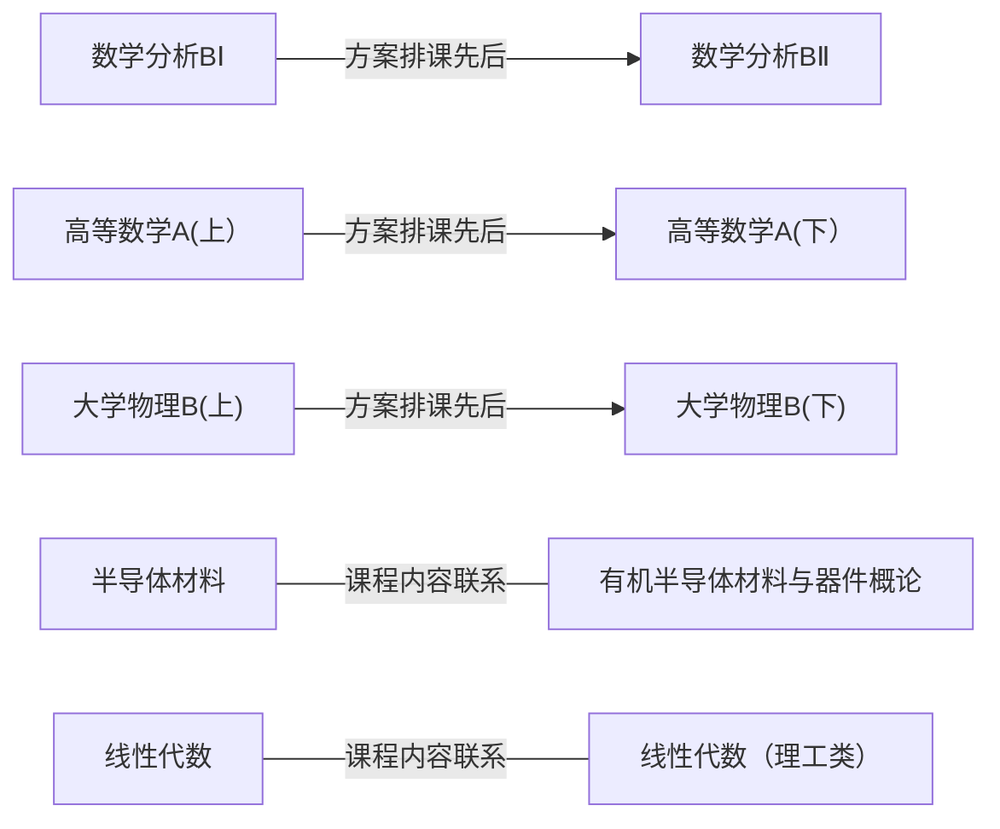

# 2024 电子科学与技术专业“2+X”教学培养方案

智能材料与未来能源创新学院 · 电子科学与技术 · 方案 72730 · 63 个不同课程或科研条目。

[官方 Word](../originals/plan-72730.docx) · [教务详情](https://fdjwgl.fudan.edu.cn/manager/bizType/2/major-program-search/info/72730?skipAuth=1) · [方案快照](../raw/plan-72730.json.gz) · [年级目录](../README.md)

## 修读导读

- **建议先学**　《大学物理B(上)》（`PHYS10003`） → 《大学物理B(下)》（`PHYS10004`）。题名列出连续册次或级别。可把前一册用过的物理量和建模假设列在一起，后续遇到相似问题时再比较。方案分别列在第1、2学期。

- **可以对照着读**　《半导体材料》（`MASE50023`）与《有机半导体材料与器件概论》（`MASE50040`）。两门课的题名都涉及半导体。把材料性质、载流子行为和器件表现放在同一张对照表里。

- **查模块选课**　《材料科学导论》（`MASE20002`）、《数学物理方法》（`MASE20003`）列在“专业核心教育课程”中。原表见 `/courseModules/12`。

## 课程关系图

图中展示部分关系。下表保留全部已建立的课程对，来源位置使用本方案 JSON Pointer。

## 先修与内容联系

| 类型 | 起点 | 终点 | 依据 | 原表定位 |
| --- | --- | --- | --- | --- |
| 建议学习顺序 | 数学分析BⅠ (MATH10012) | 数学分析BⅡ (MATH10013) | 同方案的课程题名具有连续分册或序号。  | `/courseModules/7/planCourses/0`、`/courseModules/7/planCourses/1` |
| 建议学习顺序 | 高等数学A(上） (MATH10015) | 高等数学A(下） (MATH10016) | 同方案的课程题名具有连续分册或序号。  | `/courseModules/8/planCourses/0`、`/courseModules/8/planCourses/1` |
| 建议学习顺序 | 大学物理B(上) (PHYS10003) | 大学物理B(下) (PHYS10004) | 同方案的课程题名具有连续分册或序号。  | `/courseModules/9/planCourses/1`、`/courseModules/9/planCourses/2` |
| 方案排课先后 | 数学分析BⅠ (MATH10012) | 数学分析BⅡ (MATH10013) | 同方案该课程全部明确数字学期均早于后者。  | `/courseModules/7/planCourses/0`、`/courseModules/7/planCourses/1` |
| 方案排课先后 | 高等数学A(上） (MATH10015) | 高等数学A(下） (MATH10016) | 同方案该课程全部明确数字学期均早于后者。  | `/courseModules/8/planCourses/0`、`/courseModules/8/planCourses/1` |
| 方案排课先后 | 大学物理B(上) (PHYS10003) | 大学物理B(下) (PHYS10004) | 同方案该课程全部明确数字学期均早于后者。  | `/courseModules/9/planCourses/1`、`/courseModules/9/planCourses/2` |
| 课程内容联系 | 线性代数 (CS10003) | 线性代数（理工类） (MATH10014) | 本方案两门课程的题名均含“线性代数”，可据此对照这一主题。  | `/courseModules/10/planCourses/1`、`/courseModules/9/planCourses/0` |
| 课程内容联系 | 半导体材料 (MASE50023) | 有机半导体材料与器件概论 (MASE50040) | 本方案两门课程的题名均含“半导体”，可据此对照这一主题。  | `/courseModules/17/planCourses/2`、`/courseModules/18/planCourses/11` |

本次未从可定位的明确表述中确认课程对课程预修。学期安排、系列分册与编辑建议均保留各自的依据。

## 按原方案模块阅读

同一模块展示原表中的课程归属。模块内课程之间的先后仍须逐项查阅。

- **其他课程**　程序设计、电子系统导论、大学物理B(上)、大学物理B(下)、基础物理实验（原表模块 11）
- **电子科学与技术专业进阶I**　真空物理与技术、表面分析、薄膜技术、专业英语(电子科学与技术)、电子物理实验、光电技术与器件（原表模块 15）
- **信息材料模块**　集成电路的分析与设计、材料失效分析、半导体材料、电子显微分析技术、电子与信息材料、有机化学与聚合物引论、纳米科技导论、液晶物理学、材料科学前沿讲座、扫描探针显微技术及其应用、薄膜材料与器件、柔性光电子学、光电材料、计算物理（原表模块 17）
- **电子材料与器件模块**　集成电路的分析与设计、电子封装材料与工艺、材料化学基础、薄膜材料工艺学、工程材料的电学性质、半导体材料、电子显微分析技术、电子与信息材料、材料科学前沿讲座、光子晶体导论、光电材料、有机半导体材料与器件概论、电子材料的化学处理、智能材料、有机光电材料与器件、太阳能电池器件物理（原表模块 18）
- **新能源材料模块**　材料失效分析、新型能源材料、电子显微分析技术、无机功能材料、材料科学前沿讲座、纳米功能材料、光电材料、智能材料、锂电池材料、氢能材料与技术、新能源转换材料及应用、有机光电材料与器件、太阳能电池器件物理（原表模块 19）

## 课程表

同一课程在不同模块分别出现时，按原表逐行列出。季节字段保留原值。

| 课程 | 代码 | 学分 | 学期 | 模块 |
| --- | --- | ---: | --- | --- |
| 数学分析BⅠ | MATH10012 | 5.0 | 第1学期 | 培养方案 / 专业培养课程 / 大类基础课程 / 数学大类基础_二选一 / A组 |
| 数学分析BⅡ | MATH10013 | 5.0 | 第2学期 | 培养方案 / 专业培养课程 / 大类基础课程 / 数学大类基础_二选一 / A组 |
| 高等数学A(上） | MATH10015 | 5.0 | 第1学期 | 培养方案 / 专业培养课程 / 大类基础课程 / 数学大类基础_二选一 / B组 |
| 高等数学A(下） | MATH10016 | 5.0 | 第2学期 | 培养方案 / 专业培养课程 / 大类基础课程 / 数学大类基础_二选一 / B组 |
| 线性代数（理工类） | MATH10014 | 3.0 | SPRING、AUTUMN | 培养方案 / 专业培养课程 / 大类基础课程 / 必修课程 |
| 大学物理B(上) | PHYS10003 | 4.0 | 第1学期 | 培养方案 / 专业培养课程 / 大类基础课程 / 必修课程 |
| 大学物理B(下) | PHYS10004 | 4.0 | 第2学期 | 培养方案 / 专业培养课程 / 大类基础课程 / 必修课程 |
| 基础物理实验 | PHYS10005 | 2.0 | 第2学期 | 培养方案 / 专业培养课程 / 大类基础课程 / 必修课程 |
| 程序设计 | CS10004 | 4.0 | 第1学期 | 培养方案 / 专业培养课程 / 大类基础课程 / 必修课程 |
| 电子系统导论 | EST10003 | 3.0 | 第2学期 | 培养方案 / 专业培养课程 / 大类基础课程 / 必修课程 |
| 线性代数（理工类） | MATH10014 | 3.0 | SPRING、AUTUMN | 培养方案 / 专业培养课程 / 大类基础课程 / 必修课程 / 二选一 |
| 线性代数 | CS10003 | 3.0 | SPRING、AUTUMN | 培养方案 / 专业培养课程 / 大类基础课程 / 必修课程 / 二选一 |
| 程序设计 | CS10004 | 4.0 | 第1学期 | 培养方案 / 专业培养课程 / 大类基础课程 / 必修课程 / 其他课程 |
| 电子系统导论 | EST10003 | 3.0 | 第2学期 | 培养方案 / 专业培养课程 / 大类基础课程 / 必修课程 / 其他课程 |
| 大学物理B(上) | PHYS10003 | 4.0 | 第1学期 | 培养方案 / 专业培养课程 / 大类基础课程 / 必修课程 / 其他课程 |
| 大学物理B(下) | PHYS10004 | 4.0 | 第2学期 | 培养方案 / 专业培养课程 / 大类基础课程 / 必修课程 / 其他课程 |
| 基础物理实验 | PHYS10005 | 2.0 | 第2学期 | 培养方案 / 专业培养课程 / 大类基础课程 / 必修课程 / 其他课程 |
| 普通化学实验I | CHEM10005 | 1.0 | 第3学期 | 培养方案 / 专业培养课程 / 专业核心教育课程 |
| 材料科学导论 | MASE20002 | 3.0 | 第3学期 | 培养方案 / 专业培养课程 / 专业核心教育课程 |
| 数学物理方法 | MASE20003 | 4.0 | 第3学期 | 培养方案 / 专业培养课程 / 专业核心教育课程 |
| 普通化学 | MASE20009 | 2.0 | 第3学期 | 培养方案 / 专业培养课程 / 专业核心教育课程 |
| 近代物理A | PHYS20007 | 4.0 | 第3学期 | 培养方案 / 专业培养课程 / 专业核心教育课程 |
| 模拟与数字电子线路 | MASE20004 | 3.0 | 第4学期 | 培养方案 / 专业培养课程 / 专业核心教育课程 |
| 物理化学B | MASE20005 | 4.0 | 第4学期 | 培养方案 / 专业培养课程 / 专业核心教育课程 |
| 材料结构与性能 | MASE20010 | 3.0 | 第4学期 | 培养方案 / 专业培养课程 / 专业核心教育课程 |
| 经典物理A | PHYS20008 | 4.0 | 第4学期 | 培养方案 / 专业培养课程 / 专业核心教育课程 |
| 材料制备与加工 | MASE30022 | 3.0 | 第5学期 | 培养方案 / 专业培养课程 / 专业核心教育课程 |
| 固体物理导论 | EST30011 | 4.0 | 第5学期 | 培养方案 / 专业培养课程 / 专业核心教育课程 |
| 近代物理实验A | PHYS30012 | 3.0 | 第5学期 | 培养方案 / 专业培养课程 / 专业核心教育课程 |
| 材料分析 | MASE30023 | 3.0 | 第6学期 | 培养方案 / 专业培养课程 / 专业核心教育课程 |
| 材料综合实验 | MASE30024 | 2.0 | 第6学期 | 培养方案 / 专业培养课程 / 专业核心教育课程 |
| 生产实习 | MASE40016 | 1.0 | 第7学期 | 培养方案 / 专业培养课程 / 专业核心教育课程 |
| 毕业论文 | MASE40017 | 6.0 | 第8学期 | 培养方案 / 专业培养课程 / 专业核心教育课程 |
| 真空物理与技术 | MASE30017 | 3.0 | 第5学期 | 培养方案 / 电子科学与技术专业进阶I |
| 专业英语(电子科学与技术) | MASE30021 | 2.0 | 第5学期 | 培养方案 / 电子科学与技术专业进阶I |
| 表面分析 | MASE30018 | 3.0 | 第6学期 | 培养方案 / 电子科学与技术专业进阶I |
| 薄膜技术 | MASE30019 | 3.0 | 第6学期 | 培养方案 / 电子科学与技术专业进阶I |
| 电子物理实验 | MASE40018 | 3.0 | 第7学期 | 培养方案 / 电子科学与技术专业进阶I |
| 光电技术与器件 | MASE40020 | 3.0 | 第7学期 | 培养方案 / 电子科学与技术专业进阶I |
| 集成电路的分析与设计 | EST30010 | 3.0 | 第7学期 | 培养方案 / 电子科学与技术专业进阶II / 信息材料模块 |
| 材料失效分析 | MASE50020 | 2.0 | SPRING | 培养方案 / 电子科学与技术专业进阶II / 信息材料模块 |
| 半导体材料 | MASE50023 | 2.0 | AUTUMN | 培养方案 / 电子科学与技术专业进阶II / 信息材料模块 |
| 电子显微分析技术 | MASE50025 | 2.0 | AUTUMN | 培养方案 / 电子科学与技术专业进阶II / 信息材料模块 |
| 电子与信息材料 | MASE50026 | 3.0 | AUTUMN | 培养方案 / 电子科学与技术专业进阶II / 信息材料模块 |
| 有机化学与聚合物引论 | MASE50027 | 3.0 | SPRING、AUTUMN | 培养方案 / 电子科学与技术专业进阶II / 信息材料模块 |
| 纳米科技导论 | MASE50028 | 2.0 | SPRING | 培养方案 / 电子科学与技术专业进阶II / 信息材料模块 |
| 液晶物理学 | MASE50029 | 2.0 | SPRING | 培养方案 / 电子科学与技术专业进阶II / 信息材料模块 |
| 材料科学前沿讲座 | MASE50032 | 2.0 | SPRING | 培养方案 / 电子科学与技术专业进阶II / 信息材料模块 |
| 扫描探针显微技术及其应用 | MASE50034 | 2.0 | SPRING | 培养方案 / 电子科学与技术专业进阶II / 信息材料模块 |
| 薄膜材料与器件 | MASE50035 | 2.0 | AUTUMN | 培养方案 / 电子科学与技术专业进阶II / 信息材料模块 |
| 柔性光电子学 | MASE50036 | 2.0 | SPRING | 培养方案 / 电子科学与技术专业进阶II / 信息材料模块 |
| 光电材料 | MASE50038 | 2.0 | SPRING | 培养方案 / 电子科学与技术专业进阶II / 信息材料模块 |
| 计算物理 | MASE50039 | 2.0 | SPRING | 培养方案 / 电子科学与技术专业进阶II / 信息材料模块 |
| 电子封装材料与工艺 | MASE50017 | 2.0 | SPRING | 培养方案 / 电子科学与技术专业进阶II / 电子材料与器件模块 |
| 材料化学基础 | MASE50019 | 3.0 | SPRING | 培养方案 / 电子科学与技术专业进阶II / 电子材料与器件模块 |
| 集成电路的分析与设计 | EST30010 | 3.0 | 第7学期 | 培养方案 / 电子科学与技术专业进阶II / 电子材料与器件模块 |
| 薄膜材料工艺学 | MASE50021 | 2.0 | SPRING | 培养方案 / 电子科学与技术专业进阶II / 电子材料与器件模块 |
| 工程材料的电学性质 | MASE50022 | 2.0 | AUTUMN | 培养方案 / 电子科学与技术专业进阶II / 电子材料与器件模块 |
| 半导体材料 | MASE50023 | 2.0 | AUTUMN | 培养方案 / 电子科学与技术专业进阶II / 电子材料与器件模块 |
| 电子显微分析技术 | MASE50025 | 2.0 | AUTUMN | 培养方案 / 电子科学与技术专业进阶II / 电子材料与器件模块 |
| 电子与信息材料 | MASE50026 | 3.0 | AUTUMN | 培养方案 / 电子科学与技术专业进阶II / 电子材料与器件模块 |
| 材料科学前沿讲座 | MASE50032 | 2.0 | SPRING | 培养方案 / 电子科学与技术专业进阶II / 电子材料与器件模块 |
| 光子晶体导论 | MASE50033 | 2.0 | AUTUMN | 培养方案 / 电子科学与技术专业进阶II / 电子材料与器件模块 |
| 光电材料 | MASE50038 | 2.0 | SPRING | 培养方案 / 电子科学与技术专业进阶II / 电子材料与器件模块 |
| 有机半导体材料与器件概论 | MASE50040 | 2.0 | AUTUMN | 培养方案 / 电子科学与技术专业进阶II / 电子材料与器件模块 |
| 电子材料的化学处理 | MASE50041 | 2.0 | AUTUMN | 培养方案 / 电子科学与技术专业进阶II / 电子材料与器件模块 |
| 智能材料 | MASE50045 | 2.0 | AUTUMN | 培养方案 / 电子科学与技术专业进阶II / 电子材料与器件模块 |
| 有机光电材料与器件 | MASE50051 | 2.0 | SPRING | 培养方案 / 电子科学与技术专业进阶II / 电子材料与器件模块 |
| 太阳能电池器件物理 | MASE50052 | 2.0 | SPRING | 培养方案 / 电子科学与技术专业进阶II / 电子材料与器件模块 |
| 材料失效分析 | MASE50020 | 2.0 | SPRING | 培养方案 / 电子科学与技术专业进阶II / 新能源材料模块 |
| 新型能源材料 | MASE50024 | 2.0 | SPRING | 培养方案 / 电子科学与技术专业进阶II / 新能源材料模块 |
| 电子显微分析技术 | MASE50025 | 2.0 | AUTUMN | 培养方案 / 电子科学与技术专业进阶II / 新能源材料模块 |
| 无机功能材料 | MASE50031 | 2.0 | SPRING | 培养方案 / 电子科学与技术专业进阶II / 新能源材料模块 |
| 材料科学前沿讲座 | MASE50032 | 2.0 | SPRING | 培养方案 / 电子科学与技术专业进阶II / 新能源材料模块 |
| 纳米功能材料 | MASE50037 | 2.0 | AUTUMN | 培养方案 / 电子科学与技术专业进阶II / 新能源材料模块 |
| 光电材料 | MASE50038 | 2.0 | SPRING | 培养方案 / 电子科学与技术专业进阶II / 新能源材料模块 |
| 智能材料 | MASE50045 | 2.0 | AUTUMN | 培养方案 / 电子科学与技术专业进阶II / 新能源材料模块 |
| 锂电池材料 | MASE50048 | 2.0 | AUTUMN | 培养方案 / 电子科学与技术专业进阶II / 新能源材料模块 |
| 氢能材料与技术 | MASE50049 | 2.0 | SPRING | 培养方案 / 电子科学与技术专业进阶II / 新能源材料模块 |
| 新能源转换材料及应用 | MASE50050 | 2.0 | SPRING | 培养方案 / 电子科学与技术专业进阶II / 新能源材料模块 |
| 有机光电材料与器件 | MASE50051 | 2.0 | SPRING | 培养方案 / 电子科学与技术专业进阶II / 新能源材料模块 |
| 太阳能电池器件物理 | MASE50052 | 2.0 | SPRING | 培养方案 / 电子科学与技术专业进阶II / 新能源材料模块 |
