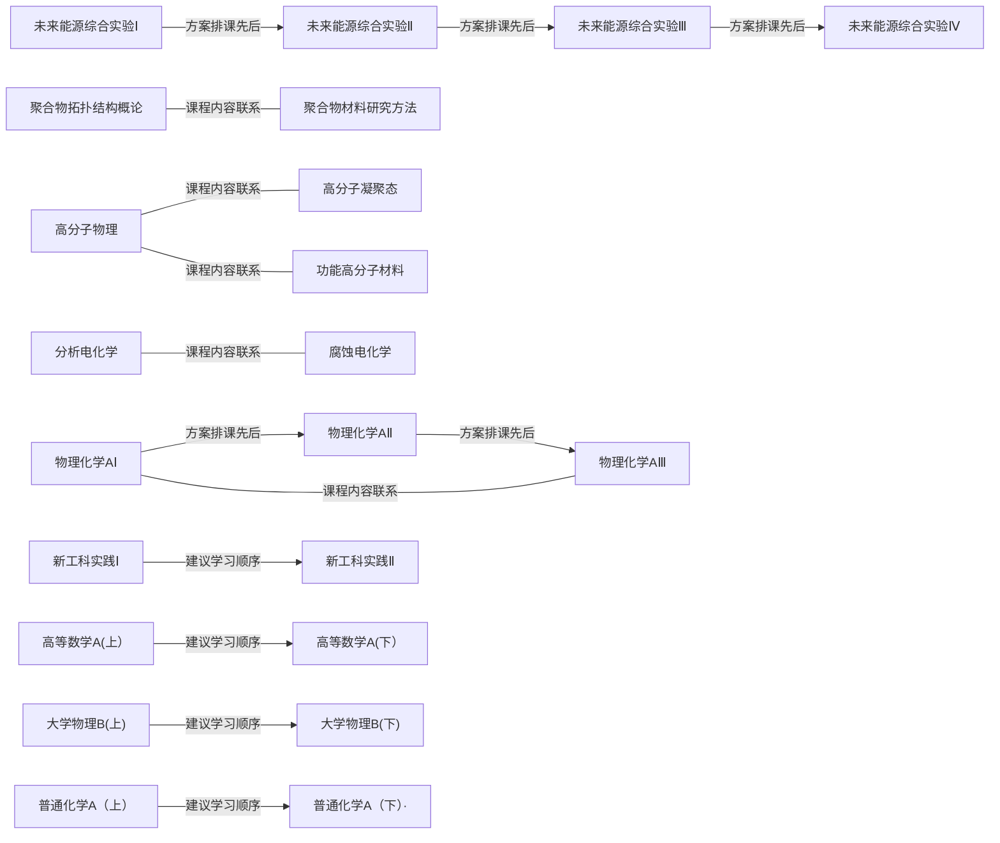

# 2025高分子材料与工程专业本科培养方案

智能材料与未来能源创新学院 · 高分子材料与工程 · 方案 96734 · 100 个不同课程或科研条目。

[官方 Word](../originals/plan-96734.docx) · [教务详情](https://fdjwgl.fudan.edu.cn/manager/bizType/2/major-program-search/info/96734?skipAuth=1) · [方案快照](../raw/plan-96734.json.gz) · [年级目录](../README.md)

## 课程关系图

图中展示部分关系。下表保留全部已建立的课程对，来源位置使用本方案 JSON Pointer。

## 先修与内容联系

| 类型 | 起点 | 终点 | 依据 | 原表定位 |
| --- | --- | --- | --- | --- |
| 建议学习顺序 | 普通化学A（上） (CHEM10003) | 普通化学A（下） (CHEM10004) | 同方案的课程题名具有连续分册或序号。  | `/courseModules/5/planCourses/6`、`/courseModules/5/planCourses/7` |
| 建议学习顺序 | 物理化学AⅠ (CHEM20005) | 物理化学AⅡ (CHEM20006) | 同方案的课程题名具有连续分册或序号。  | `/courseModules/6/planCourses/5`、`/courseModules/6/planCourses/6` |
| 建议学习顺序 | 物理化学AⅡ (CHEM20006) | 物理化学AⅢ (CHEM30004) | 同方案的课程题名具有连续分册或序号。  | `/courseModules/6/planCourses/6`、`/courseModules/6/planCourses/7` |
| 建议学习顺序 | 新工科实践Ⅰ (MASE30001) | 新工科实践Ⅱ (MASE40001) | 同方案的课程题名具有连续分册或序号。  | `/courseModules/25/planCourses/0`、`/courseModules/25/planCourses/4` |
| 建议学习顺序 | 未来能源综合实验Ⅰ (MASE40007) | 未来能源综合实验Ⅱ (MASE40009) | 同方案的课程题名具有连续分册或序号。  | `/courseModules/25/planCourses/3`、`/courseModules/25/planCourses/7` |
| 建议学习顺序 | 未来能源综合实验Ⅲ (MASE40008) | 未来能源综合实验Ⅳ (MASE40010) | 同方案的课程题名具有连续分册或序号。  | `/courseModules/25/planCourses/5`、`/courseModules/25/planCourses/9` |
| 建议学习顺序 | 未来能源综合实验Ⅱ (MASE40009) | 未来能源综合实验Ⅲ (MASE40008) | 同方案的课程题名具有连续分册或序号。  | `/courseModules/25/planCourses/7`、`/courseModules/25/planCourses/5` |
| 建议学习顺序 | 高等数学A(上） (MATH10015) | 高等数学A(下） (MATH10016) | 同方案的课程题名具有连续分册或序号。  | `/courseModules/5/planCourses/0`、`/courseModules/5/planCourses/1` |
| 建议学习顺序 | 大学物理B(上) (PHYS10003) | 大学物理B(下) (PHYS10004) | 同方案的课程题名具有连续分册或序号。  | `/courseModules/5/planCourses/2`、`/courseModules/5/planCourses/3` |
| 方案排课先后 | 普通化学A（上） (CHEM10003) | 普通化学A（下） (CHEM10004) | 同方案该课程全部明确数字学期均早于后者。  | `/courseModules/5/planCourses/6`、`/courseModules/5/planCourses/7` |
| 方案排课先后 | 物理化学AⅠ (CHEM20005) | 物理化学AⅡ (CHEM20006) | 同方案该课程全部明确数字学期均早于后者。  | `/courseModules/6/planCourses/5`、`/courseModules/6/planCourses/6` |
| 方案排课先后 | 物理化学AⅡ (CHEM20006) | 物理化学AⅢ (CHEM30004) | 同方案该课程全部明确数字学期均早于后者。  | `/courseModules/6/planCourses/6`、`/courseModules/6/planCourses/7` |
| 方案排课先后 | 未来能源综合实验Ⅰ (MASE40007) | 未来能源综合实验Ⅱ (MASE40009) | 同方案该课程全部明确数字学期均早于后者。  | `/courseModules/25/planCourses/3`、`/courseModules/25/planCourses/7` |
| 方案排课先后 | 未来能源综合实验Ⅲ (MASE40008) | 未来能源综合实验Ⅳ (MASE40010) | 同方案该课程全部明确数字学期均早于后者。  | `/courseModules/25/planCourses/5`、`/courseModules/25/planCourses/9` |
| 方案排课先后 | 未来能源综合实验Ⅱ (MASE40009) | 未来能源综合实验Ⅲ (MASE40008) | 同方案该课程全部明确数字学期均早于后者。  | `/courseModules/25/planCourses/7`、`/courseModules/25/planCourses/5` |
| 方案排课先后 | 高等数学A(上） (MATH10015) | 高等数学A(下） (MATH10016) | 同方案该课程全部明确数字学期均早于后者。  | `/courseModules/5/planCourses/0`、`/courseModules/5/planCourses/1` |
| 方案排课先后 | 大学物理B(上) (PHYS10003) | 大学物理B(下) (PHYS10004) | 同方案该课程全部明确数字学期均早于后者。  | `/courseModules/5/planCourses/2`、`/courseModules/5/planCourses/3` |
| 课程内容联系 | 有机化学C (CHEM10007) | 高等有机化学 (CHEM50003) | 本方案两门课程的题名均含“有机化学”，可据此对照这一主题。  | `/courseModules/6/planCourses/8`、`/courseModules/9/planCourses/15` |
| 课程内容联系 | 物理化学AⅠ (CHEM20005) | 物理化学AⅡ (CHEM20006) | 本方案两门课程的题名均含“物理化学”，可据此对照这一主题。  | `/courseModules/6/planCourses/5`、`/courseModules/6/planCourses/6` |
| 课程内容联系 | 物理化学AⅠ (CHEM20005) | 物理化学AⅢ (CHEM30004) | 本方案两门课程的题名均含“物理化学”，可据此对照这一主题。  | `/courseModules/6/planCourses/5`、`/courseModules/6/planCourses/7` |
| 课程内容联系 | 绿色电化学合成 (CHEM30001) | 分析电化学 (CHEM60016) | 本方案两门课程的题名均含“电化学”，可据此对照这一主题。  | `/courseModules/9/planCourses/13`、`/courseModules/12/planCourses/4` |
| 课程内容联系 | 无机化学 (CHEM30005) | 高等无机化学 (CHEM50002) | 本方案两门课程的题名均含“无机化学”，可据此对照这一主题。  | `/courseModules/9/planCourses/2`、`/courseModules/9/planCourses/14` |
| 课程内容联系 | 分析电化学 (CHEM60016) | 腐蚀电化学 (EST60053) | 本方案两门课程的题名均含“电化学”，可据此对照这一主题。  | `/courseModules/12/planCourses/4`、`/courseModules/17/planCourses/2` |
| 课程内容联系 | 高分子化学A (MASE30004) | 高分子物理 (MASE30005) | 本方案两门课程的题名均含“高分子”，可据此对照这一主题。  | `/courseModules/9/planCourses/4`、`/courseModules/9/planCourses/5` |
| 课程内容联系 | 高分子物理 (MASE30005) | 高分子反应工程 (MASE50006) | 本方案两门课程的题名均含“高分子”，可据此对照这一主题。  | `/courseModules/9/planCourses/5`、`/courseModules/9/planCourses/6` |
| 课程内容联系 | 高分子物理 (MASE30005) | 功能高分子材料 (MASE50030) | 本方案两门课程的题名均含“高分子”，可据此对照这一主题。  | `/courseModules/9/planCourses/5`、`/courseModules/16/planCourses/3` |
| 课程内容联系 | 高分子物理 (MASE30005) | 高分子凝聚态 (MASE60019) | 本方案两门课程的题名均含“高分子”，可据此对照这一主题。  | `/courseModules/9/planCourses/5`、`/courseModules/9/planCourses/17` |
| 课程内容联系 | 聚合物拓扑结构概论 (MASE50005) | 聚合物材料研究方法 (MASE50044) | 本方案两门课程的题名均含“聚合物”，可据此对照这一主题。  | `/courseModules/16/planCourses/0`、`/courseModules/16/planCourses/4` |

本次未从可定位的明确表述中确认课程对课程预修。学期安排、系列分册与编辑建议均保留各自的依据。

## 按原方案模块阅读

同一模块展示原表中的课程归属。模块内课程之间的先后仍须逐项查阅。

- **材料多尺度表征**　电子封装材料与工艺、电子显微分析技术、同步辐射表征与材料科学（原表模块 11）
- **能源催化**　溶胶-凝胶化学及实验、计算谱学原理、统计热力学、分析电化学、分子催化和表面化学、催化反应机理及其研究方法（原表模块 12）
- **新能源材料**　气体吸附与分离、新型能源材料、锂电池材料、氢能材料与技术、新能源转换材料及应用、氢能与燃料电池（原表模块 13）
- **未来光电材料**　光电子器件、光子晶体导论、有机光电材料与器件、太阳能电池器件物理（原表模块 14）
- **材料与界面**　生物医学光子学、印刷电子学、智能感知材料与器件、液晶物理学、无机功能材料、智能材料、现代涂料科学与技术、液晶材料与显示、生物医用材料的设计与应用、传感材料与器件原理（原表模块 15）
- **功能高分子**　聚合物拓扑结构概论、生物大分子、高分子流变学与加工、功能高分子材料、聚合物材料研究方法、高分子物理（II）、高性能树脂概述（原表模块 16）
- **智能工程材料**　腐蚀电化学、CAD工程制图、精细化工工艺学、工业产品检测技术、核电材料老化与管理（原表模块 17）
- **材料人工智能**　人工智能化学计算模拟、计算材料学、材料计算与设计（原表模块 18）
- **CTO**　职业责任与领导力、科技创新创业、运筹学、科技伦理前沿（原表模块 19）

## 课程表

同一课程在不同模块分别出现时，按原表逐行列出。季节字段保留原值。

| 课程 | 代码 | 学分 | 学期 | 模块 |
| --- | --- | ---: | --- | --- |
| 高等数学A(上） | MATH10015 | 5.0 | 第1学期 | 培养方案 / 专业培养课程 / 学科基础课程 |
| 高等数学A(下） | MATH10016 | 5.0 | 第2学期 | 培养方案 / 专业培养课程 / 学科基础课程 |
| 大学物理B(上) | PHYS10003 | 4.0 | 第1学期 | 培养方案 / 专业培养课程 / 学科基础课程 |
| 大学物理B(下) | PHYS10004 | 4.0 | 第2学期 | 培养方案 / 专业培养课程 / 学科基础课程 |
| 基础物理实验 | PHYS10005 | 2.0 | 第2学期 | 培养方案 / 专业培养课程 / 学科基础课程 |
| 普通化学实验I | CHEM10005 | 1.0 | 第1学期 | 培养方案 / 专业培养课程 / 学科基础课程 |
| 普通化学A（上） | CHEM10003 | 2.0 | 第1学期 | 培养方案 / 专业培养课程 / 学科基础课程 |
| 普通化学A（下） | CHEM10004 | 2.0 | 第2学期 | 培养方案 / 专业培养课程 / 学科基础课程 |
| Python程序设计 | GEEC10072 | 2.0 | 第2学期 | 培养方案 / 专业培养课程 / 学科基础课程 |
| 线性代数（理工类） | MATH10014 | 3.0 | 第1学期 | 培养方案 / 专业培养课程 / 专业核心教育课程 |
| 材料科学导论 | MASE20002 | 3.0 | 第3学期 | 培养方案 / 专业培养课程 / 专业核心教育课程 |
| 材料分析 | MASE30023 | 3.0 | 第6学期 | 培养方案 / 专业培养课程 / 专业核心教育课程 |
| 材料结构与性能 | MASE20010 | 3.0 | 第4学期 | 培养方案 / 专业培养课程 / 专业核心教育课程 |
| 材料制备与加工 | MASE30022 | 3.0 | 第5学期 | 培养方案 / 专业培养课程 / 专业核心教育课程 |
| 物理化学AⅠ | CHEM20005 | 3.0 | 第3学期 | 培养方案 / 专业培养课程 / 专业核心教育课程 |
| 物理化学AⅡ | CHEM20006 | 3.0 | 第4学期 | 培养方案 / 专业培养课程 / 专业核心教育课程 |
| 物理化学AⅢ | CHEM30004 | 3.0 | 第5学期 | 培养方案 / 专业培养课程 / 专业核心教育课程 |
| 有机化学C | CHEM10007 | 3.0 | 第2学期、第4学期 | 培养方案 / 专业培养课程 / 专业核心教育课程 |
| 化工基础 | CHEM30039 | 3.0 | 第5学期 | 培养方案 / 专业培养课程 / 专业核心教育课程 |
| 分析化学 | CHEM20015 | 2.0 | 第3学期 | 培养方案 / 专业培养课程 / 专业核心教育课程 |
| 未来能源前沿 | MASE30002 | 2.0 | 第2学期 | 培养方案 / 专业培养课程 / 专业核心教育课程 |
| 碳基能源化学 | CHEM30036 | 2.0 | AUTUMN | 培养方案 / 专业进阶模块I |
| 高能化学电源 | CHEM30028 | 2.0 | SPRING | 培养方案 / 专业进阶模块I |
| 无机化学 | CHEM30005 | 3.0 | 第5学期、第6学期 | 培养方案 / 专业进阶模块I |
| 谱学导论 | CHEM20007 | 3.0 | SPRING | 培养方案 / 专业进阶模块I |
| 高分子化学A | MASE30004 | 3.0 | 第5学期 | 培养方案 / 专业进阶模块I |
| 高分子物理 | MASE30005 | 3.0 | 第6学期 | 培养方案 / 专业进阶模块I |
| 高分子反应工程 | MASE50006 | 2.0 | 第6学期 | 培养方案 / 专业进阶模块I |
| 高分子材料化学 | MASE30011 | 2.0 | 第5学期 | 培养方案 / 专业进阶模块I |
| 高分子材料结构与性能 | MASE30010 | 3.0 | 第6学期 | 培养方案 / 专业进阶模块I |
| 材料化学 | MASE40015 | 2.0 | 第7学期 | 培养方案 / 专业进阶模块I |
| 材料失效分析 | MASE50020 | 2.0 | SPRING | 培养方案 / 专业进阶模块I |
| 多相催化原理 | CHEM70009 | 2.0 | SPRING | 培养方案 / 专业进阶模块I |
| 分子反应动力学 | CHEM70011 | 1.0 | AUTUMN | 培养方案 / 专业进阶模块I |
| 绿色电化学合成 | CHEM30001 | 2.0 | SPRING、AUTUMN | 培养方案 / 专业进阶模块I |
| 高等无机化学 | CHEM50002 | 3.0 | SPRING、AUTUMN | 培养方案 / 专业进阶模块I |
| 高等有机化学 | CHEM50003 | 3.0 | SPRING、AUTUMN | 培养方案 / 专业进阶模块I |
| 量子化学原理及应用 | CHEM50004 | 3.0 | SPRING、AUTUMN | 培养方案 / 专业进阶模块I |
| 高分子凝聚态 | MASE60019 | 3.0 | AUTUMN | 培养方案 / 专业进阶模块I |
| 固体材料学 | MASE50055 | 3.0 | AUTUMN | 培养方案 / 专业进阶模块I |
| 材料热力学 | MASE50056 | 3.0 | SPRING、AUTUMN | 培养方案 / 专业进阶模块I |
| 电子显微分析技术 | MASE50025 | 2.0 | AUTUMN | 培养方案 / 专业进阶模块II / 材料多尺度表征 |
| 电子封装材料与工艺 | MASE50017 | 2.0 | SPRING | 培养方案 / 专业进阶模块II / 材料多尺度表征 |
| 同步辐射表征与材料科学 | MASE60023 | 2.0 | SPRING | 培养方案 / 专业进阶模块II / 材料多尺度表征 |
| 计算谱学原理 | CHEM30033 | 2.0 | SPRING、AUTUMN | 培养方案 / 专业进阶模块II / 能源催化 |
| 溶胶-凝胶化学及实验 | CHEM30020 | 2.0 | SPRING | 培养方案 / 专业进阶模块II / 能源催化 |
| 统计热力学 | CHEM60005 | 3.0 | AUTUMN | 培养方案 / 专业进阶模块II / 能源催化 |
| 催化反应机理及其研究方法 | CHEM70030 | 2.0 | AUTUMN | 培养方案 / 专业进阶模块II / 能源催化 |
| 分析电化学 | CHEM60016 | 2.0 | SPRING | 培养方案 / 专业进阶模块II / 能源催化 |
| 分子催化和表面化学 | CHEM60018 | 2.0 | SPRING | 培养方案 / 专业进阶模块II / 能源催化 |
| 锂电池材料 | MASE50048 | 2.0 | SPRING、AUTUMN | 培养方案 / 专业进阶模块II / 新能源材料 |
| 新型能源材料 | MASE50024 | 2.0 | SPRING、AUTUMN | 培养方案 / 专业进阶模块II / 新能源材料 |
| 新能源转换材料及应用 | MASE50050 | 2.0 | SPRING | 培养方案 / 专业进阶模块II / 新能源材料 |
| 氢能材料与技术 | MASE50049 | 2.0 | SPRING | 培养方案 / 专业进阶模块II / 新能源材料 |
| 气体吸附与分离 | CHEM50001 | 2.0 | SPRING、AUTUMN | 培养方案 / 专业进阶模块II / 新能源材料 |
| 氢能与燃料电池 | MASE80001 | 2.0 | SPRING、AUTUMN | 培养方案 / 专业进阶模块II / 新能源材料 |
| 有机光电材料与器件 | MASE50051 | 2.0 | SPRING | 培养方案 / 专业进阶模块II / 未来光电材料 |
| 太阳能电池器件物理 | MASE50052 | 2.0 | SPRING | 培养方案 / 专业进阶模块II / 未来光电材料 |
| 光电子器件 | EST60046 | 3.0 | SPRING | 培养方案 / 专业进阶模块II / 未来光电材料 |
| 光子晶体导论 | MASE50033 | 2.0 | AUTUMN | 培养方案 / 专业进阶模块II / 未来光电材料 |
| 智能材料 | MASE50045 | 2.0 | AUTUMN | 培养方案 / 专业进阶模块II / 材料与界面 |
| 现代涂料科学与技术 | MASE60011 | 2.0 | SPRING | 培养方案 / 专业进阶模块II / 材料与界面 |
| 液晶物理学 | MASE50029 | 2.0 | SPRING | 培养方案 / 专业进阶模块II / 材料与界面 |
| 液晶材料与显示 | MASE60012 | 2.0 | AUTUMN | 培养方案 / 专业进阶模块II / 材料与界面 |
| 印刷电子学 | EST60049 | 2.0 | AUTUMN | 培养方案 / 专业进阶模块II / 材料与界面 |
| 无机功能材料 | MASE50031 | 2.0 | SPRING | 培养方案 / 专业进阶模块II / 材料与界面 |
| 生物医用材料的设计与应用 | MASE60017 | 2.0 | AUTUMN | 培养方案 / 专业进阶模块II / 材料与界面 |
| 传感材料与器件原理 | MASE60018 | 2.0 | SPRING、AUTUMN | 培养方案 / 专业进阶模块II / 材料与界面 |
| 生物医学光子学 | CHEM30044 | 2.0 | SPRING、AUTUMN | 培养方案 / 专业进阶模块II / 材料与界面 |
| 智能感知材料与器件 | MASE20012 | 3.0 | SPRING、AUTUMN | 培养方案 / 专业进阶模块II / 材料与界面 |
| 聚合物拓扑结构概论 | MASE50005 | 2.0 | SPRING | 培养方案 / 专业进阶模块II / 功能高分子 |
| 生物大分子 | MASE50013 | 2.0 | AUTUMN | 培养方案 / 专业进阶模块II / 功能高分子 |
| 高分子流变学与加工 | MASE50015 | 2.0 | SPRING | 培养方案 / 专业进阶模块II / 功能高分子 |
| 功能高分子材料 | MASE50030 | 2.0 | SPRING | 培养方案 / 专业进阶模块II / 功能高分子 |
| 聚合物材料研究方法 | MASE50044 | 2.0 | SPRING、AUTUMN | 培养方案 / 专业进阶模块II / 功能高分子 |
| 高分子物理（II） | MASE60005 | 3.0 | AUTUMN | 培养方案 / 专业进阶模块II / 功能高分子 |
| 高性能树脂概述 | MASE60021 | 2.0 | SPRING | 培养方案 / 专业进阶模块II / 功能高分子 |
| 精细化工工艺学 | MASE50043 | 2.0 | AUTUMN | 培养方案 / 专业进阶模块II / 智能工程材料 |
| 核电材料老化与管理 | MASE60015 | 2.0 | AUTUMN | 培养方案 / 专业进阶模块II / 智能工程材料 |
| 腐蚀电化学 | EST60053 | 2.0 | AUTUMN | 培养方案 / 专业进阶模块II / 智能工程材料 |
| 工业产品检测技术 | MASE60014 | 2.0 | AUTUMN | 培养方案 / 专业进阶模块II / 智能工程材料 |
| CAD工程制图 | MASE30026 | 2.0 | SPRING、AUTUMN | 培养方案 / 专业进阶模块II / 智能工程材料 |
| 人工智能化学计算模拟 | AIS531005 | 2.0 | SPRING | 培养方案 / 专业进阶模块II / 材料人工智能 |
| 材料计算与设计 | MASE60022 | 2.0 | AUTUMN | 培养方案 / 专业进阶模块II / 材料人工智能 |
| 计算材料学 | MASE50003 | 2.0 | SPRING、AUTUMN | 培养方案 / 专业进阶模块II / 材料人工智能 |
| 科技创新创业 | GEIN10012 | 2.0 | SPRING、AUTUMN | 培养方案 / 专业进阶模块II / CTO |
| 科技伦理前沿 | PHIL50045 | 2.0 | SPRING、AUTUMN | 培养方案 / 专业进阶模块II / CTO |
| 运筹学 | MSE20005 | 4.0 | AUTUMN | 培养方案 / 专业进阶模块II / CTO |
| 职业责任与领导力 | BA30032 | 3.0 | SPRING | 培养方案 / 专业进阶模块II / CTO |
| 新工科实践Ⅰ | MASE30001 | 2.0 | SPRING、AUTUMN | 融合创新能力 |
| 复芏计划(FDUROP) | 102 | 0.0 |  | 融合创新能力 |
| 其他 | 107 | 0.0 |  | 融合创新能力 |
| 未来能源综合实验Ⅰ | MASE40007 | 2.0 | 第3学期 | 融合创新能力 |
| 新工科实践Ⅱ | MASE40001 | 2.0 | SPRING、AUTUMN | 融合创新能力 |
| 未来能源综合实验Ⅲ | MASE40008 | 2.0 | 第5学期 | 融合创新能力 |
| 材料工程实验室安全与管理 | MASE40023 | 1.0 | AUTUMN | 融合创新能力 |
| 未来能源综合实验Ⅱ | MASE40009 | 2.0 | 第4学期 | 融合创新能力 |
| 科研项目申请及论文写作 | MASE40011 | 1.0 | 第7学期 | 融合创新能力 |
| 未来能源综合实验Ⅳ | MASE40010 | 2.0 | 第6学期 | 融合创新能力 |
| 毕业论文 | MASE40017 | 6.0 | 第8学期 | 融合创新能力 |
