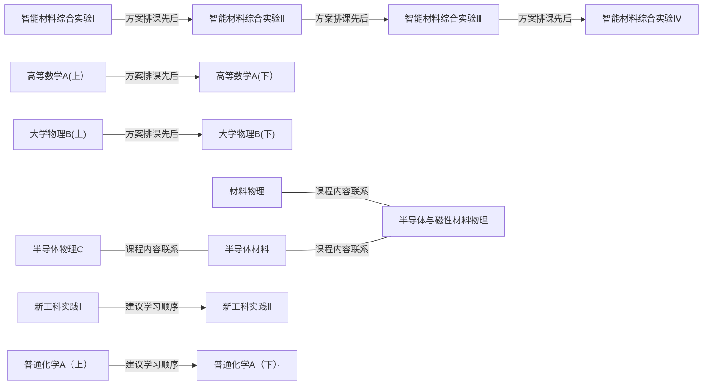

# 2025材料物理专业本科培养方案

智能材料与未来能源创新学院 · 材料物理 · 方案 96735 · 195 个不同课程或科研条目。

[官方 Word](../originals/plan-96735.docx) · [教务详情](https://fdjwgl.fudan.edu.cn/manager/bizType/2/major-program-search/info/96735?skipAuth=1) · [方案快照](../raw/plan-96735.json.gz) · [年级目录](../README.md)

## 修读导读

- **建议先学**　《智能材料综合实验Ⅰ》（`MASE40003`） → 《智能材料综合实验Ⅱ》（`MASE40004`） → 《智能材料综合实验Ⅲ》（`MASE40005`）。题名列出连续册次或级别。可沿用前一阶段的实验记录格式，对照后来新增的测量方法和误差来源。方案分别列在第4、5、6学期。

- **可以对照着读**　《材料物理》（`MASE30012`）与《半导体与磁性材料物理》（`MASE50058`）。两门课的题名都涉及材料物理。对同一种材料，比较结构特征与可测量的物理性质怎样对应。

- **查模块选课**　《智能材料前沿》（`MASE40002`）、《材料科学导论》（`MASE20002`）列在“专业核心教育课程”中。模块说明写明“要求修读34学分（部分课程学分可用荣誉课程学分替换）”。原表见 `/courseModules/7`。

## 课程关系图

图中展示部分关系。下表保留全部已建立的课程对，来源位置使用本方案 JSON Pointer。

## 先修与内容联系

| 类型 | 起点 | 终点 | 依据 | 原表定位 |
| --- | --- | --- | --- | --- |
| 建议学习顺序 | 普通化学A（上） (CHEM10003) | 普通化学A（下） (CHEM10004) | 同方案的课程题名具有连续分册或序号。  | `/courseModules/6/planCourses/6`、`/courseModules/6/planCourses/7` |
| 建议学习顺序 | 新工科实践Ⅰ (MASE30001) | 新工科实践Ⅱ (MASE40001) | 同方案的课程题名具有连续分册或序号。  | `/courseModules/24/planCourses/0`、`/courseModules/24/planCourses/4` |
| 建议学习顺序 | 智能材料综合实验Ⅰ (MASE40003) | 智能材料综合实验Ⅱ (MASE40004) | 同方案的课程题名具有连续分册或序号。  | `/courseModules/24/planCourses/3`、`/courseModules/24/planCourses/5` |
| 建议学习顺序 | 智能材料综合实验Ⅱ (MASE40004) | 智能材料综合实验Ⅲ (MASE40005) | 同方案的课程题名具有连续分册或序号。  | `/courseModules/24/planCourses/5`、`/courseModules/24/planCourses/7` |
| 建议学习顺序 | 智能材料综合实验Ⅲ (MASE40005) | 智能材料综合实验Ⅳ (MASE40006) | 同方案的课程题名具有连续分册或序号。  | `/courseModules/24/planCourses/7`、`/courseModules/24/planCourses/9` |
| 建议学习顺序 | 高等数学A(上） (MATH10015) | 高等数学A(下） (MATH10016) | 同方案的课程题名具有连续分册或序号。  | `/courseModules/6/planCourses/0`、`/courseModules/6/planCourses/1` |
| 建议学习顺序 | 大学物理B(上) (PHYS10003) | 大学物理B(下) (PHYS10004) | 同方案的课程题名具有连续分册或序号。  | `/courseModules/6/planCourses/2`、`/courseModules/6/planCourses/3` |
| 方案排课先后 | 普通化学A（上） (CHEM10003) | 普通化学A（下） (CHEM10004) | 同方案该课程全部明确数字学期均早于后者。  | `/courseModules/6/planCourses/6`、`/courseModules/6/planCourses/7` |
| 方案排课先后 | 智能材料综合实验Ⅰ (MASE40003) | 智能材料综合实验Ⅱ (MASE40004) | 同方案该课程全部明确数字学期均早于后者。  | `/courseModules/24/planCourses/3`、`/courseModules/24/planCourses/5` |
| 方案排课先后 | 智能材料综合实验Ⅱ (MASE40004) | 智能材料综合实验Ⅲ (MASE40005) | 同方案该课程全部明确数字学期均早于后者。  | `/courseModules/24/planCourses/5`、`/courseModules/24/planCourses/7` |
| 方案排课先后 | 智能材料综合实验Ⅲ (MASE40005) | 智能材料综合实验Ⅳ (MASE40006) | 同方案该课程全部明确数字学期均早于后者。  | `/courseModules/24/planCourses/7`、`/courseModules/24/planCourses/9` |
| 方案排课先后 | 高等数学A(上） (MATH10015) | 高等数学A(下） (MATH10016) | 同方案该课程全部明确数字学期均早于后者。  | `/courseModules/6/planCourses/0`、`/courseModules/6/planCourses/1` |
| 方案排课先后 | 大学物理B(上) (PHYS10003) | 大学物理B(下) (PHYS10004) | 同方案该课程全部明确数字学期均早于后者。  | `/courseModules/6/planCourses/2`、`/courseModules/6/planCourses/3` |
| 课程内容联系 | 材料物理 (MASE30012) | 半导体与磁性材料物理 (MASE50058) | 本方案两门课程的题名均含“材料物理”，可据此对照这一主题。  | `/courseModules/7/planCourses/10`、`/courseModules/12/planCourses/6` |
| 课程内容联系 | 半导体物理C (MASE30013) | 半导体材料 (MASE50023) | 本方案两门课程的题名均含“半导体”，可据此对照这一主题。  | `/courseModules/10/planCourses/2`、`/courseModules/12/planCourses/0` |
| 课程内容联系 | 半导体材料 (MASE50023) | 半导体与磁性材料物理 (MASE50058) | 本方案两门课程的题名均含“半导体”，可据此对照这一主题。  | `/courseModules/12/planCourses/0`、`/courseModules/12/planCourses/6` |

本次未从可定位的明确表述中确认课程对课程预修。学期安排、系列分册与编辑建议均保留各自的依据。

## 按原方案模块阅读

同一模块展示原表中的课程归属。模块内课程之间的先后仍须逐项查阅。

- **电子与信息**　微弱信号检测技术、光波导理论与技术、信息安全原理与应用、器件与集成电路原理、半导体材料、电子与信息材料、半导体与磁性材料物理（原表模块 12）
- **材料多尺度表征**　电子封装材料与工艺、电子显微分析技术、同步辐射表征与材料科学（原表模块 13）
- **未来光电材料**　光电子器件、光子晶体导论、有机光电材料与器件、太阳能电池器件物理（原表模块 14）
- **材料与界面**　生物医学光子学、印刷电子学、智能感知材料与器件、液晶物理学、无机功能材料、智能材料、现代涂料科学与技术、液晶材料与显示、生物医用材料的设计与应用、传感材料与器件原理（原表模块 15）
- **智能工程材料**　腐蚀电化学、CAD工程制图、精细化工工艺学、工业产品检测技术、核电材料老化与管理（原表模块 16）
- **材料人工智能**　人工智能化学计算模拟、计算材料学、材料计算与设计（原表模块 17）
- **CTO**　职业责任与领导力、科技创新创业、运筹学、科技伦理前沿（原表模块 18）

## 课程表

同一课程在不同模块分别出现时，按原表逐行列出。季节字段保留原值。

| 课程 | 代码 | 学分 | 学期 | 模块 |
| --- | --- | ---: | --- | --- |
| 木兰拳 | GEPE10007 | 1.0 | AUTUMN | 培养方案 / 通识教育课程 / 通识教育专项教育课程 / 体育课程 |
| 木兰扇 | GEPE10008 | 1.0 | SPRING | 培养方案 / 通识教育课程 / 通识教育专项教育课程 / 体育课程 |
| 十六式太极拳 | GEPE10009 | 1.0 | AUTUMN | 培养方案 / 通识教育课程 / 通识教育专项教育课程 / 体育课程 |
| 陈式太极拳 | GEPE10010 | 1.0 | SPRING | 培养方案 / 通识教育课程 / 通识教育专项教育课程 / 体育课程 |
| 长拳二段 | GEPE10011 | 1.0 | AUTUMN | 培养方案 / 通识教育课程 / 通识教育专项教育课程 / 体育课程 |
| 长拳三段 | GEPE10012 | 1.0 | SPRING | 培养方案 / 通识教育课程 / 通识教育专项教育课程 / 体育课程 |
| 段位剑术二段 | GEPE10013 | 1.0 | AUTUMN | 培养方案 / 通识教育课程 / 通识教育专项教育课程 / 体育课程 |
| 段位剑术三段 | GEPE10014 | 1.0 | SPRING | 培养方案 / 通识教育课程 / 通识教育专项教育课程 / 体育课程 |
| 太极推手（一） | GEPE10015 | 1.0 | AUTUMN | 培养方案 / 通识教育课程 / 通识教育专项教育课程 / 体育课程 |
| 太极推手（二） | GEPE10016 | 1.0 | SPRING | 培养方案 / 通识教育课程 / 通识教育专项教育课程 / 体育课程 |
| 咏春拳（一） | GEPE10017 | 1.0 | AUTUMN | 培养方案 / 通识教育课程 / 通识教育专项教育课程 / 体育课程 |
| 咏春拳（二） | GEPE10018 | 1.0 | SPRING | 培养方案 / 通识教育课程 / 通识教育专项教育课程 / 体育课程 |
| 高尔夫（一） | GEPE10019 | 1.0 | AUTUMN | 培养方案 / 通识教育课程 / 通识教育专项教育课程 / 体育课程 |
| 高尔夫（二） | GEPE10020 | 1.0 | SPRING | 培养方案 / 通识教育课程 / 通识教育专项教育课程 / 体育课程 |
| 篮球（一） | GEPE10021 | 1.0 | AUTUMN | 培养方案 / 通识教育课程 / 通识教育专项教育课程 / 体育课程 |
| 篮球（二） | GEPE10022 | 1.0 | SPRING | 培养方案 / 通识教育课程 / 通识教育专项教育课程 / 体育课程 |
| 排球（一） | GEPE10023 | 1.0 | AUTUMN | 培养方案 / 通识教育课程 / 通识教育专项教育课程 / 体育课程 |
| 排球（二） | GEPE10024 | 1.0 | SPRING | 培养方案 / 通识教育课程 / 通识教育专项教育课程 / 体育课程 |
| 足球（一） | GEPE10025 | 1.0 | AUTUMN | 培养方案 / 通识教育课程 / 通识教育专项教育课程 / 体育课程 |
| 足球（二） | GEPE10026 | 1.0 | SPRING | 培养方案 / 通识教育课程 / 通识教育专项教育课程 / 体育课程 |
| 乒乓球（一） | GEPE10027 | 1.0 | AUTUMN | 培养方案 / 通识教育课程 / 通识教育专项教育课程 / 体育课程 |
| 乒乓球（二） | GEPE10028 | 1.0 | SPRING | 培养方案 / 通识教育课程 / 通识教育专项教育课程 / 体育课程 |
| 羽毛球（一） | GEPE10029 | 1.0 | AUTUMN | 培养方案 / 通识教育课程 / 通识教育专项教育课程 / 体育课程 |
| 羽毛球（二） | GEPE10030 | 1.0 | SPRING | 培养方案 / 通识教育课程 / 通识教育专项教育课程 / 体育课程 |
| 网球（一） | GEPE10031 | 1.0 | AUTUMN | 培养方案 / 通识教育课程 / 通识教育专项教育课程 / 体育课程 |
| 网球（二） | GEPE10032 | 1.0 | SPRING | 培养方案 / 通识教育课程 / 通识教育专项教育课程 / 体育课程 |
| 棒球（一） | GEPE10033 | 1.0 | AUTUMN | 培养方案 / 通识教育课程 / 通识教育专项教育课程 / 体育课程 |
| 棒球（二） | GEPE10034 | 1.0 | SPRING | 培养方案 / 通识教育课程 / 通识教育专项教育课程 / 体育课程 |
| 垒球（一） | GEPE10035 | 1.0 | AUTUMN | 培养方案 / 通识教育课程 / 通识教育专项教育课程 / 体育课程 |
| 垒球（二） | GEPE10036 | 1.0 | SPRING | 培养方案 / 通识教育课程 / 通识教育专项教育课程 / 体育课程 |
| 板球（一） | GEPE10037 | 1.0 | AUTUMN | 培养方案 / 通识教育课程 / 通识教育专项教育课程 / 体育课程 |
| 板球（二） | GEPE10038 | 1.0 | SPRING | 培养方案 / 通识教育课程 / 通识教育专项教育课程 / 体育课程 |
| 体育舞蹈（一） | GEPE10039 | 1.0 | AUTUMN | 培养方案 / 通识教育课程 / 通识教育专项教育课程 / 体育课程 |
| 体育舞蹈（二） | GEPE10040 | 1.0 | SPRING | 培养方案 / 通识教育课程 / 通识教育专项教育课程 / 体育课程 |
| 击剑（一） | GEPE10041 | 1.0 | AUTUMN | 培养方案 / 通识教育课程 / 通识教育专项教育课程 / 体育课程 |
| 击剑（二） | GEPE10042 | 1.0 | SPRING | 培养方案 / 通识教育课程 / 通识教育专项教育课程 / 体育课程 |
| 综合体育（一） | GEPE10043 | 1.0 | AUTUMN | 培养方案 / 通识教育课程 / 通识教育专项教育课程 / 体育课程 |
| 综合体育（二） | GEPE10044 | 1.0 | SPRING | 培养方案 / 通识教育课程 / 通识教育专项教育课程 / 体育课程 |
| 艺术体操（一） | GEPE10045 | 1.0 | AUTUMN | 培养方案 / 通识教育课程 / 通识教育专项教育课程 / 体育课程 |
| 艺术体操（二） | GEPE10046 | 1.0 | SPRING | 培养方案 / 通识教育课程 / 通识教育专项教育课程 / 体育课程 |
| 形体健美（一） | GEPE10047 | 1.0 | AUTUMN | 培养方案 / 通识教育课程 / 通识教育专项教育课程 / 体育课程 |
| 形体健美（二） | GEPE10048 | 1.0 | SPRING | 培养方案 / 通识教育课程 / 通识教育专项教育课程 / 体育课程 |
| 健美操（一） | GEPE10049 | 1.0 | AUTUMN | 培养方案 / 通识教育课程 / 通识教育专项教育课程 / 体育课程 |
| 健美操（二） | GEPE10050 | 1.0 | SPRING | 培养方案 / 通识教育课程 / 通识教育专项教育课程 / 体育课程 |
| 健美（一） | GEPE10051 | 1.0 | AUTUMN | 培养方案 / 通识教育课程 / 通识教育专项教育课程 / 体育课程 |
| 健美（二） | GEPE10052 | 1.0 | SPRING | 培养方案 / 通识教育课程 / 通识教育专项教育课程 / 体育课程 |
| 游泳（一） | GEPE10053 | 1.0 | AUTUMN | 培养方案 / 通识教育课程 / 通识教育专项教育课程 / 体育课程 |
| 游泳（二） | GEPE10054 | 1.0 | SPRING | 培养方案 / 通识教育课程 / 通识教育专项教育课程 / 体育课程 |
| 传统体育养生-八段锦 | GEPE10055 | 1.0 | SPRING | 培养方案 / 通识教育课程 / 通识教育专项教育课程 / 体育课程 |
| 传统体育养生-易筋经 | GEPE10056 | 1.0 | AUTUMN | 培养方案 / 通识教育课程 / 通识教育专项教育课程 / 体育课程 |
| 传统体育养生-五禽戏 | GEPE10057 | 1.0 | SPRING | 培养方案 / 通识教育课程 / 通识教育专项教育课程 / 体育课程 |
| 传统体育养生-六字诀 | GEPE10058 | 1.0 | AUTUMN | 培养方案 / 通识教育课程 / 通识教育专项教育课程 / 体育课程 |
| 手球（一） | GEPE10059 | 1.0 | AUTUMN | 培养方案 / 通识教育课程 / 通识教育专项教育课程 / 体育课程 |
| 手球（二） | GEPE10060 | 1.0 | SPRING | 培养方案 / 通识教育课程 / 通识教育专项教育课程 / 体育课程 |
| 气排球（一） | GEPE10061 | 1.0 | AUTUMN | 培养方案 / 通识教育课程 / 通识教育专项教育课程 / 体育课程 |
| 气排球（二） | GEPE10062 | 1.0 | SPRING | 培养方案 / 通识教育课程 / 通识教育专项教育课程 / 体育课程 |
| 有氧塑身（一） | GEPE10063 | 1.0 | AUTUMN | 培养方案 / 通识教育课程 / 通识教育专项教育课程 / 体育课程 |
| 有氧塑身（二） | GEPE10064 | 1.0 | SPRING | 培养方案 / 通识教育课程 / 通识教育专项教育课程 / 体育课程 |
| 游泳救生（一） | GEPE10065 | 1.0 | AUTUMN | 培养方案 / 通识教育课程 / 通识教育专项教育课程 / 体育课程 |
| 游泳救生（二） | GEPE10066 | 1.0 | SPRING | 培养方案 / 通识教育课程 / 通识教育专项教育课程 / 体育课程 |
| 龙狮运动（一） | GEPE10067 | 1.0 | AUTUMN | 培养方案 / 通识教育课程 / 通识教育专项教育课程 / 体育课程 |
| 龙狮运动（二） | GEPE10068 | 1.0 | SPRING | 培养方案 / 通识教育课程 / 通识教育专项教育课程 / 体育课程 |
| 射艺（一） | GEPE10069 | 1.0 | AUTUMN | 培养方案 / 通识教育课程 / 通识教育专项教育课程 / 体育课程 |
| 射艺（二） | GEPE10070 | 1.0 | SPRING | 培养方案 / 通识教育课程 / 通识教育专项教育课程 / 体育课程 |
| 导引养生（一） | GEPE10071 | 1.0 | AUTUMN | 培养方案 / 通识教育课程 / 通识教育专项教育课程 / 体育课程 |
| 导引养生（二） | GEPE10072 | 1.0 | SPRING | 培养方案 / 通识教育课程 / 通识教育专项教育课程 / 体育课程 |
| 防身术（一） | GEPE10073 | 1.0 | AUTUMN | 培养方案 / 通识教育课程 / 通识教育专项教育课程 / 体育课程 |
| 防身术（二） | GEPE10074 | 1.0 | SPRING | 培养方案 / 通识教育课程 / 通识教育专项教育课程 / 体育课程 |
| 篮球（提高一） | GEPE20003 | 1.0 | AUTUMN | 培养方案 / 通识教育课程 / 通识教育专项教育课程 / 体育课程 |
| 篮球（提高二） | GEPE20004 | 1.0 | SPRING | 培养方案 / 通识教育课程 / 通识教育专项教育课程 / 体育课程 |
| 排球（提高一） | GEPE20005 | 1.0 | AUTUMN | 培养方案 / 通识教育课程 / 通识教育专项教育课程 / 体育课程 |
| 排球（提高二） | GEPE20006 | 1.0 | SPRING | 培养方案 / 通识教育课程 / 通识教育专项教育课程 / 体育课程 |
| 足球（提高一） | GEPE20007 | 1.0 | AUTUMN | 培养方案 / 通识教育课程 / 通识教育专项教育课程 / 体育课程 |
| 足球（提高二） | GEPE20008 | 1.0 | SPRING | 培养方案 / 通识教育课程 / 通识教育专项教育课程 / 体育课程 |
| 网球（提高一） | GEPE20009 | 1.0 | AUTUMN | 培养方案 / 通识教育课程 / 通识教育专项教育课程 / 体育课程 |
| 网球（提高二） | GEPE20010 | 1.0 | SPRING | 培养方案 / 通识教育课程 / 通识教育专项教育课程 / 体育课程 |
| 羽毛球（提高一） | GEPE20011 | 1.0 | AUTUMN | 培养方案 / 通识教育课程 / 通识教育专项教育课程 / 体育课程 |
| 羽毛球（提高二） | GEPE20012 | 1.0 | SPRING | 培养方案 / 通识教育课程 / 通识教育专项教育课程 / 体育课程 |
| 乒乓球（提高一） | GEPE20013 | 1.0 | AUTUMN | 培养方案 / 通识教育课程 / 通识教育专项教育课程 / 体育课程 |
| 乒乓球（提高二） | GEPE20014 | 1.0 | SPRING | 培养方案 / 通识教育课程 / 通识教育专项教育课程 / 体育课程 |
| 健美操（提高一） | GEPE20015 | 1.0 | AUTUMN | 培养方案 / 通识教育课程 / 通识教育专项教育课程 / 体育课程 |
| 健美操（提高二） | GEPE20016 | 1.0 | SPRING | 培养方案 / 通识教育课程 / 通识教育专项教育课程 / 体育课程 |
| 旱地冰球（一） | GEPE10075 | 1.0 | AUTUMN | 培养方案 / 通识教育课程 / 通识教育专项教育课程 / 体育课程 |
| 旱地冰球（二） | GEPE10076 | 1.0 | SPRING | 培养方案 / 通识教育课程 / 通识教育专项教育课程 / 体育课程 |
| 健康体适能（一） | GEPE10077 | 1.0 | AUTUMN | 培养方案 / 通识教育课程 / 通识教育专项教育课程 / 体育课程 |
| 健康体适能（二） | GEPE10078 | 1.0 | SPRING | 培养方案 / 通识教育课程 / 通识教育专项教育课程 / 体育课程 |
| 瑜伽（一） | GEPE10079 | 1.0 | AUTUMN | 培养方案 / 通识教育课程 / 通识教育专项教育课程 / 体育课程 |
| 瑜伽（二） | GEPE10080 | 1.0 | SPRING | 培养方案 / 通识教育课程 / 通识教育专项教育课程 / 体育课程 |
| 极限飞盘（一） | GEPE10081 | 1.0 | AUTUMN | 培养方案 / 通识教育课程 / 通识教育专项教育课程 / 体育课程 |
| 极限飞盘（二） | GEPE10082 | 1.0 | SPRING | 培养方案 / 通识教育课程 / 通识教育专项教育课程 / 体育课程 |
| 武术兵道（一） | GEPE10083 | 1.0 | AUTUMN | 培养方案 / 通识教育课程 / 通识教育专项教育课程 / 体育课程 |
| 武术兵道（二） | GEPE10084 | 1.0 | SPRING | 培养方案 / 通识教育课程 / 通识教育专项教育课程 / 体育课程 |
| 毽球（一） | GEPE10085 | 1.0 | AUTUMN | 培养方案 / 通识教育课程 / 通识教育专项教育课程 / 体育课程 |
| 毽球（二） | GEPE10086 | 1.0 | SPRING | 培养方案 / 通识教育课程 / 通识教育专项教育课程 / 体育课程 |
| 高级体育训练（一） | GEPE40001 | 1.0 | AUTUMN | 培养方案 / 通识教育课程 / 通识教育专项教育课程 / 体育课程 |
| 高级体育训练（二） | GEPE40002 | 1.0 | SPRING | 培养方案 / 通识教育课程 / 通识教育专项教育课程 / 体育课程 |
| 高级体育训练（三） | GEPE40003 | 1.0 | AUTUMN | 培养方案 / 通识教育课程 / 通识教育专项教育课程 / 体育课程 |
| 高级体育训练（四） | GEPE40004 | 1.0 | SPRING | 培养方案 / 通识教育课程 / 通识教育专项教育课程 / 体育课程 |
| 花样跳绳（一） | GEPE10003 | 1.0 | AUTUMN | 培养方案 / 通识教育课程 / 通识教育专项教育课程 / 体育课程 |
| 花样跳绳（二） | GEPE10004 | 1.0 | SPRING | 培养方案 / 通识教育课程 / 通识教育专项教育课程 / 体育课程 |
| 花样跳绳-提高（一） | GEPE20001 | 1.0 | AUTUMN | 培养方案 / 通识教育课程 / 通识教育专项教育课程 / 体育课程 |
| 花样跳绳-提高（二） | GEPE20002 | 1.0 | SPRING | 培养方案 / 通识教育课程 / 通识教育专项教育课程 / 体育课程 |
| 跆拳道（一） | GEPE10005 | 1.0 | AUTUMN | 培养方案 / 通识教育课程 / 通识教育专项教育课程 / 体育课程 |
| 跆拳道（二） | GEPE10006 | 1.0 | SPRING | 培养方案 / 通识教育课程 / 通识教育专项教育课程 / 体育课程 |
| 射击（一） | GEPE10001 | 1.0 | AUTUMN | 培养方案 / 通识教育课程 / 通识教育专项教育课程 / 体育课程 |
| 射击（二） | GEPE10002 | 1.0 | SPRING | 培养方案 / 通识教育课程 / 通识教育专项教育课程 / 体育课程 |
| 中国传统舞蹈（一） | GEPE10087 | 1.0 |  | 培养方案 / 通识教育课程 / 通识教育专项教育课程 / 体育课程 |
| 中国传统舞蹈（二） | GEPE10088 | 1.0 |  | 培养方案 / 通识教育课程 / 通识教育专项教育课程 / 体育课程 |
| 中国传统舞蹈（提高一） | GEPE10089 | 1.0 |  | 培养方案 / 通识教育课程 / 通识教育专项教育课程 / 体育课程 |
| 中国传统舞蹈（提高二） | GEPE10090 | 1.0 |  | 培养方案 / 通识教育课程 / 通识教育专项教育课程 / 体育课程 |
| 匹克球（一） | GEPE10091 | 1.0 |  | 培养方案 / 通识教育课程 / 通识教育专项教育课程 / 体育课程 |
| 匹克球（二） | GEPE10092 | 1.0 |  | 培养方案 / 通识教育课程 / 通识教育专项教育课程 / 体育课程 |
| 武术短兵（一） | GEPE10093 | 1.0 |  | 培养方案 / 通识教育课程 / 通识教育专项教育课程 / 体育课程 |
| 武术短兵（二） | GEPE10094 | 1.0 |  | 培养方案 / 通识教育课程 / 通识教育专项教育课程 / 体育课程 |
| 中国传统舞蹈（提高一） | GEPE20017 | 1.0 |  | 培养方案 / 通识教育课程 / 通识教育专项教育课程 / 体育课程 |
| 中国传统舞蹈（提高二） | GEPE20018 | 1.0 |  | 培养方案 / 通识教育课程 / 通识教育专项教育课程 / 体育课程 |
| 高等数学A(上） | MATH10015 | 5.0 | 第1学期 | 培养方案 / 专业培养课程 / 学科基础课程 |
| 高等数学A(下） | MATH10016 | 5.0 | 第2学期 | 培养方案 / 专业培养课程 / 学科基础课程 |
| 大学物理B(上) | PHYS10003 | 4.0 | 第1学期 | 培养方案 / 专业培养课程 / 学科基础课程 |
| 大学物理B(下) | PHYS10004 | 4.0 | 第2学期 | 培养方案 / 专业培养课程 / 学科基础课程 |
| 基础物理实验 | PHYS10005 | 2.0 | 第2学期 | 培养方案 / 专业培养课程 / 学科基础课程 |
| 普通化学实验I | CHEM10005 | 1.0 | 第1学期 | 培养方案 / 专业培养课程 / 学科基础课程 |
| 普通化学A（上） | CHEM10003 | 2.0 | 第1学期 | 培养方案 / 专业培养课程 / 学科基础课程 |
| 普通化学A（下） | CHEM10004 | 2.0 | 第2学期 | 培养方案 / 专业培养课程 / 学科基础课程 |
| Python程序设计 | GEEC10072 | 2.0 | 第2学期 | 培养方案 / 专业培养课程 / 学科基础课程 |
| 智能材料前沿 | MASE40002 | 2.0 | 第2学期 | 培养方案 / 专业培养课程 / 专业核心教育课程 |
| 线性代数（理工类） | MATH10014 | 3.0 | 第1学期 | 培养方案 / 专业培养课程 / 专业核心教育课程 |
| 材料科学导论 | MASE20002 | 3.0 | 第3学期 | 培养方案 / 专业培养课程 / 专业核心教育课程 |
| 材料分析 | MASE30023 | 3.0 | 第6学期 | 培养方案 / 专业培养课程 / 专业核心教育课程 |
| 材料结构与性能 | MASE20010 | 3.0 | 第4学期 | 培养方案 / 专业培养课程 / 专业核心教育课程 |
| 材料制备与加工 | MASE30022 | 3.0 | 第5学期 | 培养方案 / 专业培养课程 / 专业核心教育课程 |
| 物理化学B | MASE20005 | 4.0 | 第3学期 | 培养方案 / 专业培养课程 / 专业核心教育课程 |
| 材料力学 | MASE20006 | 2.0 | 第4学期 | 培养方案 / 专业培养课程 / 专业核心教育课程 |
| 近代物理A | PHYS20007 | 4.0 | 第3学期 | 培养方案 / 专业培养课程 / 专业核心教育课程 |
| 经典物理A | PHYS20008 | 4.0 | 第4学期 | 培养方案 / 专业培养课程 / 专业核心教育课程 |
| 材料物理 | MASE30012 | 3.0 | 第5学期 | 培养方案 / 专业培养课程 / 专业核心教育课程 |
| 模拟与数字电子线路 | MASE20004 | 3.0 | 第4学期 | 培养方案 / 专业进阶模块I |
| 数学物理方法 | MASE20003 | 4.0 | 第3学期 | 培养方案 / 专业进阶模块I |
| 半导体物理C | MASE30013 | 3.0 | 第5学期 | 培养方案 / 专业进阶模块I |
| 材料与器件中的AI应用 | AIS310015 | 2.0 | 第4学期 | 培养方案 / 专业进阶模块I |
| 计算物理 | MASE50039 | 2.0 | 第6学期 | 培养方案 / 专业进阶模块I |
| 真空物理与技术 | MASE30017 | 3.0 | 第5学期 | 培养方案 / 专业进阶模块I |
| 薄膜技术 | MASE30019 | 3.0 | 第6学期 | 培养方案 / 专业进阶模块I |
| 光电技术与器件 | MASE40020 | 3.0 | 第7学期 | 培养方案 / 专业进阶模块I |
| 表面分析 | MASE30018 | 3.0 | 第6学期 | 培养方案 / 专业进阶模块I |
| 固体物理导论 | EST30011 | 4.0 | 第5学期 | 培养方案 / 专业进阶模块I |
| 固体材料学 | MASE50055 | 3.0 | AUTUMN | 培养方案 / 专业进阶模块I |
| 材料热力学 | MASE50056 | 3.0 | SPRING、AUTUMN | 培养方案 / 专业进阶模块I |
| 半导体材料 | MASE50023 | 2.0 | AUTUMN | 培养方案 / 专业进阶模块II / 电子与信息 |
| 电子与信息材料 | MASE50026 | 3.0 | AUTUMN | 培养方案 / 专业进阶模块II / 电子与信息 |
| 微弱信号检测技术 | EST50041 | 3.0 | AUTUMN | 培养方案 / 专业进阶模块II / 电子与信息 |
| 信息安全原理与应用 | EST60051 | 3.0 | SPRING | 培养方案 / 专业进阶模块II / 电子与信息 |
| 光波导理论与技术 | EST50042 | 3.0 | AUTUMN | 培养方案 / 专业进阶模块II / 电子与信息 |
| 器件与集成电路原理 | MASE40024 | 4.0 | SPRING | 培养方案 / 专业进阶模块II / 电子与信息 |
| 半导体与磁性材料物理 | MASE50058 | 3.0 | SPRING、AUTUMN | 培养方案 / 专业进阶模块II / 电子与信息 |
| 电子显微分析技术 | MASE50025 | 2.0 | AUTUMN | 培养方案 / 专业进阶模块II / 材料多尺度表征 |
| 电子封装材料与工艺 | MASE50017 | 2.0 | SPRING | 培养方案 / 专业进阶模块II / 材料多尺度表征 |
| 同步辐射表征与材料科学 | MASE60023 | 2.0 | SPRING | 培养方案 / 专业进阶模块II / 材料多尺度表征 |
| 有机光电材料与器件 | MASE50051 | 2.0 | SPRING | 培养方案 / 专业进阶模块II / 未来光电材料 |
| 太阳能电池器件物理 | MASE50052 | 2.0 | SPRING | 培养方案 / 专业进阶模块II / 未来光电材料 |
| 光电子器件 | EST60046 | 3.0 | SPRING | 培养方案 / 专业进阶模块II / 未来光电材料 |
| 光子晶体导论 | MASE50033 | 2.0 | AUTUMN | 培养方案 / 专业进阶模块II / 未来光电材料 |
| 智能材料 | MASE50045 | 2.0 | AUTUMN | 培养方案 / 专业进阶模块II / 材料与界面 |
| 现代涂料科学与技术 | MASE60011 | 2.0 | SPRING | 培养方案 / 专业进阶模块II / 材料与界面 |
| 液晶物理学 | MASE50029 | 2.0 | SPRING | 培养方案 / 专业进阶模块II / 材料与界面 |
| 液晶材料与显示 | MASE60012 | 2.0 | AUTUMN | 培养方案 / 专业进阶模块II / 材料与界面 |
| 印刷电子学 | EST60049 | 2.0 | AUTUMN | 培养方案 / 专业进阶模块II / 材料与界面 |
| 无机功能材料 | MASE50031 | 2.0 | SPRING | 培养方案 / 专业进阶模块II / 材料与界面 |
| 生物医用材料的设计与应用 | MASE60017 | 2.0 | AUTUMN | 培养方案 / 专业进阶模块II / 材料与界面 |
| 传感材料与器件原理 | MASE60018 | 2.0 | SPRING、AUTUMN | 培养方案 / 专业进阶模块II / 材料与界面 |
| 生物医学光子学 | CHEM30044 | 2.0 | SPRING、AUTUMN | 培养方案 / 专业进阶模块II / 材料与界面 |
| 智能感知材料与器件 | MASE20012 | 3.0 | SPRING、AUTUMN | 培养方案 / 专业进阶模块II / 材料与界面 |
| 精细化工工艺学 | MASE50043 | 2.0 | AUTUMN | 培养方案 / 专业进阶模块II / 智能工程材料 |
| 核电材料老化与管理 | MASE60015 | 2.0 | AUTUMN | 培养方案 / 专业进阶模块II / 智能工程材料 |
| 腐蚀电化学 | EST60053 | 2.0 | AUTUMN | 培养方案 / 专业进阶模块II / 智能工程材料 |
| 工业产品检测技术 | MASE60014 | 2.0 | AUTUMN | 培养方案 / 专业进阶模块II / 智能工程材料 |
| CAD工程制图 | MASE30026 | 2.0 | SPRING、AUTUMN | 培养方案 / 专业进阶模块II / 智能工程材料 |
| 人工智能化学计算模拟 | AIS531005 | 2.0 | SPRING | 培养方案 / 专业进阶模块II / 材料人工智能 |
| 材料计算与设计 | MASE60022 | 2.0 | AUTUMN | 培养方案 / 专业进阶模块II / 材料人工智能 |
| 计算材料学 | MASE50003 | 2.0 | SPRING、AUTUMN | 培养方案 / 专业进阶模块II / 材料人工智能 |
| 科技创新创业 | GEIN10012 | 2.0 | SPRING、AUTUMN | 培养方案 / 专业进阶模块II / CTO |
| 科技伦理前沿 | PHIL50045 | 2.0 | SPRING、AUTUMN | 培养方案 / 专业进阶模块II / CTO |
| 运筹学 | MSE20005 | 4.0 | AUTUMN | 培养方案 / 专业进阶模块II / CTO |
| 职业责任与领导力 | BA30032 | 3.0 | SPRING | 培养方案 / 专业进阶模块II / CTO |
| 新工科实践Ⅰ | MASE30001 | 2.0 | SPRING、AUTUMN | 融合创新能力 |
| 复芏计划(FDUROP) | 102 | 0.0 |  | 融合创新能力 |
| 其他 | 107 | 0.0 |  | 融合创新能力 |
| 智能材料综合实验Ⅰ | MASE40003 | 2.0 | 第4学期 | 融合创新能力 |
| 新工科实践Ⅱ | MASE40001 | 2.0 | SPRING、AUTUMN | 融合创新能力 |
| 智能材料综合实验Ⅱ | MASE40004 | 2.0 | 第5学期 | 融合创新能力 |
| 材料工程实验室安全与管理 | MASE40023 | 1.0 | AUTUMN | 融合创新能力 |
| 智能材料综合实验Ⅲ | MASE40005 | 2.0 | 第6学期 | 融合创新能力 |
| 科研项目申请及论文写作 | MASE40011 | 1.0 | 第7学期 | 融合创新能力 |
| 智能材料综合实验Ⅳ | MASE40006 | 2.0 | 第7学期 | 融合创新能力 |
| 毕业论文 | MASE40017 | 6.0 | 第8学期 | 融合创新能力 |
