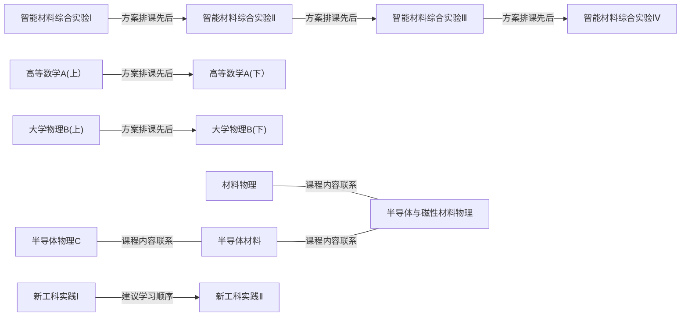

# 2025材料物理专业-智能材料方向本硕融通培养方案

智能材料与未来能源创新学院 · 材料物理 · 方案 96744 · 87 个不同课程或科研条目。

[官方 Word](../originals/plan-96744.docx) · [教务详情](https://fdjwgl.fudan.edu.cn/manager/bizType/2/major-program-search/info/96744?skipAuth=1) · [方案快照](../raw/plan-96744.json.gz) · [年级目录](../README.md)

## 修读导读

- **建议先学**　《智能材料综合实验Ⅰ》（`MASE40003`） → 《智能材料综合实验Ⅱ》（`MASE40004`） → 《智能材料综合实验Ⅲ》（`MASE40005`）。题名列出连续册次或级别。可沿用前一阶段的实验记录格式，对照后来新增的测量方法和误差来源。方案分别列在第4、5、6学期。

- **可以对照着读**　《材料物理》（`MASE30012`）与《半导体与磁性材料物理》（`MASE50058`）。两门课的题名都涉及材料物理。对同一种材料，比较结构特征与可测量的物理性质怎样对应。

- **查模块选课**　《智能材料前沿》（`MASE40002`）、《材料科学导论》（`MASE20002`）列在“专业核心教育课程”中。模块说明写明“要求修读34学分（部分课程学分可用荣誉课程学分替换）”。原表见 `/courseModules/6`。

## 课程关系图

图中展示部分关系。下表保留全部已建立的课程对，来源位置使用本方案 JSON Pointer。

## 先修与内容联系

| 类型 | 起点 | 终点 | 依据 | 原表定位 |
| --- | --- | --- | --- | --- |
| 建议学习顺序 | 新工科实践Ⅰ (MASE30001) | 新工科实践Ⅱ (MASE40001) | 同方案的课程题名具有连续分册或序号。  | `/courseModules/23/planCourses/8`、`/courseModules/23/planCourses/10` |
| 建议学习顺序 | 智能材料综合实验Ⅰ (MASE40003) | 智能材料综合实验Ⅱ (MASE40004) | 同方案的课程题名具有连续分册或序号。  | `/courseModules/23/planCourses/7`、`/courseModules/23/planCourses/9` |
| 建议学习顺序 | 智能材料综合实验Ⅱ (MASE40004) | 智能材料综合实验Ⅲ (MASE40005) | 同方案的课程题名具有连续分册或序号。  | `/courseModules/23/planCourses/9`、`/courseModules/23/planCourses/11` |
| 建议学习顺序 | 智能材料综合实验Ⅲ (MASE40005) | 智能材料综合实验Ⅳ (MASE40006) | 同方案的课程题名具有连续分册或序号。  | `/courseModules/23/planCourses/11`、`/courseModules/23/planCourses/13` |
| 建议学习顺序 | 高等数学A(上） (MATH10015) | 高等数学A(下） (MATH10016) | 同方案的课程题名具有连续分册或序号。  | `/courseModules/5/planCourses/0`、`/courseModules/5/planCourses/1` |
| 建议学习顺序 | 大学物理B(上) (PHYS10003) | 大学物理B(下) (PHYS10004) | 同方案的课程题名具有连续分册或序号。  | `/courseModules/5/planCourses/2`、`/courseModules/5/planCourses/3` |
| 方案排课先后 | 智能材料综合实验Ⅰ (MASE40003) | 智能材料综合实验Ⅱ (MASE40004) | 同方案该课程全部明确数字学期均早于后者。  | `/courseModules/23/planCourses/7`、`/courseModules/23/planCourses/9` |
| 方案排课先后 | 智能材料综合实验Ⅱ (MASE40004) | 智能材料综合实验Ⅲ (MASE40005) | 同方案该课程全部明确数字学期均早于后者。  | `/courseModules/23/planCourses/9`、`/courseModules/23/planCourses/11` |
| 方案排课先后 | 智能材料综合实验Ⅲ (MASE40005) | 智能材料综合实验Ⅳ (MASE40006) | 同方案该课程全部明确数字学期均早于后者。  | `/courseModules/23/planCourses/11`、`/courseModules/23/planCourses/13` |
| 方案排课先后 | 高等数学A(上） (MATH10015) | 高等数学A(下） (MATH10016) | 同方案该课程全部明确数字学期均早于后者。  | `/courseModules/5/planCourses/0`、`/courseModules/5/planCourses/1` |
| 方案排课先后 | 大学物理B(上) (PHYS10003) | 大学物理B(下) (PHYS10004) | 同方案该课程全部明确数字学期均早于后者。  | `/courseModules/5/planCourses/2`、`/courseModules/5/planCourses/3` |
| 课程内容联系 | 材料物理 (MASE30012) | 半导体与磁性材料物理 (MASE50058) | 本方案两门课程的题名均含“材料物理”，可据此对照这一主题。  | `/courseModules/6/planCourses/10`、`/courseModules/11/planCourses/6` |
| 课程内容联系 | 半导体物理C (MASE30013) | 半导体材料 (MASE50023) | 本方案两门课程的题名均含“半导体”，可据此对照这一主题。  | `/courseModules/9/planCourses/2`、`/courseModules/11/planCourses/0` |
| 课程内容联系 | 半导体材料 (MASE50023) | 半导体与磁性材料物理 (MASE50058) | 本方案两门课程的题名均含“半导体”，可据此对照这一主题。  | `/courseModules/11/planCourses/0`、`/courseModules/11/planCourses/6` |

本次未从可定位的明确表述中确认课程对课程预修。学期安排、系列分册与编辑建议均保留各自的依据。

## 按原方案模块阅读

同一模块展示原表中的课程归属。模块内课程之间的先后仍须逐项查阅。

- **电子与信息**　微弱信号检测技术、光波导理论与技术、信息安全原理与应用、器件与集成电路原理、半导体材料、电子与信息材料、半导体与磁性材料物理（原表模块 11）
- **材料多尺度表征**　电子封装材料与工艺、电子显微分析技术、同步辐射表征与材料科学（原表模块 12）
- **未来光电材料**　光电子器件、光子晶体导论、有机光电材料与器件、太阳能电池器件物理（原表模块 13）
- **材料与界面**　生物医学光子学、印刷电子学、智能感知材料与器件、液晶物理学、无机功能材料、智能材料、现代涂料科学与技术、液晶材料与显示、生物医用材料的设计与应用、传感材料与器件原理（原表模块 14）
- **智能工程材料**　腐蚀电化学、CAD工程制图、精细化工工艺学、固体材料学、工业产品检测技术、核电材料老化与管理（原表模块 15）
- **材料人工智能**　人工智能化学计算模拟、计算材料学、材料计算与设计（原表模块 16）
- **CTO**　职业责任与领导力、科技创新创业、工程伦理与管理、运筹学、科技伦理前沿（原表模块 17）

## 课程表

同一课程在不同模块分别出现时，按原表逐行列出。季节字段保留原值。

| 课程 | 代码 | 学分 | 学期 | 模块 |
| --- | --- | ---: | --- | --- |
| 高等数学A(上） | MATH10015 | 5.0 | 第1学期 | 培养方案 / 专业培养课程 / 学科基础课程 |
| 高等数学A(下） | MATH10016 | 5.0 | 第2学期 | 培养方案 / 专业培养课程 / 学科基础课程 |
| 大学物理B(上) | PHYS10003 | 4.0 | 第1学期 | 培养方案 / 专业培养课程 / 学科基础课程 |
| 大学物理B(下) | PHYS10004 | 4.0 | 第2学期 | 培养方案 / 专业培养课程 / 学科基础课程 |
| 基础物理实验 | PHYS10005 | 2.0 | 第2学期 | 培养方案 / 专业培养课程 / 学科基础课程 |
| 普通化学实验I | CHEM10005 | 1.0 | 第1学期 | 培养方案 / 专业培养课程 / 学科基础课程 |
| 普通化学 | CHEM10001 | 4.0 | 第1学期 | 培养方案 / 专业培养课程 / 学科基础课程 |
| Python程序设计 | GEEC10072 | 2.0 | 第2学期 | 培养方案 / 专业培养课程 / 学科基础课程 |
| 智能材料前沿 | MASE40002 | 2.0 | 第2学期 | 培养方案 / 专业培养课程 / 专业核心教育课程 |
| 线性代数（理工类） | MATH10014 | 3.0 | 第1学期 | 培养方案 / 专业培养课程 / 专业核心教育课程 |
| 材料科学导论 | MASE20002 | 3.0 | 第3学期 | 培养方案 / 专业培养课程 / 专业核心教育课程 |
| 材料分析 | MASE30023 | 3.0 | 第6学期 | 培养方案 / 专业培养课程 / 专业核心教育课程 |
| 材料结构与性能 | MASE20010 | 3.0 | 第4学期 | 培养方案 / 专业培养课程 / 专业核心教育课程 |
| 材料制备与加工 | MASE30022 | 3.0 | 第5学期 | 培养方案 / 专业培养课程 / 专业核心教育课程 |
| 物理化学B | MASE20005 | 4.0 | 第3学期 | 培养方案 / 专业培养课程 / 专业核心教育课程 |
| 材料力学 | MASE20006 | 2.0 | 第4学期 | 培养方案 / 专业培养课程 / 专业核心教育课程 |
| 近代物理A | PHYS20007 | 4.0 | 第3学期 | 培养方案 / 专业培养课程 / 专业核心教育课程 |
| 经典物理A | PHYS20008 | 4.0 | 第4学期 | 培养方案 / 专业培养课程 / 专业核心教育课程 |
| 材料物理 | MASE30012 | 3.0 | 第5学期 | 培养方案 / 专业培养课程 / 专业核心教育课程 |
| 模拟与数字电子线路 | MASE20004 | 3.0 | 第4学期 | 培养方案 / 专业进阶模块I |
| 数学物理方法 | MASE20003 | 4.0 | 第3学期 | 培养方案 / 专业进阶模块I |
| 半导体物理C | MASE30013 | 3.0 | 第5学期 | 培养方案 / 专业进阶模块I |
| 材料与器件中的AI应用 | AIS310015 | 2.0 | 第4学期 | 培养方案 / 专业进阶模块I |
| 计算物理 | MASE50039 | 2.0 | 第6学期 | 培养方案 / 专业进阶模块I |
| 真空物理与技术 | MASE30017 | 3.0 | 第5学期 | 培养方案 / 专业进阶模块I |
| 薄膜技术 | MASE30019 | 3.0 | 第6学期 | 培养方案 / 专业进阶模块I |
| 光电技术与器件 | MASE40020 | 3.0 | 第7学期 | 培养方案 / 专业进阶模块I |
| 表面分析 | MASE30018 | 3.0 | 第6学期 | 培养方案 / 专业进阶模块I |
| 固体物理导论 | EST30011 | 4.0 | 第5学期 | 培养方案 / 专业进阶模块I |
| 材料热力学 | MASE50056 | 3.0 | AUTUMN | 培养方案 / 专业进阶模块I |
| 纳米材料学 | MASE60006 | 2.0 | SPRING | 培养方案 / 专业进阶模块I |
| 高分子凝聚态 | MASE60019 | 3.0 | 第7学期 | 培养方案 / 专业进阶模块I |
| 固体材料学 | MASE50055 | 3.0 | AUTUMN | 培养方案 / 专业进阶模块I |
| 功能材料 | MASE60003 | 3.0 | AUTUMN | 培养方案 / 专业进阶模块I |
| 半导体材料 | MASE50023 | 2.0 | AUTUMN | 培养方案 / 专业进阶模块II / 电子与信息 |
| 电子与信息材料 | MASE50026 | 3.0 | AUTUMN | 培养方案 / 专业进阶模块II / 电子与信息 |
| 微弱信号检测技术 | EST50041 | 3.0 | AUTUMN | 培养方案 / 专业进阶模块II / 电子与信息 |
| 信息安全原理与应用 | EST60051 | 3.0 | SPRING | 培养方案 / 专业进阶模块II / 电子与信息 |
| 光波导理论与技术 | EST50042 | 3.0 | AUTUMN | 培养方案 / 专业进阶模块II / 电子与信息 |
| 器件与集成电路原理 | MASE40024 | 4.0 | SPRING | 培养方案 / 专业进阶模块II / 电子与信息 |
| 半导体与磁性材料物理 | MASE50058 | 3.0 | SPRING、AUTUMN | 培养方案 / 专业进阶模块II / 电子与信息 |
| 电子显微分析技术 | MASE50025 | 2.0 | AUTUMN | 培养方案 / 专业进阶模块II / 材料多尺度表征 |
| 电子封装材料与工艺 | MASE50017 | 2.0 | SPRING | 培养方案 / 专业进阶模块II / 材料多尺度表征 |
| 同步辐射表征与材料科学 | MASE60023 | 2.0 | SPRING | 培养方案 / 专业进阶模块II / 材料多尺度表征 |
| 有机光电材料与器件 | MASE50051 | 2.0 | SPRING | 培养方案 / 专业进阶模块II / 未来光电材料 |
| 太阳能电池器件物理 | MASE50052 | 2.0 | SPRING | 培养方案 / 专业进阶模块II / 未来光电材料 |
| 光电子器件 | EST60046 | 3.0 | SPRING | 培养方案 / 专业进阶模块II / 未来光电材料 |
| 光子晶体导论 | MASE50033 | 2.0 | AUTUMN | 培养方案 / 专业进阶模块II / 未来光电材料 |
| 智能材料 | MASE50045 | 2.0 | AUTUMN | 培养方案 / 专业进阶模块II / 材料与界面 |
| 现代涂料科学与技术 | MASE60011 | 2.0 | SPRING | 培养方案 / 专业进阶模块II / 材料与界面 |
| 液晶物理学 | MASE50029 | 2.0 | SPRING | 培养方案 / 专业进阶模块II / 材料与界面 |
| 液晶材料与显示 | MASE60012 | 2.0 | AUTUMN | 培养方案 / 专业进阶模块II / 材料与界面 |
| 印刷电子学 | EST60049 | 2.0 | AUTUMN | 培养方案 / 专业进阶模块II / 材料与界面 |
| 无机功能材料 | MASE50031 | 2.0 | SPRING | 培养方案 / 专业进阶模块II / 材料与界面 |
| 生物医用材料的设计与应用 | MASE60017 | 2.0 | AUTUMN | 培养方案 / 专业进阶模块II / 材料与界面 |
| 传感材料与器件原理 | MASE60018 | 2.0 | SPRING、AUTUMN | 培养方案 / 专业进阶模块II / 材料与界面 |
| 生物医学光子学 | CHEM30044 | 2.0 | SPRING、AUTUMN | 培养方案 / 专业进阶模块II / 材料与界面 |
| 智能感知材料与器件 | MASE20012 | 3.0 | SPRING、AUTUMN | 培养方案 / 专业进阶模块II / 材料与界面 |
| 固体材料学 | MASE50055 | 3.0 | AUTUMN | 培养方案 / 专业进阶模块II / 智能工程材料 |
| 精细化工工艺学 | MASE50043 | 2.0 | AUTUMN | 培养方案 / 专业进阶模块II / 智能工程材料 |
| 核电材料老化与管理 | MASE60015 | 2.0 | AUTUMN | 培养方案 / 专业进阶模块II / 智能工程材料 |
| 腐蚀电化学 | EST60053 | 2.0 | AUTUMN | 培养方案 / 专业进阶模块II / 智能工程材料 |
| 工业产品检测技术 | MASE60014 | 2.0 | AUTUMN | 培养方案 / 专业进阶模块II / 智能工程材料 |
| CAD工程制图 | MASE30026 | 2.0 | SPRING、AUTUMN | 培养方案 / 专业进阶模块II / 智能工程材料 |
| 人工智能化学计算模拟 | AIS531005 | 2.0 | SPRING | 培养方案 / 专业进阶模块II / 材料人工智能 |
| 材料计算与设计 | MASE60022 | 2.0 | AUTUMN | 培养方案 / 专业进阶模块II / 材料人工智能 |
| 计算材料学 | MASE50003 | 2.0 | SPRING、AUTUMN | 培养方案 / 专业进阶模块II / 材料人工智能 |
| 科技创新创业 | GEIN10012 | 2.0 | SPRING、AUTUMN | 培养方案 / 专业进阶模块II / CTO |
| 科技伦理前沿 | PHIL50045 | 2.0 | SPRING、AUTUMN | 培养方案 / 专业进阶模块II / CTO |
| 运筹学 | MSE20005 | 4.0 | AUTUMN | 培养方案 / 专业进阶模块II / CTO |
| 职业责任与领导力 | BA30032 | 3.0 | SPRING | 培养方案 / 专业进阶模块II / CTO |
| 工程伦理与管理 | MCE40003 | 2.0 | SPRING | 培养方案 / 专业进阶模块II / CTO |
| 复芏计划(FDUROP) | 102 | 0.0 |  | 融合创新能力 |
| 其他 | 107 | 0.0 |  | 融合创新能力 |
| 研究生学术活动 | 4 | 2.0 |  | 融合创新能力 |
| 研究生实践活动 | 5 | 6.0 |  | 融合创新能力 |
| 硕士学位论文开题 | 11 | 0.0 |  | 融合创新能力 |
| 硕士论文中期考核 | 31 | 0.0 |  | 融合创新能力 |
| 硕士学位论文预审 | 61 | 0.0 |  | 融合创新能力 |
| 智能材料综合实验Ⅰ | MASE40003 | 2.0 | 第4学期 | 融合创新能力 |
| 新工科实践Ⅰ | MASE30001 | 2.0 | SPRING、AUTUMN | 融合创新能力 |
| 智能材料综合实验Ⅱ | MASE40004 | 2.0 | 第5学期 | 融合创新能力 |
| 新工科实践Ⅱ | MASE40001 | 2.0 | SPRING、AUTUMN | 融合创新能力 |
| 智能材料综合实验Ⅲ | MASE40005 | 2.0 | 第6学期 | 融合创新能力 |
| 材料工程实验室安全与管理 | MASE40023 | 1.0 | AUTUMN | 融合创新能力 |
| 智能材料综合实验Ⅳ | MASE40006 | 2.0 | 第7学期 | 融合创新能力 |
| 科研项目申请及论文写作 | MASE40011 | 1.0 | 第7学期 | 融合创新能力 |
| 毕业论文 | MASE40012 | 2.0 | 第8学期 | 融合创新能力 |
