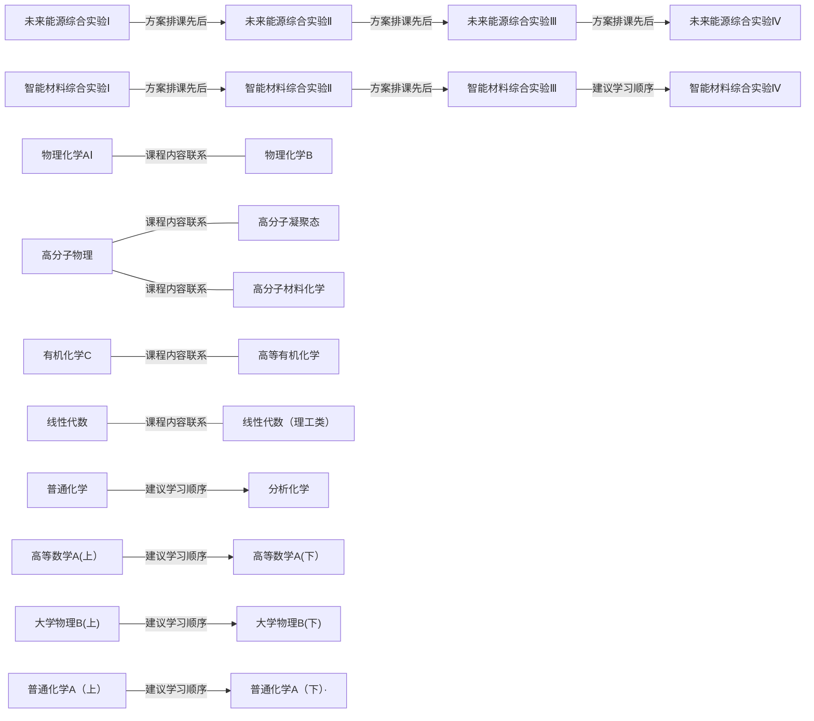

# 2025工科试验班（智能材料与未来能源学院）培养方案

智能材料与未来能源创新学院 · 工科试验班(智能材料与未来能源创新学院) · 方案 97476 · 66 个不同课程或科研条目。

[官方 Word](../originals/plan-97476.docx) · [教务详情](https://fdjwgl.fudan.edu.cn/manager/bizType/2/major-program-search/info/97476?skipAuth=1) · [方案快照](../raw/plan-97476.json.gz) · [年级目录](../README.md)

## 修读导读

- **建议先学**　《普通化学》（`CHEM10001`） → 《分析化学》（`CHEM20015`）。溶液与平衡概念支持化学分析。方案分别列在第1、3学期。

- **可以对照着读**　《高分子物理》（`MASE30005`）与《高分子凝聚态》（`MASE60019`）。两门课的题名都涉及高分子。选一种聚合物，比较链结构、材料形态和可观察到的性质。

- **查模块选课**　《未来能源前沿》（`MASE30002`）、《智能材料前沿》（`MASE40002`）列在“专业核心教育课程”中。原表见 `/courseModules/6`。

## 课程关系图

图中展示部分关系。下表保留全部已建立的课程对，来源位置使用本方案 JSON Pointer。

## 先修与内容联系

| 类型 | 起点 | 终点 | 依据 | 原表定位 |
| --- | --- | --- | --- | --- |
| 建议学习顺序 | 普通化学 (CHEM10001) | 分析化学 (CHEM20015) | 溶液与平衡概念支持化学分析。  | `/courseModules/5/planCourses/8`、`/courseModules/6/planCourses/6` |
| 建议学习顺序 | 普通化学A（上） (CHEM10003) | 普通化学A（下） (CHEM10004) | 同方案的课程题名具有连续分册或序号。  | `/courseModules/5/planCourses/6`、`/courseModules/5/planCourses/7` |
| 建议学习顺序 | 智能材料综合实验Ⅰ (MASE40003) | 智能材料综合实验Ⅱ (MASE40004) | 同方案的课程题名具有连续分册或序号。  | `/courseModules/15/planCourses/4`、`/courseModules/15/planCourses/5` |
| 建议学习顺序 | 智能材料综合实验Ⅱ (MASE40004) | 智能材料综合实验Ⅲ (MASE40005) | 同方案的课程题名具有连续分册或序号。  | `/courseModules/15/planCourses/5`、`/courseModules/15/planCourses/6` |
| 建议学习顺序 | 智能材料综合实验Ⅲ (MASE40005) | 智能材料综合实验Ⅳ (MASE40006) | 同方案的课程题名具有连续分册或序号。  | `/courseModules/15/planCourses/6`、`/courseModules/15/planCourses/7` |
| 建议学习顺序 | 未来能源综合实验Ⅰ (MASE40007) | 未来能源综合实验Ⅱ (MASE40009) | 同方案的课程题名具有连续分册或序号。  | `/courseModules/15/planCourses/0`、`/courseModules/15/planCourses/1` |
| 建议学习顺序 | 未来能源综合实验Ⅲ (MASE40008) | 未来能源综合实验Ⅳ (MASE40010) | 同方案的课程题名具有连续分册或序号。  | `/courseModules/15/planCourses/2`、`/courseModules/15/planCourses/3` |
| 建议学习顺序 | 未来能源综合实验Ⅱ (MASE40009) | 未来能源综合实验Ⅲ (MASE40008) | 同方案的课程题名具有连续分册或序号。  | `/courseModules/15/planCourses/1`、`/courseModules/15/planCourses/2` |
| 建议学习顺序 | 高等数学A(上） (MATH10015) | 高等数学A(下） (MATH10016) | 同方案的课程题名具有连续分册或序号。  | `/courseModules/5/planCourses/0`、`/courseModules/5/planCourses/1` |
| 建议学习顺序 | 大学物理B(上) (PHYS10003) | 大学物理B(下) (PHYS10004) | 同方案的课程题名具有连续分册或序号。  | `/courseModules/5/planCourses/2`、`/courseModules/5/planCourses/3` |
| 方案排课先后 | 普通化学 (CHEM10001) | 分析化学 (CHEM20015) | 同方案该课程全部明确数字学期均早于后者。  | `/courseModules/5/planCourses/8`、`/courseModules/6/planCourses/6` |
| 方案排课先后 | 普通化学A（上） (CHEM10003) | 普通化学A（下） (CHEM10004) | 同方案该课程全部明确数字学期均早于后者。  | `/courseModules/5/planCourses/6`、`/courseModules/5/planCourses/7` |
| 方案排课先后 | 智能材料综合实验Ⅰ (MASE40003) | 智能材料综合实验Ⅱ (MASE40004) | 同方案该课程全部明确数字学期均早于后者。  | `/courseModules/15/planCourses/4`、`/courseModules/15/planCourses/5` |
| 方案排课先后 | 智能材料综合实验Ⅱ (MASE40004) | 智能材料综合实验Ⅲ (MASE40005) | 同方案该课程全部明确数字学期均早于后者。  | `/courseModules/15/planCourses/5`、`/courseModules/15/planCourses/6` |
| 方案排课先后 | 智能材料综合实验Ⅲ (MASE40005) | 智能材料综合实验Ⅳ (MASE40006) | 同方案该课程全部明确数字学期均早于后者。  | `/courseModules/15/planCourses/6`、`/courseModules/15/planCourses/7` |
| 方案排课先后 | 未来能源综合实验Ⅰ (MASE40007) | 未来能源综合实验Ⅱ (MASE40009) | 同方案该课程全部明确数字学期均早于后者。  | `/courseModules/15/planCourses/0`、`/courseModules/15/planCourses/1` |
| 方案排课先后 | 未来能源综合实验Ⅲ (MASE40008) | 未来能源综合实验Ⅳ (MASE40010) | 同方案该课程全部明确数字学期均早于后者。  | `/courseModules/15/planCourses/2`、`/courseModules/15/planCourses/3` |
| 方案排课先后 | 未来能源综合实验Ⅱ (MASE40009) | 未来能源综合实验Ⅲ (MASE40008) | 同方案该课程全部明确数字学期均早于后者。  | `/courseModules/15/planCourses/1`、`/courseModules/15/planCourses/2` |
| 方案排课先后 | 高等数学A(上） (MATH10015) | 高等数学A(下） (MATH10016) | 同方案该课程全部明确数字学期均早于后者。  | `/courseModules/5/planCourses/0`、`/courseModules/5/planCourses/1` |
| 方案排课先后 | 大学物理B(上) (PHYS10003) | 大学物理B(下) (PHYS10004) | 同方案该课程全部明确数字学期均早于后者。  | `/courseModules/5/planCourses/2`、`/courseModules/5/planCourses/3` |
| 课程内容联系 | 有机化学C (CHEM10007) | 高等有机化学 (CHEM50003) | 本方案两门课程的题名均含“有机化学”，可据此对照这一主题。  | `/courseModules/6/planCourses/1`、`/courseModules/9/planCourses/14` |
| 课程内容联系 | 物理化学AⅠ (CHEM20005) | 物理化学B (MASE20005) | 本方案两门课程的题名均含“物理化学”，可据此对照这一主题。  | `/courseModules/6/planCourses/5`、`/courseModules/6/planCourses/8` |
| 课程内容联系 | 无机化学 (CHEM30005) | 高等无机化学 (CHEM50002) | 本方案两门课程的题名均含“无机化学”，可据此对照这一主题。  | `/courseModules/9/planCourses/3`、`/courseModules/9/planCourses/13` |
| 课程内容联系 | 线性代数 (CS10003) | 线性代数（理工类） (MATH10014) | 本方案两门课程的题名均含“线性代数”，可据此对照这一主题。  | `/courseModules/5/planCourses/13`、`/courseModules/6/planCourses/0` |
| 课程内容联系 | 高分子化学A (MASE30004) | 高分子物理 (MASE30005) | 本方案两门课程的题名均含“高分子”，可据此对照这一主题。  | `/courseModules/9/planCourses/4`、`/courseModules/9/planCourses/5` |
| 课程内容联系 | 高分子物理 (MASE30005) | 高分子材料化学 (MASE30011) | 本方案两门课程的题名均含“高分子”，可据此对照这一主题。  | `/courseModules/9/planCourses/5`、`/courseModules/9/planCourses/7` |
| 课程内容联系 | 高分子物理 (MASE30005) | 高分子反应工程 (MASE50006) | 本方案两门课程的题名均含“高分子”，可据此对照这一主题。  | `/courseModules/9/planCourses/5`、`/courseModules/9/planCourses/6` |
| 课程内容联系 | 高分子物理 (MASE30005) | 高分子凝聚态 (MASE60019) | 本方案两门课程的题名均含“高分子”，可据此对照这一主题。  | `/courseModules/9/planCourses/5`、`/courseModules/9/planCourses/18` |

本次未从可定位的明确表述中确认课程对课程预修。学期安排、系列分册与编辑建议均保留各自的依据。

## 课程表

同一课程在不同模块分别出现时，按原表逐行列出。季节字段保留原值。

| 课程 | 代码 | 学分 | 学期 | 模块 |
| --- | --- | ---: | --- | --- |
| 高等数学A(上） | MATH10015 | 5.0 | 第1学期 | 培养方案 / 专业培养课程 / 学科基础课程 |
| 高等数学A(下） | MATH10016 | 5.0 | 第2学期 | 培养方案 / 专业培养课程 / 学科基础课程 |
| 大学物理B(上) | PHYS10003 | 4.0 | 第1学期 | 培养方案 / 专业培养课程 / 学科基础课程 |
| 大学物理B(下) | PHYS10004 | 4.0 | 第2学期 | 培养方案 / 专业培养课程 / 学科基础课程 |
| 基础物理实验 | PHYS10005 | 2.0 | 第2学期 | 培养方案 / 专业培养课程 / 学科基础课程 |
| 普通化学实验I | CHEM10005 | 1.0 | 第1学期 | 培养方案 / 专业培养课程 / 学科基础课程 |
| 普通化学A（上） | CHEM10003 | 2.0 | 第1学期 | 培养方案 / 专业培养课程 / 学科基础课程 |
| 普通化学A（下） | CHEM10004 | 2.0 | 第2学期 | 培养方案 / 专业培养课程 / 学科基础课程 |
| 普通化学 | CHEM10001 | 4.0 | 第1学期 | 培养方案 / 专业培养课程 / 学科基础课程 |
| Python程序设计 | GEEC10072 | 2.0 | 第2学期 | 培养方案 / 专业培养课程 / 学科基础课程 |
| 大学物理A：力学 | PHYS10006 | 4.0 | 第1学期 | 培养方案 / 专业培养课程 / 学科基础课程 |
| 大学物理A：热学 | PHYS10007 | 2.0 | 第2学期 | 培养方案 / 专业培养课程 / 学科基础课程 |
| 大学物理A：电磁学 | PHYS10008 | 4.0 | 第2学期 | 培养方案 / 专业培养课程 / 学科基础课程 |
| 线性代数 | CS10003 | 3.0 | 第1学期 | 培养方案 / 专业培养课程 / 学科基础课程 |
| 线性代数（理工类） | MATH10014 | 3.0 | 第1学期 | 培养方案 / 专业培养课程 / 专业核心教育课程 |
| 有机化学C | CHEM10007 | 3.0 | 第2学期 | 培养方案 / 专业培养课程 / 专业核心教育课程 |
| 未来能源前沿 | MASE30002 | 2.0 | 第2学期 | 培养方案 / 专业培养课程 / 专业核心教育课程 |
| 智能材料前沿 | MASE40002 | 2.0 | 第2学期 | 培养方案 / 专业培养课程 / 专业核心教育课程 |
| 材料科学导论 | MASE20002 | 3.0 | 第3学期 | 培养方案 / 专业培养课程 / 专业核心教育课程 |
| 物理化学AⅠ | CHEM20005 | 3.0 | 第3学期 | 培养方案 / 专业培养课程 / 专业核心教育课程 |
| 分析化学 | CHEM20015 | 2.0 | 第3学期 | 培养方案 / 专业培养课程 / 专业核心教育课程 |
| 材料结构与性能 | MASE20010 | 3.0 | 第4学期 | 培养方案 / 专业培养课程 / 专业核心教育课程 |
| 物理化学B | MASE20005 | 4.0 | 第3学期 | 培养方案 / 专业培养课程 / 专业核心教育课程 |
| 近代物理A | PHYS20007 | 4.0 | 第3学期 | 培养方案 / 专业培养课程 / 专业核心教育课程 |
| 经典物理A | PHYS20008 | 4.0 | 第4学期 | 培养方案 / 专业培养课程 / 专业核心教育课程 |
| 材料力学 | MASE20006 | 2.0 | 第4学期 | 培养方案 / 专业培养课程 / 专业核心教育课程 |
| 碳基能源化学 | CHEM30036 | 2.0 | AUTUMN | 培养方案 / 专业进阶模块 |
| 高能化学电源 | CHEM30028 | 2.0 | SPRING | 培养方案 / 专业进阶模块 |
| 谱学导论 | CHEM20007 | 3.0 | SPRING | 培养方案 / 专业进阶模块 |
| 无机化学 | CHEM30005 | 3.0 | 第5学期、第6学期 | 培养方案 / 专业进阶模块 |
| 高分子化学A | MASE30004 | 3.0 | 第5学期 | 培养方案 / 专业进阶模块 |
| 高分子物理 | MASE30005 | 3.0 | 第6学期 | 培养方案 / 专业进阶模块 |
| 高分子反应工程 | MASE50006 | 2.0 | 第6学期 | 培养方案 / 专业进阶模块 |
| 高分子材料化学 | MASE30011 | 2.0 | 第5学期 | 培养方案 / 专业进阶模块 |
| 高分子材料结构与性能 | MASE30010 | 3.0 | 第6学期 | 培养方案 / 专业进阶模块 |
| 材料化学 | MASE40015 | 2.0 | 第7学期 | 培养方案 / 专业进阶模块 |
| 材料失效分析 | MASE50020 | 2.0 | SPRING | 培养方案 / 专业进阶模块 |
| 多相催化原理 | CHEM70009 | 2.0 | SPRING | 培养方案 / 专业进阶模块 |
| 分子反应动力学 | CHEM70011 | 1.0 | AUTUMN | 培养方案 / 专业进阶模块 |
| 高等无机化学 | CHEM50002 | 3.0 | SPRING、AUTUMN | 培养方案 / 专业进阶模块 |
| 高等有机化学 | CHEM50003 | 3.0 | SPRING、AUTUMN | 培养方案 / 专业进阶模块 |
| 量子化学原理及应用 | CHEM50004 | 3.0 | SPRING、AUTUMN | 培养方案 / 专业进阶模块 |
| 材料热力学 | MASE50056 | 3.0 | SPRING、AUTUMN | 培养方案 / 专业进阶模块 |
| 纳米材料学 | MASE60006 | 2.0 | SPRING | 培养方案 / 专业进阶模块 |
| 高分子凝聚态 | MASE60019 | 3.0 | 第7学期 | 培养方案 / 专业进阶模块 |
| 绿色电化学合成 | CHEM30001 | 2.0 | SPRING、AUTUMN | 培养方案 / 专业进阶模块 |
| 模拟与数字电子线路 | MASE20004 | 3.0 | AUTUMN | 培养方案 / 专业进阶模块 |
| 数学物理方法 | MASE20003 | 4.0 | SPRING | 培养方案 / 专业进阶模块 |
| 半导体物理C | MASE30013 | 3.0 | SPRING | 培养方案 / 专业进阶模块 |
| 材料与器件中的AI应用 | AIS310015 | 2.0 | 第5学期、第6学期 | 培养方案 / 专业进阶模块 |
| 计算物理 | MASE50039 | 2.0 | 第5学期 | 培养方案 / 专业进阶模块 |
| 真空物理与技术 | MASE30017 | 3.0 | 第6学期 | 培养方案 / 专业进阶模块 |
| 薄膜技术 | MASE30019 | 3.0 | 第6学期 | 培养方案 / 专业进阶模块 |
| 光电技术与器件 | MASE40020 | 3.0 | 第5学期 | 培养方案 / 专业进阶模块 |
| 表面分析 | MASE30018 | 3.0 | 第6学期 | 培养方案 / 专业进阶模块 |
| 固体物理导论 | EST30011 | 4.0 | 第7学期 | 培养方案 / 专业进阶模块 |
| 固体材料学 | MASE50055 | 3.0 | SPRING、AUTUMN | 培养方案 / 专业进阶模块 |
| 功能材料 | MASE60003 | 3.0 | SPRING、AUTUMN | 培养方案 / 专业进阶模块 |
| 未来能源综合实验Ⅰ | MASE40007 | 2.0 | 第3学期 | 融合创新能力 |
| 未来能源综合实验Ⅱ | MASE40009 | 2.0 | 第4学期 | 融合创新能力 |
| 未来能源综合实验Ⅲ | MASE40008 | 2.0 | 第5学期 | 融合创新能力 |
| 未来能源综合实验Ⅳ | MASE40010 | 2.0 | 第6学期 | 融合创新能力 |
| 智能材料综合实验Ⅰ | MASE40003 | 2.0 | 第4学期 | 融合创新能力 |
| 智能材料综合实验Ⅱ | MASE40004 | 2.0 | 第5学期 | 融合创新能力 |
| 智能材料综合实验Ⅲ | MASE40005 | 2.0 | 第6学期 | 融合创新能力 |
| 智能材料综合实验Ⅳ | MASE40006 | 2.0 | 第7学期 | 融合创新能力 |
