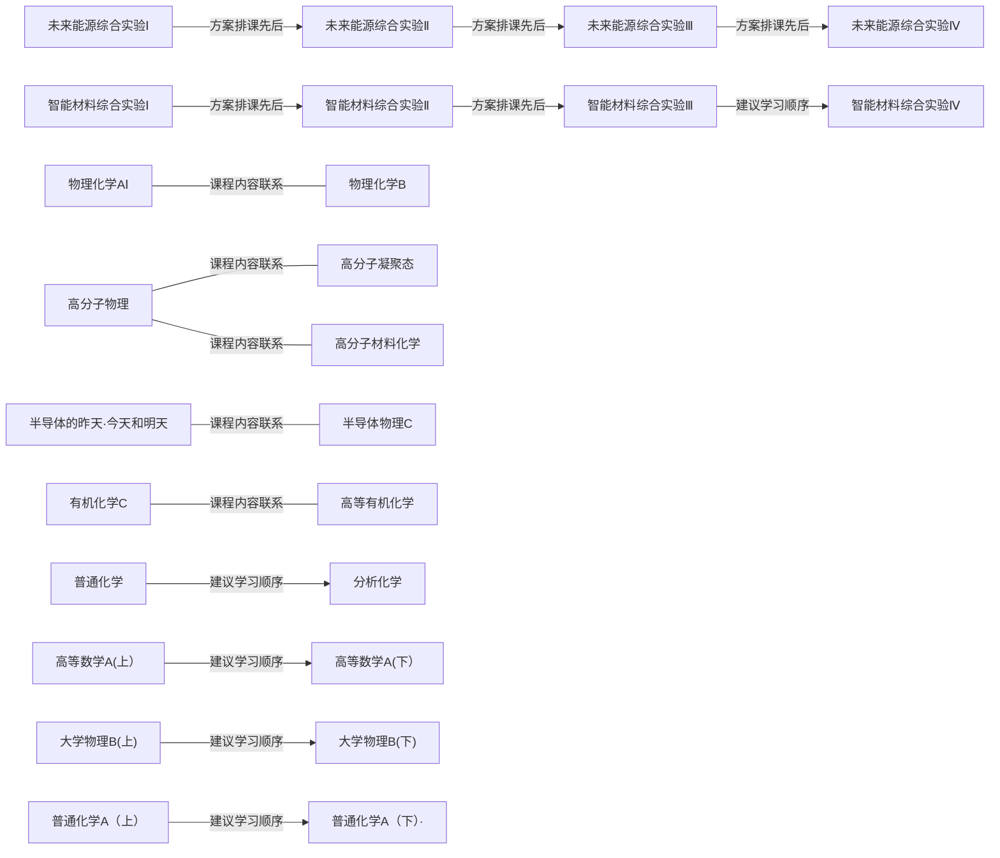

# 2025工科试验班（智能材料与未来能源学院）培养方案（港澳台侨生适用）

智能材料与未来能源创新学院 · 工科试验班(智能材料与未来能源创新学院) · 方案 98724 · 577 个不同课程或科研条目。

[官方 Word](../originals/plan-98724.docx) · [教务详情](https://fdjwgl.fudan.edu.cn/manager/bizType/2/major-program-search/info/98724?skipAuth=1) · [方案快照](../raw/plan-98724.json.gz) · [年级目录](../README.md)

## 课程关系图

图中展示部分关系。下表保留全部已建立的课程对，来源位置使用本方案 JSON Pointer。

## 先修与内容联系

| 类型 | 起点 | 终点 | 依据 | 原表定位 |
| --- | --- | --- | --- | --- |
| 建议学习顺序 | 普通化学 (CHEM10001) | 分析化学 (CHEM20015) | 溶液与平衡概念支持化学分析。  | `/courseModules/5/planCourses/8`、`/courseModules/6/planCourses/6` |
| 建议学习顺序 | 普通化学A（上） (CHEM10003) | 普通化学A（下） (CHEM10004) | 同方案的课程题名具有连续分册或序号。  | `/courseModules/5/planCourses/6`、`/courseModules/5/planCourses/7` |
| 建议学习顺序 | 智能材料综合实验Ⅰ (MASE40003) | 智能材料综合实验Ⅱ (MASE40004) | 同方案的课程题名具有连续分册或序号。  | `/courseModules/37/planCourses/4`、`/courseModules/37/planCourses/5` |
| 建议学习顺序 | 智能材料综合实验Ⅱ (MASE40004) | 智能材料综合实验Ⅲ (MASE40005) | 同方案的课程题名具有连续分册或序号。  | `/courseModules/37/planCourses/5`、`/courseModules/37/planCourses/6` |
| 建议学习顺序 | 智能材料综合实验Ⅲ (MASE40005) | 智能材料综合实验Ⅳ (MASE40006) | 同方案的课程题名具有连续分册或序号。  | `/courseModules/37/planCourses/6`、`/courseModules/37/planCourses/7` |
| 建议学习顺序 | 未来能源综合实验Ⅰ (MASE40007) | 未来能源综合实验Ⅱ (MASE40009) | 同方案的课程题名具有连续分册或序号。  | `/courseModules/37/planCourses/0`、`/courseModules/37/planCourses/1` |
| 建议学习顺序 | 未来能源综合实验Ⅲ (MASE40008) | 未来能源综合实验Ⅳ (MASE40010) | 同方案的课程题名具有连续分册或序号。  | `/courseModules/37/planCourses/2`、`/courseModules/37/planCourses/3` |
| 建议学习顺序 | 未来能源综合实验Ⅱ (MASE40009) | 未来能源综合实验Ⅲ (MASE40008) | 同方案的课程题名具有连续分册或序号。  | `/courseModules/37/planCourses/1`、`/courseModules/37/planCourses/2` |
| 建议学习顺序 | 高等数学A(上） (MATH10015) | 高等数学A(下） (MATH10016) | 同方案的课程题名具有连续分册或序号。  | `/courseModules/5/planCourses/0`、`/courseModules/5/planCourses/1` |
| 建议学习顺序 | 大学物理B(上) (PHYS10003) | 大学物理B(下) (PHYS10004) | 同方案的课程题名具有连续分册或序号。  | `/courseModules/5/planCourses/2`、`/courseModules/5/planCourses/3` |
| 方案排课先后 | 普通化学 (CHEM10001) | 分析化学 (CHEM20015) | 同方案该课程全部明确数字学期均早于后者。  | `/courseModules/5/planCourses/8`、`/courseModules/6/planCourses/6` |
| 方案排课先后 | 普通化学A（上） (CHEM10003) | 普通化学A（下） (CHEM10004) | 同方案该课程全部明确数字学期均早于后者。  | `/courseModules/5/planCourses/6`、`/courseModules/5/planCourses/7` |
| 方案排课先后 | 智能材料综合实验Ⅰ (MASE40003) | 智能材料综合实验Ⅱ (MASE40004) | 同方案该课程全部明确数字学期均早于后者。  | `/courseModules/37/planCourses/4`、`/courseModules/37/planCourses/5` |
| 方案排课先后 | 智能材料综合实验Ⅱ (MASE40004) | 智能材料综合实验Ⅲ (MASE40005) | 同方案该课程全部明确数字学期均早于后者。  | `/courseModules/37/planCourses/5`、`/courseModules/37/planCourses/6` |
| 方案排课先后 | 智能材料综合实验Ⅲ (MASE40005) | 智能材料综合实验Ⅳ (MASE40006) | 同方案该课程全部明确数字学期均早于后者。  | `/courseModules/37/planCourses/6`、`/courseModules/37/planCourses/7` |
| 方案排课先后 | 未来能源综合实验Ⅰ (MASE40007) | 未来能源综合实验Ⅱ (MASE40009) | 同方案该课程全部明确数字学期均早于后者。  | `/courseModules/37/planCourses/0`、`/courseModules/37/planCourses/1` |
| 方案排课先后 | 未来能源综合实验Ⅲ (MASE40008) | 未来能源综合实验Ⅳ (MASE40010) | 同方案该课程全部明确数字学期均早于后者。  | `/courseModules/37/planCourses/2`、`/courseModules/37/planCourses/3` |
| 方案排课先后 | 未来能源综合实验Ⅱ (MASE40009) | 未来能源综合实验Ⅲ (MASE40008) | 同方案该课程全部明确数字学期均早于后者。  | `/courseModules/37/planCourses/1`、`/courseModules/37/planCourses/2` |
| 方案排课先后 | 高等数学A(上） (MATH10015) | 高等数学A(下） (MATH10016) | 同方案该课程全部明确数字学期均早于后者。  | `/courseModules/5/planCourses/0`、`/courseModules/5/planCourses/1` |
| 方案排课先后 | 大学物理B(上) (PHYS10003) | 大学物理B(下) (PHYS10004) | 同方案该课程全部明确数字学期均早于后者。  | `/courseModules/5/planCourses/2`、`/courseModules/5/planCourses/3` |
| 课程内容联系 | 有机化学C (CHEM10007) | 高等有机化学 (CHEM50003) | 本方案两门课程的题名均含“有机化学”，可据此对照这一主题。  | `/courseModules/6/planCourses/1`、`/courseModules/31/planCourses/14` |
| 课程内容联系 | 物理化学AⅠ (CHEM20005) | 物理化学B (MASE20005) | 本方案两门课程的题名均含“物理化学”，可据此对照这一主题。  | `/courseModules/6/planCourses/5`、`/courseModules/6/planCourses/8` |
| 课程内容联系 | 无机化学 (CHEM30005) | 高等无机化学 (CHEM50002) | 本方案两门课程的题名均含“无机化学”，可据此对照这一主题。  | `/courseModules/31/planCourses/3`、`/courseModules/31/planCourses/13` |
| 课程内容联系 | 线性代数 (CS10003) | 线性代数（理工类） (MATH10014) | 本方案两门课程的题名均含“线性代数”，可据此对照这一主题。  | `/courseModules/5/planCourses/13`、`/courseModules/6/planCourses/0` |
| 课程内容联系 | 文化遗产与我们 (GEFS10005) | 走进非物质文化遗产 (GEXZ10006) | 本方案两门课程的题名均含“文化遗产”，可据此对照这一主题。  | `/courseModules/15/planCourses/2`、`/courseModules/23/planCourses/2` |
| 课程内容联系 | 文化遗产与我们 (GEFS10005) | 贵州千寨文化遗产与旅游实践 (GEXZ20001) | 本方案两门课程的题名均含“文化遗产”，可据此对照这一主题。  | `/courseModules/15/planCourses/2`、`/courseModules/21/planCourses/26` |
| 课程内容联系 | 半导体的昨天、今天和明天 (GEFS10011) | 半导体物理C (MASE30013) | 本方案两门课程的题名均含“半导体”，可据此对照这一主题。  | `/courseModules/18/planCourses/5`、`/courseModules/31/planCourses/22` |
| 课程内容联系 | 金融科技中的人工智能 (GEIS10001) | 人工智能介绍-概率推理与决策 (GEIS20003) | 本方案两门课程的题名均含“人工智能”，可据此对照这一主题。  | `/courseModules/27/planCourses/23`、`/courseModules/28/planCourses/0` |
| 课程内容联系 | 看电影学金融 (GEIS10004) | 公司金融 (GEIS10019) | 本方案两门课程的题名均含“金融”，可据此对照这一主题。  | `/courseModules/27/planCourses/14`、`/courseModules/27/planCourses/0` |
| 课程内容联系 | 国际投资法 (GEIS10015) | 投资组合管理 (GEIS30011) | 本方案两门课程的题名均含“投资”，可据此对照这一主题。  | `/courseModules/27/planCourses/16`、`/courseModules/27/planCourses/7` |
| 课程内容联系 | 公司金融 (GEIS10019) | 国际金融 (GEIS30008) | 本方案两门课程的题名均含“金融”，可据此对照这一主题。  | `/courseModules/27/planCourses/0`、`/courseModules/27/planCourses/4` |
| 课程内容联系 | 公司金融 (GEIS10019) | 国际金融：市场与政策 (GEIS30018) | 本方案两门课程的题名均含“金融”，可据此对照这一主题。  | `/courseModules/27/planCourses/0`、`/courseModules/27/planCourses/13` |
| 课程内容联系 | 公司金融 (GEIS10019) | 中国金融市场 (GEIS30020) | 本方案两门课程的题名均含“金融”，可据此对照这一主题。  | `/courseModules/27/planCourses/0`、`/courseModules/27/planCourses/21` |
| 课程内容联系 | 应用健康计量经济学与卫生政策 (GEIS10026) | 计量经济学 (GEIS30017) | 本方案两门课程的题名均含“计量经济”，可据此对照这一主题。  | `/courseModules/28/planCourses/6`、`/courseModules/27/planCourses/12` |
| 课程内容联系 | 高分子化学A (MASE30004) | 高分子物理 (MASE30005) | 本方案两门课程的题名均含“高分子”，可据此对照这一主题。  | `/courseModules/31/planCourses/4`、`/courseModules/31/planCourses/5` |
| 课程内容联系 | 高分子物理 (MASE30005) | 高分子材料化学 (MASE30011) | 本方案两门课程的题名均含“高分子”，可据此对照这一主题。  | `/courseModules/31/planCourses/5`、`/courseModules/31/planCourses/7` |
| 课程内容联系 | 高分子物理 (MASE30005) | 高分子反应工程 (MASE50006) | 本方案两门课程的题名均含“高分子”，可据此对照这一主题。  | `/courseModules/31/planCourses/5`、`/courseModules/31/planCourses/6` |
| 课程内容联系 | 高分子物理 (MASE30005) | 高分子凝聚态 (MASE60019) | 本方案两门课程的题名均含“高分子”，可据此对照这一主题。  | `/courseModules/31/planCourses/5`、`/courseModules/31/planCourses/18` |

本次未从可定位的明确表述中确认课程对课程预修。学期安排、系列分册与编辑建议均保留各自的依据。

## 按原方案模块阅读

同一模块展示原表中的课程归属。模块内课程之间的先后仍须逐项查阅。

- **任重书院**　语言科学、分配正义论、文化遗产与我们（原表模块 15）
- **克卿书院**　免疫学和社会学的对话、大学生健康素养及促进（原表模块 17）
- **腾飞书院**　生活中的材料启示、音乐科技导论、集成电路设计透视、人体信息建模与计算机仿真、生命、医学与材料、半导体的昨天、今天和明天（原表模块 18）
- **希德书院**　经典与前沿：细胞生物学、现代人类学、探索大脑、DNA数据的浅析与应用、生命的魅力与生命科学的挑战、跨入科学研究之门——计算机应用、疾病中的生命科学（原表模块 19）
- **复旦行知･服务学习**　画布上藏医药—非遗曼唐、飞越田野-应用气象学中的无人机遥感、小城镇绿色发展田野调查、探究大熊猫栖息地、生态文明的理论与实践、博物教育与生态文明、艺术与创造力（陶艺）、古村落的保护与开发、原本性音乐教育与社区服务、油画风景写生、多声部声乐实践、植物标本的艺术创作、虚拟现实艺术与在地创新、丝绸之路与古陶瓷外销、篆刻专题创作、智能芯片与社会、中国山水画审美与实践、中国书法艺术-理论与实践等28项（原表模块 21）
- **复旦行知･咨政服务**　科技与伦理的追问、政策调研与写作、当代中国教育与社会发展、国家发展动力、乡村振兴战略的理论与实践（原表模块 22）
- **复旦行知･劳动教育**　人类骨骼考古前沿与实践、走近红树林、走进非物质文化遗产、视觉艺术现场研究、中国传统书籍装帧艺术与实践（原表模块 23）
- **中国社会与政治**　中国的政治与外交、全球治理与金砖合作、全球化与中国媒体和政治、社会媒体和社会网络、美国政治与对外政策、心理学与生活、社会网络与中国社会、一带一路和中国在发展中国家的影响、中国人口与发展（原表模块 25）
- **中国历史与文化**　中国古典审美理想、中国城市文化与休闲资源研究、中国、第三世界与冷战、中国古代思想、中西哲学比较、世界语言与文化巡礼、数学哲学（原表模块 26）
- **中国经济与管理**　金融科技中的人工智能、看电影学金融、会计学原理、国际投资法、国际法、中国法律文化、中国知识产权法、公司金融、市场营销基础、货币、银行与经济、当代中国经济、国际贸易学、发展经济学、国际金融、产业组织、数据科学基础、投资组合管理、组合管理等25项（原表模块 27）
- **科学技术**　全球卫生治理导论、环境与健康：空气污染与气候变化、可再生能源：基本原理与实际应用、应用健康计量经济学与卫生政策、计算理论导论、人工智能介绍-概率推理与决策、Python入门、从夸克到早期宇宙：探索大型强子对撞机中的物理、聚变科学与工程导论、编程解题实践、概率统计、文化探索之旅：神奇的中国传统医学、上海医疗服务的多样性、针灸的奥秘（原表模块 28）

## 课程表

同一课程在不同模块分别出现时，按原表逐行列出。季节字段保留原值。

| 课程 | 代码 | 学分 | 学期 | 模块 |
| --- | --- | ---: | --- | --- |
| 高等数学A(上） | MATH10015 | 5.0 | 第1学期 | 培养方案 / 专业培养课程 / 学科基础课程 |
| 高等数学A(下） | MATH10016 | 5.0 | 第2学期 | 培养方案 / 专业培养课程 / 学科基础课程 |
| 大学物理B(上) | PHYS10003 | 4.0 | 第1学期 | 培养方案 / 专业培养课程 / 学科基础课程 |
| 大学物理B(下) | PHYS10004 | 4.0 | 第2学期 | 培养方案 / 专业培养课程 / 学科基础课程 |
| 基础物理实验 | PHYS10005 | 2.0 | 第2学期 | 培养方案 / 专业培养课程 / 学科基础课程 |
| 普通化学实验I | CHEM10005 | 1.0 | 第1学期 | 培养方案 / 专业培养课程 / 学科基础课程 |
| 普通化学A（上） | CHEM10003 | 2.0 | 第1学期 | 培养方案 / 专业培养课程 / 学科基础课程 |
| 普通化学A（下） | CHEM10004 | 2.0 | 第2学期 | 培养方案 / 专业培养课程 / 学科基础课程 |
| 普通化学 | CHEM10001 | 4.0 | 第1学期 | 培养方案 / 专业培养课程 / 学科基础课程 |
| Python程序设计 | GEEC10072 | 2.0 | 第2学期 | 培养方案 / 专业培养课程 / 学科基础课程 |
| 大学物理A：力学 | PHYS10006 | 4.0 | 第1学期 | 培养方案 / 专业培养课程 / 学科基础课程 |
| 大学物理A：热学 | PHYS10007 | 2.0 | 第2学期 | 培养方案 / 专业培养课程 / 学科基础课程 |
| 大学物理A：电磁学 | PHYS10008 | 4.0 | 第2学期 | 培养方案 / 专业培养课程 / 学科基础课程 |
| 线性代数 | CS10003 | 3.0 | 第1学期 | 培养方案 / 专业培养课程 / 学科基础课程 |
| 线性代数（理工类） | MATH10014 | 3.0 | 第1学期 | 培养方案 / 专业培养课程 / 专业核心教育课程 |
| 有机化学C | CHEM10007 | 3.0 | 第2学期 | 培养方案 / 专业培养课程 / 专业核心教育课程 |
| 未来能源前沿 | MASE30002 | 2.0 | 第2学期 | 培养方案 / 专业培养课程 / 专业核心教育课程 |
| 智能材料前沿 | MASE40002 | 2.0 | 第2学期 | 培养方案 / 专业培养课程 / 专业核心教育课程 |
| 材料科学导论 | MASE20002 | 3.0 | 第3学期 | 培养方案 / 专业培养课程 / 专业核心教育课程 |
| 物理化学AⅠ | CHEM20005 | 3.0 | 第3学期 | 培养方案 / 专业培养课程 / 专业核心教育课程 |
| 分析化学 | CHEM20015 | 2.0 | 第3学期 | 培养方案 / 专业培养课程 / 专业核心教育课程 |
| 材料结构与性能 | MASE20010 | 3.0 | 第4学期 | 培养方案 / 专业培养课程 / 专业核心教育课程 |
| 物理化学B | MASE20005 | 4.0 | 第3学期 | 培养方案 / 专业培养课程 / 专业核心教育课程 |
| 近代物理A | PHYS20007 | 4.0 | 第3学期 | 培养方案 / 专业培养课程 / 专业核心教育课程 |
| 经典物理A | PHYS20008 | 4.0 | 第4学期 | 培养方案 / 专业培养课程 / 专业核心教育课程 |
| 材料力学 | MASE20006 | 2.0 | 第4学期 | 培养方案 / 专业培养课程 / 专业核心教育课程 |
| 东西方美术巡礼 | GEEC10273 | 2.0 | SPRING、AUTUMN | 培养方案 / 任意选修 / 通识教育选修课程 / 人文科学与艺术 |
| 考古发现与探索 | GEEC10274 | 2.0 | SPRING | 培养方案 / 任意选修 / 通识教育选修课程 / 人文科学与艺术 |
| 中国近代城市与建筑 | GEEC10276 | 2.0 | AUTUMN | 培养方案 / 任意选修 / 通识教育选修课程 / 人文科学与艺术 |
| 中国考古与文化 | GEEC10277 | 2.0 | SPRING、AUTUMN | 培养方案 / 任意选修 / 通识教育选修课程 / 人文科学与艺术 |
| 中国古代建筑与园林 | GEEC10278 | 2.0 | SPRING、AUTUMN | 培养方案 / 任意选修 / 通识教育选修课程 / 人文科学与艺术 |
| 海洋考古学 | GEEC10279 | 2.0 | SPRING、AUTUMN | 培养方案 / 任意选修 / 通识教育选修课程 / 人文科学与艺术 |
| 人类的过去——从史前到文明 | GEEC10281 | 2.0 | AUTUMN | 培养方案 / 任意选修 / 通识教育选修课程 / 人文科学与艺术 |
| 古代植物的开发与利用 | GEEC10282 | 2.0 | AUTUMN | 培养方案 / 任意选修 / 通识教育选修课程 / 人文科学与艺术 |
| 数字艺术创作实践 | GEEC20038 | 4.0 | SPRING、AUTUMN | 培养方案 / 任意选修 / 通识教育选修课程 / 人文科学与艺术 |
| 文物与科技 | GEEC10275 | 2.0 | SPRING、AUTUMN | 培养方案 / 任意选修 / 通识教育选修课程 / 人文科学与艺术 |
| 中国古代文学名著赏析 | GEEC10041 | 2.0 | SPRING、AUTUMN | 培养方案 / 任意选修 / 通识教育选修课程 / 人文科学与艺术 |
| 中国古典诗词鉴赏 | GEEC10042 | 2.0 | SPRING、AUTUMN | 培养方案 / 任意选修 / 通识教育选修课程 / 人文科学与艺术 |
| 古代散文鉴赏 | GEEC10043 | 2.0 | SPRING、AUTUMN | 培养方案 / 任意选修 / 通识教育选修课程 / 人文科学与艺术 |
| 古代名剧鉴赏 | GEEC10044 | 2.0 | SPRING、AUTUMN | 培养方案 / 任意选修 / 通识教育选修课程 / 人文科学与艺术 |
| 当代世界文学 | GEEC10045 | 2.0 | SPRING、AUTUMN | 培养方案 / 任意选修 / 通识教育选修课程 / 人文科学与艺术 |
| 当代文学鉴赏 | GEEC10046 | 2.0 | SPRING、AUTUMN | 培养方案 / 任意选修 / 通识教育选修课程 / 人文科学与艺术 |
| 东西方美学思潮 | GEEC10047 | 2.0 | SPRING、AUTUMN | 培养方案 / 任意选修 / 通识教育选修课程 / 人文科学与艺术 |
| 古代文学选讲 | GEEC10048 | 2.0 | SPRING、AUTUMN | 培养方案 / 任意选修 / 通识教育选修课程 / 人文科学与艺术 |
| 现代文学思潮 | GEEC10049 | 2.0 | SPRING、AUTUMN | 培养方案 / 任意选修 / 通识教育选修课程 / 人文科学与艺术 |
| 影视艺术审美 | GEEC10050 | 2.0 | SPRING、AUTUMN | 培养方案 / 任意选修 / 通识教育选修课程 / 人文科学与艺术 |
| 中国民俗文化 | GEEC10051 | 2.0 | SPRING、AUTUMN | 培养方案 / 任意选修 / 通识教育选修课程 / 人文科学与艺术 |
| 风俗与文学 | GEEC10052 | 2.0 | SPRING、AUTUMN | 培养方案 / 任意选修 / 通识教育选修课程 / 人文科学与艺术 |
| 先秦诸子美学思想与文化 | GEEC10053 | 2.0 | SPRING、AUTUMN | 培养方案 / 任意选修 / 通识教育选修课程 / 人文科学与艺术 |
| 华语电影评析 | GEEC10054 | 2.0 | SPRING、AUTUMN | 培养方案 / 任意选修 / 通识教育选修课程 / 人文科学与艺术 |
| 《旧约》与中国现代作家 | GEEC10055 | 2.0 | SPRING、AUTUMN | 培养方案 / 任意选修 / 通识教育选修课程 / 人文科学与艺术 |
| 非物质文化遗产保护导论 | GEEC10058 | 2.0 | SPRING、AUTUMN | 培养方案 / 任意选修 / 通识教育选修课程 / 人文科学与艺术 |
| 世界科幻电影导论 | GEEC10059 | 2.0 | SPRING、AUTUMN | 培养方案 / 任意选修 / 通识教育选修课程 / 人文科学与艺术 |
| 国外马克思主义美学与现当代艺术 | GEEC10060 | 2.0 | SPRING、AUTUMN | 培养方案 / 任意选修 / 通识教育选修课程 / 人文科学与艺术 |
| 上海话 | GEEC10198 | 2.0 | AUTUMN | 培养方案 / 任意选修 / 通识教育选修课程 / 人文科学与艺术 |
| 中国古诗词鉴赏诵读 | GEEC10199 | 2.0 | AUTUMN | 培养方案 / 任意选修 / 通识教育选修课程 / 人文科学与艺术 |
| 本科留学生学术汉语视听说 | GEEC10200 | 2.0 | AUTUMN | 培养方案 / 任意选修 / 通识教育选修课程 / 人文科学与艺术 |
| 本科留学生学术汉语读写课程 | GEEC10201 | 2.0 | SPRING | 培养方案 / 任意选修 / 通识教育选修课程 / 人文科学与艺术 |
| 中华文化经典选读 | GEEC10202 | 2.0 | SPRING | 培养方案 / 任意选修 / 通识教育选修课程 / 人文科学与艺术 |
| 中国古典诗乐艺术 | GEEC10203 | 2.0 | SPRING | 培养方案 / 任意选修 / 通识教育选修课程 / 人文科学与艺术 |
| 公共政策分析方法 | GEEC20009 | 2.0 | SPRING、AUTUMN | 培养方案 / 任意选修 / 通识教育选修课程 / 人文科学与艺术 |
| 全球公共政策 | GEEC20011 | 2.0 | SPRING、AUTUMN | 培养方案 / 任意选修 / 通识教育选修课程 / 人文科学与艺术 |
| 国际组织管理 | GEEC20012 | 2.0 | SPRING | 培养方案 / 任意选修 / 通识教育选修课程 / 人文科学与艺术 |
| 全球廉政分析 | GEEC20013 | 2.0 | SPRING、AUTUMN | 培养方案 / 任意选修 / 通识教育选修课程 / 人文科学与艺术 |
| 全球可持续发展 | GEEC20014 | 2.0 | AUTUMN | 培养方案 / 任意选修 / 通识教育选修课程 / 人文科学与艺术 |
| 全球公共政策与治理分析报告 | GEEC20015 | 2.0 | AUTUMN | 培养方案 / 任意选修 / 通识教育选修课程 / 人文科学与艺术 |
| 新兴技术与全球科技治理 | GEEC20016 | 2.0 | AUTUMN | 培养方案 / 任意选修 / 通识教育选修课程 / 人文科学与艺术 |
| 近代上海与中西文化交流 | GEEC10204 | 2.0 | SPRING | 培养方案 / 任意选修 / 通识教育选修课程 / 人文科学与艺术 |
| 日本文学文化 | GEEC20006 | 2.0 | AUTUMN | 培养方案 / 任意选修 / 通识教育选修课程 / 人文科学与艺术 |
| 北欧文学 | GEEC10145 | 2.0 | SPRING、AUTUMN | 培养方案 / 任意选修 / 通识教育选修课程 / 人文科学与艺术 |
| 北欧电影 | GEEC10146 | 2.0 | SPRING、AUTUMN | 培养方案 / 任意选修 / 通识教育选修课程 / 人文科学与艺术 |
| 俄罗斯文学史与经典赏析 | GEEC10147 | 2.0 | SPRING、AUTUMN | 培养方案 / 任意选修 / 通识教育选修课程 / 人文科学与艺术 |
| 莎士比亚悲剧 | GEEC10148 | 2.0 | SPRING、AUTUMN | 培养方案 / 任意选修 / 通识教育选修课程 / 人文科学与艺术 |
| 语言与文化 | GEEC10150 | 2.0 | SPRING、AUTUMN | 培养方案 / 任意选修 / 通识教育选修课程 / 人文科学与艺术 |
| 拉丁美洲的经济和政治 | GEEC30002 | 2.0 | SPRING、AUTUMN | 培养方案 / 任意选修 / 通识教育选修课程 / 人文科学与艺术 |
| 拉丁美洲的历史和文化 | GEEC30003 | 2.0 | SPRING、AUTUMN | 培养方案 / 任意选修 / 通识教育选修课程 / 人文科学与艺术 |
| 欧美经典短篇小说赏析 | GEEC10151 | 2.0 | SPRING、AUTUMN | 培养方案 / 任意选修 / 通识教育选修课程 / 人文科学与艺术 |
| 天籁与诗：漫谈德奥古典音乐与文学 | GEEC10152 | 2.0 | SPRING、AUTUMN | 培养方案 / 任意选修 / 通识教育选修课程 / 人文科学与艺术 |
| 美国文学史选读 | GEEC10153 | 2.0 | AUTUMN | 培养方案 / 任意选修 / 通识教育选修课程 / 人文科学与艺术 |
| 英美报刊 | GEEC10154 | 2.0 | SPRING、AUTUMN | 培养方案 / 任意选修 / 通识教育选修课程 / 人文科学与艺术 |
| 非虚构文学赏析 | GEEC10155 | 2.0 | SPRING、AUTUMN | 培养方案 / 任意选修 / 通识教育选修课程 / 人文科学与艺术 |
| 英语短篇小说导读 | GEEC10156 | 2.0 | SPRING、AUTUMN | 培养方案 / 任意选修 / 通识教育选修课程 / 人文科学与艺术 |
| 丹麦社会与文化 | GEEC10157 | 2.0 | SPRING、AUTUMN | 培养方案 / 任意选修 / 通识教育选修课程 / 人文科学与艺术 |
| 光影镜像中的德国社会多元文化变迁 | GEEC10158 | 2.0 | SPRING、AUTUMN | 培养方案 / 任意选修 / 通识教育选修课程 / 人文科学与艺术 |
| 阿拉伯伊斯兰文化 | GEEC10159 | 2.0 | SPRING、AUTUMN | 培养方案 / 任意选修 / 通识教育选修课程 / 人文科学与艺术 |
| 英美悬疑短篇小说 | GEEC10160 | 2.0 | SPRING、AUTUMN | 培养方案 / 任意选修 / 通识教育选修课程 / 人文科学与艺术 |
| 以色列文化与社会 | GEEC10161 | 2.0 | SPRING、AUTUMN | 培养方案 / 任意选修 / 通识教育选修课程 / 人文科学与艺术 |
| 葡萄牙文学与艺术 | GEEC10162 | 2.0 | SPRING、AUTUMN | 培养方案 / 任意选修 / 通识教育选修课程 / 人文科学与艺术 |
| 阿拉伯语语法 | GEEC10163 | 2.0 | SPRING、AUTUMN | 培养方案 / 任意选修 / 通识教育选修课程 / 人文科学与艺术 |
| 阿拉伯语进阶讲练 | GEEC30004 | 2.0 | SPRING、AUTUMN | 培养方案 / 任意选修 / 通识教育选修课程 / 人文科学与艺术 |
| 阿拉伯语高阶讲练 | GEEC40001 | 2.0 | SPRING、AUTUMN | 培养方案 / 任意选修 / 通识教育选修课程 / 人文科学与艺术 |
| 德国文学与圣经文学批评 | GEEC10164 | 2.0 | SPRING、AUTUMN | 培养方案 / 任意选修 / 通识教育选修课程 / 人文科学与艺术 |
| 歌德时代的德国文艺和思想 | GEEC10165 | 2.0 | SPRING、AUTUMN | 培养方案 / 任意选修 / 通识教育选修课程 / 人文科学与艺术 |
| 荷兰社会与文化 | GEEC10166 | 2.0 | SPRING、AUTUMN | 培养方案 / 任意选修 / 通识教育选修课程 / 人文科学与艺术 |
| 村上春树文学十五讲 | GEEC20007 | 2.0 | SPRING、AUTUMN | 培养方案 / 任意选修 / 通识教育选修课程 / 人文科学与艺术 |
| 阿拉伯社会与文化 | GEEC10167 | 2.0 | SPRING、AUTUMN | 培养方案 / 任意选修 / 通识教育选修课程 / 人文科学与艺术 |
| 泰国文化与社会概论 | GEEC10168 | 2.0 | SPRING、AUTUMN | 培养方案 / 任意选修 / 通识教育选修课程 / 人文科学与艺术 |
| 西班牙语世界概况 | GEEC30005 | 2.0 | SPRING、AUTUMN | 培养方案 / 任意选修 / 通识教育选修课程 / 人文科学与艺术 |
| 20世纪的中国 | GEEC10171 | 2.0 | SPRING、AUTUMN | 培养方案 / 任意选修 / 通识教育选修课程 / 人文科学与艺术 |
| 中国革命的起源与目标 | GEEC10172 | 2.0 | SPRING、AUTUMN | 培养方案 / 任意选修 / 通识教育选修课程 / 人文科学与艺术 |
| 西方人在中国:1600-1900 | GEEC10173 | 2.0 | SPRING、AUTUMN | 培养方案 / 任意选修 / 通识教育选修课程 / 人文科学与艺术 |
| 中国现代史 | GEEC10174 | 2.0 | SPRING、AUTUMN | 培养方案 / 任意选修 / 通识教育选修课程 / 人文科学与艺术 |
| 中国文明史 | GEEC10175 | 2.0 | SPRING、AUTUMN | 培养方案 / 任意选修 / 通识教育选修课程 / 人文科学与艺术 |
| 影像中的中国近代史 | GEEC10177 | 2.0 | SPRING、AUTUMN | 培养方案 / 任意选修 / 通识教育选修课程 / 人文科学与艺术 |
| 国史概要 | GEEC10178 | 2.0 | SPRING、AUTUMN | 培养方案 / 任意选修 / 通识教育选修课程 / 人文科学与艺术 |
| 中国货币史 | GEEC10179 | 2.0 | SPRING、AUTUMN | 培养方案 / 任意选修 / 通识教育选修课程 / 人文科学与艺术 |
| 莎士比亚戏剧与英国历史 | GEEC10182 | 2.0 | SPRING、AUTUMN | 培养方案 / 任意选修 / 通识教育选修课程 / 人文科学与艺术 |
| 古埃及接受史 | GEEC10183 | 2.0 | SPRING、AUTUMN | 培养方案 / 任意选修 / 通识教育选修课程 / 人文科学与艺术 |
| 近代中国的思想与人物 | GEEC10184 | 2.0 | SPRING、AUTUMN | 培养方案 / 任意选修 / 通识教育选修课程 / 人文科学与艺术 |
| 中国艺术品在德国（1860-1949） | GEEC10186 | 2.0 | SPRING、AUTUMN | 培养方案 / 任意选修 / 通识教育选修课程 / 人文科学与艺术 |
| 书面写作与口头沟通 | GEEC10187 | 2.0 | SPRING、AUTUMN | 培养方案 / 任意选修 / 通识教育选修课程 / 人文科学与艺术 |
| 地理信息系统导论 | GEEC10188 | 2.0 | SPRING、AUTUMN | 培养方案 / 任意选修 / 通识教育选修课程 / 人文科学与艺术 |
| 中国历史城市地理 | GEEC10189 | 2.0 | SPRING、AUTUMN | 培养方案 / 任意选修 / 通识教育选修课程 / 人文科学与艺术 |
| 全球变化与中华文明 | GEEC10190 | 2.0 | SPRING、AUTUMN | 培养方案 / 任意选修 / 通识教育选修课程 / 人文科学与艺术 |
| 海岸生态与人类文明 | GEEC10191 | 2.0 | SPRING、AUTUMN | 培养方案 / 任意选修 / 通识教育选修课程 / 人文科学与艺术 |
| 环境与社会史 | GEEC10192 | 2.0 | SPRING、AUTUMN | 培养方案 / 任意选修 / 通识教育选修课程 / 人文科学与艺术 |
| 周易选读 | GEEC10342 | 2.0 | SPRING | 培养方案 / 任意选修 / 通识教育选修课程 / 人文科学与艺术 |
| 当代西方哲学思潮 | GEEC10343 | 2.0 | AUTUMN | 培养方案 / 任意选修 / 通识教育选修课程 / 人文科学与艺术 |
| 人生哲学 | GEEC10344 | 2.0 | AUTUMN | 培养方案 / 任意选修 / 通识教育选修课程 / 人文科学与艺术 |
| 技术与人文 | GEEC10345 | 2.0 | SPRING | 培养方案 / 任意选修 / 通识教育选修课程 / 人文科学与艺术 |
| 佛教思想入门 | GEEC10346 | 3.0 | SPRING、AUTUMN | 培养方案 / 任意选修 / 通识教育选修课程 / 人文科学与艺术 |
| 先秦道家与墨家 | GEEC10347 | 3.0 | SPRING、AUTUMN | 培养方案 / 任意选修 / 通识教育选修课程 / 人文科学与艺术 |
| 中国心灵传统学 | GEEC10348 | 3.0 | SPRING、AUTUMN | 培养方案 / 任意选修 / 通识教育选修课程 / 人文科学与艺术 |
| 宋明理学 | GEEC10349 | 3.0 | SPRING、AUTUMN | 培养方案 / 任意选修 / 通识教育选修课程 / 人文科学与艺术 |
| 中国传统文化的艺术韵味 | GEEC10350 | 2.0 | SPRING、AUTUMN | 培养方案 / 任意选修 / 通识教育选修课程 / 人文科学与艺术 |
| 电影中的哲学思辨 | GEEC10351 | 2.0 | SPRING、AUTUMN | 培养方案 / 任意选修 / 通识教育选修课程 / 人文科学与艺术 |
| 先秦儒家与法家 | GEEC10352 | 3.0 | SPRING、AUTUMN | 培养方案 / 任意选修 / 通识教育选修课程 / 人文科学与艺术 |
| 通识游学 | GEEC10353 | 1.0 | SPRING、AUTUMN | 培养方案 / 任意选修 / 通识教育选修课程 / 人文科学与艺术 |
| 生命伦理学 | GEEC20066 | 2.0 | SPRING、AUTUMN | 培养方案 / 任意选修 / 通识教育选修课程 / 人文科学与艺术 |
| 艺术训练（一） | GEEC10104 | 1.0 | SPRING、AUTUMN | 培养方案 / 任意选修 / 通识教育选修课程 / 人文科学与艺术 |
| 艺术训练（二） | GEEC10105 | 1.0 | SPRING、AUTUMN | 培养方案 / 任意选修 / 通识教育选修课程 / 人文科学与艺术 |
| 艺术训练（三） | GEEC10106 | 1.0 | SPRING、AUTUMN | 培养方案 / 任意选修 / 通识教育选修课程 / 人文科学与艺术 |
| 艺术训练（四） | GEEC10107 | 1.0 | SPRING、AUTUMN | 培养方案 / 任意选修 / 通识教育选修课程 / 人文科学与艺术 |
| 艺术表演 | GEEC10128 | 2.0 | SPRING、AUTUMN | 培养方案 / 任意选修 / 通识教育选修课程 / 人文科学与艺术 |
| 英语诗歌导读 | GEEC10056 | 2.0 | SPRING、AUTUMN | 培养方案 / 任意选修 / 通识教育选修课程 / 人文科学与艺术 |
| 法国现当代文论原典选读 | GEEC20008 | 2.0 | SPRING、AUTUMN | 培养方案 / 任意选修 / 通识教育选修课程 / 人文科学与艺术 |
| 《论语》英译研究十五讲 | GEEC30006 | 2.0 | SPRING、AUTUMN | 培养方案 / 任意选修 / 通识教育选修课程 / 人文科学与艺术 |
| 能源与美国文化 | GEEC10169 | 2.0 | SPRING、AUTUMN | 培养方案 / 任意选修 / 通识教育选修课程 / 人文科学与艺术 |
| 大问题：阅读与辩论 | GEEC10170 | 2.0 | SPRING、AUTUMN | 培养方案 / 任意选修 / 通识教育选修课程 / 人文科学与艺术 |
| 言语交际与人际沟通 | GEEC10057 | 2.0 | SPRING、AUTUMN | 培养方案 / 任意选修 / 通识教育选修课程 / 人文科学与艺术 |
| 全球健康治理 | GEEC20017 | 2.0 | AUTUMN | 培养方案 / 任意选修 / 通识教育选修课程 / 人文科学与艺术 |
| 科学技术与创新政策 | GEEC20018 | 2.0 | AUTUMN | 培养方案 / 任意选修 / 通识教育选修课程 / 人文科学与艺术 |
| 全球生态环境史 | GEEC20002 | 2.0 | SPRING、AUTUMN | 培养方案 / 任意选修 / 通识教育选修课程 / 人文科学与艺术 |
| 中国传统戏曲赏析 | GEEC10425 | 2.0 |  | 培养方案 / 任意选修 / 通识教育选修课程 / 人文科学与艺术 |
| 中国旅游文化 | GEEC10426 | 2.0 |  | 培养方案 / 任意选修 / 通识教育选修课程 / 人文科学与艺术 |
| 中国印 | GEEC10427 | 2.0 |  | 培养方案 / 任意选修 / 通识教育选修课程 / 人文科学与艺术 |
| 中国传统医学文化 | GEEC20074 | 2.0 |  | 培养方案 / 任意选修 / 通识教育选修课程 / 人文科学与艺术 |
| 中国传统建筑文化 | GEEC10428 | 2.0 |  | 培养方案 / 任意选修 / 通识教育选修课程 / 人文科学与艺术 |
| 中国文化地理 | GEEC10429 | 2.0 |  | 培养方案 / 任意选修 / 通识教育选修课程 / 人文科学与艺术 |
| 中国书法 | GEEC10430 | 2.0 |  | 培养方案 / 任意选修 / 通识教育选修课程 / 人文科学与艺术 |
| 中国历史名人 | GEEC10431 | 2.0 |  | 培养方案 / 任意选修 / 通识教育选修课程 / 人文科学与艺术 |
| 中国神话传说 | GEEC10432 | 2.0 |  | 培养方案 / 任意选修 / 通识教育选修课程 / 人文科学与艺术 |
| 世界中的中国现代文学 | GEEC10447 | 2.0 |  | 培养方案 / 任意选修 / 通识教育选修课程 / 人文科学与艺术 |
| 电子商务 | GEEC10220 | 2.0 | SPRING、AUTUMN | 培养方案 / 任意选修 / 通识教育选修课程 / 社会科学与行为科学 |
| 宏观经济学 | GEEC10221 | 2.0 | SPRING、AUTUMN | 培养方案 / 任意选修 / 通识教育选修课程 / 社会科学与行为科学 |
| 金融工程导论 | GEEC10222 | 2.0 | SPRING、AUTUMN | 培养方案 / 任意选修 / 通识教育选修课程 / 社会科学与行为科学 |
| 现代物流管理 | GEEC10224 | 2.0 | SPRING、AUTUMN | 培养方案 / 任意选修 / 通识教育选修课程 / 社会科学与行为科学 |
| 产业经济学概论 | GEEC10226 | 2.0 | SPRING、AUTUMN | 培养方案 / 任意选修 / 通识教育选修课程 / 社会科学与行为科学 |
| 企业发展 | GEEC10237 | 3.0 | SPRING、AUTUMN | 培养方案 / 任意选修 / 通识教育选修课程 / 社会科学与行为科学 |
| 管理沟通 | GEEC10239 | 2.0 | SPRING、AUTUMN | 培养方案 / 任意选修 / 通识教育选修课程 / 社会科学与行为科学 |
| 市场营销导论 | GEEC10228 | 2.0 | SPRING、AUTUMN | 培养方案 / 任意选修 / 通识教育选修课程 / 社会科学与行为科学 |
| 现代投资学 | GEEC10229 | 2.0 | SPRING、AUTUMN | 培养方案 / 任意选修 / 通识教育选修课程 / 社会科学与行为科学 |
| 信息技术管理 | GEEC10230 | 2.0 | SPRING、AUTUMN | 培养方案 / 任意选修 / 通识教育选修课程 / 社会科学与行为科学 |
| 质量管理 | GEEC10232 | 2.0 | SPRING、AUTUMN | 培养方案 / 任意选修 / 通识教育选修课程 / 社会科学与行为科学 |
| 国际财务 | GEEC10233 | 2.0 | SPRING、AUTUMN | 培养方案 / 任意选修 / 通识教育选修课程 / 社会科学与行为科学 |
| 量化金融中的数学方法 | GEEC10234 | 2.0 | SPRING、AUTUMN | 培养方案 / 任意选修 / 通识教育选修课程 / 社会科学与行为科学 |
| 人口、资源、环境与经济发展 | GEEC10080 | 2.0 | SPRING、AUTUMN | 培养方案 / 任意选修 / 通识教育选修课程 / 社会科学与行为科学 |
| 外国经济思潮 | GEEC10081 | 2.0 | SPRING、AUTUMN | 培养方案 / 任意选修 / 通识教育选修课程 / 社会科学与行为科学 |
| 证券投资与技术分析 | GEEC10082 | 2.0 | SPRING、AUTUMN | 培养方案 / 任意选修 / 通识教育选修课程 / 社会科学与行为科学 |
| 国际金融 | GEEC10083 | 3.0 | SPRING、AUTUMN | 培养方案 / 任意选修 / 通识教育选修课程 / 社会科学与行为科学 |
| 国际金融与贸易 | GEEC10084 | 2.0 | SPRING、AUTUMN | 培养方案 / 任意选修 / 通识教育选修课程 / 社会科学与行为科学 |
| 货币与金融市场 | GEEC10085 | 2.0 | SPRING、AUTUMN | 培养方案 / 任意选修 / 通识教育选修课程 / 社会科学与行为科学 |
| 证券投资理论与实证分析 | GEEC10086 | 2.0 | SPRING、AUTUMN | 培养方案 / 任意选修 / 通识教育选修课程 / 社会科学与行为科学 |
| 国际经济学 | GEEC10087 | 2.0 | SPRING、AUTUMN | 培养方案 / 任意选修 / 通识教育选修课程 / 社会科学与行为科学 |
| 国际贸易与政治 | GEEC10088 | 2.0 | SPRING、AUTUMN | 培养方案 / 任意选修 / 通识教育选修课程 / 社会科学与行为科学 |
| 婚姻家庭法 | GEEC10210 | 2.0 | SPRING、AUTUMN | 培养方案 / 任意选修 / 通识教育选修课程 / 社会科学与行为科学 |
| 知识产权法 | GEEC10211 | 2.0 | SPRING、AUTUMN | 培养方案 / 任意选修 / 通识教育选修课程 / 社会科学与行为科学 |
| 外国行政法 | GEEC10212 | 2.0 | SPRING、AUTUMN | 培养方案 / 任意选修 / 通识教育选修课程 / 社会科学与行为科学 |
| 合同法的理论与实践 | GEEC10213 | 2.0 | SPRING、AUTUMN | 培养方案 / 任意选修 / 通识教育选修课程 / 社会科学与行为科学 |
| 知识经济与知识产权管理 | GEEC10214 | 2.0 | SPRING、AUTUMN | 培养方案 / 任意选修 / 通识教育选修课程 / 社会科学与行为科学 |
| 交易法律制度 | GEEC10215 | 2.0 | SPRING、AUTUMN | 培养方案 / 任意选修 / 通识教育选修课程 / 社会科学与行为科学 |
| 法治社会的公民权利 | GEEC10216 | 2.0 | SPRING、AUTUMN | 培养方案 / 任意选修 / 通识教育选修课程 / 社会科学与行为科学 |
| 环境与资源保护法律政策 | GEEC10218 | 2.0 | SPRING、AUTUMN | 培养方案 / 任意选修 / 通识教育选修课程 / 社会科学与行为科学 |
| 日本战后法律事件的解读 | GEEC10219 | 2.0 | SPRING、AUTUMN | 培养方案 / 任意选修 / 通识教育选修课程 / 社会科学与行为科学 |
| 当代美国 | GEEC10369 | 2.0 | AUTUMN | 培养方案 / 任意选修 / 通识教育选修课程 / 社会科学与行为科学 |
| 公务员制度 | GEEC30012 | 2.0 | SPRING | 培养方案 / 任意选修 / 通识教育选修课程 / 社会科学与行为科学 |
| 美国宗教与社会 | GEEC10370 | 2.0 | AUTUMN | 培养方案 / 任意选修 / 通识教育选修课程 / 社会科学与行为科学 |
| 全球问题与治理 | GEEC10371 | 2.0 | AUTUMN | 培养方案 / 任意选修 / 通识教育选修课程 / 社会科学与行为科学 |
| 中国当代外交史 | GEEC10372 | 2.0 | SPRING、AUTUMN | 培养方案 / 任意选修 / 通识教育选修课程 / 社会科学与行为科学 |
| 国际热点问题讲座 | GEEC10373 | 2.0 | SPRING、AUTUMN | 培养方案 / 任意选修 / 通识教育选修课程 / 社会科学与行为科学 |
| 东亚国际关系 | GEEC10374 | 2.0 | SPRING、AUTUMN | 培养方案 / 任意选修 / 通识教育选修课程 / 社会科学与行为科学 |
| 北欧国家国情简介 | GEEC10375 | 2.0 | SPRING、AUTUMN | 培养方案 / 任意选修 / 通识教育选修课程 / 社会科学与行为科学 |
| 中国的边界与海洋事务 | GEEC10376 | 2.0 | SPRING、AUTUMN | 培养方案 / 任意选修 / 通识教育选修课程 / 社会科学与行为科学 |
| 计算社会科学 | GEEC10378 | 2.0 | SPRING、AUTUMN | 培养方案 / 任意选修 / 通识教育选修课程 / 社会科学与行为科学 |
| 当代中东热点问题 | GEEC10379 | 2.0 | SPRING、AUTUMN | 培养方案 / 任意选修 / 通识教育选修课程 / 社会科学与行为科学 |
| 治理全球城市 | GEEC40006 | 3.0 | SPRING、AUTUMN | 培养方案 / 任意选修 / 通识教育选修课程 / 社会科学与行为科学 |
| 政策调研与写作 | GEXZ10024 | 2.0 | SPRING、AUTUMN | 培养方案 / 任意选修 / 通识教育选修课程 / 社会科学与行为科学 |
| 当代中国教育与社会发展 | GEXZ10025 | 2.0 | SPRING、AUTUMN | 培养方案 / 任意选修 / 通识教育选修课程 / 社会科学与行为科学 |
| 中国的政治与外交 | GEEC10381 | 2.0 | SUMMER | 培养方案 / 任意选修 / 通识教育选修课程 / 社会科学与行为科学 |
| 全球治理与金砖合作 | GEEC10382 | 2.0 | SUMMER | 培养方案 / 任意选修 / 通识教育选修课程 / 社会科学与行为科学 |
| 港台政治与行政 | GEEC30013 | 2.0 | SPRING、AUTUMN | 培养方案 / 任意选修 / 通识教育选修课程 / 社会科学与行为科学 |
| 社会调查研究方法 | GEEC10383 | 2.0 | SPRING | 培养方案 / 任意选修 / 通识教育选修课程 / 社会科学与行为科学 |
| 视觉文化与社会性别 | GEEC10385 | 2.0 | SPRING、AUTUMN | 培养方案 / 任意选修 / 通识教育选修课程 / 社会科学与行为科学 |
| 公共政策过程分析 | GEEC10386 | 2.0 | SPRING、AUTUMN | 培养方案 / 任意选修 / 通识教育选修课程 / 社会科学与行为科学 |
| 社会科学方法论 | GEEC10384 | 2.0 | SPRING、AUTUMN | 培养方案 / 任意选修 / 通识教育选修课程 / 社会科学与行为科学 |
| 博弈论在社会科学中的应用 | GEEC10387 | 2.0 | SPRING、AUTUMN | 培养方案 / 任意选修 / 通识教育选修课程 / 社会科学与行为科学 |
| 大学生生涯规划与发展 | GEEC10388 | 2.0 | SPRING、AUTUMN | 培养方案 / 任意选修 / 通识教育选修课程 / 社会科学与行为科学 |
| 大学生就业指导 | GEEC10389 | 2.0 | SPRING、AUTUMN | 培养方案 / 任意选修 / 通识教育选修课程 / 社会科学与行为科学 |
| 大学生创业导论 | GEEC10391 | 2.0 | SPRING、AUTUMN | 培养方案 / 任意选修 / 通识教育选修课程 / 社会科学与行为科学 |
| 中国人口与发展 | GEEC10392 | 2.0 | SPRING、AUTUMN | 培养方案 / 任意选修 / 通识教育选修课程 / 社会科学与行为科学 |
| 社会心理与社会政策 | GEEC10393 | 2.0 | SPRING、AUTUMN | 培养方案 / 任意选修 / 通识教育选修课程 / 社会科学与行为科学 |
| 政策科学引论 | GEEC10395 | 2.0 | SPRING、AUTUMN | 培养方案 / 任意选修 / 通识教育选修课程 / 社会科学与行为科学 |
| 21世纪的人口老龄化：挑战与机遇 | GEEC10398 | 2.0 | SPRING、AUTUMN | 培养方案 / 任意选修 / 通识教育选修课程 / 社会科学与行为科学 |
| 人口学概论 | GEEC10399 | 2.0 | SPRING、AUTUMN | 培养方案 / 任意选修 / 通识教育选修课程 / 社会科学与行为科学 |
| 现代化和中国社会 | GEEC10400 | 2.0 | SPRING、AUTUMN | 培养方案 / 任意选修 / 通识教育选修课程 / 社会科学与行为科学 |
| 城市化与发展 | GEEC10401 | 2.0 | SPRING、AUTUMN | 培养方案 / 任意选修 / 通识教育选修课程 / 社会科学与行为科学 |
| 亲密关系 | GEEC10402 | 2.0 | SPRING、AUTUMN | 培养方案 / 任意选修 / 通识教育选修课程 / 社会科学与行为科学 |
| 政策模拟方法与应用 | GEEC10403 | 2.0 | SPRING、AUTUMN | 培养方案 / 任意选修 / 通识教育选修课程 / 社会科学与行为科学 |
| 19世纪以来人类死亡率简史 | GEEC10407 | 2.0 | SPRING、AUTUMN | 培养方案 / 任意选修 / 通识教育选修课程 / 社会科学与行为科学 |
| 人口经济学 | GEEC10408 | 2.0 | SPRING、AUTUMN | 培养方案 / 任意选修 / 通识教育选修课程 / 社会科学与行为科学 |
| 中国的人口迁移 | GEEC10409 | 2.0 | SPRING、AUTUMN | 培养方案 / 任意选修 / 通识教育选修课程 / 社会科学与行为科学 |
| 人口与经济 | GEEC10410 | 2.0 | SPRING、AUTUMN | 培养方案 / 任意选修 / 通识教育选修课程 / 社会科学与行为科学 |
| 婚恋心理学 | GEEC10411 | 2.0 | SPRING、AUTUMN | 培养方案 / 任意选修 / 通识教育选修课程 / 社会科学与行为科学 |
| 家庭养育与儿童发展 | GEEC10412 | 2.0 | SPRING、AUTUMN | 培养方案 / 任意选修 / 通识教育选修课程 / 社会科学与行为科学 |
| 旅游与经济管理 | GEEC10420 | 2.0 | SPRING、AUTUMN | 培养方案 / 任意选修 / 通识教育选修课程 / 社会科学与行为科学 |
| 旅游与文化 | GEEC10421 | 2.0 | SPRING、AUTUMN | 培养方案 / 任意选修 / 通识教育选修课程 / 社会科学与行为科学 |
| 中国旅游名胜 | GEEC10422 | 2.0 | SPRING、AUTUMN | 培养方案 / 任意选修 / 通识教育选修课程 / 社会科学与行为科学 |
| 互联网时代的企业信息管理 | GEEC10423 | 2.0 | SPRING、AUTUMN | 培养方案 / 任意选修 / 通识教育选修课程 / 社会科学与行为科学 |
| 健康管理与健康政策 | GEEC10008 | 2.0 | SPRING、AUTUMN | 培养方案 / 任意选修 / 通识教育选修课程 / 社会科学与行为科学 |
| 人机传播与数智向善 | GEEC10009 | 2.0 | SPRING、AUTUMN | 培养方案 / 任意选修 / 通识教育选修课程 / 社会科学与行为科学 |
| 人口老龄化与社会政策应对 | GEEC10010 | 2.0 | SPRING、AUTUMN | 培养方案 / 任意选修 / 通识教育选修课程 / 社会科学与行为科学 |
| 政策模拟与计算社会科学 | GEEC10011 | 2.0 | SPRING、AUTUMN | 培养方案 / 任意选修 / 通识教育选修课程 / 社会科学与行为科学 |
| 气候变化与极端天气 | GEEC10017 | 2.0 | SPRING、AUTUMN | 培养方案 / 任意选修 / 通识教育选修课程 / 自然科学 |
| 复杂系统简介 | GEEC10016 | 2.0 | SPRING | 培养方案 / 任意选修 / 通识教育选修课程 / 自然科学 |
| 数学概论 | GEEC10258 | 2.0 | SPRING、AUTUMN | 培养方案 / 任意选修 / 通识教育选修课程 / 自然科学 |
| 数学模型概论 | GEEC20029 | 2.0 | SPRING、AUTUMN | 培养方案 / 任意选修 / 通识教育选修课程 / 自然科学 |
| 电工实验 | GEEC10205 | 2.0 | SPRING、AUTUMN | 培养方案 / 任意选修 / 通识教育选修课程 / 自然科学 |
| 光与色彩 | GEEC10206 | 2.0 | SPRING、AUTUMN | 培养方案 / 任意选修 / 通识教育选修课程 / 自然科学 |
| 无孔不入的纳米科技 | GEEC10207 | 2.0 | SPRING | 培养方案 / 任意选修 / 通识教育选修课程 / 自然科学 |
| 诺贝尔奖与光学 | GEEC10208 | 2.0 | SPRING、AUTUMN | 培养方案 / 任意选修 / 通识教育选修课程 / 自然科学 |
| 元素发现史 | GEEC10038 | 2.0 | SPRING、AUTUMN | 培养方案 / 任意选修 / 通识教育选修课程 / 自然科学 |
| 食品安全 | GEEC10040 | 2.0 | SPRING、AUTUMN | 培养方案 / 任意选修 / 通识教育选修课程 / 自然科学 |
| 大学化学实验(文管类) | GEEC10039 | 1.0 | AUTUMN | 培养方案 / 任意选修 / 通识教育选修课程 / 自然科学 |
| 脑信息处理 | GEEC10019 | 2.0 | SPRING、AUTUMN | 培养方案 / 任意选修 / 通识教育选修课程 / 自然科学 |
| 普通生物学实验 | GEEC10037 | 2.0 | SPRING、AUTUMN | 培养方案 / 任意选修 / 通识教育选修课程 / 自然科学 |
| 生命的科学 | GEEC10020 | 2.0 | SPRING、AUTUMN | 培养方案 / 任意选修 / 通识教育选修课程 / 自然科学 |
| 现代药物与疾病治疗 | GEEC10021 | 2.0 | SPRING、AUTUMN | 培养方案 / 任意选修 / 通识教育选修课程 / 自然科学 |
| 应用系统生物学前沿 | GEEC10022 | 2.0 | SPRING、AUTUMN | 培养方案 / 任意选修 / 通识教育选修课程 / 自然科学 |
| 遗传与疾病 | GEEC10023 | 2.0 | SPRING、AUTUMN | 培养方案 / 任意选修 / 通识教育选修课程 / 自然科学 |
| 生理与健康 | GEEC10024 | 2.0 | SPRING、AUTUMN | 培养方案 / 任意选修 / 通识教育选修课程 / 自然科学 |
| 免疫与人类健康 | GEEC10025 | 2.0 | SPRING、AUTUMN | 培养方案 / 任意选修 / 通识教育选修课程 / 自然科学 |
| 脑科学概论 | GEEC10026 | 2.0 | SPRING | 培养方案 / 任意选修 / 通识教育选修课程 / 自然科学 |
| 改变生活的生物技术 | GEEC10027 | 2.0 | SPRING、AUTUMN | 培养方案 / 任意选修 / 通识教育选修课程 / 自然科学 |
| 生命的基石：细胞概论 | GEEC10029 | 2.0 | SPRING、AUTUMN | 培养方案 / 任意选修 / 通识教育选修课程 / 自然科学 |
| 寄生虫与寄生虫病 | GEEC10030 | 2.0 | SPRING、AUTUMN | 培养方案 / 任意选修 / 通识教育选修课程 / 自然科学 |
| 医学史与转化医学 | GEEC10031 | 2.0 | SPRING、AUTUMN | 培养方案 / 任意选修 / 通识教育选修课程 / 自然科学 |
| 生活中的微生物 | GEEC10033 | 2.0 | SPRING、AUTUMN | 培养方案 / 任意选修 / 通识教育选修课程 / 自然科学 |
| 人类医学遗传学 | GEEC10034 | 2.0 | SPRING、AUTUMN | 培养方案 / 任意选修 / 通识教育选修课程 / 自然科学 |
| 营养与健康 | GEEC10035 | 2.0 | SPRING、AUTUMN | 培养方案 / 任意选修 / 通识教育选修课程 / 自然科学 |
| LINUX操作系统 | GEEC10063 | 2.0 | SPRING、AUTUMN | 培养方案 / 任意选修 / 通识教育选修课程 / 自然科学 |
| Web页制作技术 | GEEC10064 | 2.0 | SPRING、AUTUMN | 培养方案 / 任意选修 / 通识教育选修课程 / 自然科学 |
| MATLAB程序设计 | GEEC10066 | 2.0 | SPRING、AUTUMN | 培养方案 / 任意选修 / 通识教育选修课程 / 自然科学 |
| Excel与数据处理 | GEEC10069 | 2.0 | SPRING、AUTUMN | 培养方案 / 任意选修 / 通识教育选修课程 / 自然科学 |
| 音乐与计算机的交融 | GEEC10070 | 2.0 | SPRING、AUTUMN | 培养方案 / 任意选修 / 通识教育选修课程 / 自然科学 |
| 数据分析 | GEEC10071 | 3.0 | SPRING、AUTUMN | 培养方案 / 任意选修 / 通识教育选修课程 / 自然科学 |
| 城市绿地规划与设计 | GEEC10089 | 2.0 | SPRING、AUTUMN | 培养方案 / 任意选修 / 通识教育选修课程 / 自然科学 |
| 地理信息系统及其应用 | GEEC10090 | 2.0 | SPRING、AUTUMN | 培养方案 / 任意选修 / 通识教育选修课程 / 自然科学 |
| 环境法学 | GEEC10091 | 2.0 | SPRING、AUTUMN | 培养方案 / 任意选修 / 通识教育选修课程 / 自然科学 |
| 能源与环境 | GEEC10092 | 2.0 | SPRING、AUTUMN | 培养方案 / 任意选修 / 通识教育选修课程 / 自然科学 |
| 环境与健康 | GEEC10093 | 2.0 | SPRING、AUTUMN | 培养方案 / 任意选修 / 通识教育选修课程 / 自然科学 |
| 植物改变生活 | GEEC10094 | 2.0 | SPRING、AUTUMN | 培养方案 / 任意选修 / 通识教育选修课程 / 自然科学 |
| 气候变化与能源 | GEEC10095 | 2.0 | SPRING、AUTUMN | 培养方案 / 任意选修 / 通识教育选修课程 / 自然科学 |
| 全球化时代的环境问题 | GEEC10096 | 2.0 | SPRING、AUTUMN | 培养方案 / 任意选修 / 通识教育选修课程 / 自然科学 |
| 可再生能源—原理、应用与新兴生物质能 | GEEC10097 | 3.0 | SPRING、AUTUMN | 培养方案 / 任意选修 / 通识教育选修课程 / 自然科学 |
| 燃烧与文明 | GEEC10098 | 2.0 | SPRING、AUTUMN | 培养方案 / 任意选修 / 通识教育选修课程 / 自然科学 |
| 生态文明的理论与实践 | GEXZ10007 | 3.0 | SPRING、AUTUMN | 培养方案 / 任意选修 / 通识教育选修课程 / 自然科学 |
| 高分子材料概论 | GEEC20020 | 2.0 | SPRING、AUTUMN | 培养方案 / 任意选修 / 通识教育选修课程 / 自然科学 |
| 纳米材料与纳米技术导论 | GEEC20021 | 2.0 | SPRING、AUTUMN | 培养方案 / 任意选修 / 通识教育选修课程 / 自然科学 |
| 超分子化学 | GEEC20022 | 2.0 | SPRING、AUTUMN | 培养方案 / 任意选修 / 通识教育选修课程 / 自然科学 |
| 甜蜜化学 | GEEC20023 | 2.0 | SPRING、AUTUMN | 培养方案 / 任意选修 / 通识教育选修课程 / 自然科学 |
| 自然与材料创新 | GEEC20024 | 2.0 | SPRING、AUTUMN | 培养方案 / 任意选修 / 通识教育选修课程 / 自然科学 |
| 奇异的纳米“建筑” | GEEC20025 | 2.0 | SPRING、AUTUMN | 培养方案 / 任意选修 / 通识教育选修课程 / 自然科学 |
| 现代精细化学品 | GEEC20026 | 2.0 | SPRING、AUTUMN | 培养方案 / 任意选修 / 通识教育选修课程 / 自然科学 |
| 材料科学中的机器学习导论 | GEEC20028 | 2.0 | SPRING、AUTUMN | 培养方案 / 任意选修 / 通识教育选修课程 / 自然科学 |
| 生物医用材料 | GEEC10240 | 2.0 | SPRING、AUTUMN | 培养方案 / 任意选修 / 通识教育选修课程 / 自然科学 |
| 现代复合材料 | GEEC10241 | 2.0 | SPRING、AUTUMN | 培养方案 / 任意选修 / 通识教育选修课程 / 自然科学 |
| 能源的今天和明天 | GEEC10243 | 2.0 | SPRING、AUTUMN | 培养方案 / 任意选修 / 通识教育选修课程 / 自然科学 |
| 光纤传感技术 | GEEC10244 | 2.0 | SPRING、AUTUMN | 培养方案 / 任意选修 / 通识教育选修课程 / 自然科学 |
| 虚拟仪器技术 | GEEC10245 | 2.0 | SPRING、AUTUMN | 培养方案 / 任意选修 / 通识教育选修课程 / 自然科学 |
| 光电子器件 | GEEC10246 | 2.0 | SPRING、AUTUMN | 培养方案 / 任意选修 / 通识教育选修课程 / 自然科学 |
| 生活中的材料学 | GEEC10247 | 2.0 | SPRING、AUTUMN | 培养方案 / 任意选修 / 通识教育选修课程 / 自然科学 |
| 推进世界的材料科学 | GEEC10248 | 2.0 | SPRING、AUTUMN | 培养方案 / 任意选修 / 通识教育选修课程 / 自然科学 |
| 扫描探针显微镜：从宏观到微观 | GEEC10249 | 2.0 | SPRING、AUTUMN | 培养方案 / 任意选修 / 通识教育选修课程 / 自然科学 |
| 奇妙的纳米世界 | GEEC10250 | 2.0 | SPRING、AUTUMN | 培养方案 / 任意选修 / 通识教育选修课程 / 自然科学 |
| 材料失效分析 | GEEC10251 | 2.0 | SPRING、AUTUMN | 培养方案 / 任意选修 / 通识教育选修课程 / 自然科学 |
| 有机分子和聚合物材料导论 | GEEC10252 | 2.0 | SPRING、AUTUMN | 培养方案 / 任意选修 / 通识教育选修课程 / 自然科学 |
| 有机发光材料与器件 | GEEC10253 | 2.0 | SPRING、AUTUMN | 培养方案 / 任意选修 / 通识教育选修课程 / 自然科学 |
| 界面与分子科学引论 | GEEC10254 | 2.0 | SPRING、AUTUMN | 培养方案 / 任意选修 / 通识教育选修课程 / 自然科学 |
| 智能材料与器件漫谈 | GEEC10255 | 2.0 | SPRING、AUTUMN | 培养方案 / 任意选修 / 通识教育选修课程 / 自然科学 |
| 纳米科技与生活 | GEEC10256 | 2.0 | SPRING、AUTUMN | 培养方案 / 任意选修 / 通识教育选修课程 / 自然科学 |
| 科技信息素养及检索 | GEEC10257 | 2.0 | SPRING、AUTUMN | 培养方案 / 任意选修 / 通识教育选修课程 / 自然科学 |
| 医学物理学 | GEEC20063 | 2.0 | SPRING、AUTUMN | 培养方案 / 任意选修 / 通识教育选修课程 / 自然科学 |
| 文科物理实验 | GEEC10366 | 2.0 | SPRING、AUTUMN | 培养方案 / 任意选修 / 通识教育选修课程 / 自然科学 |
| 物理实验技能（I） | GEEC10367 | 1.0 | SPRING、AUTUMN | 培养方案 / 任意选修 / 通识教育选修课程 / 自然科学 |
| 严肃游戏应用与设计 | GEEC10417 | 2.0 | SPRING、AUTUMN | 培养方案 / 任意选修 / 通识教育选修课程 / 自然科学 |
| 虚拟世界：科技与人文 | GEEC10418 | 2.0 | SPRING、AUTUMN | 培养方案 / 任意选修 / 通识教育选修课程 / 自然科学 |
| 天使还是恶魔——人类驯核记 | GEEC10419 | 2.0 | SPRING、AUTUMN | 培养方案 / 任意选修 / 通识教育选修课程 / 自然科学 |
| 气候变化及影响 | GEEC20003 | 2.0 | SPRING、AUTUMN | 培养方案 / 任意选修 / 通识教育选修课程 / 自然科学 |
| 昆虫与健康 | GEEC10259 | 2.0 | SPRING、AUTUMN | 培养方案 / 任意选修 / 通识教育选修课程 / 医学与药学 |
| 人身伤害的法医学鉴定 | GEEC10261 | 2.0 | SPRING、AUTUMN | 培养方案 / 任意选修 / 通识教育选修课程 / 医学与药学 |
| 毒物分析 | GEEC10262 | 2.0 | SPRING、AUTUMN | 培养方案 / 任意选修 / 通识教育选修课程 / 医学与药学 |
| 简明法医学 | GEEC10263 | 2.0 | SPRING、AUTUMN | 培养方案 / 任意选修 / 通识教育选修课程 / 医学与药学 |
| 大学生健康教育 | GEEC10264 | 2.0 | SPRING、AUTUMN | 培养方案 / 任意选修 / 通识教育选修课程 / 医学与药学 |
| 直面灾难，自救与互救 | GEEC20030 | 2.0 | SPRING、AUTUMN | 培养方案 / 任意选修 / 通识教育选修课程 / 医学与药学 |
| 口腔健康与美学 | MED110052 | 2.0 | SPRING、AUTUMN | 培养方案 / 任意选修 / 通识教育选修课程 / 医学与药学 |
| 创伤与急救 | GEEC10265 | 2.0 | SPRING、AUTUMN | 培养方案 / 任意选修 / 通识教育选修课程 / 医学与药学 |
| 疼痛-隐藏的慢性杀手 | GEEC20031 | 2.0 | SPRING、AUTUMN | 培养方案 / 任意选修 / 通识教育选修课程 / 医学与药学 |
| 艺术与现实中的医学—医学影视作品赏析 | GEEC20032 | 2.0 | SPRING、AUTUMN | 培养方案 / 任意选修 / 通识教育选修课程 / 医学与药学 |
| 近代医学人文历史巡礼 | GEEC20072 | 2.0 | SUMMER | 培养方案 / 任意选修 / 通识教育选修课程 / 医学与药学 |
| 中西医急救知识及技能培训 | GEEC20033 | 2.0 | SPRING | 培养方案 / 任意选修 / 通识教育选修课程 / 医学与药学 |
| 直面生命—医学纪录片《人间世》赏析 | GEEC20034 | 2.0 | SPRING、AUTUMN | 培养方案 / 任意选修 / 通识教育选修课程 / 医学与药学 |
| 信息素养与科学发现 | GEEC10266 | 2.0 | SPRING、AUTUMN | 培养方案 / 任意选修 / 通识教育选修课程 / 医学与药学 |
| 中国传统医学初探 | GEEC10424 | 2.0 | SPRING | 培养方案 / 任意选修 / 通识教育选修课程 / 医学与药学 |
| 睡眠与健康 | GEEC10267 | 2.0 | SPRING | 培养方案 / 任意选修 / 通识教育选修课程 / 医学与药学 |
| 女性健康与保健 | GEEC10268 | 2.0 | SPRING、AUTUMN | 培养方案 / 任意选修 / 通识教育选修课程 / 医学与药学 |
| 旅行中的医学 | GEEC10269 | 2.0 | SPRING、AUTUMN | 培养方案 / 任意选修 / 通识教育选修课程 / 医学与药学 |
| 人文与医学 | GEEC10272 | 2.0 | SPRING、AUTUMN | 培养方案 / 任意选修 / 通识教育选修课程 / 医学与药学 |
| 显微镜下的生命奥秘 | GEEC10270 | 1.0 | SPRING | 培养方案 / 任意选修 / 通识教育选修课程 / 医学与药学 |
| 症状护理学 | GEEC20039 | 2.0 | SPRING、AUTUMN | 培养方案 / 任意选修 / 通识教育选修课程 / 医学与药学 |
| 实用老年护理学 | GEEC20040 | 2.0 | SPRING、AUTUMN | 培养方案 / 任意选修 / 通识教育选修课程 / 医学与药学 |
| 实用康复护理 | GEEC30009 | 1.0 | SPRING、AUTUMN | 培养方案 / 任意选修 / 通识教育选修课程 / 医学与药学 |
| 实用肿瘤预防与康复 | GEEC20041 | 2.0 | SPRING、AUTUMN | 培养方案 / 任意选修 / 通识教育选修课程 / 医学与药学 |
| 药学概论 | GEEC10320 | 1.0 | SPRING、AUTUMN | 培养方案 / 任意选修 / 通识教育选修课程 / 医学与药学 |
| 医药微生物学 | GEEC10322 | 1.0 | SPRING、AUTUMN | 培养方案 / 任意选修 / 通识教育选修课程 / 医学与药学 |
| 药学服务与健康 | GEEC10324 | 2.0 | SPRING、AUTUMN | 培养方案 / 任意选修 / 通识教育选修课程 / 医学与药学 |
| 药物剂型与疾病治疗 | GEEC10325 | 2.0 | SPRING、AUTUMN | 培养方案 / 任意选修 / 通识教育选修课程 / 医学与药学 |
| 脑健康科学 | GEEC10326 | 2.0 | SPRING、AUTUMN | 培养方案 / 任意选修 / 通识教育选修课程 / 医学与药学 |
| 纳米医学与健康 | GEEC10327 | 2.0 | SPRING、AUTUMN | 培养方案 / 任意选修 / 通识教育选修课程 / 医学与药学 |
| 病毒与人类的斗争 | GEEC10328 | 2.0 | SPRING、AUTUMN | 培养方案 / 任意选修 / 通识教育选修课程 / 医学与药学 |
| 新药研发中的科学和人文 | GEEC10329 | 2.0 | SPRING、AUTUMN | 培养方案 / 任意选修 / 通识教育选修课程 / 医学与药学 |
| 现代生活方式病与药物 | GEEC10330 | 2.0 | SPRING、AUTUMN | 培养方案 / 任意选修 / 通识教育选修课程 / 医学与药学 |
| 中草药概论 | GEEC10331 | 2.0 | SPRING、AUTUMN | 培养方案 / 任意选修 / 通识教育选修课程 / 医学与药学 |
| 食品营养成分 | GEEC10332 | 2.0 | SPRING、AUTUMN | 培养方案 / 任意选修 / 通识教育选修课程 / 医学与药学 |
| 常见疾病的药物治疗 | GEEC10333 | 2.0 | SPRING、AUTUMN | 培养方案 / 任意选修 / 通识教育选修课程 / 医学与药学 |
| 药膳与中国饮食文化 | GEEC10334 | 2.0 | SPRING、AUTUMN | 培养方案 / 任意选修 / 通识教育选修课程 / 医学与药学 |
| 诺贝尔奖与药物 | GEEC10335 | 2.0 | SPRING、AUTUMN | 培养方案 / 任意选修 / 通识教育选修课程 / 医学与药学 |
| 食物营养与健康 | GEEC10354 | 1.0 | SPRING、AUTUMN | 培养方案 / 任意选修 / 通识教育选修课程 / 医学与药学 |
| 毒物中毒 | GEEC10355 | 2.0 | SPRING、AUTUMN | 培养方案 / 任意选修 / 通识教育选修课程 / 医学与药学 |
| 法医毒理 | GEEC20042 | 1.0 | SPRING、AUTUMN | 培养方案 / 任意选修 / 通识教育选修课程 / 医学与药学 |
| 环境与健康 | GEEC20043 | 2.0 | SPRING、AUTUMN | 培养方案 / 任意选修 / 通识教育选修课程 / 医学与药学 |
| 食品安全与健康 | GEEC20044 | 2.0 | SPRING、AUTUMN | 培养方案 / 任意选修 / 通识教育选修课程 / 医学与药学 |
| 卫生法导论 | GEEC10356 | 1.0 | SPRING | 培养方案 / 任意选修 / 通识教育选修课程 / 医学与药学 |
| 性病、艾滋病预防和控制 | GEEC20045 | 1.0 | SPRING | 培养方案 / 任意选修 / 通识教育选修课程 / 医学与药学 |
| 药品经济与市场营销 | GEEC20046 | 2.0 | SPRING、AUTUMN | 培养方案 / 任意选修 / 通识教育选修课程 / 医学与药学 |
| 医学技术与健康 | GEEC10357 | 1.0 | SPRING | 培养方案 / 任意选修 / 通识教育选修课程 / 医学与药学 |
| 营养与疾病 | GEEC20047 | 2.0 | SPRING、AUTUMN | 培养方案 / 任意选修 / 通识教育选修课程 / 医学与药学 |
| 职业与健康 | GEEC10358 | 2.0 | SPRING、AUTUMN | 培养方案 / 任意选修 / 通识教育选修课程 / 医学与药学 |
| 美国管理保健 | GEEC20048 | 1.0 | AUTUMN | 培养方案 / 任意选修 / 通识教育选修课程 / 医学与药学 |
| 我国医药政策的分析 | GEEC10359 | 1.0 | SPRING、AUTUMN | 培养方案 / 任意选修 / 通识教育选修课程 / 医学与药学 |
| 青少年健康 | GEEC10360 | 2.0 | SPRING、AUTUMN | 培养方案 / 任意选修 / 通识教育选修课程 / 医学与药学 |
| 医院管理理论与案例 | GEEC20049 | 2.0 | SPRING、AUTUMN | 培养方案 / 任意选修 / 通识教育选修课程 / 医学与药学 |
| 环境与生殖 | GEEC30010 | 2.0 | SPRING | 培养方案 / 任意选修 / 通识教育选修课程 / 医学与药学 |
| 多学科视角的全球卫生 | GEEC20050 | 2.0 | SPRING、AUTUMN | 培养方案 / 任意选修 / 通识教育选修课程 / 医学与药学 |
| 空气污染、气候变化与人体健康 | GEEC20051 | 2.0 | AUTUMN | 培养方案 / 任意选修 / 通识教育选修课程 / 医学与药学 |
| 新现环境污染物与健康 | GEEC20052 | 2.0 | AUTUMN | 培养方案 / 任意选修 / 通识教育选修课程 / 医学与药学 |
| 儿童发展和社会适应 | GEMH10006 | 2.0 | AUTUMN | 培养方案 / 任意选修 / 通识教育选修课程 / 医学与药学 |
| 中美卫生系统比较 | GEEC20053 | 2.0 | AUTUMN | 培养方案 / 任意选修 / 通识教育选修课程 / 医学与药学 |
| 健康社会科学 | GEEC10361 | 2.0 | SPRING | 培养方案 / 任意选修 / 通识教育选修课程 / 医学与药学 |
| 大气PM2.5与疾病 | GEEC30011 | 2.0 | SPRING、AUTUMN | 培养方案 / 任意选修 / 通识教育选修课程 / 医学与药学 |
| 系统思维 | GEEC10362 | 2.0 | SPRING、AUTUMN | 培养方案 / 任意选修 / 通识教育选修课程 / 医学与药学 |
| 健康传播理论与实践 | GEEC10363 | 2.0 | SPRING、AUTUMN | 培养方案 / 任意选修 / 通识教育选修课程 / 医学与药学 |
| 流行病学常识与解读 | GEEC20054 | 2.0 | SPRING、AUTUMN | 培养方案 / 任意选修 / 通识教育选修课程 / 医学与药学 |
| 卫生经济计量方法介绍 | GEEC20055 | 2.0 | SPRING、AUTUMN | 培养方案 / 任意选修 / 通识教育选修课程 / 医学与药学 |
| 健康促进与个体化干预 | GEEC10364 | 3.0 | SPRING、AUTUMN | 培养方案 / 任意选修 / 通识教育选修课程 / 医学与药学 |
| 营养膳食与健康 | GEEC20056 | 2.0 | SPRING、AUTUMN | 培养方案 / 任意选修 / 通识教育选修课程 / 医学与药学 |
| 人类的伟大发明-疫苗 | GEEC20057 | 2.0 | SPRING、AUTUMN | 培养方案 / 任意选修 / 通识教育选修课程 / 医学与药学 |
| 全球卫生治理与实践 | GEEC20059 | 2.0 | SPRING、AUTUMN | 培养方案 / 任意选修 / 通识教育选修课程 / 医学与药学 |
| 大学生健康教育与健康管理 | GEEC10365 | 2.0 | SPRING、AUTUMN | 培养方案 / 任意选修 / 通识教育选修课程 / 医学与药学 |
| 卫生体系与健康中国 | GEEC20060 | 1.0 | SPRING、AUTUMN | 培养方案 / 任意选修 / 通识教育选修课程 / 医学与药学 |
| 药物与历史 | GEEC10340 | 2.0 | SPRING、AUTUMN | 培养方案 / 任意选修 / 通识教育选修课程 / 医学与药学 |
| 人工智能与药物设计 | GEEC10341 | 2.0 | SPRING、AUTUMN | 培养方案 / 任意选修 / 通识教育选修课程 / 医学与药学 |
| 破解流行病的密码 | GEEC10012 | 1.0 | SPRING、AUTUMN | 培养方案 / 任意选修 / 通识教育选修课程 / 医学与药学 |
| 医学人文视野下的生命关怀与死亡教育 | GEEC10013 | 2.0 | SPRING、AUTUMN | 培养方案 / 任意选修 / 通识教育选修课程 / 医学与药学 |
| 护理学专业学生职业生涯规划 | GEEC10014 | 2.0 | SPRING、AUTUMN | 培养方案 / 任意选修 / 通识教育选修课程 / 医学与药学 |
| 毽球 | GEEC10283 | 1.0 | SPRING、AUTUMN | 培养方案 / 任意选修 / 通识教育选修课程 / 体育选修课程 |
| 武术兵道 | GEEC10284 | 1.0 | SPRING、AUTUMN | 培养方案 / 任意选修 / 通识教育选修课程 / 体育选修课程 |
| 极限飞盘 | GEEC10285 | 1.0 | SPRING、AUTUMN | 培养方案 / 任意选修 / 通识教育选修课程 / 体育选修课程 |
| 瑜伽 | GEEC10286 | 1.0 | SPRING、AUTUMN | 培养方案 / 任意选修 / 通识教育选修课程 / 体育选修课程 |
| 中国龙舞表演与赏析 | GEEC10287 | 1.0 | SPRING、AUTUMN | 培养方案 / 任意选修 / 通识教育选修课程 / 体育选修课程 |
| 健康体适能 | GEEC10288 | 1.0 | SPRING、AUTUMN | 培养方案 / 任意选修 / 通识教育选修课程 / 体育选修课程 |
| 旱地冰球 | GEEC10289 | 1.0 | SPRING、AUTUMN | 培养方案 / 任意选修 / 通识教育选修课程 / 体育选修课程 |
| 桥牌（二） | GEEC10290 | 1.0 | SPRING、AUTUMN | 培养方案 / 任意选修 / 通识教育选修课程 / 体育选修课程 |
| 桥牌（一） | GEEC10291 | 1.0 | SPRING、AUTUMN | 培养方案 / 任意选修 / 通识教育选修课程 / 体育选修课程 |
| 围棋（二） | GEEC10292 | 1.0 | SPRING、AUTUMN | 培养方案 / 任意选修 / 通识教育选修课程 / 体育选修课程 |
| 围棋（一） | GEEC10293 | 1.0 | SPRING、AUTUMN | 培养方案 / 任意选修 / 通识教育选修课程 / 体育选修课程 |
| 龙狮运动 | GEEC10294 | 1.0 | SPRING、AUTUMN | 培养方案 / 任意选修 / 通识教育选修课程 / 体育选修课程 |
| 导引养生 | GEEC10295 | 1.0 | SPRING、AUTUMN | 培养方案 / 任意选修 / 通识教育选修课程 / 体育选修课程 |
| 射艺 | GEEC10296 | 1.0 | SPRING、AUTUMN | 培养方案 / 任意选修 / 通识教育选修课程 / 体育选修课程 |
| 有氧塑身 | GEEC10297 | 1.0 | SPRING、AUTUMN | 培养方案 / 任意选修 / 通识教育选修课程 / 体育选修课程 |
| 新编木兰拳 | GEEC10298 | 1.0 | SPRING、AUTUMN | 培养方案 / 任意选修 / 通识教育选修课程 / 体育选修课程 |
| 攻防格斗 | GEEC10299 | 1.0 | SPRING、AUTUMN | 培养方案 / 任意选修 / 通识教育选修课程 / 体育选修课程 |
| 段位长拳 | GEEC10300 | 1.0 | SPRING、AUTUMN | 培养方案 / 任意选修 / 通识教育选修课程 / 体育选修课程 |
| 太极拳 | GEEC10301 | 1.0 | SPRING、AUTUMN | 培养方案 / 任意选修 / 通识教育选修课程 / 体育选修课程 |
| 运动训练（四） | GEEC40002 | 1.0 | SPRING、AUTUMN | 培养方案 / 任意选修 / 通识教育选修课程 / 体育选修课程 |
| 运动训练（三） | GEEC40003 | 1.0 | SPRING、AUTUMN | 培养方案 / 任意选修 / 通识教育选修课程 / 体育选修课程 |
| 运动训练（二） | GEEC40004 | 1.0 | SPRING、AUTUMN | 培养方案 / 任意选修 / 通识教育选修课程 / 体育选修课程 |
| 运动训练（一） | GEEC40005 | 1.0 | SPRING、AUTUMN | 培养方案 / 任意选修 / 通识教育选修课程 / 体育选修课程 |
| 二十四式太极拳 | GEEC10302 | 1.0 | SPRING、AUTUMN | 培养方案 / 任意选修 / 通识教育选修课程 / 体育选修课程 |
| 游泳 | GEEC10303 | 1.0 | SPRING、AUTUMN | 培养方案 / 任意选修 / 通识教育选修课程 / 体育选修课程 |
| 击剑 | GEEC10304 | 1.0 | SPRING、AUTUMN | 培养方案 / 任意选修 / 通识教育选修课程 / 体育选修课程 |
| 健美 | GEEC10305 | 1.0 | SPRING、AUTUMN | 培养方案 / 任意选修 / 通识教育选修课程 / 体育选修课程 |
| 形体健美 | GEEC10306 | 1.0 | SPRING、AUTUMN | 培养方案 / 任意选修 / 通识教育选修课程 / 体育选修课程 |
| 综合体育 | GEEC10307 | 1.0 | SPRING、AUTUMN | 培养方案 / 任意选修 / 通识教育选修课程 / 体育选修课程 |
| 健美操 | GEEC10308 | 1.0 | SPRING、AUTUMN | 培养方案 / 任意选修 / 通识教育选修课程 / 体育选修课程 |
| 气排球 | GEEC10309 | 1.0 | SPRING、AUTUMN | 培养方案 / 任意选修 / 通识教育选修课程 / 体育选修课程 |
| 板球 | GEEC10310 | 1.0 | SPRING、AUTUMN | 培养方案 / 任意选修 / 通识教育选修课程 / 体育选修课程 |
| 棒球 | GEEC10311 | 1.0 | SPRING、AUTUMN | 培养方案 / 任意选修 / 通识教育选修课程 / 体育选修课程 |
| 垒球 | GEEC10312 | 1.0 | SPRING、AUTUMN | 培养方案 / 任意选修 / 通识教育选修课程 / 体育选修课程 |
| 乒乓球 | GEEC10313 | 1.0 | SPRING、AUTUMN | 培养方案 / 任意选修 / 通识教育选修课程 / 体育选修课程 |
| 羽毛球 | GEEC10314 | 1.0 | SPRING、AUTUMN | 培养方案 / 任意选修 / 通识教育选修课程 / 体育选修课程 |
| 网球 | GEEC10315 | 1.0 | SPRING、AUTUMN | 培养方案 / 任意选修 / 通识教育选修课程 / 体育选修课程 |
| 足球 | GEEC10316 | 1.0 | SPRING、AUTUMN | 培养方案 / 任意选修 / 通识教育选修课程 / 体育选修课程 |
| 排球 | GEEC10317 | 1.0 | SPRING、AUTUMN | 培养方案 / 任意选修 / 通识教育选修课程 / 体育选修课程 |
| 篮球 | GEEC10318 | 1.0 | SPRING、AUTUMN | 培养方案 / 任意选修 / 通识教育选修课程 / 体育选修课程 |
| 高尔夫 | GEEC10319 | 1.0 | SPRING、AUTUMN | 培养方案 / 任意选修 / 通识教育选修课程 / 体育选修课程 |
| 花样跳绳 | GEEC10003 | 1.0 | SPRING、AUTUMN | 培养方案 / 任意选修 / 通识教育选修课程 / 体育选修课程 |
| 跆拳道 | GEEC10004 | 1.0 | SPRING、AUTUMN | 培养方案 / 任意选修 / 通识教育选修课程 / 体育选修课程 |
| 射击 | GEEC10005 | 1.0 | SPRING、AUTUMN | 培养方案 / 任意选修 / 通识教育选修课程 / 体育选修课程 |
| 中国传统舞蹈 | GEEC10433 | 1.0 |  | 培养方案 / 任意选修 / 通识教育选修课程 / 体育选修课程 |
| 匹克球 | GEEC10434 | 1.0 |  | 培养方案 / 任意选修 / 通识教育选修课程 / 体育选修课程 |
| 武术短兵 | GEEC10435 | 1.0 |  | 培养方案 / 任意选修 / 通识教育选修课程 / 体育选修课程 |
| 语言科学 | GEFS10003 | 2.0 | SPRING、AUTUMN | 培养方案 / 任意选修 / 新生研讨课 / 任重书院 |
| 分配正义论 | GEFS10004 | 2.0 | SPRING、AUTUMN | 培养方案 / 任意选修 / 新生研讨课 / 任重书院 |
| 文化遗产与我们 | GEFS10005 | 2.0 | SPRING、AUTUMN | 培养方案 / 任意选修 / 新生研讨课 / 任重书院 |
| 免疫学和社会学的对话 | GEFS10001 | 1.0 | SPRING、AUTUMN | 培养方案 / 任意选修 / 新生研讨课 / 克卿书院 |
| 大学生健康素养及促进 | GEFS10002 | 1.0 | SPRING、AUTUMN | 培养方案 / 任意选修 / 新生研讨课 / 克卿书院 |
| 生活中的材料启示 | GEFS10006 | 2.0 | SPRING、AUTUMN | 培养方案 / 任意选修 / 新生研讨课 / 腾飞书院 |
| 音乐科技导论 | GEFS10007 | 1.0 | SPRING、AUTUMN | 培养方案 / 任意选修 / 新生研讨课 / 腾飞书院 |
| 集成电路设计透视 | GEFS10008 | 2.0 | SPRING、AUTUMN | 培养方案 / 任意选修 / 新生研讨课 / 腾飞书院 |
| 人体信息建模与计算机仿真 | GEFS10009 | 2.0 | SPRING、AUTUMN | 培养方案 / 任意选修 / 新生研讨课 / 腾飞书院 |
| 生命、医学与材料 | GEFS10010 | 2.0 | SPRING、AUTUMN | 培养方案 / 任意选修 / 新生研讨课 / 腾飞书院 |
| 半导体的昨天、今天和明天 | GEFS10011 | 1.0 | SPRING、AUTUMN | 培养方案 / 任意选修 / 新生研讨课 / 腾飞书院 |
| 经典与前沿：细胞生物学 | GEFS10012 | 2.0 | SPRING、AUTUMN | 培养方案 / 任意选修 / 新生研讨课 / 希德书院 |
| 现代人类学 | GEFS10013 | 2.0 | SPRING、AUTUMN | 培养方案 / 任意选修 / 新生研讨课 / 希德书院 |
| 探索大脑 | GEFS10014 | 2.0 | SPRING、AUTUMN | 培养方案 / 任意选修 / 新生研讨课 / 希德书院 |
| DNA数据的浅析与应用 | GEFS10015 | 2.0 | SPRING、AUTUMN | 培养方案 / 任意选修 / 新生研讨课 / 希德书院 |
| 跨入科学研究之门——计算机应用 | GEFS10017 | 2.0 | SPRING、AUTUMN | 培养方案 / 任意选修 / 新生研讨课 / 希德书院 |
| 疾病中的生命科学 | GEFS10018 | 2.0 | SPRING、AUTUMN | 培养方案 / 任意选修 / 新生研讨课 / 希德书院 |
| 生命的魅力与生命科学的挑战 | GEFS10016 | 2.0 | SPRING、AUTUMN | 培养方案 / 任意选修 / 新生研讨课 / 希德书院 |
| 中国书法艺术-理论与实践 | GEXZ10023 | 3.0 | SUMMER | 培养方案 / 任意选修 / 复旦行知课程 / 复旦行知･服务学习 |
| 探究大熊猫栖息地 | GEXZ10005 | 3.0 | SUMMER | 培养方案 / 任意选修 / 复旦行知课程 / 复旦行知･服务学习 |
| 丝绸之路与古陶瓷外销 | GEXZ10017 | 3.0 | SUMMER | 培养方案 / 任意选修 / 复旦行知课程 / 复旦行知･服务学习 |
| 中国山水画审美与实践 | GEXZ10022 | 3.0 | SUMMER | 培养方案 / 任意选修 / 复旦行知课程 / 复旦行知･服务学习 |
| 篆刻专题创作 | GEXZ10018 | 3.0 | SUMMER | 培养方案 / 任意选修 / 复旦行知课程 / 复旦行知･服务学习 |
| 社会创新与设计思维 | GEXZ10027 | 3.0 | SPRING、AUTUMN | 培养方案 / 任意选修 / 复旦行知课程 / 复旦行知･服务学习 |
| 艺术与心灵 | GEXZ10028 | 3.0 | SPRING、AUTUMN | 培养方案 / 任意选修 / 复旦行知课程 / 复旦行知･服务学习 |
| 科技服务创新与智慧养老 | GEXZ10029 | 3.0 | SPRING、AUTUMN | 培养方案 / 任意选修 / 复旦行知课程 / 复旦行知･服务学习 |
| 古村落的保护与开发 | GEXZ10010 | 3.0 | SUMMER | 培养方案 / 任意选修 / 复旦行知课程 / 复旦行知･服务学习 |
| 原本性音乐教育与社区服务 | GEXZ10011 | 3.0 | SUMMER | 培养方案 / 任意选修 / 复旦行知课程 / 复旦行知･服务学习 |
| 医疗救治与人文关怀 | GEXZ20002 | 3.0 | SPRING、AUTUMN | 培养方案 / 任意选修 / 复旦行知课程 / 复旦行知･服务学习 |
| 计算思维与信息素养 | GEXZ10032 | 3.0 | SPRING、AUTUMN | 培养方案 / 任意选修 / 复旦行知课程 / 复旦行知･服务学习 |
| 油画风景写生 | GEXZ10012 | 3.0 | SUMMER | 培养方案 / 任意选修 / 复旦行知课程 / 复旦行知･服务学习 |
| 多声部声乐实践 | GEXZ10013 | 3.0 | SPRING、AUTUMN | 培养方案 / 任意选修 / 复旦行知课程 / 复旦行知･服务学习 |
| 植物标本的艺术创作 | GEXZ10014 | 3.0 | SUMMER | 培养方案 / 任意选修 / 复旦行知课程 / 复旦行知･服务学习 |
| 虚拟现实艺术与在地创新 | GEXZ10016 | 3.0 | SPRING、AUTUMN | 培养方案 / 任意选修 / 复旦行知课程 / 复旦行知･服务学习 |
| 生态文明的理论与实践 | GEXZ10007 | 3.0 | SPRING、AUTUMN | 培养方案 / 任意选修 / 复旦行知课程 / 复旦行知･服务学习 |
| 常见疾病与健康促进 | GEXZ30001 | 3.0 | SPRING | 培养方案 / 任意选修 / 复旦行知课程 / 复旦行知･服务学习 |
| 乡村振兴的教育赋能 | GEXZ10031 | 3.0 | SUMMER | 培养方案 / 任意选修 / 复旦行知课程 / 复旦行知･服务学习 |
| 博物教育与生态文明 | GEXZ10008 | 3.0 | SUMMER | 培养方案 / 任意选修 / 复旦行知课程 / 复旦行知･服务学习 |
| 艺术与创造力（陶艺） | GEXZ10009 | 3.0 | SPRING、AUTUMN | 培养方案 / 任意选修 / 复旦行知课程 / 复旦行知･服务学习 |
| 智能芯片与社会 | GEXZ10019 | 3.0 | SPRING、AUTUMN | 培养方案 / 任意选修 / 复旦行知课程 / 复旦行知･服务学习 |
| 小城镇绿色发展田野调查 | GEXZ10003 | 3.0 | SUMMER | 培养方案 / 任意选修 / 复旦行知课程 / 复旦行知･服务学习 |
| 飞越田野-应用气象学中的无人机遥感 | GEXZ10002 | 3.0 | SUMMER | 培养方案 / 任意选修 / 复旦行知课程 / 复旦行知･服务学习 |
| 画布上藏医药—非遗曼唐 | GEXZ10001 | 2.0 | SUMMER | 培养方案 / 任意选修 / 复旦行知课程 / 复旦行知･服务学习 |
| 走近中国：常见疾病与健康促进 | GEXZ10033 | 3.0 | SPRING、AUTUMN | 培养方案 / 任意选修 / 复旦行知课程 / 复旦行知･服务学习 |
| 贵州千寨文化遗产与旅游实践 | GEXZ20001 | 2.0 | SUMMER | 培养方案 / 任意选修 / 复旦行知课程 / 复旦行知･服务学习 |
| 艺术与创造力（马赛克） | GEXZ10035 | 3.0 |  | 培养方案 / 任意选修 / 复旦行知课程 / 复旦行知･服务学习 |
| 科技与伦理的追问 | GEXZ10020 | 2.0 | SPRING、AUTUMN | 培养方案 / 任意选修 / 复旦行知课程 / 复旦行知･咨政服务 |
| 当代中国教育与社会发展 | GEXZ10025 | 2.0 | SPRING、AUTUMN | 培养方案 / 任意选修 / 复旦行知课程 / 复旦行知･咨政服务 |
| 乡村振兴战略的理论与实践 | GEXZ10030 | 3.0 | SUMMER | 培养方案 / 任意选修 / 复旦行知课程 / 复旦行知･咨政服务 |
| 国家发展动力 | GEXZ10026 | 2.0 | SPRING、AUTUMN | 培养方案 / 任意选修 / 复旦行知课程 / 复旦行知･咨政服务 |
| 政策调研与写作 | GEXZ10024 | 2.0 | SPRING、AUTUMN | 培养方案 / 任意选修 / 复旦行知课程 / 复旦行知･咨政服务 |
| 视觉艺术现场研究 | GEXZ10015 | 3.0 | SPRING、AUTUMN | 培养方案 / 任意选修 / 复旦行知课程 / 复旦行知･劳动教育 |
| 中国传统书籍装帧艺术与实践 | GEXZ10021 | 3.0 | SPRING、AUTUMN | 培养方案 / 任意选修 / 复旦行知课程 / 复旦行知･劳动教育 |
| 走进非物质文化遗产 | GEXZ10006 | 3.0 | SUMMER | 培养方案 / 任意选修 / 复旦行知课程 / 复旦行知･劳动教育 |
| 人类骨骼考古前沿与实践 | GEEC10280 | 3.0 | SUMMER | 培养方案 / 任意选修 / 复旦行知课程 / 复旦行知･劳动教育 |
| 走近红树林 | GEXZ10004 | 3.0 | SUMMER | 培养方案 / 任意选修 / 复旦行知课程 / 复旦行知･劳动教育 |
| 心理学与生活 | GEIS10028 | 2.0 | SUMMER | 培养方案 / 任意选修 / 暑期国际课程 / 中国社会与政治 |
| 社会网络与中国社会 | GEIS10029 | 2.0 | SUMMER | 培养方案 / 任意选修 / 暑期国际课程 / 中国社会与政治 |
| 一带一路和中国在发展中国家的影响 | GEIS10030 | 2.0 | SUMMER | 培养方案 / 任意选修 / 暑期国际课程 / 中国社会与政治 |
| 中国人口与发展 | GEIS10031 | 2.0 | SUMMER | 培养方案 / 任意选修 / 暑期国际课程 / 中国社会与政治 |
| 全球化与中国媒体和政治 | GEIS10013 | 2.0 | SUMMER | 培养方案 / 任意选修 / 暑期国际课程 / 中国社会与政治 |
| 社会媒体和社会网络 | GEIS10014 | 2.0 | SUMMER | 培养方案 / 任意选修 / 暑期国际课程 / 中国社会与政治 |
| 中国的政治与外交 | GEEC10381 | 2.0 | SUMMER | 培养方案 / 任意选修 / 暑期国际课程 / 中国社会与政治 |
| 全球治理与金砖合作 | GEEC10382 | 2.0 | SUMMER | 培养方案 / 任意选修 / 暑期国际课程 / 中国社会与政治 |
| 美国政治与对外政策 | GEIS10027 | 2.0 | SUMMER | 培养方案 / 任意选修 / 暑期国际课程 / 中国社会与政治 |
| 中国古代思想 | GEIS10024 | 2.0 | SUMMER | 培养方案 / 任意选修 / 暑期国际课程 / 中国历史与文化 |
| 中西哲学比较 | GEIS10025 | 2.0 | SUMMER | 培养方案 / 任意选修 / 暑期国际课程 / 中国历史与文化 |
| 中国城市文化与休闲资源研究 | GEIS10007 | 2.0 | SUMMER | 培养方案 / 任意选修 / 暑期国际课程 / 中国历史与文化 |
| 中国、第三世界与冷战 | GEIS10008 | 2.0 | SUMMER | 培养方案 / 任意选修 / 暑期国际课程 / 中国历史与文化 |
| 数学哲学 | PHIL30027 | 2.0 | SUMMER | 培养方案 / 任意选修 / 暑期国际课程 / 中国历史与文化 |
| 中国古典审美理想 | GECC20045 | 2.0 | SUMMER | 培养方案 / 任意选修 / 暑期国际课程 / 中国历史与文化 |
| 世界语言与文化巡礼 | GEIS10035 | 2.0 |  | 培养方案 / 任意选修 / 暑期国际课程 / 中国历史与文化 |
| 公司金融 | GEIS10019 | 2.0 | SUMMER | 培养方案 / 任意选修 / 暑期国际课程 / 中国经济与管理 |
| 当代中国经济 | GEIS30003 | 2.0 | SUMMER | 培养方案 / 任意选修 / 暑期国际课程 / 中国经济与管理 |
| 国际贸易学 | GEIS30004 | 2.0 | SUMMER | 培养方案 / 任意选修 / 暑期国际课程 / 中国经济与管理 |
| 发展经济学 | GEIS30005 | 2.0 | SUMMER | 培养方案 / 任意选修 / 暑期国际课程 / 中国经济与管理 |
| 国际金融 | GEIS30008 | 2.0 | SUMMER | 培养方案 / 任意选修 / 暑期国际课程 / 中国经济与管理 |
| 产业组织 | GEIS30009 | 2.0 | SUMMER | 培养方案 / 任意选修 / 暑期国际课程 / 中国经济与管理 |
| 数据科学基础 | GEIS30010 | 2.0 | SUMMER | 培养方案 / 任意选修 / 暑期国际课程 / 中国经济与管理 |
| 投资组合管理 | GEIS30011 | 3.0 | SUMMER | 培养方案 / 任意选修 / 暑期国际课程 / 中国经济与管理 |
| 组合管理 | GEIS30012 | 3.0 | SUMMER | 培养方案 / 任意选修 / 暑期国际课程 / 中国经济与管理 |
| 市场营销基础 | GEIS20002 | 2.0 | SUMMER | 培养方案 / 任意选修 / 暑期国际课程 / 中国经济与管理 |
| 国际财务管理 | GEIS30014 | 2.0 | SUMMER | 培养方案 / 任意选修 / 暑期国际课程 / 中国经济与管理 |
| 风险管理与衍生品 | GEIS30015 | 3.0 | SUMMER | 培养方案 / 任意选修 / 暑期国际课程 / 中国经济与管理 |
| 计量经济学 | GEIS30017 | 3.0 | SUMMER | 培养方案 / 任意选修 / 暑期国际课程 / 中国经济与管理 |
| 国际金融：市场与政策 | GEIS30018 | 3.0 | SUMMER | 培养方案 / 任意选修 / 暑期国际课程 / 中国经济与管理 |
| 看电影学金融 | GEIS10004 | 2.0 | SUMMER | 培养方案 / 任意选修 / 暑期国际课程 / 中国经济与管理 |
| 会计学原理 | GEIS10005 | 2.0 | SUMMER | 培养方案 / 任意选修 / 暑期国际课程 / 中国经济与管理 |
| 国际投资法 | GEIS10015 | 2.0 | SUMMER | 培养方案 / 任意选修 / 暑期国际课程 / 中国经济与管理 |
| 国际法 | GEIS10016 | 2.0 | SUMMER | 培养方案 / 任意选修 / 暑期国际课程 / 中国经济与管理 |
| 中国法律文化 | GEIS10017 | 2.0 | SUMMER | 培养方案 / 任意选修 / 暑期国际课程 / 中国经济与管理 |
| 中国知识产权法 | GEIS10018 | 2.0 | SUMMER | 培养方案 / 任意选修 / 暑期国际课程 / 中国经济与管理 |
| 经济史 | GEIS30019 | 2.0 | SUMMER | 培养方案 / 任意选修 / 暑期国际课程 / 中国经济与管理 |
| 中国金融市场 | GEIS30020 | 2.0 | SUMMER | 培养方案 / 任意选修 / 暑期国际课程 / 中国经济与管理 |
| 数字经济反垄断和竞争政策 | GEIS30021 | 2.0 | SUMMER | 培养方案 / 任意选修 / 暑期国际课程 / 中国经济与管理 |
| 金融科技中的人工智能 | GEIS10001 | 2.0 | SUMMER | 培养方案 / 任意选修 / 暑期国际课程 / 中国经济与管理 |
| 货币、银行与经济 | GEIS30002 | 2.0 | SUMMER | 培养方案 / 任意选修 / 暑期国际课程 / 中国经济与管理 |
| 人工智能介绍-概率推理与决策 | GEIS20003 | 2.0 | SUMMER | 培养方案 / 任意选修 / 暑期国际课程 / 科学技术 |
| Python入门 | GEIS20005 | 2.0 | SUMMER | 培养方案 / 任意选修 / 暑期国际课程 / 科学技术 |
| 概率统计 | GEIS30016 | 3.0 | SUMMER | 培养方案 / 任意选修 / 暑期国际课程 / 科学技术 |
| 可再生能源：基本原理与实际应用 | GEIS10006 | 2.0 | SUMMER | 培养方案 / 任意选修 / 暑期国际课程 / 科学技术 |
| 文化探索之旅：神奇的中国传统医学 | GEIS30022 | 2.0 | SUMMER | 培养方案 / 任意选修 / 暑期国际课程 / 科学技术 |
| 上海医疗服务的多样性 | GEIS40001 | 1.0 | SUMMER | 培养方案 / 任意选修 / 暑期国际课程 / 科学技术 |
| 应用健康计量经济学与卫生政策 | GEIS10026 | 2.0 | SUMMER | 培养方案 / 任意选修 / 暑期国际课程 / 科学技术 |
| 全球卫生治理导论 | GEIS10002 | 1.0 | SUMMER | 培养方案 / 任意选修 / 暑期国际课程 / 科学技术 |
| 环境与健康：空气污染与气候变化 | GEIS10003 | 1.0 | SUMMER | 培养方案 / 任意选修 / 暑期国际课程 / 科学技术 |
| 计算理论导论 | GEIS20001 | 2.0 | SUMMER | 培养方案 / 任意选修 / 暑期国际课程 / 科学技术 |
| 编程解题实践 | GEIS30001 | 2.0 | SUMMER | 培养方案 / 任意选修 / 暑期国际课程 / 科学技术 |
| 针灸的奥秘 | MED30001 | 2.0 | SUMMER | 培养方案 / 任意选修 / 暑期国际课程 / 科学技术 |
| 从夸克到早期宇宙：探索大型强子对撞机中的物理 | GEIS20006 | 2.0 |  | 培养方案 / 任意选修 / 暑期国际课程 / 科学技术 |
| 聚变科学与工程导论 | GEIS20007 | 2.0 |  | 培养方案 / 任意选修 / 暑期国际课程 / 科学技术 |
| 碳基能源化学 | CHEM30036 | 2.0 | AUTUMN | 培养方案 / 专业进阶模块 |
| 高能化学电源 | CHEM30028 | 2.0 | SPRING | 培养方案 / 专业进阶模块 |
| 谱学导论 | CHEM20007 | 3.0 | SPRING | 培养方案 / 专业进阶模块 |
| 无机化学 | CHEM30005 | 3.0 | 第5学期、第6学期 | 培养方案 / 专业进阶模块 |
| 高分子化学A | MASE30004 | 3.0 | 第5学期 | 培养方案 / 专业进阶模块 |
| 高分子物理 | MASE30005 | 3.0 | 第6学期 | 培养方案 / 专业进阶模块 |
| 高分子反应工程 | MASE50006 | 2.0 | 第6学期 | 培养方案 / 专业进阶模块 |
| 高分子材料化学 | MASE30011 | 2.0 | 第5学期 | 培养方案 / 专业进阶模块 |
| 高分子材料结构与性能 | MASE30010 | 3.0 | 第6学期 | 培养方案 / 专业进阶模块 |
| 材料化学 | MASE40015 | 2.0 | 第7学期 | 培养方案 / 专业进阶模块 |
| 材料失效分析 | MASE50020 | 2.0 | SPRING | 培养方案 / 专业进阶模块 |
| 多相催化原理 | CHEM70009 | 2.0 | SPRING | 培养方案 / 专业进阶模块 |
| 分子反应动力学 | CHEM70011 | 1.0 | AUTUMN | 培养方案 / 专业进阶模块 |
| 高等无机化学 | CHEM50002 | 3.0 | SPRING、AUTUMN | 培养方案 / 专业进阶模块 |
| 高等有机化学 | CHEM50003 | 3.0 | SPRING、AUTUMN | 培养方案 / 专业进阶模块 |
| 量子化学原理及应用 | CHEM50004 | 3.0 | SPRING、AUTUMN | 培养方案 / 专业进阶模块 |
| 材料热力学 | MASE50056 | 3.0 | SPRING、AUTUMN | 培养方案 / 专业进阶模块 |
| 纳米材料学 | MASE60006 | 2.0 | SPRING | 培养方案 / 专业进阶模块 |
| 高分子凝聚态 | MASE60019 | 3.0 | 第7学期 | 培养方案 / 专业进阶模块 |
| 绿色电化学合成 | CHEM30001 | 2.0 | SPRING、AUTUMN | 培养方案 / 专业进阶模块 |
| 模拟与数字电子线路 | MASE20004 | 3.0 | AUTUMN | 培养方案 / 专业进阶模块 |
| 数学物理方法 | MASE20003 | 4.0 | SPRING | 培养方案 / 专业进阶模块 |
| 半导体物理C | MASE30013 | 3.0 | SPRING | 培养方案 / 专业进阶模块 |
| 材料与器件中的AI应用 | AIS310015 | 2.0 | 第5学期、第6学期 | 培养方案 / 专业进阶模块 |
| 计算物理 | MASE50039 | 2.0 | 第5学期 | 培养方案 / 专业进阶模块 |
| 真空物理与技术 | MASE30017 | 3.0 | 第6学期 | 培养方案 / 专业进阶模块 |
| 薄膜技术 | MASE30019 | 3.0 | 第6学期 | 培养方案 / 专业进阶模块 |
| 光电技术与器件 | MASE40020 | 3.0 | 第5学期 | 培养方案 / 专业进阶模块 |
| 表面分析 | MASE30018 | 3.0 | 第6学期 | 培养方案 / 专业进阶模块 |
| 固体物理导论 | EST30011 | 4.0 | 第7学期 | 培养方案 / 专业进阶模块 |
| 固体材料学 | MASE50055 | 3.0 | SPRING、AUTUMN | 培养方案 / 专业进阶模块 |
| 功能材料 | MASE60003 | 3.0 | SPRING、AUTUMN | 培养方案 / 专业进阶模块 |
| 未来能源综合实验Ⅰ | MASE40007 | 2.0 | 第3学期 | 融合创新能力 |
| 未来能源综合实验Ⅱ | MASE40009 | 2.0 | 第4学期 | 融合创新能力 |
| 未来能源综合实验Ⅲ | MASE40008 | 2.0 | 第5学期 | 融合创新能力 |
| 未来能源综合实验Ⅳ | MASE40010 | 2.0 | 第6学期 | 融合创新能力 |
| 智能材料综合实验Ⅰ | MASE40003 | 2.0 | 第4学期 | 融合创新能力 |
| 智能材料综合实验Ⅱ | MASE40004 | 2.0 | 第5学期 | 融合创新能力 |
| 智能材料综合实验Ⅲ | MASE40005 | 2.0 | 第6学期 | 融合创新能力 |
| 智能材料综合实验Ⅳ | MASE40006 | 2.0 | 第7学期 | 融合创新能力 |
