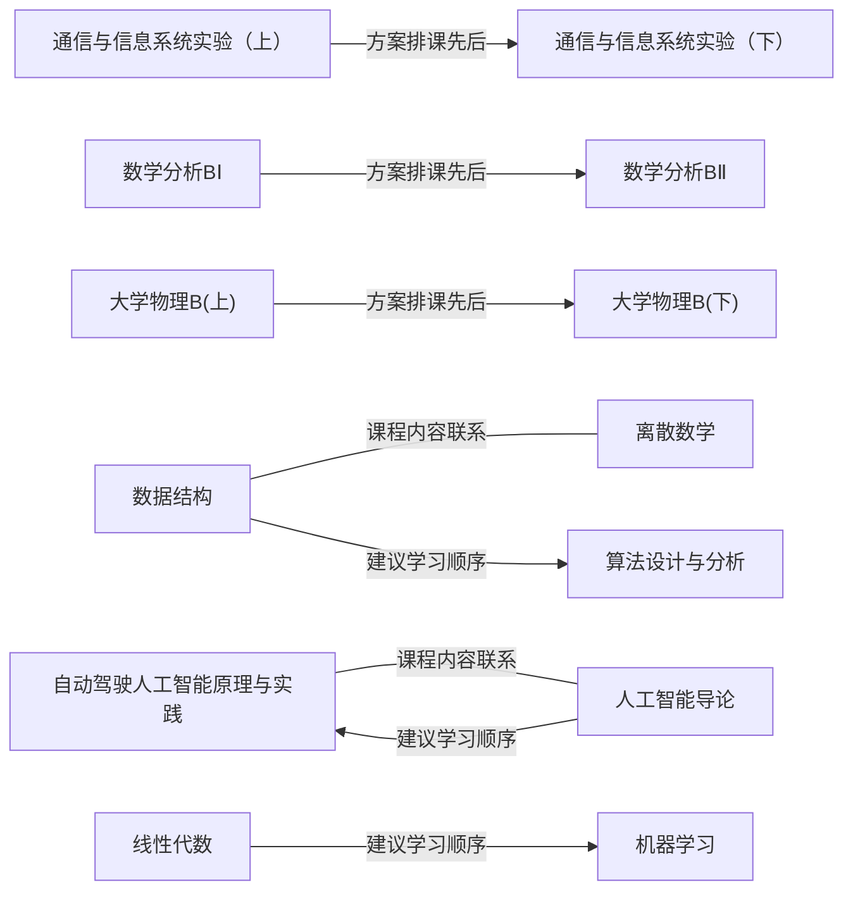

# 2024通信工程专业2+X@普通本科生

未来信息创新学院 · 通信工程 · 方案 72683 · 53 个不同课程或科研条目。

[官方 Word](../originals/plan-72683.docx) · [教务详情](https://fdjwgl.fudan.edu.cn/manager/bizType/2/major-program-search/info/72683?skipAuth=1) · [方案快照](../raw/plan-72683.json.gz) · [年级目录](../README.md)

## 课程关系图

图中展示部分关系。下表保留全部已建立的课程对，来源位置使用本方案 JSON Pointer。

## 先修与内容联系

| 类型 | 起点 | 终点 | 依据 | 原表定位 |
| --- | --- | --- | --- | --- |
| 建议学习顺序 | 线性代数 (CS10003) | 机器学习 (ICE50015) | 向量、矩阵及线性映射为理解学习模型提供数学准备。  | `/courseModules/6/planCourses/2`、`/courseModules/11/planCourses/21` |
| 建议学习顺序 | 数据结构 (EST50016) | 算法设计与分析 (ICE40002) | 数据组织与基本操作为算法设计提供基础。  | `/courseModules/11/planCourses/8`、`/courseModules/11/planCourses/10` |
| 建议学习顺序 | 通信与信息系统实验（上） (ICE40008) | 通信与信息系统实验（下） (ICE40009) | 同方案的课程题名具有连续分册或序号。  | `/courseModules/10/planCourses/3`、`/courseModules/10/planCourses/5` |
| 建议学习顺序 | 人工智能导论 (IST20002) | 自动驾驶人工智能原理与实践 (AIT410017) | “人工智能导论”题名标明基础层次，前置阅读可帮助了解“自动驾驶人工智能原理与实践”中的人工智能主题。  | `/courseModules/11/planCourses/5`、`/courseModules/11/planCourses/24` |
| 建议学习顺序 | 数学分析BⅠ (MATH10012) | 数学分析BⅡ (MATH10013) | 同方案的课程题名具有连续分册或序号。  | `/courseModules/6/planCourses/0`、`/courseModules/6/planCourses/1` |
| 建议学习顺序 | 大学物理B(上) (PHYS10003) | 大学物理B(下) (PHYS10004) | 同方案的课程题名具有连续分册或序号。  | `/courseModules/6/planCourses/3`、`/courseModules/6/planCourses/4` |
| 方案排课先后 | 通信与信息系统实验（上） (ICE40008) | 通信与信息系统实验（下） (ICE40009) | 同方案该课程全部明确数字学期均早于后者。  | `/courseModules/10/planCourses/3`、`/courseModules/10/planCourses/5` |
| 方案排课先后 | 数学分析BⅠ (MATH10012) | 数学分析BⅡ (MATH10013) | 同方案该课程全部明确数字学期均早于后者。  | `/courseModules/6/planCourses/0`、`/courseModules/6/planCourses/1` |
| 方案排课先后 | 大学物理B(上) (PHYS10003) | 大学物理B(下) (PHYS10004) | 同方案该课程全部明确数字学期均早于后者。  | `/courseModules/6/planCourses/3`、`/courseModules/6/planCourses/4` |
| 课程内容联系 | 自动驾驶人工智能原理与实践 (AIT410017) | 人工智能导论 (IST20002) | 本方案两门课程的题名均含“人工智能”，可据此对照这一主题。  | `/courseModules/11/planCourses/24`、`/courseModules/11/planCourses/5` |
| 课程内容联系 | 数据结构 (EST50016) | 离散数学 (ICE50004) | 共同主题为图、树与离散结构。  | `/courseModules/11/planCourses/8`、`/courseModules/11/planCourses/4` |

本次未从可定位的明确表述中确认课程对课程预修。学期安排、系列分册与编辑建议均保留各自的依据。

## 按原方案模块阅读

同一模块展示原表中的课程归属。模块内课程之间的先后仍须逐项查阅。

- **技术科学类基础课程（工科试验班等适用）**　线性代数、程序设计、电子系统导论、数学分析BⅠ、数学分析BⅡ、大学物理B(上)、大学物理B(下)、基础物理实验（原表模块 6）

## 课程表

同一课程在不同模块分别出现时，按原表逐行列出。季节字段保留原值。

| 课程 | 代码 | 学分 | 学期 | 模块 |
| --- | --- | ---: | --- | --- |
| 数学分析BⅠ | MATH10012 | 5.0 | 第1学期 | 培养方案 / 专业培养课程 / 大类基础课程 / 技术科学类基础课程（工科试验班等适用） |
| 数学分析BⅡ | MATH10013 | 5.0 | 第2学期 | 培养方案 / 专业培养课程 / 大类基础课程 / 技术科学类基础课程（工科试验班等适用） |
| 线性代数 | CS10003 | 3.0 | 第1学期 | 培养方案 / 专业培养课程 / 大类基础课程 / 技术科学类基础课程（工科试验班等适用） |
| 大学物理B(上) | PHYS10003 | 4.0 | 第1学期 | 培养方案 / 专业培养课程 / 大类基础课程 / 技术科学类基础课程（工科试验班等适用） |
| 大学物理B(下) | PHYS10004 | 4.0 | 第2学期 | 培养方案 / 专业培养课程 / 大类基础课程 / 技术科学类基础课程（工科试验班等适用） |
| 基础物理实验 | PHYS10005 | 2.0 | 第2学期 | 培养方案 / 专业培养课程 / 大类基础课程 / 技术科学类基础课程（工科试验班等适用） |
| 程序设计 | CS10004 | 4.0 | 第1学期 | 培养方案 / 专业培养课程 / 大类基础课程 / 技术科学类基础课程（工科试验班等适用） |
| 电子系统导论 | EST10003 | 3.0 | 第2学期 | 培养方案 / 专业培养课程 / 大类基础课程 / 技术科学类基础课程（工科试验班等适用） |
| 数字逻辑基础 | EST20009 | 4.0 | 第3学期 | 培养方案 / 专业培养课程 / 专业核心教育课程 |
| 概率、数理统计与随机过程 | EST20002 | 3.0 | 第3学期 | 培养方案 / 专业培养课程 / 专业核心教育课程 |
| 工程数学 | EST20003 | 4.0 | 第3学期 | 培养方案 / 专业培养课程 / 专业核心教育课程 |
| 模拟电子学基础 | EST20010 | 4.0 | 第3学期 | 培养方案 / 专业培养课程 / 专业核心教育课程 |
| 高频电子线路B | EST20005 | 3.0 | 第4学期 | 培养方案 / 专业培养课程 / 专业核心教育课程 |
| 模拟与数字电路实验 | EST40012 | 3.0 | 第4学期 | 培养方案 / 专业培养课程 / 专业核心教育课程 |
| 通信原理B | ICE30001 | 3.0 | 第5学期 | 培养方案 / 专业培养课程 / 专业核心教育课程 |
| 信息论基础 | EST20008 | 3.0 | 第4学期 | 培养方案 / 专业培养课程 / 专业核心教育课程 |
| 微机原理与接口实验 | EST40017 | 3.0 | 第5学期 | 培养方案 / 专业培养课程 / 专业核心教育课程 |
| 数字信号处理A | EST30002 | 3.0 | 第5学期 | 培养方案 / 专业培养课程 / 专业核心教育课程 |
| 信号与系统实验 | ICE40005 | 2.0 | 第5学期 | 培养方案 / 专业培养课程 / 专业核心教育课程 |
| 毕业论文 | EST40005 | 6.0 | 第8学期 | 培养方案 / 专业培养课程 / 专业核心教育课程 |
| 信号与通信系统 | EST20004 | 3.0 | 第4学期 | 培养方案 / 专业培养课程 / 专业核心教育课程 |
| 生产实习 | EST40004 | 1.0 | 第7学期 | 培养方案 / 专业培养课程 / 专业核心教育课程 |
| 电磁场与微波技术 | ICE20001 | 3.0 | 第4学期 | 培养方案 / 专业进阶模块I |
| 计算机通信与网络 | ICE50002 | 3.0 | 第6学期 | 培养方案 / 专业进阶模块I |
| 光纤通信原理 | ICE50017 | 2.0 | 第6学期 | 培养方案 / 专业进阶模块I |
| 通信与信息系统实验（上） | ICE40008 | 3.0 | 第6学期 | 培养方案 / 专业进阶模块I |
| 信号检测与估计基础 | EST50014 | 2.0 | 第7学期 | 培养方案 / 专业进阶模块I |
| 通信与信息系统实验（下） | ICE40009 | 3.0 | 第7学期 | 培养方案 / 专业进阶模块I |
| 智能光电子导论 | ICE50018 | 2.0 | SPRING | 培养方案 / 专业进阶模块II |
| 前沿讲座 | ICE50010 | 2.0 | SPRING | 培养方案 / 专业进阶模块II |
| 科技英语 | ICE50003 | 2.0 | AUTUMN | 培养方案 / 专业进阶模块II |
| 计算机仿真与模拟 | ICE50007 | 2.0 | AUTUMN | 培养方案 / 专业进阶模块II |
| 离散数学 | ICE50004 | 2.0 | SPRING | 培养方案 / 专业进阶模块II |
| 人工智能导论 | IST20002 | 4.0 | SPRING | 培养方案 / 专业进阶模块II |
| 天线原理 | ICE50012 | 2.0 | AUTUMN | 培养方案 / 专业进阶模块II |
| 智能硬件创新方法概论与基础实践 | ICE50013 | 2.0 | AUTUMN | 培养方案 / 专业进阶模块II |
| 数据结构 | EST50016 | 2.0 | SPRING | 培养方案 / 专业进阶模块II |
| 计算机体系结构 | EST30005 | 3.0 | SPRING | 培养方案 / 专业进阶模块II |
| 算法设计与分析 | ICE40002 | 3.0 | SPRING | 培养方案 / 专业进阶模块II |
| 数字图像处理B | ICE40003 | 2.0 | AUTUMN | 培养方案 / 专业进阶模块II |
| 遥感原理与技术 | ICE50008 | 2.0 | AUTUMN | 培养方案 / 专业进阶模块II |
| 科学计算 | ICE40006 | 2.0 | AUTUMN | 培养方案 / 专业进阶模块II |
| 无线通信 | ICE50014 | 2.0 | AUTUMN | 培养方案 / 专业进阶模块II |
| 通信编码原理与技术 | ICE50011 | 2.0 | SPRING | 培养方案 / 专业进阶模块II |
| 卫星与移动通信B | ICE40004 | 2.0 | AUTUMN | 培养方案 / 专业进阶模块II |
| 光通信网络基础 | ICE50006 | 2.0 | AUTUMN | 培养方案 / 专业进阶模块II |
| 网络协议与网络安全基础 | ICE50005 | 2.0 | AUTUMN | 培养方案 / 专业进阶模块II |
| 电信网络基础 | ICE40001 | 2.0 | AUTUMN | 培养方案 / 专业进阶模块II |
| 空天信息导论 | ICE40007 | 2.0 | SPRING | 培养方案 / 专业进阶模块II |
| 机器学习 | ICE50015 | 2.0 | AUTUMN | 培养方案 / 专业进阶模块II |
| 智能通信导论 | ICE50016 | 2.0 | SPRING | 培养方案 / 专业进阶模块II |
| AI增强仿真学：理论与实践 | AIT310027 | 3.0 | AUTUMN | 培养方案 / 专业进阶模块II |
| 自动驾驶人工智能原理与实践 | AIT410017 | 2.0 | SPRING | 培养方案 / 专业进阶模块II |
