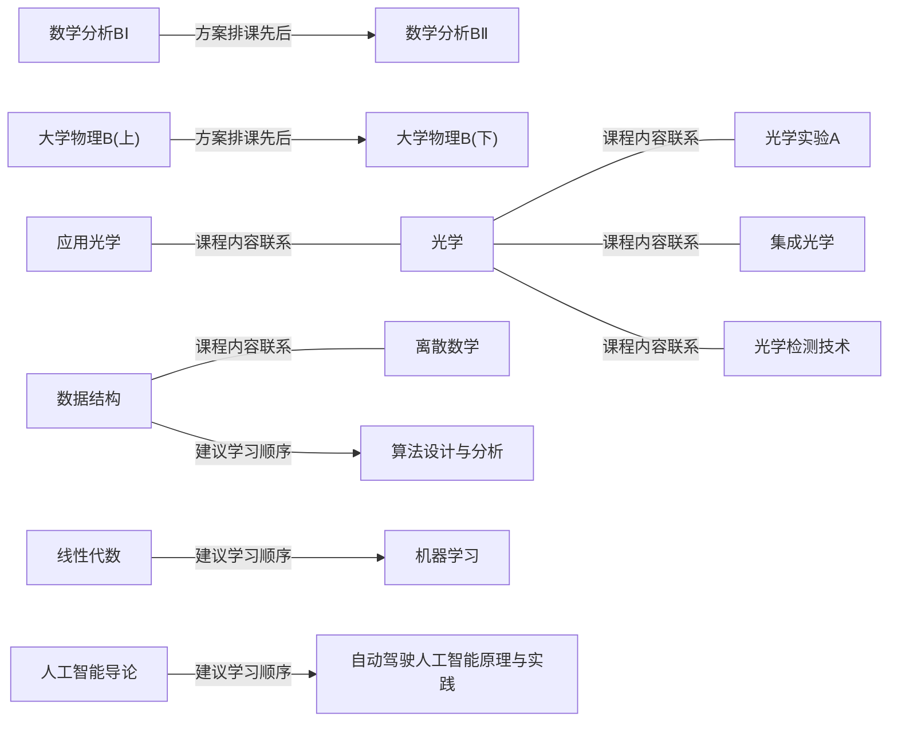

# 2024电子信息科学与技术（光子计划院士班）2+X @普通本科生

未来信息创新学院 · 电子信息科学与技术(光子计划院士班) · 方案 73040 · 107 个不同课程或科研条目。

[官方 Word](../originals/plan-73040.docx) · [教务详情](https://fdjwgl.fudan.edu.cn/manager/bizType/2/major-program-search/info/73040?skipAuth=1) · [方案快照](../raw/plan-73040.json.gz) · [年级目录](../README.md)

## 课程关系图

图中展示部分关系。下表保留全部已建立的课程对，来源位置使用本方案 JSON Pointer。

## 先修与内容联系

| 类型 | 起点 | 终点 | 依据 | 原表定位 |
| --- | --- | --- | --- | --- |
| 建议学习顺序 | 线性代数 (CS10003) | 机器学习 (ICE50015) | 向量、矩阵及线性映射为理解学习模型提供数学准备。  | `/courseModules/7/planCourses/2`、`/courseModules/12/planCourses/21` |
| 建议学习顺序 | 数据结构 (EST50016) | 算法设计与分析 (ICE40002) | 数据组织与基本操作为算法设计提供基础。  | `/courseModules/8/planCourses/14`、`/courseModules/12/planCourses/26` |
| 建议学习顺序 | 人工智能导论 (IST20002) | 自动驾驶人工智能原理与实践 (AIT410017) | “人工智能导论”题名标明基础层次，前置阅读可帮助了解“自动驾驶人工智能原理与实践”中的人工智能主题。  | `/courseModules/12/planCourses/16`、`/courseModules/12/planCourses/31` |
| 建议学习顺序 | 数学分析BⅠ (MATH10012) | 数学分析BⅡ (MATH10013) | 同方案的课程题名具有连续分册或序号。  | `/courseModules/7/planCourses/0`、`/courseModules/7/planCourses/1` |
| 建议学习顺序 | 大学物理B(上) (PHYS10003) | 大学物理B(下) (PHYS10004) | 同方案的课程题名具有连续分册或序号。  | `/courseModules/7/planCourses/3`、`/courseModules/7/planCourses/4` |
| 方案排课先后 | 数学分析BⅠ (MATH10012) | 数学分析BⅡ (MATH10013) | 同方案该课程全部明确数字学期均早于后者。  | `/courseModules/7/planCourses/0`、`/courseModules/7/planCourses/1` |
| 方案排课先后 | 大学物理B(上) (PHYS10003) | 大学物理B(下) (PHYS10004) | 同方案该课程全部明确数字学期均早于后者。  | `/courseModules/7/planCourses/3`、`/courseModules/7/planCourses/4` |
| 课程内容联系 | 自动驾驶人工智能原理与实践 (AIT410017) | 人工智能导论 (IST20002) | 本方案两门课程的题名均含“人工智能”，可据此对照这一主题。  | `/courseModules/12/planCourses/31`、`/courseModules/12/planCourses/16` |
| 课程内容联系 | 数字信号处理A (EST30002) | 传感器与信号处理 (OPTI50014) | 本方案两门课程的题名均含“信号处理”，可据此对照这一主题。  | `/courseModules/8/planCourses/11`、`/courseModules/14/planCourses/24` |
| 课程内容联系 | 半导体物理 (EST30004) | 半导体材料测试分析方法 (OPTI50028) | 本方案两门课程的题名均含“半导体”，可据此对照这一主题。  | `/courseModules/11/planCourses/0`、`/courseModules/14/planCourses/23` |
| 课程内容联系 | 量子与统计 (EST30012) | 集成量子光学及应用 (OPTI40016) | 本方案两门课程的题名均含“量子”，可据此对照这一主题。  | `/courseModules/11/planCourses/8`、`/courseModules/12/planCourses/34` |
| 课程内容联系 | 数据结构 (EST50016) | 离散数学 (ICE50004) | 共同主题为图、树与离散结构。  | `/courseModules/8/planCourses/14`、`/courseModules/12/planCourses/20` |
| 课程内容联系 | 图像处理与机器视觉 (EST60008) | 数字图像处理B (ICE40003) | 本方案两门课程的题名均含“图像处理”，可据此对照这一主题。  | `/courseModules/12/planCourses/19`、`/courseModules/12/planCourses/10` |
| 课程内容联系 | 应用光学 (OPTI20001) | 光学 (OPTI20002) | 本方案两门课程的题名均含“光学”，可据此对照这一主题。  | `/courseModules/11/planCourses/2`、`/courseModules/8/planCourses/9` |
| 课程内容联系 | 光学 (OPTI20002) | 光学实验A (OPTI30005) | 本方案两门课程的题名均含“光学”，可据此对照这一主题。  | `/courseModules/8/planCourses/9`、`/courseModules/8/planCourses/13` |
| 课程内容联系 | 光学 (OPTI20002) | 集成光学 (OPTI50003) | 本方案两门课程的题名均含“光学”，可据此对照这一主题。  | `/courseModules/8/planCourses/9`、`/courseModules/14/planCourses/4` |
| 课程内容联系 | 光学 (OPTI20002) | 光学检测技术 (OPTI50009) | 本方案两门课程的题名均含“光学”，可据此对照这一主题。  | `/courseModules/8/planCourses/9`、`/courseModules/14/planCourses/6` |

本次未从可定位的明确表述中确认课程对课程预修。学期安排、系列分册与编辑建议均保留各自的依据。

## 按原方案模块阅读

同一模块展示原表中的课程归属。模块内课程之间的先后仍须逐项查阅。

- **技术科学类基础课程（工科试验班等适用）**　线性代数、程序设计、电子系统导论、数学分析BⅠ、数学分析BⅡ、大学物理B(上)、大学物理B(下)、基础物理实验（原表模块 7）

## 课程表

同一课程在不同模块分别出现时，按原表逐行列出。季节字段保留原值。

| 课程 | 代码 | 学分 | 学期 | 模块 |
| --- | --- | ---: | --- | --- |
| 数学分析BⅠ | MATH10012 | 5.0 | 第1学期 | 培养方案 / 专业培养课程 / 大类基础课程 / 技术科学类基础课程 / 技术科学类基础课程（工科试验班等适用） |
| 数学分析BⅡ | MATH10013 | 5.0 | 第2学期 | 培养方案 / 专业培养课程 / 大类基础课程 / 技术科学类基础课程 / 技术科学类基础课程（工科试验班等适用） |
| 线性代数 | CS10003 | 3.0 | 第1学期 | 培养方案 / 专业培养课程 / 大类基础课程 / 技术科学类基础课程 / 技术科学类基础课程（工科试验班等适用） |
| 大学物理B(上) | PHYS10003 | 4.0 | 第1学期 | 培养方案 / 专业培养课程 / 大类基础课程 / 技术科学类基础课程 / 技术科学类基础课程（工科试验班等适用） |
| 大学物理B(下) | PHYS10004 | 4.0 | 第2学期 | 培养方案 / 专业培养课程 / 大类基础课程 / 技术科学类基础课程 / 技术科学类基础课程（工科试验班等适用） |
| 基础物理实验 | PHYS10005 | 2.0 | 第2学期 | 培养方案 / 专业培养课程 / 大类基础课程 / 技术科学类基础课程 / 技术科学类基础课程（工科试验班等适用） |
| 程序设计 | CS10004 | 4.0 | 第1学期 | 培养方案 / 专业培养课程 / 大类基础课程 / 技术科学类基础课程 / 技术科学类基础课程（工科试验班等适用） |
| 电子系统导论 | EST10003 | 3.0 | 第2学期 | 培养方案 / 专业培养课程 / 大类基础课程 / 技术科学类基础课程 / 技术科学类基础课程（工科试验班等适用） |
| 数字逻辑基础 | EST20009 | 4.0 | 第3学期 | 培养方案 / 专业培养课程 / 专业核心教育课程 |
| 概率、数理统计与随机过程 | EST20002 | 3.0 | 第3学期 | 培养方案 / 专业培养课程 / 专业核心教育课程 |
| 工程数学 | EST20003 | 4.0 | 第3学期 | 培养方案 / 专业培养课程 / 专业核心教育课程 |
| 模拟电子学基础 | EST20010 | 4.0 | 第3学期 | 培养方案 / 专业培养课程 / 专业核心教育课程 |
| 信息科技前沿讲座 | EST20011 | 1.0 | 第3学期 | 培养方案 / 专业培养课程 / 专业核心教育课程 |
| 高频电子线路B | EST20005 | 3.0 | 第4学期 | 培养方案 / 专业培养课程 / 专业核心教育课程 |
| 模拟与数字电路实验 | EST40012 | 3.0 | 第4学期 | 培养方案 / 专业培养课程 / 专业核心教育课程 |
| 信号与通信系统 | EST20004 | 3.0 | 第4学期 | 培养方案 / 专业培养课程 / 专业核心教育课程 |
| 信息论基础 | EST20008 | 3.0 | 第4学期 | 培养方案 / 专业培养课程 / 专业核心教育课程 |
| 光学 | OPTI20002 | 3.0 | 第4学期 | 培养方案 / 专业培养课程 / 专业核心教育课程 |
| 电磁场与电磁波A | OPTI30004 | 3.0 | 第4学期 | 培养方案 / 专业培养课程 / 专业核心教育课程 |
| 数字信号处理A | EST30002 | 3.0 | 第5学期 | 培养方案 / 专业培养课程 / 专业核心教育课程 |
| 信号与系统实验 | ICE40005 | 2.0 | 第5学期 | 培养方案 / 专业培养课程 / 专业核心教育课程 |
| 光学实验A | OPTI30005 | 2.0 | 第5学期 | 培养方案 / 专业培养课程 / 专业核心教育课程 |
| 数据结构 | EST50016 | 2.0 | 第6学期 | 培养方案 / 专业培养课程 / 专业核心教育课程 |
| 生产实习 | EST40004 | 1.0 | 第6学期、第7学期 | 培养方案 / 专业培养课程 / 专业核心教育课程 |
| 毕业论文 | EST40005 | 6.0 | 第8学期 | 培养方案 / 专业培养课程 / 专业核心教育课程 |
| 半导体物理 | EST30004 | 3.0 | 第5学期 | 培养方案 / 专业进阶模块I |
| 光电信号检测原理与技术 | EST50017 | 2.0 | 第5学期 | 培养方案 / 专业进阶模块I |
| 应用光学 | OPTI20001 | 3.0 | 第6学期 | 培养方案 / 专业进阶模块I |
| 通信与网络 | ICE40013 | 3.0 |  | 培养方案 / 专业进阶模块I |
| 计算机体系结构 | EST30005 | 3.0 | 第6学期 | 培养方案 / 专业进阶模块I |
| 光纤通信原理与技术 | OPTI50002 | 3.0 | 第6学期 | 培养方案 / 专业进阶模块I |
| 光电显示技术基础 | OPTI50024 | 3.0 | 第6学期 | 培养方案 / 专业进阶模块I |
| 生产实习 | EST40004 | 1.0 | 第6学期、第7学期 | 培养方案 / 专业进阶模块I |
| 量子与统计 | EST30012 | 3.0 | 第6学期 | 培养方案 / 专业进阶模块I |
| 光电综合实验 | EST40036 | 3.0 | 第7学期 | 培养方案 / 专业进阶模块I |
| 自动控制原理 | EST30003 | 3.0 | 第5学期 | 培养方案 / 专业进阶模块II（电子信息科学与技术方向） |
| 可编程器件与硬件描述语言 | EST50013 | 2.0 | 第5学期 | 培养方案 / 专业进阶模块II（电子信息科学与技术方向） |
| 微机原理与接口实验 | EST40017 | 3.0 | 第5学期 | 培养方案 / 专业进阶模块II（电子信息科学与技术方向） |
| 高频电路实验 | EST40013 | 2.0 | 第6学期 | 培养方案 / 专业进阶模块II（电子信息科学与技术方向） |
| 电子系统设计 | EST50012 | 2.0 | 第7学期 | 培养方案 / 专业进阶模块II（电子信息科学与技术方向） |
| 电工实验 | EST40006 | 2.0 | AUTUMN | 培养方案 / 专业进阶模块II（电子信息科学与技术方向） |
| 多媒体技术 | EST40007 | 2.0 | AUTUMN | 培养方案 / 专业进阶模块II（电子信息科学与技术方向） |
| 计算机网络 | EST40008 | 2.0 | AUTUMN | 培养方案 / 专业进阶模块II（电子信息科学与技术方向） |
| 科技英语 | ICE50003 | 2.0 | SPRING、AUTUMN | 培养方案 / 专业进阶模块II（电子信息科学与技术方向） |
| 数据采集和处理系统 | EST40009 | 2.0 | SPRING | 培养方案 / 专业进阶模块II（电子信息科学与技术方向） |
| 数字图像处理B | ICE40003 | 2.0 | AUTUMN | 培养方案 / 专业进阶模块II（电子信息科学与技术方向） |
| 网络科学导论 | EST50015 | 2.0 | SPRING | 培养方案 / 专业进阶模块II（电子信息科学与技术方向） |
| 工程图学及应用 | EST40010 | 2.0 | SPRING | 培养方案 / 专业进阶模块II（电子信息科学与技术方向） |
| 医学成像技术 | BME50021 | 2.0 | AUTUMN | 培养方案 / 专业进阶模块II（电子信息科学与技术方向） |
| 电力电子学 | OPTI50005 | 3.0 | SPRING | 培养方案 / 专业进阶模块II（电子信息科学与技术方向） |
| 电气工程基础 | OPTI40011 | 2.0 | AUTUMN | 培养方案 / 专业进阶模块II（电子信息科学与技术方向） |
| 人工智能导论 | IST20002 | 4.0 | SPRING | 培养方案 / 专业进阶模块II（电子信息科学与技术方向） |
| 脑科学导论 | IST20001 | 3.0 | AUTUMN | 培养方案 / 专业进阶模块II（电子信息科学与技术方向） |
| 机器人学导论 | IST40011 | 4.0 | AUTUMN | 培养方案 / 专业进阶模块II（电子信息科学与技术方向） |
| 图像处理与机器视觉 | EST60008 | 3.0 | SPRING | 培养方案 / 专业进阶模块II（电子信息科学与技术方向） |
| 离散数学 | ICE50004 | 2.0 | SPRING | 培养方案 / 专业进阶模块II（电子信息科学与技术方向） |
| 机器学习 | ICE50015 | 2.0 | AUTUMN | 培养方案 / 专业进阶模块II（电子信息科学与技术方向） |
| 群体智能 | EST40016 | 2.0 | AUTUMN | 培养方案 / 专业进阶模块II（电子信息科学与技术方向） |
| 智能硬件创新方法概论与基础实践 | ICE50013 | 2.0 | AUTUMN | 培养方案 / 专业进阶模块II（电子信息科学与技术方向） |
| 计算机仿真与模拟 | ICE50007 | 2.0 | AUTUMN | 培养方案 / 专业进阶模块II（电子信息科学与技术方向） |
| 科学计算 | ICE40006 | 2.0 | AUTUMN | 培养方案 / 专业进阶模块II（电子信息科学与技术方向） |
| 算法设计与分析 | ICE40002 | 3.0 | SPRING | 培养方案 / 专业进阶模块II（电子信息科学与技术方向） |
| 统计学习 | IST30007 | 4.0 | AUTUMN | 培养方案 / 专业进阶模块II（电子信息科学与技术方向） |
| 智能系统设计 | EST40015 | 4.0 | AUTUMN | 培养方案 / 专业进阶模块II（电子信息科学与技术方向） |
| 数字控制理论与应用 | OPTI50012 | 3.0 | SPRING | 培养方案 / 专业进阶模块II（电子信息科学与技术方向） |
| AI增强仿真学：理论与实践 | AIT310027 | 3.0 | AUTUMN | 培养方案 / 专业进阶模块II（电子信息科学与技术方向） |
| 自动驾驶人工智能原理与实践 | AIT410017 | 2.0 | SPRING | 培养方案 / 专业进阶模块II（电子信息科学与技术方向） |
| 机器人学导论 | AIS410007 | 4.0 | AUTUMN | 培养方案 / 专业进阶模块II（电子信息科学与技术方向） |
| 脑科学导论 | AIS310018 | 3.0 | AUTUMN | 培养方案 / 专业进阶模块II（电子信息科学与技术方向） |
| 集成量子光学及应用 | OPTI40016 | 2.0 |  | 培养方案 / 专业进阶模块II（电子信息科学与技术方向） |
| 微机原理与接口实验 | EST40017 | 3.0 | 第5学期 | 培养方案 / 专业进阶模块II（通信工程方向） |
| 通信原理B | ICE30001 | 3.0 | 第5学期 | 培养方案 / 专业进阶模块II（通信工程方向） |
| 机器学习 | ICE50015 | 2.0 | 第5学期 | 培养方案 / 专业进阶模块II（通信工程方向） |
| 光纤通信原理 | ICE50017 | 2.0 | 第6学期 | 培养方案 / 专业进阶模块II（通信工程方向） |
| 电子系统设计 | EST50012 | 2.0 | 第7学期 | 培养方案 / 专业进阶模块II（通信工程方向） |
| 天线原理 | ICE50012 | 2.0 | AUTUMN | 培养方案 / 专业进阶模块II（通信工程方向） |
| 遥感原理与技术 | ICE50008 | 2.0 | AUTUMN | 培养方案 / 专业进阶模块II（通信工程方向） |
| 空天信息导论 | ICE40007 | 2.0 | SPRING | 培养方案 / 专业进阶模块II（通信工程方向） |
| 无线通信 | ICE50014 | 2.0 | AUTUMN | 培养方案 / 专业进阶模块II（通信工程方向） |
| 网络协议与网络安全基础 | ICE50005 | 2.0 | AUTUMN | 培养方案 / 专业进阶模块II（通信工程方向） |
| 电信网络基础 | ICE40001 | 2.0 | AUTUMN | 培养方案 / 专业进阶模块II（通信工程方向） |
| 光通信网络基础 | ICE50006 | 2.0 | AUTUMN | 培养方案 / 专业进阶模块II（通信工程方向） |
| 通信编码原理与技术 | ICE50011 | 2.0 | SPRING | 培养方案 / 专业进阶模块II（通信工程方向） |
| 智能通信导论 | ICE50016 | 2.0 | SPRING | 培养方案 / 专业进阶模块II（通信工程方向） |
| 科技英语 | ICE50003 | 2.0 | AUTUMN | 培养方案 / 专业进阶模块II（通信工程方向） |
| 卫星与移动通信B | ICE40004 | 2.0 | AUTUMN | 培养方案 / 专业进阶模块II（通信工程方向） |
| 人工智能导论 | IST20002 | 4.0 | SPRING | 培养方案 / 专业进阶模块II（通信工程方向） |
| 脑科学导论 | IST20001 | 3.0 | AUTUMN | 培养方案 / 专业进阶模块II（通信工程方向） |
| 机器人学导论 | IST40011 | 4.0 | AUTUMN | 培养方案 / 专业进阶模块II（通信工程方向） |
| 图像处理与机器视觉 | EST60008 | 3.0 | SPRING | 培养方案 / 专业进阶模块II（通信工程方向） |
| 离散数学 | ICE50004 | 2.0 | SPRING | 培养方案 / 专业进阶模块II（通信工程方向） |
| 群体智能 | EST40016 | 2.0 | AUTUMN | 培养方案 / 专业进阶模块II（通信工程方向） |
| 智能硬件创新方法概论与基础实践 | ICE50013 | 2.0 | AUTUMN | 培养方案 / 专业进阶模块II（通信工程方向） |
| 计算机仿真与模拟 | ICE50007 | 2.0 | AUTUMN | 培养方案 / 专业进阶模块II（通信工程方向） |
| 科学计算 | ICE40006 | 2.0 | AUTUMN | 培养方案 / 专业进阶模块II（通信工程方向） |
| 算法设计与分析 | ICE40002 | 3.0 | SPRING | 培养方案 / 专业进阶模块II（通信工程方向） |
| 统计学习 | IST30007 | 4.0 | AUTUMN | 培养方案 / 专业进阶模块II（通信工程方向） |
| 智能系统设计 | EST40015 | 4.0 | AUTUMN | 培养方案 / 专业进阶模块II（通信工程方向） |
| 数字控制理论与应用 | OPTI50012 | 3.0 | SPRING | 培养方案 / 专业进阶模块II（通信工程方向） |
| AI增强仿真学：理论与实践 | AIT310027 | 3.0 | AUTUMN | 培养方案 / 专业进阶模块II（通信工程方向） |
| 自动驾驶人工智能原理与实践 | AIT410017 | 2.0 | SPRING | 培养方案 / 专业进阶模块II（通信工程方向） |
| 脑科学导论 | AIS310018 | 3.0 | AUTUMN | 培养方案 / 专业进阶模块II（通信工程方向） |
| 机器人学导论 | AIS410007 | 4.0 | AUTUMN | 培养方案 / 专业进阶模块II（通信工程方向） |
| 微机原理与接口实验 | EST40017 | 3.0 | 第5学期 | 培养方案 / 专业进阶模块II（光电信息科学与工程方向） |
| 激光原理与技术 | OPTI50001 | 3.0 | 第5学期 | 培养方案 / 专业进阶模块II（光电信息科学与工程方向） |
| 光源原理 | OPTI50013 | 3.0 | 第5学期 | 培养方案 / 专业进阶模块II（光电信息科学与工程方向） |
| 现代信息光学 | OPTI50018 | 3.0 | 第6学期 | 培养方案 / 专业进阶模块II（光电信息科学与工程方向） |
| 集成光学 | OPTI50003 | 2.0 | AUTUMN | 培养方案 / 专业进阶模块II（光电信息科学与工程方向） |
| 现代光子学 | OPTI50017 | 2.0 | SPRING | 培养方案 / 专业进阶模块II（光电信息科学与工程方向） |
| 光学检测技术 | OPTI50009 | 2.0 | SPRING | 培养方案 / 专业进阶模块II（光电信息科学与工程方向） |
| 智能光电子导论 | ICE50018 | 2.0 | SPRING | 培养方案 / 专业进阶模块II（光电信息科学与工程方向） |
| 智能光电系统导论 | OPTI50022 | 2.0 | SPRING | 培养方案 / 专业进阶模块II（光电信息科学与工程方向） |
| 智能光电驱动技术 | OPTI50025 | 3.0 | SPRING | 培养方案 / 专业进阶模块II（光电信息科学与工程方向） |
| 工程图学及应用 | EST40010 | 2.0 | SPRING | 培养方案 / 专业进阶模块II（光电信息科学与工程方向） |
| 光生物医学 | OPTI40006 | 2.0 | AUTUMN | 培养方案 / 专业进阶模块II（光电信息科学与工程方向） |
| 光谱技术与应用 | OPTI40005 | 2.0 | SPRING | 培养方案 / 专业进阶模块II（光电信息科学与工程方向） |
| 液晶原理与应用 | OPTI40007 | 2.0 | SPRING | 培养方案 / 专业进阶模块II（光电信息科学与工程方向） |
| 偏振器件原理与应用 | OPTI50020 | 2.0 | SPRING | 培养方案 / 专业进阶模块II（光电信息科学与工程方向） |
| 光子学器件与工艺 | OPTI40002 | 2.0 | AUTUMN | 培养方案 / 专业进阶模块II（光电信息科学与工程方向） |
| 光学薄膜设计导论 | OPTI50011 | 2.0 | AUTUMN | 培养方案 / 专业进阶模块II（光电信息科学与工程方向） |
| 光传感技术 | OPTI50010 | 2.0 | AUTUMN | 培养方案 / 专业进阶模块II（光电信息科学与工程方向） |
| 激光工程 | OPTI40010 | 2.0 | AUTUMN | 培养方案 / 专业进阶模块II（光电信息科学与工程方向） |
| 应用非线性光学 | OPTI40008 | 3.0 | SPRING | 培养方案 / 专业进阶模块II（光电信息科学与工程方向） |
| LED器件及应用技术 | OPTI50016 | 2.0 | SPRING | 培养方案 / 专业进阶模块II（光电信息科学与工程方向） |
| 激光雷达技术及应用 | OPTI50030 | 3.0 | SPRING | 培养方案 / 专业进阶模块II（光电信息科学与工程方向） |
| 发光材料及其应用 | OPTI50006 | 2.0 | SPRING | 培养方案 / 专业进阶模块II（光电信息科学与工程方向） |
| 半导体材料测试分析方法 | OPTI50028 | 2.0 | SPRING | 培养方案 / 专业进阶模块II（光电信息科学与工程方向） |
| 传感器与信号处理 | OPTI50014 | 3.0 | SPRING | 培养方案 / 专业进阶模块II（光电信息科学与工程方向） |
| 照明设计 | OPTI50015 | 3.0 | AUTUMN | 培养方案 / 专业进阶模块II（光电信息科学与工程方向） |
| 应用光学系统设计 | OPTI50029 | 2.0 | AUTUMN | 培养方案 / 专业进阶模块II（光电信息科学与工程方向） |
| 照明人体工效学 | OPTI50007 | 2.0 | SPRING | 培养方案 / 专业进阶模块II（光电信息科学与工程方向） |
| 人工智能导论 | IST20002 | 4.0 | SPRING | 培养方案 / 专业进阶模块II（光电信息科学与工程方向） |
| 脑科学导论 | IST20001 | 3.0 | AUTUMN | 培养方案 / 专业进阶模块II（光电信息科学与工程方向） |
| 机器人学导论 | IST40011 | 4.0 | AUTUMN | 培养方案 / 专业进阶模块II（光电信息科学与工程方向） |
| 图像处理与机器视觉 | EST60008 | 3.0 | SPRING | 培养方案 / 专业进阶模块II（光电信息科学与工程方向） |
| 离散数学 | ICE50004 | 2.0 | SPRING | 培养方案 / 专业进阶模块II（光电信息科学与工程方向） |
| 机器学习 | ICE50015 | 2.0 | AUTUMN | 培养方案 / 专业进阶模块II（光电信息科学与工程方向） |
| 群体智能 | EST40016 | 2.0 | AUTUMN | 培养方案 / 专业进阶模块II（光电信息科学与工程方向） |
| 智能硬件创新方法概论与基础实践 | ICE50013 | 2.0 | AUTUMN | 培养方案 / 专业进阶模块II（光电信息科学与工程方向） |
| 计算机仿真与模拟 | ICE50007 | 2.0 | AUTUMN | 培养方案 / 专业进阶模块II（光电信息科学与工程方向） |
| 科学计算 | ICE40006 | 2.0 | AUTUMN | 培养方案 / 专业进阶模块II（光电信息科学与工程方向） |
| 算法设计与分析 | ICE40002 | 3.0 | SPRING | 培养方案 / 专业进阶模块II（光电信息科学与工程方向） |
| 统计学习 | IST30007 | 4.0 | AUTUMN | 培养方案 / 专业进阶模块II（光电信息科学与工程方向） |
| 智能系统设计 | EST40015 | 4.0 | AUTUMN | 培养方案 / 专业进阶模块II（光电信息科学与工程方向） |
| 数字控制理论与应用 | OPTI50012 | 3.0 | SPRING | 培养方案 / 专业进阶模块II（光电信息科学与工程方向） |
| AI增强仿真学：理论与实践 | AIT310027 | 3.0 | AUTUMN | 培养方案 / 专业进阶模块II（光电信息科学与工程方向） |
| 自动驾驶人工智能原理与实践 | AIT410017 | 2.0 | SPRING | 培养方案 / 专业进阶模块II（光电信息科学与工程方向） |
| 机器人学导论 | AIS410007 | 4.0 | AUTUMN | 培养方案 / 专业进阶模块II（光电信息科学与工程方向） |
| 脑科学导论 | AIS310018 | 3.0 | AUTUMN | 培养方案 / 专业进阶模块II（光电信息科学与工程方向） |
