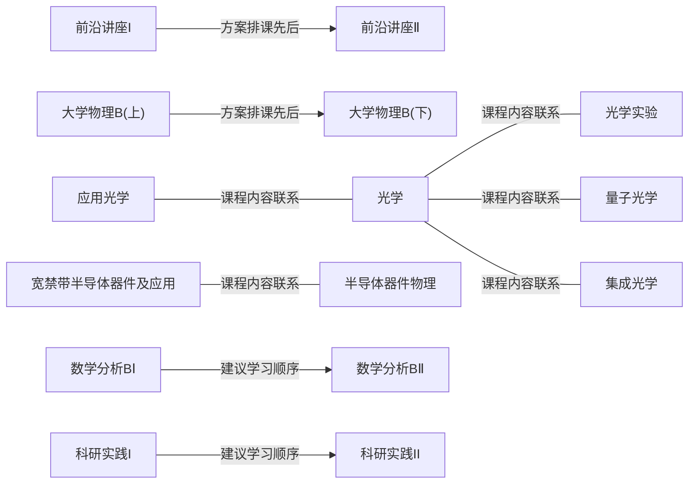

# 2025光电信息科学与工程-电子信息本硕融通培养方案（产教融合班）

未来信息创新学院 · 光电信息科学与工程 · 方案 97053 · 77 个不同课程或科研条目。

[官方 Word](../originals/plan-97053.docx) · [教务详情](https://fdjwgl.fudan.edu.cn/manager/bizType/2/major-program-search/info/97053?skipAuth=1) · [方案快照](../raw/plan-97053.json.gz) · [年级目录](../README.md)

## 课程关系图

图中展示部分关系。下表保留全部已建立的课程对，来源位置使用本方案 JSON Pointer。

## 先修与内容联系

| 类型 | 起点 | 终点 | 依据 | 原表定位 |
| --- | --- | --- | --- | --- |
| 建议学习顺序 | 科研实践I (52) | 科研实践II (53) | 同方案的课程题名具有连续分册或序号。  | `/courseModules/16/planCourses/3`、`/courseModules/16/planCourses/4` |
| 建议学习顺序 | 前沿讲座I (EST50045) | 前沿讲座Ⅱ (EST50046) | 同方案的课程题名具有连续分册或序号。  | `/courseModules/16/planCourses/10`、`/courseModules/16/planCourses/12` |
| 建议学习顺序 | 数学分析BⅠ (MATH10012) | 数学分析BⅡ (MATH10013) | 同方案的课程题名具有连续分册或序号。  | `/courseModules/4/planCourses/0`、`/courseModules/4/planCourses/1` |
| 建议学习顺序 | 大学物理B(上) (PHYS10003) | 大学物理B(下) (PHYS10004) | 同方案的课程题名具有连续分册或序号。  | `/courseModules/4/planCourses/3`、`/courseModules/4/planCourses/4` |
| 方案排课先后 | 前沿讲座I (EST50045) | 前沿讲座Ⅱ (EST50046) | 同方案该课程全部明确数字学期均早于后者。  | `/courseModules/16/planCourses/10`、`/courseModules/16/planCourses/12` |
| 方案排课先后 | 大学物理B(上) (PHYS10003) | 大学物理B(下) (PHYS10004) | 同方案该课程全部明确数字学期均早于后者。  | `/courseModules/4/planCourses/3`、`/courseModules/4/planCourses/4` |
| 课程内容联系 | 宽禁带半导体器件及应用 (EST60025) | 半导体器件物理 (OPTI50019) | 本方案两门课程的题名均含“半导体”，可据此对照这一主题。  | `/courseModules/10/planCourses/19`、`/courseModules/9/planCourses/3` |
| 课程内容联系 | 应用光学 (OPTI20001) | 光学 (OPTI20002) | 本方案两门课程的题名均含“光学”，可据此对照这一主题。  | `/courseModules/5/planCourses/6`、`/courseModules/5/planCourses/4` |
| 课程内容联系 | 光学 (OPTI20002) | 光学实验 (OPTI30003) | 题名显示相同主题的课程与实验、实践或实习。  | `/courseModules/5/planCourses/4`、`/courseModules/5/planCourses/9` |
| 课程内容联系 | 光学 (OPTI20002) | 量子光学 (OPTI40001) | 本方案两门课程的题名均含“光学”，可据此对照这一主题。  | `/courseModules/5/planCourses/4`、`/courseModules/10/planCourses/10` |
| 课程内容联系 | 光学 (OPTI20002) | 集成光学 (OPTI50003) | 本方案两门课程的题名均含“光学”，可据此对照这一主题。  | `/courseModules/5/planCourses/4`、`/courseModules/10/planCourses/0` |
| 课程内容联系 | 量子光学 (OPTI40001) | 量子力学基础 (OPTI50021) | 本方案两门课程的题名均含“量子”，可据此对照这一主题。  | `/courseModules/10/planCourses/10`、`/courseModules/10/planCourses/4` |

本次未从可定位的明确表述中确认课程对课程预修。学期安排、系列分册与编辑建议均保留各自的依据。

## 按原方案模块阅读

同一模块展示原表中的课程归属。模块内课程之间的先后仍须逐项查阅。

- **工学基础课程**　线性代数、程序设计、电子系统导论、数学分析BⅠ、数学分析BⅡ、大学物理B(上)、大学物理B(下)、基础物理实验（原表模块 4）

## 课程表

同一课程在不同模块分别出现时，按原表逐行列出。季节字段保留原值。

| 课程 | 代码 | 学分 | 学期 | 模块 |
| --- | --- | ---: | --- | --- |
| 数学分析BⅠ | MATH10012 | 5.0 | AUTUMN | 培养方案 / 专业培养课程 / 学科基础课程 / 工学基础课程 |
| 数学分析BⅡ | MATH10013 | 5.0 | SPRING | 培养方案 / 专业培养课程 / 学科基础课程 / 工学基础课程 |
| 线性代数 | CS10003 | 3.0 | AUTUMN | 培养方案 / 专业培养课程 / 学科基础课程 / 工学基础课程 |
| 大学物理B(上) | PHYS10003 | 4.0 | 第1学期 | 培养方案 / 专业培养课程 / 学科基础课程 / 工学基础课程 |
| 大学物理B(下) | PHYS10004 | 4.0 | 第2学期 | 培养方案 / 专业培养课程 / 学科基础课程 / 工学基础课程 |
| 基础物理实验 | PHYS10005 | 2.0 | 第2学期 | 培养方案 / 专业培养课程 / 学科基础课程 / 工学基础课程 |
| 程序设计 | CS10004 | 4.0 | 第1学期 | 培养方案 / 专业培养课程 / 学科基础课程 / 工学基础课程 |
| 电子系统导论 | EST10003 | 3.0 | 第2学期 | 培养方案 / 专业培养课程 / 学科基础课程 / 工学基础课程 |
| 数字逻辑基础 | EST20013 | 3.0 | 第3学期 | 培养方案 / 专业培养课程 / 专业核心教育课程 |
| 模拟电子学基础 | EST20012 | 3.0 | 第3学期 | 培养方案 / 专业培养课程 / 专业核心教育课程 |
| 工程数学 | EST20006 | 3.0 | 第3学期 | 培养方案 / 专业培养课程 / 专业核心教育课程 |
| 概率、数理统计与随机过程 | EST20002 | 3.0 | 第3学期 | 培养方案 / 专业培养课程 / 专业核心教育课程 |
| 光学 | OPTI20002 | 3.0 | 第3学期 | 培养方案 / 专业培养课程 / 专业核心教育课程 |
| 固体物理导论 | OPTI20003 | 3.0 | 第4学期 | 培养方案 / 专业培养课程 / 专业核心教育课程 |
| 应用光学 | OPTI20001 | 3.0 | 第4学期 | 培养方案 / 专业培养课程 / 专业核心教育课程 |
| 电磁场与电磁波A | OPTI30004 | 3.0 | 第4学期 | 培养方案 / 专业培养课程 / 专业核心教育课程 |
| 光电测试技术 | OPTI30002 | 3.0 | 第5学期 | 培养方案 / 专业培养课程 / 专业核心教育课程 |
| 光学实验 | OPTI30003 | 3.0 | 第5学期 | 培养方案 / 专业培养课程 / 专业核心教育课程 |
| 激光原理与技术 | OPTI50001 | 3.0 | 第5学期 | 培养方案 / 专业进阶模块 / 专业进阶模块I |
| 光电器件与系统 | EST30013 | 3.0 | 第6学期 | 培养方案 / 专业进阶模块 / 专业进阶模块I |
| 光纤通信原理与技术 | OPTI50002 | 3.0 | SPRING、AUTUMN | 培养方案 / 专业进阶模块 / 专业进阶模块I |
| 半导体器件物理 | OPTI50019 | 3.0 | SPRING、AUTUMN | 培养方案 / 专业进阶模块 / 专业进阶模块I |
| 现代光学设计 | OPTI50036 | 3.0 | SPRING、AUTUMN | 培养方案 / 专业进阶模块 / 专业进阶模块I |
| Modern Optical Design | OPTI40013 | 3.0 | SPRING、AUTUMN | 培养方案 / 专业进阶模块 / 专业进阶模块I |
| 工程伦理与研究方法 | EIE50005 | 2.0 | SPRING、AUTUMN | 培养方案 / 专业进阶模块 / 专业进阶模块I |
| 薄膜物理基础 | EST60009 | 3.0 | SPRING、AUTUMN | 培养方案 / 专业进阶模块 / 专业进阶模块I |
| 光学检测技术 | OPTI50046 | 3.0 | SPRING、AUTUMN | 培养方案 / 专业进阶模块 / 专业进阶模块I |
| 固体的光学性质 | OPTI60004 | 3.0 | SPRING、AUTUMN | 培养方案 / 专业进阶模块 / 专业进阶模块I |
| 纳光子学 | OPTI60007 | 3.0 | SPRING、AUTUMN | 培养方案 / 专业进阶模块 / 专业进阶模块I |
| 现代信息光学 | OPTI50018 | 3.0 | SPRING、AUTUMN | 培养方案 / 专业进阶模块 / 专业进阶模块I |
| 光伏科学与技术 | EST40030 | 3.0 | SPRING、AUTUMN | 培养方案 / 专业进阶模块 / 专业进阶模块I |
| 智能传感技术 | EST40032 | 3.0 | SPRING、AUTUMN | 培养方案 / 专业进阶模块 / 专业进阶模块I |
| 自旋电子学 | EST60060 | 3.0 | SPRING、AUTUMN | 培养方案 / 专业进阶模块 / 专业进阶模块I |
| 材料表征技术 | EST60010 | 2.0 | SPRING、AUTUMN | 培养方案 / 专业进阶模块 / 专业进阶模块I |
| 集成光学 | OPTI50003 | 2.0 | SPRING、AUTUMN | 培养方案 / 专业进阶模块 / 专业进阶模块II |
| 现代光子学 | OPTI50017 | 2.0 | SPRING、AUTUMN | 培养方案 / 专业进阶模块 / 专业进阶模块II |
| 光子学器件与工艺 | OPTI40002 | 2.0 | SPRING、AUTUMN | 培养方案 / 专业进阶模块 / 专业进阶模块II |
| 工程图学及应用 | EST40010 | 2.0 | SPRING、AUTUMN | 培养方案 / 专业进阶模块 / 专业进阶模块II |
| 量子力学基础 | OPTI50021 | 3.0 | SPRING、AUTUMN | 培养方案 / 专业进阶模块 / 专业进阶模块II |
| 光谱技术与应用 | OPTI40005 | 2.0 | SPRING、AUTUMN | 培养方案 / 专业进阶模块 / 专业进阶模块II |
| 激光工程 | OPTI40010 | 2.0 | SPRING、AUTUMN | 培养方案 / 专业进阶模块 / 专业进阶模块II |
| 智能光电系统导论 | OPTI50022 | 2.0 | SPRING、AUTUMN | 培养方案 / 专业进阶模块 / 专业进阶模块II |
| LED器件及应用技术 | OPTI50016 | 2.0 | SPRING、AUTUMN | 培养方案 / 专业进阶模块 / 专业进阶模块II |
| 数字图像处理B | ICE40003 | 2.0 | SPRING、AUTUMN | 培养方案 / 专业进阶模块 / 专业进阶模块II |
| 量子光学 | OPTI40001 | 2.0 | AUTUMN | 培养方案 / 专业进阶模块 / 专业进阶模块II |
| AI增强仿真学：理论与实践 | AIT310027 | 3.0 | SPRING、AUTUMN | 培养方案 / 专业进阶模块 / 专业进阶模块II |
| 偏振光学原理与应用 | OPTI50035 | 3.0 | SPRING、AUTUMN | 培养方案 / 专业进阶模块 / 专业进阶模块II |
| 光子学物理基础 | OPTI60002 | 3.0 | SPRING、AUTUMN | 培养方案 / 专业进阶模块 / 专业进阶模块II |
| 非线性光学 | OPTI60003 | 3.0 | SPRING、AUTUMN | 培养方案 / 专业进阶模块 / 专业进阶模块II |
| 生物光子学 | OPTI60005 | 3.0 | SPRING、AUTUMN | 培养方案 / 专业进阶模块 / 专业进阶模块II |
| Biophotonics | OPTI50045 | 3.0 | SPRING、AUTUMN | 培养方案 / 专业进阶模块 / 专业进阶模块II |
| 现代光学显微技术及应用 | OPTI50038 | 2.0 | SPRING、AUTUMN | 培养方案 / 专业进阶模块 / 专业进阶模块II |
| 有机光电材料与器件 | OPTI50040 | 3.0 | SPRING、AUTUMN | 培养方案 / 专业进阶模块 / 专业进阶模块II |
| 宽禁带半导体器件及应用 | EST60025 | 2.0 | SPRING、AUTUMN | 培养方案 / 专业进阶模块 / 专业进阶模块II |
| 现代光学仪器系统设计 | OPTI50041 | 3.0 | SPRING、AUTUMN | 培养方案 / 专业进阶模块 / 专业进阶模块II |
| 微弱信号检测 | EST60023 | 3.0 | SPRING、AUTUMN | 培养方案 / 专业进阶模块 / 专业进阶模块II |
| 磁记录物理 | OPTI50042 | 3.0 | SPRING、AUTUMN | 培养方案 / 专业进阶模块 / 专业进阶模块II |
| 纳米光电功能薄膜 | EST50028 | 3.0 | SPRING、AUTUMN | 培养方案 / 专业进阶模块 / 专业进阶模块II |
| 智能电子信息产业应用前沿 | EIE40001 | 1.0 | SPRING、AUTUMN | 培养方案 / 专业进阶模块 / 专业进阶模块II |
| 光学薄膜设计 | OPTI70001 | 2.0 | SPRING、AUTUMN | 培养方案 / 专业进阶模块 / 专业进阶模块II |
| 信息电子器件 | EST40033 | 3.0 | SPRING、AUTUMN | 培养方案 / 专业进阶模块 / 专业进阶模块II |
| 红外探测物理及器件 | EST50047 | 3.0 | SPRING、AUTUMN | 培养方案 / 专业进阶模块 / 专业进阶模块II |
| 模拟与数字电路实验 | EST40012 | 3.0 | 第4学期 | 融合创新能力 |
| 无学分讨论班 | 101 | 0.0 |  | 融合创新能力 |
| 复芏计划(FDUROP) | 102 | 0.0 |  | 融合创新能力 |
| 科研实践I | 52 | 2.0 |  | 融合创新能力 |
| 科研实践II | 53 | 2.0 |  | 融合创新能力 |
| 研究生实践活动 | 5 | 6.0 |  | 融合创新能力 |
| 硕士学位论文开题 | 11 | 0.0 |  | 融合创新能力 |
| 硕士论文中期考核 | 31 | 0.0 |  | 融合创新能力 |
| 硕士学位论文预审 | 61 | 0.0 |  | 融合创新能力 |
| 微机原理与接口实验 | EST40017 | 3.0 | 第5学期 | 融合创新能力 |
| 前沿讲座I | EST50045 | 1.0 | 第3学期 | 融合创新能力 |
| 光电综合实验 | EST40036 | 3.0 | 第7学期 | 融合创新能力 |
| 前沿讲座Ⅱ | EST50046 | 1.0 | 第4学期 | 融合创新能力 |
| 毕业论文 | EST40035 | 2.0 | 第8学期 | 融合创新能力 |
| 专业外语 | EST40027 | 1.0 | SPRING、AUTUMN | 融合创新能力 |
