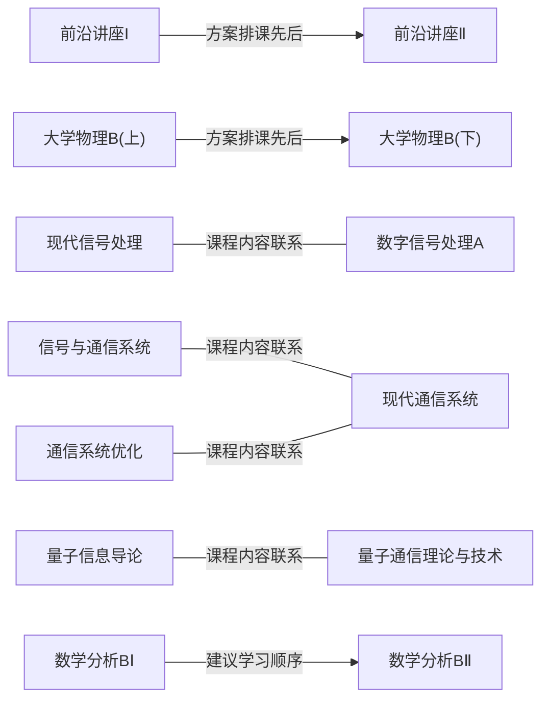

# 2025电子信息科学与技术-电子信息本硕融通培养方案（产教融合班）

未来信息创新学院 · 电子信息科学与技术 · 方案 97060 · 76 个不同课程或科研条目。

[官方 Word](../originals/plan-97060.docx) · [教务详情](https://fdjwgl.fudan.edu.cn/manager/bizType/2/major-program-search/info/97060?skipAuth=1) · [方案快照](../raw/plan-97060.json.gz) · [年级目录](../README.md)

## 修读导读

- **建议先学**　《前沿讲座I》（`EST50045`） → 《前沿讲座Ⅱ》（`EST50046`）。题名列出连续册次或级别。可按编号整理各次讨论的问题、证据和待查文献，再比较专题之间的联系。方案分别列在第3、4学期。

- **可以对照着读**　《现代信号处理》（`EIE60004`）与《数字信号处理A》（`EST30002`）。两门课的题名都涉及信号处理。取同一段信号，比较时域和频域表示各能突出哪些特征。

- **查模块选课**　《数字逻辑基础》（`EST20013`）、《模拟电子学基础》（`EST20012`）列在“专业核心教育课程”中。原表见 `/courseModules/5`。

## 课程关系图

图中展示部分关系。下表保留全部已建立的课程对，来源位置使用本方案 JSON Pointer。

## 先修与内容联系

| 类型 | 起点 | 终点 | 依据 | 原表定位 |
| --- | --- | --- | --- | --- |
| 建议学习顺序 | 前沿讲座I (EST50045) | 前沿讲座Ⅱ (EST50046) | 同方案的课程题名具有连续分册或序号。  | `/courseModules/16/planCourses/0`、`/courseModules/16/planCourses/9` |
| 建议学习顺序 | 数学分析BⅠ (MATH10012) | 数学分析BⅡ (MATH10013) | 同方案的课程题名具有连续分册或序号。  | `/courseModules/4/planCourses/0`、`/courseModules/4/planCourses/1` |
| 建议学习顺序 | 大学物理B(上) (PHYS10003) | 大学物理B(下) (PHYS10004) | 同方案的课程题名具有连续分册或序号。  | `/courseModules/4/planCourses/3`、`/courseModules/4/planCourses/4` |
| 方案排课先后 | 前沿讲座I (EST50045) | 前沿讲座Ⅱ (EST50046) | 同方案该课程全部明确数字学期均早于后者。  | `/courseModules/16/planCourses/0`、`/courseModules/16/planCourses/9` |
| 方案排课先后 | 大学物理B(上) (PHYS10003) | 大学物理B(下) (PHYS10004) | 同方案该课程全部明确数字学期均早于后者。  | `/courseModules/4/planCourses/3`、`/courseModules/4/planCourses/4` |
| 课程内容联系 | 现代信号处理 (EIE60004) | 数字信号处理A (EST30002) | 本方案两门课程的题名均含“信号处理”，可据此对照这一主题。  | `/courseModules/9/planCourses/3`、`/courseModules/5/planCourses/7` |
| 课程内容联系 | 信号与通信系统 (EST20004) | 现代通信系统 (ICE60003) | 本方案两门课程的题名均含“通信系统”，可据此对照这一主题。  | `/courseModules/5/planCourses/5`、`/courseModules/10/planCourses/27` |
| 课程内容联系 | 通信系统优化 (ICE50021) | 现代通信系统 (ICE60003) | 本方案两门课程的题名均含“通信系统”，可据此对照这一主题。  | `/courseModules/10/planCourses/24`、`/courseModules/10/planCourses/27` |
| 课程内容联系 | 量子信息导论 (ICE50022) | 量子通信理论与技术 (ICE60009) | 本方案两门课程的题名均含“量子”，可据此对照这一主题。  | `/courseModules/10/planCourses/20`、`/courseModules/10/planCourses/26` |

本次未从可定位的明确表述中确认课程对课程预修。学期安排、系列分册与编辑建议均保留各自的依据。

## 按原方案模块阅读

同一模块展示原表中的课程归属。模块内课程之间的先后仍须逐项查阅。

- **工学基础课程**　线性代数、程序设计、电子系统导论、数学分析BⅠ、数学分析BⅡ、大学物理B(上)、大学物理B(下)、基础物理实验（原表模块 4）

## 课程表

同一课程在不同模块分别出现时，按原表逐行列出。季节字段保留原值。

| 课程 | 代码 | 学分 | 学期 | 模块 |
| --- | --- | ---: | --- | --- |
| 数学分析BⅠ | MATH10012 | 5.0 | AUTUMN | 培养方案 / 专业培养课程 / 学科基础课程 / 工学基础课程 |
| 数学分析BⅡ | MATH10013 | 5.0 | SPRING | 培养方案 / 专业培养课程 / 学科基础课程 / 工学基础课程 |
| 线性代数 | CS10003 | 3.0 | AUTUMN | 培养方案 / 专业培养课程 / 学科基础课程 / 工学基础课程 |
| 大学物理B(上) | PHYS10003 | 4.0 | 第1学期 | 培养方案 / 专业培养课程 / 学科基础课程 / 工学基础课程 |
| 大学物理B(下) | PHYS10004 | 4.0 | 第2学期 | 培养方案 / 专业培养课程 / 学科基础课程 / 工学基础课程 |
| 基础物理实验 | PHYS10005 | 2.0 | 第2学期 | 培养方案 / 专业培养课程 / 学科基础课程 / 工学基础课程 |
| 程序设计 | CS10004 | 4.0 | 第1学期 | 培养方案 / 专业培养课程 / 学科基础课程 / 工学基础课程 |
| 电子系统导论 | EST10003 | 3.0 | 第2学期 | 培养方案 / 专业培养课程 / 学科基础课程 / 工学基础课程 |
| 数字逻辑基础 | EST20013 | 3.0 | 第3学期 | 培养方案 / 专业培养课程 / 专业核心教育课程 |
| 模拟电子学基础 | EST20012 | 3.0 | 第3学期 | 培养方案 / 专业培养课程 / 专业核心教育课程 |
| 概率、数理统计与随机过程 | EST20002 | 3.0 | 第3学期 | 培养方案 / 专业培养课程 / 专业核心教育课程 |
| 工程数学 | EST20006 | 3.0 | 第3学期 | 培养方案 / 专业培养课程 / 专业核心教育课程 |
| 高频电子线路B | EST20005 | 3.0 | 第4学期 | 培养方案 / 专业培养课程 / 专业核心教育课程 |
| 信号与通信系统 | EST20004 | 3.0 | 第4学期 | 培养方案 / 专业培养课程 / 专业核心教育课程 |
| 信息论基础 | EST20008 | 3.0 | 第4学期 | 培养方案 / 专业培养课程 / 专业核心教育课程 |
| 数字信号处理A | EST30002 | 3.0 | 第5学期 | 培养方案 / 专业培养课程 / 专业核心教育课程 |
| 自动控制原理 | EST30003 | 3.0 | 第5学期 | 培养方案 / 专业培养课程 / 专业核心教育课程 |
| 计算机体系结构 | EST30005 | 3.0 | 第5学期 | 培养方案 / 专业培养课程 / 专业核心教育课程 |
| 人工智能的数学基础 | EIE60005 | 3.0 | SPRING、AUTUMN | 培养方案 / 专业培养课程 / 专业核心教育课程 |
| 机器学习 | EST70011 | 3.0 | SPRING、AUTUMN | 培养方案 / 专业培养课程 / 专业核心教育课程 |
| 数据分析与算法设计 | EIE60008 | 3.0 | SPRING、AUTUMN | 培养方案 / 专业培养课程 / 专业核心教育课程 |
| 集成电路设计 | EIE70005 | 3.0 | SPRING、AUTUMN | 培养方案 / 专业培养课程 / 专业核心教育课程 |
| 工程伦理与研究方法 | EIE50005 | 2.0 | SPRING、AUTUMN | 培养方案 / 专业培养课程 / 专业核心教育课程 |
| 可编程器件与硬件描述语言 | EST50013 | 2.0 | 第5学期 | 培养方案 / 专业进阶模块 / 专业进阶模块I |
| 信号检测与估计基础 | EST50014 | 2.0 | 第6学期 | 培养方案 / 专业进阶模块 / 专业进阶模块I |
| 电磁场与电磁波 | ICE50009 | 3.0 | 第6学期 | 培养方案 / 专业进阶模块 / 专业进阶模块I |
| 现代信号处理 | EIE60004 | 3.0 | SPRING、AUTUMN | 培养方案 / 专业进阶模块 / 专业进阶模块I |
| 机器人与自主系统 | EIE60006 | 3.0 | SPRING、AUTUMN | 培养方案 / 专业进阶模块 / 专业进阶模块I |
| 智能计算系统 | EIE60007 | 3.0 | SPRING、AUTUMN | 培养方案 / 专业进阶模块 / 专业进阶模块I |
| 计算机视觉 | EIE50003 | 3.0 | SPRING、AUTUMN | 培养方案 / 专业进阶模块 / 专业进阶模块I |
| 电工实验 | EST40006 | 2.0 | SPRING、AUTUMN | 培养方案 / 专业进阶模块 / 专业进阶模块II |
| 电子系统设计 | EST50012 | 2.0 | AUTUMN | 培养方案 / 专业进阶模块 / 专业进阶模块II |
| 网络科学导论 | EST50015 | 2.0 | SPRING、AUTUMN | 培养方案 / 专业进阶模块 / 专业进阶模块II |
| 数字图像处理B | ICE40003 | 2.0 | SPRING、AUTUMN | 培养方案 / 专业进阶模块 / 专业进阶模块II |
| 机器学习 | ICE50015 | 2.0 | SPRING、AUTUMN | 培养方案 / 专业进阶模块 / 专业进阶模块II |
| 多媒体技术 | EST40007 | 2.0 | SPRING、AUTUMN | 培养方案 / 专业进阶模块 / 专业进阶模块II |
| 通信编码原理与技术 | ICE50011 | 2.0 | SPRING、AUTUMN | 培养方案 / 专业进阶模块 / 专业进阶模块II |
| 光通信网络基础 | ICE50006 | 2.0 | SPRING、AUTUMN | 培养方案 / 专业进阶模块 / 专业进阶模块II |
| 智联网络系统 | EST30014 | 2.0 | SPRING、AUTUMN | 培养方案 / 专业进阶模块 / 专业进阶模块II |
| 群体智能 | EST40016 | 2.0 | SPRING、AUTUMN | 培养方案 / 专业进阶模块 / 专业进阶模块II |
| 智能系统设计 | EST40015 | 4.0 | SPRING、AUTUMN | 培养方案 / 专业进阶模块 / 专业进阶模块II |
| 计算机工程 | EST70008 | 3.0 | SPRING、AUTUMN | 培养方案 / 专业进阶模块 / 专业进阶模块II |
| 统计学习 | EST70007 | 3.0 | SPRING、AUTUMN | 培养方案 / 专业进阶模块 / 专业进阶模块II |
| 遥感数字影像分析与解译 | EST70023 | 3.0 | SPRING、AUTUMN | 培养方案 / 专业进阶模块 / 专业进阶模块II |
| 现代电子测量技术 | EST70013 | 2.0 | SPRING、AUTUMN | 培养方案 / 专业进阶模块 / 专业进阶模块II |
| 线性自适应系统理论与控制 | EST70019 | 3.0 | SPRING、AUTUMN | 培养方案 / 专业进阶模块 / 专业进阶模块II |
| 先进工业过程控制讨论班 | EST70027 | 2.0 | SPRING、AUTUMN | 培养方案 / 专业进阶模块 / 专业进阶模块II |
| 数字信息处理与传输（讨论班） | EST70015 | 2.0 | SPRING、AUTUMN | 培养方案 / 专业进阶模块 / 专业进阶模块II |
| 微波理论与天线技术 | EST60019 | 3.0 | SPRING、AUTUMN | 培养方案 / 专业进阶模块 / 专业进阶模块II |
| 数据分析与算法设计 | EIE60008 | 3.0 | SPRING、AUTUMN | 培养方案 / 专业进阶模块 / 专业进阶模块II |
| 量子信息导论 | ICE50022 | 3.0 | SPRING、AUTUMN | 培养方案 / 专业进阶模块 / 专业进阶模块II |
| 雷达成像和目标识别 | ICE40010 | 3.0 | SPRING、AUTUMN | 培养方案 / 专业进阶模块 / 专业进阶模块II |
| 图像信息处理理论与方法 | EST60012 | 3.0 | SPRING、AUTUMN | 培养方案 / 专业进阶模块 / 专业进阶模块II |
| 空间遥感信息理论 | EST60016 | 3.0 | SPRING、AUTUMN | 培养方案 / 专业进阶模块 / 专业进阶模块II |
| 通信系统优化 | ICE50021 | 3.0 | SPRING、AUTUMN | 培养方案 / 专业进阶模块 / 专业进阶模块II |
| 毫米波与太赫兹通信技术 | ICE60011 | 3.0 | SPRING、AUTUMN | 培养方案 / 专业进阶模块 / 专业进阶模块II |
| 量子通信理论与技术 | ICE60009 | 3.0 | SPRING、AUTUMN | 培养方案 / 专业进阶模块 / 专业进阶模块II |
| 现代通信系统 | ICE60003 | 3.0 | SPRING、AUTUMN | 培养方案 / 专业进阶模块 / 专业进阶模块II |
| 网络安全设计 | ICE70001 | 3.0 | SPRING、AUTUMN | 培养方案 / 专业进阶模块 / 专业进阶模块II |
| 网络动力学 | ICE60008 | 2.0 | SPRING、AUTUMN | 培养方案 / 专业进阶模块 / 专业进阶模块II |
| Lasers and Integrated Photonics for Optical Communications | ICE70005 | 2.0 | SPRING、AUTUMN | 培养方案 / 专业进阶模块 / 专业进阶模块II |
| 前沿讲座I | EST50045 | 1.0 | 第3学期 | 融合创新能力 |
| 科研实践I | 52 | 2.0 |  | 融合创新能力 |
| 研究生实践活动 | 5 | 6.0 |  | 融合创新能力 |
| 无学分讨论班 | 101 | 0.0 |  | 融合创新能力 |
| 硕士学位论文开题 | 11 | 0.0 |  | 融合创新能力 |
| 硕士论文中期考核 | 31 | 0.0 |  | 融合创新能力 |
| 硕士学位论文预审 | 61 | 0.0 |  | 融合创新能力 |
| 复芏计划(FDUROP) | 102 | 0.0 |  | 融合创新能力 |
| 模拟与数字电路实验 | EST40012 | 3.0 | 第4学期 | 融合创新能力 |
| 前沿讲座Ⅱ | EST50046 | 1.0 | 第4学期 | 融合创新能力 |
| 信号与系统实验 | ICE40005 | 2.0 | 第5学期 | 融合创新能力 |
| 毕业论文 | EST40035 | 2.0 | 第8学期 | 融合创新能力 |
| 微机原理与接口实验 | EST40017 | 3.0 | 第5学期 | 融合创新能力 |
| 专业外语 | EST50011 | 1.0 | SPRING、AUTUMN | 融合创新能力 |
| 高频电路实验 | EST40013 | 2.0 | 第6学期 | 融合创新能力 |
| 电子系统综合实验 | EST40034 | 3.0 | 第7学期 | 融合创新能力 |
