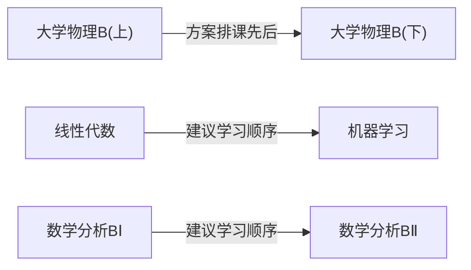

# 2025级电子信息科学与技术（空间信息与数字技术方向）专业本科培养方案

未来信息创新学院 · 电子信息科学与技术(空间信息与数字技术方向) · 方案 97140 · 45 个不同课程或科研条目。

[官方 Word](../originals/plan-97140.docx) · [教务详情](https://fdjwgl.fudan.edu.cn/manager/bizType/2/major-program-search/info/97140?skipAuth=1) · [方案快照](../raw/plan-97140.json.gz) · [年级目录](../README.md)

## 修读导读

- **建议先学**　《线性代数》（`CS10003`） → 《机器学习》（`ICE50015`）。向量、矩阵及线性映射为理解学习模型提供数学准备。

- **查模块选课**　《模拟电子学基础》（`EST20012`）、《数字逻辑基础》（`EST20013`）列在“专业核心教育课程”中。模块说明写明“要求修读38学分（选修荣誉课程学分数每门加1分）”。原表见 `/courseModules/5`。

## 课程关系图

图中展示部分关系。下表保留全部已建立的课程对，来源位置使用本方案 JSON Pointer。

## 先修与内容联系

| 类型 | 起点 | 终点 | 依据 | 原表定位 |
| --- | --- | --- | --- | --- |
| 建议学习顺序 | 线性代数 (CS10003) | 机器学习 (ICE50015) | 向量、矩阵及线性映射为理解学习模型提供数学准备。  | `/courseModules/4/planCourses/2`、`/courseModules/9/planCourses/2` |
| 建议学习顺序 | 数学分析BⅠ (MATH10012) | 数学分析BⅡ (MATH10013) | 同方案的课程题名具有连续分册或序号。  | `/courseModules/4/planCourses/0`、`/courseModules/4/planCourses/1` |
| 建议学习顺序 | 大学物理B(上) (PHYS10003) | 大学物理B(下) (PHYS10004) | 同方案的课程题名具有连续分册或序号。  | `/courseModules/4/planCourses/3`、`/courseModules/4/planCourses/4` |
| 方案排课先后 | 大学物理B(上) (PHYS10003) | 大学物理B(下) (PHYS10004) | 同方案该课程全部明确数字学期均早于后者。  | `/courseModules/4/planCourses/3`、`/courseModules/4/planCourses/4` |

本次未从可定位的明确表述中确认课程对课程预修。学期安排、系列分册与编辑建议均保留各自的依据。

## 按原方案模块阅读

同一模块展示原表中的课程归属。模块内课程之间的先后仍须逐项查阅。

- **工学基础课程**　线性代数、程序设计、电子系统导论、数学分析BⅠ、数学分析BⅡ、大学物理B(上)、大学物理B(下)、基础物理实验（原表模块 4）
- **卫星互联网**　互联网体系结构、可编程器件与硬件描述语言、卫星与移动通信B、卫星互联网、遥感原理与技术、无线通信（原表模块 11）
- **人工智能赋能通信**　面向大模型的编程与并行学习算法、智能系统设计、电子系统设计、算法设计与分析、天线原理、智能通信导论（原表模块 12）

## 课程表

同一课程在不同模块分别出现时，按原表逐行列出。季节字段保留原值。

| 课程 | 代码 | 学分 | 学期 | 模块 |
| --- | --- | ---: | --- | --- |
| 数学分析BⅠ | MATH10012 | 5.0 | AUTUMN | 培养方案 / 专业培养课程 / 学科基础课程 / 工学基础课程 |
| 数学分析BⅡ | MATH10013 | 5.0 | SPRING | 培养方案 / 专业培养课程 / 学科基础课程 / 工学基础课程 |
| 线性代数 | CS10003 | 3.0 | AUTUMN | 培养方案 / 专业培养课程 / 学科基础课程 / 工学基础课程 |
| 大学物理B(上) | PHYS10003 | 4.0 | 第1学期 | 培养方案 / 专业培养课程 / 学科基础课程 / 工学基础课程 |
| 大学物理B(下) | PHYS10004 | 4.0 | 第2学期 | 培养方案 / 专业培养课程 / 学科基础课程 / 工学基础课程 |
| 基础物理实验 | PHYS10005 | 2.0 | 第2学期 | 培养方案 / 专业培养课程 / 学科基础课程 / 工学基础课程 |
| 程序设计 | CS10004 | 4.0 | 第1学期 | 培养方案 / 专业培养课程 / 学科基础课程 / 工学基础课程 |
| 电子系统导论 | EST10003 | 3.0 | 第2学期 | 培养方案 / 专业培养课程 / 学科基础课程 / 工学基础课程 |
| 模拟电子学基础 | EST20012 | 3.0 | 第3学期 | 培养方案 / 专业培养课程 / 专业核心教育课程 |
| 数字逻辑基础 | EST20013 | 3.0 | 第3学期 | 培养方案 / 专业培养课程 / 专业核心教育课程 |
| 概率、数理统计与随机过程 | EST20002 | 3.0 | 第3学期 | 培养方案 / 专业培养课程 / 专业核心教育课程 |
| 工程数学 | EST20006 | 3.0 | 第3学期 | 培养方案 / 专业培养课程 / 专业核心教育课程 |
| 人工智能导论 | IST20002 | 4.0 | 第4学期 | 培养方案 / 专业培养课程 / 专业核心教育课程 |
| 信号与通信系统 | EST20004 | 3.0 | 第4学期 | 培养方案 / 专业培养课程 / 专业核心教育课程 |
| 信息论基础 | EST20008 | 3.0 | 第4学期 | 培养方案 / 专业培养课程 / 专业核心教育课程 |
| 计算机体系结构 | EST30005 | 3.0 | 第4学期 | 培养方案 / 专业培养课程 / 专业核心教育课程 |
| 数字信号处理A | EST30002 | 3.0 | 第5学期 | 培养方案 / 专业培养课程 / 专业核心教育课程 |
| 微机原理与接口实验 | EST40017 | 3.0 | 第5学期 | 培养方案 / 专业培养课程 / 专业核心教育课程 |
| 数据结构与算法设计（H） | EST50016h | 4.0 | 第5学期 | 培养方案 / 专业培养课程 / 专业核心教育课程 |
| 通信原理B | ICE30001 | 3.0 | 第5学期 | 培养方案 / 专业培养课程 / 专业核心教育课程 |
| 统计学习 | IST30007 | 4.0 | 第5学期 | 培养方案 / 专业进阶模块 / 专业进阶模块I |
| 空天信息导论 | ICE40007 | 2.0 | 第5学期 | 培养方案 / 专业进阶模块 / 专业进阶模块I |
| 机器学习 | ICE50015 | 2.0 | 第5学期 | 培养方案 / 专业进阶模块 / 专业进阶模块I |
| 计算机通信与网络 | ICE50002 | 3.0 | 第6学期 | 培养方案 / 专业进阶模块 / 专业进阶模块I |
| 信号检测与估计基础 | EST50014 | 2.0 | 第7学期 | 培养方案 / 专业进阶模块 / 专业进阶模块I |
| 电子系统综合实验 | EST40034 | 3.0 | 第7学期 | 培养方案 / 专业进阶模块 / 专业进阶模块I |
| 互联网体系结构 | CS30049 | 3.0 | 第6学期 | 培养方案 / 专业进阶模块 / 专业进阶模块II / 卫星互联网 |
| 遥感原理与技术 | ICE50008 | 2.0 | 第6学期 | 培养方案 / 专业进阶模块 / 专业进阶模块II / 卫星互联网 |
| 卫星互联网 | ICE50001 | 3.0 | 第6学期 | 培养方案 / 专业进阶模块 / 专业进阶模块II / 卫星互联网 |
| 可编程器件与硬件描述语言 | EST50013 | 2.0 | 第7学期 | 培养方案 / 专业进阶模块 / 专业进阶模块II / 卫星互联网 |
| 卫星与移动通信B | ICE40004 | 2.0 | 第7学期 | 培养方案 / 专业进阶模块 / 专业进阶模块II / 卫星互联网 |
| 无线通信 | ICE50014 | 2.0 | 第7学期 | 培养方案 / 专业进阶模块 / 专业进阶模块II / 卫星互联网 |
| 面向大模型的编程与并行学习算法 | CS20015 | 3.0 | 第6学期 | 培养方案 / 专业进阶模块 / 专业进阶模块II / 人工智能赋能通信 |
| 智能通信导论 | ICE50016 | 2.0 | 第6学期 | 培养方案 / 专业进阶模块 / 专业进阶模块II / 人工智能赋能通信 |
| 算法设计与分析 | ICE40002 | 3.0 | 第6学期 | 培养方案 / 专业进阶模块 / 专业进阶模块II / 人工智能赋能通信 |
| 天线原理 | ICE50012 | 2.0 | 第7学期 | 培养方案 / 专业进阶模块 / 专业进阶模块II / 人工智能赋能通信 |
| 电子系统设计 | EST50012 | 2.0 | 第7学期 | 培养方案 / 专业进阶模块 / 专业进阶模块II / 人工智能赋能通信 |
| 智能系统设计 | EST40015 | 4.0 | 第7学期 | 培养方案 / 专业进阶模块 / 专业进阶模块II / 人工智能赋能通信 |
| 信号与系统实验 | ICE40005 | 2.0 | 第5学期 | 融合创新能力 |
| 无学分讨论班 | 101 | 0.0 |  | 融合创新能力 |
| 无学分科研实践 | 51 | 0.0 |  | 融合创新能力 |
| 通信与信息系统实验A | ICE30002 | 3.0 | 第6学期 | 融合创新能力 |
| 前沿讲座 | ICE50010 | 2.0 | 第4学期 | 融合创新能力 |
| 通信与信息系统实验B | ICE40011 | 3.0 | 第7学期 | 融合创新能力 |
| 毕业论文 | EST40005 | 6.0 | 第8学期 | 融合创新能力 |
