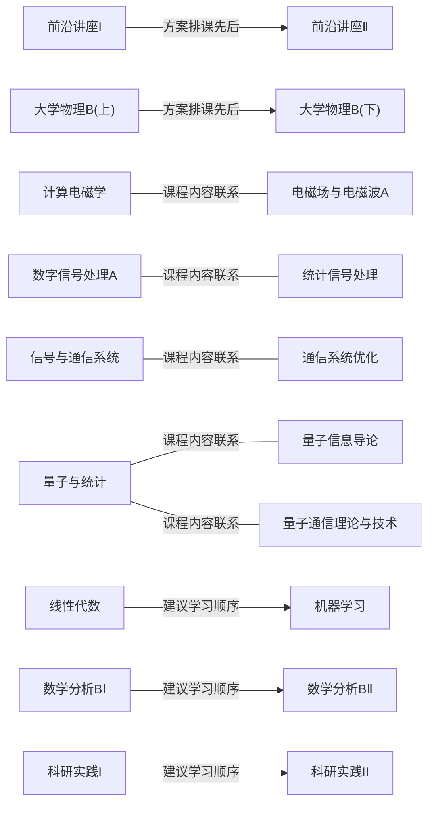

# 2025电子信息科学与技术（光子计划院士班）-信息与通信工程本博融通培养方案（香农计划）

未来信息创新学院 · 电子信息科学与技术(香农计划) · 方案 97381 · 81 个不同课程或科研条目。

[官方 Word](../originals/plan-97381.docx) · [教务详情](https://fdjwgl.fudan.edu.cn/manager/bizType/2/major-program-search/info/97381?skipAuth=1) · [方案快照](../raw/plan-97381.json.gz) · [年级目录](../README.md)

## 课程关系图

图中展示部分关系。下表保留全部已建立的课程对，来源位置使用本方案 JSON Pointer。

## 先修与内容联系

| 类型 | 起点 | 终点 | 依据 | 原表定位 |
| --- | --- | --- | --- | --- |
| 建议学习顺序 | 科研实践I (52) | 科研实践II (53) | 同方案的课程题名具有连续分册或序号。  | `/courseModules/19/planCourses/0`、`/courseModules/19/planCourses/1` |
| 建议学习顺序 | 线性代数 (CS10003) | 机器学习 (EST70011) | 向量、矩阵及线性映射为理解学习模型提供数学准备。  | `/courseModules/4/planCourses/2`、`/courseModules/11/planCourses/0` |
| 建议学习顺序 | 前沿讲座I (EST50045) | 前沿讲座Ⅱ (EST50046) | 同方案的课程题名具有连续分册或序号。  | `/courseModules/19/planCourses/13`、`/courseModules/19/planCourses/16` |
| 建议学习顺序 | 数学分析BⅠ (MATH10012) | 数学分析BⅡ (MATH10013) | 同方案的课程题名具有连续分册或序号。  | `/courseModules/4/planCourses/0`、`/courseModules/4/planCourses/1` |
| 建议学习顺序 | 大学物理B(上) (PHYS10003) | 大学物理B(下) (PHYS10004) | 同方案的课程题名具有连续分册或序号。  | `/courseModules/4/planCourses/3`、`/courseModules/4/planCourses/4` |
| 方案排课先后 | 前沿讲座I (EST50045) | 前沿讲座Ⅱ (EST50046) | 同方案该课程全部明确数字学期均早于后者。  | `/courseModules/19/planCourses/13`、`/courseModules/19/planCourses/16` |
| 方案排课先后 | 大学物理B(上) (PHYS10003) | 大学物理B(下) (PHYS10004) | 同方案该课程全部明确数字学期均早于后者。  | `/courseModules/4/planCourses/3`、`/courseModules/4/planCourses/4` |
| 课程内容联系 | 信号与通信系统 (EST20004) | 通信系统优化 (ICE50021) | 本方案两门课程的题名均含“通信系统”，可据此对照这一主题。  | `/courseModules/5/planCourses/5`、`/courseModules/13/planCourses/5` |
| 课程内容联系 | 数字信号处理A (EST30002) | 统计信号处理 (EST40023) | 本方案两门课程的题名均含“信号处理”，可据此对照这一主题。  | `/courseModules/5/planCourses/8`、`/courseModules/10/planCourses/0` |
| 课程内容联系 | 量子与统计 (EST30012) | 量子信息导论 (ICE50022) | 本方案两门课程的题名均含“量子”，可据此对照这一主题。  | `/courseModules/5/planCourses/12`、`/courseModules/13/planCourses/2` |
| 课程内容联系 | 量子与统计 (EST30012) | 量子通信理论与技术 (ICE60009) | 本方案两门课程的题名均含“量子”，可据此对照这一主题。  | `/courseModules/5/planCourses/12`、`/courseModules/13/planCourses/7` |
| 课程内容联系 | 电磁场与微波技术 (ICE20001) | 计算电磁学 (ICE70003) | 本方案两门课程的题名均含“电磁”，可据此对照这一主题。  | `/courseModules/12/planCourses/9`、`/courseModules/11/planCourses/6` |
| 课程内容联系 | 高等电磁场理论 (ICE40012) | 计算电磁学 (ICE70003) | 本方案两门课程的题名均含“电磁”，可据此对照这一主题。  | `/courseModules/10/planCourses/2`、`/courseModules/11/planCourses/6` |
| 课程内容联系 | 计算电磁学 (ICE70003) | 电磁场与电磁波A (OPTI30004) | 本方案两门课程的题名均含“电磁”，可据此对照这一主题。  | `/courseModules/11/planCourses/6`、`/courseModules/5/planCourses/7` |

本次未从可定位的明确表述中确认课程对课程预修。学期安排、系列分册与编辑建议均保留各自的依据。

## 按原方案模块阅读

同一模块展示原表中的课程归属。模块内课程之间的先后仍须逐项查阅。

- **工学基础课程**　线性代数、程序设计、电子系统导论、数学分析BⅠ、数学分析BⅡ、大学物理B(上)、大学物理B(下)、基础物理实验（原表模块 4）
- **研究生学位基础课**　统计信号处理、通信原理（H）、高等电磁场理论、矩阵分析、最优化理论与方法（原表模块 10）
- **研究生学位专业课**　Technologies of Coherent Communication、机器学习、现代雷达原理、信息论与编码、现代光通信与光网络、微波遥感理论、复杂网络系统理论与应用、光纤传输与传感、现代无线通信、计算电磁学（原表模块 11）
- **研究生选修课**　数据分析与算法设计、图像信息处理理论与方法、空间遥感信息理论、微波理论与天线技术、通信系统优化、量子信息导论、量子通信理论与技术、毫米波与太赫兹通信技术、网络安全设计、Lasers and Integrated Photonics for Optical Communications（原表模块 13）

## 课程表

同一课程在不同模块分别出现时，按原表逐行列出。季节字段保留原值。

| 课程 | 代码 | 学分 | 学期 | 模块 |
| --- | --- | ---: | --- | --- |
| 数学分析BⅠ | MATH10012 | 5.0 | AUTUMN | 培养方案 / 专业培养课程 / 学科基础课程 / 工学基础课程 |
| 数学分析BⅡ | MATH10013 | 5.0 | SPRING | 培养方案 / 专业培养课程 / 学科基础课程 / 工学基础课程 |
| 线性代数 | CS10003 | 3.0 | AUTUMN | 培养方案 / 专业培养课程 / 学科基础课程 / 工学基础课程 |
| 大学物理B(上) | PHYS10003 | 4.0 | 第1学期 | 培养方案 / 专业培养课程 / 学科基础课程 / 工学基础课程 |
| 大学物理B(下) | PHYS10004 | 4.0 | 第2学期 | 培养方案 / 专业培养课程 / 学科基础课程 / 工学基础课程 |
| 基础物理实验 | PHYS10005 | 2.0 | 第2学期 | 培养方案 / 专业培养课程 / 学科基础课程 / 工学基础课程 |
| 程序设计 | CS10004 | 4.0 | 第1学期 | 培养方案 / 专业培养课程 / 学科基础课程 / 工学基础课程 |
| 电子系统导论 | EST10003 | 3.0 | 第2学期 | 培养方案 / 专业培养课程 / 学科基础课程 / 工学基础课程 |
| 模拟电子学基础 | EST20012 | 3.0 | 第3学期 | 培养方案 / 专业培养课程 / 专业核心教育课程 |
| 数字逻辑基础 | EST20013 | 3.0 | 第3学期 | 培养方案 / 专业培养课程 / 专业核心教育课程 |
| 概率、数理统计与随机过程 | EST20002 | 3.0 | 第3学期 | 培养方案 / 专业培养课程 / 专业核心教育课程 |
| 工程数学 | EST20006 | 3.0 | 第3学期 | 培养方案 / 专业培养课程 / 专业核心教育课程 |
| 高频电子线路B | EST20005 | 3.0 | 第4学期 | 培养方案 / 专业培养课程 / 专业核心教育课程 |
| 信号与通信系统 | EST20004 | 3.0 | 第4学期 | 培养方案 / 专业培养课程 / 专业核心教育课程 |
| 信息论基础 | EST20008 | 3.0 | 第4学期 | 培养方案 / 专业培养课程 / 专业核心教育课程 |
| 电磁场与电磁波A | OPTI30004 | 3.0 | 第4学期 | 培养方案 / 专业培养课程 / 专业核心教育课程 |
| 数字信号处理A | EST30002 | 3.0 | 第5学期 | 培养方案 / 专业培养课程 / 专业核心教育课程 |
| 半导体物理 | EST30004 | 3.0 | 第5学期 | 培养方案 / 专业培养课程 / 专业核心教育课程 |
| 光电信号检测原理与技术 | EST50017 | 2.0 | 第5学期 | 培养方案 / 专业培养课程 / 专业核心教育课程 |
| 数据结构 | EST50016 | 2.0 | 第6学期 | 培养方案 / 专业培养课程 / 专业核心教育课程 |
| 量子与统计 | EST30012 | 3.0 | 第6学期 | 培养方案 / 专业培养课程 / 专业核心教育课程 |
| 通信与网络 | ICE40013 | 3.0 | 第6学期 | 培养方案 / 专业进阶模块 / 专业进阶模块I |
| 计算机体系结构 | EST30005 | 3.0 | 第6学期 | 培养方案 / 专业进阶模块 / 专业进阶模块I |
| 统计信号处理 | EST40023 | 3.0 | 第8学期 | 培养方案 / 专业进阶模块 / 专业进阶模块I / 研究生学位基础课 |
| 通信原理（H） | ICE30001h | 4.0 | 第7学期 | 培养方案 / 专业进阶模块 / 专业进阶模块I / 研究生学位基础课 |
| 高等电磁场理论 | ICE40012 | 3.0 | SPRING、AUTUMN | 培养方案 / 专业进阶模块 / 专业进阶模块I / 研究生学位基础课 |
| 最优化理论与方法 | ICE60018 | 3.0 | 第7学期 | 培养方案 / 专业进阶模块 / 专业进阶模块I / 研究生学位基础课 |
| 矩阵分析 | ICE60016 | 3.0 | SPRING | 培养方案 / 专业进阶模块 / 专业进阶模块I / 研究生学位基础课 |
| 机器学习 | EST70011 | 3.0 | SPRING、AUTUMN | 培养方案 / 专业进阶模块 / 专业进阶模块I / 研究生学位专业课 |
| 现代无线通信 | ICE60017 | 3.0 | SPRING、AUTUMN | 培养方案 / 专业进阶模块 / 专业进阶模块I / 研究生学位专业课 |
| 现代光通信与光网络 | ICE60012 | 3.0 | SPRING、AUTUMN | 培养方案 / 专业进阶模块 / 专业进阶模块I / 研究生学位专业课 |
| 现代雷达原理 | EST70033 | 3.0 | SPRING、AUTUMN | 培养方案 / 专业进阶模块 / 专业进阶模块I / 研究生学位专业课 |
| 微波遥感理论 | ICE60013 | 3.0 | SPRING、AUTUMN | 培养方案 / 专业进阶模块 / 专业进阶模块I / 研究生学位专业课 |
| 复杂网络系统理论与应用 | ICE60014 | 3.0 | SPRING、AUTUMN | 培养方案 / 专业进阶模块 / 专业进阶模块I / 研究生学位专业课 |
| 计算电磁学 | ICE70003 | 3.0 | SPRING、AUTUMN | 培养方案 / 专业进阶模块 / 专业进阶模块I / 研究生学位专业课 |
| 光纤传输与传感 | ICE60015 | 3.0 | SPRING、AUTUMN | 培养方案 / 专业进阶模块 / 专业进阶模块I / 研究生学位专业课 |
| 信息论与编码 | ICE60010 | 3.0 | SPRING、AUTUMN | 培养方案 / 专业进阶模块 / 专业进阶模块I / 研究生学位专业课 |
| Technologies of Coherent Communication | EST50036 | 3.0 | SPRING、AUTUMN | 培养方案 / 专业进阶模块 / 专业进阶模块I / 研究生学位专业课 |
| 电工实验 | EST40006 | 2.0 | SPRING、AUTUMN | 培养方案 / 专业进阶模块 / 专业进阶模块II |
| 电子系统设计 | EST50012 | 2.0 | SPRING、AUTUMN | 培养方案 / 专业进阶模块 / 专业进阶模块II |
| 数字图像处理B | ICE40003 | 2.0 | SPRING、AUTUMN | 培养方案 / 专业进阶模块 / 专业进阶模块II |
| 多媒体技术 | EST40007 | 2.0 | SPRING、AUTUMN | 培养方案 / 专业进阶模块 / 专业进阶模块II |
| 通信编码原理与技术 | ICE50011 | 2.0 | SPRING、AUTUMN | 培养方案 / 专业进阶模块 / 专业进阶模块II |
| 卫星与移动通信B | ICE40004 | 2.0 | SPRING、AUTUMN | 培养方案 / 专业进阶模块 / 专业进阶模块II |
| 智能系统设计 | EST40015 | 4.0 | SPRING、AUTUMN | 培养方案 / 专业进阶模块 / 专业进阶模块II |
| 群体智能 | EST40016 | 2.0 | SPRING、AUTUMN | 培养方案 / 专业进阶模块 / 专业进阶模块II |
| 智联网络系统 | EST30014 | 2.0 | SPRING、AUTUMN | 培养方案 / 专业进阶模块 / 专业进阶模块II |
| 电磁场与微波技术 | ICE20001 | 3.0 | 第4学期 | 培养方案 / 专业进阶模块 / 专业进阶模块II |
| 光纤通信原理 | ICE50017 | 2.0 | 第6学期 | 培养方案 / 专业进阶模块 / 专业进阶模块II |
| 通信与信息系统实验A | ICE30002 | 3.0 | 第6学期 | 培养方案 / 专业进阶模块 / 专业进阶模块II |
| 通信与信息系统实验B | ICE40011 | 3.0 | 第7学期 | 培养方案 / 专业进阶模块 / 专业进阶模块II |
| 微波理论与天线技术 | EST60019 | 3.0 | SPRING、AUTUMN | 培养方案 / 专业进阶模块 / 专业进阶模块II / 研究生选修课 |
| 数据分析与算法设计 | EIE60008 | 3.0 | SPRING、AUTUMN | 培养方案 / 专业进阶模块 / 专业进阶模块II / 研究生选修课 |
| 量子信息导论 | ICE50022 | 3.0 | SPRING、AUTUMN | 培养方案 / 专业进阶模块 / 专业进阶模块II / 研究生选修课 |
| 图像信息处理理论与方法 | EST60012 | 3.0 | SPRING、AUTUMN | 培养方案 / 专业进阶模块 / 专业进阶模块II / 研究生选修课 |
| 空间遥感信息理论 | EST60016 | 3.0 | SPRING、AUTUMN | 培养方案 / 专业进阶模块 / 专业进阶模块II / 研究生选修课 |
| 通信系统优化 | ICE50021 | 3.0 | SPRING、AUTUMN | 培养方案 / 专业进阶模块 / 专业进阶模块II / 研究生选修课 |
| 毫米波与太赫兹通信技术 | ICE60011 | 3.0 | SPRING、AUTUMN | 培养方案 / 专业进阶模块 / 专业进阶模块II / 研究生选修课 |
| 量子通信理论与技术 | ICE60009 | 3.0 | SPRING、AUTUMN | 培养方案 / 专业进阶模块 / 专业进阶模块II / 研究生选修课 |
| 网络安全设计 | ICE70001 | 3.0 | SPRING、AUTUMN | 培养方案 / 专业进阶模块 / 专业进阶模块II / 研究生选修课 |
| Lasers and Integrated Photonics for Optical Communications | ICE70005 | 2.0 | SPRING、AUTUMN | 培养方案 / 专业进阶模块 / 专业进阶模块II / 研究生选修课 |
| 科研实践I | 52 | 2.0 |  | 融合创新能力 |
| 科研实践II | 53 | 2.0 |  | 融合创新能力 |
| 无学分讨论班 | 101 | 0.0 |  | 融合创新能力 |
| 复芏计划(FDUROP) | 102 | 0.0 |  | 融合创新能力 |
| 研究生学术活动 | 4 | 2.0 |  | 融合创新能力 |
| 研究生实践活动 | 5 | 2.0 |  | 融合创新能力 |
| 国际交流 | 7 | 0.0 |  | 融合创新能力 |
| 博士学位论文开题 | 1 | 0.0 |  | 融合创新能力 |
| 博士生资格考核 | 2 | 0.0 |  | 融合创新能力 |
| 博士论文中期考核 | 3 | 0.0 |  | 融合创新能力 |
| 博士学位论文预审 | 6 | 0.0 |  | 融合创新能力 |
| 模拟与数字电路实验 | EST40012 | 3.0 | 第4学期 | 融合创新能力 |
| 微机原理与接口实验 | EST40017 | 3.0 | 第7学期 | 融合创新能力 |
| 前沿讲座I | EST50045 | 1.0 | 第3学期 | 融合创新能力 |
| 信号与系统实验 | ICE40005 | 2.0 | 第5学期 | 融合创新能力 |
| 光电综合实验 | EST40036 | 3.0 | 第7学期 | 融合创新能力 |
| 前沿讲座Ⅱ | EST50046 | 1.0 | 第4学期 | 融合创新能力 |
| 毕业论文 | EST40035 | 2.0 | 第8学期 | 融合创新能力 |
| 专业外语 | EST50011 | 1.0 | SPRING、AUTUMN | 融合创新能力 |
| 相辉前沿专题 | MATH10025 | 2.0 | SPRING、AUTUMN | 融合创新能力 |
