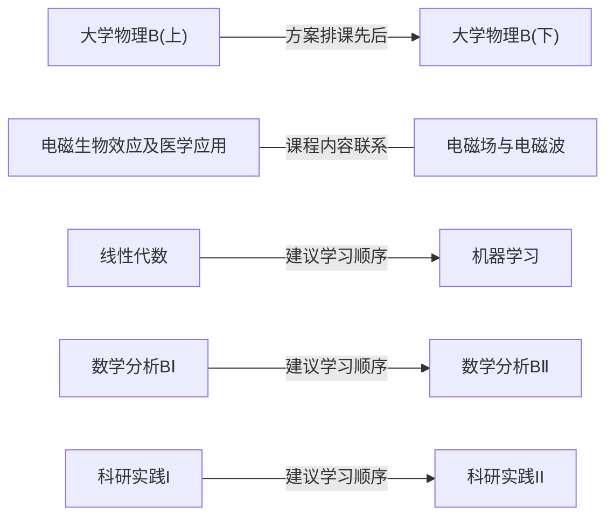

# 2025电子信息科学与技术专业本科培养方案（港澳台侨生适用）

未来信息创新学院 · 电子信息科学与技术 · 方案 97876 · 62 个不同课程或科研条目。

[官方 Word](../originals/plan-97876.docx) · [教务详情](https://fdjwgl.fudan.edu.cn/manager/bizType/2/major-program-search/info/97876?skipAuth=1) · [方案快照](../raw/plan-97876.json.gz) · [年级目录](../README.md)

## 课程关系图

图中展示部分关系。下表保留全部已建立的课程对，来源位置使用本方案 JSON Pointer。

## 先修与内容联系

| 类型 | 起点 | 终点 | 依据 | 原表定位 |
| --- | --- | --- | --- | --- |
| 建议学习顺序 | 科研实践I (52) | 科研实践II (53) | 同方案的课程题名具有连续分册或序号。  | `/courseModules/21/planCourses/2`、`/courseModules/21/planCourses/3` |
| 建议学习顺序 | 线性代数 (CS10003) | 机器学习 (ICE50015) | 向量、矩阵及线性映射为理解学习模型提供数学准备。  | `/courseModules/9/planCourses/2`、`/courseModules/15/planCourses/19` |
| 建议学习顺序 | 数学分析BⅠ (MATH10012) | 数学分析BⅡ (MATH10013) | 同方案的课程题名具有连续分册或序号。  | `/courseModules/9/planCourses/0`、`/courseModules/9/planCourses/1` |
| 建议学习顺序 | 大学物理B(上) (PHYS10003) | 大学物理B(下) (PHYS10004) | 同方案的课程题名具有连续分册或序号。  | `/courseModules/9/planCourses/3`、`/courseModules/9/planCourses/4` |
| 方案排课先后 | 大学物理B(上) (PHYS10003) | 大学物理B(下) (PHYS10004) | 同方案该课程全部明确数字学期均早于后者。  | `/courseModules/9/planCourses/3`、`/courseModules/9/planCourses/4` |
| 课程内容联系 | 电磁生物效应及医学应用 (BME50024) | 电磁场与电磁波 (ICE50009) | 本方案两门课程的题名均含“电磁”，可据此对照这一主题。  | `/courseModules/15/planCourses/15`、`/courseModules/14/planCourses/2` |

本次未从可定位的明确表述中确认课程对课程预修。学期安排、系列分册与编辑建议均保留各自的依据。

## 按原方案模块阅读

同一模块展示原表中的课程归属。模块内课程之间的先后仍须逐项查阅。

- **工学基础课程**　线性代数、程序设计、电子系统导论、数学分析BⅠ、数学分析BⅡ、大学物理B(上)、大学物理B(下)、基础物理实验（原表模块 9）

## 课程表

同一课程在不同模块分别出现时，按原表逐行列出。季节字段保留原值。

| 课程 | 代码 | 学分 | 学期 | 模块 |
| --- | --- | ---: | --- | --- |
| 人工智能基础 | AIB210002 | 3.0 | SPRING、AUTUMN | 培养方案 / 通识教育课程 / 通识教育专项教育课程 / 人工智能教学专项 / B1类课程 |
| 深度学习基础 | AIB310003 | 3.0 | SPRING、AUTUMN | 培养方案 / 通识教育课程 / 通识教育专项教育课程 / 人工智能教学专项 / B1类课程 |
| 具身智能引论 | AIB310002 | 3.0 | SPRING、AUTUMN | 培养方案 / 通识教育课程 / 通识教育专项教育课程 / 人工智能教学专项 / B1类课程 |
| 生成式软件开发 | AIB110005 | 3.0 | SPRING、AUTUMN | 培养方案 / 通识教育课程 / 通识教育专项教育课程 / 人工智能教学专项 / B1类课程 |
| 计算与智能概论A | AIB210006 | 3.0 |  | 培养方案 / 通识教育课程 / 通识教育专项教育课程 / 人工智能教学专项 / B1类课程 |
| 数学分析BⅠ | MATH10012 | 5.0 | AUTUMN | 培养方案 / 专业培养课程 / 学科基础课程 / 工学基础课程 |
| 数学分析BⅡ | MATH10013 | 5.0 | SPRING | 培养方案 / 专业培养课程 / 学科基础课程 / 工学基础课程 |
| 线性代数 | CS10003 | 3.0 | AUTUMN | 培养方案 / 专业培养课程 / 学科基础课程 / 工学基础课程 |
| 大学物理B(上) | PHYS10003 | 4.0 | 第1学期 | 培养方案 / 专业培养课程 / 学科基础课程 / 工学基础课程 |
| 大学物理B(下) | PHYS10004 | 4.0 | 第2学期 | 培养方案 / 专业培养课程 / 学科基础课程 / 工学基础课程 |
| 基础物理实验 | PHYS10005 | 2.0 | 第2学期 | 培养方案 / 专业培养课程 / 学科基础课程 / 工学基础课程 |
| 程序设计 | CS10004 | 4.0 | 第1学期 | 培养方案 / 专业培养课程 / 学科基础课程 / 工学基础课程 |
| 电子系统导论 | EST10003 | 3.0 | 第2学期 | 培养方案 / 专业培养课程 / 学科基础课程 / 工学基础课程 |
| 数字逻辑基础 | EST20013 | 3.0 | 第3学期 | 培养方案 / 专业培养课程 / 专业核心教育课程 |
| 模拟电子学基础 | EST20012 | 3.0 | 第3学期 | 培养方案 / 专业培养课程 / 专业核心教育课程 |
| 概率、数理统计与随机过程 | EST20002 | 3.0 | 第3学期 | 培养方案 / 专业培养课程 / 专业核心教育课程 |
| 工程数学 | EST20006 | 3.0 | 第3学期 | 培养方案 / 专业培养课程 / 专业核心教育课程 |
| 高频电子线路B | EST20005 | 3.0 | 第4学期 | 培养方案 / 专业培养课程 / 专业核心教育课程 |
| 信号与通信系统 | EST20004 | 3.0 | 第4学期 | 培养方案 / 专业培养课程 / 专业核心教育课程 |
| 信息论基础 | EST20008 | 3.0 | 第4学期 | 培养方案 / 专业培养课程 / 专业核心教育课程 |
| 数字信号处理A | EST30002 | 3.0 | 第5学期 | 培养方案 / 专业培养课程 / 专业核心教育课程 |
| 自动控制原理 | EST30003 | 3.0 | 第5学期 | 培养方案 / 专业培养课程 / 专业核心教育课程 |
| 计算机体系结构 | EST30005 | 3.0 | 第5学期 | 培养方案 / 专业培养课程 / 专业核心教育课程 |
| 可编程器件与硬件描述语言 | EST50013 | 2.0 | 第5学期 | 培养方案 / 专业进阶模块 / 专业进阶模块I |
| 信号检测与估计基础 | EST50014 | 2.0 | 第6学期 | 培养方案 / 专业进阶模块 / 专业进阶模块I |
| 电磁场与电磁波 | ICE50009 | 3.0 | 第6学期 | 培养方案 / 专业进阶模块 / 专业进阶模块I |
| 电工实验 | EST40006 | 2.0 | AUTUMN | 培养方案 / 专业进阶模块 / 专业进阶模块II |
| 电子系统设计 | EST50012 | 2.0 | AUTUMN | 培养方案 / 专业进阶模块 / 专业进阶模块II |
| 多媒体技术 | EST40007 | 2.0 | AUTUMN | 培养方案 / 专业进阶模块 / 专业进阶模块II |
| 智联网络系统 | EST30014 | 2.0 | SPRING、AUTUMN | 培养方案 / 专业进阶模块 / 专业进阶模块II |
| 群体智能 | EST40016 | 2.0 | AUTUMN | 培养方案 / 专业进阶模块 / 专业进阶模块II |
| 近代医学概论 | BME50018 | 2.0 | SPRING | 培养方案 / 专业进阶模块 / 专业进阶模块II |
| 科技英语 | ICE50003 | 2.0 | SPRING、AUTUMN | 培养方案 / 专业进阶模块 / 专业进阶模块II |
| 数据采集和处理系统 | EST40009 | 2.0 | SPRING | 培养方案 / 专业进阶模块 / 专业进阶模块II |
| 心脏电生理与起搏 | BME50019 | 2.0 | SPRING | 培养方案 / 专业进阶模块 / 专业进阶模块II |
| 医学超声技术 | AIT531030 | 2.0 | SPRING | 培养方案 / 专业进阶模块 / 专业进阶模块II |
| 医学成像技术 | BME50021 | 2.0 | AUTUMN | 培养方案 / 专业进阶模块 / 专业进阶模块II |
| 光通信网络基础 | ICE50006 | 2.0 | AUTUMN | 培养方案 / 专业进阶模块 / 专业进阶模块II |
| 数字图像处理B | ICE40003 | 2.0 | AUTUMN | 培养方案 / 专业进阶模块 / 专业进阶模块II |
| 卫星与移动通信B | ICE40004 | 2.0 | AUTUMN | 培养方案 / 专业进阶模块 / 专业进阶模块II |
| 网络科学导论 | EST50015 | 2.0 | SPRING | 培养方案 / 专业进阶模块 / 专业进阶模块II |
| 电磁生物效应及医学应用 | BME50024 | 2.0 | AUTUMN | 培养方案 / 专业进阶模块 / 专业进阶模块II |
| 工程图学及应用 | EST40010 | 2.0 | SPRING | 培养方案 / 专业进阶模块 / 专业进阶模块II |
| 通信编码原理与技术 | ICE50011 | 2.0 | SPRING | 培养方案 / 专业进阶模块 / 专业进阶模块II |
| 数据结构 | EST50016 | 2.0 | SPRING | 培养方案 / 专业进阶模块 / 专业进阶模块II |
| 机器学习 | ICE50015 | 2.0 | AUTUMN | 培养方案 / 专业进阶模块 / 专业进阶模块II |
| 电气工程基础 | OPTI40011 | 2.0 | AUTUMN | 培养方案 / 专业进阶模块 / 专业进阶模块II |
| 医学电子创新设计与实验 | BME30004 | 3.0 | AUTUMN | 培养方案 / 专业进阶模块 / 专业进阶模块II |
| 电路基础 | ICSE10001 | 3.0 | SPRING | 培养方案 / 专业进阶模块 / 专业进阶模块II |
| 电力电子学 | OPTI50005 | 3.0 | SPRING | 培养方案 / 专业进阶模块 / 专业进阶模块II |
| 无学分讨论班 | 101 | 0.0 |  | 融合创新能力 |
| 复芏计划(FDUROP) | 102 | 0.0 |  | 融合创新能力 |
| 科研实践I | 52 | 2.0 |  | 融合创新能力 |
| 科研实践II | 53 | 2.0 |  | 融合创新能力 |
| 模拟与数字电路实验 | EST40012 | 3.0 | 第4学期 | 融合创新能力 |
| 毕业论文 | EST40005 | 6.0 | 第8学期 | 融合创新能力 |
| 信号与系统实验 | ICE40005 | 2.0 | 第5学期 | 融合创新能力 |
| 毕业论文 | EST40035 | 2.0 | 第8学期 | 融合创新能力 |
| 微机原理与接口实验 | EST40017 | 3.0 | 第6学期 | 融合创新能力 |
| 高频电路实验 | EST40013 | 2.0 | 第6学期 | 融合创新能力 |
| 电子系统综合实验 | EST40034 | 3.0 | 第7学期 | 融合创新能力 |
| 前沿讲座 | ICE50010 | 2.0 | 第5学期 | 融合创新能力 |
