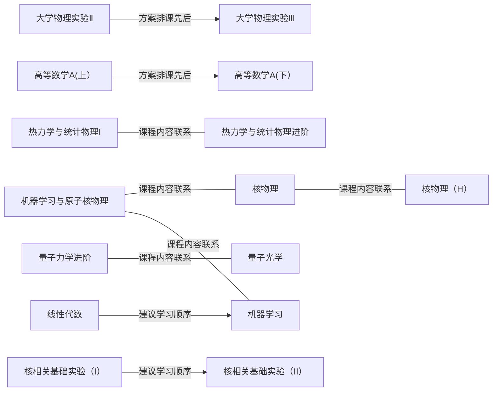

# 2024级物理学（核物理方向）“2+X”本科培养方案

核科学与技术系 · 物理学(核物理方向) · 方案 73414 · 78 个不同课程或科研条目。

[官方 Word](../originals/plan-73414.docx) · [教务详情](https://fdjwgl.fudan.edu.cn/manager/bizType/2/major-program-search/info/73414?skipAuth=1) · [方案快照](../raw/plan-73414.json.gz) · [年级目录](../README.md)

## 课程关系图

图中展示部分关系。下表保留全部已建立的课程对，来源位置使用本方案 JSON Pointer。

## 先修与内容联系

| 类型 | 起点 | 终点 | 依据 | 原表定位 |
| --- | --- | --- | --- | --- |
| 建议学习顺序 | 高等数学A(上） (MATH10015) | 高等数学A(下） (MATH10016) | 同方案的课程题名具有连续分册或序号。  | `/courseModules/5/planCourses/0`、`/courseModules/5/planCourses/4` |
| 建议学习顺序 | 核相关基础实验（I） (NST30004) | 核相关基础实验（II） (NST50014) | 同方案的课程题名具有连续分册或序号。  | `/courseModules/14/planCourses/21`、`/courseModules/15/planCourses/3` |
| 建议学习顺序 | 线性代数 (PHYS10010) | 机器学习 (ICE50015) | 向量、矩阵及线性映射为理解学习模型提供数学准备。  | `/courseModules/6/planCourses/0`、`/courseModules/14/planCourses/15` |
| 建议学习顺序 | 大学物理实验Ⅱ (PHYS20015) | 大学物理实验Ⅲ (PHYS20016) | 同方案的课程题名具有连续分册或序号。  | `/courseModules/6/planCourses/4`、`/courseModules/6/planCourses/9` |
| 方案排课先后 | 高等数学A(上） (MATH10015) | 高等数学A(下） (MATH10016) | 同方案该课程全部明确数字学期均早于后者。  | `/courseModules/5/planCourses/0`、`/courseModules/5/planCourses/4` |
| 方案排课先后 | 大学物理实验Ⅱ (PHYS20015) | 大学物理实验Ⅲ (PHYS20016) | 同方案该课程全部明确数字学期均早于后者。  | `/courseModules/6/planCourses/4`、`/courseModules/6/planCourses/9` |
| 课程内容联系 | 机器学习与原子核物理 (AIS410004) | 机器学习 (ICE50015) | 本方案两门课程的题名均含“机器学习”，可据此对照这一主题。  | `/courseModules/14/planCourses/30`、`/courseModules/14/planCourses/15` |
| 课程内容联系 | 机器学习与原子核物理 (AIS410004) | 核物理 (PHYS30017) | 本方案两门课程的题名均含“核物理”，可据此对照这一主题。  | `/courseModules/14/planCourses/30`、`/courseModules/6/planCourses/13` |
| 课程内容联系 | 大学物理A：光学 (PHYS20010) | 量子光学 (PHYS60023) | 本方案两门课程的题名均含“光学”，可据此对照这一主题。  | `/courseModules/6/planCourses/2`、`/courseModules/14/planCourses/25` |
| 课程内容联系 | 热力学与统计物理I (PHYS20013) | 热力学与统计物理I(H) (PHYS20013h) | 本方案两门课程的题名均含“统计物理”，可据此对照这一主题。  | `/courseModules/6/planCourses/8`、`/courseModules/17/planCourses/3` |
| 课程内容联系 | 热力学与统计物理I (PHYS20013) | 热力学与统计物理进阶 (PHYS40027) | 本方案两门课程的题名均含“统计物理”，可据此对照这一主题。  | `/courseModules/6/planCourses/8`、`/courseModules/15/planCourses/2` |
| 课程内容联系 | 量子力学I (PHYS30010) | 量子光学 (PHYS60023) | 本方案两门课程的题名均含“量子”，可据此对照这一主题。  | `/courseModules/6/planCourses/10`、`/courseModules/14/planCourses/25` |
| 课程内容联系 | 量子力学I(H) (PHYS30010h) | 量子光学 (PHYS60023) | 本方案两门课程的题名均含“量子”，可据此对照这一主题。  | `/courseModules/17/planCourses/5`、`/courseModules/14/planCourses/25` |
| 课程内容联系 | 核物理 (PHYS30017) | 核物理（H） (PHYS30017h) | 本方案两门课程的题名均含“核物理”，可据此对照这一主题。  | `/courseModules/6/planCourses/13`、`/courseModules/17/planCourses/7` |
| 课程内容联系 | 量子力学进阶 (PHYS40026) | 量子光学 (PHYS60023) | 本方案两门课程的题名均含“量子”，可据此对照这一主题。  | `/courseModules/15/planCourses/1`、`/courseModules/14/planCourses/25` |
| 课程内容联系 | 量子场论 (PHYS60022) | 量子光学 (PHYS60023) | 本方案两门课程的题名均含“量子”，可据此对照这一主题。  | `/courseModules/14/planCourses/12`、`/courseModules/14/planCourses/25` |

本次未从可定位的明确表述中确认课程对课程预修。学期安排、系列分册与编辑建议均保留各自的依据。

## 按原方案模块阅读

同一模块展示原表中的课程归属。模块内课程之间的先后仍须逐项查阅。

- **粒子物理与核物理**　粒子物理学、粒子探测、理论物理专题（原表模块 11）
- **原子与分子物理**　聚变等离子体物理、实验谱学（原表模块 12）
- **核工程与核技术**　加速器原理、核反应堆物理、核分析技术（原表模块 13）
- **荣誉项目**　核辐射探测与测量方法（H）、核技术综合实验（H）、经典力学(H)、数学物理方法A(H)、热力学与统计物理I(H)、原子物理学（H）、量子力学I(H)、电动力学(H)、核物理（H）、粒子物理学（H）（原表模块 17）

## 课程表

同一课程在不同模块分别出现时，按原表逐行列出。季节字段保留原值。

| 课程 | 代码 | 学分 | 学期 | 模块 |
| --- | --- | ---: | --- | --- |
| 高等数学A(上） | MATH10015 | 5.0 | 第1学期 | 培养方案 / 专业培养课程 / 大类基础课程 |
| 大学物理A：力学 | PHYS10006 | 4.0 | 第1学期 | 培养方案 / 专业培养课程 / 大类基础课程 |
| 基础物理实验 | PHYS10005 | 2.0 | 第1学期 | 培养方案 / 专业培养课程 / 大类基础课程 |
| 程序设计 | CS10004 | 4.0 | 第1学期 | 培养方案 / 专业培养课程 / 大类基础课程 |
| 高等数学A(下） | MATH10016 | 5.0 | 第2学期 | 培养方案 / 专业培养课程 / 大类基础课程 |
| 大学物理A：热学 | PHYS10007 | 2.0 | 第2学期 | 培养方案 / 专业培养课程 / 大类基础课程 |
| 大学物理A：电磁学 | PHYS10008 | 4.0 | 第2学期 | 培养方案 / 专业培养课程 / 大类基础课程 |
| 线性代数 | PHYS10010 | 3.0 | 第3学期 | 培养方案 / 专业培养课程 / 专业核心教育课程 |
| 概率论与数理统计 | PHYS20014 | 2.0 | 第3学期 | 培养方案 / 专业培养课程 / 专业核心教育课程 |
| 大学物理A：光学 | PHYS20010 | 3.0 | 第3学期 | 培养方案 / 专业培养课程 / 专业核心教育课程 |
| 经典力学 | PHYS20003 | 3.0 | 第3学期 | 培养方案 / 专业培养课程 / 专业核心教育课程 |
| 大学物理实验Ⅱ | PHYS20015 | 2.0 | 第3学期 | 培养方案 / 专业培养课程 / 专业核心教育课程 |
| 电子线路基础 | NST20001 | 4.0 | 第4学期 | 培养方案 / 专业培养课程 / 专业核心教育课程 |
| 原子物理学 | PHYS20017 | 3.0 | 第4学期 | 培养方案 / 专业培养课程 / 专业核心教育课程 |
| 数学物理方法A | PHYS20006 | 4.0 | 第4学期 | 培养方案 / 专业培养课程 / 专业核心教育课程 |
| 热力学与统计物理I | PHYS20013 | 4.0 | 第4学期 | 培养方案 / 专业培养课程 / 专业核心教育课程 |
| 大学物理实验Ⅲ | PHYS20016 | 2.0 | 第4学期 | 培养方案 / 专业培养课程 / 专业核心教育课程 |
| 量子力学I | PHYS30010 | 4.0 | 第5学期 | 培养方案 / 专业培养课程 / 专业核心教育课程 |
| 电动力学 | PHYS30016 | 4.0 | 第5学期 | 培养方案 / 专业培养课程 / 专业核心教育课程 |
| 核辐射探测与测量方法 | NST30003 | 3.0 | 第5学期 | 培养方案 / 专业培养课程 / 专业核心教育课程 |
| 核物理 | PHYS30017 | 3.0 | 第6学期 | 培养方案 / 专业培养课程 / 专业核心教育课程 |
| 专业实践 | NST20002 | 1.0 | 第7学期 | 培养方案 / 专业培养课程 / 专业核心教育课程 |
| 毕业论文 | PHYS40020 | 6.0 | 第8学期 | 培养方案 / 专业培养课程 / 专业核心教育课程 |
| 理论物理专题 | PHYS50014 | 3.0 | SPRING | 培养方案 / 专业进阶II / 专业进阶II方向课 / 粒子物理与核物理 |
| 粒子物理学 | PHYS40023 | 3.0 | AUTUMN | 培养方案 / 专业进阶II / 专业进阶II方向课 / 粒子物理与核物理 |
| 粒子探测 | PHYS40025 | 3.0 | AUTUMN | 培养方案 / 专业进阶II / 专业进阶II方向课 / 粒子物理与核物理 |
| 实验谱学 | PHYS50013 | 3.0 | SPRING | 培养方案 / 专业进阶II / 专业进阶II方向课 / 原子与分子物理 |
| 聚变等离子体物理 | PHYS40024 | 3.0 | AUTUMN | 培养方案 / 专业进阶II / 专业进阶II方向课 / 原子与分子物理 |
| 加速器原理 | NST40003 | 2.0 | SPRING | 培养方案 / 专业进阶II / 专业进阶II方向课 / 核工程与核技术 |
| 核分析技术 | NST50003 | 3.0 | AUTUMN | 培养方案 / 专业进阶II / 专业进阶II方向课 / 核工程与核技术 |
| 核反应堆物理 | NST40005 | 4.0 | SPRING | 培养方案 / 专业进阶II / 专业进阶II方向课 / 核工程与核技术 |
| 金工实习 | AAST30031 | 1.0 | 第6学期 | 培养方案 / 专业进阶II / 专业进阶II公选课 |
| 核技术概论 | NST50002 | 3.0 | AUTUMN | 培养方案 / 专业进阶II / 专业进阶II公选课 |
| 计算物理基础 | PHYS40021 | 2.0 | AUTUMN | 培养方案 / 专业进阶II / 专业进阶II公选课 |
| 辐射防护 | NST30002 | 2.0 | AUTUMN | 培养方案 / 专业进阶II / 专业进阶II公选课 |
| 生物医学核技术 | NST50011 | 3.0 | SPRING | 培养方案 / 专业进阶II / 专业进阶II公选课 |
| 医学影像原理与技术 | NST50012 | 3.0 | SPRING | 培养方案 / 专业进阶II / 专业进阶II公选课 |
| 放疗物理学 | NST50013 | 3.0 | AUTUMN | 培养方案 / 专业进阶II / 专业进阶II公选课 |
| 核电子学 | NST50001 | 3.0 | SPRING | 培养方案 / 专业进阶II / 专业进阶II公选课 |
| 固体物理 | PHYS30011 | 4.0 | SPRING | 培养方案 / 专业进阶II / 专业进阶II公选课 |
| 材料物理 | MASE30012 | 3.0 | AUTUMN | 培养方案 / 专业进阶II / 专业进阶II公选课 |
| 流体力学Ⅰ | AAST30005 | 4.0 | AUTUMN | 培养方案 / 专业进阶II / 专业进阶II公选课 |
| 激光物理 | PHYS40008 | 3.0 | SPRING | 培养方案 / 专业进阶II / 专业进阶II公选课 |
| 量子场论 | PHYS60022 | 3.0 | SPRING | 培养方案 / 专业进阶II / 专业进阶II公选课 |
| 数字图象处理 | CS30026 | 3.0 | SPRING | 培养方案 / 专业进阶II / 专业进阶II公选课 |
| 工程图学基础 | NST20003 | 2.0 | AUTUMN | 培养方案 / 专业进阶II / 专业进阶II公选课 |
| 机器学习 | ICE50015 | 2.0 | AUTUMN | 培养方案 / 专业进阶II / 专业进阶II公选课 |
| 现代核科学与技术VR仿真实验 | TCPH130050 | 2.0 | AUTUMN | 培养方案 / 专业进阶II / 专业进阶II公选课 |
| 核反应堆热工水力学 | NST40006 | 3.0 | AUTUMN | 培养方案 / 专业进阶II / 专业进阶II公选课 |
| 薄膜物理与技术 | NST50005 | 2.0 | AUTUMN | 培养方案 / 专业进阶II / 专业进阶II公选课 |
| 核电厂运行与安全 | NST40007 | 3.0 | AUTUMN | 培养方案 / 专业进阶II / 专业进阶II公选课 |
| 同位素分离与应用 | NST50015 | 2.0 | AUTUMN | 培养方案 / 专业进阶II / 专业进阶II公选课 |
| 核相关基础实验（I） | NST30004 | 3.0 | AUTUMN | 培养方案 / 专业进阶II / 专业进阶II公选课 |
| 误差分析和数据处理 | PHYS50012 | 2.0 | AUTUMN | 培养方案 / 专业进阶II / 专业进阶II公选课 |
| 信号处理与总线 | NST50010 | 2.0 | AUTUMN | 培养方案 / 专业进阶II / 专业进阶II公选课 |
| 核技术综合实验 | NST40004 | 3.0 | AUTUMN | 培养方案 / 专业进阶II / 专业进阶II公选课 |
| 量子光学 | PHYS60023 | 3.0 | AUTUMN | 培养方案 / 专业进阶II / 专业进阶II公选课 |
| 量子计算与量子信息 | PHYS60021 | 3.0 | AUTUMN | 培养方案 / 专业进阶II / 专业进阶II公选课 |
| 群论 | PHYS50007 | 3.0 | AUTUMN | 培养方案 / 专业进阶II / 专业进阶II公选课 |
| 科技英语写作 | NST50009 | 2.0 | SPRING、AUTUMN | 培养方案 / 专业进阶II / 专业进阶II公选课 |
| 核事业与行业发展 | GEIN10054 | 1.0 | AUTUMN | 培养方案 / 专业进阶II / 专业进阶II公选课 |
| 机器学习与原子核物理 | AIS410004 | 3.0 | SPRING、AUTUMN | 培养方案 / 专业进阶II / 专业进阶II公选课 |
| 数据科学及物理问题中的算法导论 | PHYS50004 | 3.0 | 第6学期 | 培养方案 / 专业进阶II / 专业进阶II公选课 |
| 中微子与暗物质实验前沿 | PHYS50003 | 2.0 | 第6学期 | 培养方案 / 专业进阶II / 专业进阶II公选课 |
| 近代物理实验I | PHYS30013 | 4.0 | 第5学期 | 培养方案 / 专业进阶I |
| 量子力学进阶 | PHYS40026 | 3.0 | 第6学期 | 培养方案 / 专业进阶I |
| 热力学与统计物理进阶 | PHYS40027 | 3.0 | 第6学期 | 培养方案 / 专业进阶I |
| 核相关基础实验（II） | NST50014 | 3.0 | 第6学期 | 培养方案 / 专业进阶I |
| 经典力学(H) | PHYS20003h | 4.0 | 第3学期 | 培养方案 / 荣誉项目 |
| 原子物理学（H） | PHYS20017h | 4.0 | 第4学期 | 培养方案 / 荣誉项目 |
| 数学物理方法A(H) | PHYS20006h | 5.0 | 第4学期 | 培养方案 / 荣誉项目 |
| 热力学与统计物理I(H) | PHYS20013h | 5.0 | 第4学期 | 培养方案 / 荣誉项目 |
| 核辐射探测与测量方法（H） | NST30003h | 4.0 | 第5学期 | 培养方案 / 荣誉项目 |
| 量子力学I(H) | PHYS30010h | 5.0 | 第5学期 | 培养方案 / 荣誉项目 |
| 电动力学(H) | PHYS30016h | 5.0 | 第5学期 | 培养方案 / 荣誉项目 |
| 核物理（H） | PHYS30017h | 4.0 | 第6学期 | 培养方案 / 荣誉项目 |
| 核技术综合实验（H） | NST40004h | 4.0 | 第7学期 | 培养方案 / 荣誉项目 |
| 粒子物理学（H） | PHYS40023h | 4.0 | 第7学期 | 培养方案 / 荣誉项目 |
