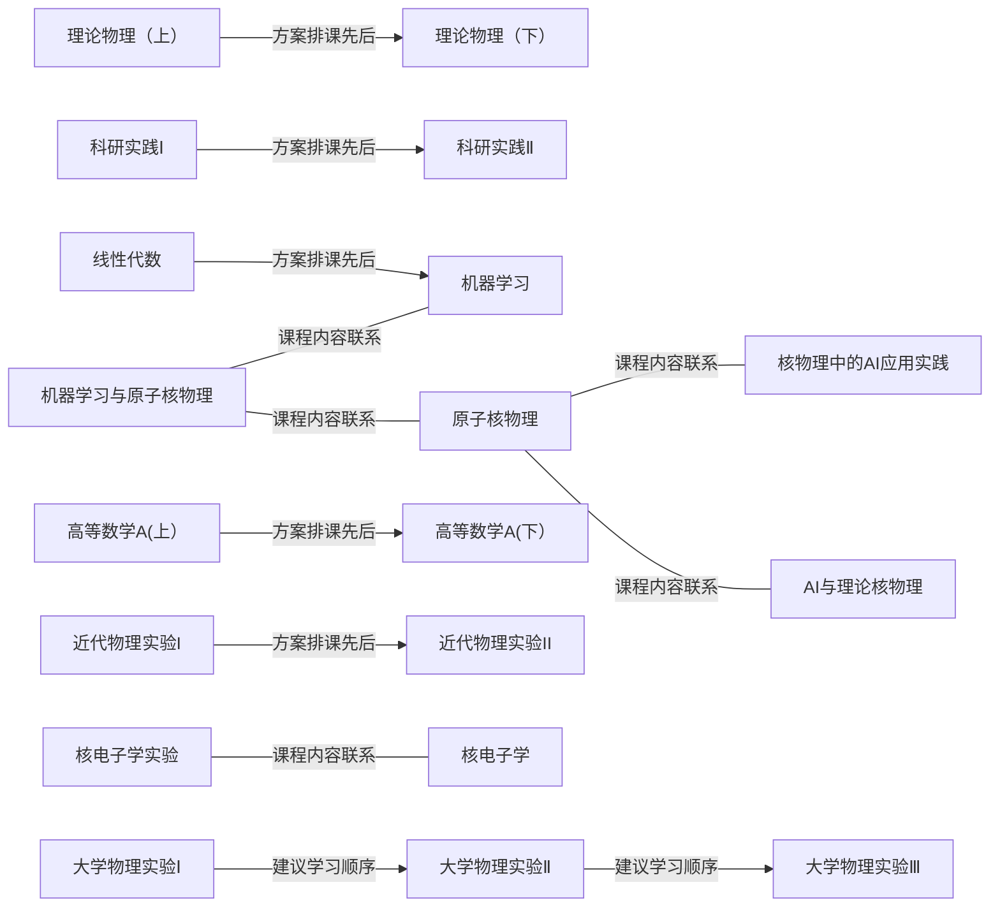

# 2025核工程与核技术-电子信息本硕融通培养方案(核工程与核技术专业适用）

核科学与技术系 · 核工程与核技术 · 方案 97129 · 91 个不同课程或科研条目。

[官方 Word](../originals/plan-97129.docx) · [教务详情](https://fdjwgl.fudan.edu.cn/manager/bizType/2/major-program-search/info/97129?skipAuth=1) · [方案快照](../raw/plan-97129.json.gz) · [年级目录](../README.md)

## 修读导读

- **建议先学**　《线性代数》（`MATH20003`） → 《机器学习》（`ICE50015`）。向量、矩阵及线性映射为理解学习模型提供数学准备。方案分别列在第1、5学期。

- **可以对照着读**　《原子核物理》（`PHYS30005`）与《AI与理论核物理》（`PHYS30023`）。两门课的题名都涉及核物理。围绕一个核结构或辐射现象，区分模型描述的量与可供比较的观测证据。

- **查模块选课**　《概率论与数理统计》（`STAT20002`）、《原子物理学》（`PHYS20017`）列在“专业核心教育课程”中。模块说明写明“要求修读43学分（部分课程学分可用荣誉课程学分替换）”。原表见 `/courseModules/6`。

## 课程关系图

图中展示部分关系。下表保留全部已建立的课程对，来源位置使用本方案 JSON Pointer。

## 先修与内容联系

| 类型 | 起点 | 终点 | 依据 | 原表定位 |
| --- | --- | --- | --- | --- |
| 建议学习顺序 | 高等数学A(上） (MATH10015) | 高等数学A(下） (MATH10016) | 同方案的课程题名具有连续分册或序号。  | `/courseModules/5/planCourses/0`、`/courseModules/5/planCourses/1` |
| 建议学习顺序 | 线性代数 (MATH20003) | 机器学习 (ICE50015) | 向量、矩阵及线性映射为理解学习模型提供数学准备。  | `/courseModules/6/planCourses/0`、`/courseModules/17/planCourses/1` |
| 建议学习顺序 | 大学物理实验Ⅰ (PHYS10009) | 大学物理实验Ⅱ (PHYS20015) | 同方案的课程题名具有连续分册或序号。  | `/courseModules/26/planCourses/9`、`/courseModules/26/planCourses/11` |
| 建议学习顺序 | 大学物理实验Ⅱ (PHYS20015) | 大学物理实验Ⅲ (PHYS20016) | 同方案的课程题名具有连续分册或序号。  | `/courseModules/26/planCourses/11`、`/courseModules/26/planCourses/13` |
| 建议学习顺序 | 科研实践Ⅰ (PHYS30004) | 科研实践Ⅱ (PHYS30006) | 同方案的课程题名具有连续分册或序号。  | `/courseModules/26/planCourses/12`、`/courseModules/26/planCourses/14` |
| 建议学习顺序 | 近代物理实验I (PHYS30013) | 近代物理实验II (PHYS40014) | 同方案的课程题名具有连续分册或序号。  | `/courseModules/26/planCourses/15`、`/courseModules/16/planCourses/0` |
| 建议学习顺序 | 理论物理（上） (PHYS30018) | 理论物理（下） (PHYS30019) | 同方案的课程题名具有连续分册或序号。  | `/courseModules/6/planCourses/6`、`/courseModules/6/planCourses/7` |
| 方案排课先后 | 高等数学A(上） (MATH10015) | 高等数学A(下） (MATH10016) | 同方案该课程全部明确数字学期均早于后者。  | `/courseModules/5/planCourses/0`、`/courseModules/5/planCourses/1` |
| 方案排课先后 | 线性代数 (MATH20003) | 机器学习 (ICE50015) | 同方案该课程全部明确数字学期均早于后者。  | `/courseModules/6/planCourses/0`、`/courseModules/17/planCourses/1` |
| 方案排课先后 | 大学物理实验Ⅰ (PHYS10009) | 大学物理实验Ⅱ (PHYS20015) | 同方案该课程全部明确数字学期均早于后者。  | `/courseModules/26/planCourses/9`、`/courseModules/26/planCourses/11` |
| 方案排课先后 | 大学物理实验Ⅱ (PHYS20015) | 大学物理实验Ⅲ (PHYS20016) | 同方案该课程全部明确数字学期均早于后者。  | `/courseModules/26/planCourses/11`、`/courseModules/26/planCourses/13` |
| 方案排课先后 | 科研实践Ⅰ (PHYS30004) | 科研实践Ⅱ (PHYS30006) | 同方案该课程全部明确数字学期均早于后者。  | `/courseModules/26/planCourses/12`、`/courseModules/26/planCourses/14` |
| 方案排课先后 | 近代物理实验I (PHYS30013) | 近代物理实验II (PHYS40014) | 同方案该课程全部明确数字学期均早于后者。  | `/courseModules/26/planCourses/15`、`/courseModules/16/planCourses/0` |
| 方案排课先后 | 理论物理（上） (PHYS30018) | 理论物理（下） (PHYS30019) | 同方案该课程全部明确数字学期均早于后者。  | `/courseModules/6/planCourses/6`、`/courseModules/6/planCourses/7` |
| 课程内容联系 | 机器学习与原子核物理 (AIS410004) | 机器学习 (ICE50015) | 本方案两门课程的题名均含“机器学习”，可据此对照这一主题。  | `/courseModules/11/planCourses/0`、`/courseModules/17/planCourses/1` |
| 课程内容联系 | 机器学习与原子核物理 (AIS410004) | 原子核物理 (PHYS30005) | 本方案两门课程的题名均含“核物理”，可据此对照这一主题。  | `/courseModules/11/planCourses/0`、`/courseModules/6/planCourses/8` |
| 课程内容联系 | 核电子学实验 (NST30001) | 核电子学 (NST50001) | 题名显示相同主题的课程与实验、实践或实习。  | `/courseModules/10/planCourses/1`、`/courseModules/10/planCourses/0` |
| 课程内容联系 | 原子核物理 (PHYS30005) | 核物理中的AI应用实践 (PHYS30022) | 本方案两门课程的题名均含“核物理”，可据此对照这一主题。  | `/courseModules/6/planCourses/8`、`/courseModules/11/planCourses/4` |
| 课程内容联系 | 原子核物理 (PHYS30005) | AI与理论核物理 (PHYS30023) | 本方案两门课程的题名均含“核物理”，可据此对照这一主题。  | `/courseModules/6/planCourses/8`、`/courseModules/11/planCourses/3` |

本次未从可定位的明确表述中确认课程对课程预修。学期安排、系列分册与编辑建议均保留各自的依据。

## 按原方案模块阅读

同一模块展示原表中的课程归属。模块内课程之间的先后仍须逐项查阅。

- **/**　核电子学实验、加速器原理、核反应堆物理、核电子学、核技术概论、计算物理、量子力学进阶、热力学与统计物理进阶、误差分析和数据处理、实验物理中的概率和统计（原表模块 10）
- **AI交叉**　机器学习与原子核物理、AI与实验数据分析、AI与粒子探测、核物理中的AI应用实践、AI与理论核物理（原表模块 11）
- **核技术**　等离子体物理、材料物理、光电检测技术、高电荷态离子物理I、离子束物理II、强激光与物质的相互作用（原表模块 12）
- **核工程**　工程伦理与研究方法、工程管理、传热学、核反应堆热工水力学、核反应堆安全分析、聚变等离子体物理（原表模块 13）
- **聚变工程与技术**　高温超导磁体技术、工程数值计算（原表模块 14）
- **/**　流体力学Ⅰ、现代核科学与技术VR仿真实验、核技术综合实验、信号处理与总线、同位素分离与应用、近代物理实验II、专业外语、生物物理学（原表模块 16）
- **AI交叉**　机器学习、数据科学及物理问题中的算法导论（原表模块 17）
- **核技术**　现代生物科学导论A、核分析技术、薄膜物理与技术、生命科学中的微量元素、生物医学核技术、放疗物理学、真空物理与技术、粒子探测、粒子探测技术、医学影像原理与技术（原表模块 18）
- **核工程**　工程伦理、核电厂运行与安全、先进反应堆数值模拟（原表模块 19）

## 课程表

同一课程在不同模块分别出现时，按原表逐行列出。季节字段保留原值。

| 课程 | 代码 | 学分 | 学期 | 模块 |
| --- | --- | ---: | --- | --- |
| 高等数学A(上） | MATH10015 | 5.0 | 第1学期 | 培养方案 / 专业培养课程 / 学科基础课程 |
| 高等数学A(下） | MATH10016 | 5.0 | 第2学期 | 培养方案 / 专业培养课程 / 学科基础课程 |
| 大学物理A：力学 | PHYS10006 | 4.0 | 第1学期 | 培养方案 / 专业培养课程 / 学科基础课程 |
| 大学物理A：热学 | PHYS10007 | 2.0 | 第2学期 | 培养方案 / 专业培养课程 / 学科基础课程 |
| 大学物理A：电磁学 | PHYS10008 | 4.0 | 第2学期 | 培养方案 / 专业培养课程 / 学科基础课程 |
| 线性代数 | MATH20003 | 3.0 | 第1学期 | 培养方案 / 专业培养课程 / 专业核心教育课程 |
| Python程序设计 | CS10002 | 2.0 | 第1学期 | 培养方案 / 专业培养课程 / 专业核心教育课程 |
| 概率论与数理统计 | STAT20002 | 2.0 | 第2学期 | 培养方案 / 专业培养课程 / 专业核心教育课程 |
| 大学物理A：光学 | PHYS20010 | 3.0 | 第3学期 | 培养方案 / 专业培养课程 / 专业核心教育课程 |
| 原子物理学 | PHYS20017 | 3.0 | 第3学期 | 培养方案 / 专业培养课程 / 专业核心教育课程 |
| 数学物理方法A | PHYS20006 | 4.0 | 第3学期 | 培养方案 / 专业培养课程 / 专业核心教育课程 |
| 理论物理（上） | PHYS30018 | 4.0 | 第4学期 | 培养方案 / 专业培养课程 / 专业核心教育课程 |
| 理论物理（下） | PHYS30019 | 4.0 | 第5学期 | 培养方案 / 专业培养课程 / 专业核心教育课程 |
| 原子核物理 | PHYS30005 | 3.0 | 第5学期 | 培养方案 / 专业培养课程 / 专业核心教育课程 |
| 核辐射探测与测量方法 | NST30003 | 3.0 | 第5学期 | 培养方案 / 专业培养课程 / 专业核心教育课程 |
| 辐射防护 | NST30002 | 2.0 | 第6学期 | 培养方案 / 专业培养课程 / 专业核心教育课程 |
| 工程图学基础 | NST20003 | 2.0 | 第3学期 | 培养方案 / 专业培养课程 / 专业核心教育课程 |
| 电子线路基础 | NST20001 | 4.0 | 第4学期 | 培养方案 / 专业培养课程 / 专业核心教育课程 |
| 核相关基础实验 | NST40002 | 3.0 | 第6学期 | 培养方案 / 专业培养课程 / 专业核心教育课程 |
| 金工实习 | AAST30031 | 1.0 | 第4学期 | 培养方案 / 专业培养课程 / 专业核心教育课程 |
| 核电子学 | NST50001 | 3.0 | 第5学期 | 培养方案 / 专业进阶模块I / / |
| 核电子学实验 | NST30001 | 3.0 | 第5学期 | 培养方案 / 专业进阶模块I / / |
| 核反应堆物理 | NST40005 | 4.0 | 第6学期 | 培养方案 / 专业进阶模块I / / |
| 计算物理 | PHYS40004 | 3.0 | 第4学期 | 培养方案 / 专业进阶模块I / / |
| 加速器原理 | NST40003 | 2.0 | 第6学期 | 培养方案 / 专业进阶模块I / / |
| 核技术概论 | NST50002 | 3.0 | 第5学期 | 培养方案 / 专业进阶模块I / / |
| 误差分析和数据处理 | PHYS50012 | 2.0 | 第5学期 | 培养方案 / 专业进阶模块I / / |
| 实验物理中的概率和统计 | PHYS60011 | 2.0 | 第9学期 | 培养方案 / 专业进阶模块I / / |
| 量子力学进阶 | PHYS40026 | 3.0 | 第6学期 | 培养方案 / 专业进阶模块I / / |
| 热力学与统计物理进阶 | PHYS40027 | 3.0 | 第6学期 | 培养方案 / 专业进阶模块I / / |
| 机器学习与原子核物理 | AIS410004 | 3.0 | 第6学期 | 培养方案 / 专业进阶模块I / AI交叉 |
| AI与实验数据分析 | PHYS30020 | 3.0 | 第6学期 | 培养方案 / 专业进阶模块I / AI交叉 |
| AI与粒子探测 | PHYS30021 | 3.0 | 第7学期 | 培养方案 / 专业进阶模块I / AI交叉 |
| AI与理论核物理 | PHYS30023 | 3.0 | 第7学期 | 培养方案 / 专业进阶模块I / AI交叉 |
| 核物理中的AI应用实践 | PHYS30022 | 3.0 | 第7学期 | 培养方案 / 专业进阶模块I / AI交叉 |
| 强激光与物质的相互作用 | PHYS70004 | 2.0 | 第9学期 | 培养方案 / 专业进阶模块I / 核技术 |
| 材料物理 | MASE30012 | 3.0 | 第9学期 | 培养方案 / 专业进阶模块I / 核技术 |
| 高电荷态离子物理I | PHYS60014 | 3.0 | 第9学期 | 培养方案 / 专业进阶模块I / 核技术 |
| 等离子体物理 | EST70010 | 3.0 | 第9学期 | 培养方案 / 专业进阶模块I / 核技术 |
| 光电检测技术 | OPTI40015 | 3.0 | 第9学期 | 培养方案 / 专业进阶模块I / 核技术 |
| 离子束物理II | PHYS60015 | 3.0 | 第9学期 | 培养方案 / 专业进阶模块I / 核技术 |
| 聚变等离子体物理 | PHYS40024 | 3.0 | 第7学期 | 培养方案 / 专业进阶模块I / 核工程 |
| 核反应堆安全分析 | NST70003 | 2.0 | 第10学期 | 培养方案 / 专业进阶模块I / 核工程 |
| 核反应堆热工水力学 | NST40006 | 3.0 | 第7学期 | 培养方案 / 专业进阶模块I / 核工程 |
| 传热学 | NST40001 | 2.0 | 第4学期 | 培养方案 / 专业进阶模块I / 核工程 |
| 工程伦理与研究方法 | EIE50005 | 2.0 | 第10学期 | 培养方案 / 专业进阶模块I / 核工程 |
| 工程管理 | EIE60012 | 2.0 | 第9学期 | 培养方案 / 专业进阶模块I / 核工程 |
| 工程数值计算 | NST60003 | 2.0 | 第6学期 | 培养方案 / 专业进阶模块I / 聚变工程与技术 |
| 高温超导磁体技术 | NST60002 | 2.0 | 第7学期 | 培养方案 / 专业进阶模块I / 聚变工程与技术 |
| 近代物理实验II | PHYS40014 | 3.0 | 第6学期 | 培养方案 / 专业进阶模块II / / |
| 核技术综合实验 | NST40004 | 3.0 | 第7学期 | 培养方案 / 专业进阶模块II / / |
| 专业外语 | PHYS50005 | 2.0 | 第10学期 | 培养方案 / 专业进阶模块II / / |
| 流体力学Ⅰ | AAST30005 | 4.0 | 第7学期 | 培养方案 / 专业进阶模块II / / |
| 现代核科学与技术VR仿真实验 | AIT310023 | 2.0 | 第7学期 | 培养方案 / 专业进阶模块II / / |
| 同位素分离与应用 | NST50015 | 2.0 | 第7学期 | 培养方案 / 专业进阶模块II / / |
| 生物物理学 | PHYS70007 | 3.0 | 第9学期 | 培养方案 / 专业进阶模块II / / |
| 信号处理与总线 | NST50010 | 2.0 | 第7学期 | 培养方案 / 专业进阶模块II / / |
| 数据科学及物理问题中的算法导论 | PHYS50004 | 3.0 | 第6学期 | 培养方案 / 专业进阶模块II / AI交叉 |
| 机器学习 | ICE50015 | 2.0 | 第5学期 | 培养方案 / 专业进阶模块II / AI交叉 |
| 粒子探测 | PHYS40025 | 3.0 | 第7学期 | 培养方案 / 专业进阶模块II / 核技术 |
| 粒子探测技术 | PHYS60005 | 3.0 | 第10学期 | 培养方案 / 专业进阶模块II / 核技术 |
| 薄膜物理与技术 | NST50005 | 2.0 | 第6学期 | 培养方案 / 专业进阶模块II / 核技术 |
| 生命科学中的微量元素 | NST50008 | 2.0 | 第7学期 | 培养方案 / 专业进阶模块II / 核技术 |
| 现代生物科学导论A | BIOL10001 | 3.0 | 第3学期 | 培养方案 / 专业进阶模块II / 核技术 |
| 生物医学核技术 | NST50011 | 3.0 | 第8学期 | 培养方案 / 专业进阶模块II / 核技术 |
| 医学影像原理与技术 | PHYS70001 | 3.0 | 第10学期 | 培养方案 / 专业进阶模块II / 核技术 |
| 放疗物理学 | NST50013 | 3.0 | 第7学期 | 培养方案 / 专业进阶模块II / 核技术 |
| 核分析技术 | NST50003 | 3.0 | 第7学期 | 培养方案 / 专业进阶模块II / 核技术 |
| 真空物理与技术 | NST70001 | 2.0 | 第10学期 | 培养方案 / 专业进阶模块II / 核技术 |
| 工程伦理 | IST50011 | 2.0 | 第10学期 | 培养方案 / 专业进阶模块II / 核工程 |
| 先进反应堆数值模拟 | NST70002 | 2.0 | 第9学期 | 培养方案 / 专业进阶模块II / 核工程 |
| 核电厂运行与安全 | NST40007 | 3.0 | 第7学期 | 培养方案 / 专业进阶模块II / 核工程 |
| 聚变大科学装置 | PHYS70025 | 2.0 | 第10学期 | 培养方案 / 专业进阶模块II / 聚变工程与技术 |
| 无学分讨论班 | 101 | 0.0 |  | 融合创新能力 |
| 复芏计划(FDUROP) | 102 | 0.0 |  | 融合创新能力 |
| 研究生学术活动 | 4 | 2.0 |  | 融合创新能力 |
| 研究生实践活动 | 5 | 2.0 |  | 融合创新能力 |
| 其他 | 107 | 0.0 |  | 融合创新能力 |
| 国际交流 | 7 | 0.0 |  | 融合创新能力 |
| 硕士学位论文开题 | 11 | 0.0 |  | 融合创新能力 |
| 硕士论文中期考核 | 31 | 0.0 |  | 融合创新能力 |
| 硕士学位论文预审 | 61 | 0.0 |  | 融合创新能力 |
| 大学物理实验Ⅰ | PHYS10009 | 2.0 | 第2学期 | 融合创新能力 |
| 核科学与技术前沿导论 | PHYS10001 | 2.0 | 第2学期 | 融合创新能力 |
| 大学物理实验Ⅱ | PHYS20015 | 2.0 | 第3学期 | 融合创新能力 |
| 科研实践Ⅰ | PHYS30004 | 3.0 | 第5学期 | 融合创新能力 |
| 大学物理实验Ⅲ | PHYS20016 | 2.0 | 第4学期 | 融合创新能力 |
| 科研实践Ⅱ | PHYS30006 | 3.0 | 第6学期 | 融合创新能力 |
| 近代物理实验I | PHYS30013 | 4.0 | 第5学期 | 融合创新能力 |
| 专业实践 | NST20002 | 1.0 | 第7学期 | 融合创新能力 |
| 毕业论文 | PHYS30007 | 2.0 | 第8学期 | 融合创新能力 |
