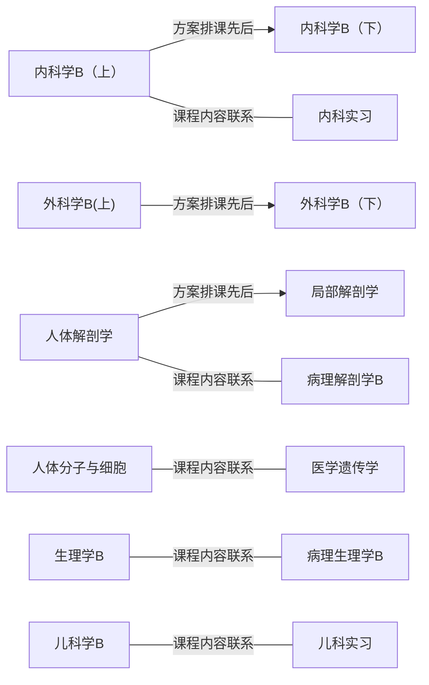

# 2024 法医学专业“2+X”教学培养方案

法医学与法庭科学学院 · 法医学 · 方案 72822 · 63 个不同课程或科研条目。

[官方 Word](../originals/plan-72822.docx) · [教务详情](https://fdjwgl.fudan.edu.cn/manager/bizType/2/major-program-search/info/72822?skipAuth=1) · [方案快照](../raw/plan-72822.json.gz) · [年级目录](../README.md)

## 修读导读

- **建议先学**　《人体解剖学》（`MED20070`） → 《局部解剖学》（`MED20087`）。系统结构与位置关系可用于区域解剖学习。方案分别列在第3、4学期。

- **可以对照着读**　《人体分子与细胞》（`MED20093`）与《医学遗传学》（`MED30117`）。基因、细胞与人体性状是共同知识背景。

- **查模块选课**　《法医学概论》（`MED20020`）、《临床法医学》（`MED40018`）列在“专业核心教育课程”中。原表见 `/courseModules/7`。

## 课程关系图

图中展示部分关系。下表保留全部已建立的课程对，来源位置使用本方案 JSON Pointer。

## 先修与内容联系

| 类型 | 起点 | 终点 | 依据 | 原表定位 |
| --- | --- | --- | --- | --- |
| 建议学习顺序 | 人体解剖学 (MED20070) | 局部解剖学 (MED20087) | 系统结构与位置关系可用于区域解剖学习。  | `/courseModules/7/planCourses/2`、`/courseModules/7/planCourses/4` |
| 建议学习顺序 | 内科学B（上） (MED30083) | 内科学B（下） (MED30084) | 同方案的课程题名具有连续分册或序号。  | `/courseModules/7/planCourses/13`、`/courseModules/7/planCourses/15` |
| 建议学习顺序 | 外科学B(上) (MED40072) | 外科学B（下） (MED40073) | 同方案的课程题名具有连续分册或序号。  | `/courseModules/7/planCourses/14`、`/courseModules/7/planCourses/16` |
| 方案排课先后 | 人体解剖学 (MED20070) | 局部解剖学 (MED20087) | 同方案该课程全部明确数字学期均早于后者。  | `/courseModules/7/planCourses/2`、`/courseModules/7/planCourses/4` |
| 方案排课先后 | 内科学B（上） (MED30083) | 内科学B（下） (MED30084) | 同方案该课程全部明确数字学期均早于后者。  | `/courseModules/7/planCourses/13`、`/courseModules/7/planCourses/15` |
| 方案排课先后 | 外科学B(上) (MED40072) | 外科学B（下） (MED40073) | 同方案该课程全部明确数字学期均早于后者。  | `/courseModules/7/planCourses/14`、`/courseModules/7/planCourses/16` |
| 课程内容联系 | 人工智能病理学 (AIS631011) | 医学人工智能与机器学习 (MED130347) | 本方案两门课程的题名均含“人工智能”，可据此对照这一主题。  | `/courseModules/10/planCourses/16`、`/courseModules/10/planCourses/11` |
| 课程内容联系 | 人工智能病理学 (AIS631011) | 法医病理学 (MED40013) | 本方案两门课程的题名均含“病理”，可据此对照这一主题。  | `/courseModules/10/planCourses/16`、`/courseModules/7/planCourses/24` |
| 课程内容联系 | 有机化学实验I (CHEM10006) | 有机化学C (CHEM10007) | 本方案两门课程的题名均含“有机化学”，可据此对照这一主题。  | `/courseModules/6/planCourses/3`、`/courseModules/6/planCourses/0` |
| 课程内容联系 | 生理学B (MED20008) | 病理生理学B (MED30009) | 本方案两门课程的题名均含“生理学”，可据此对照这一主题。  | `/courseModules/7/planCourses/7`、`/courseModules/7/planCourses/9` |
| 课程内容联系 | 法医学概论 (MED20020) | 临床法医学 (MED40018) | 本方案两门课程的题名均含“法医学”，可据此对照这一主题。  | `/courseModules/7/planCourses/23`、`/courseModules/7/planCourses/25` |
| 课程内容联系 | 人体解剖学 (MED20070) | 局部解剖学 (MED20087) | 本方案两门课程的题名均含“解剖”，可据此对照这一主题。  | `/courseModules/7/planCourses/2`、`/courseModules/7/planCourses/4` |
| 课程内容联系 | 人体解剖学 (MED20070) | 病理解剖学B (MED30007) | 本方案两门课程的题名均含“解剖”，可据此对照这一主题。  | `/courseModules/7/planCourses/2`、`/courseModules/7/planCourses/5` |
| 课程内容联系 | 解码疾病的医学遗传学原理 (MED20082) | 医学遗传学 (MED30117) | 本方案两门课程的题名均含“遗传学”，可据此对照这一主题。  | `/courseModules/10/planCourses/9`、`/courseModules/7/planCourses/1` |
| 课程内容联系 | 人体分子与细胞 (MED20093) | 医学遗传学 (MED30117) | 基因、细胞与人体性状是共同知识背景。  | `/courseModules/7/planCourses/0`、`/courseModules/7/planCourses/1` |
| 课程内容联系 | 病理解剖学B (MED30007) | 法医病理学 (MED40013) | 本方案两门课程的题名均含“病理”，可据此对照这一主题。  | `/courseModules/7/planCourses/5`、`/courseModules/7/planCourses/24` |
| 课程内容联系 | 病理生理学B (MED30009) | 法医病理学 (MED40013) | 本方案两门课程的题名均含“病理”，可据此对照这一主题。  | `/courseModules/7/planCourses/9`、`/courseModules/7/planCourses/24` |
| 课程内容联系 | 内科学B（上） (MED30083) | 内科实习 (MED40032) | 本方案两门课程的题名均含“内科”，可据此对照这一主题。  | `/courseModules/7/planCourses/13`、`/courseModules/7/planCourses/19` |
| 课程内容联系 | 内科学B（下） (MED30084) | 内科实习 (MED40032) | 本方案两门课程的题名均含“内科”，可据此对照这一主题。  | `/courseModules/7/planCourses/15`、`/courseModules/7/planCourses/19` |
| 课程内容联系 | 儿科学B (MED30085) | 儿科实习 (MED40062) | 本方案两门课程的题名均含“儿科”，可据此对照这一主题。  | `/courseModules/7/planCourses/18`、`/courseModules/7/planCourses/21` |
| 课程内容联系 | 外科实习 (MED40033) | 外科学B(上) (MED40072) | 本方案两门课程的题名均含“外科”，可据此对照这一主题。  | `/courseModules/7/planCourses/20`、`/courseModules/7/planCourses/14` |
| 课程内容联系 | 外科实习 (MED40033) | 外科学B（下） (MED40073) | 本方案两门课程的题名均含“外科”，可据此对照这一主题。  | `/courseModules/7/planCourses/20`、`/courseModules/7/planCourses/16` |

本次未从可定位的明确表述中确认课程对课程预修。学期安排、系列分册与编辑建议均保留各自的依据。

## 按原方案模块阅读

同一模块展示原表中的课程归属。模块内课程之间的先后仍须逐项查阅。

- **医学类基础课程**　现代生物科学导论C、普通化学实验I、有机化学实验I、有机化学C、普通化学C、高等数学C I、普通物理B、基础物理实验（原表模块 6）

## 课程表

同一课程在不同模块分别出现时，按原表逐行列出。季节字段保留原值。

| 课程 | 代码 | 学分 | 学期 | 模块 |
| --- | --- | ---: | --- | --- |
| 有机化学C | CHEM10007 | 3.0 | 第2学期 | 培养方案 / 专业教育课程 / 大类基础课程 / 医学类基础课程 |
| 现代生物科学导论C | BIOL10002 | 2.0 | 第1学期、第2学期 | 培养方案 / 专业教育课程 / 大类基础课程 / 医学类基础课程 |
| 普通化学实验I | CHEM10005 | 1.0 | 第2学期 | 培养方案 / 专业教育课程 / 大类基础课程 / 医学类基础课程 |
| 有机化学实验I | CHEM10006 | 1.0 | 第2学期 | 培养方案 / 专业教育课程 / 大类基础课程 / 医学类基础课程 |
| 普通物理B | PHYS10002 | 3.0 | 第1学期 | 培养方案 / 专业教育课程 / 大类基础课程 / 医学类基础课程 |
| 基础物理实验 | PHYS10005 | 2.0 | 第1学期 | 培养方案 / 专业教育课程 / 大类基础课程 / 医学类基础课程 |
| 高等数学C I | MATH10018 | 5.0 | AUTUMN | 培养方案 / 专业教育课程 / 大类基础课程 / 医学类基础课程 |
| 普通化学C | CHEM10008 | 3.0 | 第1学期 | 培养方案 / 专业教育课程 / 大类基础课程 / 医学类基础课程 |
| 人体分子与细胞 | MED20093 | 4.5 | 第3学期 | 培养方案 / 专业教育课程 / 专业核心教育课程 |
| 医学遗传学 | MED30117 | 1.5 | 第4学期 | 培养方案 / 专业教育课程 / 专业核心教育课程 |
| 人体解剖学 | MED20070 | 3.0 | 第3学期 | 培养方案 / 专业教育课程 / 专业核心教育课程 |
| 组织胚胎学B | MED20007 | 3.5 | 第3学期 | 培养方案 / 专业教育课程 / 专业核心教育课程 |
| 局部解剖学 | MED20087 | 2.0 | 第4学期 | 培养方案 / 专业教育课程 / 专业核心教育课程 |
| 病理解剖学B | MED30007 | 5.5 | 第4学期 | 培养方案 / 专业教育课程 / 专业核心教育课程 |
| 医学微生物学C | MED20060 | 3.5 | 第4学期 | 培养方案 / 专业教育课程 / 专业核心教育课程 |
| 生理学B | MED20008 | 4.0 | 第4学期 | 培养方案 / 专业教育课程 / 专业核心教育课程 |
| 免疫学B | MED20085 | 2.0 | 第4学期 | 培养方案 / 专业教育课程 / 专业核心教育课程 |
| 病理生理学B | MED30009 | 3.0 | 第5学期 | 培养方案 / 专业教育课程 / 专业核心教育课程 |
| 药理学C | MED20011 | 4.0 | 第5学期 | 培养方案 / 专业教育课程 / 专业核心教育课程 |
| 诊断学 | MED30105 | 3.0 | 第5学期 | 培养方案 / 专业教育课程 / 专业核心教育课程 |
| 影像诊断学 | MED30109 | 3.0 | 第6学期 | 培养方案 / 专业教育课程 / 专业核心教育课程 |
| 内科学B（上） | MED30083 | 4.0 | 第6学期 | 培养方案 / 专业教育课程 / 专业核心教育课程 |
| 外科学B(上) | MED40072 | 4.0 | 第6学期 | 培养方案 / 专业教育课程 / 专业核心教育课程 |
| 内科学B（下） | MED30084 | 4.0 | 第7学期 | 培养方案 / 专业教育课程 / 专业核心教育课程 |
| 外科学B（下） | MED40073 | 4.0 | 第7学期 | 培养方案 / 专业教育课程 / 专业核心教育课程 |
| 妇产科学B | MED40009 | 4.0 | 第7学期 | 培养方案 / 专业教育课程 / 专业核心教育课程 |
| 儿科学B | MED30085 | 4.0 | 第7学期 | 培养方案 / 专业教育课程 / 专业核心教育课程 |
| 内科实习 | MED40032 | 8.0 | 第8学期 | 培养方案 / 专业教育课程 / 专业核心教育课程 |
| 外科实习 | MED40033 | 8.0 | 第8学期 | 培养方案 / 专业教育课程 / 专业核心教育课程 |
| 儿科实习 | MED40062 | 4.0 | 第8学期 | 培养方案 / 专业教育课程 / 专业核心教育课程 |
| 妇产科实习 | MED40063 | 4.0 | 第8学期 | 培养方案 / 专业教育课程 / 专业核心教育课程 |
| 法医学概论 | MED20020 | 2.0 | 第3学期 | 培养方案 / 专业教育课程 / 专业核心教育课程 |
| 法医病理学 | MED40013 | 6.0 | 第9学期 | 培养方案 / 专业教育课程 / 专业核心教育课程 |
| 临床法医学 | MED40018 | 2.5 | 第9学期 | 培养方案 / 专业教育课程 / 专业核心教育课程 |
| 专业实习 | MED40034 | 16.0 | 第10学期 | 培养方案 / 专业教育课程 / 专业核心教育课程 |
| 毕业论文 | MED40035 | 6.0 | 第10学期 | 培养方案 / 专业教育课程 / 专业核心教育课程 |
| 生物化学实验C | MED20084 | 1.0 | 第3学期 | 培养方案 / 专业进阶I |
| 功能学科综合实验 | MED30103 | 2.0 | 第5学期 | 培养方案 / 专业进阶I |
| 法医物证学 | MED40014 | 4.0 | 第5学期 | 培养方案 / 专业进阶I |
| 法医人类学 | MED40015 | 1.0 | 第5学期 | 培养方案 / 专业进阶I |
| 法医毒物分析 | MED40016 | 3.0 | 第7学期 | 培养方案 / 专业进阶I |
| 法医毒理学 | MED40017 | 1.5 | 第7学期 | 培养方案 / 专业进阶I |
| 精神医学 | MED40011 | 1.5 | 第6学期 | 培养方案 / 专业进阶I |
| 神经病学 | MED30018 | 1.5 | 第6学期 | 培养方案 / 专业进阶I |
| 司法精神医学 | MED30066 | 1.5 | 第7学期 | 培养方案 / 专业进阶I |
| 刑事科学技术 | MED20053 | 3.0 | 第9学期 | 培养方案 / 专业进阶I |
| 卫生统计方法（一） | PHPM30014 | 1.5 | 第3学期 | 培养方案 / 专业进阶II |
| 医学文献检索与利用B | MED20016 | 2.0 | SUMMER | 培养方案 / 专业进阶II |
| 眼科学 | MED30034 | 2.0 | 第6学期 | 培养方案 / 专业进阶II |
| 耳鼻喉科学 | MED30035 | 2.0 | 第6学期 | 培养方案 / 专业进阶II |
| 寄生虫学C | MED30008 | 2.0 | AUTUMN | 培养方案 / 专业进阶II |
| 医疗纠纷防范与应对 | MED30067 | 2.0 | SPRING | 培养方案 / 专业进阶II |
| 刑事诉讼法 | LAW20002 | 3.0 | SPRING | 培养方案 / 专业进阶II |
| 代谢分子医学与疾病 | MED20081 | 2.0 | AUTUMN | 培养方案 / 专业进阶II |
| 免疫学进阶 | MED50031 | 2.0 | AUTUMN | 培养方案 / 专业进阶II |
| 解码疾病的医学遗传学原理 | MED20082 | 2.0 | SPRING | 培养方案 / 专业进阶II |
| 口腔科学B | MED40010 | 1.0 | SPRING | 培养方案 / 专业进阶II |
| 医学人工智能与机器学习 | MED130347 | 3.0 | SUMMER | 培养方案 / 专业进阶II |
| 脑科学前沿 | MED20076 | 2.0 | SPRING | 培养方案 / 专业进阶II |
| 中西医结合基础概论 | MED20018 | 2.0 | AUTUMN | 培养方案 / 专业进阶II |
| 生物医学信息学概论 | MED20054 | 2.0 | SPRING | 培养方案 / 专业进阶II |
| 医学影像深度学习 | AIS310019 | 3.0 | AUTUMN | 培养方案 / 专业进阶II |
| 人工智能病理学 | AIS631011 | 3.0 | AUTUMN | 培养方案 / 专业进阶II |
