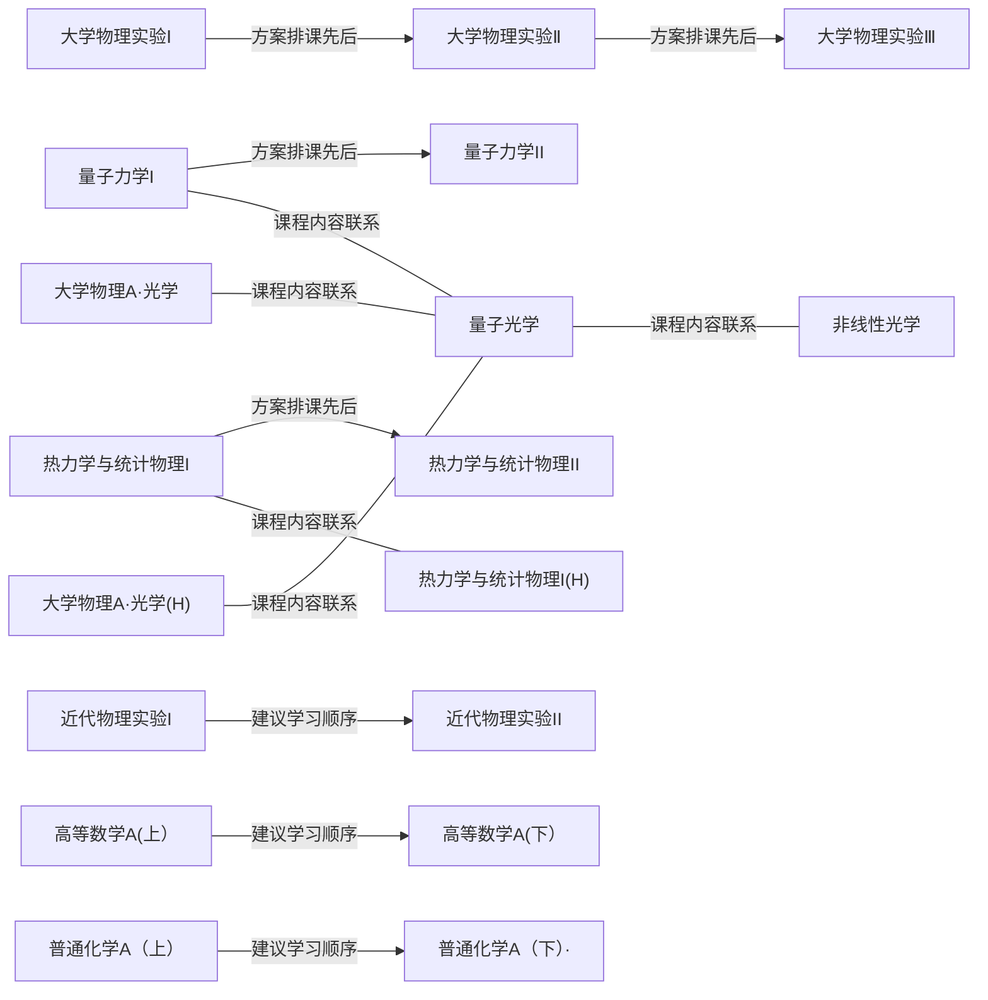

# 2024 物理学专业“2+X”教学培养方案（强基班学生适用）

物理学系 · 物理学(强基计划) · 方案 72619 · 99 个不同课程或科研条目。

[官方 Word](../originals/plan-72619.docx) · [教务详情](https://fdjwgl.fudan.edu.cn/manager/bizType/2/major-program-search/info/72619?skipAuth=1) · [方案快照](../raw/plan-72619.json.gz) · [年级目录](../README.md)

## 修读导读

- **建议先学**　《大学物理实验Ⅱ》（`PHYS20015`） → 《大学物理实验Ⅲ》（`PHYS20016`）。题名列出连续册次或级别。可沿用前一阶段的实验记录格式，对照后来新增的测量方法和误差来源。方案分别列在第3、4学期。

- **可以对照着读**　《大学物理A：光学》（`PHYS20010`）与《量子光学》（`PHYS60023`）。两门课的题名都涉及光学。选择同一光学现象，对照观察结果、使用的光传播模型及其适用条件。

- **查模块选课**　《经典力学》（`PHYS20003`）、《数学物理方法A》（`PHYS20006`）列在“专业核心教育课程”中。原表见 `/courseModules/6`。

## 课程关系图

图中展示部分关系。下表保留全部已建立的课程对，来源位置使用本方案 JSON Pointer。

## 先修与内容联系

| 类型 | 起点 | 终点 | 依据 | 原表定位 |
| --- | --- | --- | --- | --- |
| 建议学习顺序 | 普通化学A（上） (CHEM10003) | 普通化学A（下） (CHEM10004) | 同方案的课程题名具有连续分册或序号。  | `/courseModules/9/planCourses/12`、`/courseModules/9/planCourses/13` |
| 建议学习顺序 | 高等数学A(上） (MATH10015) | 高等数学A(下） (MATH10016) | 同方案的课程题名具有连续分册或序号。  | `/courseModules/5/planCourses/4`、`/courseModules/5/planCourses/5` |
| 建议学习顺序 | 大学物理实验Ⅰ (PHYS10009) | 大学物理实验Ⅱ (PHYS20015) | 同方案的课程题名具有连续分册或序号。  | `/courseModules/5/planCourses/3`、`/courseModules/6/planCourses/12` |
| 建议学习顺序 | 热力学与统计物理I (PHYS20013) | 热力学与统计物理II (PHYS40011) | 同方案的课程题名具有连续分册或序号。  | `/courseModules/6/planCourses/8`、`/courseModules/9/planCourses/3` |
| 建议学习顺序 | 大学物理实验Ⅱ (PHYS20015) | 大学物理实验Ⅲ (PHYS20016) | 同方案的课程题名具有连续分册或序号。  | `/courseModules/6/planCourses/12`、`/courseModules/6/planCourses/13` |
| 建议学习顺序 | 量子力学I (PHYS30010) | 量子力学II (PHYS40012) | 同方案的课程题名具有连续分册或序号。  | `/courseModules/6/planCourses/2`、`/courseModules/9/planCourses/4` |
| 建议学习顺序 | 近代物理实验I (PHYS30013) | 近代物理实验II (PHYS40014) | 同方案的课程题名具有连续分册或序号。  | `/courseModules/6/planCourses/5`、`/courseModules/10/planCourses/13` |
| 方案排课先后 | 大学物理实验Ⅰ (PHYS10009) | 大学物理实验Ⅱ (PHYS20015) | 同方案该课程全部明确数字学期均早于后者。  | `/courseModules/5/planCourses/3`、`/courseModules/6/planCourses/12` |
| 方案排课先后 | 热力学与统计物理I (PHYS20013) | 热力学与统计物理II (PHYS40011) | 同方案该课程全部明确数字学期均早于后者。  | `/courseModules/6/planCourses/8`、`/courseModules/9/planCourses/3` |
| 方案排课先后 | 大学物理实验Ⅱ (PHYS20015) | 大学物理实验Ⅲ (PHYS20016) | 同方案该课程全部明确数字学期均早于后者。  | `/courseModules/6/planCourses/12`、`/courseModules/6/planCourses/13` |
| 方案排课先后 | 量子力学I (PHYS30010) | 量子力学II (PHYS40012) | 同方案该课程全部明确数字学期均早于后者。  | `/courseModules/6/planCourses/2`、`/courseModules/9/planCourses/4` |
| 课程内容联系 | 大学物理A：电磁学 (PHYS10008) | 大学物理A：电磁学(H) (PHYS10008h) | 本方案两门课程的题名均含“电磁”，可据此对照这一主题。  | `/courseModules/5/planCourses/2`、`/courseModules/17/planCourses/2` |
| 课程内容联系 | 大学物理A：光学 (PHYS20010) | 量子光学 (PHYS60023) | 本方案两门课程的题名均含“光学”，可据此对照这一主题。  | `/courseModules/6/planCourses/6`、`/courseModules/10/planCourses/5` |
| 课程内容联系 | 大学物理A：光学(H) (PHYS20010h) | 量子光学 (PHYS60023) | 本方案两门课程的题名均含“光学”，可据此对照这一主题。  | `/courseModules/17/planCourses/3`、`/courseModules/10/planCourses/5` |
| 课程内容联系 | 热力学与统计物理I (PHYS20013) | 热力学与统计物理I(H) (PHYS20013h) | 本方案两门课程的题名均含“统计物理”，可据此对照这一主题。  | `/courseModules/6/planCourses/8`、`/courseModules/18/planCourses/1` |
| 课程内容联系 | 热力学与统计物理I (PHYS20013) | 热力学与统计物理II (PHYS40011) | 本方案两门课程的题名均含“统计物理”，可据此对照这一主题。  | `/courseModules/6/planCourses/8`、`/courseModules/9/planCourses/3` |
| 课程内容联系 | 量子力学I (PHYS30010) | 量子光学 (PHYS60023) | 本方案两门课程的题名均含“量子”，可据此对照这一主题。  | `/courseModules/6/planCourses/2`、`/courseModules/10/planCourses/5` |
| 课程内容联系 | 核物理 (PHYS30017) | 粒子物理，核物理，宇宙学前沿 (PHYS40013) | 本方案两门课程的题名均含“核物理”，可据此对照这一主题。  | `/courseModules/10/planCourses/25`、`/courseModules/10/planCourses/14` |
| 课程内容联系 | 量子力学II (PHYS40012) | 量子光学 (PHYS60023) | 本方案两门课程的题名均含“量子”，可据此对照这一主题。  | `/courseModules/9/planCourses/4`、`/courseModules/10/planCourses/5` |
| 课程内容联系 | 凝聚态物理 (PHYS60020) | 软凝聚态物理导论 (PHYS60024) | 本方案两门课程的题名均含“凝聚态”，可据此对照这一主题。  | `/courseModules/12/planCourses/22`、`/courseModules/10/planCourses/8` |
| 课程内容联系 | 量子场论 (PHYS60022) | 量子光学 (PHYS60023) | 本方案两门课程的题名均含“量子”，可据此对照这一主题。  | `/courseModules/9/planCourses/8`、`/courseModules/10/planCourses/5` |
| 课程内容联系 | 量子光学 (PHYS60023) | 量子多体理论 (PHYS60028) | 本方案两门课程的题名均含“量子”，可据此对照这一主题。  | `/courseModules/10/planCourses/5`、`/courseModules/10/planCourses/37` |
| 课程内容联系 | 量子光学 (PHYS60023) | 非线性光学 (PHYS70018) | 本方案两门课程的题名均含“光学”，可据此对照这一主题。  | `/courseModules/10/planCourses/5`、`/courseModules/9/planCourses/17` |

本次未从可定位的明确表述中确认课程对课程预修。学期安排、系列分册与编辑建议均保留各自的依据。

## 按原方案模块阅读

同一模块展示原表中的课程归属。模块内课程之间的先后仍须逐项查阅。

- **选修**　大学物理A：力学(H)、大学物理A：热学(H)、大学物理A：电磁学(H)、大学物理A：光学(H)、大学物理A：原子物理(H)、近代物理实验I（H）（原表模块 17）

## 课程表

同一课程在不同模块分别出现时，按原表逐行列出。季节字段保留原值。

| 课程 | 代码 | 学分 | 学期 | 模块 |
| --- | --- | ---: | --- | --- |
| 大学物理A：力学 | PHYS10006 | 4.0 | AUTUMN | 培养方案 / 专业培养课程 / 大类基础课程 |
| 大学物理A：热学 | PHYS10007 | 2.0 | SPRING | 培养方案 / 专业培养课程 / 大类基础课程 |
| 大学物理A：电磁学 | PHYS10008 | 4.0 | SPRING | 培养方案 / 专业培养课程 / 大类基础课程 |
| 大学物理实验Ⅰ | PHYS10009 | 2.0 | 第1学期 | 培养方案 / 专业培养课程 / 大类基础课程 |
| 高等数学A(上） | MATH10015 | 5.0 | AUTUMN | 培养方案 / 专业培养课程 / 大类基础课程 |
| 高等数学A(下） | MATH10016 | 5.0 | SPRING | 培养方案 / 专业培养课程 / 大类基础课程 |
| 经典力学 | PHYS20003 | 3.0 | 第3学期 | 培养方案 / 专业培养课程 / 专业核心教育课程 |
| 数学物理方法A | PHYS20006 | 4.0 | 第4学期 | 培养方案 / 专业培养课程 / 专业核心教育课程 |
| 量子力学I | PHYS30010 | 4.0 | 第5学期 | 培养方案 / 专业培养课程 / 专业核心教育课程 |
| 固体物理 | PHYS30011 | 4.0 | 第6学期 | 培养方案 / 专业培养课程 / 专业核心教育课程 |
| 毕业论文 | PHYS40006 | 6.0 | 第8学期 | 培养方案 / 专业培养课程 / 专业核心教育课程 |
| 近代物理实验I | PHYS30013 | 4.0 | 第6学期 | 培养方案 / 专业培养课程 / 专业核心教育课程 |
| 大学物理A：光学 | PHYS20010 | 3.0 | 第3学期 | 培养方案 / 专业培养课程 / 专业核心教育课程 |
| 大学物理A：原子物理 | PHYS20011 | 3.0 | 第4学期 | 培养方案 / 专业培养课程 / 专业核心教育课程 |
| 热力学与统计物理I | PHYS20013 | 4.0 | 第4学期 | 培养方案 / 专业培养课程 / 专业核心教育课程 |
| 电动力学 | PHYS30016 | 4.0 | 第5学期 | 培养方案 / 专业培养课程 / 专业核心教育课程 |
| 概率论与数理统计 | PHYS20014 | 2.0 | AUTUMN | 培养方案 / 专业培养课程 / 专业核心教育课程 |
| 线性代数 | PHYS10010 | 3.0 | AUTUMN | 培养方案 / 专业培养课程 / 专业核心教育课程 |
| 大学物理实验Ⅱ | PHYS20015 | 2.0 | 第3学期 | 培养方案 / 专业培养课程 / 专业核心教育课程 |
| 大学物理实验Ⅲ | PHYS20016 | 2.0 | 第4学期 | 培养方案 / 专业培养课程 / 专业核心教育课程 |
| 计算物理基础 | PHYS20009 | 3.0 | AUTUMN | 培养方案 / 专业培养课程 / 专业核心教育课程 |
| 科研实践 | PHYS30014 | 2.0 | SPRING、AUTUMN | 培养方案 / 专业培养课程 / 专业核心教育课程 |
| 基础物理建模 | PHYS20012 | 2.0 | SPRING、AUTUMN | 培养方案 / 专业进阶模块I |
| 半导体物理A | PHYS50006 | 3.0 | 第6学期 | 培养方案 / 专业进阶模块I |
| 表面物理 | PHYS60016 | 3.0 | 第7学期 | 培养方案 / 专业进阶模块I |
| 热力学与统计物理II | PHYS40011 | 3.0 | 第7学期 | 培养方案 / 专业进阶模块I |
| 量子力学II | PHYS40012 | 3.0 | 第6学期 | 培养方案 / 专业进阶模块I |
| 群论 | PHYS50007 | 3.0 | 第7学期 | 培养方案 / 专业进阶模块I |
| 高等电动力学 | PHYS50008 | 3.0 | SPRING、AUTUMN | 培养方案 / 专业进阶模块I |
| 固体理论 | PHYS60025 | 3.0 | SPRING、AUTUMN | 培养方案 / 专业进阶模块I |
| 量子场论 | PHYS60022 | 3.0 | 第8学期 | 培养方案 / 专业进阶模块I |
| 微分几何初步（物理学） | PHYS130115 | 3.0 | SPRING、AUTUMN | 培养方案 / 专业进阶模块I |
| 模拟电子学基础 | EST10002 | 4.0 | 第4学期 | 培养方案 / 专业进阶模块I |
| 科学写作 | PHYS40005 | 2.0 | SPRING、AUTUMN | 培养方案 / 专业进阶模块I |
| 普通化学A（上） | CHEM10003 | 2.0 | AUTUMN | 培养方案 / 专业进阶模块I |
| 普通化学A（下） | CHEM10004 | 2.0 | SPRING | 培养方案 / 专业进阶模块I |
| 普通化学实验I | CHEM10005 | 1.0 | AUTUMN | 培养方案 / 专业进阶模块I |
| 现代生物科学导论A | BIOL10001 | 3.0 | SPRING、AUTUMN | 培养方案 / 专业进阶模块I |
| 现代生物科学实验 | BIOL10003 | 1.0 | 第1学期 | 培养方案 / 专业进阶模块I |
| 非线性光学 | PHYS70018 | 3.0 | SPRING | 培养方案 / 专业进阶模块I |
| 物理前沿导论 | PHYS10011 | 2.0 | SPRING、AUTUMN | 培养方案 / 专业进阶模块I |
| AI物理 | AIS531004 | 3.0 | SPRING、AUTUMN | 培养方案 / 专业进阶模块I |
| 机器学习在物理实验中的应用 | AIS310013 | 3.0 | SPRING、AUTUMN | 培养方案 / 专业进阶模块I |
| 固态电子学与器件 | PHYS50001 | 3.0 |  | 培养方案 / 专业进阶模块I |
| 计算物理A | PHYS60027 | 2.0 | SPRING | 培养方案 / 专业进阶模块Ⅱ |
| 自学物理实验A | PHYS40010 | 2.0 | 第3学期 | 培养方案 / 专业进阶模块Ⅱ |
| 物理CAI课件设计I | PHYS40009 | 2.0 | SPRING、AUTUMN | 培养方案 / 专业进阶模块Ⅱ |
| 计算物理模拟实验 | PHYS40019 | 3.0 | SPRING、AUTUMN | 培养方案 / 专业进阶模块Ⅱ |
| 激光物理 | PHYS40008 | 3.0 | 第6学期 | 培养方案 / 专业进阶模块Ⅱ |
| 量子光学 | PHYS60023 | 3.0 | SPRING、AUTUMN | 培养方案 / 专业进阶模块Ⅱ |
| 经济物理 | PHYS70009 | 2.0 | SPRING、AUTUMN | 培养方案 / 专业进阶模块Ⅱ |
| 物理生物学 | PHYS70010 | 2.0 | SPRING、AUTUMN | 培养方案 / 专业进阶模块Ⅱ |
| 软凝聚态物理导论 | PHYS60024 | 3.0 | AUTUMN | 培养方案 / 专业进阶模块Ⅱ |
| 医学物理实验 | PHYS40017 | 2.0 | SPRING、AUTUMN | 培养方案 / 专业进阶模块Ⅱ |
| 医学影像物理基础 | PHYS40018 | 2.0 | SPRING、AUTUMN | 培养方案 / 专业进阶模块Ⅱ |
| 生物医学光子学 | PHYS70016 | 2.0 | SPRING、AUTUMN | 培养方案 / 专业进阶模块Ⅱ |
| 设计与制造 | GEEC30008 | 2.0 | SPRING、AUTUMN | 培养方案 / 专业进阶模块Ⅱ |
| 近代物理实验II | PHYS40014 | 3.0 | SPRING、AUTUMN | 培养方案 / 专业进阶模块Ⅱ |
| 粒子物理，核物理，宇宙学前沿 | PHYS40013 | 3.0 | SPRING、AUTUMN | 培养方案 / 专业进阶模块Ⅱ |
| 广义相对论 | PHYS60019 | 3.0 | SPRING | 培养方案 / 专业进阶模块Ⅱ |
| 共形场论 | PHYS70013 | 3.0 | SPRING、AUTUMN | 培养方案 / 专业进阶模块Ⅱ |
| 宇宙学导论 | PHYS50009 | 3.0 | SPRING、AUTUMN | 培养方案 / 专业进阶模块Ⅱ |
| 天体物理学导论 | PHYS50010 | 2.0 | SPRING、AUTUMN | 培养方案 / 专业进阶模块Ⅱ |
| 真空技术 | NST50007 | 2.0 | 第5学期 | 培养方案 / 专业进阶模块Ⅱ |
| 医学物理学 | GEEC20063 | 2.0 | SPRING、AUTUMN | 培养方案 / 专业进阶模块Ⅱ |
| 数字逻辑基础 | EST20009 | 4.0 | SPRING、AUTUMN | 培养方案 / 专业进阶模块Ⅱ |
| 规范场理论 | PHYS70012 | 3.0 | SPRING、AUTUMN | 培养方案 / 专业进阶模块Ⅱ |
| 物理学中的作用量 | PHYS130112 | 2.0 | SPRING、AUTUMN | 培养方案 / 专业进阶模块Ⅱ |
| 量子计算与量子信息 | PHYS60021 | 3.0 | 第7学期 | 培养方案 / 专业进阶模块Ⅱ |
| 核物理 | PHYS30017 | 3.0 | 第4学期 | 培养方案 / 专业进阶模块Ⅱ |
| 粒子物理 | PHYS60017 | 3.0 | SPRING | 培养方案 / 专业进阶模块Ⅱ |
| 低温和超导物理 | PHYS70008 | 3.0 | 第7学期 | 培养方案 / 专业进阶模块Ⅱ |
| 铁磁学 | PHYS60018 | 2.0 | SPRING | 培养方案 / 专业进阶模块Ⅱ |
| 纳米物理学 | PHYS130091 | 2.0 | SPRING、AUTUMN | 培养方案 / 专业进阶模块Ⅱ |
| 薄膜物理与技术 | NST50005 | 2.0 | AUTUMN | 培养方案 / 专业进阶模块Ⅱ |
| 实验物理方法和技术 | PHYS60026 | 3.0 | SPRING、AUTUMN | 培养方案 / 专业进阶模块Ⅱ |
| 散射物理 | PHYS70015 | 2.0 | SPRING、AUTUMN | 培养方案 / 专业进阶模块Ⅱ |
| 设计性研究性物理实验 | PHYS40015 | 3.0 | 第5学期、第6学期 | 培养方案 / 专业进阶模块Ⅱ |
| 物理演示实验拓展 | PHYS40016 | 2.0 | SPRING、AUTUMN | 培养方案 / 专业进阶模块Ⅱ |
| 现代物理讲座 | PHYS40007 | 2.0 | 第4学期 | 培养方案 / 专业进阶模块Ⅱ |
| 电子结构理论与计算 | PHYS70017 | 3.0 | SPRING、AUTUMN | 培养方案 / 专业进阶模块Ⅱ |
| 量子多体理论 | PHYS60028 | 3.0 | SPRING、AUTUMN | 培养方案 / 专业进阶模块Ⅱ |
| 计算物理B | PHYS50002 | 2.0 |  | 培养方案 / 专业进阶模块Ⅱ |
| 基础物理建模 | PHYS20012 | 2.0 | SPRING、AUTUMN | 培养方案 / 专业进阶模块-I+II（24学分） / 专业进阶模块I |
| 半导体物理A | PHYS50006 | 3.0 | 第6学期 | 培养方案 / 专业进阶模块-I+II（24学分） / 专业进阶模块I |
| 表面物理 | PHYS60016 | 3.0 | 第7学期 | 培养方案 / 专业进阶模块-I+II（24学分） / 专业进阶模块I |
| 热力学与统计物理II | PHYS40011 | 3.0 | 第7学期 | 培养方案 / 专业进阶模块-I+II（24学分） / 专业进阶模块I |
| 量子力学II | PHYS40012 | 3.0 | 第6学期 | 培养方案 / 专业进阶模块-I+II（24学分） / 专业进阶模块I |
| 群论 | PHYS50007 | 3.0 | 第7学期 | 培养方案 / 专业进阶模块-I+II（24学分） / 专业进阶模块I |
| 高等电动力学 | PHYS50008 | 3.0 | SPRING、AUTUMN | 培养方案 / 专业进阶模块-I+II（24学分） / 专业进阶模块I |
| 固体理论 | PHYS60025 | 3.0 | SPRING、AUTUMN | 培养方案 / 专业进阶模块-I+II（24学分） / 专业进阶模块I |
| 量子场论 | PHYS60022 | 3.0 | 第8学期 | 培养方案 / 专业进阶模块-I+II（24学分） / 专业进阶模块I |
| 微分几何初步（物理学） | PHYS130115 | 3.0 | SPRING、AUTUMN | 培养方案 / 专业进阶模块-I+II（24学分） / 专业进阶模块I |
| 模拟电子学基础 | EST10002 | 4.0 | 第4学期 | 培养方案 / 专业进阶模块-I+II（24学分） / 专业进阶模块I |
| 科学写作 | PHYS40005 | 2.0 | SPRING、AUTUMN | 培养方案 / 专业进阶模块-I+II（24学分） / 专业进阶模块I |
| 普通化学A（上） | CHEM10003 | 2.0 | AUTUMN | 培养方案 / 专业进阶模块-I+II（24学分） / 专业进阶模块I |
| 普通化学A（下） | CHEM10004 | 2.0 | SPRING | 培养方案 / 专业进阶模块-I+II（24学分） / 专业进阶模块I |
| 普通化学实验I | CHEM10005 | 1.0 | AUTUMN | 培养方案 / 专业进阶模块-I+II（24学分） / 专业进阶模块I |
| 现代生物科学导论A | BIOL10001 | 3.0 | SPRING、AUTUMN | 培养方案 / 专业进阶模块-I+II（24学分） / 专业进阶模块I |
| 现代生物科学实验 | BIOL10003 | 1.0 | 第1学期 | 培养方案 / 专业进阶模块-I+II（24学分） / 专业进阶模块I |
| 非线性光学 | PHYS70018 | 3.0 | SPRING | 培养方案 / 专业进阶模块-I+II（24学分） / 专业进阶模块I |
| 物理前沿导论 | PHYS10011 | 2.0 | SPRING、AUTUMN | 培养方案 / 专业进阶模块-I+II（24学分） / 专业进阶模块I |
| AI物理 | AIS531004 | 3.0 | SPRING、AUTUMN | 培养方案 / 专业进阶模块-I+II（24学分） / 专业进阶模块I |
| 机器学习在物理实验中的应用 | AIS310013 | 3.0 | SPRING、AUTUMN | 培养方案 / 专业进阶模块-I+II（24学分） / 专业进阶模块I |
| 固态电子学与器件 | PHYS50001 | 3.0 | AUTUMN | 培养方案 / 专业进阶模块-I+II（24学分） / 专业进阶模块I |
| 凝聚态物理 | PHYS60020 | 3.0 | AUTUMN | 培养方案 / 专业进阶模块-I+II（24学分） / 专业进阶模块I |
| 星际介质物理 | PHYS60031 | 3.0 | SPRING | 培养方案 / 专业进阶模块-I+II（24学分） / 专业进阶模块I |
| 物理中的微分几何 | PHYS70019 | 3.0 | SPRING | 培养方案 / 专业进阶模块-I+II（24学分） / 专业进阶模块I |
| 计算物理A | PHYS60027 | 2.0 | SPRING | 培养方案 / 专业进阶模块-I+II（24学分） / 专业进阶模块Ⅱ |
| 自学物理实验A | PHYS40010 | 2.0 | 第3学期 | 培养方案 / 专业进阶模块-I+II（24学分） / 专业进阶模块Ⅱ |
| 物理CAI课件设计I | PHYS40009 | 2.0 | SPRING、AUTUMN | 培养方案 / 专业进阶模块-I+II（24学分） / 专业进阶模块Ⅱ |
| 计算物理模拟实验 | PHYS40019 | 3.0 | SPRING、AUTUMN | 培养方案 / 专业进阶模块-I+II（24学分） / 专业进阶模块Ⅱ |
| 激光物理 | PHYS40008 | 3.0 | 第6学期 | 培养方案 / 专业进阶模块-I+II（24学分） / 专业进阶模块Ⅱ |
| 量子光学 | PHYS60023 | 3.0 | SPRING、AUTUMN | 培养方案 / 专业进阶模块-I+II（24学分） / 专业进阶模块Ⅱ |
| 经济物理 | PHYS70009 | 2.0 | SPRING、AUTUMN | 培养方案 / 专业进阶模块-I+II（24学分） / 专业进阶模块Ⅱ |
| 物理生物学 | PHYS70010 | 2.0 | SPRING、AUTUMN | 培养方案 / 专业进阶模块-I+II（24学分） / 专业进阶模块Ⅱ |
| 软凝聚态物理导论 | PHYS60024 | 3.0 | AUTUMN | 培养方案 / 专业进阶模块-I+II（24学分） / 专业进阶模块Ⅱ |
| 医学物理实验 | PHYS40017 | 2.0 | SPRING、AUTUMN | 培养方案 / 专业进阶模块-I+II（24学分） / 专业进阶模块Ⅱ |
| 医学影像物理基础 | PHYS40018 | 2.0 | SPRING、AUTUMN | 培养方案 / 专业进阶模块-I+II（24学分） / 专业进阶模块Ⅱ |
| 生物医学光子学 | PHYS70016 | 2.0 | SPRING、AUTUMN | 培养方案 / 专业进阶模块-I+II（24学分） / 专业进阶模块Ⅱ |
| 设计与制造 | GEEC30008 | 2.0 | SPRING、AUTUMN | 培养方案 / 专业进阶模块-I+II（24学分） / 专业进阶模块Ⅱ |
| 近代物理实验II | PHYS40014 | 3.0 | SPRING、AUTUMN | 培养方案 / 专业进阶模块-I+II（24学分） / 专业进阶模块Ⅱ |
| 粒子物理，核物理，宇宙学前沿 | PHYS40013 | 3.0 | SPRING、AUTUMN | 培养方案 / 专业进阶模块-I+II（24学分） / 专业进阶模块Ⅱ |
| 广义相对论 | PHYS60019 | 3.0 | SPRING | 培养方案 / 专业进阶模块-I+II（24学分） / 专业进阶模块Ⅱ |
| 共形场论 | PHYS70013 | 3.0 | SPRING、AUTUMN | 培养方案 / 专业进阶模块-I+II（24学分） / 专业进阶模块Ⅱ |
| 宇宙学导论 | PHYS50009 | 3.0 | SPRING、AUTUMN | 培养方案 / 专业进阶模块-I+II（24学分） / 专业进阶模块Ⅱ |
| 天体物理学导论 | PHYS50010 | 2.0 | SPRING、AUTUMN | 培养方案 / 专业进阶模块-I+II（24学分） / 专业进阶模块Ⅱ |
| 真空技术 | NST50007 | 2.0 | 第5学期 | 培养方案 / 专业进阶模块-I+II（24学分） / 专业进阶模块Ⅱ |
| 医学物理学 | GEEC20063 | 2.0 | SPRING、AUTUMN | 培养方案 / 专业进阶模块-I+II（24学分） / 专业进阶模块Ⅱ |
| 数字逻辑基础 | EST20009 | 4.0 | SPRING、AUTUMN | 培养方案 / 专业进阶模块-I+II（24学分） / 专业进阶模块Ⅱ |
| 规范场理论 | PHYS70012 | 3.0 | SPRING、AUTUMN | 培养方案 / 专业进阶模块-I+II（24学分） / 专业进阶模块Ⅱ |
| 物理学中的作用量 | PHYS130112 | 2.0 | SPRING、AUTUMN | 培养方案 / 专业进阶模块-I+II（24学分） / 专业进阶模块Ⅱ |
| 量子计算与量子信息 | PHYS60021 | 3.0 | 第7学期 | 培养方案 / 专业进阶模块-I+II（24学分） / 专业进阶模块Ⅱ |
| 核物理 | PHYS30017 | 3.0 | 第4学期 | 培养方案 / 专业进阶模块-I+II（24学分） / 专业进阶模块Ⅱ |
| 粒子物理 | PHYS60017 | 3.0 | SPRING | 培养方案 / 专业进阶模块-I+II（24学分） / 专业进阶模块Ⅱ |
| 低温和超导物理 | PHYS70008 | 3.0 | 第7学期 | 培养方案 / 专业进阶模块-I+II（24学分） / 专业进阶模块Ⅱ |
| 铁磁学 | PHYS60018 | 2.0 | SPRING | 培养方案 / 专业进阶模块-I+II（24学分） / 专业进阶模块Ⅱ |
| 纳米物理学 | PHYS130091 | 2.0 | SPRING、AUTUMN | 培养方案 / 专业进阶模块-I+II（24学分） / 专业进阶模块Ⅱ |
| 薄膜物理与技术 | NST50005 | 2.0 | AUTUMN | 培养方案 / 专业进阶模块-I+II（24学分） / 专业进阶模块Ⅱ |
| 实验物理方法和技术 | PHYS60026 | 3.0 | SPRING、AUTUMN | 培养方案 / 专业进阶模块-I+II（24学分） / 专业进阶模块Ⅱ |
| 散射物理 | PHYS70015 | 2.0 | SPRING、AUTUMN | 培养方案 / 专业进阶模块-I+II（24学分） / 专业进阶模块Ⅱ |
| 设计性研究性物理实验 | PHYS40015 | 3.0 | 第5学期、第6学期 | 培养方案 / 专业进阶模块-I+II（24学分） / 专业进阶模块Ⅱ |
| 物理演示实验拓展 | PHYS40016 | 2.0 | SPRING、AUTUMN | 培养方案 / 专业进阶模块-I+II（24学分） / 专业进阶模块Ⅱ |
| 现代物理讲座 | PHYS40007 | 2.0 | 第4学期 | 培养方案 / 专业进阶模块-I+II（24学分） / 专业进阶模块Ⅱ |
| 电子结构理论与计算 | PHYS70017 | 3.0 | SPRING、AUTUMN | 培养方案 / 专业进阶模块-I+II（24学分） / 专业进阶模块Ⅱ |
| 量子多体理论 | PHYS60028 | 3.0 | SPRING、AUTUMN | 培养方案 / 专业进阶模块-I+II（24学分） / 专业进阶模块Ⅱ |
| 计算物理B | PHYS50002 | 2.0 | AUTUMN | 培养方案 / 专业进阶模块-I+II（24学分） / 专业进阶模块Ⅱ |
| 先进微纳加工 | PHYS30025 | 3.0 |  | 培养方案 / 专业进阶模块-I+II（24学分） / 专业进阶模块Ⅱ |
| 大学物理A：力学(H) | PHYS10006h | 5.0 | 第1学期 | 培养方案 / 荣誉项目 / 选修 |
| 大学物理A：热学(H) | PHYS10007h | 3.0 | 第2学期 | 培养方案 / 荣誉项目 / 选修 |
| 大学物理A：电磁学(H) | PHYS10008h | 5.0 | 第2学期 | 培养方案 / 荣誉项目 / 选修 |
| 大学物理A：光学(H) | PHYS20010h | 4.0 | 第3学期 | 培养方案 / 荣誉项目 / 选修 |
| 大学物理A：原子物理(H) | PHYS20011h | 4.0 | 第4学期 | 培养方案 / 荣誉项目 / 选修 |
| 近代物理实验I（H） | PHYS30013h | 5.0 | 第5学期、第6学期 | 培养方案 / 荣誉项目 / 选修 |
| 经典力学(H) | PHYS20003h | 4.0 | 第3学期 | 培养方案 / 荣誉项目 / 六选三 |
| 热力学与统计物理I(H) | PHYS20013h | 5.0 | 第4学期 | 培养方案 / 荣誉项目 / 六选三 |
| 数学物理方法A(H) | PHYS20006h | 5.0 | 第4学期 | 培养方案 / 荣誉项目 / 六选三 |
| 量子力学I(H) | PHYS30010h | 5.0 | 第5学期 | 培养方案 / 荣誉项目 / 六选三 |
| 电动力学(H) | PHYS30016h | 5.0 | 第6学期 | 培养方案 / 荣誉项目 / 六选三 |
| 固体物理(H) | PHYS30011h | 5.0 | 第6学期 | 培养方案 / 荣誉项目 / 六选三 |
