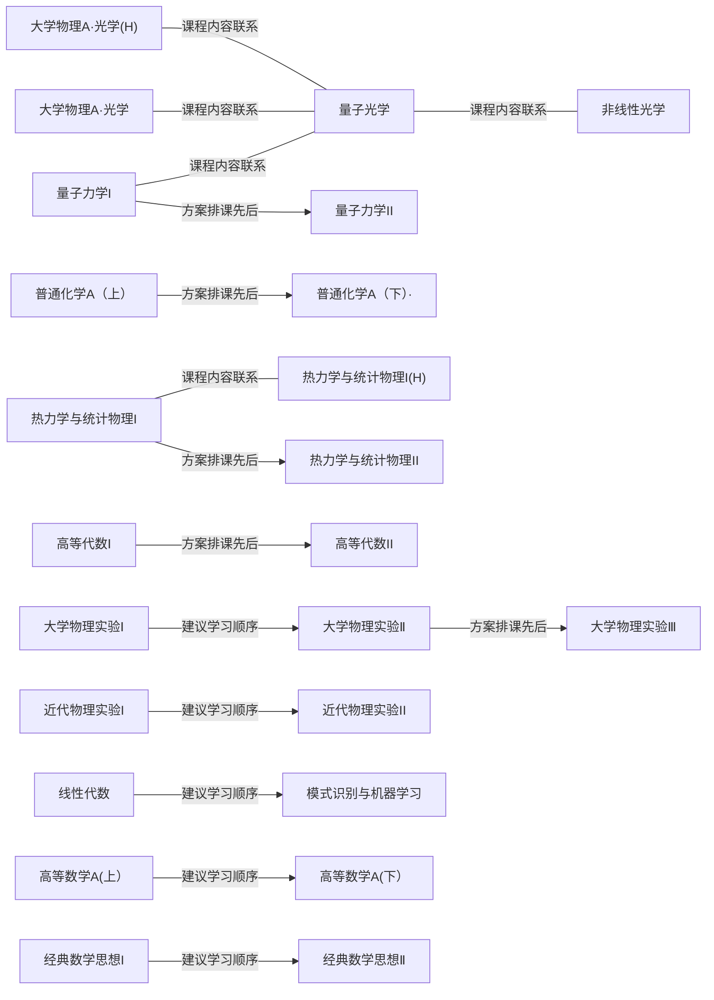

# 2024级物理学专业教学培养方案（相辉计划适用）

物理学系 · 物理学(相辉计划) · 方案 72975 · 175 个不同课程或科研条目。

[官方 Word](../originals/plan-72975.docx) · [教务详情](https://fdjwgl.fudan.edu.cn/manager/bizType/2/major-program-search/info/72975?skipAuth=1) · [方案快照](../raw/plan-72975.json.gz) · [年级目录](../README.md)

## 课程关系图

图中展示部分关系。下表保留全部已建立的课程对，来源位置使用本方案 JSON Pointer。

## 先修与内容联系

| 类型 | 起点 | 终点 | 依据 | 原表定位 |
| --- | --- | --- | --- | --- |
| 建议学习顺序 | 人工智能导论 (AIE310005) | 模式识别与机器学习 (AIE410001) | 人工智能问题与模型类别可为学习模式识别作准备。  | `/courseModules/23/planCourses/4`、`/courseModules/23/planCourses/6` |
| 建议学习顺序 | 生物化学A(上) (BIOL30002) | 生物化学A(下) (BIOL30021) | 同方案的课程题名具有连续分册或序号。  | `/courseModules/22/planCourses/7`、`/courseModules/22/planCourses/8` |
| 建议学习顺序 | 普通化学A（上） (CHEM10003) | 普通化学A（下） (CHEM10004) | 同方案的课程题名具有连续分册或序号。  | `/courseModules/9/planCourses/15`、`/courseModules/9/planCourses/16` |
| 建议学习顺序 | 分析化学AⅠ (CHEM20001) | 分析化学AⅡ (CHEM20002) | 同方案的课程题名具有连续分册或序号。  | `/courseModules/21/planCourses/3`、`/courseModules/21/planCourses/4` |
| 建议学习顺序 | 无机化学和化学分析实验Ⅰ (CHEM20003) | 无机化学和化学分析实验Ⅱ (CHEM130004) | 同方案的课程题名具有连续分册或序号。  | `/courseModules/21/planCourses/11`、`/courseModules/21/planCourses/12` |
| 建议学习顺序 | 合成化学实验(上) (CHEM20004) | 合成化学实验(下) (CHEM30003) | 同方案的课程题名具有连续分册或序号。  | `/courseModules/21/planCourses/13`、`/courseModules/21/planCourses/14` |
| 建议学习顺序 | 物理化学AⅠ (CHEM20005) | 物理化学AⅡ (CHEM20006) | 同方案的课程题名具有连续分册或序号。  | `/courseModules/21/planCourses/0`、`/courseModules/21/planCourses/1` |
| 建议学习顺序 | 物理化学AⅡ (CHEM20006) | 物理化学AⅢ (CHEM30004) | 同方案的课程题名具有连续分册或序号。  | `/courseModules/21/planCourses/1`、`/courseModules/21/planCourses/2` |
| 建议学习顺序 | 有机化学A I (CHEM20013) | 有机化学A II (CHEM20014) | 同方案的课程题名具有连续分册或序号。  | `/courseModules/21/planCourses/9`、`/courseModules/21/planCourses/10` |
| 建议学习顺序 | 物理化学实验（上） (CHEM30031) | 物理化学实验（下） (CHEM30032) | 同方案的课程题名具有连续分册或序号。  | `/courseModules/21/planCourses/5`、`/courseModules/21/planCourses/6` |
| 建议学习顺序 | 集成电路实验(上) (ICSE40008) | 集成电路实验(下) (ICSE40009) | 同方案的课程题名具有连续分册或序号。  | `/courseModules/24/planCourses/10`、`/courseModules/24/planCourses/11` |
| 建议学习顺序 | 高等代数Ⅰ (MATH10009) | 高等代数II (MATH10019) | 同方案的课程题名具有连续分册或序号。  | `/courseModules/20/planCourses/0`、`/courseModules/20/planCourses/1` |
| 建议学习顺序 | 高等数学A(上） (MATH10015) | 高等数学A(下） (MATH10016) | 同方案的课程题名具有连续分册或序号。  | `/courseModules/5/planCourses/0`、`/courseModules/5/planCourses/1` |
| 建议学习顺序 | 经典数学思想I (MATH10021) | 经典数学思想Ⅱ (MATH10022) | 同方案的课程题名具有连续分册或序号。  | `/courseModules/20/planCourses/4`、`/courseModules/20/planCourses/5` |
| 建议学习顺序 | 实变函数 (MATH20017) | 泛函分析 (MATH30004) | 测度与积分有助于理解函数空间。  | `/courseModules/20/planCourses/10`、`/courseModules/20/planCourses/11` |
| 建议学习顺序 | 大学物理实验Ⅰ (PHYS10009) | 大学物理实验Ⅱ (PHYS20015) | 同方案的课程题名具有连续分册或序号。  | `/courseModules/5/planCourses/5`、`/courseModules/6/planCourses/3` |
| 建议学习顺序 | 线性代数 (PHYS10010) | 模式识别与机器学习 (AIE410001) | 向量表示和矩阵运算支持理解分类、回归等模型。  | `/courseModules/6/planCourses/0`、`/courseModules/23/planCourses/6` |
| 建议学习顺序 | 热力学与统计物理I (PHYS20013) | 热力学与统计物理II (PHYS40011) | 同方案的课程题名具有连续分册或序号。  | `/courseModules/6/planCourses/8`、`/courseModules/9/planCourses/1` |
| 建议学习顺序 | 大学物理实验Ⅱ (PHYS20015) | 大学物理实验Ⅲ (PHYS20016) | 同方案的课程题名具有连续分册或序号。  | `/courseModules/6/planCourses/3`、`/courseModules/6/planCourses/6` |
| 建议学习顺序 | 量子力学I (PHYS30010) | 量子力学II (PHYS40012) | 同方案的课程题名具有连续分册或序号。  | `/courseModules/6/planCourses/9`、`/courseModules/9/planCourses/0` |
| 建议学习顺序 | 近代物理实验I (PHYS30013) | 近代物理实验II (PHYS40014) | 同方案的课程题名具有连续分册或序号。  | `/courseModules/6/planCourses/14`、`/courseModules/11/planCourses/2` |
| 方案排课先后 | 生物化学A(上) (BIOL30002) | 生物化学A(下) (BIOL30021) | 同方案该课程全部明确数字学期均早于后者。  | `/courseModules/22/planCourses/7`、`/courseModules/22/planCourses/8` |
| 方案排课先后 | 普通化学A（上） (CHEM10003) | 普通化学A（下） (CHEM10004) | 同方案该课程全部明确数字学期均早于后者。  | `/courseModules/9/planCourses/15`、`/courseModules/9/planCourses/16` |
| 方案排课先后 | 分析化学AⅠ (CHEM20001) | 分析化学AⅡ (CHEM20002) | 同方案该课程全部明确数字学期均早于后者。  | `/courseModules/21/planCourses/3`、`/courseModules/21/planCourses/4` |
| 方案排课先后 | 合成化学实验(上) (CHEM20004) | 合成化学实验(下) (CHEM30003) | 同方案该课程全部明确数字学期均早于后者。  | `/courseModules/21/planCourses/13`、`/courseModules/21/planCourses/14` |
| 方案排课先后 | 物理化学AⅠ (CHEM20005) | 物理化学AⅡ (CHEM20006) | 同方案该课程全部明确数字学期均早于后者。  | `/courseModules/21/planCourses/0`、`/courseModules/21/planCourses/1` |
| 方案排课先后 | 物理化学AⅡ (CHEM20006) | 物理化学AⅢ (CHEM30004) | 同方案该课程全部明确数字学期均早于后者。  | `/courseModules/21/planCourses/1`、`/courseModules/21/planCourses/2` |
| 方案排课先后 | 有机化学A I (CHEM20013) | 有机化学A II (CHEM20014) | 同方案该课程全部明确数字学期均早于后者。  | `/courseModules/21/planCourses/9`、`/courseModules/21/planCourses/10` |
| 方案排课先后 | 物理化学实验（上） (CHEM30031) | 物理化学实验（下） (CHEM30032) | 同方案该课程全部明确数字学期均早于后者。  | `/courseModules/21/planCourses/5`、`/courseModules/21/planCourses/6` |
| 方案排课先后 | 集成电路实验(上) (ICSE40008) | 集成电路实验(下) (ICSE40009) | 同方案该课程全部明确数字学期均早于后者。  | `/courseModules/24/planCourses/10`、`/courseModules/24/planCourses/11` |
| 方案排课先后 | 高等代数Ⅰ (MATH10009) | 高等代数II (MATH10019) | 同方案该课程全部明确数字学期均早于后者。  | `/courseModules/20/planCourses/0`、`/courseModules/20/planCourses/1` |
| 方案排课先后 | 热力学与统计物理I (PHYS20013) | 热力学与统计物理II (PHYS40011) | 同方案该课程全部明确数字学期均早于后者。  | `/courseModules/6/planCourses/8`、`/courseModules/9/planCourses/1` |
| 方案排课先后 | 大学物理实验Ⅱ (PHYS20015) | 大学物理实验Ⅲ (PHYS20016) | 同方案该课程全部明确数字学期均早于后者。  | `/courseModules/6/planCourses/3`、`/courseModules/6/planCourses/6` |
| 方案排课先后 | 量子力学I (PHYS30010) | 量子力学II (PHYS40012) | 同方案该课程全部明确数字学期均早于后者。  | `/courseModules/6/planCourses/9`、`/courseModules/9/planCourses/0` |
| 课程内容联系 | 人工智能导论 (AIE310005) | 人工智能安全 (AIE831001) | 本方案两门课程的题名均含“人工智能”，可据此对照这一主题。  | `/courseModules/23/planCourses/4`、`/courseModules/23/planCourses/7` |
| 课程内容联系 | 人工智能的编程基础 (AIE310006) | 人工智能安全 (AIE831001) | 本方案两门课程的题名均含“人工智能”，可据此对照这一主题。  | `/courseModules/23/planCourses/0`、`/courseModules/23/planCourses/7` |
| 课程内容联系 | 人工智能的数学基础 (AIE310009) | 模式识别与机器学习 (AIE410001) | 数学表达与学习模型的统计、优化工具可对照。  | `/courseModules/23/planCourses/2`、`/courseModules/23/planCourses/6` |
| 课程内容联系 | 人工智能的数学基础 (AIE310009) | 人工智能安全 (AIE831001) | 本方案两门课程的题名均含“人工智能”，可据此对照这一主题。  | `/courseModules/23/planCourses/2`、`/courseModules/23/planCourses/7` |
| 课程内容联系 | 模式识别与机器学习 (AIE410001) | 机器学习在物理实验中的应用 (AIS310013) | 本方案两门课程的题名均含“机器学习”，可据此对照这一主题。  | `/courseModules/23/planCourses/6`、`/courseModules/9/planCourses/14` |
| 课程内容联系 | 人工智能安全 (AIE831001) | 人工智能生物学 (AIS310017) | 本方案两门课程的题名均含“人工智能”，可据此对照这一主题。  | `/courseModules/23/planCourses/7`、`/courseModules/22/planCourses/19` |
| 课程内容联系 | 生物化学A(上) (BIOL30002) | 生物化学实验 (BIOL30003) | 本方案两门课程的题名均含“生物化学”，可据此对照这一主题。  | `/courseModules/22/planCourses/7`、`/courseModules/22/planCourses/9` |
| 课程内容联系 | 生物化学实验 (BIOL30003) | 生物化学A(下) (BIOL30021) | 本方案两门课程的题名均含“生物化学”，可据此对照这一主题。  | `/courseModules/22/planCourses/9`、`/courseModules/22/planCourses/8` |
| 课程内容联系 | 细胞生物学 (BIOL30004) | 细胞生物学实验 (BIOL30005) | 题名显示相同主题的课程与实验、实践或实习。  | `/courseModules/22/planCourses/10`、`/courseModules/22/planCourses/11` |
| 课程内容联系 | 微生物学 (BIOL30006) | 微生物学实验 (BIOL30007) | 题名显示相同主题的课程与实验、实践或实习。  | `/courseModules/22/planCourses/14`、`/courseModules/22/planCourses/15` |
| 课程内容联系 | 遗传学 (BIOL30008) | 遗传学实验 (BIOL30009) | 题名显示相同主题的课程与实验、实践或实习。  | `/courseModules/22/planCourses/16`、`/courseModules/22/planCourses/17` |
| 课程内容联系 | 生理学 (BIOL30010) | 生理学实验 (BIOL30020) | 题名显示相同主题的课程与实验、实践或实习。  | `/courseModules/22/planCourses/12`、`/courseModules/22/planCourses/13` |
| 课程内容联系 | 无机化学和化学分析实验Ⅱ (CHEM130004) | 无机化学 (CHEM30005) | 本方案两门课程的题名均含“无机化学”，可据此对照这一主题。  | `/courseModules/21/planCourses/12`、`/courseModules/21/planCourses/8` |
| 课程内容联系 | 分析化学AⅠ (CHEM20001) | 分析化学 (CHEM20015) | 本方案两门课程的题名均含“分析化学”，可据此对照这一主题。  | `/courseModules/21/planCourses/3`、`/courseModules/22/planCourses/2` |
| 课程内容联系 | 分析化学AⅡ (CHEM20002) | 分析化学 (CHEM20015) | 本方案两门课程的题名均含“分析化学”，可据此对照这一主题。  | `/courseModules/21/planCourses/4`、`/courseModules/22/planCourses/2` |
| 课程内容联系 | 无机化学和化学分析实验Ⅰ (CHEM20003) | 无机化学 (CHEM30005) | 本方案两门课程的题名均含“无机化学”，可据此对照这一主题。  | `/courseModules/21/planCourses/11`、`/courseModules/21/planCourses/8` |
| 课程内容联系 | 物理化学AⅠ (CHEM20005) | 物理化学AⅡ (CHEM20006) | 本方案两门课程的题名均含“物理化学”，可据此对照这一主题。  | `/courseModules/21/planCourses/0`、`/courseModules/21/planCourses/1` |
| 课程内容联系 | 物理化学AⅠ (CHEM20005) | 物理化学AⅢ (CHEM30004) | 本方案两门课程的题名均含“物理化学”，可据此对照这一主题。  | `/courseModules/21/planCourses/0`、`/courseModules/21/planCourses/2` |
| 课程内容联系 | 物理化学AⅠ (CHEM20005) | 物理化学实验（上） (CHEM30031) | 本方案两门课程的题名均含“物理化学”，可据此对照这一主题。  | `/courseModules/21/planCourses/0`、`/courseModules/21/planCourses/5` |
| 课程内容联系 | 物理化学AⅠ (CHEM20005) | 物理化学实验（下） (CHEM30032) | 本方案两门课程的题名均含“物理化学”，可据此对照这一主题。  | `/courseModules/21/planCourses/0`、`/courseModules/21/planCourses/6` |
| 课程内容联系 | 有机化学 (CHEM20011) | 有机化学实验 (CHEM20012) | 题名显示相同主题的课程与实验、实践或实习。  | `/courseModules/22/planCourses/0`、`/courseModules/22/planCourses/1` |
| 课程内容联系 | 有机化学 (CHEM20011) | 有机化学A I (CHEM20013) | 本方案两门课程的题名均含“有机化学”，可据此对照这一主题。  | `/courseModules/22/planCourses/0`、`/courseModules/21/planCourses/9` |
| 课程内容联系 | 有机化学 (CHEM20011) | 有机化学A II (CHEM20014) | 本方案两门课程的题名均含“有机化学”，可据此对照这一主题。  | `/courseModules/22/planCourses/0`、`/courseModules/21/planCourses/10` |
| 课程内容联系 | 分析化学 (CHEM20015) | 分析化学实验 (CHEM20016) | 题名显示相同主题的课程与实验、实践或实习。  | `/courseModules/22/planCourses/2`、`/courseModules/22/planCourses/3` |
| 课程内容联系 | 半导体物理 (ICSE20007) | 半导体器件原理 (ICSE30020) | 本方案两门课程的题名均含“半导体”，可据此对照这一主题。  | `/courseModules/24/planCourses/3`、`/courseModules/24/planCourses/5` |
| 课程内容联系 | 半导体物理 (ICSE20007) | 半导体物理A (PHYS50006) | 本方案两门课程的题名均含“半导体”，可据此对照这一主题。  | `/courseModules/24/planCourses/3`、`/courseModules/9/planCourses/6` |
| 课程内容联系 | 专用集成电路设计方法 (ICSE30007) | 集成电路工艺原理 (ICSE30010) | 本方案两门课程的题名均含“集成电路”，可据此对照这一主题。  | `/courseModules/24/planCourses/9`、`/courseModules/24/planCourses/7` |
| 课程内容联系 | 集成电路工艺原理 (ICSE30010) | 数字集成电路设计原理 (ICSE30021) | 本方案两门课程的题名均含“集成电路”，可据此对照这一主题。  | `/courseModules/24/planCourses/7`、`/courseModules/24/planCourses/6` |
| 课程内容联系 | 集成电路工艺原理 (ICSE30010) | 集成电路实验(上) (ICSE40008) | 本方案两门课程的题名均含“集成电路”，可据此对照这一主题。  | `/courseModules/24/planCourses/7`、`/courseModules/24/planCourses/10` |
| 课程内容联系 | 集成电路工艺原理 (ICSE30010) | 集成电路实验(下) (ICSE40009) | 本方案两门课程的题名均含“集成电路”，可据此对照这一主题。  | `/courseModules/24/planCourses/7`、`/courseModules/24/planCourses/11` |
| 课程内容联系 | 线性代数（理工类） (MATH10014) | 线性代数 (PHYS10010) | 本方案两门课程的题名均含“线性代数”，可据此对照这一主题。  | `/courseModules/20/planCourses/18`、`/courseModules/6/planCourses/0` |
| 课程内容联系 | 大学物理A：电磁学 (PHYS10008) | 大学物理A：电磁学(H) (PHYS10008h) | 本方案两门课程的题名均含“电磁”，可据此对照这一主题。  | `/courseModules/5/planCourses/4`、`/courseModules/27/planCourses/11` |
| 课程内容联系 | 大学物理A：光学 (PHYS20010) | 量子光学 (PHYS60023) | 本方案两门课程的题名均含“光学”，可据此对照这一主题。  | `/courseModules/6/planCourses/4`、`/courseModules/16/planCourses/1` |
| 课程内容联系 | 大学物理A：光学(H) (PHYS20010h) | 量子光学 (PHYS60023) | 本方案两门课程的题名均含“光学”，可据此对照这一主题。  | `/courseModules/6/planCourses/17`、`/courseModules/16/planCourses/1` |
| 课程内容联系 | 热力学与统计物理I (PHYS20013) | 热力学与统计物理I(H) (PHYS20013h) | 本方案两门课程的题名均含“统计物理”，可据此对照这一主题。  | `/courseModules/6/planCourses/8`、`/courseModules/6/planCourses/20` |
| 课程内容联系 | 热力学与统计物理I (PHYS20013) | 热力学与统计物理II (PHYS40011) | 本方案两门课程的题名均含“统计物理”，可据此对照这一主题。  | `/courseModules/6/planCourses/8`、`/courseModules/9/planCourses/1` |
| 课程内容联系 | 量子力学I (PHYS30010) | 量子光学 (PHYS60023) | 本方案两门课程的题名均含“量子”，可据此对照这一主题。  | `/courseModules/6/planCourses/9`、`/courseModules/16/planCourses/1` |
| 课程内容联系 | 核物理 (PHYS30017) | 粒子物理，核物理，宇宙学前沿 (PHYS40013) | 本方案两门课程的题名均含“核物理”，可据此对照这一主题。  | `/courseModules/13/planCourses/0`、`/courseModules/13/planCourses/1` |
| 课程内容联系 | 量子力学II (PHYS40012) | 量子光学 (PHYS60023) | 本方案两门课程的题名均含“量子”，可据此对照这一主题。  | `/courseModules/9/planCourses/0`、`/courseModules/16/planCourses/1` |
| 课程内容联系 | 量子场论 (PHYS60022) | 量子光学 (PHYS60023) | 本方案两门课程的题名均含“量子”，可据此对照这一主题。  | `/courseModules/9/planCourses/7`、`/courseModules/16/planCourses/1` |
| 课程内容联系 | 量子光学 (PHYS60023) | 量子多体理论 (PHYS60028) | 本方案两门课程的题名均含“量子”，可据此对照这一主题。  | `/courseModules/16/planCourses/1`、`/courseModules/12/planCourses/4` |
| 课程内容联系 | 量子光学 (PHYS60023) | 非线性光学 (PHYS70018) | 本方案两门课程的题名均含“光学”，可据此对照这一主题。  | `/courseModules/16/planCourses/1`、`/courseModules/9/planCourses/10` |

本次未从可定位的明确表述中确认课程对课程预修。学期安排、系列分册与编辑建议均保留各自的依据。

## 按原方案模块阅读

同一模块展示原表中的课程归属。模块内课程之间的先后仍须逐项查阅。

- **模块1**　数字逻辑基础、设计与制造、现代物理讲座、自学物理实验A、近代物理实验II、设计性研究性物理实验、物理演示实验拓展（原表模块 11）
- **理论物理**　广义相对论、量子计算与量子信息、量子多体理论、规范场理论、共形场论（原表模块 12）
- **粒子、天体物理与宇宙学**　核物理、粒子物理，核物理，宇宙学前沿、宇宙学导论、天体物理学导论、粒子物理（原表模块 13）
- **凝聚态物理**　薄膜物理与技术、真空技术、纳米物理学、铁磁学、实验物理方法和技术、低温和超导物理、固体电子结构、散射物理（原表模块 14）
- **计算物理**　物理CAI课件设计I、计算物理模拟实验、计算物理A、电子结构理论与计算（原表模块 15）
- **光物理**　激光物理、量子光学、生物医学光子学（原表模块 16）
- **复杂体系物理**　软凝聚态物理导论、经济物理、物理生物学（原表模块 17）
- **医学物理**　医学物理学、医学物理实验、医学影像物理基础（原表模块 18）
- **数学组**　数据科学的逼近论基础、新型算法、高等代数Ⅰ、线性代数（理工类）、高等数学A(上）、高等数学A(下）、高等代数II、解析几何、经典数学思想I、经典数学思想Ⅱ、数学分析I（英才班）、数学分析II（英才班）、常微分方程、抽象代数、复变函数、实变函数、拓扑学、几何拓扑选讲等19项（原表模块 20）
- **化学组**　人工智能在化学中的应用、人工智能化学计算模拟、无机化学和化学分析实验Ⅱ、分析化学AⅠ、分析化学AⅡ、无机化学和化学分析实验Ⅰ、合成化学实验(上)、物理化学AⅠ、物理化学AⅡ、有机化学A I、有机化学A II、仪器分析实验、合成化学实验(下)、物理化学AⅢ、无机化学、物理化学实验（上）、物理化学实验（下）、高分子化学B（原表模块 21）
- **生物科学组**　人工智能生物学、人工智能结构生物学、AI在生物分子结构中的研究及应用、普通生物学实验-动物、普通生物学实验-植物、生物化学A(上)、生物化学实验、细胞生物学、细胞生物学实验、微生物学、微生物学实验、遗传学、遗传学实验、生理学、分子生物学、普通生物学、生理学实验、生物化学A(下)等22项（原表模块 22）
- **人工智能组**　计算机系统基础、计算机视觉、人工智能导论、人工智能的编程基础、数据结构、人工智能的软件基础、人工智能的数学基础、模式识别与机器学习、自然语言处理与大语言模型、人工智能前沿探索实践、人工智能安全（原表模块 23）
- **微电子组**　模拟电子线路、数字逻辑基础、信号与系统概论、半导体物理、嵌入式处理器与芯片系统设计、专用集成电路设计方法、集成电路工艺原理、半导体器件原理、数字集成电路设计原理、模拟集成电路设计原理、集成电路实验(上)、集成电路实验(下)（原表模块 24）
- **物理荣誉课程**　大学物理A：力学(H)、大学物理A：热学(H)、大学物理A：电磁学(H)、经典力学(H)、数学物理方法A(H)、大学物理A：光学(H)、大学物理A：原子物理(H)、热力学与统计物理I(H)、量子力学I(H)、固体物理(H)、近代物理实验I（H）、电动力学(H)（原表模块 27）

## 课程表

同一课程在不同模块分别出现时，按原表逐行列出。季节字段保留原值。

| 课程 | 代码 | 学分 | 学期 | 模块 |
| --- | --- | ---: | --- | --- |
| 高等数学A(上） | MATH10015 | 5.0 | AUTUMN | 培养方案 / 专业培养课程 / 大类基础课程 |
| 高等数学A(下） | MATH10016 | 5.0 | SPRING | 培养方案 / 专业培养课程 / 大类基础课程 |
| 大学物理A：力学 | PHYS10006 | 4.0 | 第1学期 | 培养方案 / 专业培养课程 / 大类基础课程 |
| 大学物理A：热学 | PHYS10007 | 2.0 | 第2学期 | 培养方案 / 专业培养课程 / 大类基础课程 |
| 大学物理A：电磁学 | PHYS10008 | 4.0 | 第2学期 | 培养方案 / 专业培养课程 / 大类基础课程 |
| 大学物理实验Ⅰ | PHYS10009 | 2.0 | AUTUMN | 培养方案 / 专业培养课程 / 大类基础课程 |
| 线性代数 | PHYS10010 | 3.0 | 第1学期 | 培养方案 / 专业培养课程 / 专业核心教育课程 |
| 概率论与数理统计 | PHYS20014 | 2.0 | 第3学期 | 培养方案 / 专业培养课程 / 专业核心教育课程 |
| 经典力学 | PHYS20003 | 3.0 | 第3学期 | 培养方案 / 专业培养课程 / 专业核心教育课程 |
| 大学物理实验Ⅱ | PHYS20015 | 2.0 | 第3学期 | 培养方案 / 专业培养课程 / 专业核心教育课程 |
| 大学物理A：光学 | PHYS20010 | 3.0 | 第3学期 | 培养方案 / 专业培养课程 / 专业核心教育课程 |
| 大学物理A：原子物理 | PHYS20011 | 3.0 | 第4学期 | 培养方案 / 专业培养课程 / 专业核心教育课程 |
| 大学物理实验Ⅲ | PHYS20016 | 2.0 | 第4学期 | 培养方案 / 专业培养课程 / 专业核心教育课程 |
| 数学物理方法A | PHYS20006 | 4.0 | 第4学期 | 培养方案 / 专业培养课程 / 专业核心教育课程 |
| 热力学与统计物理I | PHYS20013 | 4.0 | 第4学期 | 培养方案 / 专业培养课程 / 专业核心教育课程 |
| 量子力学I | PHYS30010 | 4.0 | 第5学期 | 培养方案 / 专业培养课程 / 专业核心教育课程 |
| 电动力学 | PHYS30016 | 4.0 | 第5学期 | 培养方案 / 专业培养课程 / 专业核心教育课程 |
| 计算物理基础 | PHYS20009 | 3.0 | 第5学期 | 培养方案 / 专业培养课程 / 专业核心教育课程 |
| 科研实践 | PHYS30014 | 2.0 | 第5学期 | 培养方案 / 专业培养课程 / 专业核心教育课程 |
| 固体物理 | PHYS30011 | 4.0 | 第6学期 | 培养方案 / 专业培养课程 / 专业核心教育课程 |
| 近代物理实验I | PHYS30013 | 4.0 | 第6学期 | 培养方案 / 专业培养课程 / 专业核心教育课程 |
| 毕业论文 | PHYS40006 | 6.0 | 第8学期 | 培养方案 / 专业培养课程 / 专业核心教育课程 |
| 经典力学(H) | PHYS20003h | 4.0 | 第3学期 | 培养方案 / 专业培养课程 / 专业核心教育课程 |
| 大学物理A：光学(H) | PHYS20010h | 4.0 | 第3学期 | 培养方案 / 专业培养课程 / 专业核心教育课程 |
| 大学物理A：原子物理(H) | PHYS20011h | 4.0 | 第4学期 | 培养方案 / 专业培养课程 / 专业核心教育课程 |
| 数学物理方法A(H) | PHYS20006h | 5.0 | 第4学期 | 培养方案 / 专业培养课程 / 专业核心教育课程 |
| 热力学与统计物理I(H) | PHYS20013h | 5.0 | 第4学期 | 培养方案 / 专业培养课程 / 专业核心教育课程 |
| 量子力学I(H) | PHYS30010h | 5.0 | 第5学期 | 培养方案 / 专业培养课程 / 专业核心教育课程 |
| 电动力学(H) | PHYS30016h | 5.0 | 第5学期 | 培养方案 / 专业培养课程 / 专业核心教育课程 |
| 固体物理(H) | PHYS30011h | 5.0 | 第6学期 | 培养方案 / 专业培养课程 / 专业核心教育课程 |
| 近代物理实验I（H） | PHYS30013h | 5.0 | 第6学期 | 培养方案 / 专业培养课程 / 专业核心教育课程 |
| 量子力学II | PHYS40012 | 3.0 | 第6学期 | 培养方案 / 专业进阶模块I |
| 热力学与统计物理II | PHYS40011 | 3.0 | 第7学期 | 培养方案 / 专业进阶模块I |
| 模拟电子学基础 | EST10002 | 4.0 | SPRING | 培养方案 / 专业进阶模块I |
| 群论 | PHYS50007 | 3.0 | 第7学期 | 培养方案 / 专业进阶模块I |
| 固体理论 | PHYS60025 | 3.0 | SPRING、AUTUMN | 培养方案 / 专业进阶模块I |
| 表面物理 | PHYS60016 | 3.0 | 第7学期 | 培养方案 / 专业进阶模块I |
| 半导体物理A | PHYS50006 | 3.0 | 第6学期 | 培养方案 / 专业进阶模块I |
| 量子场论 | PHYS60022 | 3.0 | 第8学期 | 培养方案 / 专业进阶模块I |
| 微分几何初步（物理学） | PHYS130115 | 3.0 | SPRING、AUTUMN | 培养方案 / 专业进阶模块I |
| 高等电动力学 | PHYS50008 | 3.0 | SPRING、AUTUMN | 培养方案 / 专业进阶模块I |
| 非线性光学 | PHYS70018 | 3.0 | SPRING | 培养方案 / 专业进阶模块I |
| 基础物理建模 | PHYS20012 | 2.0 | SPRING、AUTUMN | 培养方案 / 专业进阶模块I |
| 科学写作 | PHYS40005 | 2.0 | SPRING、AUTUMN | 培养方案 / 专业进阶模块I |
| AI物理 | AIS531004 | 3.0 | SPRING、AUTUMN | 培养方案 / 专业进阶模块I |
| 机器学习在物理实验中的应用 | AIS310013 | 3.0 | SPRING、AUTUMN | 培养方案 / 专业进阶模块I |
| 普通化学A（上） | CHEM10003 | 2.0 | 第1学期 | 培养方案 / 专业进阶模块I |
| 普通化学A（下） | CHEM10004 | 2.0 | 第2学期 | 培养方案 / 专业进阶模块I |
| 普通化学实验I | CHEM10005 | 1.0 | 第1学期 | 培养方案 / 专业进阶模块I |
| 现代生物科学导论A | BIOL10001 | 3.0 | SPRING、AUTUMN | 培养方案 / 专业进阶模块I |
| 现代生物科学实验 | BIOL10003 | 1.0 | 第1学期 | 培养方案 / 专业进阶模块I |
| 物理前沿导论 | PHYS10011 | 2.0 | 第2学期 | 培养方案 / 专业进阶模块I |
| 计算物理B | PHYS50002 | 2.0 |  | 培养方案 / 专业进阶模块II |
| 数字逻辑基础 | EST20009 | 4.0 | AUTUMN | 培养方案 / 专业进阶模块II / 模块1 |
| 设计与制造 | GEEC30008 | 2.0 | SPRING、AUTUMN | 培养方案 / 专业进阶模块II / 模块1 |
| 近代物理实验II | PHYS40014 | 3.0 | SPRING、AUTUMN | 培养方案 / 专业进阶模块II / 模块1 |
| 设计性研究性物理实验 | PHYS40015 | 3.0 | 第5学期、第6学期 | 培养方案 / 专业进阶模块II / 模块1 |
| 物理演示实验拓展 | PHYS40016 | 2.0 | SPRING、AUTUMN | 培养方案 / 专业进阶模块II / 模块1 |
| 现代物理讲座 | PHYS40007 | 2.0 | 第4学期 | 培养方案 / 专业进阶模块II / 模块1 |
| 自学物理实验A | PHYS40010 | 2.0 | 第3学期 | 培养方案 / 专业进阶模块II / 模块1 |
| 广义相对论 | PHYS60019 | 3.0 | SPRING | 培养方案 / 专业进阶模块II / 理论物理 |
| 规范场理论 | PHYS70012 | 3.0 | SPRING、AUTUMN | 培养方案 / 专业进阶模块II / 理论物理 |
| 共形场论 | PHYS70013 | 3.0 | SPRING、AUTUMN | 培养方案 / 专业进阶模块II / 理论物理 |
| 量子计算与量子信息 | PHYS60021 | 3.0 | 第7学期 | 培养方案 / 专业进阶模块II / 理论物理 |
| 量子多体理论 | PHYS60028 | 3.0 | SPRING、SUMMER | 培养方案 / 专业进阶模块II / 理论物理 |
| 核物理 | PHYS30017 | 3.0 | 第4学期 | 培养方案 / 专业进阶模块II / 粒子、天体物理与宇宙学 |
| 粒子物理，核物理，宇宙学前沿 | PHYS40013 | 3.0 | SPRING、AUTUMN | 培养方案 / 专业进阶模块II / 粒子、天体物理与宇宙学 |
| 宇宙学导论 | PHYS50009 | 3.0 | SPRING、AUTUMN | 培养方案 / 专业进阶模块II / 粒子、天体物理与宇宙学 |
| 粒子物理 | PHYS60017 | 3.0 | SPRING | 培养方案 / 专业进阶模块II / 粒子、天体物理与宇宙学 |
| 天体物理学导论 | PHYS50010 | 2.0 | SPRING、AUTUMN | 培养方案 / 专业进阶模块II / 粒子、天体物理与宇宙学 |
| 低温和超导物理 | PHYS70008 | 3.0 | 第7学期 | 培养方案 / 专业进阶模块II / 凝聚态物理 |
| 铁磁学 | PHYS60018 | 2.0 | SPRING | 培养方案 / 专业进阶模块II / 凝聚态物理 |
| 纳米物理学 | PHYS130091 | 2.0 | SPRING、AUTUMN | 培养方案 / 专业进阶模块II / 凝聚态物理 |
| 真空技术 | NST50007 | 2.0 | 第5学期 | 培养方案 / 专业进阶模块II / 凝聚态物理 |
| 固体电子结构 | PHYS70011 | 2.0 | SPRING、AUTUMN | 培养方案 / 专业进阶模块II / 凝聚态物理 |
| 薄膜物理与技术 | NST50005 | 2.0 | AUTUMN | 培养方案 / 专业进阶模块II / 凝聚态物理 |
| 实验物理方法和技术 | PHYS60026 | 3.0 | SPRING、AUTUMN | 培养方案 / 专业进阶模块II / 凝聚态物理 |
| 散射物理 | PHYS70015 | 2.0 | SPRING、AUTUMN | 培养方案 / 专业进阶模块II / 凝聚态物理 |
| 计算物理A | PHYS60027 | 2.0 | SPRING、AUTUMN | 培养方案 / 专业进阶模块II / 计算物理 |
| 物理CAI课件设计I | PHYS40009 | 2.0 | SPRING、AUTUMN | 培养方案 / 专业进阶模块II / 计算物理 |
| 电子结构理论与计算 | PHYS70017 | 3.0 | SPRING、AUTUMN | 培养方案 / 专业进阶模块II / 计算物理 |
| 计算物理模拟实验 | PHYS40019 | 3.0 | SPRING、AUTUMN | 培养方案 / 专业进阶模块II / 计算物理 |
| 激光物理 | PHYS40008 | 3.0 | 第6学期 | 培养方案 / 专业进阶模块II / 光物理 |
| 量子光学 | PHYS60023 | 3.0 | SPRING、AUTUMN | 培养方案 / 专业进阶模块II / 光物理 |
| 生物医学光子学 | PHYS70016 | 2.0 | SPRING、AUTUMN | 培养方案 / 专业进阶模块II / 光物理 |
| 经济物理 | PHYS70009 | 2.0 | SPRING、AUTUMN | 培养方案 / 专业进阶模块II / 复杂体系物理 |
| 物理生物学 | PHYS70010 | 2.0 | SPRING、AUTUMN | 培养方案 / 专业进阶模块II / 复杂体系物理 |
| 软凝聚态物理导论 | PHYS60024 | 3.0 | AUTUMN | 培养方案 / 专业进阶模块II / 复杂体系物理 |
| 医学物理实验 | PHYS40017 | 2.0 | SPRING、AUTUMN | 培养方案 / 专业进阶模块II / 医学物理 |
| 医学影像物理基础 | PHYS40018 | 2.0 | SPRING、AUTUMN | 培养方案 / 专业进阶模块II / 医学物理 |
| 医学物理学 | GEEC20063 | 2.0 | SPRING、AUTUMN | 培养方案 / 专业进阶模块II / 医学物理 |
| 高等代数Ⅰ | MATH10009 | 5.0 | 第1学期 | 培养方案 / 理工核心课程池 / 数学组 |
| 高等代数II | MATH10019 | 5.0 | 第2学期 | 培养方案 / 理工核心课程池 / 数学组 |
| 数学分析II（英才班） | MATH130155 | 6.0 | 第2学期 | 培养方案 / 理工核心课程池 / 数学组 |
| 数学分析I（英才班） | MATH130154 | 6.0 | 第1学期 | 培养方案 / 理工核心课程池 / 数学组 |
| 经典数学思想I | MATH10021 | 3.0 | 第3学期 | 培养方案 / 理工核心课程池 / 数学组 |
| 经典数学思想Ⅱ | MATH10022 | 3.0 | 第3学期 | 培养方案 / 理工核心课程池 / 数学组 |
| 几何拓扑选讲 | MATH20019 | 4.0 | 第4学期 | 培养方案 / 理工核心课程池 / 数学组 |
| 抽象代数 | MATH20015 | 4.0 | 第4学期 | 培养方案 / 理工核心课程池 / 数学组 |
| 常微分方程 | MATH20014 | 4.0 | 第4学期 | 培养方案 / 理工核心课程池 / 数学组 |
| 复变函数 | MATH20016 | 4.0 | 第4学期 | 培养方案 / 理工核心课程池 / 数学组 |
| 实变函数 | MATH20017 | 4.0 | 第4学期 | 培养方案 / 理工核心课程池 / 数学组 |
| 泛函分析 | MATH30004 | 3.0 | 第4学期 | 培养方案 / 理工核心课程池 / 数学组 |
| 拓扑学 | MATH20018 | 4.0 | 第4学期 | 培养方案 / 理工核心课程池 / 数学组 |
| 解析几何 | MATH10020 | 4.0 | 第4学期 | 培养方案 / 理工核心课程池 / 数学组 |
| 新型算法 | AIS631004 | 3.0 | 第3学期 | 培养方案 / 理工核心课程池 / 数学组 |
| 数据科学的逼近论基础 | AIS631003 | 3.0 | 第3学期 | 培养方案 / 理工核心课程池 / 数学组 |
| 高等数学A(上） | MATH10015 | 5.0 | 第1学期 | 培养方案 / 理工核心课程池 / 数学组 |
| 高等数学A(下） | MATH10016 | 5.0 | 第2学期 | 培养方案 / 理工核心课程池 / 数学组 |
| 线性代数（理工类） | MATH10014 | 3.0 | AUTUMN | 培养方案 / 理工核心课程池 / 数学组 |
| 物理化学AⅠ | CHEM20005 | 3.0 | 第3学期 | 培养方案 / 理工核心课程池 / 化学组 |
| 物理化学AⅡ | CHEM20006 | 3.0 | 第4学期 | 培养方案 / 理工核心课程池 / 化学组 |
| 物理化学AⅢ | CHEM30004 | 3.0 | 第5学期 | 培养方案 / 理工核心课程池 / 化学组 |
| 分析化学AⅠ | CHEM20001 | 2.0 | 第3学期 | 培养方案 / 理工核心课程池 / 化学组 |
| 分析化学AⅡ | CHEM20002 | 2.0 | 第4学期 | 培养方案 / 理工核心课程池 / 化学组 |
| 物理化学实验（上） | CHEM30031 | 2.0 | 第5学期 | 培养方案 / 理工核心课程池 / 化学组 |
| 物理化学实验（下） | CHEM30032 | 2.0 | 第6学期 | 培养方案 / 理工核心课程池 / 化学组 |
| 仪器分析实验 | CHEM20020 | 2.0 | 第4学期 | 培养方案 / 理工核心课程池 / 化学组 |
| 无机化学 | CHEM30005 | 3.0 | 第5学期、第6学期 | 培养方案 / 理工核心课程池 / 化学组 |
| 有机化学A I | CHEM20013 | 4.0 | 第3学期 | 培养方案 / 理工核心课程池 / 化学组 |
| 有机化学A II | CHEM20014 | 2.0 | 第4学期 | 培养方案 / 理工核心课程池 / 化学组 |
| 无机化学和化学分析实验Ⅰ | CHEM20003 | 2.0 | 第3学期 | 培养方案 / 理工核心课程池 / 化学组 |
| 无机化学和化学分析实验Ⅱ | CHEM130004 | 2.0 | 第3学期 | 培养方案 / 理工核心课程池 / 化学组 |
| 合成化学实验(上) | CHEM20004 | 2.0 | 第4学期 | 培养方案 / 理工核心课程池 / 化学组 |
| 合成化学实验(下) | CHEM30003 | 2.0 | 第5学期 | 培养方案 / 理工核心课程池 / 化学组 |
| 高分子化学B | MASE30007 | 2.0 | 第5学期 | 培养方案 / 理工核心课程池 / 化学组 |
| 人工智能化学计算模拟 | AIS531005 | 2.0 | SPRING | 培养方案 / 理工核心课程池 / 化学组 |
| 人工智能在化学中的应用 | AIS310014 | 2.0 | AUTUMN | 培养方案 / 理工核心课程池 / 化学组 |
| 有机化学 | CHEM20011 | 4.0 | 第3学期 | 培养方案 / 理工核心课程池 / 生物科学组 |
| 有机化学实验 | CHEM20012 | 2.0 | 第3学期 | 培养方案 / 理工核心课程池 / 生物科学组 |
| 分析化学 | CHEM20015 | 2.0 | 第3学期 | 培养方案 / 理工核心课程池 / 生物科学组 |
| 分析化学实验 | CHEM20016 | 2.0 | 第3学期 | 培养方案 / 理工核心课程池 / 生物科学组 |
| 普通生物学 | BIOL30019 | 3.0 | 第3学期 | 培养方案 / 理工核心课程池 / 生物科学组 |
| 普通生物学实验-动物 | BIOL130185 | 1.5 | 第3学期 | 培养方案 / 理工核心课程池 / 生物科学组 |
| 普通生物学实验-植物 | BIOL130186 | 1.5 | 第3学期 | 培养方案 / 理工核心课程池 / 生物科学组 |
| 生物化学A(上) | BIOL30002 | 3.0 | 第4学期 | 培养方案 / 理工核心课程池 / 生物科学组 |
| 生物化学A(下) | BIOL30021 | 2.0 | 第5学期 | 培养方案 / 理工核心课程池 / 生物科学组 |
| 生物化学实验 | BIOL30003 | 1.5 | 第4学期 | 培养方案 / 理工核心课程池 / 生物科学组 |
| 细胞生物学 | BIOL30004 | 3.0 | 第4学期 | 培养方案 / 理工核心课程池 / 生物科学组 |
| 细胞生物学实验 | BIOL30005 | 1.5 | 第4学期 | 培养方案 / 理工核心课程池 / 生物科学组 |
| 生理学 | BIOL30010 | 3.0 | 第4学期 | 培养方案 / 理工核心课程池 / 生物科学组 |
| 生理学实验 | BIOL30020 | 1.5 | 第4学期 | 培养方案 / 理工核心课程池 / 生物科学组 |
| 微生物学 | BIOL30006 | 3.0 | 第5学期 | 培养方案 / 理工核心课程池 / 生物科学组 |
| 微生物学实验 | BIOL30007 | 1.5 | 第5学期 | 培养方案 / 理工核心课程池 / 生物科学组 |
| 遗传学 | BIOL30008 | 3.0 | 第5学期 | 培养方案 / 理工核心课程池 / 生物科学组 |
| 遗传学实验 | BIOL30009 | 1.5 | 第5学期 | 培养方案 / 理工核心课程池 / 生物科学组 |
| 分子生物学 | BIOL30014 | 2.0 | 第5学期 | 培养方案 / 理工核心课程池 / 生物科学组 |
| 人工智能生物学 | AIS310017 | 2.0 | AUTUMN | 培养方案 / 理工核心课程池 / 生物科学组 |
| 人工智能结构生物学 | AIS410006 | 2.0 | AUTUMN | 培养方案 / 理工核心课程池 / 生物科学组 |
| AI在生物分子结构中的研究及应用 | AIS410014 | 2.0 | AUTUMN | 培养方案 / 理工核心课程池 / 生物科学组 |
| 人工智能的编程基础 | AIE310006 | 2.0 | AUTUMN | 培养方案 / 理工核心课程池 / 人工智能组 |
| 数据结构 | AIE310007 | 4.0 | AUTUMN | 培养方案 / 理工核心课程池 / 人工智能组 |
| 人工智能的数学基础 | AIE310009 | 3.0 | AUTUMN | 培养方案 / 理工核心课程池 / 人工智能组 |
| 计算机系统基础 | AIE210006 | 3.0 | AUTUMN | 培养方案 / 理工核心课程池 / 人工智能组 |
| 人工智能导论 | AIE310005 | 3.0 | AUTUMN | 培养方案 / 理工核心课程池 / 人工智能组 |
| 人工智能的软件基础 | AIE310008 | 3.0 | AUTUMN | 培养方案 / 理工核心课程池 / 人工智能组 |
| 模式识别与机器学习 | AIE410001 | 3.0 | AUTUMN | 培养方案 / 理工核心课程池 / 人工智能组 |
| 人工智能安全 | AIE831001 | 3.0 | AUTUMN | 培养方案 / 理工核心课程池 / 人工智能组 |
| 自然语言处理与大语言模型 | AIE410002 | 3.0 | AUTUMN | 培养方案 / 理工核心课程池 / 人工智能组 |
| 计算机视觉 | AIE310004 | 3.0 | AUTUMN | 培养方案 / 理工核心课程池 / 人工智能组 |
| 人工智能前沿探索实践 | AIE531001 | 3.0 | AUTUMN | 培养方案 / 理工核心课程池 / 人工智能组 |
| 模拟电子线路 | ICSE20004 | 3.0 | 第3学期 | 培养方案 / 理工核心课程池 / 微电子组 |
| 数字逻辑基础 | ICSE20005 | 4.0 | 第3学期 | 培养方案 / 理工核心课程池 / 微电子组 |
| 信号与系统概论 | ICSE20006 | 3.0 | 第4学期 | 培养方案 / 理工核心课程池 / 微电子组 |
| 半导体物理 | ICSE20007 | 4.0 | 第4学期 | 培养方案 / 理工核心课程池 / 微电子组 |
| 嵌入式处理器与芯片系统设计 | ICSE20008 | 5.0 | 第4学期 | 培养方案 / 理工核心课程池 / 微电子组 |
| 半导体器件原理 | ICSE30020 | 4.0 | 第5学期 | 培养方案 / 理工核心课程池 / 微电子组 |
| 数字集成电路设计原理 | ICSE30021 | 3.0 | 第5学期 | 培养方案 / 理工核心课程池 / 微电子组 |
| 集成电路工艺原理 | ICSE30010 | 3.0 | 第6学期 | 培养方案 / 理工核心课程池 / 微电子组 |
| 模拟集成电路设计原理 | ICSE30022 | 3.0 | 第6学期 | 培养方案 / 理工核心课程池 / 微电子组 |
| 专用集成电路设计方法 | ICSE30007 | 2.0 | 第6学期 | 培养方案 / 理工核心课程池 / 微电子组 |
| 集成电路实验(上) | ICSE40008 | 3.0 | 第7学期 | 培养方案 / 理工核心课程池 / 微电子组 |
| 集成电路实验(下) | ICSE40009 | 2.0 | 第8学期 | 培养方案 / 理工核心课程池 / 微电子组 |
| 复杂科学前沿与创新 | PHYS30024 | 3.0 | SPRING | 培养方案 / 理工核心课程池 / 其他 |
| 经典力学(H) | PHYS20003h | 4.0 | 第3学期 | 培养方案 / 物理荣誉课程 |
| 大学物理A：光学(H) | PHYS20010h | 4.0 | 第3学期 | 培养方案 / 物理荣誉课程 |
| 大学物理A：原子物理(H) | PHYS20011h | 4.0 | 第4学期 | 培养方案 / 物理荣誉课程 |
| 数学物理方法A(H) | PHYS20006h | 5.0 | 第4学期 | 培养方案 / 物理荣誉课程 |
| 热力学与统计物理I(H) | PHYS20013h | 5.0 | 第4学期 | 培养方案 / 物理荣誉课程 |
| 量子力学I(H) | PHYS30010h | 5.0 | 第5学期 | 培养方案 / 物理荣誉课程 |
| 电动力学(H) | PHYS30016h | 5.0 | 第5学期 | 培养方案 / 物理荣誉课程 |
| 固体物理(H) | PHYS30011h | 5.0 | 第6学期 | 培养方案 / 物理荣誉课程 |
| 近代物理实验I（H） | PHYS30013h | 5.0 | 第6学期 | 培养方案 / 物理荣誉课程 |
| 大学物理A：力学(H) | PHYS10006h | 5.0 | 第1学期 | 培养方案 / 物理荣誉课程 |
| 大学物理A：热学(H) | PHYS10007h | 3.0 | 第2学期 | 培养方案 / 物理荣誉课程 |
| 大学物理A：电磁学(H) | PHYS10008h | 5.0 | 第2学期 | 培养方案 / 物理荣誉课程 |
