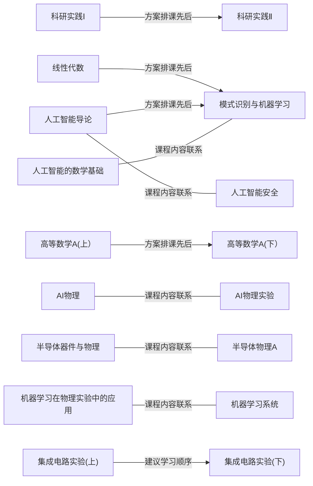

# 2025级 物理学-人工智能双学士本博融通教学培养方案（量子与智能英才班适用）

物理学系 · 物理学-人工智能(双学士学位项目) · 方案 97212 · 78 个不同课程或科研条目。

[官方 Word](../originals/plan-97212.docx) · [教务详情](https://fdjwgl.fudan.edu.cn/manager/bizType/2/major-program-search/info/97212?skipAuth=1) · [方案快照](../raw/plan-97212.json.gz) · [年级目录](../README.md)

## 课程关系图

图中展示部分关系。下表保留全部已建立的课程对，来源位置使用本方案 JSON Pointer。

## 先修与内容联系

| 类型 | 起点 | 终点 | 依据 | 原表定位 |
| --- | --- | --- | --- | --- |
| 建议学习顺序 | 人工智能导论 (AIE310005) | 模式识别与机器学习 (AIE410001) | 人工智能问题与模型类别可为学习模式识别作准备。  | `/courseModules/6/planCourses/19`、`/courseModules/6/planCourses/21` |
| 建议学习顺序 | 集成电路实验(上) (ICSE40008) | 集成电路实验(下) (ICSE40009) | 同方案的课程题名具有连续分册或序号。  | `/courseModules/9/planCourses/0`、`/courseModules/9/planCourses/1` |
| 建议学习顺序 | 高等数学A(上） (MATH10015) | 高等数学A(下） (MATH10016) | 同方案的课程题名具有连续分册或序号。  | `/courseModules/5/planCourses/0`、`/courseModules/5/planCourses/1` |
| 建议学习顺序 | 线性代数 (PHYS10010) | 模式识别与机器学习 (AIE410001) | 向量表示和矩阵运算支持理解分类、回归等模型。  | `/courseModules/6/planCourses/0`、`/courseModules/6/planCourses/21` |
| 建议学习顺序 | 科研实践Ⅰ (PHYS30008) | 科研实践Ⅱ (PHYS30009) | 同方案的课程题名具有连续分册或序号。  | `/courseModules/16/planCourses/11`、`/courseModules/16/planCourses/12` |
| 方案排课先后 | 人工智能导论 (AIE310005) | 模式识别与机器学习 (AIE410001) | 同方案该课程全部明确数字学期均早于后者。  | `/courseModules/6/planCourses/19`、`/courseModules/6/planCourses/21` |
| 方案排课先后 | 高等数学A(上） (MATH10015) | 高等数学A(下） (MATH10016) | 同方案该课程全部明确数字学期均早于后者。  | `/courseModules/5/planCourses/0`、`/courseModules/5/planCourses/1` |
| 方案排课先后 | 线性代数 (PHYS10010) | 模式识别与机器学习 (AIE410001) | 同方案该课程全部明确数字学期均早于后者。  | `/courseModules/6/planCourses/0`、`/courseModules/6/planCourses/21` |
| 方案排课先后 | 科研实践Ⅰ (PHYS30008) | 科研实践Ⅱ (PHYS30009) | 同方案该课程全部明确数字学期均早于后者。  | `/courseModules/16/planCourses/11`、`/courseModules/16/planCourses/12` |
| 课程内容联系 | 计算机系统基础 (AIE210006) | 计算机组成与体系结构 (CS30052) | 处理器、存储与系统执行模型具有共同内容。  | `/courseModules/6/planCourses/18`、`/courseModules/10/planCourses/1` |
| 课程内容联系 | 人工智能导论 (AIE310005) | 人工智能安全 (AIE831001) | 本方案两门课程的题名均含“人工智能”，可据此对照这一主题。  | `/courseModules/6/planCourses/19`、`/courseModules/6/planCourses/22` |
| 课程内容联系 | 人工智能的编程基础 (AIE310006) | 人工智能安全 (AIE831001) | 本方案两门课程的题名均含“人工智能”，可据此对照这一主题。  | `/courseModules/6/planCourses/15`、`/courseModules/6/planCourses/22` |
| 课程内容联系 | 人工智能的软件基础 (AIE310008) | 人工智能安全 (AIE831001) | 本方案两门课程的题名均含“人工智能”，可据此对照这一主题。  | `/courseModules/6/planCourses/20`、`/courseModules/6/planCourses/22` |
| 课程内容联系 | 人工智能的数学基础 (AIE310009) | 模式识别与机器学习 (AIE410001) | 数学表达与学习模型的统计、优化工具可对照。  | `/courseModules/6/planCourses/17`、`/courseModules/6/planCourses/21` |
| 课程内容联系 | 人工智能的数学基础 (AIE310009) | 人工智能安全 (AIE831001) | 本方案两门课程的题名均含“人工智能”，可据此对照这一主题。  | `/courseModules/6/planCourses/17`、`/courseModules/6/planCourses/22` |
| 课程内容联系 | 模式识别与机器学习 (AIE410001) | 机器学习系统 (CS30058) | 本方案两门课程的题名均含“机器学习”，可据此对照这一主题。  | `/courseModules/6/planCourses/21`、`/courseModules/10/planCourses/5` |
| 课程内容联系 | 机器学习在物理实验中的应用 (AIS310013) | 机器学习系统 (CS30058) | 本方案两门课程的题名均含“机器学习”，可据此对照这一主题。  | `/courseModules/10/planCourses/7`、`/courseModules/10/planCourses/5` |
| 课程内容联系 | AI物理 (AIS531004) | AI物理实验 (PHYS30002) | 题名显示相同主题的课程与实验、实践或实习。  | `/courseModules/6/planCourses/10`、`/courseModules/16/planCourses/10` |
| 课程内容联系 | 集成电路实验(上) (ICSE40008) | 集成电路实验(下) (ICSE40009) | 本方案两门课程的题名均含“集成电路”，可据此对照这一主题。  | `/courseModules/9/planCourses/0`、`/courseModules/9/planCourses/1` |
| 课程内容联系 | 半导体器件与物理 (PHYS30001) | 半导体物理A (PHYS50006) | 本方案两门课程的题名均含“半导体”，可据此对照这一主题。  | `/courseModules/6/planCourses/11`、`/courseModules/9/planCourses/4` |

本次未从可定位的明确表述中确认课程对课程预修。学期安排、系列分册与编辑建议均保留各自的依据。

## 按原方案模块阅读

同一模块展示原表中的课程归属。模块内课程之间的先后仍须逐项查阅。

- **双学位进阶课程**　机器学习在物理实验中的应用、数据库引论、软件工程、计算机图形学A、计算机网络、集合与图论、计算机组成与体系结构、机器学习系统（原表模块 10）

## 课程表

同一课程在不同模块分别出现时，按原表逐行列出。季节字段保留原值。

| 课程 | 代码 | 学分 | 学期 | 模块 |
| --- | --- | ---: | --- | --- |
| 高等数学A(上） | MATH10015 | 5.0 | 第1学期 | 培养方案 / 专业培养课程 / 学科基础课程 |
| 高等数学A(下） | MATH10016 | 5.0 | 第2学期 | 培养方案 / 专业培养课程 / 学科基础课程 |
| 大学物理A：力学 | PHYS10006 | 4.0 | 第1学期 | 培养方案 / 专业培养课程 / 学科基础课程 |
| 大学物理A：热学 | PHYS10007 | 2.0 | 第2学期 | 培养方案 / 专业培养课程 / 学科基础课程 |
| 大学物理A：电磁学 | PHYS10008 | 4.0 | 第2学期 | 培养方案 / 专业培养课程 / 学科基础课程 |
| 程序设计 | CS10004 | 4.0 | 第1学期 | 培养方案 / 专业培养课程 / 学科基础课程 |
| 线性代数 | PHYS10010 | 3.0 | 第1学期 | 培养方案 / 专业培养课程 / 专业核心教育课程 |
| 数学物理方法导论 | PHYS30003 | 4.0 | 第3学期 | 培养方案 / 专业培养课程 / 专业核心教育课程 |
| 经典力学 | PHYS20003 | 3.0 | 第3学期 | 培养方案 / 专业培养课程 / 专业核心教育课程 |
| 大学物理A：光学 | PHYS20010 | 3.0 | 第3学期 | 培养方案 / 专业培养课程 / 专业核心教育课程 |
| 大学物理A：原子物理 | PHYS20011 | 3.0 | 第2学期 | 培养方案 / 专业培养课程 / 专业核心教育课程 |
| 热力学与统计物理I | PHYS20013 | 4.0 | 第4学期 | 培养方案 / 专业培养课程 / 专业核心教育课程 |
| 量子力学I | PHYS30010 | 4.0 | 第4学期 | 培养方案 / 专业培养课程 / 专业核心教育课程 |
| 电动力学 | PHYS30016 | 4.0 | 第5学期 | 培养方案 / 专业培养课程 / 专业核心教育课程 |
| 计算物理基础 | PHYS20009 | 3.0 | 第3学期 | 培养方案 / 专业培养课程 / 专业核心教育课程 |
| 固体物理 | PHYS30011 | 4.0 | 第5学期 | 培养方案 / 专业培养课程 / 专业核心教育课程 |
| AI物理 | AIS531004 | 3.0 | SPRING | 培养方案 / 专业培养课程 / 专业核心教育课程 |
| 半导体器件与物理 | PHYS30001 | 3.0 | 第6学期 | 培养方案 / 专业培养课程 / 专业核心教育课程 |
| AI物理Ⅱ | PHYS40001 | 3.0 | 第6学期 | 培养方案 / 专业培养课程 / 专业核心教育课程 |
| 模拟电子学基础 | EST10002 | 4.0 | 第2学期 | 培养方案 / 专业培养课程 / 专业核心教育课程 |
| 数字逻辑基础 | EST20009 | 4.0 | AUTUMN | 培养方案 / 专业培养课程 / 专业核心教育课程 |
| 人工智能的编程基础 | AIE310006 | 2.0 | 第2学期 | 培养方案 / 专业培养课程 / 专业核心教育课程 |
| 数据结构 | AIE310007 | 4.0 | 第3学期 | 培养方案 / 专业培养课程 / 专业核心教育课程 |
| 人工智能的数学基础 | AIE310009 | 3.0 | 第3学期 | 培养方案 / 专业培养课程 / 专业核心教育课程 |
| 计算机系统基础 | AIE210006 | 3.0 | 第3学期 | 培养方案 / 专业培养课程 / 专业核心教育课程 |
| 人工智能导论 | AIE310005 | 3.0 | 第4学期 | 培养方案 / 专业培养课程 / 专业核心教育课程 |
| 人工智能的软件基础 | AIE310008 | 3.0 | 第4学期 | 培养方案 / 专业培养课程 / 专业核心教育课程 |
| 模式识别与机器学习 | AIE410001 | 3.0 | 第5学期 | 培养方案 / 专业培养课程 / 专业核心教育课程 |
| 人工智能安全 | AIE831001 | 3.0 | 第5学期 | 培养方案 / 专业培养课程 / 专业核心教育课程 |
| 自然语言处理与大语言模型 | AIE410002 | 3.0 | 第6学期 | 培养方案 / 专业培养课程 / 专业核心教育课程 |
| 计算机视觉 | AIE310004 | 3.0 | 第7学期 | 培养方案 / 专业培养课程 / 专业核心教育课程 |
| 人工智能前沿探索实践 | AIE531001 | 3.0 | 第7学期 | 培养方案 / 专业培养课程 / 专业核心教育课程 |
| 信号与系统概论 | ICSE20006 | 3.0 | 第4学期 | 培养方案 / 专业培养课程 / 专业核心教育课程 |
| 人工智能的伦理与治理 | PHIL50006 | 2.0 | 第4学期、第6学期 | 培养方案 / 专业培养课程 / 专业核心教育课程 |
| 集成电路实验(上) | ICSE40008 | 3.0 | SPRING、AUTUMN | 培养方案 / 专业进阶课程 |
| 集成电路实验(下) | ICSE40009 | 2.0 | SPRING、AUTUMN | 培养方案 / 专业进阶课程 |
| 基础物理建模 | PHYS20012 | 2.0 | SPRING | 培养方案 / 专业进阶课程 |
| 固体理论 | PHYS60025 | 3.0 | SPRING | 培养方案 / 专业进阶课程 |
| 半导体物理A | PHYS50006 | 3.0 | SPRING、AUTUMN | 培养方案 / 专业进阶课程 |
| 软凝聚态物理导论 | PHYS60024 | 3.0 | AUTUMN | 培养方案 / 专业进阶课程 |
| 计算物理A | PHYS60027 | 2.0 | SPRING | 培养方案 / 专业进阶课程 |
| 设计与制造 | GEEC30008 | 2.0 | SPRING、AUTUMN | 培养方案 / 专业进阶课程 |
| 设计性研究性物理实验 | PHYS40015 | 3.0 | AUTUMN | 培养方案 / 专业进阶课程 |
| 物理演示实验拓展 | PHYS40016 | 2.0 | SPRING、AUTUMN | 培养方案 / 专业进阶课程 |
| 自学物理实验A | PHYS40010 | 2.0 | SPRING、AUTUMN | 培养方案 / 专业进阶课程 |
| 科学写作 | PHYS40005 | 2.0 | SPRING、AUTUMN | 培养方案 / 专业进阶课程 |
| 薄膜物理与技术 | NST50005 | 2.0 | SPRING、AUTUMN | 培养方案 / 专业进阶课程 |
| 铁磁学 | PHYS60018 | 2.0 | SPRING、AUTUMN | 培养方案 / 专业进阶课程 |
| 低温和超导物理 | PHYS70008 | 3.0 | SPRING、AUTUMN | 培养方案 / 专业进阶课程 |
| 纳米物理 | PHYS60030 | 2.0 | SPRING、AUTUMN | 培养方案 / 专业进阶课程 |
| 固体电子结构 | PHYS70011 | 2.0 | SPRING、AUTUMN | 培养方案 / 专业进阶课程 |
| 自旋电子学 | PHYS70022 | 3.0 | SPRING、AUTUMN | 培养方案 / 专业进阶课程 |
| 实验物理方法和技术 | PHYS60026 | 3.0 | SPRING、AUTUMN | 培养方案 / 专业进阶课程 |
| 物理CAI课件设计I | PHYS40009 | 2.0 | SPRING、AUTUMN | 培养方案 / 专业进阶课程 |
| 计算物理模拟实验 | PHYS40019 | 3.0 | SPRING、AUTUMN | 培养方案 / 专业进阶课程 |
| 电子结构理论与计算 | PHYS70017 | 3.0 | SPRING、AUTUMN | 培养方案 / 专业进阶课程 |
| 集合与图论 | CS30043 | 3.0 | AUTUMN | 培养方案 / 专业进阶课程 / 双学位进阶课程 |
| 计算机组成与体系结构 | CS30052 | 4.0 | SPRING | 培养方案 / 专业进阶课程 / 双学位进阶课程 |
| 数据库引论 | CS20010 | 3.0 | SPRING | 培养方案 / 专业进阶课程 / 双学位进阶课程 |
| 计算机网络 | CS30036 | 3.0 | AUTUMN | 培养方案 / 专业进阶课程 / 双学位进阶课程 |
| 软件工程 | CS30018 | 3.0 | SPRING | 培养方案 / 专业进阶课程 / 双学位进阶课程 |
| 机器学习系统 | CS30058 | 3.0 | SPRING | 培养方案 / 专业进阶课程 / 双学位进阶课程 |
| 计算机图形学A | CS30019 | 3.0 | SPRING | 培养方案 / 专业进阶课程 / 双学位进阶课程 |
| 机器学习在物理实验中的应用 | AIS310013 | 3.0 | SPRING | 培养方案 / 专业进阶课程 / 双学位进阶课程 |
| 复芏计划(FDUROP) | 102 | 0.0 |  | 融合创新能力 |
| 国际交流 | 7 | 0.0 |  | 融合创新能力 |
| 研究生实践活动 | 5 | 2.0 |  | 融合创新能力 |
| 研究生学术活动 | 4 | 2.0 |  | 融合创新能力 |
| 博士学位论文开题 | 1 | 0.0 |  | 融合创新能力 |
| 博士生资格考核 | 2 | 0.0 |  | 融合创新能力 |
| 博士论文中期考核 | 3 | 0.0 |  | 融合创新能力 |
| 博士学位论文预审 | 6 | 0.0 |  | 融合创新能力 |
| 基础物理实验 | PHYS10005 | 2.0 | 第2学期 | 融合创新能力 |
| 物理前沿导论 | PHYS10011 | 2.0 | 第2学期 | 融合创新能力 |
| AI物理实验 | PHYS30002 | 4.0 | 第5学期 | 融合创新能力 |
| 科研实践Ⅰ | PHYS30008 | 3.0 | 第5学期 | 融合创新能力 |
| 科研实践Ⅱ | PHYS30009 | 3.0 | 第6学期 | 融合创新能力 |
| 本科毕业论文 | PHYS40002 | 2.0 | 第8学期 | 融合创新能力 |
