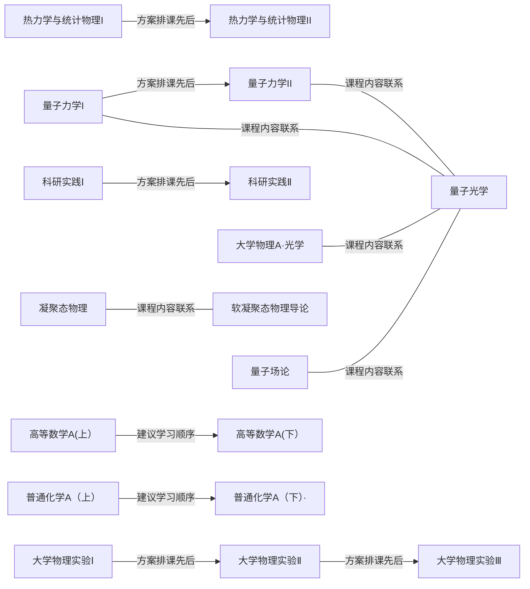

# 2025级 物理学本博融通教学培养方案（相辉计划适用）

物理学系 · 物理学(相辉计划) · 方案 97213 · 63 个不同课程或科研条目。

[官方 Word](../originals/plan-97213.docx) · [教务详情](https://fdjwgl.fudan.edu.cn/manager/bizType/2/major-program-search/info/97213?skipAuth=1) · [方案快照](../raw/plan-97213.json.gz) · [年级目录](../README.md)

## 课程关系图

图中展示部分关系。下表保留全部已建立的课程对，来源位置使用本方案 JSON Pointer。

## 先修与内容联系

| 类型 | 起点 | 终点 | 依据 | 原表定位 |
| --- | --- | --- | --- | --- |
| 建议学习顺序 | 普通化学A（上） (CHEM10003) | 普通化学A（下） (CHEM10004) | 同方案的课程题名具有连续分册或序号。  | `/courseModules/10/planCourses/2`、`/courseModules/10/planCourses/3` |
| 建议学习顺序 | 高等数学A(上） (MATH10015) | 高等数学A(下） (MATH10016) | 同方案的课程题名具有连续分册或序号。  | `/courseModules/5/planCourses/0`、`/courseModules/5/planCourses/1` |
| 建议学习顺序 | 大学物理实验Ⅰ (PHYS10009) | 大学物理实验Ⅱ (PHYS20015) | 同方案的课程题名具有连续分册或序号。  | `/courseModules/26/planCourses/10`、`/courseModules/26/planCourses/12` |
| 建议学习顺序 | 热力学与统计物理I (PHYS20013) | 热力学与统计物理II (PHYS40011) | 同方案的课程题名具有连续分册或序号。  | `/courseModules/6/planCourses/6`、`/courseModules/6/planCourses/12` |
| 建议学习顺序 | 大学物理实验Ⅱ (PHYS20015) | 大学物理实验Ⅲ (PHYS20016) | 同方案的课程题名具有连续分册或序号。  | `/courseModules/26/planCourses/12`、`/courseModules/26/planCourses/14` |
| 建议学习顺序 | 科研实践Ⅰ (PHYS30008) | 科研实践Ⅱ (PHYS30009) | 同方案的课程题名具有连续分册或序号。  | `/courseModules/26/planCourses/13`、`/courseModules/26/planCourses/15` |
| 建议学习顺序 | 量子力学I (PHYS30010) | 量子力学II (PHYS40012) | 同方案的课程题名具有连续分册或序号。  | `/courseModules/6/planCourses/7`、`/courseModules/6/planCourses/11` |
| 方案排课先后 | 高等数学A(上） (MATH10015) | 高等数学A(下） (MATH10016) | 同方案该课程全部明确数字学期均早于后者。  | `/courseModules/5/planCourses/0`、`/courseModules/5/planCourses/1` |
| 方案排课先后 | 大学物理实验Ⅰ (PHYS10009) | 大学物理实验Ⅱ (PHYS20015) | 同方案该课程全部明确数字学期均早于后者。  | `/courseModules/26/planCourses/10`、`/courseModules/26/planCourses/12` |
| 方案排课先后 | 热力学与统计物理I (PHYS20013) | 热力学与统计物理II (PHYS40011) | 同方案该课程全部明确数字学期均早于后者。  | `/courseModules/6/planCourses/6`、`/courseModules/6/planCourses/12` |
| 方案排课先后 | 大学物理实验Ⅱ (PHYS20015) | 大学物理实验Ⅲ (PHYS20016) | 同方案该课程全部明确数字学期均早于后者。  | `/courseModules/26/planCourses/12`、`/courseModules/26/planCourses/14` |
| 方案排课先后 | 科研实践Ⅰ (PHYS30008) | 科研实践Ⅱ (PHYS30009) | 同方案该课程全部明确数字学期均早于后者。  | `/courseModules/26/planCourses/13`、`/courseModules/26/planCourses/15` |
| 方案排课先后 | 量子力学I (PHYS30010) | 量子力学II (PHYS40012) | 同方案该课程全部明确数字学期均早于后者。  | `/courseModules/6/planCourses/7`、`/courseModules/6/planCourses/11` |
| 课程内容联系 | 大学物理A：光学 (PHYS20010) | 量子光学 (PHYS60023) | 本方案两门课程的题名均含“光学”，可据此对照这一主题。  | `/courseModules/6/planCourses/3`、`/courseModules/13/planCourses/0` |
| 课程内容联系 | 热力学与统计物理I (PHYS20013) | 热力学与统计物理II (PHYS40011) | 本方案两门课程的题名均含“统计物理”，可据此对照这一主题。  | `/courseModules/6/planCourses/6`、`/courseModules/6/planCourses/12` |
| 课程内容联系 | 量子力学I (PHYS30010) | 量子光学 (PHYS60023) | 本方案两门课程的题名均含“量子”，可据此对照这一主题。  | `/courseModules/6/planCourses/7`、`/courseModules/13/planCourses/0` |
| 课程内容联系 | 量子力学II (PHYS40012) | 量子光学 (PHYS60023) | 本方案两门课程的题名均含“量子”，可据此对照这一主题。  | `/courseModules/6/planCourses/11`、`/courseModules/13/planCourses/0` |
| 课程内容联系 | 凝聚态物理 (PHYS60020) | 软凝聚态物理导论 (PHYS60024) | 本方案两门课程的题名均含“凝聚态”，可据此对照这一主题。  | `/courseModules/12/planCourses/5`、`/courseModules/14/planCourses/0` |
| 课程内容联系 | 量子场论 (PHYS60022) | 量子光学 (PHYS60023) | 本方案两门课程的题名均含“量子”，可据此对照这一主题。  | `/courseModules/15/planCourses/0`、`/courseModules/13/planCourses/0` |
| 课程内容联系 | 量子光学 (PHYS60023) | 量子多体理论 (PHYS60028) | 本方案两门课程的题名均含“量子”，可据此对照这一主题。  | `/courseModules/13/planCourses/0`、`/courseModules/15/planCourses/5` |

本次未从可定位的明确表述中确认课程对课程预修。学期安排、系列分册与编辑建议均保留各自的依据。

## 按原方案模块阅读

同一模块展示原表中的课程归属。模块内课程之间的先后仍须逐项查阅。

- **模块I**　现代生物科学导论A、现代生物科学实验、普通化学A（上）、普通化学A（下）、普通化学实验I、模拟电子学基础、基础物理建模（原表模块 10）
- **凝聚态物理**　固态电子学与器件、半导体物理A、表面物理、铁磁学、凝聚态物理、固体理论、实验物理方法和技术（原表模块 12）
- **理论物理**　群论、高等电动力学、广义相对论、量子计算与量子信息、量子场论、量子多体理论（原表模块 15）

## 课程表

同一课程在不同模块分别出现时，按原表逐行列出。季节字段保留原值。

| 课程 | 代码 | 学分 | 学期 | 模块 |
| --- | --- | ---: | --- | --- |
| 高等数学A(上） | MATH10015 | 5.0 | 第1学期 | 培养方案 / 专业培养课程 / 学科基础课程 |
| 高等数学A(下） | MATH10016 | 5.0 | 第2学期 | 培养方案 / 专业培养课程 / 学科基础课程 |
| 大学物理A：力学 | PHYS10006 | 4.0 | 第1学期 | 培养方案 / 专业培养课程 / 学科基础课程 |
| 大学物理A：热学 | PHYS10007 | 2.0 | 第2学期 | 培养方案 / 专业培养课程 / 学科基础课程 |
| 大学物理A：电磁学 | PHYS10008 | 4.0 | 第2学期 | 培养方案 / 专业培养课程 / 学科基础课程 |
| 线性代数 | PHYS10010 | 3.0 | 第1学期 | 培养方案 / 专业培养课程 / 专业核心教育课程 |
| 概率论与数理统计 | PHYS20014 | 2.0 | 第2学期 | 培养方案 / 专业培养课程 / 专业核心教育课程 |
| 经典力学 | PHYS20003 | 3.0 | 第3学期 | 培养方案 / 专业培养课程 / 专业核心教育课程 |
| 大学物理A：光学 | PHYS20010 | 3.0 | 第3学期 | 培养方案 / 专业培养课程 / 专业核心教育课程 |
| 大学物理A：原子物理 | PHYS20011 | 3.0 | 第2学期 | 培养方案 / 专业培养课程 / 专业核心教育课程 |
| 数学物理方法A | PHYS20006 | 4.0 | 第4学期 | 培养方案 / 专业培养课程 / 专业核心教育课程 |
| 热力学与统计物理I | PHYS20013 | 4.0 | 第4学期 | 培养方案 / 专业培养课程 / 专业核心教育课程 |
| 量子力学I | PHYS30010 | 4.0 | 第4学期 | 培养方案 / 专业培养课程 / 专业核心教育课程 |
| 电动力学 | PHYS30016 | 4.0 | 第5学期 | 培养方案 / 专业培养课程 / 专业核心教育课程 |
| 计算物理基础 | PHYS20009 | 3.0 | 第3学期 | 培养方案 / 专业培养课程 / 专业核心教育课程 |
| 固体物理 | PHYS30011 | 4.0 | 第5学期 | 培养方案 / 专业培养课程 / 专业核心教育课程 |
| 量子力学II | PHYS40012 | 3.0 | 第6学期 | 培养方案 / 专业培养课程 / 专业核心教育课程 |
| 热力学与统计物理II | PHYS40011 | 3.0 | 第6学期 | 培养方案 / 专业培养课程 / 专业核心教育课程 |
| 模拟电子学基础 | EST10002 | 4.0 | SPRING | 培养方案 / 专业进阶模块I / 模块I |
| 基础物理建模 | PHYS20012 | 2.0 | SPRING | 培养方案 / 专业进阶模块I / 模块I |
| 普通化学A（上） | CHEM10003 | 2.0 | AUTUMN | 培养方案 / 专业进阶模块I / 模块I |
| 普通化学A（下） | CHEM10004 | 2.0 | SPRING | 培养方案 / 专业进阶模块I / 模块I |
| 普通化学实验I | CHEM10005 | 1.0 | AUTUMN | 培养方案 / 专业进阶模块I / 模块I |
| 现代生物科学导论A | BIOL10001 | 3.0 | SPRING、AUTUMN | 培养方案 / 专业进阶模块I / 模块I |
| 现代生物科学实验 | BIOL10003 | 1.0 | AUTUMN | 培养方案 / 专业进阶模块I / 模块I |
| 机器学习在物理实验中的应用 | AIS310013 | 3.0 | SPRING | 培养方案 / 专业进阶模块I / AI交叉 |
| 固体理论 | PHYS60025 | 3.0 | SPRING | 培养方案 / 专业进阶模块I / 凝聚态物理 |
| 表面物理 | PHYS60016 | 3.0 | AUTUMN | 培养方案 / 专业进阶模块I / 凝聚态物理 |
| 半导体物理A | PHYS50006 | 3.0 | SPRING、AUTUMN | 培养方案 / 专业进阶模块I / 凝聚态物理 |
| 实验物理方法和技术 | PHYS60026 | 3.0 | SPRING | 培养方案 / 专业进阶模块I / 凝聚态物理 |
| 固态电子学与器件 | PHYS50001 | 3.0 | AUTUMN | 培养方案 / 专业进阶模块I / 凝聚态物理 |
| 凝聚态物理 | PHYS60020 | 3.0 | AUTUMN | 培养方案 / 专业进阶模块I / 凝聚态物理 |
| 铁磁学 | PHYS60018 | 2.0 | AUTUMN | 培养方案 / 专业进阶模块I / 凝聚态物理 |
| 量子光学 | PHYS60023 | 3.0 | AUTUMN | 培养方案 / 专业进阶模块I / 原子分子物理 |
| 软凝聚态物理导论 | PHYS60024 | 3.0 | AUTUMN | 培养方案 / 专业进阶模块I / 复杂体系物理 |
| 量子场论 | PHYS60022 | 3.0 | AUTUMN | 培养方案 / 专业进阶模块I / 理论物理 |
| 量子计算与量子信息 | PHYS60021 | 3.0 | AUTUMN | 培养方案 / 专业进阶模块I / 理论物理 |
| 高等电动力学 | PHYS50008 | 3.0 | AUTUMN | 培养方案 / 专业进阶模块I / 理论物理 |
| 广义相对论 | PHYS60019 | 3.0 | SPRING | 培养方案 / 专业进阶模块I / 理论物理 |
| 群论 | PHYS50007 | 3.0 | SPRING | 培养方案 / 专业进阶模块I / 理论物理 |
| 量子多体理论 | PHYS60028 | 3.0 | SPRING | 培养方案 / 专业进阶模块I / 理论物理 |
| 粒子物理 | PHYS60017 | 3.0 | AUTUMN | 培养方案 / 专业进阶模块I / 粒子物理与核物理 |
| 星际介质物理 | PHYS60031 | 3.0 | SPRING | 培养方案 / 专业进阶模块I / 天体物理 |
| 计算物理A | PHYS60027 | 2.0 | SPRING | 培养方案 / 专业进阶模块I / 计算物理 |
| 无学分讨论班 | 101 | 0.0 |  | 融合创新能力 |
| 复芏计划(FDUROP) | 102 | 0.0 |  | 融合创新能力 |
| 国际交流 | 7 | 0.0 |  | 融合创新能力 |
| 研究生实践活动 | 5 | 2.0 |  | 融合创新能力 |
| 专业外语 | 8 | 0.0 |  | 融合创新能力 |
| 研究生学术活动 | 4 | 2.0 |  | 融合创新能力 |
| 博士学位论文开题 | 1 | 0.0 |  | 融合创新能力 |
| 博士生资格考核 | 2 | 0.0 |  | 融合创新能力 |
| 博士学位论文预审 | 6 | 0.0 |  | 融合创新能力 |
| 博士论文中期考核 | 3 | 0.0 |  | 融合创新能力 |
| 大学物理实验Ⅰ | PHYS10009 | 2.0 | 第1学期 | 融合创新能力 |
| 物理前沿导论 | PHYS10011 | 2.0 | 第2学期 | 融合创新能力 |
| 大学物理实验Ⅱ | PHYS20015 | 2.0 | 第3学期 | 融合创新能力 |
| 科研实践Ⅰ | PHYS30008 | 3.0 | 第5学期 | 融合创新能力 |
| 大学物理实验Ⅲ | PHYS20016 | 2.0 | 第4学期 | 融合创新能力 |
| 科研实践Ⅱ | PHYS30009 | 3.0 | 第6学期 | 融合创新能力 |
| 近代物理实验I | PHYS30013 | 4.0 | 第5学期 | 融合创新能力 |
| 本科毕业论文 | PHYS40002 | 2.0 | 第8学期 | 融合创新能力 |
| 相辉前沿专题 | MATH10025 | 2.0 | SPRING、AUTUMN | 融合创新能力 |
