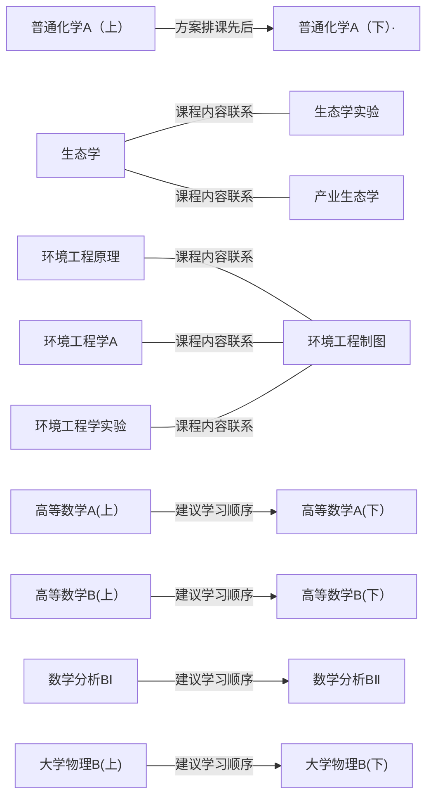

# 2024 环境科学（环境管理方向）专业“2+X”教学培养方案

环境科学与工程系 · 环境科学(环境管理方向) · 方案 72701 · 86 个不同课程或科研条目。

[官方 Word](../originals/plan-72701.docx) · [教务详情](https://fdjwgl.fudan.edu.cn/manager/bizType/2/major-program-search/info/72701?skipAuth=1) · [方案快照](../raw/plan-72701.json.gz) · [年级目录](../README.md)

## 课程关系图

图中展示部分关系。下表保留全部已建立的课程对，来源位置使用本方案 JSON Pointer。

## 先修与内容联系

| 类型 | 起点 | 终点 | 依据 | 原表定位 |
| --- | --- | --- | --- | --- |
| 建议学习顺序 | 普通化学A（上） (CHEM10003) | 普通化学A（下） (CHEM10004) | 同方案的课程题名具有连续分册或序号。  | `/courseModules/5/planCourses/5`、`/courseModules/5/planCourses/6` |
| 建议学习顺序 | 高等数学B(上） (MATH10004) | 高等数学B(下） (MATH10005) | 同方案的课程题名具有连续分册或序号。  | `/courseModules/5/planCourses/9`、`/courseModules/5/planCourses/2` |
| 建议学习顺序 | 数学分析BⅠ (MATH10012) | 数学分析BⅡ (MATH10013) | 同方案的课程题名具有连续分册或序号。  | `/courseModules/5/planCourses/10`、`/courseModules/5/planCourses/3` |
| 建议学习顺序 | 高等数学A(上） (MATH10015) | 高等数学A(下） (MATH10016) | 同方案的课程题名具有连续分册或序号。  | `/courseModules/5/planCourses/8`、`/courseModules/5/planCourses/1` |
| 建议学习顺序 | 大学物理B(上) (PHYS10003) | 大学物理B(下) (PHYS10004) | 同方案的课程题名具有连续分册或序号。  | `/courseModules/5/planCourses/11`、`/courseModules/5/planCourses/12` |
| 方案排课先后 | 普通化学A（上） (CHEM10003) | 普通化学A（下） (CHEM10004) | 同方案该课程全部明确数字学期均早于后者。  | `/courseModules/5/planCourses/5`、`/courseModules/5/planCourses/6` |
| 课程内容联系 | 环境生物学实验 (BIOL30012) | 环境生物学 (ESE20011) | 题名显示相同主题的课程与实验、实践或实习。  | `/courseModules/6/planCourses/6`、`/courseModules/6/planCourses/5` |
| 课程内容联系 | 生态学 (ESE20009) | 生态学实验 (ESE20010) | 题名显示相同主题的课程与实验、实践或实习。  | `/courseModules/6/planCourses/2`、`/courseModules/6/planCourses/9` |
| 课程内容联系 | 生态学 (ESE20009) | 城市生态学 (ESE50032) | 本方案两门课程的题名均含“生态学”，可据此对照这一主题。  | `/courseModules/6/planCourses/2`、`/courseModules/10/planCourses/5` |
| 课程内容联系 | 生态学 (ESE20009) | 产业生态学 (ESE50066) | 本方案两门课程的题名均含“生态学”，可据此对照这一主题。  | `/courseModules/6/planCourses/2`、`/courseModules/10/planCourses/3` |
| 课程内容联系 | 环境工程原理 (ESE20018) | 环境工程制图 (ESE50005) | 本方案两门课程的题名均含“环境工程”，可据此对照这一主题。  | `/courseModules/6/planCourses/0`、`/courseModules/11/planCourses/30` |
| 课程内容联系 | 环境工程学A (ESE30002) | 环境工程制图 (ESE50005) | 本方案两门课程的题名均含“环境工程”，可据此对照这一主题。  | `/courseModules/6/planCourses/11`、`/courseModules/11/planCourses/30` |
| 课程内容联系 | 环境工程学实验 (ESE30007) | 环境工程制图 (ESE50005) | 本方案两门课程的题名均含“环境工程”，可据此对照这一主题。  | `/courseModules/6/planCourses/12`、`/courseModules/11/planCourses/30` |
| 课程内容联系 | 环境遥感 (ESE50037) | 环境遥感实验 (ESE50053) | 题名显示相同主题的课程与实验、实践或实习。  | `/courseModules/10/planCourses/4`、`/courseModules/11/planCourses/7` |

本次未从可定位的明确表述中确认课程对课程预修。学期安排、系列分册与编辑建议均保留各自的依据。

## 按原方案模块阅读

同一模块展示原表中的课程归属。模块内课程之间的先后仍须逐项查阅。

- **选修**　环境经济学（H）、环境物理化学（H）、大气化学（H）、地理信息系统及其应用（H）、污染控制化学（H）、大气环境监测 （理论与实践）（H）、环境政策与时事述评（H）、城市绿地规划与设计（H）（原表模块 14）
- **必修**　环境管理（H）、环境工程原理（H）、环境化学（H）、大气污染与控制（H）、水环境化学（H）（原表模块 15）

## 课程表

同一课程在不同模块分别出现时，按原表逐行列出。季节字段保留原值。

| 课程 | 代码 | 学分 | 学期 | 模块 |
| --- | --- | ---: | --- | --- |
| 现代生物科学导论A | BIOL10001 | 3.0 | SPRING、AUTUMN | 培养方案 / 专业培养课程 / 大类基础课程 |
| 高等数学A(下） | MATH10016 | 5.0 | SPRING | 培养方案 / 专业培养课程 / 大类基础课程 |
| 高等数学B(下） | MATH10005 | 5.0 | SPRING | 培养方案 / 专业培养课程 / 大类基础课程 |
| 数学分析BⅡ | MATH10013 | 5.0 | SPRING | 培养方案 / 专业培养课程 / 大类基础课程 |
| 现代生物科学实验 | BIOL10003 | 1.0 | 第1学期 | 培养方案 / 专业培养课程 / 大类基础课程 |
| 普通化学A（上） | CHEM10003 | 2.0 | 第1学期 | 培养方案 / 专业培养课程 / 大类基础课程 |
| 普通化学A（下） | CHEM10004 | 2.0 | 第2学期 | 培养方案 / 专业培养课程 / 大类基础课程 |
| 普通化学实验I | CHEM10005 | 1.0 | 第1学期 | 培养方案 / 专业培养课程 / 大类基础课程 |
| 高等数学A(上） | MATH10015 | 5.0 | AUTUMN | 培养方案 / 专业培养课程 / 大类基础课程 |
| 高等数学B(上） | MATH10004 | 5.0 | AUTUMN | 培养方案 / 专业培养课程 / 大类基础课程 |
| 数学分析BⅠ | MATH10012 | 5.0 | AUTUMN | 培养方案 / 专业培养课程 / 大类基础课程 |
| 大学物理B(上) | PHYS10003 | 4.0 | SPRING、AUTUMN | 培养方案 / 专业培养课程 / 大类基础课程 |
| 大学物理B(下) | PHYS10004 | 4.0 | SPRING、AUTUMN | 培养方案 / 专业培养课程 / 大类基础课程 |
| 基础物理实验 | PHYS10005 | 2.0 | 第2学期 | 培养方案 / 专业培养课程 / 大类基础课程 |
| 环境工程原理 | ESE20018 | 4.0 | 第3学期 | 培养方案 / 专业培养课程 / 专业核心教育课程 |
| 环境分析化学 | ESE20014 | 3.0 | 第3学期 | 培养方案 / 专业培养课程 / 专业核心教育课程 |
| 生态学 | ESE20009 | 2.0 | 第3学期 | 培养方案 / 专业培养课程 / 专业核心教育课程 |
| 环境管理 | ESE20015 | 3.0 | 第3学期 | 培养方案 / 专业培养课程 / 专业核心教育课程 |
| 环境经济学 | ESE20013 | 3.0 | 第4学期 | 培养方案 / 专业培养课程 / 专业核心教育课程 |
| 环境生物学 | ESE20011 | 3.0 | 第3学期 | 培养方案 / 专业培养课程 / 专业核心教育课程 |
| 环境生物学实验 | BIOL30012 | 1.5 | 第4学期 | 培养方案 / 专业培养课程 / 专业核心教育课程 |
| 环境监测A | ESE20012 | 3.0 | 第4学期 | 培养方案 / 专业培养课程 / 专业核心教育课程 |
| 环境监测实验 | ESE20019 | 3.0 | 第4学期 | 培养方案 / 专业培养课程 / 专业核心教育课程 |
| 生态学实验 | ESE20010 | 1.5 | 第4学期 | 培养方案 / 专业培养课程 / 专业核心教育课程 |
| 环境化学A | ESE30004 | 3.0 | 第5学期 | 培养方案 / 专业培养课程 / 专业核心教育课程 |
| 环境工程学A | ESE30002 | 3.0 | 第5学期 | 培养方案 / 专业培养课程 / 专业核心教育课程 |
| 环境工程学实验 | ESE30007 | 1.0 | 第6学期 | 培养方案 / 专业培养课程 / 专业核心教育课程 |
| 环境地学基础 | ESE30006 | 2.0 | 第5学期 | 培养方案 / 专业培养课程 / 专业核心教育课程 |
| 野外实习 | ESE20016 | 1.0 | 第5学期 | 培养方案 / 专业培养课程 / 专业核心教育课程 |
| 毕业论文 | ESE40002 | 6.0 | 第8学期 | 培养方案 / 专业培养课程 / 专业核心教育课程 |
| 生产实习 | ESE30005 | 1.0 | SUMMER | 培养方案 / 专业培养课程 / 专业核心教育课程 |
| 环境法 | ESE50035 | 3.0 | 第5学期 | 培养方案 / 专业进阶模块I |
| 环境规划原理 | ESE50043 | 3.0 | 第7学期 | 培养方案 / 专业进阶模块I |
| 全球环境变化 | ESE50029 | 2.0 | 第7学期 | 培养方案 / 专业进阶模块I |
| 环境评价 | ESE50044 | 2.0 | 第7学期 | 培养方案 / 专业进阶模块I |
| 田野调查方法 | ESE50034 | 2.0 | 第5学期 | 培养方案 / 专业进阶模块I |
| 城市规划原理 | ESE50031 | 2.0 | 第5学期 | 培养方案 / 专业进阶模块I |
| 环境法 | ESE50001 | 2.0 |  | 培养方案 / 专业进阶模块I |
| 地理信息系统及其应用 | ESE50010 | 2.0 |  | 培养方案 / 专业进阶模块I |
| 环境规划原理 | ESE50014 | 2.0 |  | 培养方案 / 专业进阶模块I |
| 环境工程原理（H） | ESE20005h | 4.0 |  | 培养方案 / 专业进阶模块I |
| 环境政策与时事述评 | ESE50068 | 2.0 | 第7学期 | 培养方案 / 专业进阶模块II |
| 环境核算与审计 | ESE50036 | 2.0 | 第7学期 | 培养方案 / 专业进阶模块II |
| 环境与贸易 | ESE50027 | 2.0 | 第5学期 | 培养方案 / 专业进阶模块II |
| 产业生态学 | ESE50066 | 3.0 | 第5学期 | 培养方案 / 专业进阶模块II |
| 环境遥感 | ESE50037 | 2.0 | 第6学期 | 培养方案 / 专业进阶模块II |
| 城市生态学 | ESE50032 | 2.0 | 第7学期 | 培养方案 / 专业进阶模块II |
| 自然资源经济学 | ESE50033 | 2.0 | 第5学期 | 培养方案 / 专业进阶模块II |
| 社会统计与软件应用(I) | SOCI130184 | 3.0 | 第3学期 | 培养方案 / 专业进阶模块II |
| 环境信息系统 | ESE50017 | 2.0 | 第6学期 | 培养方案 / 专业进阶模块II |
| 环境信息技术实验 | ESE50040 | 1.0 | 第6学期 | 培养方案 / 专业进阶模块II |
| 环境科学与工程虚拟仿真实验 | ESE50054 | 2.0 | 第5学期 | 培养方案 / 专业进阶模块II |
| 环境信息技术实验 | ESE50040 | 1.0 | 第6学期 | 培养方案 / 任意选修 |
| 产业生态学 | ESE50066 | 3.0 | 第5学期 | 培养方案 / 任意选修 |
| 城市生态学 | ESE50032 | 2.0 | 第7学期 | 培养方案 / 任意选修 |
| 环境核算与审计 | ESE50036 | 2.0 | 第7学期 | 培养方案 / 任意选修 |
| 环境物理化学 | ESE50026 | 3.0 | 第4学期 | 培养方案 / 任意选修 |
| 环境规划原理 | ESE50043 | 3.0 | 第7学期 | 培养方案 / 任意选修 |
| 生物地球化学 | ESE50030 | 2.0 | 第6学期 | 培养方案 / 任意选修 |
| 环境遥感实验 | ESE50053 | 1.0 | 第6学期 | 培养方案 / 任意选修 |
| 环境物理学导论 | ESE50055 | 2.0 | 第5学期 | 培养方案 / 任意选修 |
| 大气气溶胶与全球环境效应 | ESE50069 | 2.0 | 第6学期 | 培养方案 / 任意选修 |
| 全球环境变化 | ESE50029 | 2.0 | 第7学期 | 培养方案 / 任意选修 |
| 环境评价 | ESE50044 | 2.0 | 第7学期 | 培养方案 / 任意选修 |
| 大气化学 | ESE50060 | 3.0 | 第6学期 | 培养方案 / 任意选修 |
| 环境毒理学原理 | ESE50045 | 3.0 | 第7学期 | 培养方案 / 任意选修 |
| 空气污染气象学 | ESE50067 | 3.0 | 第3学期 | 培养方案 / 任意选修 |
| 环境科学与工程虚拟仿真实验 | ESE50054 | 2.0 | 第5学期 | 培养方案 / 任意选修 |
| 城市气候导论 | ESE50074 | 2.0 | 第6学期 | 培养方案 / 任意选修 |
| 线性代数（理工类） | MATH10014 | 3.0 | 第3学期 | 培养方案 / 任意选修 |
| 有机化学 | ESE50018 | 4.0 | 第5学期 | 培养方案 / 任意选修 |
| 环境信息系统 | ESE50017 | 2.0 | 第6学期 | 培养方案 / 任意选修 |
| 环境与贸易 | ESE50027 | 2.0 | 第5学期 | 培养方案 / 任意选修 |
| 城市规划原理 | ESE50031 | 2.0 | 第5学期 | 培养方案 / 任意选修 |
| 概率论与环境数理统计 | ESE20017 | 3.0 | 第5学期 | 培养方案 / 任意选修 |
| 自然资源经济学 | ESE50033 | 2.0 | 第5学期 | 培养方案 / 任意选修 |
| 环境法 | ESE50035 | 3.0 | 第5学期 | 培养方案 / 任意选修 |
| 环境流体力学 | ESE50047 | 2.0 | 第4学期 | 培养方案 / 任意选修 |
| 环境遥感 | ESE50037 | 2.0 | 第6学期 | 培养方案 / 任意选修 |
| 专业文献查阅 | ESE50023 | 1.0 | 第7学期 | 培养方案 / 任意选修 |
| 土壤环境化学 | ESE50002 | 2.0 |  | 培养方案 / 任意选修 |
| 空气污染气象学 | ESE50003 | 2.0 |  | 培养方案 / 任意选修 |
| 环境工程制图 | ESE50005 | 2.0 |  | 培养方案 / 任意选修 |
| 环境物理化学 | ESE50007 | 2.0 |  | 培养方案 / 任意选修 |
| 水污染与控制 | ESE50008 | 2.0 |  | 培养方案 / 任意选修 |
| 大气化学 | ESE50011 | 2.0 |  | 培养方案 / 任意选修 |
| 大气污染与控制 | ESE50012 | 2.0 |  | 培养方案 / 任意选修 |
| 大气环境监测 （理论与实践）（H） | ESE50065h | 4.0 | 第6学期 | 培养方案 / 荣誉项目 / 选修 |
| 污染控制化学（H） | ESE50063h | 4.0 | 第6学期 | 培养方案 / 荣誉项目 / 选修 |
| 地理信息系统及其应用（H） | ESE50061h | 4.0 | 第6学期 | 培养方案 / 荣誉项目 / 选修 |
| 城市绿地规划与设计（H） | ESE50072h | 4.0 | 第6学期 | 培养方案 / 荣誉项目 / 选修 |
| 环境经济学（H） | ESE20013h | 4.0 | 第4学期 | 培养方案 / 荣誉项目 / 选修 |
| 环境政策与时事述评（H） | ESE50068h | 4.0 | 第7学期 | 培养方案 / 荣誉项目 / 选修 |
| 大气化学（H） | ESE50060h | 4.0 | 第6学期 | 培养方案 / 荣誉项目 / 选修 |
| 环境物理化学（H） | ESE50026h | 4.0 | 第4学期 | 培养方案 / 荣誉项目 / 选修 |
| 环境工程原理（H） | ESE20018h | 5.0 | 第3学期 | 培养方案 / 荣誉项目 / 必修 |
| 环境管理（H） | ESE20015h | 4.0 | 第3学期 | 培养方案 / 荣誉项目 / 必修 |
| 环境化学（H） | ESE30004h | 4.0 | 第5学期 | 培养方案 / 荣誉项目 / 必修 |
| 大气污染与控制（H） | ESE50019h | 4.0 | 第5学期 | 培养方案 / 荣誉项目 / 必修 |
| 水环境化学（H） | ESE50062h | 4.0 | 第6学期 | 培养方案 / 荣誉项目 / 必修 |
