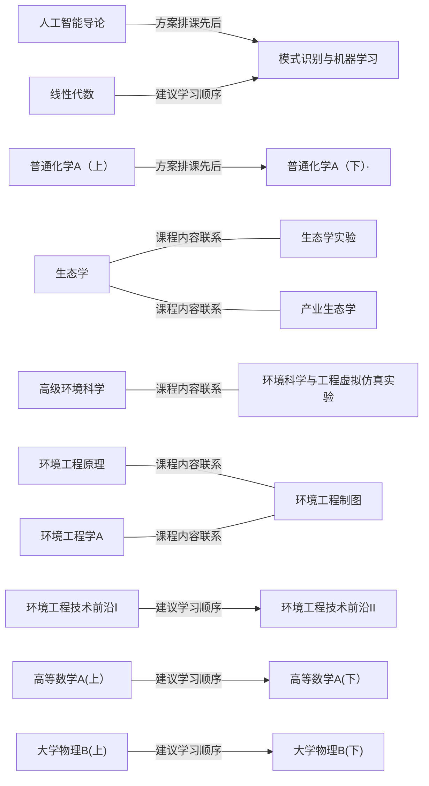

# 2025 环境化学+智能科学与技术（人工智能方向）双学士学位本博融通培养方案（强基班适用）

环境科学与工程系 · 环境科学-智能科学与技术(人工智能方向)(双学士学位项目) · 方案 151491 · 163 个不同课程或科研条目。

[官方 Word](../originals/plan-151491.docx) · [教务详情](https://fdjwgl.fudan.edu.cn/manager/bizType/2/major-program-search/info/151491?skipAuth=1) · [方案快照](../raw/plan-151491.json.gz) · [年级目录](../README.md)

## 修读导读

- **建议先学**　《人工智能导论》（`AIE310005`） → 《模式识别与机器学习》（`AIE410001`）。人工智能问题与模型类别可为学习模式识别作准备。方案分别列在第4、5学期。

- **可以对照着读**　《高级环境科学》（`ESE40011`）与《环境科学与工程虚拟仿真实验》（`ESE50054`）。两门课的题名都涉及环境科学。围绕一个环境变化案例，比较作用过程、观测尺度和判断证据。

- **查模块选课**　《环境学导论》（`ESE10001`）、《概率论与数理统计》（`STAT20007`）列在“专业核心教育课程”中。原表见 `/courseModules/6`。

## 课程关系图

图中展示部分关系。下表保留全部已建立的课程对，来源位置使用本方案 JSON Pointer。

## 先修与内容联系

| 类型 | 起点 | 终点 | 依据 | 原表定位 |
| --- | --- | --- | --- | --- |
| 建议学习顺序 | 人工智能导论 (AIE310005) | 模式识别与机器学习 (AIE410001) | 人工智能问题与模型类别可为学习模式识别作准备。  | `/courseModules/6/planCourses/22`、`/courseModules/6/planCourses/24` |
| 建议学习顺序 | 普通化学A（上） (CHEM10003) | 普通化学A（下） (CHEM10004) | 同方案的课程题名具有连续分册或序号。  | `/courseModules/5/planCourses/8`、`/courseModules/5/planCourses/9` |
| 建议学习顺序 | 高等数学A(上） (MATH10015) | 高等数学A(下） (MATH10016) | 同方案的课程题名具有连续分册或序号。  | `/courseModules/5/planCourses/0`、`/courseModules/5/planCourses/1` |
| 建议学习顺序 | 线性代数 (MATH10017) | 模式识别与机器学习 (AIE410001) | 向量表示和矩阵运算支持理解分类、回归等模型。  | `/courseModules/5/planCourses/2`、`/courseModules/6/planCourses/24` |
| 建议学习顺序 | 大学物理B(上) (PHYS10003) | 大学物理B(下) (PHYS10004) | 同方案的课程题名具有连续分册或序号。  | `/courseModules/5/planCourses/3`、`/courseModules/5/planCourses/4` |
| 建议学习顺序 | 环境工程技术前沿Ⅰ (REE50001) | 环境工程技术前沿II (REE60003) | 同方案的课程题名具有连续分册或序号。  | `/courseModules/11/planCourses/29`、`/courseModules/11/planCourses/30` |
| 方案排课先后 | 人工智能导论 (AIE310005) | 模式识别与机器学习 (AIE410001) | 同方案该课程全部明确数字学期均早于后者。  | `/courseModules/6/planCourses/22`、`/courseModules/6/planCourses/24` |
| 方案排课先后 | 普通化学A（上） (CHEM10003) | 普通化学A（下） (CHEM10004) | 同方案该课程全部明确数字学期均早于后者。  | `/courseModules/5/planCourses/8`、`/courseModules/5/planCourses/9` |
| 课程内容联系 | 计算机系统基础 (AIE210006) | 计算机组成与体系结构 (CS30052) | 处理器、存储与系统执行模型具有共同内容。  | `/courseModules/6/planCourses/21`、`/courseModules/12/planCourses/1` |
| 课程内容联系 | 人工智能导论 (AIE310005) | 人工智能安全 (AIE831001) | 本方案两门课程的题名均含“人工智能”，可据此对照这一主题。  | `/courseModules/6/planCourses/22`、`/courseModules/6/planCourses/25` |
| 课程内容联系 | 人工智能的编程基础 (AIE310006) | 人工智能安全 (AIE831001) | 本方案两门课程的题名均含“人工智能”，可据此对照这一主题。  | `/courseModules/6/planCourses/18`、`/courseModules/6/planCourses/25` |
| 课程内容联系 | 人工智能的软件基础 (AIE310008) | 人工智能安全 (AIE831001) | 本方案两门课程的题名均含“人工智能”，可据此对照这一主题。  | `/courseModules/6/planCourses/23`、`/courseModules/6/planCourses/25` |
| 课程内容联系 | 人工智能的数学基础 (AIE310009) | 模式识别与机器学习 (AIE410001) | 数学表达与学习模型的统计、优化工具可对照。  | `/courseModules/6/planCourses/20`、`/courseModules/6/planCourses/24` |
| 课程内容联系 | 人工智能的数学基础 (AIE310009) | 人工智能安全 (AIE831001) | 本方案两门课程的题名均含“人工智能”，可据此对照这一主题。  | `/courseModules/6/planCourses/20`、`/courseModules/6/planCourses/25` |
| 课程内容联系 | 模式识别与机器学习 (AIE410001) | 机器学习系统 (CS40007) | 本方案两门课程的题名均含“机器学习”，可据此对照这一主题。  | `/courseModules/6/planCourses/24`、`/courseModules/12/planCourses/5` |
| 课程内容联系 | 全球气候变化驱动下生态环境响应的AI场景模拟与应用 (AIT631016) | 城市气候导论 (ESE50074) | 本方案两门课程的题名均含“气候”，可据此对照这一主题。  | `/courseModules/10/planCourses/30`、`/courseModules/11/planCourses/34` |
| 课程内容联系 | 环境生物学实验 (BIOL30012) | 环境生物学 (ESE20006) | 题名显示相同主题的课程与实验、实践或实习。  | `/courseModules/19/planCourses/11`、`/courseModules/6/planCourses/5` |
| 课程内容联系 | 环境工程原理 (ESE20005) | 环境工程制图 (ESE50005) | 本方案两门课程的题名均含“环境工程”，可据此对照这一主题。  | `/courseModules/6/planCourses/9`、`/courseModules/11/planCourses/20` |
| 课程内容联系 | 生态学 (ESE20009) | 生态学实验 (ESE20010) | 题名显示相同主题的课程与实验、实践或实习。  | `/courseModules/6/planCourses/6`、`/courseModules/19/planCourses/14` |
| 课程内容联系 | 生态学 (ESE20009) | 产业生态学 (ESE50024) | 本方案两门课程的题名均含“生态学”，可据此对照这一主题。  | `/courseModules/6/planCourses/6`、`/courseModules/10/planCourses/17` |
| 课程内容联系 | 生态学 (ESE20009) | 城市生态学 (ESE50032) | 本方案两门课程的题名均含“生态学”，可据此对照这一主题。  | `/courseModules/6/planCourses/6`、`/courseModules/10/planCourses/18` |
| 课程内容联系 | 生态学 (ESE20009) | 高级城市生态学 (ESE60005) | 本方案两门课程的题名均含“生态学”，可据此对照这一主题。  | `/courseModules/6/planCourses/6`、`/courseModules/10/planCourses/23` |
| 课程内容联系 | 环境工程学A (ESE30002) | 环境工程制图 (ESE50005) | 本方案两门课程的题名均含“环境工程”，可据此对照这一主题。  | `/courseModules/6/planCourses/10`、`/courseModules/11/planCourses/20` |
| 课程内容联系 | 环境工程学实验 (ESE30007) | 环境工程制图 (ESE50005) | 本方案两门课程的题名均含“环境工程”，可据此对照这一主题。  | `/courseModules/19/planCourses/16`、`/courseModules/11/planCourses/20` |
| 课程内容联系 | 高级环境科学 (ESE40011) | 环境科学与工程虚拟仿真实验 (ESE50054) | 本方案两门课程的题名均含“环境科学”，可据此对照这一主题。  | `/courseModules/6/planCourses/14`、`/courseModules/10/planCourses/28` |
| 课程内容联系 | 环境工程制图 (ESE50005) | 环境工程设计 (ESE50049) | 本方案两门课程的题名均含“环境工程”，可据此对照这一主题。  | `/courseModules/11/planCourses/20`、`/courseModules/11/planCourses/22` |
| 课程内容联系 | 环境物理化学 (ESE50007) | 环境物理化学（H） (ESE50026h) | 本方案两门课程的题名均含“物理化学”，可据此对照这一主题。  | `/courseModules/10/planCourses/0`、`/courseModules/14/planCourses/1` |
| 课程内容联系 | 污染控制化学 (ESE50009) | 污染控制化学（H） (ESE50063h) | 本方案两门课程的题名均含“污染控制”，可据此对照这一主题。  | `/courseModules/11/planCourses/18`、`/courseModules/14/planCourses/5` |
| 课程内容联系 | 污染控制化学 (ESE50009) | 流域污染控制 (ESE60002) | 本方案两门课程的题名均含“污染控制”，可据此对照这一主题。  | `/courseModules/11/planCourses/18`、`/courseModules/10/planCourses/16` |
| 课程内容联系 | 污染控制化学 (ESE50009) | 面源污染控制 (ESE70009) | 本方案两门课程的题名均含“污染控制”，可据此对照这一主题。  | `/courseModules/11/planCourses/18`、`/courseModules/10/planCourses/15` |
| 课程内容联系 | 污染控制化学 (ESE50009) | 燃烧源污染控制 (ESE70016) | 本方案两门课程的题名均含“污染控制”，可据此对照这一主题。  | `/courseModules/11/planCourses/18`、`/courseModules/11/planCourses/26` |
| 课程内容联系 | 环境遥感 (ESE50037) | 环境遥感实验 (ESE50053) | 题名显示相同主题的课程与实验、实践或实习。  | `/courseModules/11/planCourses/36`、`/courseModules/11/planCourses/37` |

本次未从可定位的明确表述中确认课程对课程预修。学期安排、系列分册与编辑建议均保留各自的依据。

## 按原方案模块阅读

同一模块展示原表中的课程归属。模块内课程之间的先后仍须逐项查阅。

- **AI课程**　数据库引论、软件工程、计算机图形学A、计算机网络、集合与图论、计算机组成与体系结构、机器学习系统（原表模块 12）

## 课程表

同一课程在不同模块分别出现时，按原表逐行列出。季节字段保留原值。

| 课程 | 代码 | 学分 | 学期 | 模块 |
| --- | --- | ---: | --- | --- |
| 高等化学导论 | CHEM70050 | 4.0 |  | 培养方案 / 专业培养课程 |
| 化工产业进展专题 | CHEM80001 | 1.0 |  | 培养方案 / 专业培养课程 |
| 工程伦理学 | CHEM50025 | 2.0 |  | 培养方案 / 专业培养课程 |
| 高等材料化学导论 | CHEM50026 | 2.0 |  | 培养方案 / 专业培养课程 |
| 高等数学A(上） | MATH10015 | 5.0 | AUTUMN | 培养方案 / 专业培养课程 / 学科基础课程 |
| 高等数学A(下） | MATH10016 | 5.0 | SPRING | 培养方案 / 专业培养课程 / 学科基础课程 |
| 线性代数 | MATH10017 | 3.0 | SPRING、AUTUMN | 培养方案 / 专业培养课程 / 学科基础课程 |
| 大学物理B(上) | PHYS10003 | 4.0 | SPRING、AUTUMN | 培养方案 / 专业培养课程 / 学科基础课程 |
| 大学物理B(下) | PHYS10004 | 4.0 | SPRING、AUTUMN | 培养方案 / 专业培养课程 / 学科基础课程 |
| 基础物理实验 | PHYS10005 | 2.0 | 第2学期 | 培养方案 / 专业培养课程 / 学科基础课程 |
| 现代生物科学导论A | BIOL10001 | 3.0 | SPRING、AUTUMN | 培养方案 / 专业培养课程 / 学科基础课程 |
| 现代生物科学实验 | BIOL10003 | 1.0 | 第1学期 | 培养方案 / 专业培养课程 / 学科基础课程 |
| 普通化学A（上） | CHEM10003 | 2.0 | 第1学期 | 培养方案 / 专业培养课程 / 学科基础课程 |
| 普通化学A（下） | CHEM10004 | 2.0 | 第2学期 | 培养方案 / 专业培养课程 / 学科基础课程 |
| 普通化学实验I | CHEM10005 | 1.0 | 第1学期 | 培养方案 / 专业培养课程 / 学科基础课程 |
| 程序设计 | CS10004 | 4.0 | SPRING、AUTUMN | 培养方案 / 专业培养课程 / 学科基础课程 |
| 环境学导论 | ESE10001 | 2.0 | 第1学期 | 培养方案 / 专业培养课程 / 专业核心教育课程 |
| 概率论与数理统计 | STAT20007 | 3.0 | 第3学期 | 培养方案 / 专业培养课程 / 专业核心教育课程 |
| 环境分析化学 | ESE20003 | 2.0 | 第3学期 | 培养方案 / 专业培养课程 / 专业核心教育课程 |
| 环境监测A | ESE20001 | 2.0 | 第4学期 | 培养方案 / 专业培养课程 / 专业核心教育课程 |
| 环境化学A | ESE30004 | 3.0 | 第5学期 | 培养方案 / 专业培养课程 / 专业核心教育课程 |
| 环境生物学 | ESE20006 | 2.0 | 第3学期 | 培养方案 / 专业培养课程 / 专业核心教育课程 |
| 生态学 | ESE20009 | 2.0 | 第3学期 | 培养方案 / 专业培养课程 / 专业核心教育课程 |
| 环境地学基础 | ESE30006 | 2.0 | 第5学期 | 培养方案 / 专业培养课程 / 专业核心教育课程 |
| 环境健康学 | ESE30001 | 2.0 | 第6学期 | 培养方案 / 专业培养课程 / 专业核心教育课程 |
| 环境工程原理 | ESE20005 | 3.0 | 第3学期 | 培养方案 / 专业培养课程 / 专业核心教育课程 |
| 环境工程学A | ESE30002 | 3.0 | 第5学期 | 培养方案 / 专业培养课程 / 专业核心教育课程 |
| 环境管理 | ESE20002 | 2.0 | 第3学期 | 培养方案 / 专业培养课程 / 专业核心教育课程 |
| 环境经济学 | ESE20004 | 2.0 | 第4学期 | 培养方案 / 专业培养课程 / 专业核心教育课程 |
| 碳中和管理 | ESE30009 | 2.0 | 第5学期 | 培养方案 / 专业培养课程 / 专业核心教育课程 |
| 高级环境科学 | ESE40011 | 2.0 | AUTUMN | 培养方案 / 专业培养课程 / 专业核心教育课程 |
| 高级环境健康学 | ESE60013 | 2.0 | AUTUMN | 培养方案 / 专业培养课程 / 专业核心教育课程 |
| 高级环境工程学 | ESE40010 | 2.0 | AUTUMN | 培养方案 / 专业培养课程 / 专业核心教育课程 |
| 高级生态管理学 | ESE60012 | 2.0 | AUTUMN | 培养方案 / 专业培养课程 / 专业核心教育课程 |
| 人工智能的编程基础 | AIE310006 | 2.0 | 第2学期 | 培养方案 / 专业培养课程 / 专业核心教育课程 |
| 数据结构 | AIE310007 | 4.0 | 第3学期 | 培养方案 / 专业培养课程 / 专业核心教育课程 |
| 人工智能的数学基础 | AIE310009 | 3.0 | 第3学期 | 培养方案 / 专业培养课程 / 专业核心教育课程 |
| 计算机系统基础 | AIE210006 | 3.0 | 第3学期 | 培养方案 / 专业培养课程 / 专业核心教育课程 |
| 人工智能导论 | AIE310005 | 3.0 | 第4学期 | 培养方案 / 专业培养课程 / 专业核心教育课程 |
| 人工智能的软件基础 | AIE310008 | 3.0 | 第4学期 | 培养方案 / 专业培养课程 / 专业核心教育课程 |
| 模式识别与机器学习 | AIE410001 | 3.0 | 第5学期 | 培养方案 / 专业培养课程 / 专业核心教育课程 |
| 人工智能安全 | AIE831001 | 3.0 | 第5学期 | 培养方案 / 专业培养课程 / 专业核心教育课程 |
| 人工智能的伦理与治理 | PHIL50006 | 2.0 | 第4学期、第6学期 | 培养方案 / 专业培养课程 / 专业核心教育课程 |
| 自然语言处理与大语言模型 | AIE410002 | 3.0 | 第6学期 | 培养方案 / 专业培养课程 / 专业核心教育课程 |
| 计算机视觉 | AIE310004 | 3.0 | 第7学期 | 培养方案 / 专业培养课程 / 专业核心教育课程 |
| 人工智能前沿探索实践 | AIE531001 | 3.0 | 第7学期 | 培养方案 / 专业培养课程 / 专业核心教育课程 |
| 环境物理化学 | ESE50007 | 2.0 | 第4学期 | 培养方案 / 专业进阶课程 / 专业进阶模块I |
| 大气化学 | ESE50011 | 2.0 | 第6学期 | 培养方案 / 专业进阶课程 / 专业进阶模块I |
| 水环境化学 | ESE50013 | 2.0 | 第6学期 | 培养方案 / 专业进阶课程 / 专业进阶模块I |
| 土壤环境化学 | ESE50002 | 2.0 | 第6学期 | 培养方案 / 专业进阶课程 / 专业进阶模块I |
| 环境化学实验A | ESE50059 | 2.0 | 第6学期 | 培养方案 / 专业进阶课程 / 专业进阶模块I |
| 环境光化学 | ESE60004 | 3.0 | AUTUMN | 培养方案 / 专业进阶课程 / 专业进阶模块I |
| 大气气溶胶科学与技术 | ESE70008 | 3.0 | AUTUMN | 培养方案 / 专业进阶课程 / 专业进阶模块I |
| 生物地球化学循环和全球变化 | ESE50085 | 3.0 | AUTUMN | 培养方案 / 专业进阶课程 / 专业进阶模块I |
| 大气化学和大气物理前沿 | ESE50086 | 3.0 | AUTUMN | 培养方案 / 专业进阶课程 / 专业进阶模块I |
| 环境毒理学原理 | ESE50045 | 3.0 | 第7学期 | 培养方案 / 专业进阶课程 / 专业进阶模块I |
| 现代生物分析技术（全英文教学） | ESE70017 | 3.0 | AUTUMN | 培养方案 / 专业进阶课程 / 专业进阶模块I |
| 大气污染与控制 | ESE50012 | 2.0 | 第5学期 | 培养方案 / 专业进阶课程 / 专业进阶模块I |
| 水污染与控制 | ESE50008 | 2.0 | 第5学期 | 培养方案 / 专业进阶课程 / 专业进阶模块I |
| 固体废物处理与资源化 | ESE50004 | 2.0 | 第5学期 | 培养方案 / 专业进阶课程 / 专业进阶模块I |
| 生态工程 | ESE50038 | 2.0 | 第7学期 | 培养方案 / 专业进阶课程 / 专业进阶模块I |
| 面源污染控制 | ESE70009 | 3.0 | AUTUMN | 培养方案 / 专业进阶课程 / 专业进阶模块I |
| 流域污染控制 | ESE60002 | 3.0 | AUTUMN | 培养方案 / 专业进阶课程 / 专业进阶模块I |
| 产业生态学 | ESE50024 | 2.0 | 第5学期 | 培养方案 / 专业进阶课程 / 专业进阶模块I |
| 城市生态学 | ESE50032 | 2.0 | 第7学期 | 培养方案 / 专业进阶课程 / 专业进阶模块I |
| 环境法 | ESE50001 | 2.0 | 第5学期 | 培养方案 / 专业进阶课程 / 专业进阶模块I |
| 环境评价 | ESE50044 | 2.0 | 第7学期 | 培养方案 / 专业进阶课程 / 专业进阶模块I |
| 环境规划原理 | ESE50014 | 2.0 | 第7学期 | 培养方案 / 专业进阶课程 / 专业进阶模块I |
| 田野调查方法 | ESE50034 | 2.0 | 第5学期 | 培养方案 / 专业进阶课程 / 专业进阶模块I |
| 高级城市生态学 | ESE60005 | 3.0 | SPRING | 培养方案 / 专业进阶课程 / 专业进阶模块I |
| 资源与环境政策 | MANA70008 | 3.0 | AUTUMN | 培养方案 / 专业进阶课程 / 专业进阶模块I |
| 社会科学定性研究方法论 | MANA60013 | 3.0 | AUTUMN | 培养方案 / 专业进阶课程 / 专业进阶模块I |
| 高级微观经济学 | ECON40026 | 3.0 | AUTUMN | 培养方案 / 专业进阶课程 / 专业进阶模块I |
| 比较公共行政 | MANA60068 | 3.0 | AUTUMN | 培养方案 / 专业进阶课程 / 专业进阶模块I |
| 环境科学与工程虚拟仿真实验 | ESE50054 | 2.0 | 第5学期 | 培养方案 / 专业进阶课程 / 专业进阶模块I |
| AI技术在环境系统模型中的应用 | AIS531010 | 3.0 | SPRING | 培养方案 / 专业进阶课程 / 专业进阶模块I |
| 全球气候变化驱动下生态环境响应的AI场景模拟与应用 | AIT631016 | 3.0 | SPRING | 培养方案 / 专业进阶课程 / 专业进阶模块I |
| 有机化学 | ESE50077 | 2.0 | 第5学期 | 培养方案 / 专业进阶课程 / 专业进阶模块II |
| 生物地球化学 | ESE50030 | 2.0 | 第6学期 | 培养方案 / 专业进阶课程 / 专业进阶模块II |
| 全球环境变化 | ESE50029 | 2.0 | 第5学期 | 培养方案 / 专业进阶课程 / 专业进阶模块II |
| 仪器分析 | ESE50042 | 2.0 | 第5学期 | 培养方案 / 专业进阶课程 / 专业进阶模块II |
| 大气环境监测（理论和实践） | ESE50065 | 2.0 | 第6学期 | 培养方案 / 专业进阶课程 / 专业进阶模块II |
| 环境物理学导论 | ESE50055 | 2.0 | 第5学期 | 培养方案 / 专业进阶课程 / 专业进阶模块II |
| 大气气溶胶与全球环境效应 | ESE50069 | 2.0 | 第6学期 | 培养方案 / 专业进阶课程 / 专业进阶模块II |
| 空气污染气象学 | ESE50003 | 2.0 | 第6学期 | 培养方案 / 专业进阶课程 / 专业进阶模块II |
| 高等大气化学 （全英文教学） | ESE70012 | 2.0 | AUTUMN | 培养方案 / 专业进阶课程 / 专业进阶模块II |
| 光谱技术在环境监测中的应用 | ESE40005 | 2.0 | AUTUMN | 培养方案 / 专业进阶课程 / 专业进阶模块II |
| MATLAB在环境模拟计算中的应用 | ESE60009 | 2.0 | AUTUMN | 培养方案 / 专业进阶课程 / 专业进阶模块II |
| 气溶胶力学 | ESE60008 | 2.0 | AUTUMN | 培养方案 / 专业进阶课程 / 专业进阶模块II |
| 高级水环境化学（全英文课程） | ESE70011 | 2.0 | AUTUMN | 培养方案 / 专业进阶课程 / 专业进阶模块II |
| 高级环境土壤化学 (全英文课程) | ESE70015 | 3.0 | AUTUMN | 培养方案 / 专业进阶课程 / 专业进阶模块II |
| 室内环境化学与健康 | CHEM70048 | 3.0 | SPRING | 培养方案 / 专业进阶课程 / 专业进阶模块II |
| 环境健康研究方法与实践 | ESE60010 | 2.0 | SPRING | 培养方案 / 专业进阶课程 / 专业进阶模块II |
| 微量有害化学物质的风险评价 | ESE60011 | 2.0 | SPRING | 培养方案 / 专业进阶课程 / 专业进阶模块II |
| 工业废水处理与资源化 | ESE50076 | 2.0 | 第6学期 | 培养方案 / 专业进阶课程 / 专业进阶模块II |
| 污染控制化学 | ESE50009 | 2.0 | 第6学期 | 培养方案 / 专业进阶课程 / 专业进阶模块II |
| 碳中和技术概论 | ESE50075 | 2.0 | 第6学期 | 培养方案 / 专业进阶课程 / 专业进阶模块II |
| 环境工程制图 | ESE50005 | 2.0 | 第6学期 | 培养方案 / 专业进阶课程 / 专业进阶模块II |
| 环境设备基础 | ESE50028 | 2.0 | 第6学期 | 培养方案 / 专业进阶课程 / 专业进阶模块II |
| 环境工程设计 | ESE50049 | 2.0 | 第7学期 | 培养方案 / 专业进阶课程 / 专业进阶模块II |
| 环境材料导论 | ESE50025 | 2.0 | 第5学期 | 培养方案 / 专业进阶课程 / 专业进阶模块II |
| 环境纳米技术 | ESE50051 | 2.0 | 第7学期 | 培养方案 / 专业进阶课程 / 专业进阶模块II |
| 水处理理论与设计 | ESE70004 | 2.0 | AUTUMN | 培养方案 / 专业进阶课程 / 专业进阶模块II |
| 燃烧源污染控制 | ESE70016 | 3.0 | AUTUMN | 培养方案 / 专业进阶课程 / 专业进阶模块II |
| 绿色化学选读 | ESE70010 | 2.0 | AUTUMN | 培养方案 / 专业进阶课程 / 专业进阶模块II |
| 生物质能源技术 | ESE70006 | 2.0 | AUTUMN | 培养方案 / 专业进阶课程 / 专业进阶模块II |
| 环境工程技术前沿Ⅰ | REE50001 | 1.0 | AUTUMN | 培养方案 / 专业进阶课程 / 专业进阶模块II |
| 环境工程技术前沿II | REE60003 | 1.0 | AUTUMN | 培养方案 / 专业进阶课程 / 专业进阶模块II |
| 地理信息系统及其应用 | ESE50010 | 2.0 | 第6学期 | 培养方案 / 专业进阶课程 / 专业进阶模块II |
| 环境信息系统 | ESE50017 | 2.0 | 第6学期 | 培养方案 / 专业进阶课程 / 专业进阶模块II |
| 环境信息技术实验 | ESE50040 | 1.0 | 第6学期 | 培养方案 / 专业进阶课程 / 专业进阶模块II |
| 城市气候导论 | ESE50074 | 2.0 | 第6学期 | 培养方案 / 专业进阶课程 / 专业进阶模块II |
| 城市绿地规划与设计 | ESE50072 | 2.0 | 第6学期 | 培养方案 / 专业进阶课程 / 专业进阶模块II |
| 环境遥感 | ESE50037 | 2.0 | 第6学期 | 培养方案 / 专业进阶课程 / 专业进阶模块II |
| 环境遥感实验 | ESE50053 | 1.0 | 第6学期 | 培养方案 / 专业进阶课程 / 专业进阶模块II |
| 环境水文学基础 | ESE50039 | 2.0 | 第7学期 | 培养方案 / 专业进阶课程 / 专业进阶模块II |
| 自然资源经济学 | ESE50033 | 2.0 | 第5学期 | 培养方案 / 专业进阶课程 / 专业进阶模块II |
| 环境与贸易 | ESE50027 | 2.0 | 第5学期 | 培养方案 / 专业进阶课程 / 专业进阶模块II |
| 城市规划原理 | ESE50031 | 2.0 | 第5学期 | 培养方案 / 专业进阶课程 / 专业进阶模块II |
| 环境核算与审计 | ESE50036 | 2.0 | 第7学期 | 培养方案 / 专业进阶课程 / 专业进阶模块II |
| 环境政策与时事述评 | ESE50068 | 2.0 | 第7学期 | 培养方案 / 专业进阶课程 / 专业进阶模块II |
| 绿地规划与设计 | ESE50081 | 3.0 | AUTUMN | 培养方案 / 专业进阶课程 / 专业进阶模块II |
| 战略环境评价原理 | MANA40005 | 2.0 | AUTUMN | 培养方案 / 专业进阶课程 / 专业进阶模块II |
| 可持续发展理论 | ESE70013 | 2.0 | AUTUMN | 培养方案 / 专业进阶课程 / 专业进阶模块II |
| 环境管理前沿 | MPA50001 | 3.0 | AUTUMN | 培养方案 / 专业进阶课程 / 专业进阶模块II |
| 环境法案例分析 | MANA60012 | 2.0 | SPRING | 培养方案 / 专业进阶课程 / 专业进阶模块II |
| 温室气体减排与大气污染控制协同效益分析（全英文） | ESE70014 | 2.0 | AUTUMN | 培养方案 / 专业进阶课程 / 专业进阶模块II |
| 集合与图论 | CS30043 | 3.0 | 第3学期 | 培养方案 / 专业进阶课程 / 专业进阶模块II / AI课程 |
| 计算机组成与体系结构 | CS30052 | 4.0 | 第4学期 | 培养方案 / 专业进阶课程 / 专业进阶模块II / AI课程 |
| 数据库引论 | CS20010 | 3.0 | 第4学期 | 培养方案 / 专业进阶课程 / 专业进阶模块II / AI课程 |
| 计算机网络 | CS30036 | 3.0 | 第5学期 | 培养方案 / 专业进阶课程 / 专业进阶模块II / AI课程 |
| 软件工程 | CS30018 | 3.0 | 第6学期 | 培养方案 / 专业进阶课程 / 专业进阶模块II / AI课程 |
| 机器学习系统 | CS40007 | 3.0 | 第6学期 | 培养方案 / 专业进阶课程 / 专业进阶模块II / AI课程 |
| 计算机图形学A | CS30019 | 3.0 | 第6学期 | 培养方案 / 专业进阶课程 / 专业进阶模块II / AI课程 |
| 环境化学（H） | ESE30004h | 4.0 | 第5学期 | 培养方案 / 荣誉课程 |
| 环境物理化学（H） | ESE50026h | 4.0 | 第4学期 | 培养方案 / 荣誉课程 |
| 大气化学（H） | ESE50060h | 4.0 | 第6学期 | 培养方案 / 荣誉课程 |
| 大气环境监测 （理论与实践）（H） | ESE50065h | 4.0 | 第6学期 | 培养方案 / 荣誉课程 |
| 水环境化学（H） | ESE50062h | 4.0 | 第6学期 | 培养方案 / 荣誉课程 |
| 污染控制化学（H） | ESE50063h | 4.0 | 第6学期 | 培养方案 / 荣誉课程 |
| 环境管理（H） | ESE20015h | 4.0 | 第3学期 | 培养方案 / 荣誉课程 |
| 环境经济学（H） | ESE20013h | 4.0 | 第4学期 | 培养方案 / 荣誉课程 |
| 学术规范和科研技能 | ESE50087 | 2.0 | AUTUMN | 融合创新能力 |
| 复芏计划(FDUROP) | 102 | 0.0 |  | 融合创新能力 |
| 研究生实践活动 | 5 | 0.0 |  | 融合创新能力 |
| 国际交流 | 7 | 0.0 |  | 融合创新能力 |
| 博士学位论文开题 | 1 | 0.0 |  | 融合创新能力 |
| 博士生资格考核 | 2 | 0.0 |  | 融合创新能力 |
| 博士论文中期考核 | 3 | 0.0 |  | 融合创新能力 |
| 博士学位论文预审 | 6 | 0.0 |  | 融合创新能力 |
| 环境监测实验 | ESE20007 | 2.0 | 第4学期 | 融合创新能力 |
| 野外实习 | ESE20016 | 1.0 | 第5学期 | 融合创新能力 |
| 工程伦理与环境 | REE60001 | 2.0 | AUTUMN | 融合创新能力 |
| 环境生物学实验 | BIOL30012 | 1.5 | 第4学期 | 融合创新能力 |
| 生产实习 | ESE30005 | 1.0 | SUMMER | 融合创新能力 |
| 环境系学生生涯规划与发展 | ESE50006 | 2.0 | AUTUMN | 融合创新能力 |
| 生态学实验 | ESE20010 | 1.5 | 第4学期 | 融合创新能力 |
| 科研实践 | ESE30010 | 3.0 | SPRING、AUTUMN | 融合创新能力 |
| 环境工程学实验 | ESE30007 | 1.0 | 第6学期 | 融合创新能力 |
| 毕业论文 | ESE40001 | 3.0 | 第8学期 | 融合创新能力 |
| 专业外语 | ESE50015 | 2.0 | AUTUMN | 融合创新能力 |
| 实验室安全 | ESE40007 | 1.0 | AUTUMN | 融合创新能力 |
| 环境前沿讲堂 | ESE60001 | 2.0 | AUTUMN | 融合创新能力 |
