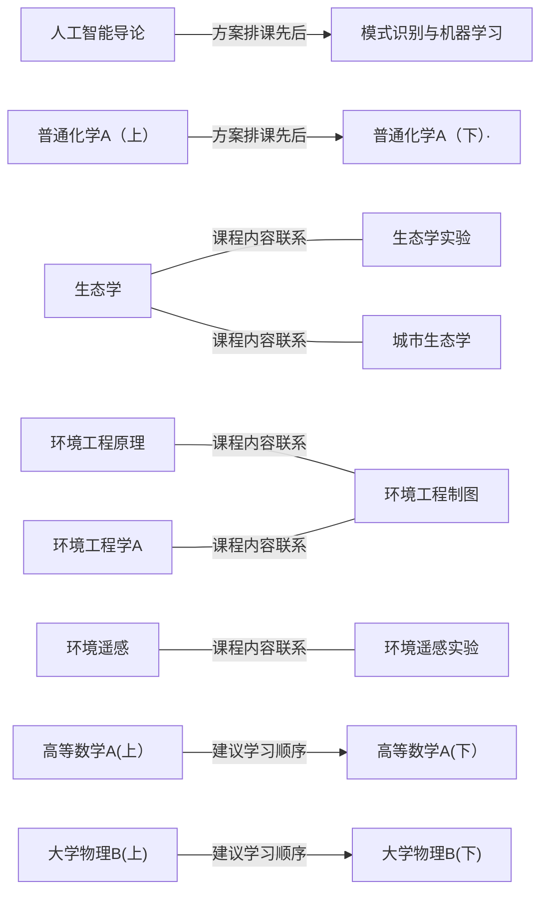

# 2025 环境科学-智能科学与技术（人工智能方向）双学士学位项目“2+X+Y”教学培养方案

环境科学与工程系 · 环境科学-智能科学与技术(人工智能方向)(双学士学位项目) · 方案 97479 · 101 个不同课程或科研条目。

[官方 Word](../originals/plan-97479.docx) · [教务详情](https://fdjwgl.fudan.edu.cn/manager/bizType/2/major-program-search/info/97479?skipAuth=1) · [方案快照](../raw/plan-97479.json.gz) · [年级目录](../README.md)

## 课程关系图

图中展示部分关系。下表保留全部已建立的课程对，来源位置使用本方案 JSON Pointer。

## 先修与内容联系

| 类型 | 起点 | 终点 | 依据 | 原表定位 |
| --- | --- | --- | --- | --- |
| 建议学习顺序 | 人工智能导论 (AIE310005) | 模式识别与机器学习 (AIE410001) | 人工智能问题与模型类别可为学习模式识别作准备。  | `/courseModules/6/planCourses/18`、`/courseModules/6/planCourses/20` |
| 建议学习顺序 | 普通化学A（上） (CHEM10003) | 普通化学A（下） (CHEM10004) | 同方案的课程题名具有连续分册或序号。  | `/courseModules/5/planCourses/7`、`/courseModules/5/planCourses/8` |
| 建议学习顺序 | 高等数学A(上） (MATH10015) | 高等数学A(下） (MATH10016) | 同方案的课程题名具有连续分册或序号。  | `/courseModules/5/planCourses/0`、`/courseModules/5/planCourses/1` |
| 建议学习顺序 | 大学物理B(上) (PHYS10003) | 大学物理B(下) (PHYS10004) | 同方案的课程题名具有连续分册或序号。  | `/courseModules/5/planCourses/2`、`/courseModules/5/planCourses/3` |
| 方案排课先后 | 人工智能导论 (AIE310005) | 模式识别与机器学习 (AIE410001) | 同方案该课程全部明确数字学期均早于后者。  | `/courseModules/6/planCourses/18`、`/courseModules/6/planCourses/20` |
| 方案排课先后 | 普通化学A（上） (CHEM10003) | 普通化学A（下） (CHEM10004) | 同方案该课程全部明确数字学期均早于后者。  | `/courseModules/5/planCourses/7`、`/courseModules/5/planCourses/8` |
| 课程内容联系 | 计算机系统基础 (AIE210006) | 计算机组成与体系结构 (CS30052) | 处理器、存储与系统执行模型具有共同内容。  | `/courseModules/6/planCourses/17`、`/courseModules/10/planCourses/1` |
| 课程内容联系 | 人工智能导论 (AIE310005) | 人工智能安全 (AIE831001) | 本方案两门课程的题名均含“人工智能”，可据此对照这一主题。  | `/courseModules/6/planCourses/18`、`/courseModules/6/planCourses/21` |
| 课程内容联系 | 人工智能的编程基础 (AIE310006) | 人工智能安全 (AIE831001) | 本方案两门课程的题名均含“人工智能”，可据此对照这一主题。  | `/courseModules/6/planCourses/14`、`/courseModules/6/planCourses/21` |
| 课程内容联系 | 人工智能的软件基础 (AIE310008) | 人工智能安全 (AIE831001) | 本方案两门课程的题名均含“人工智能”，可据此对照这一主题。  | `/courseModules/6/planCourses/19`、`/courseModules/6/planCourses/21` |
| 课程内容联系 | 人工智能的数学基础 (AIE310009) | 模式识别与机器学习 (AIE410001) | 数学表达与学习模型的统计、优化工具可对照。  | `/courseModules/6/planCourses/16`、`/courseModules/6/planCourses/20` |
| 课程内容联系 | 人工智能的数学基础 (AIE310009) | 人工智能安全 (AIE831001) | 本方案两门课程的题名均含“人工智能”，可据此对照这一主题。  | `/courseModules/6/planCourses/16`、`/courseModules/6/planCourses/21` |
| 课程内容联系 | 模式识别与机器学习 (AIE410001) | 机器学习系统 (CS40007) | 本方案两门课程的题名均含“机器学习”，可据此对照这一主题。  | `/courseModules/6/planCourses/20`、`/courseModules/10/planCourses/5` |
| 课程内容联系 | 全球气候变化驱动下生态环境响应的AI场景模拟与应用 (AIT631016) | 城市气候导论 (ESE50074) | 本方案两门课程的题名均含“气候”，可据此对照这一主题。  | `/courseModules/10/planCourses/8`、`/courseModules/9/planCourses/29` |
| 课程内容联系 | 环境生物学实验 (BIOL30012) | 环境生物学 (ESE20006) | 题名显示相同主题的课程与实验、实践或实习。  | `/courseModules/17/planCourses/2`、`/courseModules/6/planCourses/5` |
| 课程内容联系 | 环境工程原理 (ESE20005) | 环境工程制图 (ESE50050) | 本方案两门课程的题名均含“环境工程”，可据此对照这一主题。  | `/courseModules/6/planCourses/9`、`/courseModules/9/planCourses/24` |
| 课程内容联系 | 生态学 (ESE20009) | 生态学实验 (ESE20010) | 题名显示相同主题的课程与实验、实践或实习。  | `/courseModules/6/planCourses/6`、`/courseModules/17/planCourses/4` |
| 课程内容联系 | 生态学 (ESE20009) | 城市生态学 (ESE50032) | 本方案两门课程的题名均含“生态学”，可据此对照这一主题。  | `/courseModules/6/planCourses/6`、`/courseModules/9/planCourses/26` |
| 课程内容联系 | 环境工程学A (ESE30002) | 环境工程制图 (ESE50050) | 本方案两门课程的题名均含“环境工程”，可据此对照这一主题。  | `/courseModules/6/planCourses/10`、`/courseModules/9/planCourses/24` |
| 课程内容联系 | 环境工程学实验 (ESE30007) | 环境工程制图 (ESE50050) | 本方案两门课程的题名均含“环境工程”，可据此对照这一主题。  | `/courseModules/17/planCourses/8`、`/courseModules/9/planCourses/24` |
| 课程内容联系 | 环境物理化学 (ESE50007) | 环境物理化学（H） (ESE50026h) | 本方案两门课程的题名均含“物理化学”，可据此对照这一主题。  | `/courseModules/9/planCourses/0`、`/courseModules/12/planCourses/1` |
| 课程内容联系 | 污染控制化学 (ESE50009) | 污染控制化学（H） (ESE50063h) | 本方案两门课程的题名均含“污染控制”，可据此对照这一主题。  | `/courseModules/9/planCourses/18`、`/courseModules/12/planCourses/5` |
| 课程内容联系 | 环境遥感 (ESE50037) | 环境遥感实验 (ESE50053) | 题名显示相同主题的课程与实验、实践或实习。  | `/courseModules/9/planCourses/31`、`/courseModules/9/planCourses/32` |
| 课程内容联系 | 环境工程设计 (ESE50049) | 环境工程制图 (ESE50050) | 本方案两门课程的题名均含“环境工程”，可据此对照这一主题。  | `/courseModules/9/planCourses/25`、`/courseModules/9/planCourses/24` |

本次未从可定位的明确表述中确认课程对课程预修。学期安排、系列分册与编辑建议均保留各自的依据。

## 课程表

同一课程在不同模块分别出现时，按原表逐行列出。季节字段保留原值。

| 课程 | 代码 | 学分 | 学期 | 模块 |
| --- | --- | ---: | --- | --- |
| 高等数学A(上） | MATH10015 | 5.0 | AUTUMN | 培养方案 / 专业培养课程 / 学科基础课程 |
| 高等数学A(下） | MATH10016 | 5.0 | SPRING | 培养方案 / 专业培养课程 / 学科基础课程 |
| 大学物理B(上) | PHYS10003 | 4.0 | SPRING、AUTUMN | 培养方案 / 专业培养课程 / 学科基础课程 |
| 大学物理B(下) | PHYS10004 | 4.0 | SPRING、AUTUMN | 培养方案 / 专业培养课程 / 学科基础课程 |
| 基础物理实验 | PHYS10005 | 2.0 | 第2学期 | 培养方案 / 专业培养课程 / 学科基础课程 |
| 现代生物科学导论A | BIOL10001 | 3.0 | SPRING、AUTUMN | 培养方案 / 专业培养课程 / 学科基础课程 |
| 现代生物科学实验 | BIOL10003 | 1.0 | 第1学期 | 培养方案 / 专业培养课程 / 学科基础课程 |
| 普通化学A（上） | CHEM10003 | 2.0 | 第1学期 | 培养方案 / 专业培养课程 / 学科基础课程 |
| 普通化学A（下） | CHEM10004 | 2.0 | 第2学期 | 培养方案 / 专业培养课程 / 学科基础课程 |
| 普通化学实验I | CHEM10005 | 1.0 | 第1学期 | 培养方案 / 专业培养课程 / 学科基础课程 |
| 线性代数（理工类） | MATH10014 | 3.0 | SPRING、AUTUMN | 培养方案 / 专业培养课程 / 学科基础课程 |
| 程序设计 | CS10004 | 4.0 | SPRING、AUTUMN | 培养方案 / 专业培养课程 / 学科基础课程 |
| 环境学导论 | ESE10001 | 2.0 | 第1学期 | 培养方案 / 专业培养课程 / 专业核心教育课程 |
| 概率论与数理统计 | STAT20007 | 3.0 | 第3学期 | 培养方案 / 专业培养课程 / 专业核心教育课程 |
| 环境分析化学 | ESE20003 | 2.0 | 第3学期 | 培养方案 / 专业培养课程 / 专业核心教育课程 |
| 环境监测A | ESE20001 | 2.0 | 第4学期 | 培养方案 / 专业培养课程 / 专业核心教育课程 |
| 环境化学A | ESE30004 | 3.0 | 第5学期 | 培养方案 / 专业培养课程 / 专业核心教育课程 |
| 环境生物学 | ESE20006 | 2.0 | 第3学期 | 培养方案 / 专业培养课程 / 专业核心教育课程 |
| 生态学 | ESE20009 | 2.0 | 第3学期 | 培养方案 / 专业培养课程 / 专业核心教育课程 |
| 环境地学基础 | ESE30006 | 2.0 | 第5学期 | 培养方案 / 专业培养课程 / 专业核心教育课程 |
| 环境健康学 | ESE30001 | 2.0 | 第6学期 | 培养方案 / 专业培养课程 / 专业核心教育课程 |
| 环境工程原理 | ESE20005 | 3.0 | 第3学期 | 培养方案 / 专业培养课程 / 专业核心教育课程 |
| 环境工程学A | ESE30002 | 3.0 | 第5学期 | 培养方案 / 专业培养课程 / 专业核心教育课程 |
| 环境管理 | ESE20002 | 2.0 | 第3学期 | 培养方案 / 专业培养课程 / 专业核心教育课程 |
| 环境经济学 | ESE20004 | 2.0 | 第4学期 | 培养方案 / 专业培养课程 / 专业核心教育课程 |
| 碳中和管理 | ESE30009 | 2.0 | 第5学期 | 培养方案 / 专业培养课程 / 专业核心教育课程 |
| 人工智能的编程基础 | AIE310006 | 2.0 | 第2学期 | 培养方案 / 专业培养课程 / 专业核心教育课程 |
| 数据结构 | AIE310007 | 4.0 | 第3学期 | 培养方案 / 专业培养课程 / 专业核心教育课程 |
| 人工智能的数学基础 | AIE310009 | 3.0 | 第3学期 | 培养方案 / 专业培养课程 / 专业核心教育课程 |
| 计算机系统基础 | AIE210006 | 3.0 | 第3学期 | 培养方案 / 专业培养课程 / 专业核心教育课程 |
| 人工智能导论 | AIE310005 | 3.0 | 第4学期 | 培养方案 / 专业培养课程 / 专业核心教育课程 |
| 人工智能的软件基础 | AIE310008 | 3.0 | 第4学期 | 培养方案 / 专业培养课程 / 专业核心教育课程 |
| 模式识别与机器学习 | AIE410001 | 3.0 | 第5学期 | 培养方案 / 专业培养课程 / 专业核心教育课程 |
| 人工智能安全 | AIE831001 | 3.0 | 第5学期 | 培养方案 / 专业培养课程 / 专业核心教育课程 |
| 人工智能的伦理与治理 | PHIL50006 | 2.0 | 第4学期、第6学期 | 培养方案 / 专业培养课程 / 专业核心教育课程 |
| 自然语言处理与大语言模型 | AIE410002 | 3.0 | 第6学期 | 培养方案 / 专业培养课程 / 专业核心教育课程 |
| 计算机视觉 | AIE310004 | 3.0 | 第7学期 | 培养方案 / 专业培养课程 / 专业核心教育课程 |
| 人工智能前沿探索实践 | AIE531001 | 3.0 | 第7学期 | 培养方案 / 专业培养课程 / 专业核心教育课程 |
| 环境物理化学 | ESE50007 | 2.0 | 第4学期 | 培养方案 / 专业进阶模块I |
| 大气化学 | ESE50011 | 2.0 | 第6学期 | 培养方案 / 专业进阶模块I |
| 水环境化学 | ESE50013 | 2.0 | 第6学期 | 培养方案 / 专业进阶模块I |
| 土壤环境化学 | ESE50002 | 2.0 | 第6学期 | 培养方案 / 专业进阶模块I |
| 环境化学实验A | ESE50059 | 2.0 | 第6学期 | 培养方案 / 专业进阶模块I |
| 有机化学 | ESE50077 | 2.0 | 第5学期 | 培养方案 / 专业进阶模块I |
| 生物地球化学 | ESE50030 | 2.0 | 第6学期 | 培养方案 / 专业进阶模块I |
| 全球环境变化 | ESE50029 | 2.0 | 第5学期 | 培养方案 / 专业进阶模块I |
| 仪器分析 | ESE50042 | 2.0 | 第5学期 | 培养方案 / 专业进阶模块I |
| 大气环境监测（理论和实践） | ESE50065 | 2.0 | 第6学期 | 培养方案 / 专业进阶模块I |
| 环境物理学导论 | ESE50055 | 2.0 | 第5学期 | 培养方案 / 专业进阶模块I |
| 大气气溶胶与全球环境效应 | ESE50069 | 2.0 | 第6学期 | 培养方案 / 专业进阶模块I |
| 空气污染气象学 | ESE50067 | 3.0 | 第6学期 | 培养方案 / 专业进阶模块I |
| 环境毒理学原理 | ESE50045 | 3.0 | 第7学期 | 培养方案 / 专业进阶模块I |
| 现代生物分析技术（全英文教学） | ESE70017 | 3.0 | AUTUMN | 培养方案 / 专业进阶模块I |
| 室内环境化学与健康 | CHEM70048 | 3.0 | SPRING | 培养方案 / 专业进阶模块I |
| 环境健康研究方法与实践 | ESE60010 | 2.0 | SPRING | 培养方案 / 专业进阶模块I |
| 微量有害化学物质的风险评价 | ESE60011 | 2.0 | SPRING | 培养方案 / 专业进阶模块I |
| 污染控制化学 | ESE50009 | 2.0 | 第6学期 | 培养方案 / 专业进阶模块I |
| 大气污染与控制 | ESE50012 | 2.0 | 第5学期 | 培养方案 / 专业进阶模块I |
| 水污染与控制 | ESE50008 | 2.0 | 第5学期 | 培养方案 / 专业进阶模块I |
| 固体废物处理与资源化 | ESE50004 | 2.0 | 第5学期 | 培养方案 / 专业进阶模块I |
| 生态工程 | ESE50038 | 2.0 | 第7学期 | 培养方案 / 专业进阶模块I |
| 工业废水处理与资源化 | ESE50076 | 2.0 | 第6学期 | 培养方案 / 专业进阶模块I |
| 环境工程制图 | ESE50050 | 3.0 | 第6学期 | 培养方案 / 专业进阶模块I |
| 环境工程设计 | ESE50049 | 2.0 | 第6学期 | 培养方案 / 专业进阶模块I |
| 城市生态学 | ESE50032 | 2.0 | 第7学期 | 培养方案 / 专业进阶模块I |
| 环境信息系统 | ESE50017 | 2.0 | 第6学期 | 培养方案 / 专业进阶模块I |
| 环境信息技术实验 | ESE50040 | 1.0 | 第6学期 | 培养方案 / 专业进阶模块I |
| 城市气候导论 | ESE50074 | 2.0 | 第6学期 | 培养方案 / 专业进阶模块I |
| 城市绿地规划与设计 | ESE50072 | 2.0 | 第6学期 | 培养方案 / 专业进阶模块I |
| 环境遥感 | ESE50037 | 2.0 | 第6学期 | 培养方案 / 专业进阶模块I |
| 环境遥感实验 | ESE50053 | 1.0 | 第6学期 | 培养方案 / 专业进阶模块I |
| 环境规划原理 | ESE50043 | 3.0 | 第7学期 | 培养方案 / 专业进阶模块I |
| 城市规划原理 | ESE50031 | 2.0 | 第5学期 | 培养方案 / 专业进阶模块I |
| 环境核算与审计 | ESE50036 | 2.0 | 第7学期 | 培养方案 / 专业进阶模块I |
| 环境科学与工程虚拟仿真实验 | ESE50054 | 2.0 | 第5学期 | 培养方案 / 专业进阶模块I |
| 集合与图论 | CS30043 | 3.0 | 第3学期 | 培养方案 / 专业进阶模块II |
| 计算机组成与体系结构 | CS30052 | 4.0 | 第4学期 | 培养方案 / 专业进阶模块II |
| 数据库引论 | CS20010 | 3.0 | 第4学期 | 培养方案 / 专业进阶模块II |
| 计算机网络 | CS30036 | 3.0 | 第5学期 | 培养方案 / 专业进阶模块II |
| 软件工程 | CS30018 | 3.0 | 第6学期 | 培养方案 / 专业进阶模块II |
| 机器学习系统 | CS40007 | 3.0 | 第6学期 | 培养方案 / 专业进阶模块II |
| 计算机图形学A | CS30019 | 3.0 | 第6学期 | 培养方案 / 专业进阶模块II |
| AI技术在环境系统模型中的应用 | AIS531010 | 3.0 | 第6学期 | 培养方案 / 专业进阶模块II |
| 全球气候变化驱动下生态环境响应的AI场景模拟与应用 | AIT631016 | 3.0 | 第6学期 | 培养方案 / 专业进阶模块II |
| 环境化学（H） | ESE30004h | 4.0 | 第5学期 | 培养方案 / 荣誉课程 |
| 环境物理化学（H） | ESE50026h | 4.0 | 第4学期 | 培养方案 / 荣誉课程 |
| 大气化学（H） | ESE50060h | 4.0 | 第6学期 | 培养方案 / 荣誉课程 |
| 大气环境监测 （理论与实践）（H） | ESE50065h | 4.0 | 第6学期 | 培养方案 / 荣誉课程 |
| 水环境化学（H） | ESE50062h | 4.0 | 第6学期 | 培养方案 / 荣誉课程 |
| 污染控制化学（H） | ESE50063h | 4.0 | 第6学期 | 培养方案 / 荣誉课程 |
| 环境管理（H） | ESE20015h | 4.0 | 第3学期 | 培养方案 / 荣誉课程 |
| 环境经济学（H） | ESE20013h | 4.0 | 第4学期 | 培养方案 / 荣誉课程 |
| 环境监测实验 | ESE20007 | 2.0 | 第4学期 | 融合创新能力 |
| 野外实习 | ESE20016 | 1.0 | 第5学期 | 融合创新能力 |
| 环境生物学实验 | BIOL30012 | 1.5 | 第4学期 | 融合创新能力 |
| 生产实习 | ESE30005 | 1.0 | SUMMER | 融合创新能力 |
| 生态学实验 | ESE20010 | 1.5 | 第4学期 | 融合创新能力 |
| 毕业论文 | ESE40001 | 3.0 | 第8学期 | 融合创新能力 |
| 科研实践 | ESE30010 | 3.0 | SPRING、AUTUMN | 融合创新能力 |
| 毕业论文 | ESE40002 | 6.0 | 第8学期 | 融合创新能力 |
| 环境工程学实验 | ESE30007 | 1.0 | 第6学期 | 融合创新能力 |
