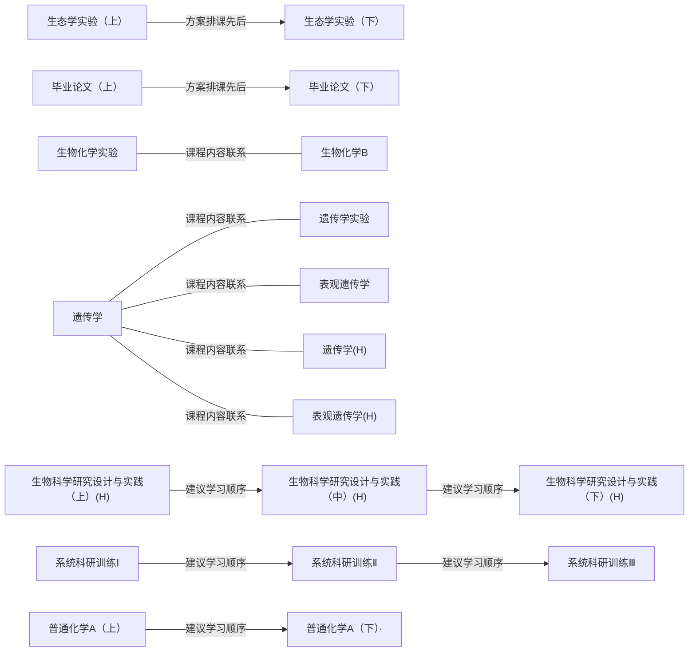

# 2024级生态学专业“2+X”教学培养方案

生命科学学院 · 生态学 · 方案 72959 · 90 个不同课程或科研条目。

[官方 Word](../originals/plan-72959.docx) · [教务详情](https://fdjwgl.fudan.edu.cn/manager/bizType/2/major-program-search/info/72959?skipAuth=1) · [方案快照](../raw/plan-72959.json.gz) · [年级目录](../README.md)

## 课程关系图

图中展示部分关系。下表保留全部已建立的课程对，来源位置使用本方案 JSON Pointer。

## 先修与内容联系

| 类型 | 起点 | 终点 | 依据 | 原表定位 |
| --- | --- | --- | --- | --- |
| 建议学习顺序 | 毕业论文（上） (BIOL40012) | 毕业论文（下） (BIOL40013) | 同方案的课程题名具有连续分册或序号。  | `/courseModules/6/planCourses/19`、`/courseModules/6/planCourses/20` |
| 建议学习顺序 | 系统科研训练Ⅰ (BIOL50046) | 系统科研训练Ⅱ (BIOL50047) | 同方案的课程题名具有连续分册或序号。  | `/courseModules/9/planCourses/22`、`/courseModules/10/planCourses/18` |
| 建议学习顺序 | 系统科研训练Ⅱ (BIOL50047) | 系统科研训练Ⅲ (BIOL50048) | 同方案的课程题名具有连续分册或序号。  | `/courseModules/10/planCourses/18`、`/courseModules/10/planCourses/19` |
| 建议学习顺序 | 生物科学研究设计与实践（上）(H) (BIOL50055h) | 生物科学研究设计与实践（中）(H) (BIOL50056h) | 同方案的课程题名具有连续分册或序号。  | `/courseModules/15/planCourses/5`、`/courseModules/9/planCourses/2` |
| 建议学习顺序 | 生物科学研究设计与实践（中）(H) (BIOL50056h) | 生物科学研究设计与实践（下）(H) (BIOL50057h) | 同方案的课程题名具有连续分册或序号。  | `/courseModules/9/planCourses/2`、`/courseModules/10/planCourses/8` |
| 建议学习顺序 | 普通化学A（上） (CHEM10003) | 普通化学A（下） (CHEM10004) | 同方案的课程题名具有连续分册或序号。  | `/courseModules/5/planCourses/2`、`/courseModules/5/planCourses/3` |
| 建议学习顺序 | 生态学实验（上） (ECOL30008) | 生态学实验（下） (ECOL30009) | 同方案的课程题名具有连续分册或序号。  | `/courseModules/6/planCourses/16`、`/courseModules/6/planCourses/17` |
| 建议学习顺序 | 高等数学B(上） (MATH10004) | 高等数学B(下） (MATH10005) | 同方案的课程题名具有连续分册或序号。  | `/courseModules/5/planCourses/5`、`/courseModules/5/planCourses/6` |
| 建议学习顺序 | 大学物理B(上) (PHYS10003) | 大学物理B(下) (PHYS10004) | 同方案的课程题名具有连续分册或序号。  | `/courseModules/5/planCourses/7`、`/courseModules/5/planCourses/8` |
| 方案排课先后 | 毕业论文（上） (BIOL40012) | 毕业论文（下） (BIOL40013) | 同方案该课程全部明确数字学期均早于后者。  | `/courseModules/6/planCourses/19`、`/courseModules/6/planCourses/20` |
| 方案排课先后 | 生态学实验（上） (ECOL30008) | 生态学实验（下） (ECOL30009) | 同方案该课程全部明确数字学期均早于后者。  | `/courseModules/6/planCourses/16`、`/courseModules/6/planCourses/17` |
| 课程内容联系 | 生物化学实验 (BIOL30003) | 生物化学B (BIOL30013) | 本方案两门课程的题名均含“生物化学”，可据此对照这一主题。  | `/courseModules/6/planCourses/8`、`/courseModules/6/planCourses/7` |
| 课程内容联系 | 遗传学 (BIOL30008) | 遗传学(H) (BIOL30008h) | 本方案两门课程的题名均含“遗传学”，可据此对照这一主题。  | `/courseModules/6/planCourses/13`、`/courseModules/14/planCourses/0` |
| 课程内容联系 | 遗传学 (BIOL30008) | 遗传学实验 (BIOL30009) | 题名显示相同主题的课程与实验、实践或实习。  | `/courseModules/6/planCourses/13`、`/courseModules/6/planCourses/14` |
| 课程内容联系 | 遗传学 (BIOL30008) | 表观遗传学 (BIOL50019) | 本方案两门课程的题名均含“遗传学”，可据此对照这一主题。  | `/courseModules/6/planCourses/13`、`/courseModules/10/planCourses/14` |
| 课程内容联系 | 遗传学 (BIOL30008) | 表观遗传学(H) (BIOL50019h) | 本方案两门课程的题名均含“遗传学”，可据此对照这一主题。  | `/courseModules/6/planCourses/13`、`/courseModules/15/planCourses/1` |
| 课程内容联系 | 生物化学B (BIOL30013) | 生物化学(H) (BIOL30024h) | 本方案两门课程的题名均含“生物化学”，可据此对照这一主题。  | `/courseModules/6/planCourses/7`、`/courseModules/14/planCourses/1` |
| 课程内容联系 | 生理学与神经生物学(H) (BIOL30025h) | 植物生理学 (BIOL50021) | 本方案两门课程的题名均含“生理学”，可据此对照这一主题。  | `/courseModules/14/planCourses/3`、`/courseModules/9/planCourses/10` |
| 课程内容联系 | 生物统计学 (BIOL50004) | 统计学导论 (STAT50013) | 本方案两门课程的题名均含“统计学”，可据此对照这一主题。  | `/courseModules/9/planCourses/1`、`/courseModules/10/planCourses/7` |
| 课程内容联系 | 生物信息学 (BIOL50012) | 生物信息学实验 (BIOL50045) | 题名显示相同主题的课程与实验、实践或实习。  | `/courseModules/10/planCourses/13`、`/courseModules/10/planCourses/17` |
| 课程内容联系 | 有机化学 (CHEM20011) | 有机化学实验 (CHEM20012) | 题名显示相同主题的课程与实验、实践或实习。  | `/courseModules/6/planCourses/0`、`/courseModules/6/planCourses/1` |
| 课程内容联系 | 土壤生态学 (ECOL50009) | 入侵生态学 (ECOL50015) | 本方案两门课程的题名均含“生态学”，可据此对照这一主题。  | `/courseModules/9/planCourses/15`、`/courseModules/9/planCourses/21` |
| 课程内容联系 | 化学生态学 (ECOL50010) | 入侵生态学 (ECOL50015) | 本方案两门课程的题名均含“生态学”，可据此对照这一主题。  | `/courseModules/9/planCourses/16`、`/courseModules/9/planCourses/21` |
| 课程内容联系 | 分子生态学 (ECOL50012) | 入侵生态学 (ECOL50015) | 本方案两门课程的题名均含“生态学”，可据此对照这一主题。  | `/courseModules/9/planCourses/18`、`/courseModules/9/planCourses/21` |
| 课程内容联系 | 入侵生态学 (ECOL50015) | 城市生态学 (ESE50032) | 本方案两门课程的题名均含“生态学”，可据此对照这一主题。  | `/courseModules/9/planCourses/21`、`/courseModules/10/planCourses/3` |

本次未从可定位的明确表述中确认课程对课程预修。学期安排、系列分册与编辑建议均保留各自的依据。

## 按原方案模块阅读

同一模块展示原表中的课程归属。模块内课程之间的先后仍须逐项查阅。

- **核心四选二**　细胞生物学(H)、遗传学(H)、生物化学(H)、生理学与神经生物学(H)（原表模块 14）

## 课程表

同一课程在不同模块分别出现时，按原表逐行列出。季节字段保留原值。

| 课程 | 代码 | 学分 | 学期 | 模块 |
| --- | --- | ---: | --- | --- |
| 现代生物科学导论A | BIOL10001 | 3.0 | AUTUMN | 培养方案 / 专业培养课程 / 大类基础课程 |
| 现代生物科学实验 | BIOL10003 | 1.0 | AUTUMN | 培养方案 / 专业培养课程 / 大类基础课程 |
| 普通化学A（上） | CHEM10003 | 2.0 | AUTUMN | 培养方案 / 专业培养课程 / 大类基础课程 |
| 普通化学A（下） | CHEM10004 | 2.0 | SPRING | 培养方案 / 专业培养课程 / 大类基础课程 |
| 普通化学实验I | CHEM10005 | 1.0 | AUTUMN | 培养方案 / 专业培养课程 / 大类基础课程 |
| 高等数学B(上） | MATH10004 | 5.0 | AUTUMN | 培养方案 / 专业培养课程 / 大类基础课程 |
| 高等数学B(下） | MATH10005 | 5.0 | SPRING | 培养方案 / 专业培养课程 / 大类基础课程 |
| 大学物理B(上) | PHYS10003 | 4.0 | AUTUMN | 培养方案 / 专业培养课程 / 大类基础课程 |
| 大学物理B(下) | PHYS10004 | 4.0 | SPRING | 培养方案 / 专业培养课程 / 大类基础课程 |
| 基础物理实验 | PHYS10005 | 2.0 | SPRING | 培养方案 / 专业培养课程 / 大类基础课程 |
| 有机化学 | CHEM20011 | 4.0 | 第3学期 | 培养方案 / 专业培养课程 / 专业核心教育课程 |
| 有机化学实验 | CHEM20012 | 2.0 | 第3学期 | 培养方案 / 专业培养课程 / 专业核心教育课程 |
| 动物生物学 | ECOL30004 | 3.0 | 第3学期 | 培养方案 / 专业培养课程 / 专业核心教育课程 |
| 动物学实验 | ECOL30002 | 1.5 | 第3学期 | 培养方案 / 专业培养课程 / 专业核心教育课程 |
| 生物多样性科学导论 | BIOL30016 | 2.0 | 第3学期 | 培养方案 / 专业培养课程 / 专业核心教育课程 |
| 植物生物学 | ECOL30005 | 3.0 | 第4学期 | 培养方案 / 专业培养课程 / 专业核心教育课程 |
| 植物学实验 | ECOL30001 | 1.5 | 第4学期 | 培养方案 / 专业培养课程 / 专业核心教育课程 |
| 生物化学B | BIOL30013 | 3.0 | 第4学期 | 培养方案 / 专业培养课程 / 专业核心教育课程 |
| 生物化学实验 | BIOL30003 | 1.5 | 第4学期 | 培养方案 / 专业培养课程 / 专业核心教育课程 |
| 种群生态学 | ECOL30006 | 2.0 | 第4学期 | 培养方案 / 专业培养课程 / 专业核心教育课程 |
| 群落生态学 | ECOL30007 | 2.0 | 第4学期 | 培养方案 / 专业培养课程 / 专业核心教育课程 |
| 生物学野外实习 | ECOL30003 | 2.0 | SUMMER | 培养方案 / 专业培养课程 / 专业核心教育课程 |
| 微生物学 | BIOL30006 | 3.0 | 第5学期 | 培养方案 / 专业培养课程 / 专业核心教育课程 |
| 遗传学 | BIOL30008 | 3.0 | 第5学期 | 培养方案 / 专业培养课程 / 专业核心教育课程 |
| 遗传学实验 | BIOL30009 | 1.5 | 第5学期 | 培养方案 / 专业培养课程 / 专业核心教育课程 |
| 生态系统生态学 | ECOL30010 | 2.0 | 第5学期 | 培养方案 / 专业培养课程 / 专业核心教育课程 |
| 生态学实验（上） | ECOL30008 | 2.0 | 第5学期 | 培养方案 / 专业培养课程 / 专业核心教育课程 |
| 生态学实验（下） | ECOL30009 | 2.0 | 第6学期 | 培养方案 / 专业培养课程 / 专业核心教育课程 |
| 生态学野外实习 | ECOL30011 | 1.0 | SUMMER | 培养方案 / 专业培养课程 / 专业核心教育课程 |
| 毕业论文（上） | BIOL40012 | 2.0 | 第7学期 | 培养方案 / 专业培养课程 / 专业核心教育课程 |
| 毕业论文（下） | BIOL40013 | 4.0 | 第8学期 | 培养方案 / 专业培养课程 / 专业核心教育课程 |
| 科学研究方法与论文写作 | BIOL50013 | 2.0 | SPRING | 培养方案 / 专业进阶 I |
| 生物统计学 | BIOL50004 | 3.0 | AUTUMN | 培养方案 / 专业进阶 I |
| 生物科学研究设计与实践（中）(H) | BIOL50056h | 2.0 | AUTUMN | 培养方案 / 专业进阶 I |
| 生态遥感 | ECOL50016 | 2.0 | SPRING | 培养方案 / 专业进阶 I |
| 自然地理学 | ECOL50007 | 2.0 | AUTUMN | 培养方案 / 专业进阶 I |
| 基因组学 | BIOL50009 | 2.0 | AUTUMN | 培养方案 / 专业进阶 I |
| 行为生态学 | ECOL50001 | 2.0 | AUTUMN | 培养方案 / 专业进阶 I |
| 生物地理学 | ECOL50002 | 2.0 | AUTUMN | 培养方案 / 专业进阶 I |
| 进化生物学 | BIOL50018 | 2.0 | SPRING | 培养方案 / 专业进阶 I |
| 物种起源导论 | ECOL50003 | 2.0 | SPRING | 培养方案 / 专业进阶 I |
| 植物生理学 | BIOL50021 | 2.0 | AUTUMN | 培养方案 / 专业进阶 I |
| 全球变化生物学 | ECOL50004 | 2.0 | AUTUMN | 培养方案 / 专业进阶 I |
| 生物安全导论 | ECOL50005 | 2.0 | SPRING | 培养方案 / 专业进阶 I |
| 植物多样性与进化 | ECOL50006 | 2.0 | AUTUMN | 培养方案 / 专业进阶 I |
| 景观生态学 | ECOL50008 | 2.0 | SPRING | 培养方案 / 专业进阶 I |
| 土壤生态学 | ECOL50009 | 2.0 | AUTUMN | 培养方案 / 专业进阶 I |
| 化学生态学 | ECOL50010 | 2.0 | AUTUMN | 培养方案 / 专业进阶 I |
| 湿地生态学 | ECOL50011 | 2.0 | AUTUMN | 培养方案 / 专业进阶 I |
| 分子生态学 | ECOL50012 | 2.0 | AUTUMN | 培养方案 / 专业进阶 I |
| 保护生物学 | ECOL50013 | 2.0 | AUTUMN | 培养方案 / 专业进阶 I |
| 生态与社会 | ECOL50014 | 2.0 | SPRING | 培养方案 / 专业进阶 I |
| 入侵生态学 | ECOL50015 | 2.0 | AUTUMN | 培养方案 / 专业进阶 I |
| 系统科研训练Ⅰ | BIOL50046 | 2.0 | 第4学期 | 培养方案 / 专业进阶 I |
| 人工智能生物学 | AIS310017 | 2.0 | AUTUMN | 培养方案 / 专业进阶 I |
| 全球变化生态学 | ECOL50019 | 2.0 |  | 培养方案 / 专业进阶 I |
| 线性统计分析 | STAT50014 | 2.0 | SPRING | 培养方案 / 专业进阶 II |
| 植物细胞与发育生物学 | BIOL50026 | 2.0 | SPRING | 培养方案 / 专业进阶 II |
| 微生物分子生态学 | BIOL50036 | 2.0 | SPRING | 培养方案 / 专业进阶 II |
| 城市生态学 | ESE50032 | 2.0 | AUTUMN | 培养方案 / 专业进阶 II |
| 生态工程 | ESE50038 | 2.0 | AUTUMN | 培养方案 / 专业进阶 II |
| 生态经济学 | ESE50046 | 2.0 | SPRING | 培养方案 / 专业进阶 II |
| 自然资源和环境保护法 | LAW30003 | 2.0 | SPRING | 培养方案 / 专业进阶 II |
| 统计学导论 | STAT50013 | 2.0 | AUTUMN | 培养方案 / 专业进阶 II |
| 生物科学研究设计与实践（下）(H) | BIOL50057h | 2.0 | AUTUMN | 培养方案 / 专业进阶 II |
| 生命科学科研伦理和规范 | BIOL50016 | 2.0 | SPRING、AUTUMN | 培养方案 / 专业进阶 II |
| 水环境多样性与环境评价 | BIOL130097 | 2.0 | SUMMER | 培养方案 / 专业进阶 II |
| 水环境多样性与环境评价 II | BIOL130155 | 2.0 | SUMMER | 培养方案 / 专业进阶 II |
| 遗传分析原理 | BIOL50015 | 2.0 | AUTUMN | 培养方案 / 专业进阶 II |
| 生物信息学 | BIOL50012 | 3.0 | SPRING | 培养方案 / 专业进阶 II |
| 表观遗传学 | BIOL50019 | 2.0 | AUTUMN | 培养方案 / 专业进阶 II |
| 艺术、科学研究与创新思维 | BIOL50025 | 2.0 | SPRING | 培养方案 / 专业进阶 II |
| R语言与统计计算 | BIOL130174 | 2.0 | SPRING | 培养方案 / 专业进阶 II |
| 生物信息学实验 | BIOL50045 | 2.0 | AUTUMN | 培养方案 / 专业进阶 II |
| 系统科研训练Ⅱ | BIOL50047 | 3.0 | SUMMER | 培养方案 / 专业进阶 II |
| 系统科研训练Ⅲ | BIOL50048 | 3.0 | 第5学期 | 培养方案 / 专业进阶 II |
| 组学数据分析和AI应用 | AIT531022 | 2.0 | AUTUMN | 培养方案 / 专业进阶 II |
| 生态学野外研究方法与实践 | ECOL70005 | 3.0 |  | 培养方案 / 专业进阶 II |
| 遗传学(H) | BIOL30008h | 4.0 | 第5学期 | 培养方案 / 荣誉项目 / 核心四选二 |
| 生物化学(H) | BIOL30024h | 6.0 | 第4学期 | 培养方案 / 荣誉项目 / 核心四选二 |
| 细胞生物学(H) | BIOL30004h | 5.0 | 第4学期 | 培养方案 / 荣誉项目 / 核心四选二 |
| 生理学与神经生物学(H) | BIOL30025h | 4.0 | 第5学期 | 培养方案 / 荣誉项目 / 核心四选二 |
| 遗传分析(H) | BIOL50015h | 4.0 | 第7学期 | 培养方案 / 荣誉项目 / 其他 |
| 表观遗传学(H) | BIOL50019h | 4.0 | 第5学期 | 培养方案 / 荣誉项目 / 其他 |
| 感染与免疫(H) | BIOL50058h | 4.0 | 第6学期 | 培养方案 / 荣誉项目 / 其他 |
| 干细胞与发育(H) | BIOL50059h | 4.0 | 第6学期 | 培养方案 / 荣誉项目 / 其他 |
| 创新源泉与能力(H) | BIOL50054h | 3.0 | 第4学期 | 培养方案 / 荣誉项目 / 其他 |
| 生物科学研究设计与实践（上）(H) | BIOL50055h | 2.0 | 第3学期 | 培养方案 / 荣誉项目 / 其他 |
| 生物科学研究设计与实践（中）(H) | BIOL50056h | 2.0 | 第5学期 | 培养方案 / 荣誉项目 / 其他 |
| 生物科学研究设计与实践（下）(H) | BIOL50057h | 2.0 | 第7学期 | 培养方案 / 荣誉项目 / 其他 |
| 生物学综合实验基础 (H) | BIOL50060h | 4.0 | 第2学期 | 培养方案 / 荣誉项目 / 其他 |
| 人类进化遗传学(H) | BIOL50017h | 4.0 | 第6学期 | 培养方案 / 荣誉项目 / 其他 |
