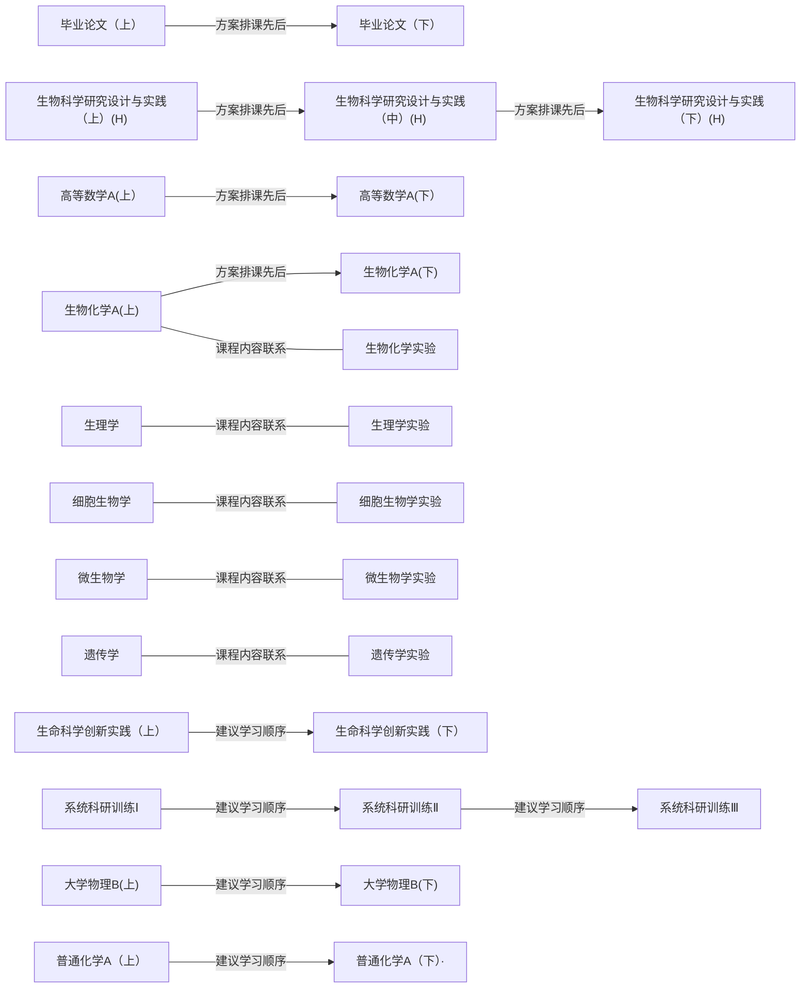

# 生物科学专业教学培养方案（相辉计划适用）

生命科学学院 · 生物科学(相辉计划) · 方案 72996 · 173 个不同课程或科研条目。

[官方 Word](../originals/plan-72996.docx) · [教务详情](https://fdjwgl.fudan.edu.cn/manager/bizType/2/major-program-search/info/72996?skipAuth=1) · [方案快照](../raw/plan-72996.json.gz) · [年级目录](../README.md)

## 修读导读

- **建议先学**　《生物化学A(上)》（`BIOL30002`） → 《生物化学A(下)》（`BIOL30021`）。题名列出连续册次或级别。可沿用同一张结构与功能对照表，把后续分册涉及的分子和过程补进去。方案分别列在第4、5学期。

- **可以对照着读**　《生理学》（`BIOL30010`）与《生理学实验》（`BIOL30020`）。可在实验或实践课中记录用到了哪些课堂概念，再回到相应章节复习。

- **查模块选课**　《普通生物学》（`BIOL30019`）、《普通生物学专业实验》（`BIOL30023`）列在“专业核心教育课程”中。模块说明写明“要求修读47.5学分（可修读荣誉课程替代对应的普通课程），多出学分可以认定为进阶学分”。原表见 `/courseModules/6`。

## 课程关系图

图中展示部分关系。下表保留全部已建立的课程对，来源位置使用本方案 JSON Pointer。

## 先修与内容联系

| 类型 | 起点 | 终点 | 依据 | 原表定位 |
| --- | --- | --- | --- | --- |
| 建议学习顺序 | 人工智能导论 (AIE310005) | 模式识别与机器学习 (AIE410001) | 人工智能问题与模型类别可为学习模式识别作准备。  | `/courseModules/16/planCourses/4`、`/courseModules/16/planCourses/6` |
| 建议学习顺序 | 生命科学创新实践（上） (BIOL130157) | 生命科学创新实践（下） (BIOL130158) | 同方案的课程题名具有连续分册或序号。  | `/courseModules/10/planCourses/47`、`/courseModules/10/planCourses/48` |
| 建议学习顺序 | 生物化学A(上) (BIOL30002) | 生物化学A(下) (BIOL30021) | 同方案的课程题名具有连续分册或序号。  | `/courseModules/6/planCourses/8`、`/courseModules/6/planCourses/9` |
| 建议学习顺序 | 毕业论文（上） (BIOL40012) | 毕业论文（下） (BIOL40013) | 同方案的课程题名具有连续分册或序号。  | `/courseModules/6/planCourses/18`、`/courseModules/6/planCourses/19` |
| 建议学习顺序 | 系统科研训练Ⅰ (BIOL50046) | 系统科研训练Ⅱ (BIOL50047) | 同方案的课程题名具有连续分册或序号。  | `/courseModules/10/planCourses/49`、`/courseModules/10/planCourses/50` |
| 建议学习顺序 | 系统科研训练Ⅱ (BIOL50047) | 系统科研训练Ⅲ (BIOL50048) | 同方案的课程题名具有连续分册或序号。  | `/courseModules/10/planCourses/50`、`/courseModules/10/planCourses/51` |
| 建议学习顺序 | 生物科学研究设计与实践（上）(H) (BIOL50055h) | 生物科学研究设计与实践（中）(H) (BIOL50056h) | 同方案的课程题名具有连续分册或序号。  | `/courseModules/22/planCourses/5`、`/courseModules/22/planCourses/6` |
| 建议学习顺序 | 生物科学研究设计与实践（中）(H) (BIOL50056h) | 生物科学研究设计与实践（下）(H) (BIOL50057h) | 同方案的课程题名具有连续分册或序号。  | `/courseModules/22/planCourses/6`、`/courseModules/22/planCourses/7` |
| 建议学习顺序 | 普通化学A（上） (CHEM10003) | 普通化学A（下） (CHEM10004) | 同方案的课程题名具有连续分册或序号。  | `/courseModules/5/planCourses/7`、`/courseModules/5/planCourses/8` |
| 建议学习顺序 | 分析化学AⅠ (CHEM20001) | 分析化学AⅡ (CHEM20002) | 同方案的课程题名具有连续分册或序号。  | `/courseModules/15/planCourses/3`、`/courseModules/15/planCourses/4` |
| 建议学习顺序 | 无机化学和化学分析实验Ⅰ (CHEM20003) | 无机化学和化学分析实验Ⅱ (CHEM130004) | 同方案的课程题名具有连续分册或序号。  | `/courseModules/15/planCourses/11`、`/courseModules/15/planCourses/12` |
| 建议学习顺序 | 合成化学实验(上) (CHEM20004) | 合成化学实验(下) (CHEM30003) | 同方案的课程题名具有连续分册或序号。  | `/courseModules/15/planCourses/13`、`/courseModules/15/planCourses/14` |
| 建议学习顺序 | 物理化学AⅠ (CHEM20005) | 物理化学AⅡ (CHEM20006) | 同方案的课程题名具有连续分册或序号。  | `/courseModules/15/planCourses/0`、`/courseModules/15/planCourses/1` |
| 建议学习顺序 | 物理化学AⅡ (CHEM20006) | 物理化学AⅢ (CHEM30004) | 同方案的课程题名具有连续分册或序号。  | `/courseModules/15/planCourses/1`、`/courseModules/15/planCourses/2` |
| 建议学习顺序 | 有机化学A I (CHEM20013) | 有机化学A II (CHEM20014) | 同方案的课程题名具有连续分册或序号。  | `/courseModules/15/planCourses/9`、`/courseModules/15/planCourses/10` |
| 建议学习顺序 | 物理化学实验（上） (CHEM30031) | 物理化学实验（下） (CHEM30032) | 同方案的课程题名具有连续分册或序号。  | `/courseModules/15/planCourses/5`、`/courseModules/15/planCourses/6` |
| 建议学习顺序 | 集成电路实验(上) (ICSE40008) | 集成电路实验(下) (ICSE40009) | 同方案的课程题名具有连续分册或序号。  | `/courseModules/17/planCourses/10`、`/courseModules/17/planCourses/11` |
| 建议学习顺序 | 高等代数Ⅰ (MATH10009) | 高等代数II (MATH10019) | 同方案的课程题名具有连续分册或序号。  | `/courseModules/13/planCourses/0`、`/courseModules/13/planCourses/1` |
| 建议学习顺序 | 高等数学A(上） (MATH10015) | 高等数学A(下） (MATH10016) | 同方案的课程题名具有连续分册或序号。  | `/courseModules/5/planCourses/0`、`/courseModules/5/planCourses/1` |
| 建议学习顺序 | 经典数学思想I (MATH10021) | 经典数学思想Ⅱ (MATH10022) | 同方案的课程题名具有连续分册或序号。  | `/courseModules/13/planCourses/4`、`/courseModules/13/planCourses/5` |
| 建议学习顺序 | 实变函数 (MATH20017) | 泛函分析 (MATH30004) | 测度与积分有助于理解函数空间。  | `/courseModules/13/planCourses/10`、`/courseModules/13/planCourses/11` |
| 建议学习顺序 | 大学物理B(上) (PHYS10003) | 大学物理B(下) (PHYS10004) | 同方案的课程题名具有连续分册或序号。  | `/courseModules/5/planCourses/2`、`/courseModules/5/planCourses/3` |
| 建议学习顺序 | 大学物理实验Ⅱ (PHYS20015) | 大学物理实验Ⅲ (PHYS20016) | 同方案的课程题名具有连续分册或序号。  | `/courseModules/14/planCourses/2`、`/courseModules/14/planCourses/5` |
| 方案排课先后 | 生物化学A(上) (BIOL30002) | 生物化学A(下) (BIOL30021) | 同方案该课程全部明确数字学期均早于后者。  | `/courseModules/6/planCourses/8`、`/courseModules/6/planCourses/9` |
| 方案排课先后 | 毕业论文（上） (BIOL40012) | 毕业论文（下） (BIOL40013) | 同方案该课程全部明确数字学期均早于后者。  | `/courseModules/6/planCourses/18`、`/courseModules/6/planCourses/19` |
| 方案排课先后 | 生物科学研究设计与实践（上）(H) (BIOL50055h) | 生物科学研究设计与实践（中）(H) (BIOL50056h) | 同方案该课程全部明确数字学期均早于后者。  | `/courseModules/22/planCourses/5`、`/courseModules/22/planCourses/6` |
| 方案排课先后 | 生物科学研究设计与实践（中）(H) (BIOL50056h) | 生物科学研究设计与实践（下）(H) (BIOL50057h) | 同方案该课程全部明确数字学期均早于后者。  | `/courseModules/22/planCourses/6`、`/courseModules/22/planCourses/7` |
| 方案排课先后 | 分析化学AⅠ (CHEM20001) | 分析化学AⅡ (CHEM20002) | 同方案该课程全部明确数字学期均早于后者。  | `/courseModules/15/planCourses/3`、`/courseModules/15/planCourses/4` |
| 方案排课先后 | 合成化学实验(上) (CHEM20004) | 合成化学实验(下) (CHEM30003) | 同方案该课程全部明确数字学期均早于后者。  | `/courseModules/15/planCourses/13`、`/courseModules/15/planCourses/14` |
| 方案排课先后 | 物理化学AⅠ (CHEM20005) | 物理化学AⅡ (CHEM20006) | 同方案该课程全部明确数字学期均早于后者。  | `/courseModules/15/planCourses/0`、`/courseModules/15/planCourses/1` |
| 方案排课先后 | 物理化学AⅡ (CHEM20006) | 物理化学AⅢ (CHEM30004) | 同方案该课程全部明确数字学期均早于后者。  | `/courseModules/15/planCourses/1`、`/courseModules/15/planCourses/2` |
| 方案排课先后 | 有机化学A I (CHEM20013) | 有机化学A II (CHEM20014) | 同方案该课程全部明确数字学期均早于后者。  | `/courseModules/15/planCourses/9`、`/courseModules/15/planCourses/10` |
| 方案排课先后 | 物理化学实验（上） (CHEM30031) | 物理化学实验（下） (CHEM30032) | 同方案该课程全部明确数字学期均早于后者。  | `/courseModules/15/planCourses/5`、`/courseModules/15/planCourses/6` |
| 方案排课先后 | 集成电路实验(上) (ICSE40008) | 集成电路实验(下) (ICSE40009) | 同方案该课程全部明确数字学期均早于后者。  | `/courseModules/17/planCourses/10`、`/courseModules/17/planCourses/11` |
| 方案排课先后 | 高等代数Ⅰ (MATH10009) | 高等代数II (MATH10019) | 同方案该课程全部明确数字学期均早于后者。  | `/courseModules/13/planCourses/0`、`/courseModules/13/planCourses/1` |
| 方案排课先后 | 高等数学A(上） (MATH10015) | 高等数学A(下） (MATH10016) | 同方案该课程全部明确数字学期均早于后者。  | `/courseModules/5/planCourses/0`、`/courseModules/5/planCourses/1` |
| 方案排课先后 | 经典数学思想I (MATH10021) | 经典数学思想Ⅱ (MATH10022) | 同方案该课程全部明确数字学期均早于后者。  | `/courseModules/13/planCourses/4`、`/courseModules/13/planCourses/5` |
| 方案排课先后 | 实变函数 (MATH20017) | 泛函分析 (MATH30004) | 同方案该课程全部明确数字学期均早于后者。  | `/courseModules/13/planCourses/10`、`/courseModules/13/planCourses/11` |
| 方案排课先后 | 大学物理实验Ⅱ (PHYS20015) | 大学物理实验Ⅲ (PHYS20016) | 同方案该课程全部明确数字学期均早于后者。  | `/courseModules/14/planCourses/2`、`/courseModules/14/planCourses/5` |
| 课程内容联系 | 人工智能导论 (AIE310005) | 人工智能安全 (AIE831001) | 本方案两门课程的题名均含“人工智能”，可据此对照这一主题。  | `/courseModules/16/planCourses/4`、`/courseModules/16/planCourses/7` |
| 课程内容联系 | 人工智能的编程基础 (AIE310006) | 人工智能安全 (AIE831001) | 本方案两门课程的题名均含“人工智能”，可据此对照这一主题。  | `/courseModules/16/planCourses/0`、`/courseModules/16/planCourses/7` |
| 课程内容联系 | 人工智能的数学基础 (AIE310009) | 模式识别与机器学习 (AIE410001) | 数学表达与学习模型的统计、优化工具可对照。  | `/courseModules/16/planCourses/2`、`/courseModules/16/planCourses/6` |
| 课程内容联系 | 人工智能的数学基础 (AIE310009) | 人工智能安全 (AIE831001) | 本方案两门课程的题名均含“人工智能”，可据此对照这一主题。  | `/courseModules/16/planCourses/2`、`/courseModules/16/planCourses/7` |
| 课程内容联系 | 模式识别与机器学习 (AIE410001) | 机器学习在物理实验中的应用 (AIS310013) | 本方案两门课程的题名均含“机器学习”，可据此对照这一主题。  | `/courseModules/16/planCourses/6`、`/courseModules/14/planCourses/13` |
| 课程内容联系 | 人工智能安全 (AIE831001) | 人工智能生物学 (AIS310017) | 本方案两门课程的题名均含“人工智能”，可据此对照这一主题。  | `/courseModules/16/planCourses/7`、`/courseModules/11/planCourses/0` |
| 课程内容联系 | 人工智能在分析化学中的应用 (AIT310024) | 分析化学 (CHEM20015) | 本方案两门课程的题名均含“分析化学”，可据此对照这一主题。  | `/courseModules/15/planCourses/18`、`/courseModules/6/planCourses/2` |
| 课程内容联系 | 生物化学A(上) (BIOL30002) | 生物化学实验 (BIOL30003) | 本方案两门课程的题名均含“生物化学”，可据此对照这一主题。  | `/courseModules/6/planCourses/8`、`/courseModules/6/planCourses/10` |
| 课程内容联系 | 生物化学实验 (BIOL30003) | 生物化学A(下) (BIOL30021) | 本方案两门课程的题名均含“生物化学”，可据此对照这一主题。  | `/courseModules/6/planCourses/10`、`/courseModules/6/planCourses/9` |
| 课程内容联系 | 生物化学实验 (BIOL30003) | 生物化学(H) (BIOL30024h) | 本方案两门课程的题名均含“生物化学”，可据此对照这一主题。  | `/courseModules/6/planCourses/10`、`/courseModules/21/planCourses/1` |
| 课程内容联系 | 细胞生物学 (BIOL30004) | 细胞生物学(H) (BIOL30004h) | 本方案两门课程的题名均含“细胞生物学”，可据此对照这一主题。  | `/courseModules/6/planCourses/11`、`/courseModules/21/planCourses/2` |
| 课程内容联系 | 细胞生物学 (BIOL30004) | 细胞生物学实验 (BIOL30005) | 题名显示相同主题的课程与实验、实践或实习。  | `/courseModules/6/planCourses/11`、`/courseModules/6/planCourses/12` |
| 课程内容联系 | 微生物学 (BIOL30006) | 微生物学实验 (BIOL30007) | 题名显示相同主题的课程与实验、实践或实习。  | `/courseModules/6/planCourses/13`、`/courseModules/6/planCourses/14` |
| 课程内容联系 | 遗传学 (BIOL30008) | 遗传学(H) (BIOL30008h) | 本方案两门课程的题名均含“遗传学”，可据此对照这一主题。  | `/courseModules/6/planCourses/15`、`/courseModules/21/planCourses/0` |
| 课程内容联系 | 遗传学 (BIOL30008) | 遗传学实验 (BIOL30009) | 题名显示相同主题的课程与实验、实践或实习。  | `/courseModules/6/planCourses/15`、`/courseModules/6/planCourses/16` |
| 课程内容联系 | 遗传学 (BIOL30008) | 表观遗传学 (BIOL50019) | 本方案两门课程的题名均含“遗传学”，可据此对照这一主题。  | `/courseModules/6/planCourses/15`、`/courseModules/10/planCourses/20` |
| 课程内容联系 | 遗传学 (BIOL30008) | 表观遗传学(H) (BIOL50019h) | 本方案两门课程的题名均含“遗传学”，可据此对照这一主题。  | `/courseModules/6/planCourses/15`、`/courseModules/22/planCourses/1` |
| 课程内容联系 | 生理学 (BIOL30010) | 生理学实验 (BIOL30020) | 题名显示相同主题的课程与实验、实践或实习。  | `/courseModules/6/planCourses/6`、`/courseModules/6/planCourses/7` |
| 课程内容联系 | 生理学 (BIOL30010) | 生理学与神经生物学(H) (BIOL30025h) | 本方案两门课程的题名均含“生理学”，可据此对照这一主题。  | `/courseModules/6/planCourses/6`、`/courseModules/21/planCourses/3` |
| 课程内容联系 | 生理学 (BIOL30010) | 植物生理学 (BIOL50021) | 本方案两门课程的题名均含“生理学”，可据此对照这一主题。  | `/courseModules/6/planCourses/6`、`/courseModules/10/planCourses/8` |
| 课程内容联系 | 生物信息学 (BIOL50012) | 生物信息学实验 (BIOL50045) | 题名显示相同主题的课程与实验、实践或实习。  | `/courseModules/10/planCourses/6`、`/courseModules/10/planCourses/19` |
| 课程内容联系 | 无机化学和化学分析实验Ⅱ (CHEM130004) | 无机化学 (CHEM30005) | 本方案两门课程的题名均含“无机化学”，可据此对照这一主题。  | `/courseModules/15/planCourses/12`、`/courseModules/15/planCourses/8` |
| 课程内容联系 | 分析化学AⅠ (CHEM20001) | 分析化学 (CHEM20015) | 本方案两门课程的题名均含“分析化学”，可据此对照这一主题。  | `/courseModules/15/planCourses/3`、`/courseModules/6/planCourses/2` |
| 课程内容联系 | 分析化学AⅡ (CHEM20002) | 分析化学 (CHEM20015) | 本方案两门课程的题名均含“分析化学”，可据此对照这一主题。  | `/courseModules/15/planCourses/4`、`/courseModules/6/planCourses/2` |
| 课程内容联系 | 无机化学和化学分析实验Ⅰ (CHEM20003) | 无机化学 (CHEM30005) | 本方案两门课程的题名均含“无机化学”，可据此对照这一主题。  | `/courseModules/15/planCourses/11`、`/courseModules/15/planCourses/8` |
| 课程内容联系 | 物理化学AⅠ (CHEM20005) | 物理化学AⅡ (CHEM20006) | 本方案两门课程的题名均含“物理化学”，可据此对照这一主题。  | `/courseModules/15/planCourses/0`、`/courseModules/15/planCourses/1` |
| 课程内容联系 | 物理化学AⅠ (CHEM20005) | 物理化学AⅢ (CHEM30004) | 本方案两门课程的题名均含“物理化学”，可据此对照这一主题。  | `/courseModules/15/planCourses/0`、`/courseModules/15/planCourses/2` |
| 课程内容联系 | 物理化学AⅠ (CHEM20005) | 物理化学实验（上） (CHEM30031) | 本方案两门课程的题名均含“物理化学”，可据此对照这一主题。  | `/courseModules/15/planCourses/0`、`/courseModules/15/planCourses/5` |
| 课程内容联系 | 物理化学AⅠ (CHEM20005) | 物理化学实验（下） (CHEM30032) | 本方案两门课程的题名均含“物理化学”，可据此对照这一主题。  | `/courseModules/15/planCourses/0`、`/courseModules/15/planCourses/6` |
| 课程内容联系 | 有机化学 (CHEM20011) | 有机化学实验 (CHEM20012) | 题名显示相同主题的课程与实验、实践或实习。  | `/courseModules/6/planCourses/0`、`/courseModules/6/planCourses/1` |
| 课程内容联系 | 有机化学 (CHEM20011) | 有机化学A I (CHEM20013) | 本方案两门课程的题名均含“有机化学”，可据此对照这一主题。  | `/courseModules/6/planCourses/0`、`/courseModules/15/planCourses/9` |
| 课程内容联系 | 有机化学 (CHEM20011) | 有机化学A II (CHEM20014) | 本方案两门课程的题名均含“有机化学”，可据此对照这一主题。  | `/courseModules/6/planCourses/0`、`/courseModules/15/planCourses/10` |
| 课程内容联系 | 分析化学 (CHEM20015) | 分析化学实验 (CHEM20016) | 题名显示相同主题的课程与实验、实践或实习。  | `/courseModules/6/planCourses/2`、`/courseModules/6/planCourses/3` |
| 课程内容联系 | 景观生态学 (ECOL50008) | 入侵生态学 (ECOL50015) | 本方案两门课程的题名均含“生态学”，可据此对照这一主题。  | `/courseModules/10/planCourses/33`、`/courseModules/10/planCourses/40` |
| 课程内容联系 | 土壤生态学 (ECOL50009) | 入侵生态学 (ECOL50015) | 本方案两门课程的题名均含“生态学”，可据此对照这一主题。  | `/courseModules/10/planCourses/34`、`/courseModules/10/planCourses/40` |
| 课程内容联系 | 化学生态学 (ECOL50010) | 入侵生态学 (ECOL50015) | 本方案两门课程的题名均含“生态学”，可据此对照这一主题。  | `/courseModules/10/planCourses/35`、`/courseModules/10/planCourses/40` |
| 课程内容联系 | 分子生态学 (ECOL50012) | 入侵生态学 (ECOL50015) | 本方案两门课程的题名均含“生态学”，可据此对照这一主题。  | `/courseModules/10/planCourses/37`、`/courseModules/10/planCourses/40` |
| 课程内容联系 | 半导体物理 (ICSE20007) | 半导体器件原理 (ICSE30020) | 本方案两门课程的题名均含“半导体”，可据此对照这一主题。  | `/courseModules/17/planCourses/3`、`/courseModules/17/planCourses/5` |
| 课程内容联系 | 专用集成电路设计方法 (ICSE30007) | 集成电路工艺原理 (ICSE30010) | 本方案两门课程的题名均含“集成电路”，可据此对照这一主题。  | `/courseModules/17/planCourses/9`、`/courseModules/17/planCourses/7` |
| 课程内容联系 | 集成电路工艺原理 (ICSE30010) | 数字集成电路设计原理 (ICSE30021) | 本方案两门课程的题名均含“集成电路”，可据此对照这一主题。  | `/courseModules/17/planCourses/7`、`/courseModules/17/planCourses/6` |
| 课程内容联系 | 集成电路工艺原理 (ICSE30010) | 集成电路实验(上) (ICSE40008) | 本方案两门课程的题名均含“集成电路”，可据此对照这一主题。  | `/courseModules/17/planCourses/7`、`/courseModules/17/planCourses/10` |
| 课程内容联系 | 集成电路工艺原理 (ICSE30010) | 集成电路实验(下) (ICSE40009) | 本方案两门课程的题名均含“集成电路”，可据此对照这一主题。  | `/courseModules/17/planCourses/7`、`/courseModules/17/planCourses/11` |

本次未从可定位的明确表述中确认课程对课程预修。学期安排、系列分册与编辑建议均保留各自的依据。

## 按原方案模块阅读

同一模块展示原表中的课程归属。模块内课程之间的先后仍须逐项查阅。

- **生物科学、生物技术和生态学专业进阶课程**　生命科学创新实践（上）、生命科学创新实践（下）、分子生物学、生物多样性科学导论、高级生化技术、基因工程实验、生物统计学、免疫学、病毒学、核酸的化学与生物学、基因组学、神经生物学概论、生物信息学、科学研究方法与论文写作、遗传分析原理、生命科学科研伦理和规范、进化生物学、表观遗传学等52项（原表模块 10）
- **AI-S/AI-T课程**　人工智能生物学、人工智能结构生物学、组学数据分析和AI应用、生物药物研发与人工智能（原表模块 11）
- **数学组**　数据科学的逼近论基础、新型算法、高等代数Ⅰ、线性代数（理工类）、高等代数II、解析几何、经典数学思想I、经典数学思想Ⅱ、数学分析I（英才班）、数学分析II（英才班）、常微分方程、抽象代数、复变函数、实变函数、拓扑学、几何拓扑选讲、泛函分析（原表模块 13）
- **物理组**　机器学习在物理实验中的应用、AI物理、经典力学、数学物理方法A、大学物理A：光学、大学物理A：原子物理、热力学与统计物理I、概率论与数理统计、大学物理实验Ⅱ、大学物理实验Ⅲ、量子力学I、固体物理、近代物理实验I、电动力学、复杂科学前沿与创新（原表模块 14）
- **化学组**　人工智能在化学中的应用、人工智能化学计算模拟、人工智能在分析化学中的应用、无机化学和化学分析实验Ⅱ、分析化学AⅠ、分析化学AⅡ、无机化学和化学分析实验Ⅰ、合成化学实验(上)、物理化学AⅠ、物理化学AⅡ、有机化学A I、有机化学A II、仪器分析实验、合成化学实验(下)、物理化学AⅢ、无机化学、物理化学实验（上）、物理化学实验（下）等19项（原表模块 15）
- **人工智能组**　计算机系统基础、计算机视觉、人工智能导论、人工智能的编程基础、数据结构、人工智能的软件基础、人工智能的数学基础、模式识别与机器学习、自然语言处理与大语言模型、人工智能前沿探索实践、人工智能安全（原表模块 16）
- **微电子组**　模拟电子线路、数字逻辑基础、信号与系统概论、半导体物理、嵌入式处理器与芯片系统设计、专用集成电路设计方法、集成电路工艺原理、半导体器件原理、数字集成电路设计原理、模拟集成电路设计原理、集成电路实验(上)、集成电路实验(下)（原表模块 17）
- **核心四选二**　细胞生物学(H)、遗传学(H)、生物化学(H)、生理学与神经生物学(H)（原表模块 21）

## 课程表

同一课程在不同模块分别出现时，按原表逐行列出。季节字段保留原值。

| 课程 | 代码 | 学分 | 学期 | 模块 |
| --- | --- | ---: | --- | --- |
| 高等数学A(上） | MATH10015 | 5.0 | 第1学期 | 培养方案 / 专业培养课程 / 大类基础课程 |
| 高等数学A(下） | MATH10016 | 5.0 | 第2学期 | 培养方案 / 专业培养课程 / 大类基础课程 |
| 大学物理B(上) | PHYS10003 | 4.0 | AUTUMN | 培养方案 / 专业培养课程 / 大类基础课程 |
| 大学物理B(下) | PHYS10004 | 4.0 | SPRING | 培养方案 / 专业培养课程 / 大类基础课程 |
| 基础物理实验 | PHYS10005 | 2.0 | SPRING | 培养方案 / 专业培养课程 / 大类基础课程 |
| 现代生物科学导论A | BIOL10001 | 3.0 | AUTUMN | 培养方案 / 专业培养课程 / 大类基础课程 |
| 现代生物科学实验 | BIOL10003 | 1.0 | AUTUMN | 培养方案 / 专业培养课程 / 大类基础课程 |
| 普通化学A（上） | CHEM10003 | 2.0 | AUTUMN | 培养方案 / 专业培养课程 / 大类基础课程 |
| 普通化学A（下） | CHEM10004 | 2.0 | SPRING | 培养方案 / 专业培养课程 / 大类基础课程 |
| 普通化学实验I | CHEM10005 | 1.0 | AUTUMN | 培养方案 / 专业培养课程 / 大类基础课程 |
| 有机化学 | CHEM20011 | 4.0 | 第3学期 | 培养方案 / 专业培养课程 / 专业核心教育课程 |
| 有机化学实验 | CHEM20012 | 2.0 | 第3学期 | 培养方案 / 专业培养课程 / 专业核心教育课程 |
| 分析化学 | CHEM20015 | 2.0 | 第3学期 | 培养方案 / 专业培养课程 / 专业核心教育课程 |
| 分析化学实验 | CHEM20016 | 2.0 | 第3学期 | 培养方案 / 专业培养课程 / 专业核心教育课程 |
| 普通生物学 | BIOL30019 | 3.0 | 第3学期 | 培养方案 / 专业培养课程 / 专业核心教育课程 |
| 普通生物学专业实验 | BIOL30023 | 2.0 | 第3学期 | 培养方案 / 专业培养课程 / 专业核心教育课程 |
| 生理学 | BIOL30010 | 3.0 | 第4学期 | 培养方案 / 专业培养课程 / 专业核心教育课程 |
| 生理学实验 | BIOL30020 | 1.5 | 第4学期 | 培养方案 / 专业培养课程 / 专业核心教育课程 |
| 生物化学A(上) | BIOL30002 | 3.0 | 第4学期 | 培养方案 / 专业培养课程 / 专业核心教育课程 |
| 生物化学A(下) | BIOL30021 | 2.0 | 第5学期 | 培养方案 / 专业培养课程 / 专业核心教育课程 |
| 生物化学实验 | BIOL30003 | 1.5 | 第4学期 | 培养方案 / 专业培养课程 / 专业核心教育课程 |
| 细胞生物学 | BIOL30004 | 3.0 | 第4学期 | 培养方案 / 专业培养课程 / 专业核心教育课程 |
| 细胞生物学实验 | BIOL30005 | 1.5 | 第4学期 | 培养方案 / 专业培养课程 / 专业核心教育课程 |
| 微生物学 | BIOL30006 | 3.0 | 第5学期 | 培养方案 / 专业培养课程 / 专业核心教育课程 |
| 微生物学实验 | BIOL30007 | 1.5 | 第5学期 | 培养方案 / 专业培养课程 / 专业核心教育课程 |
| 遗传学 | BIOL30008 | 3.0 | 第5学期 | 培养方案 / 专业培养课程 / 专业核心教育课程 |
| 遗传学实验 | BIOL30009 | 1.5 | 第5学期 | 培养方案 / 专业培养课程 / 专业核心教育课程 |
| 分子生物学 | BIOL30014 | 2.0 | 第5学期 | 培养方案 / 专业培养课程 / 专业核心教育课程 |
| 毕业论文（上） | BIOL40012 | 2.0 | 第7学期 | 培养方案 / 专业培养课程 / 专业核心教育课程 |
| 毕业论文（下） | BIOL40013 | 4.0 | 第8学期 | 培养方案 / 专业培养课程 / 专业核心教育课程 |
| 生物统计学 | BIOL50004 | 3.0 | AUTUMN | 培养方案 / 专业进阶I模块（2-15学分） / 生物科学、生物技术和生态学专业进阶课程 |
| 免疫学 | BIOL50005 | 2.0 | AUTUMN | 培养方案 / 专业进阶I模块（2-15学分） / 生物科学、生物技术和生态学专业进阶课程 |
| 病毒学 | BIOL50007 | 2.0 | AUTUMN | 培养方案 / 专业进阶I模块（2-15学分） / 生物科学、生物技术和生态学专业进阶课程 |
| 核酸的化学与生物学 | BIOL50008 | 2.0 | SPRING | 培养方案 / 专业进阶I模块（2-15学分） / 生物科学、生物技术和生态学专业进阶课程 |
| 基因组学 | BIOL50009 | 2.0 | AUTUMN | 培养方案 / 专业进阶I模块（2-15学分） / 生物科学、生物技术和生态学专业进阶课程 |
| 神经生物学概论 | BIOL50011 | 2.0 | AUTUMN | 培养方案 / 专业进阶I模块（2-15学分） / 生物科学、生物技术和生态学专业进阶课程 |
| 生物信息学 | BIOL50012 | 3.0 | SPRING | 培养方案 / 专业进阶I模块（2-15学分） / 生物科学、生物技术和生态学专业进阶课程 |
| 遗传分析原理 | BIOL50015 | 2.0 | AUTUMN | 培养方案 / 专业进阶I模块（2-15学分） / 生物科学、生物技术和生态学专业进阶课程 |
| 植物生理学 | BIOL50021 | 2.0 | AUTUMN | 培养方案 / 专业进阶I模块（2-15学分） / 生物科学、生物技术和生态学专业进阶课程 |
| 工业酶与生物催化 | BIOL50024 | 2.0 | AUTUMN | 培养方案 / 专业进阶I模块（2-15学分） / 生物科学、生物技术和生态学专业进阶课程 |
| 植物细胞与发育生物学 | BIOL50026 | 2.0 | AUTUMN | 培养方案 / 专业进阶I模块（2-15学分） / 生物科学、生物技术和生态学专业进阶课程 |
| 发育生物学 | BIOL50030 | 3.0 | AUTUMN | 培养方案 / 专业进阶I模块（2-15学分） / 生物科学、生物技术和生态学专业进阶课程 |
| 干细胞与细胞命运决定 | BIOL50031 | 2.0 | SPRING | 培养方案 / 专业进阶I模块（2-15学分） / 生物科学、生物技术和生态学专业进阶课程 |
| 癌生物学 | BIOL50033 | 2.0 | SPRING | 培养方案 / 专业进阶I模块（2-15学分） / 生物科学、生物技术和生态学专业进阶课程 |
| 结构生物学 | BIOL50034 | 2.0 | SPRING | 培养方案 / 专业进阶I模块（2-15学分） / 生物科学、生物技术和生态学专业进阶课程 |
| 病原生物学基础 | BIOL50037 | 2.0 | SPRING | 培养方案 / 专业进阶I模块（2-15学分） / 生物科学、生物技术和生态学专业进阶课程 |
| 遗传操作原理与应用 | BIOL50038 | 3.0 | AUTUMN | 培养方案 / 专业进阶I模块（2-15学分） / 生物科学、生物技术和生态学专业进阶课程 |
| 功能解剖学和组织学 | BIOL50042 | 3.0 | AUTUMN | 培养方案 / 专业进阶I模块（2-15学分） / 生物科学、生物技术和生态学专业进阶课程 |
| 代谢生物学 | BIOL50043 | 3.0 | AUTUMN | 培养方案 / 专业进阶I模块（2-15学分） / 生物科学、生物技术和生态学专业进阶课程 |
| 生物信息学实验 | BIOL50045 | 2.0 | AUTUMN | 培养方案 / 专业进阶I模块（2-15学分） / 生物科学、生物技术和生态学专业进阶课程 |
| 表观遗传学 | BIOL50019 | 2.0 | AUTUMN | 培养方案 / 专业进阶I模块（2-15学分） / 生物科学、生物技术和生态学专业进阶课程 |
| 药物设计学 | PHAR40004 | 1.0 | SPRING | 培养方案 / 专业进阶I模块（2-15学分） / 生物科学、生物技术和生态学专业进阶课程 |
| 药物化学概论 | PHAR30030 | 2.0 | SPRING | 培养方案 / 专业进阶I模块（2-15学分） / 生物科学、生物技术和生态学专业进阶课程 |
| 生物药剂学与药物动力学 | PHAR30036 | 2.0 | AUTUMN | 培养方案 / 专业进阶I模块（2-15学分） / 生物科学、生物技术和生态学专业进阶课程 |
| 行为生态学 | ECOL50001 | 2.0 | AUTUMN | 培养方案 / 专业进阶I模块（2-15学分） / 生物科学、生物技术和生态学专业进阶课程 |
| 分子生物学 | BIOL30014 | 2.0 | AUTUMN | 培养方案 / 专业进阶I模块（2-15学分） / 生物科学、生物技术和生态学专业进阶课程 |
| 生物地理学 | ECOL50002 | 2.0 | AUTUMN | 培养方案 / 专业进阶I模块（2-15学分） / 生物科学、生物技术和生态学专业进阶课程 |
| 进化生物学 | BIOL50018 | 2.0 | SPRING | 培养方案 / 专业进阶I模块（2-15学分） / 生物科学、生物技术和生态学专业进阶课程 |
| 全球变化生物学 | ECOL50004 | 2.0 | AUTUMN | 培养方案 / 专业进阶I模块（2-15学分） / 生物科学、生物技术和生态学专业进阶课程 |
| 生物安全导论 | ECOL50005 | 2.0 | SPRING | 培养方案 / 专业进阶I模块（2-15学分） / 生物科学、生物技术和生态学专业进阶课程 |
| 植物多样性与进化 | ECOL50006 | 2.0 | AUTUMN | 培养方案 / 专业进阶I模块（2-15学分） / 生物科学、生物技术和生态学专业进阶课程 |
| 生物多样性科学导论 | BIOL30016 | 2.0 | AUTUMN | 培养方案 / 专业进阶I模块（2-15学分） / 生物科学、生物技术和生态学专业进阶课程 |
| 自然地理学 | ECOL50007 | 2.0 | AUTUMN | 培养方案 / 专业进阶I模块（2-15学分） / 生物科学、生物技术和生态学专业进阶课程 |
| 景观生态学 | ECOL50008 | 2.0 | SPRING | 培养方案 / 专业进阶I模块（2-15学分） / 生物科学、生物技术和生态学专业进阶课程 |
| 土壤生态学 | ECOL50009 | 2.0 | AUTUMN | 培养方案 / 专业进阶I模块（2-15学分） / 生物科学、生物技术和生态学专业进阶课程 |
| 化学生态学 | ECOL50010 | 2.0 | AUTUMN | 培养方案 / 专业进阶I模块（2-15学分） / 生物科学、生物技术和生态学专业进阶课程 |
| 湿地生态学 | ECOL50011 | 2.0 | AUTUMN | 培养方案 / 专业进阶I模块（2-15学分） / 生物科学、生物技术和生态学专业进阶课程 |
| 分子生态学 | ECOL50012 | 2.0 | AUTUMN | 培养方案 / 专业进阶I模块（2-15学分） / 生物科学、生物技术和生态学专业进阶课程 |
| 保护生物学 | ECOL50013 | 2.0 | AUTUMN | 培养方案 / 专业进阶I模块（2-15学分） / 生物科学、生物技术和生态学专业进阶课程 |
| 生态与社会 | ECOL50014 | 2.0 | SPRING | 培养方案 / 专业进阶I模块（2-15学分） / 生物科学、生物技术和生态学专业进阶课程 |
| 入侵生态学 | ECOL50015 | 2.0 | AUTUMN | 培养方案 / 专业进阶I模块（2-15学分） / 生物科学、生物技术和生态学专业进阶课程 |
| 生态遥感 | ECOL50016 | 2.0 | SPRING | 培养方案 / 专业进阶I模块（2-15学分） / 生物科学、生物技术和生态学专业进阶课程 |
| 生物学野外实习 | ECOL30003 | 2.0 | SUMMER | 培养方案 / 专业进阶I模块（2-15学分） / 生物科学、生物技术和生态学专业进阶课程 |
| 高级生化技术 | BIOL50002 | 1.5 | SUMMER | 培养方案 / 专业进阶I模块（2-15学分） / 生物科学、生物技术和生态学专业进阶课程 |
| 基因工程实验 | BIOL50003 | 1.5 | AUTUMN | 培养方案 / 专业进阶I模块（2-15学分） / 生物科学、生物技术和生态学专业进阶课程 |
| 科学研究方法与论文写作 | BIOL50013 | 2.0 | SPRING | 培养方案 / 专业进阶I模块（2-15学分） / 生物科学、生物技术和生态学专业进阶课程 |
| 生命科学科研伦理和规范 | BIOL50016 | 2.0 | SPRING、AUTUMN | 培养方案 / 专业进阶I模块（2-15学分） / 生物科学、生物技术和生态学专业进阶课程 |
| 生命科学创新实践（上） | BIOL130157 | 1.0 | SUMMER | 培养方案 / 专业进阶I模块（2-15学分） / 生物科学、生物技术和生态学专业进阶课程 |
| 生命科学创新实践（下） | BIOL130158 | 1.0 | AUTUMN | 培养方案 / 专业进阶I模块（2-15学分） / 生物科学、生物技术和生态学专业进阶课程 |
| 系统科研训练Ⅰ | BIOL50046 | 2.0 | 第4学期 | 培养方案 / 专业进阶I模块（2-15学分） / 生物科学、生物技术和生态学专业进阶课程 |
| 系统科研训练Ⅱ | BIOL50047 | 3.0 | SUMMER | 培养方案 / 专业进阶I模块（2-15学分） / 生物科学、生物技术和生态学专业进阶课程 |
| 系统科研训练Ⅲ | BIOL50048 | 3.0 | 第5学期 | 培养方案 / 专业进阶I模块（2-15学分） / 生物科学、生物技术和生态学专业进阶课程 |
| 人工智能生物学 | AIS310017 | 2.0 | AUTUMN | 培养方案 / 专业进阶I模块（2-15学分） / AI-S/AI-T课程 |
| 组学数据分析和AI应用 | AIT531022 | 2.0 | AUTUMN | 培养方案 / 专业进阶I模块（2-15学分） / AI-S/AI-T课程 |
| 生物药物研发与人工智能 | AIT631015 | 2.0 | SPRING | 培养方案 / 专业进阶I模块（2-15学分） / AI-S/AI-T课程 |
| 人工智能结构生物学 | AIS410006 | 2.0 | AUTUMN | 培养方案 / 专业进阶I模块（2-15学分） / AI-S/AI-T课程 |
| 高等代数Ⅰ | MATH10009 | 5.0 | 第1学期 | 培养方案 / 理工科核心课程池（9-24学分） / 数学组 |
| 高等代数II | MATH10019 | 5.0 | 第2学期 | 培养方案 / 理工科核心课程池（9-24学分） / 数学组 |
| 数学分析I（英才班） | MATH130154 | 6.0 | 第1学期 | 培养方案 / 理工科核心课程池（9-24学分） / 数学组 |
| 数学分析II（英才班） | MATH130155 | 6.0 | 第2学期 | 培养方案 / 理工科核心课程池（9-24学分） / 数学组 |
| 经典数学思想I | MATH10021 | 3.0 | 第1学期 | 培养方案 / 理工科核心课程池（9-24学分） / 数学组 |
| 经典数学思想Ⅱ | MATH10022 | 3.0 | 第2学期 | 培养方案 / 理工科核心课程池（9-24学分） / 数学组 |
| 几何拓扑选讲 | MATH20019 | 4.0 | SPRING、AUTUMN | 培养方案 / 理工科核心课程池（9-24学分） / 数学组 |
| 抽象代数 | MATH20015 | 4.0 | 第3学期 | 培养方案 / 理工科核心课程池（9-24学分） / 数学组 |
| 常微分方程 | MATH20014 | 4.0 | 第3学期 | 培养方案 / 理工科核心课程池（9-24学分） / 数学组 |
| 复变函数 | MATH20016 | 4.0 | 第4学期 | 培养方案 / 理工科核心课程池（9-24学分） / 数学组 |
| 实变函数 | MATH20017 | 4.0 | 第4学期 | 培养方案 / 理工科核心课程池（9-24学分） / 数学组 |
| 泛函分析 | MATH30004 | 3.0 | 第5学期 | 培养方案 / 理工科核心课程池（9-24学分） / 数学组 |
| 拓扑学 | MATH20018 | 4.0 | 第4学期 | 培养方案 / 理工科核心课程池（9-24学分） / 数学组 |
| 解析几何 | MATH10020 | 4.0 | 第5学期 | 培养方案 / 理工科核心课程池（9-24学分） / 数学组 |
| 线性代数（理工类） | MATH10014 | 3.0 | SPRING、AUTUMN | 培养方案 / 理工科核心课程池（9-24学分） / 数学组 |
| 新型算法 | AIS631004 | 3.0 | AUTUMN | 培养方案 / 理工科核心课程池（9-24学分） / 数学组 |
| 数据科学的逼近论基础 | AIS631003 | 3.0 | AUTUMN | 培养方案 / 理工科核心课程池（9-24学分） / 数学组 |
| 概率论与数理统计 | PHYS20014 | 2.0 | 第3学期 | 培养方案 / 理工科核心课程池（9-24学分） / 物理组 |
| 经典力学 | PHYS20003 | 3.0 | 第3学期 | 培养方案 / 理工科核心课程池（9-24学分） / 物理组 |
| 大学物理实验Ⅱ | PHYS20015 | 2.0 | 第3学期 | 培养方案 / 理工科核心课程池（9-24学分） / 物理组 |
| 大学物理A：光学 | PHYS20010 | 3.0 | 第3学期 | 培养方案 / 理工科核心课程池（9-24学分） / 物理组 |
| 大学物理A：原子物理 | PHYS20011 | 3.0 | 第4学期 | 培养方案 / 理工科核心课程池（9-24学分） / 物理组 |
| 大学物理实验Ⅲ | PHYS20016 | 2.0 | 第4学期 | 培养方案 / 理工科核心课程池（9-24学分） / 物理组 |
| 数学物理方法A | PHYS20006 | 4.0 | 第4学期 | 培养方案 / 理工科核心课程池（9-24学分） / 物理组 |
| 热力学与统计物理I | PHYS20013 | 4.0 | 第4学期 | 培养方案 / 理工科核心课程池（9-24学分） / 物理组 |
| 量子力学I | PHYS30010 | 4.0 | 第5学期 | 培养方案 / 理工科核心课程池（9-24学分） / 物理组 |
| 电动力学 | PHYS30016 | 4.0 | 第5学期 | 培养方案 / 理工科核心课程池（9-24学分） / 物理组 |
| 固体物理 | PHYS30011 | 4.0 | 第6学期 | 培养方案 / 理工科核心课程池（9-24学分） / 物理组 |
| 近代物理实验I | PHYS30013 | 4.0 | 第6学期 | 培养方案 / 理工科核心课程池（9-24学分） / 物理组 |
| AI物理 | AIS531004 | 3.0 | SPRING | 培养方案 / 理工科核心课程池（9-24学分） / 物理组 |
| 机器学习在物理实验中的应用 | AIS310013 | 3.0 | SPRING | 培养方案 / 理工科核心课程池（9-24学分） / 物理组 |
| 复杂科学前沿与创新 | PHYS30024 | 3.0 | SPRING、AUTUMN | 培养方案 / 理工科核心课程池（9-24学分） / 物理组 |
| 物理化学AⅠ | CHEM20005 | 3.0 | 第3学期 | 培养方案 / 理工科核心课程池（9-24学分） / 化学组 |
| 物理化学AⅡ | CHEM20006 | 3.0 | 第4学期 | 培养方案 / 理工科核心课程池（9-24学分） / 化学组 |
| 物理化学AⅢ | CHEM30004 | 3.0 | 第5学期 | 培养方案 / 理工科核心课程池（9-24学分） / 化学组 |
| 分析化学AⅠ | CHEM20001 | 2.0 | 第3学期 | 培养方案 / 理工科核心课程池（9-24学分） / 化学组 |
| 分析化学AⅡ | CHEM20002 | 2.0 | 第4学期 | 培养方案 / 理工科核心课程池（9-24学分） / 化学组 |
| 物理化学实验（上） | CHEM30031 | 2.0 | 第5学期 | 培养方案 / 理工科核心课程池（9-24学分） / 化学组 |
| 物理化学实验（下） | CHEM30032 | 2.0 | 第6学期 | 培养方案 / 理工科核心课程池（9-24学分） / 化学组 |
| 仪器分析实验 | CHEM20020 | 2.0 | 第4学期 | 培养方案 / 理工科核心课程池（9-24学分） / 化学组 |
| 无机化学 | CHEM30005 | 3.0 | 第5学期、第6学期 | 培养方案 / 理工科核心课程池（9-24学分） / 化学组 |
| 有机化学A I | CHEM20013 | 4.0 | 第3学期 | 培养方案 / 理工科核心课程池（9-24学分） / 化学组 |
| 有机化学A II | CHEM20014 | 2.0 | 第4学期 | 培养方案 / 理工科核心课程池（9-24学分） / 化学组 |
| 无机化学和化学分析实验Ⅰ | CHEM20003 | 2.0 | 第3学期 | 培养方案 / 理工科核心课程池（9-24学分） / 化学组 |
| 无机化学和化学分析实验Ⅱ | CHEM130004 | 2.0 | 第3学期 | 培养方案 / 理工科核心课程池（9-24学分） / 化学组 |
| 合成化学实验(上) | CHEM20004 | 2.0 | 第4学期 | 培养方案 / 理工科核心课程池（9-24学分） / 化学组 |
| 合成化学实验(下) | CHEM30003 | 2.0 | 第5学期 | 培养方案 / 理工科核心课程池（9-24学分） / 化学组 |
| 高分子化学B | MASE30007 | 2.0 | 第5学期 | 培养方案 / 理工科核心课程池（9-24学分） / 化学组 |
| 人工智能化学计算模拟 | AIS531005 | 2.0 | SPRING | 培养方案 / 理工科核心课程池（9-24学分） / 化学组 |
| 人工智能在化学中的应用 | AIS310014 | 2.0 | AUTUMN | 培养方案 / 理工科核心课程池（9-24学分） / 化学组 |
| 人工智能在分析化学中的应用 | AIT310024 | 2.0 | AUTUMN | 培养方案 / 理工科核心课程池（9-24学分） / 化学组 |
| 人工智能的编程基础 | AIE310006 | 2.0 | AUTUMN | 培养方案 / 理工科核心课程池（9-24学分） / 人工智能组 |
| 数据结构 | AIE310007 | 4.0 | AUTUMN | 培养方案 / 理工科核心课程池（9-24学分） / 人工智能组 |
| 人工智能的数学基础 | AIE310009 | 3.0 | AUTUMN | 培养方案 / 理工科核心课程池（9-24学分） / 人工智能组 |
| 计算机系统基础 | AIE210006 | 3.0 | AUTUMN | 培养方案 / 理工科核心课程池（9-24学分） / 人工智能组 |
| 人工智能导论 | AIE310005 | 3.0 | AUTUMN | 培养方案 / 理工科核心课程池（9-24学分） / 人工智能组 |
| 人工智能的软件基础 | AIE310008 | 3.0 | AUTUMN | 培养方案 / 理工科核心课程池（9-24学分） / 人工智能组 |
| 模式识别与机器学习 | AIE410001 | 3.0 | AUTUMN | 培养方案 / 理工科核心课程池（9-24学分） / 人工智能组 |
| 人工智能安全 | AIE831001 | 3.0 | AUTUMN | 培养方案 / 理工科核心课程池（9-24学分） / 人工智能组 |
| 自然语言处理与大语言模型 | AIE410002 | 3.0 | AUTUMN | 培养方案 / 理工科核心课程池（9-24学分） / 人工智能组 |
| 计算机视觉 | AIE310004 | 3.0 | AUTUMN | 培养方案 / 理工科核心课程池（9-24学分） / 人工智能组 |
| 人工智能前沿探索实践 | AIE531001 | 3.0 | AUTUMN | 培养方案 / 理工科核心课程池（9-24学分） / 人工智能组 |
| 模拟电子线路 | ICSE20004 | 3.0 | 第3学期 | 培养方案 / 理工科核心课程池（9-24学分） / 微电子组 |
| 数字逻辑基础 | ICSE20005 | 4.0 | 第3学期 | 培养方案 / 理工科核心课程池（9-24学分） / 微电子组 |
| 信号与系统概论 | ICSE20006 | 3.0 | 第4学期 | 培养方案 / 理工科核心课程池（9-24学分） / 微电子组 |
| 半导体物理 | ICSE20007 | 4.0 | 第4学期 | 培养方案 / 理工科核心课程池（9-24学分） / 微电子组 |
| 嵌入式处理器与芯片系统设计 | ICSE20008 | 5.0 | 第4学期 | 培养方案 / 理工科核心课程池（9-24学分） / 微电子组 |
| 半导体器件原理 | ICSE30020 | 4.0 | 第5学期 | 培养方案 / 理工科核心课程池（9-24学分） / 微电子组 |
| 数字集成电路设计原理 | ICSE30021 | 3.0 | 第5学期 | 培养方案 / 理工科核心课程池（9-24学分） / 微电子组 |
| 集成电路工艺原理 | ICSE30010 | 3.0 | 第6学期 | 培养方案 / 理工科核心课程池（9-24学分） / 微电子组 |
| 模拟集成电路设计原理 | ICSE30022 | 3.0 | 第6学期 | 培养方案 / 理工科核心课程池（9-24学分） / 微电子组 |
| 专用集成电路设计方法 | ICSE30007 | 2.0 | 第6学期 | 培养方案 / 理工科核心课程池（9-24学分） / 微电子组 |
| 集成电路实验(上) | ICSE40008 | 3.0 | 第7学期 | 培养方案 / 理工科核心课程池（9-24学分） / 微电子组 |
| 集成电路实验(下) | ICSE40009 | 2.0 | 第8学期 | 培养方案 / 理工科核心课程池（9-24学分） / 微电子组 |
| 遗传学(H) | BIOL30008h | 4.0 | 第5学期 | 培养方案 / 荣誉项目 / 核心四选二 |
| 生物化学(H) | BIOL30024h | 6.0 | 第4学期 | 培养方案 / 荣誉项目 / 核心四选二 |
| 细胞生物学(H) | BIOL30004h | 5.0 | 第4学期 | 培养方案 / 荣誉项目 / 核心四选二 |
| 生理学与神经生物学(H) | BIOL30025h | 4.0 | 第5学期 | 培养方案 / 荣誉项目 / 核心四选二 |
| 遗传分析(H) | BIOL50015h | 4.0 | 第7学期 | 培养方案 / 荣誉项目 / 其他 |
| 表观遗传学(H) | BIOL50019h | 4.0 | 第5学期 | 培养方案 / 荣誉项目 / 其他 |
| 感染与免疫(H) | BIOL50058h | 4.0 | 第6学期 | 培养方案 / 荣誉项目 / 其他 |
| 干细胞与发育(H) | BIOL50059h | 4.0 | 第6学期 | 培养方案 / 荣誉项目 / 其他 |
| 创新源泉与能力(H) | BIOL50054h | 3.0 | 第4学期 | 培养方案 / 荣誉项目 / 其他 |
| 生物科学研究设计与实践（上）(H) | BIOL50055h | 2.0 | 第3学期 | 培养方案 / 荣誉项目 / 其他 |
| 生物科学研究设计与实践（中）(H) | BIOL50056h | 2.0 | 第5学期 | 培养方案 / 荣誉项目 / 其他 |
| 生物科学研究设计与实践（下）(H) | BIOL50057h | 2.0 | 第7学期 | 培养方案 / 荣誉项目 / 其他 |
| 生物学综合实验基础 (H) | BIOL50060h | 4.0 | 第2学期 | 培养方案 / 荣誉项目 / 其他 |
| 人类进化遗传学(H) | BIOL50017h | 4.0 | 第6学期 | 培养方案 / 荣誉项目 / 其他 |
