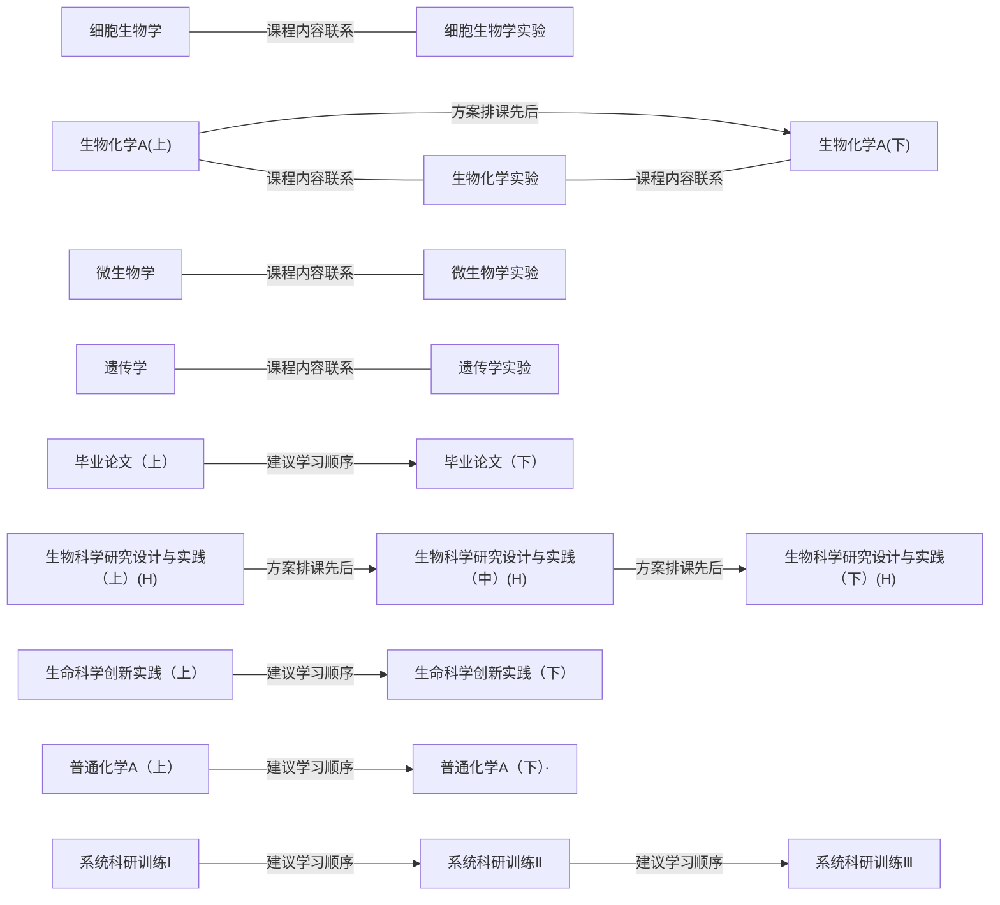

# 2024级生物技术专业“2+X”留学生教学培养方案

生命科学学院 · 生物技术 · 方案 73049 · 105 个不同课程或科研条目。

[官方 Word](../originals/plan-73049.docx) · [教务详情](https://fdjwgl.fudan.edu.cn/manager/bizType/2/major-program-search/info/73049?skipAuth=1) · [方案快照](../raw/plan-73049.json.gz) · [年级目录](../README.md)

## 修读导读

- **建议先学**　《生物化学A(上)》（`BIOL30002`） → 《生物化学A(下)》（`BIOL30021`）。题名列出连续册次或级别。可沿用同一张结构与功能对照表，把后续分册涉及的分子和过程补进去。方案分别列在第3、4学期。

- **可以对照着读**　《细胞生物学》（`BIOL30004`）与《细胞生物学实验》（`BIOL30005`）。可在实验或实践课中记录用到了哪些课堂概念，再回到相应章节复习。

- **查模块选课**　《生物化学实验》（`BIOL30003`）、《现代生物学基础实验》（`BIOL30011`）列在“专业核心教育课程”中。模块说明写明“要求必修48.5学分”。原表见 `/courseModules/6`。

## 课程关系图

图中展示部分关系。下表保留全部已建立的课程对，来源位置使用本方案 JSON Pointer。

## 先修与内容联系

| 类型 | 起点 | 终点 | 依据 | 原表定位 |
| --- | --- | --- | --- | --- |
| 建议学习顺序 | 生命科学创新实践（上） (BIOL130157) | 生命科学创新实践（下） (BIOL130158) | 同方案的课程题名具有连续分册或序号。  | `/courseModules/21/planCourses/1`、`/courseModules/21/planCourses/2` |
| 建议学习顺序 | 生物化学A(上) (BIOL30002) | 生物化学A(下) (BIOL30021) | 同方案的课程题名具有连续分册或序号。  | `/courseModules/6/planCourses/4`、`/courseModules/6/planCourses/5` |
| 建议学习顺序 | 毕业论文（上） (BIOL40012) | 毕业论文（下） (BIOL40013) | 同方案的课程题名具有连续分册或序号。  | `/courseModules/6/planCourses/19`、`/courseModules/6/planCourses/20` |
| 建议学习顺序 | 系统科研训练Ⅰ (BIOL50046) | 系统科研训练Ⅱ (BIOL50047) | 同方案的课程题名具有连续分册或序号。  | `/courseModules/8/planCourses/0`、`/courseModules/19/planCourses/0` |
| 建议学习顺序 | 系统科研训练Ⅱ (BIOL50047) | 系统科研训练Ⅲ (BIOL50048) | 同方案的课程题名具有连续分册或序号。  | `/courseModules/19/planCourses/0`、`/courseModules/19/planCourses/1` |
| 建议学习顺序 | 生物科学研究设计与实践（上）(H) (BIOL50055h) | 生物科学研究设计与实践（中）(H) (BIOL50056h) | 同方案的课程题名具有连续分册或序号。  | `/courseModules/32/planCourses/5`、`/courseModules/32/planCourses/6` |
| 建议学习顺序 | 生物科学研究设计与实践（中）(H) (BIOL50056h) | 生物科学研究设计与实践（下）(H) (BIOL50057h) | 同方案的课程题名具有连续分册或序号。  | `/courseModules/32/planCourses/6`、`/courseModules/32/planCourses/7` |
| 建议学习顺序 | 普通化学A（上） (CHEM10003) | 普通化学A（下） (CHEM10004) | 同方案的课程题名具有连续分册或序号。  | `/courseModules/5/planCourses/2`、`/courseModules/5/planCourses/3` |
| 建议学习顺序 | 高等数学B(上） (MATH10004) | 高等数学B(下） (MATH10005) | 同方案的课程题名具有连续分册或序号。  | `/courseModules/5/planCourses/5`、`/courseModules/5/planCourses/6` |
| 建议学习顺序 | 大学物理B(上) (PHYS10003) | 大学物理B(下) (PHYS10004) | 同方案的课程题名具有连续分册或序号。  | `/courseModules/5/planCourses/7`、`/courseModules/5/planCourses/8` |
| 方案排课先后 | 生物化学A(上) (BIOL30002) | 生物化学A(下) (BIOL30021) | 同方案该课程全部明确数字学期均早于后者。  | `/courseModules/6/planCourses/4`、`/courseModules/6/planCourses/5` |
| 方案排课先后 | 生物科学研究设计与实践（上）(H) (BIOL50055h) | 生物科学研究设计与实践（中）(H) (BIOL50056h) | 同方案该课程全部明确数字学期均早于后者。  | `/courseModules/32/planCourses/5`、`/courseModules/32/planCourses/6` |
| 方案排课先后 | 生物科学研究设计与实践（中）(H) (BIOL50056h) | 生物科学研究设计与实践（下）(H) (BIOL50057h) | 同方案该课程全部明确数字学期均早于后者。  | `/courseModules/32/planCourses/6`、`/courseModules/32/planCourses/7` |
| 课程内容联系 | 生物化学A(上) (BIOL30002) | 生物化学实验 (BIOL30003) | 本方案两门课程的题名均含“生物化学”，可据此对照这一主题。  | `/courseModules/6/planCourses/4`、`/courseModules/6/planCourses/6` |
| 课程内容联系 | 生物化学实验 (BIOL30003) | 生物化学A(下) (BIOL30021) | 本方案两门课程的题名均含“生物化学”，可据此对照这一主题。  | `/courseModules/6/planCourses/6`、`/courseModules/6/planCourses/5` |
| 课程内容联系 | 生物化学实验 (BIOL30003) | 生物化学(H) (BIOL30024h) | 本方案两门课程的题名均含“生物化学”，可据此对照这一主题。  | `/courseModules/6/planCourses/6`、`/courseModules/31/planCourses/1` |
| 课程内容联系 | 细胞生物学 (BIOL30004) | 细胞生物学(H) (BIOL30004h) | 本方案两门课程的题名均含“细胞生物学”，可据此对照这一主题。  | `/courseModules/6/planCourses/9`、`/courseModules/31/planCourses/2` |
| 课程内容联系 | 细胞生物学 (BIOL30004) | 细胞生物学实验 (BIOL30005) | 题名显示相同主题的课程与实验、实践或实习。  | `/courseModules/6/planCourses/9`、`/courseModules/6/planCourses/10` |
| 课程内容联系 | 微生物学 (BIOL30006) | 微生物学实验 (BIOL30007) | 题名显示相同主题的课程与实验、实践或实习。  | `/courseModules/6/planCourses/11`、`/courseModules/6/planCourses/12` |
| 课程内容联系 | 遗传学 (BIOL30008) | 遗传学(H) (BIOL30008h) | 本方案两门课程的题名均含“遗传学”，可据此对照这一主题。  | `/courseModules/6/planCourses/13`、`/courseModules/31/planCourses/0` |
| 课程内容联系 | 遗传学 (BIOL30008) | 遗传学实验 (BIOL30009) | 题名显示相同主题的课程与实验、实践或实习。  | `/courseModules/6/planCourses/13`、`/courseModules/6/planCourses/14` |
| 课程内容联系 | 遗传学 (BIOL30008) | 医学分子遗传学 (BIOL50006) | 本方案两门课程的题名均含“遗传学”，可据此对照这一主题。  | `/courseModules/6/planCourses/13`、`/courseModules/27/planCourses/0` |
| 课程内容联系 | 遗传学 (BIOL30008) | 表观遗传学 (BIOL50019) | 本方案两门课程的题名均含“遗传学”，可据此对照这一主题。  | `/courseModules/6/planCourses/13`、`/courseModules/27/planCourses/1` |
| 课程内容联系 | 生物统计学 (BIOL50004) | 统计学导论 (STAT50013) | 本方案两门课程的题名均含“统计学”，可据此对照这一主题。  | `/courseModules/11/planCourses/0`、`/courseModules/22/planCourses/1` |
| 课程内容联系 | 生物信息学 (BIOL50012) | 生物信息学实验 (BIOL50045) | 题名显示相同主题的课程与实验、实践或实习。  | `/courseModules/11/planCourses/1`、`/courseModules/22/planCourses/4` |
| 课程内容联系 | 有机化学 (CHEM20011) | 有机化学实验 (CHEM20012) | 题名显示相同主题的课程与实验、实践或实习。  | `/courseModules/6/planCourses/0`、`/courseModules/6/planCourses/1` |
| 课程内容联系 | 分析化学 (CHEM20015) | 分析化学实验 (CHEM20016) | 题名显示相同主题的课程与实验、实践或实习。  | `/courseModules/6/planCourses/2`、`/courseModules/6/planCourses/3` |
| 课程内容联系 | 药剂学概论 (PHAR30031) | 生物药剂学与药物动力学 (PHAR30036) | 本方案两门课程的题名均含“药剂”，可据此对照这一主题。  | `/courseModules/6/planCourses/18`、`/courseModules/18/planCourses/2` |

本次未从可定位的明确表述中确认课程对课程预修。学期安排、系列分册与编辑建议均保留各自的依据。

## 按原方案模块阅读

同一模块展示原表中的课程归属。模块内课程之间的先后仍须逐项查阅。

- **必选5门**　免疫学、工业酶与生物催化、遗传操作原理与应用、蛋白质与蛋白质工程（原表模块 9）
- **科学素养2选1**　科学研究方法与论文写作、生命科学科研伦理和规范（原表模块 10）
- **生物计算2选1**　生物统计学、生物信息学（原表模块 11）
- **实验2选1**　高级生化技术、基因工程实验（原表模块 12）
- **细胞发育**　发育生物学、干细胞与细胞命运决定（原表模块 13）
- **神经生理**　神经生物学概论、功能解剖学和组织学、代谢生物学（原表模块 14）
- **生物化学**　蛋白质与蛋白质工程、分子生物学、化学生物学：分子探针与生命调控、核酸的化学与生物学（原表模块 15）
- **遗传**　基因组学、遗传分析原理（原表模块 17）
- **药学**　药物化学概论、生物药剂学与药物动力学、药物设计学（原表模块 18）
- **实践**　系统科研训练Ⅱ、系统科研训练Ⅲ（原表模块 19）
- **科学素养**　生命科学创新实践（上）、生命科学创新实践（下）、定量生物物理学前沿导论、生命科学交叉前沿专题、艺术、科学研究与创新思维（原表模块 21）
- **生物计算**　组学数据分析和AI应用、生命科学中的机器学习、微阵列芯片和高通量测序数据分析与应用、大数据与精准医学、生物信息学实验、统计学导论（原表模块 22）
- **细胞发育**　发育与代谢、细胞器生物学、癌生物学、细胞周期与网络调控（原表模块 23）
- **神经生理**　生物物理学、膜片钳与离子通道（原表模块 24）
- **生物化学**　蛋白质组学、生物热力学（原表模块 25）
- **微生物免疫**　微生物分子遗传与代谢、病原生物学基础（原表模块 26）
- **遗传**　医学分子遗传学、表观遗传学、基因检测技术（原表模块 27）
- **药学**　药物分析、生物药物学、生物制药技术、生物技术药物给药系统、药物靶向传释系统、天然药物概论、中药新药研发概论、现代药物与给药系统（原表模块 28）
- **实践**　系统科研训练Ⅱ、系统科研训练Ⅲ（原表模块 29）
- **核心四选二**　细胞生物学(H)、遗传学(H)、生物化学(H)、生理学与神经生物学(H)（原表模块 31）

## 课程表

同一课程在不同模块分别出现时，按原表逐行列出。季节字段保留原值。

| 课程 | 代码 | 学分 | 学期 | 模块 |
| --- | --- | ---: | --- | --- |
| 现代生物科学导论A | BIOL10001 | 3.0 | AUTUMN | 培养方案 / 专业培养课程 / 大类基础课程 |
| 现代生物科学实验 | BIOL10003 | 1.0 | AUTUMN | 培养方案 / 专业培养课程 / 大类基础课程 |
| 普通化学A（上） | CHEM10003 | 2.0 | AUTUMN | 培养方案 / 专业培养课程 / 大类基础课程 |
| 普通化学A（下） | CHEM10004 | 2.0 | SPRING | 培养方案 / 专业培养课程 / 大类基础课程 |
| 普通化学实验I | CHEM10005 | 1.0 | AUTUMN | 培养方案 / 专业培养课程 / 大类基础课程 |
| 高等数学B(上） | MATH10004 | 5.0 | AUTUMN | 培养方案 / 专业培养课程 / 大类基础课程 |
| 高等数学B(下） | MATH10005 | 5.0 | SPRING | 培养方案 / 专业培养课程 / 大类基础课程 |
| 大学物理B(上) | PHYS10003 | 4.0 | AUTUMN | 培养方案 / 专业培养课程 / 大类基础课程 |
| 大学物理B(下) | PHYS10004 | 4.0 | SPRING | 培养方案 / 专业培养课程 / 大类基础课程 |
| 基础物理实验 | PHYS10005 | 2.0 | SPRING | 培养方案 / 专业培养课程 / 大类基础课程 |
| 有机化学 | CHEM20011 | 4.0 | 第3学期 | 培养方案 / 专业培养课程 / 专业核心教育课程 |
| 有机化学实验 | CHEM20012 | 2.0 | 第3学期 | 培养方案 / 专业培养课程 / 专业核心教育课程 |
| 分析化学 | CHEM20015 | 2.0 | 第3学期 | 培养方案 / 专业培养课程 / 专业核心教育课程 |
| 分析化学实验 | CHEM20016 | 2.0 | 第3学期 | 培养方案 / 专业培养课程 / 专业核心教育课程 |
| 生物化学A(上) | BIOL30002 | 3.0 | 第3学期 | 培养方案 / 专业培养课程 / 专业核心教育课程 |
| 生物化学A(下) | BIOL30021 | 2.0 | 第4学期 | 培养方案 / 专业培养课程 / 专业核心教育课程 |
| 生物化学实验 | BIOL30003 | 1.5 | 第4学期 | 培养方案 / 专业培养课程 / 专业核心教育课程 |
| 现代生物学基础实验 | BIOL30011 | 2.0 | 第3学期 | 培养方案 / 专业培养课程 / 专业核心教育课程 |
| 物理化学 | CHEM30002 | 2.0 | 第3学期 | 培养方案 / 专业培养课程 / 专业核心教育课程 |
| 细胞生物学 | BIOL30004 | 3.0 | 第4学期 | 培养方案 / 专业培养课程 / 专业核心教育课程 |
| 细胞生物学实验 | BIOL30005 | 1.5 | 第4学期 | 培养方案 / 专业培养课程 / 专业核心教育课程 |
| 微生物学 | BIOL30006 | 3.0 | 第5学期 | 培养方案 / 专业培养课程 / 专业核心教育课程 |
| 微生物学实验 | BIOL30007 | 1.5 | 第5学期 | 培养方案 / 专业培养课程 / 专业核心教育课程 |
| 遗传学 | BIOL30008 | 3.0 | 第5学期 | 培养方案 / 专业培养课程 / 专业核心教育课程 |
| 遗传学实验 | BIOL30009 | 1.5 | 第5学期 | 培养方案 / 专业培养课程 / 专业核心教育课程 |
| 医学基础 | PHAR20010 | 2.0 | 第5学期 | 培养方案 / 专业培养课程 / 专业核心教育课程 |
| 实习实训 | BIOL30015 | 2.0 | 第6学期 | 培养方案 / 专业培养课程 / 专业核心教育课程 |
| 药理学概论 | PHAR20011 | 2.5 | 第5学期 | 培养方案 / 专业培养课程 / 专业核心教育课程 |
| 药剂学概论 | PHAR30031 | 2.0 | 第6学期 | 培养方案 / 专业培养课程 / 专业核心教育课程 |
| 毕业论文（上） | BIOL40012 | 2.0 | 第8学期 | 培养方案 / 专业培养课程 / 专业核心教育课程 |
| 毕业论文（下） | BIOL40013 | 4.0 | 第7学期 | 培养方案 / 专业培养课程 / 专业核心教育课程 |
| 系统科研训练Ⅰ | BIOL50046 | 2.0 | SPRING | 培养方案 / 专业进阶 I |
| 免疫学 | BIOL50005 | 2.0 | AUTUMN | 培养方案 / 专业进阶 I / 必选5门 |
| 蛋白质与蛋白质工程 | BIOL820031 | 2.0 | SPRING | 培养方案 / 专业进阶 I / 必选5门 |
| 遗传操作原理与应用 | BIOL50038 | 3.0 | AUTUMN | 培养方案 / 专业进阶 I / 必选5门 |
| 工业酶与生物催化 | BIOL50024 | 2.0 | AUTUMN | 培养方案 / 专业进阶 I / 必选5门 |
| 科学研究方法与论文写作 | BIOL50013 | 2.0 | SPRING | 培养方案 / 专业进阶 I / 必选5门 / 科学素养2选1 |
| 生命科学科研伦理和规范 | BIOL50016 | 2.0 | SPRING、AUTUMN | 培养方案 / 专业进阶 I / 必选5门 / 科学素养2选1 |
| 生物统计学 | BIOL50004 | 3.0 | AUTUMN | 培养方案 / 专业进阶 I / 必选5门 / 生物计算2选1 |
| 生物信息学 | BIOL50012 | 3.0 | SPRING、AUTUMN | 培养方案 / 专业进阶 I / 必选5门 / 生物计算2选1 |
| 高级生化技术 | BIOL50002 | 1.5 | SUMMER | 培养方案 / 专业进阶 I / 必选5门 / 实验2选1 |
| 基因工程实验 | BIOL50003 | 1.5 | AUTUMN | 培养方案 / 专业进阶 I / 必选5门 / 实验2选1 |
| 发育生物学 | BIOL50030 | 3.0 | AUTUMN | 培养方案 / 专业进阶 I / 细胞发育 |
| 干细胞与细胞命运决定 | BIOL50031 | 2.0 | SPRING | 培养方案 / 专业进阶 I / 细胞发育 |
| 代谢生物学 | BIOL50043 | 3.0 | AUTUMN | 培养方案 / 专业进阶 I / 神经生理 |
| 神经生物学概论 | BIOL50011 | 2.0 | AUTUMN | 培养方案 / 专业进阶 I / 神经生理 |
| 功能解剖学和组织学 | BIOL50042 | 3.0 | AUTUMN | 培养方案 / 专业进阶 I / 神经生理 |
| 核酸的化学与生物学 | BIOL50008 | 2.0 | SPRING | 培养方案 / 专业进阶 I / 生物化学 |
| 分子生物学 | BIOL30014 | 2.0 | AUTUMN | 培养方案 / 专业进阶 I / 生物化学 |
| 蛋白质与蛋白质工程 | BIOL130033 | 2.0 | SPRING | 培养方案 / 专业进阶 I / 生物化学 |
| 化学生物学：分子探针与生命调控 | BIOL30018 | 3.0 |  | 培养方案 / 专业进阶 I / 生物化学 |
| 病毒学 | BIOL50007 | 2.0 | AUTUMN | 培养方案 / 专业进阶 I / 微生物免疫 |
| 基因组学 | BIOL50009 | 2.0 | AUTUMN | 培养方案 / 专业进阶 I / 遗传 |
| 遗传分析原理 | BIOL50015 | 2.0 | AUTUMN | 培养方案 / 专业进阶 I / 遗传 |
| 药物设计学 | PHAR40004 | 1.0 | SPRING | 培养方案 / 专业进阶 I / 药学 |
| 药物化学概论 | PHAR30030 | 2.0 | SPRING | 培养方案 / 专业进阶 I / 药学 |
| 生物药剂学与药物动力学 | PHAR30036 | 2.0 | AUTUMN | 培养方案 / 专业进阶 I / 药学 |
| 系统科研训练Ⅱ | BIOL50047 | 3.0 | SUMMER | 培养方案 / 专业进阶 I / 实践 |
| 系统科研训练Ⅲ | BIOL50048 | 3.0 | 第5学期 | 培养方案 / 专业进阶 I / 实践 |
| 系统科研训练Ⅱ | BIOL50047 | 3.0 | SUMMER | 培养方案 / 专业进阶 II |
| 系统科研训练Ⅲ | BIOL50048 | 3.0 | 第5学期 | 培养方案 / 专业进阶 II |
| 生命科学交叉前沿专题 | BIOL50020 | 2.0 | SPRING | 培养方案 / 专业进阶 II / 科学素养 |
| 生命科学创新实践（上） | BIOL130157 | 1.0 | SUMMER | 培养方案 / 专业进阶 II / 科学素养 |
| 生命科学创新实践（下） | BIOL130158 | 1.0 | AUTUMN | 培养方案 / 专业进阶 II / 科学素养 |
| 艺术、科学研究与创新思维 | BIOL50025 | 2.0 | SPRING | 培养方案 / 专业进阶 II / 科学素养 |
| 定量生物物理学前沿导论 | BIOL130167 | 2.0 | AUTUMN | 培养方案 / 专业进阶 II / 科学素养 |
| 大数据与精准医学 | BIOL50044 | 2.0 | AUTUMN | 培养方案 / 专业进阶 II / 生物计算 |
| 统计学导论 | STAT50013 | 2.0 | AUTUMN | 培养方案 / 专业进阶 II / 生物计算 |
| 微阵列芯片和高通量测序数据分析与应用 | BIOL50027 | 2.0 | AUTUMN | 培养方案 / 专业进阶 II / 生物计算 |
| 生命科学中的机器学习 | BIOL130173 | 2.0 | AUTUMN | 培养方案 / 专业进阶 II / 生物计算 |
| 生物信息学实验 | BIOL50045 | 2.0 | AUTUMN | 培养方案 / 专业进阶 II / 生物计算 |
| 组学数据分析和AI应用 | AIT531022 | 2.0 | AUTUMN | 培养方案 / 专业进阶 II / 生物计算 |
| 癌生物学 | BIOL50033 | 2.0 | SPRING | 培养方案 / 专业进阶 II / 细胞发育 |
| 细胞器生物学 | BIOL50032 | 2.0 | AUTUMN | 培养方案 / 专业进阶 II / 细胞发育 |
| 发育与代谢 | BIOL50028 | 2.0 | AUTUMN | 培养方案 / 专业进阶 II / 细胞发育 |
| 细胞周期与网络调控 | BIOL50065 | 2.0 |  | 培养方案 / 专业进阶 II / 细胞发育 |
| 生物物理学 | BIOL50010 | 2.0 | AUTUMN | 培养方案 / 专业进阶 II / 神经生理 |
| 膜片钳与离子通道 | BIOL70048 | 2.0 |  | 培养方案 / 专业进阶 II / 神经生理 |
| 蛋白质组学 | BIOL50014 | 2.0 | SPRING | 培养方案 / 专业进阶 II / 生物化学 |
| 生物热力学 | BIOL50023 | 2.0 | SPRING | 培养方案 / 专业进阶 II / 生物化学 |
| 病原生物学基础 | BIOL50037 | 2.0 | SPRING | 培养方案 / 专业进阶 II / 微生物免疫 |
| 微生物分子遗传与代谢 | BIOL50035 | 2.0 | AUTUMN | 培养方案 / 专业进阶 II / 微生物免疫 |
| 医学分子遗传学 | BIOL50006 | 2.0 | AUTUMN | 培养方案 / 专业进阶 II / 遗传 |
| 表观遗传学 | BIOL50019 | 2.0 | AUTUMN | 培养方案 / 专业进阶 II / 遗传 |
| 基因检测技术 | BIOL50039 | 2.0 | AUTUMN | 培养方案 / 专业进阶 II / 遗传 |
| 生物制药技术 | PHAR30001 | 2.0 | SPRING | 培养方案 / 专业进阶 II / 药学 |
| 生物技术药物给药系统 | PHAR30018 | 2.0 | SPRING、AUTUMN | 培养方案 / 专业进阶 II / 药学 |
| 药物靶向传释系统 | PHAR30021 | 2.0 | AUTUMN | 培养方案 / 专业进阶 II / 药学 |
| 天然药物概论 | PHAR30022 | 2.0 | SPRING | 培养方案 / 专业进阶 II / 药学 |
| 生物药物学 | PHAR20012 | 2.0 | SPRING | 培养方案 / 专业进阶 II / 药学 |
| 药物分析 | PHAR130120 | 2.0 | AUTUMN | 培养方案 / 专业进阶 II / 药学 |
| 现代药物与给药系统 | PHAR50001 | 3.0 | AUTUMN | 培养方案 / 专业进阶 II / 药学 |
| 中药新药研发概论 | PHAR30051 | 2.0 | SPRING | 培养方案 / 专业进阶 II / 药学 |
| 系统科研训练Ⅱ | BIOL50047 | 3.0 | SUMMER | 培养方案 / 专业进阶 II / 实践 |
| 系统科研训练Ⅲ | BIOL50048 | 3.0 | 第5学期 | 培养方案 / 专业进阶 II / 实践 |
| 遗传学(H) | BIOL30008h | 4.0 | 第5学期 | 培养方案 / 荣誉项目 / 核心四选二 |
| 生物化学(H) | BIOL30024h | 6.0 | 第4学期 | 培养方案 / 荣誉项目 / 核心四选二 |
| 细胞生物学(H) | BIOL30004h | 5.0 | 第4学期 | 培养方案 / 荣誉项目 / 核心四选二 |
| 生理学与神经生物学(H) | BIOL30025h | 4.0 | 第5学期 | 培养方案 / 荣誉项目 / 核心四选二 |
| 遗传分析(H) | BIOL50015h | 4.0 | 第7学期 | 培养方案 / 荣誉项目 / 其他 |
| 表观遗传学(H) | BIOL50019h | 4.0 | 第5学期 | 培养方案 / 荣誉项目 / 其他 |
| 感染与免疫(H) | BIOL50058h | 4.0 | 第6学期 | 培养方案 / 荣誉项目 / 其他 |
| 干细胞与发育(H) | BIOL50059h | 4.0 | 第6学期 | 培养方案 / 荣誉项目 / 其他 |
| 创新源泉与能力(H) | BIOL50054h | 3.0 | 第4学期 | 培养方案 / 荣誉项目 / 其他 |
| 生物科学研究设计与实践（上）(H) | BIOL50055h | 2.0 | 第3学期 | 培养方案 / 荣誉项目 / 其他 |
| 生物科学研究设计与实践（中）(H) | BIOL50056h | 2.0 | 第5学期 | 培养方案 / 荣誉项目 / 其他 |
| 生物科学研究设计与实践（下）(H) | BIOL50057h | 2.0 | 第7学期 | 培养方案 / 荣誉项目 / 其他 |
| 生物学综合实验基础 (H) | BIOL50060h | 4.0 | 第2学期 | 培养方案 / 荣誉项目 / 其他 |
| 人类进化遗传学(H) | BIOL50017h | 4.0 | 第6学期 | 培养方案 / 荣誉项目 / 其他 |
