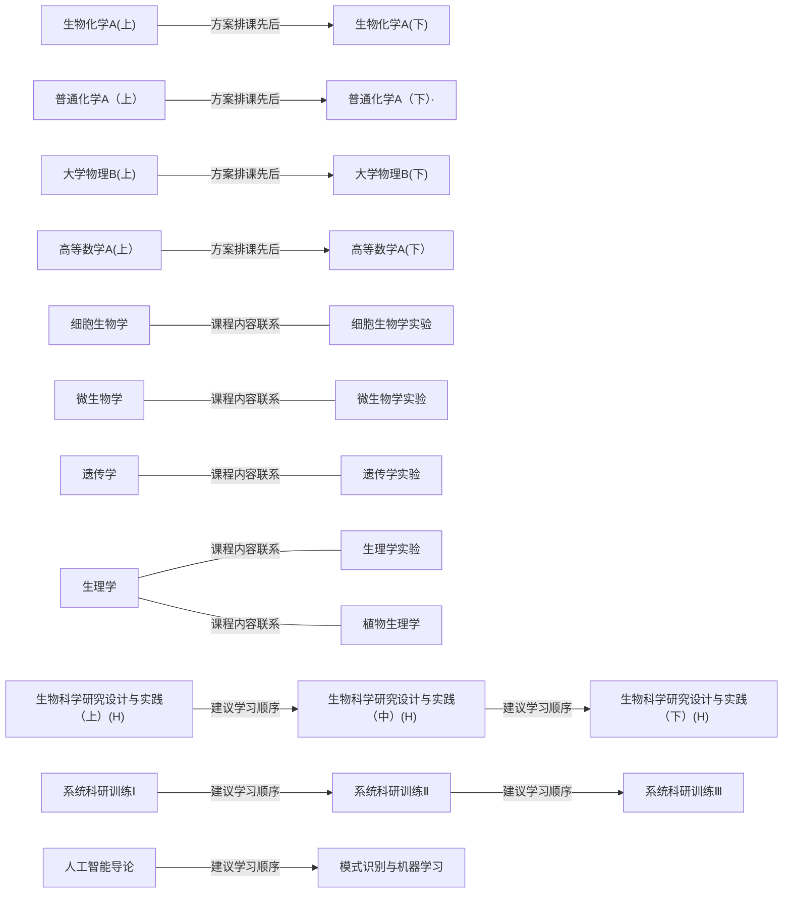

# 2025“生物科学”-“生物学”本博融通培养方案（“生物科学+人工智能双学士学位”适用）

生命科学学院 · 生物科学-人工智能(双学士学位项目) · 方案 151172 · 139 个不同课程或科研条目。

[官方 Word](../originals/plan-151172.docx) · [教务详情](https://fdjwgl.fudan.edu.cn/manager/bizType/2/major-program-search/info/151172?skipAuth=1) · [方案快照](../raw/plan-151172.json.gz) · [年级目录](../README.md)

## 课程关系图

图中展示部分关系。下表保留全部已建立的课程对，来源位置使用本方案 JSON Pointer。

## 先修与内容联系

| 类型 | 起点 | 终点 | 依据 | 原表定位 |
| --- | --- | --- | --- | --- |
| 建议学习顺序 | 人工智能导论 (AIE310005) | 模式识别与机器学习 (AIE410001) | 人工智能问题与模型类别可为学习模式识别作准备。  | `/courseModules/6/planCourses/15`、`/courseModules/6/planCourses/18` |
| 建议学习顺序 | 生物化学A(上) (BIOL30002) | 生物化学A(下) (BIOL30021) | 同方案的课程题名具有连续分册或序号。  | `/courseModules/6/planCourses/4`、`/courseModules/6/planCourses/5` |
| 建议学习顺序 | 系统科研训练Ⅰ (BIOL50046) | 系统科研训练Ⅱ (BIOL50047) | 同方案的课程题名具有连续分册或序号。  | `/courseModules/35/planCourses/15`、`/courseModules/35/planCourses/17` |
| 建议学习顺序 | 系统科研训练Ⅱ (BIOL50047) | 系统科研训练Ⅲ (BIOL50048) | 同方案的课程题名具有连续分册或序号。  | `/courseModules/35/planCourses/17`、`/courseModules/35/planCourses/19` |
| 建议学习顺序 | 生物科学研究设计与实践（上）(H) (BIOL50055h) | 生物科学研究设计与实践（中）(H) (BIOL50056h) | 同方案的课程题名具有连续分册或序号。  | `/courseModules/35/planCourses/22`、`/courseModules/35/planCourses/20` |
| 建议学习顺序 | 生物科学研究设计与实践（中）(H) (BIOL50056h) | 生物科学研究设计与实践（下）(H) (BIOL50057h) | 同方案的课程题名具有连续分册或序号。  | `/courseModules/35/planCourses/20`、`/courseModules/35/planCourses/13` |
| 建议学习顺序 | 普通化学A（上） (CHEM10003) | 普通化学A（下） (CHEM10004) | 同方案的课程题名具有连续分册或序号。  | `/courseModules/5/planCourses/1`、`/courseModules/5/planCourses/2` |
| 建议学习顺序 | 线性代数 (CS10003) | 模式识别与机器学习 (AIE410001) | 向量表示和矩阵运算支持理解分类、回归等模型。  | `/courseModules/5/planCourses/7`、`/courseModules/6/planCourses/18` |
| 建议学习顺序 | 高等数学A(上） (MATH10015) | 高等数学A(下） (MATH10016) | 同方案的课程题名具有连续分册或序号。  | `/courseModules/5/planCourses/5`、`/courseModules/5/planCourses/6` |
| 建议学习顺序 | 大学物理B(上) (PHYS10003) | 大学物理B(下) (PHYS10004) | 同方案的课程题名具有连续分册或序号。  | `/courseModules/5/planCourses/3`、`/courseModules/5/planCourses/4` |
| 方案排课先后 | 生物化学A(上) (BIOL30002) | 生物化学A(下) (BIOL30021) | 同方案该课程全部明确数字学期均早于后者。  | `/courseModules/6/planCourses/4`、`/courseModules/6/planCourses/5` |
| 方案排课先后 | 普通化学A（上） (CHEM10003) | 普通化学A（下） (CHEM10004) | 同方案该课程全部明确数字学期均早于后者。  | `/courseModules/5/planCourses/1`、`/courseModules/5/planCourses/2` |
| 方案排课先后 | 高等数学A(上） (MATH10015) | 高等数学A(下） (MATH10016) | 同方案该课程全部明确数字学期均早于后者。  | `/courseModules/5/planCourses/5`、`/courseModules/5/planCourses/6` |
| 方案排课先后 | 大学物理B(上) (PHYS10003) | 大学物理B(下) (PHYS10004) | 同方案该课程全部明确数字学期均早于后者。  | `/courseModules/5/planCourses/3`、`/courseModules/5/planCourses/4` |
| 课程内容联系 | 计算机系统基础 (AIE210006) | 计算机组成与体系结构 (CS30052) | 处理器、存储与系统执行模型具有共同内容。  | `/courseModules/6/planCourses/14`、`/courseModules/28/planCourses/1` |
| 课程内容联系 | 人工智能导论 (AIE310005) | 人工智能安全 (AIE831001) | 本方案两门课程的题名均含“人工智能”，可据此对照这一主题。  | `/courseModules/6/planCourses/15`、`/courseModules/6/planCourses/17` |
| 课程内容联系 | 人工智能的编程基础 (AIE310006) | 人工智能安全 (AIE831001) | 本方案两门课程的题名均含“人工智能”，可据此对照这一主题。  | `/courseModules/6/planCourses/11`、`/courseModules/6/planCourses/17` |
| 课程内容联系 | 人工智能的数学基础 (AIE310009) | 模式识别与机器学习 (AIE410001) | 数学表达与学习模型的统计、优化工具可对照。  | `/courseModules/6/planCourses/12`、`/courseModules/6/planCourses/18` |
| 课程内容联系 | 人工智能的数学基础 (AIE310009) | 人工智能安全 (AIE831001) | 本方案两门课程的题名均含“人工智能”，可据此对照这一主题。  | `/courseModules/6/planCourses/12`、`/courseModules/6/planCourses/17` |
| 课程内容联系 | 模式识别与机器学习 (AIE410001) | 机器学习系统 (CS30058) | 本方案两门课程的题名均含“机器学习”，可据此对照这一主题。  | `/courseModules/6/planCourses/18`、`/courseModules/28/planCourses/5` |
| 课程内容联系 | 人工智能安全 (AIE831001) | 人工智能生物学 (AIS310017) | 本方案两门课程的题名均含“人工智能”，可据此对照这一主题。  | `/courseModules/6/planCourses/17`、`/courseModules/6/planCourses/10` |
| 课程内容联系 | 生物化学A(上) (BIOL30002) | 生物化学实验 (BIOL30003) | 本方案两门课程的题名均含“生物化学”，可据此对照这一主题。  | `/courseModules/6/planCourses/4`、`/courseModules/35/planCourses/11` |
| 课程内容联系 | 生物化学实验 (BIOL30003) | 生物化学A(下) (BIOL30021) | 本方案两门课程的题名均含“生物化学”，可据此对照这一主题。  | `/courseModules/35/planCourses/11`、`/courseModules/6/planCourses/5` |
| 课程内容联系 | 生物化学实验 (BIOL30003) | 现代生物学基础与前沿Ⅰ-生物化学与细胞生物学 (BIOL60008) | 本方案两门课程的题名均含“生物化学”，可据此对照这一主题。  | `/courseModules/35/planCourses/11`、`/courseModules/11/planCourses/2` |
| 课程内容联系 | 细胞生物学 (BIOL30004) | 细胞生物学实验 (BIOL30005) | 题名显示相同主题的课程与实验、实践或实习。  | `/courseModules/6/planCourses/6`、`/courseModules/35/planCourses/14` |
| 课程内容联系 | 细胞生物学 (BIOL30004) | 现代生物学基础与前沿Ⅰ-生物化学与细胞生物学 (BIOL60008) | 本方案两门课程的题名均含“细胞生物学”，可据此对照这一主题。  | `/courseModules/6/planCourses/6`、`/courseModules/11/planCourses/2` |
| 课程内容联系 | 微生物学 (BIOL30006) | 微生物学实验 (BIOL30007) | 题名显示相同主题的课程与实验、实践或实习。  | `/courseModules/6/planCourses/7`、`/courseModules/35/planCourses/16` |
| 课程内容联系 | 遗传学 (BIOL30008) | 遗传学实验 (BIOL30009) | 题名显示相同主题的课程与实验、实践或实习。  | `/courseModules/6/planCourses/8`、`/courseModules/35/planCourses/18` |
| 课程内容联系 | 遗传学 (BIOL30008) | 人类进化遗传学 (BIOL50017) | 本方案两门课程的题名均含“遗传学”，可据此对照这一主题。  | `/courseModules/6/planCourses/8`、`/courseModules/19/planCourses/1` |
| 课程内容联系 | 遗传学 (BIOL30008) | 表观遗传学 (BIOL50019) | 本方案两门课程的题名均含“遗传学”，可据此对照这一主题。  | `/courseModules/6/planCourses/8`、`/courseModules/20/planCourses/1` |
| 课程内容联系 | 遗传学 (BIOL30008) | 分子遗传学 (BIOL60002) | 本方案两门课程的题名均含“遗传学”，可据此对照这一主题。  | `/courseModules/6/planCourses/8`、`/courseModules/19/planCourses/6` |
| 课程内容联系 | 生理学 (BIOL30010) | 生理学实验 (BIOL30020) | 题名显示相同主题的课程与实验、实践或实习。  | `/courseModules/6/planCourses/3`、`/courseModules/35/planCourses/21` |
| 课程内容联系 | 生理学 (BIOL30010) | 植物生理学 (BIOL50021) | 本方案两门课程的题名均含“生理学”，可据此对照这一主题。  | `/courseModules/6/planCourses/3`、`/courseModules/15/planCourses/0` |
| 课程内容联系 | 生理学 (BIOL30010) | 生理学专业前沿课程 (BIOL60016) | 本方案两门课程的题名均含“生理学”，可据此对照这一主题。  | `/courseModules/6/planCourses/3`、`/courseModules/17/planCourses/2` |
| 课程内容联系 | 生物统计学 (BIOL50004) | 生物统计学方法及应用 (BIOL60006) | 本方案两门课程的题名均含“统计学”，可据此对照这一主题。  | `/courseModules/23/planCourses/1`、`/courseModules/22/planCourses/4` |
| 课程内容联系 | 生物统计学 (BIOL50004) | 统计学导论 (STAT50013) | 本方案两门课程的题名均含“统计学”，可据此对照这一主题。  | `/courseModules/23/planCourses/1`、`/courseModules/22/planCourses/2` |
| 课程内容联系 | 生物信息学 (BIOL50012) | 生物信息学实验 (BIOL50045) | 题名显示相同主题的课程与实验、实践或实习。  | `/courseModules/23/planCourses/2`、`/courseModules/23/planCourses/3` |
| 课程内容联系 | 有机化学 (CHEM20011) | 有机化学实验 (CHEM20012) | 题名显示相同主题的课程与实验、实践或实习。  | `/courseModules/6/planCourses/0`、`/courseModules/35/planCourses/25` |
| 课程内容联系 | 分析化学 (CHEM20015) | 分析化学实验 (CHEM20016) | 题名显示相同主题的课程与实验、实践或实习。  | `/courseModules/6/planCourses/1`、`/courseModules/35/planCourses/26` |

本次未从可定位的明确表述中确认课程对课程预修。学期安排、系列分册与编辑建议均保留各自的依据。

## 按原方案模块阅读

同一模块展示原表中的课程归属。模块内课程之间的先后仍须逐项查阅。

- **科学素养**　艺术、科学研究与创新思维、创新源泉与能力(H)（原表模块 10）
- **/**　生命科学科研伦理和规范、现代生物学基础与前沿Ⅰ-生物化学与细胞生物学、现代生物学基础与前沿Ⅱ-遗传和发育生物学、科研伦理及规范（原表模块 11）
- **生物化学和生物物理**　化学生物学：分子探针与生命调控、生物物理学、结构生物学、RNA生物学（原表模块 12）
- **高阶生物化学和生物物理**　人工智能结构生物学、核酸的化学与生物学、蛋白质组学、生物热力学（原表模块 13）
- **高阶细胞发育**　植物生理学、发育与代谢、细胞器生物学、癌生物学、干细胞与发育(H)、细胞周期与网络调控、生殖生物学、细胞发育与健康（原表模块 15）
- **神经生理**　神经生物学概论、功能解剖学和组织学、代谢生物学（原表模块 16）
- **高阶神经生理**　脑科学导论、脑科学与脑疾病、神经生物学、生理学专业前沿课程、膜片钳与离子通道（原表模块 17）
- **高阶遗传和人类学**　复杂性状的遗传与演化、医学分子遗传学、人类进化遗传学、精神卫生学概论、遗传操作原理与应用、基因检测技术、人类表型组学、生物育种技术、合成生物学、分子遗传学（原表模块 19）
- **遗传和人类学**　遗传分析原理、表观遗传学（原表模块 20）
- **高阶微生物和免疫**　微生物组学基础与前沿、病毒学、微生物分子遗传与代谢、微生物分子生态学、现代微生物学专题（原表模块 21）
- **高阶计算生物**　组学数据分析和AI应用、生物药物研发与人工智能、生物统计学方法及应用、统计学导论、线性统计分析（原表模块 22）
- **计算生物**　人工智能生物学、生物统计学、生物信息学、生物信息学实验（原表模块 23）
- **宏观及进化**　生物多样性科学导论、物种起源导论（原表模块 24）
- **标准化**　国际标准化、标准化技术与方法、标准化实务、精准医学数据标准化和质量控制、统计质量控制（原表模块 25）
- **实践**　高级生化技术、基因工程实验、生物学野外实习（原表模块 26）
- ***星标课程组**　免疫学、基因组学、进化生物学、发育生物学（原表模块 27）

## 课程表

同一课程在不同模块分别出现时，按原表逐行列出。季节字段保留原值。

| 课程 | 代码 | 学分 | 学期 | 模块 |
| --- | --- | ---: | --- | --- |
| 现代生物科学导论A | BIOL10001 | 3.0 | 第1学期 | 培养方案 / 专业培养课程 / 学科基础课程 |
| 普通化学A（上） | CHEM10003 | 2.0 | 第1学期 | 培养方案 / 专业培养课程 / 学科基础课程 |
| 普通化学A（下） | CHEM10004 | 2.0 | 第2学期 | 培养方案 / 专业培养课程 / 学科基础课程 |
| 大学物理B(上) | PHYS10003 | 4.0 | 第1学期 | 培养方案 / 专业培养课程 / 学科基础课程 |
| 大学物理B(下) | PHYS10004 | 4.0 | 第2学期 | 培养方案 / 专业培养课程 / 学科基础课程 |
| 高等数学A(上） | MATH10015 | 5.0 | 第1学期 | 培养方案 / 专业培养课程 / 学科基础课程 |
| 高等数学A(下） | MATH10016 | 5.0 | 第2学期 | 培养方案 / 专业培养课程 / 学科基础课程 |
| 线性代数 | CS10003 | 3.0 | AUTUMN | 培养方案 / 专业培养课程 / 学科基础课程 |
| 程序设计 | CS10004 | 4.0 | AUTUMN | 培养方案 / 专业培养课程 / 学科基础课程 |
| 有机化学 | CHEM20011 | 4.0 | 第3学期 | 培养方案 / 专业培养课程 / 专业核心教育课程 |
| 分析化学 | CHEM20015 | 2.0 | 第3学期 | 培养方案 / 专业培养课程 / 专业核心教育课程 |
| 普通生物学 | BIOL30019 | 3.0 | 第3学期 | 培养方案 / 专业培养课程 / 专业核心教育课程 |
| 生理学 | BIOL30010 | 3.0 | 第4学期 | 培养方案 / 专业培养课程 / 专业核心教育课程 |
| 生物化学A(上) | BIOL30002 | 3.0 | 第4学期 | 培养方案 / 专业培养课程 / 专业核心教育课程 |
| 生物化学A(下) | BIOL30021 | 2.0 | 第5学期 | 培养方案 / 专业培养课程 / 专业核心教育课程 |
| 细胞生物学 | BIOL30004 | 3.0 | 第4学期 | 培养方案 / 专业培养课程 / 专业核心教育课程 |
| 微生物学 | BIOL30006 | 3.0 | 第5学期 | 培养方案 / 专业培养课程 / 专业核心教育课程 |
| 遗传学 | BIOL30008 | 3.0 | 第5学期 | 培养方案 / 专业培养课程 / 专业核心教育课程 |
| 分子生物学 | BIOL30014 | 2.0 | 第5学期 | 培养方案 / 专业培养课程 / 专业核心教育课程 |
| 人工智能生物学 | AIS310017 | 2.0 | 第1学期 | 培养方案 / 专业培养课程 / 专业核心教育课程 |
| 人工智能的编程基础 | AIE310006 | 2.0 | 第1学期 | 培养方案 / 专业培养课程 / 专业核心教育课程 |
| 人工智能的数学基础 | AIE310009 | 3.0 | 第1学期 | 培养方案 / 专业培养课程 / 专业核心教育课程 |
| 数据结构 | AIE310007 | 4.0 | 第2学期 | 培养方案 / 专业培养课程 / 专业核心教育课程 |
| 计算机系统基础 | AIE210006 | 3.0 | 第2学期 | 培养方案 / 专业培养课程 / 专业核心教育课程 |
| 人工智能导论 | AIE310005 | 3.0 | 第1学期 | 培养方案 / 专业培养课程 / 专业核心教育课程 |
| 人工智能的软件基础 | AIE310008 | 3.0 | 第2学期 | 培养方案 / 专业培养课程 / 专业核心教育课程 |
| 人工智能安全 | AIE831001 | 3.0 | 第1学期 | 培养方案 / 专业培养课程 / 专业核心教育课程 |
| 模式识别与机器学习 | AIE410001 | 3.0 | 第1学期 | 培养方案 / 专业培养课程 / 专业核心教育课程 |
| 人工智能的伦理与治理 | PHIL50006 | 2.0 | 第1学期 | 培养方案 / 专业培养课程 / 专业核心教育课程 |
| 自然语言处理与大语言模型 | AIE410002 | 3.0 | 第1学期 | 培养方案 / 专业培养课程 / 专业核心教育课程 |
| 计算机视觉 | AIE310004 | 3.0 | 第2学期 | 培养方案 / 专业培养课程 / 专业核心教育课程 |
| 人工智能前沿探索实践 | AIE531001 | 3.0 | 第2学期 | 培养方案 / 专业培养课程 / 专业核心教育课程 |
| 艺术、科学研究与创新思维 | BIOL50025 | 2.0 | SPRING | 培养方案 / 专业进阶-生物科学 / 科学素养 |
| 创新源泉与能力(H) | BIOL50054h | 3.0 | SPRING | 培养方案 / 专业进阶-生物科学 / 科学素养 |
| 生命科学科研伦理和规范 | BIOL50016 | 2.0 | SPRING、AUTUMN | 培养方案 / 专业进阶-生物科学 / / |
| 科研伦理及规范 | BIOL70011 | 2.0 | AUTUMN | 培养方案 / 专业进阶-生物科学 / / |
| 现代生物学基础与前沿Ⅰ-生物化学与细胞生物学 | BIOL60008 | 4.0 | AUTUMN | 培养方案 / 专业进阶-生物科学 / / |
| 现代生物学基础与前沿Ⅱ-遗传和发育生物学 | BIOL60009 | 4.0 | SPRING | 培养方案 / 专业进阶-生物科学 / / |
| 生物物理学 | BIOL50010 | 2.0 | AUTUMN | 培养方案 / 专业进阶-生物科学 / 生物化学和生物物理 |
| 结构生物学 | BIOL50034 | 2.0 | SPRING | 培养方案 / 专业进阶-生物科学 / 生物化学和生物物理 |
| RNA生物学 | BIOL50041 | 2.0 | SPRING | 培养方案 / 专业进阶-生物科学 / 生物化学和生物物理 |
| 化学生物学：分子探针与生命调控 | BIOL30018 | 3.0 |  | 培养方案 / 专业进阶-生物科学 / 生物化学和生物物理 |
| 人工智能结构生物学 | AIS410006 | 2.0 | AUTUMN | 培养方案 / 专业进阶-生物科学 / 高阶生物化学和生物物理 |
| 核酸的化学与生物学 | BIOL50008 | 2.0 | SPRING | 培养方案 / 专业进阶-生物科学 / 高阶生物化学和生物物理 |
| 蛋白质组学 | BIOL50014 | 2.0 | SPRING | 培养方案 / 专业进阶-生物科学 / 高阶生物化学和生物物理 |
| 生物热力学 | BIOL50023 | 2.0 | SPRING | 培养方案 / 专业进阶-生物科学 / 高阶生物化学和生物物理 |
| 植物细胞与发育生物学 | BIOL50026 | 2.0 | SPRING | 培养方案 / 专业进阶-生物科学 / 细胞发育 |
| 植物生理学 | BIOL50021 | 2.0 | AUTUMN | 培养方案 / 专业进阶-生物科学 / 高阶细胞发育 |
| 发育与代谢 | BIOL50028 | 2.0 | AUTUMN | 培养方案 / 专业进阶-生物科学 / 高阶细胞发育 |
| 细胞器生物学 | BIOL50032 | 2.0 | AUTUMN | 培养方案 / 专业进阶-生物科学 / 高阶细胞发育 |
| 癌生物学 | BIOL50033 | 2.0 | SPRING | 培养方案 / 专业进阶-生物科学 / 高阶细胞发育 |
| 细胞发育与健康 | BIOL60017 | 2.0 | SPRING | 培养方案 / 专业进阶-生物科学 / 高阶细胞发育 |
| 干细胞与发育(H) | BIOL50059h | 4.0 | SPRING | 培养方案 / 专业进阶-生物科学 / 高阶细胞发育 |
| 细胞周期与网络调控 | BIOL50065 | 2.0 |  | 培养方案 / 专业进阶-生物科学 / 高阶细胞发育 |
| 生殖生物学 | BIOL50066 | 3.0 |  | 培养方案 / 专业进阶-生物科学 / 高阶细胞发育 |
| 神经生物学概论 | BIOL50011 | 2.0 | AUTUMN | 培养方案 / 专业进阶-生物科学 / 神经生理 |
| 功能解剖学和组织学 | BIOL50042 | 3.0 | AUTUMN | 培养方案 / 专业进阶-生物科学 / 神经生理 |
| 代谢生物学 | BIOL50043 | 3.0 | AUTUMN | 培养方案 / 专业进阶-生物科学 / 神经生理 |
| 脑科学导论 | AIS310018 | 3.0 | AUTUMN | 培养方案 / 专业进阶-生物科学 / 高阶神经生理 |
| 神经生物学 | BIOL60003 | 3.0 | AUTUMN | 培养方案 / 专业进阶-生物科学 / 高阶神经生理 |
| 生理学专业前沿课程 | BIOL60016 | 2.0 | AUTUMN | 培养方案 / 专业进阶-生物科学 / 高阶神经生理 |
| 膜片钳与离子通道 | BIOL70048 | 2.0 |  | 培养方案 / 专业进阶-生物科学 / 高阶神经生理 |
| 脑科学与脑疾病 | BIOL40022 | 2.0 |  | 培养方案 / 专业进阶-生物科学 / 高阶神经生理 |
| 病原生物学基础 | BIOL50037 | 2.0 | SPRING | 培养方案 / 专业进阶-生物科学 / 微生物和免疫 |
| 医学分子遗传学 | BIOL50006 | 2.0 | AUTUMN | 培养方案 / 专业进阶-生物科学 / 高阶遗传和人类学 |
| 人类进化遗传学 | BIOL50017 | 2.0 | SPRING | 培养方案 / 专业进阶-生物科学 / 高阶遗传和人类学 |
| 人类表型组学 | BIOL50040 | 3.0 | AUTUMN | 培养方案 / 专业进阶-生物科学 / 高阶遗传和人类学 |
| 精神卫生学概论 | BIOL50022 | 2.0 | SPRING | 培养方案 / 专业进阶-生物科学 / 高阶遗传和人类学 |
| 遗传操作原理与应用 | BIOL50038 | 3.0 | AUTUMN | 培养方案 / 专业进阶-生物科学 / 高阶遗传和人类学 |
| 基因检测技术 | BIOL50039 | 2.0 | AUTUMN | 培养方案 / 专业进阶-生物科学 / 高阶遗传和人类学 |
| 分子遗传学 | BIOL60002 | 3.0 | AUTUMN | 培养方案 / 专业进阶-生物科学 / 高阶遗传和人类学 |
| 生物育种技术 | BIOL50061 | 2.0 | SPRING | 培养方案 / 专业进阶-生物科学 / 高阶遗传和人类学 |
| 合成生物学 | BIOL50062 | 2.0 | SPRING | 培养方案 / 专业进阶-生物科学 / 高阶遗传和人类学 |
| 复杂性状的遗传与演化 | BIOL40023 | 2.0 |  | 培养方案 / 专业进阶-生物科学 / 高阶遗传和人类学 |
| 遗传分析原理 | BIOL50015 | 2.0 | AUTUMN | 培养方案 / 专业进阶-生物科学 / 遗传和人类学 |
| 表观遗传学 | BIOL50019 | 2.0 | AUTUMN | 培养方案 / 专业进阶-生物科学 / 遗传和人类学 |
| 病毒学 | BIOL50007 | 2.0 | AUTUMN | 培养方案 / 专业进阶-生物科学 / 高阶微生物和免疫 |
| 微生物分子遗传与代谢 | BIOL50035 | 2.0 | AUTUMN | 培养方案 / 专业进阶-生物科学 / 高阶微生物和免疫 |
| 微生物分子生态学 | BIOL50036 | 2.0 | SPRING | 培养方案 / 专业进阶-生物科学 / 高阶微生物和免疫 |
| 现代微生物学专题 | BIOL60005 | 4.0 | AUTUMN | 培养方案 / 专业进阶-生物科学 / 高阶微生物和免疫 |
| 微生物组学基础与前沿 | BIOL30026 | 2.0 |  | 培养方案 / 专业进阶-生物科学 / 高阶微生物和免疫 |
| 组学数据分析和AI应用 | AIT531022 | 2.0 | AUTUMN | 培养方案 / 专业进阶-生物科学 / 高阶计算生物 |
| 生物药物研发与人工智能 | AIT631015 | 2.0 | SPRING | 培养方案 / 专业进阶-生物科学 / 高阶计算生物 |
| 统计学导论 | STAT50013 | 2.0 | AUTUMN | 培养方案 / 专业进阶-生物科学 / 高阶计算生物 |
| 线性统计分析 | STAT50014 | 2.0 | SPRING | 培养方案 / 专业进阶-生物科学 / 高阶计算生物 |
| 生物统计学方法及应用 | BIOL60006 | 4.0 | AUTUMN | 培养方案 / 专业进阶-生物科学 / 高阶计算生物 |
| 人工智能生物学 | AIS310017 | 2.0 | AUTUMN | 培养方案 / 专业进阶-生物科学 / 计算生物 |
| 生物统计学 | BIOL50004 | 3.0 | AUTUMN | 培养方案 / 专业进阶-生物科学 / 计算生物 |
| 生物信息学 | BIOL50012 | 3.0 | SPRING、AUTUMN | 培养方案 / 专业进阶-生物科学 / 计算生物 |
| 生物信息学实验 | BIOL50045 | 2.0 | SPRING、AUTUMN | 培养方案 / 专业进阶-生物科学 / 计算生物 |
| 物种起源导论 | ECOL50003 | 2.0 | AUTUMN | 培养方案 / 专业进阶-生物科学 / 宏观及进化 |
| 生物多样性科学导论 | BIOL30016 | 2.0 | AUTUMN | 培养方案 / 专业进阶-生物科学 / 宏观及进化 |
| 国际标准化 | BIOL20001 | 3.0 | AUTUMN | 培养方案 / 专业进阶-生物科学 / 标准化 |
| 标准化技术与方法 | BIOL20002 | 2.0 | AUTUMN | 培养方案 / 专业进阶-生物科学 / 标准化 |
| 标准化实务 | BIOL20003 | 2.0 | SPRING | 培养方案 / 专业进阶-生物科学 / 标准化 |
| 精准医学数据标准化和质量控制 | BIOL20004 | 2.0 | AUTUMN | 培养方案 / 专业进阶-生物科学 / 标准化 |
| 统计质量控制 | MSE20004 | 2.0 | AUTUMN | 培养方案 / 专业进阶-生物科学 / 标准化 |
| 高级生化技术 | BIOL50002 | 1.5 | SUMMER | 培养方案 / 专业进阶-生物科学 / 实践 |
| 基因工程实验 | BIOL50003 | 1.5 | AUTUMN | 培养方案 / 专业进阶-生物科学 / 实践 |
| 生物学野外实习 | ECOL30003 | 2.0 | SUMMER | 培养方案 / 专业进阶-生物科学 / 实践 |
| 免疫学 | BIOL50005 | 2.0 | AUTUMN | 培养方案 / 专业进阶-生物科学 / *星标课程组 |
| 基因组学 | BIOL50009 | 2.0 | AUTUMN | 培养方案 / 专业进阶-生物科学 / *星标课程组 |
| 进化生物学 | BIOL50018 | 2.0 | SPRING | 培养方案 / 专业进阶-生物科学 / *星标课程组 |
| 发育生物学 | BIOL50030 | 3.0 | AUTUMN | 培养方案 / 专业进阶-生物科学 / *星标课程组 |
| 集合与图论 | CS30043 | 3.0 | 第3学期 | 培养方案 / 专业进阶 - 人工智能 （必选8学分） |
| 计算机组成与体系结构 | CS30052 | 4.0 | 第4学期 | 培养方案 / 专业进阶 - 人工智能 （必选8学分） |
| 数据库引论 | CS20010 | 3.0 | 第4学期 | 培养方案 / 专业进阶 - 人工智能 （必选8学分） |
| 计算机网络 | CS30036 | 3.0 | 第5学期 | 培养方案 / 专业进阶 - 人工智能 （必选8学分） |
| 软件工程 | CS30018 | 3.0 | 第6学期 | 培养方案 / 专业进阶 - 人工智能 （必选8学分） |
| 机器学习系统 | CS30058 | 3.0 | 第6学期 | 培养方案 / 专业进阶 - 人工智能 （必选8学分） |
| 计算机图形学A | CS30019 | 3.0 | 第6学期 | 培养方案 / 专业进阶 - 人工智能 （必选8学分） |
| 组学数据分析和AI应用 | AIT531022 | 2.0 | AUTUMN | 培养方案 / 专业进阶 - 人工智能 （必选8学分） |
| AI在生物分子结构中的研究及应用 | AIS410014 | 2.0 | AUTUMN | 培养方案 / 专业进阶 - 人工智能 （必选8学分） |
| 人工智能结构生物学 | AIS410006 | 2.0 | AUTUMN | 培养方案 / 专业进阶 - 人工智能 （必选8学分） |
| 生物药物研发与人工智能 | AIT631015 | 2.0 | SPRING | 培养方案 / 专业进阶 - 人工智能 （必选8学分） |
| 毕业论文 | BIOL30001 | 2.0 | 第8学期 | 融合创新能力 |
| 复芏计划(FDUROP) | 102 | 0.0 |  | 融合创新能力 |
| 研究生学术活动 | 4 | 2.0 |  | 融合创新能力 |
| 研究生实践活动 | 5 | 2.0 |  | 融合创新能力 |
| 国际交流 | 7 | 0.0 |  | 融合创新能力 |
| 博士学位论文开题 | 1 | 0.0 |  | 融合创新能力 |
| 博士生资格考核 | 2 | 0.0 |  | 融合创新能力 |
| 博士论文中期考核 | 3 | 0.0 |  | 融合创新能力 |
| 博士学位论文预审 | 6 | 0.0 |  | 融合创新能力 |
| 现代生物科学实验 | BIOL10003 | 1.0 | 第1学期 | 融合创新能力 |
| 生命科学交叉前沿专题 | BIOL50020 | 2.0 | SPRING | 融合创新能力 |
| 生物化学实验 | BIOL30003 | 1.5 | 第4学期 | 融合创新能力 |
| 科学研究方法与论文写作 | BIOL50013 | 2.0 | SPRING | 融合创新能力 |
| 生物科学研究设计与实践（下）(H) | BIOL50057h | 2.0 | AUTUMN | 融合创新能力 |
| 细胞生物学实验 | BIOL30005 | 1.5 | 第4学期 | 融合创新能力 |
| 系统科研训练Ⅰ | BIOL50046 | 2.0 | SPRING | 融合创新能力 |
| 微生物学实验 | BIOL30007 | 1.5 | 第5学期 | 融合创新能力 |
| 系统科研训练Ⅱ | BIOL50047 | 3.0 | SUMMER | 融合创新能力 |
| 遗传学实验 | BIOL30009 | 1.5 | 第5学期 | 融合创新能力 |
| 系统科研训练Ⅲ | BIOL50048 | 3.0 | AUTUMN | 融合创新能力 |
| 生物科学研究设计与实践（中）(H) | BIOL50056h | 2.0 | SPRING、AUTUMN | 融合创新能力 |
| 生理学实验 | BIOL30020 | 1.5 | 第4学期 | 融合创新能力 |
| 生物科学研究设计与实践（上）(H) | BIOL50055h | 2.0 | AUTUMN | 融合创新能力 |
| 普通生物学专业实验 | BIOL30023 | 2.0 | 第3学期 | 融合创新能力 |
| 普通化学实验I | CHEM10005 | 1.0 | 第1学期 | 融合创新能力 |
| 有机化学实验 | CHEM20012 | 2.0 | 第3学期 | 融合创新能力 |
| 分析化学实验 | CHEM20016 | 2.0 | 第3学期 | 融合创新能力 |
| 基础物理实验 | PHYS10005 | 2.0 | 第2学期 | 融合创新能力 |
