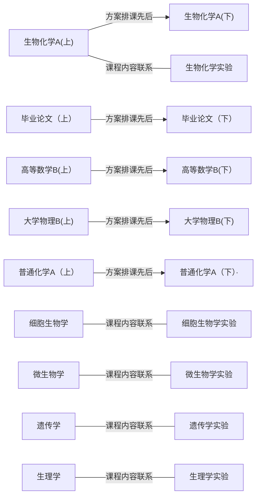

# 2025生物科学专业培养方案 （2025级港澳台侨生适用）

生命科学学院 · 生物科学 · 方案 153155 · 34 个不同课程或科研条目。

[官方 Word](../originals/plan-153155.docx) · [教务详情](https://fdjwgl.fudan.edu.cn/manager/bizType/2/major-program-search/info/153155?skipAuth=1) · [方案快照](../raw/plan-153155.json.gz) · [年级目录](../README.md)

## 修读导读

- **建议先学**　《生物化学A(上)》（`BIOL30002`） → 《生物化学A(下)》（`BIOL30021`）。题名列出连续册次或级别。可沿用同一张结构与功能对照表，把后续分册涉及的分子和过程补进去。方案分别列在第4、5学期。

- **可以对照着读**　《细胞生物学》（`BIOL30004`）与《细胞生物学实验》（`BIOL30005`）。可在实验或实践课中记录用到了哪些课堂概念，再回到相应章节复习。

- **查模块选课**　《普通生物学》（`BIOL30019`）、《生理学》（`BIOL30010`）列在“专业核心教育课程”中。原表见 `/courseModules/6`。

## 课程关系图

图中展示部分关系。下表保留全部已建立的课程对，来源位置使用本方案 JSON Pointer。

## 先修与内容联系

| 类型 | 起点 | 终点 | 依据 | 原表定位 |
| --- | --- | --- | --- | --- |
| 建议学习顺序 | 生物化学A(上) (BIOL30002) | 生物化学A(下) (BIOL30021) | 同方案的课程题名具有连续分册或序号。  | `/courseModules/6/planCourses/3`、`/courseModules/6/planCourses/4` |
| 建议学习顺序 | 毕业论文（上） (BIOL40012) | 毕业论文（下） (BIOL40013) | 同方案的课程题名具有连续分册或序号。  | `/courseModules/17/planCourses/3`、`/courseModules/17/planCourses/4` |
| 建议学习顺序 | 普通化学A（上） (CHEM10003) | 普通化学A（下） (CHEM10004) | 同方案的课程题名具有连续分册或序号。  | `/courseModules/5/planCourses/5`、`/courseModules/5/planCourses/6` |
| 建议学习顺序 | 高等数学B(上） (MATH10004) | 高等数学B(下） (MATH10005) | 同方案的课程题名具有连续分册或序号。  | `/courseModules/5/planCourses/0`、`/courseModules/5/planCourses/1` |
| 建议学习顺序 | 大学物理B(上) (PHYS10003) | 大学物理B(下) (PHYS10004) | 同方案的课程题名具有连续分册或序号。  | `/courseModules/5/planCourses/2`、`/courseModules/5/planCourses/3` |
| 方案排课先后 | 生物化学A(上) (BIOL30002) | 生物化学A(下) (BIOL30021) | 同方案该课程全部明确数字学期均早于后者。  | `/courseModules/6/planCourses/3`、`/courseModules/6/planCourses/4` |
| 方案排课先后 | 毕业论文（上） (BIOL40012) | 毕业论文（下） (BIOL40013) | 同方案该课程全部明确数字学期均早于后者。  | `/courseModules/17/planCourses/3`、`/courseModules/17/planCourses/4` |
| 方案排课先后 | 普通化学A（上） (CHEM10003) | 普通化学A（下） (CHEM10004) | 同方案该课程全部明确数字学期均早于后者。  | `/courseModules/5/planCourses/5`、`/courseModules/5/planCourses/6` |
| 方案排课先后 | 高等数学B(上） (MATH10004) | 高等数学B(下） (MATH10005) | 同方案该课程全部明确数字学期均早于后者。  | `/courseModules/5/planCourses/0`、`/courseModules/5/planCourses/1` |
| 方案排课先后 | 大学物理B(上) (PHYS10003) | 大学物理B(下) (PHYS10004) | 同方案该课程全部明确数字学期均早于后者。  | `/courseModules/5/planCourses/2`、`/courseModules/5/planCourses/3` |
| 课程内容联系 | 生物化学A(上) (BIOL30002) | 生物化学实验 (BIOL30003) | 本方案两门课程的题名均含“生物化学”，可据此对照这一主题。  | `/courseModules/6/planCourses/3`、`/courseModules/17/planCourses/2` |
| 课程内容联系 | 生物化学实验 (BIOL30003) | 生物化学A(下) (BIOL30021) | 本方案两门课程的题名均含“生物化学”，可据此对照这一主题。  | `/courseModules/17/planCourses/2`、`/courseModules/6/planCourses/4` |
| 课程内容联系 | 细胞生物学 (BIOL30004) | 细胞生物学实验 (BIOL30005) | 题名显示相同主题的课程与实验、实践或实习。  | `/courseModules/6/planCourses/5`、`/courseModules/17/planCourses/8` |
| 课程内容联系 | 微生物学 (BIOL30006) | 微生物学实验 (BIOL30007) | 题名显示相同主题的课程与实验、实践或实习。  | `/courseModules/6/planCourses/7`、`/courseModules/17/planCourses/9` |
| 课程内容联系 | 遗传学 (BIOL30008) | 遗传学实验 (BIOL30009) | 题名显示相同主题的课程与实验、实践或实习。  | `/courseModules/6/planCourses/8`、`/courseModules/17/planCourses/10` |
| 课程内容联系 | 生理学 (BIOL30010) | 生理学实验 (BIOL30020) | 题名显示相同主题的课程与实验、实践或实习。  | `/courseModules/6/planCourses/6`、`/courseModules/17/planCourses/11` |
| 课程内容联系 | 有机化学 (CHEM20011) | 有机化学实验 (CHEM20012) | 题名显示相同主题的课程与实验、实践或实习。  | `/courseModules/6/planCourses/1`、`/courseModules/17/planCourses/14` |
| 课程内容联系 | 分析化学 (CHEM20015) | 分析化学实验 (CHEM20016) | 题名显示相同主题的课程与实验、实践或实习。  | `/courseModules/6/planCourses/2`、`/courseModules/17/planCourses/15` |

本次未从可定位的明确表述中确认课程对课程预修。学期安排、系列分册与编辑建议均保留各自的依据。

## 课程表

同一课程在不同模块分别出现时，按原表逐行列出。季节字段保留原值。

| 课程 | 代码 | 学分 | 学期 | 模块 |
| --- | --- | ---: | --- | --- |
| 高等数学B(上） | MATH10004 | 5.0 | 第1学期 | 培养方案 / 专业培养课程 / 学科基础课程 |
| 高等数学B(下） | MATH10005 | 5.0 | 第2学期 | 培养方案 / 专业培养课程 / 学科基础课程 |
| 大学物理B(上) | PHYS10003 | 4.0 | 第1学期 | 培养方案 / 专业培养课程 / 学科基础课程 |
| 大学物理B(下) | PHYS10004 | 4.0 | 第2学期 | 培养方案 / 专业培养课程 / 学科基础课程 |
| 现代生物科学导论A | BIOL10001 | 3.0 | 第1学期 | 培养方案 / 专业培养课程 / 学科基础课程 |
| 普通化学A（上） | CHEM10003 | 2.0 | 第1学期 | 培养方案 / 专业培养课程 / 学科基础课程 |
| 普通化学A（下） | CHEM10004 | 2.0 | 第2学期 | 培养方案 / 专业培养课程 / 学科基础课程 |
| 普通生物学 | BIOL30019 | 3.0 | 第3学期 | 培养方案 / 专业培养课程 / 专业核心教育课程 |
| 有机化学 | CHEM20011 | 4.0 | 第3学期 | 培养方案 / 专业培养课程 / 专业核心教育课程 |
| 分析化学 | CHEM20015 | 2.0 | 第3学期 | 培养方案 / 专业培养课程 / 专业核心教育课程 |
| 生物化学A(上) | BIOL30002 | 3.0 | 第4学期 | 培养方案 / 专业培养课程 / 专业核心教育课程 |
| 生物化学A(下) | BIOL30021 | 2.0 | 第5学期 | 培养方案 / 专业培养课程 / 专业核心教育课程 |
| 细胞生物学 | BIOL30004 | 3.0 | 第4学期 | 培养方案 / 专业培养课程 / 专业核心教育课程 |
| 生理学 | BIOL30010 | 3.0 | 第4学期 | 培养方案 / 专业培养课程 / 专业核心教育课程 |
| 微生物学 | BIOL30006 | 3.0 | 第5学期 | 培养方案 / 专业培养课程 / 专业核心教育课程 |
| 遗传学 | BIOL30008 | 3.0 | 第5学期 | 培养方案 / 专业培养课程 / 专业核心教育课程 |
| 分子生物学 | BIOL30014 | 2.0 | 第5学期 | 培养方案 / 专业培养课程 / 专业核心教育课程 |
| 现代生物科学实验 | BIOL10003 | 1.0 | 第1学期 | 融合创新能力 |
| 复芏计划(FDUROP) | 102 | 0.0 |  | 融合创新能力 |
| 生物化学实验 | BIOL30003 | 1.5 | 第4学期 | 融合创新能力 |
| 毕业论文（上） | BIOL40012 | 2.0 | 第7学期 | 融合创新能力 |
| 毕业论文（下） | BIOL40013 | 4.0 | 第8学期 | 融合创新能力 |
| 毕业论文 | BIOL30001 | 2.0 | 第8学期 | 融合创新能力 |
| 生物科学研究设计与实践（中）(H) | BIOL50056h | 2.0 | SPRING、AUTUMN | 融合创新能力 |
| 系统科研训练Ⅲ | BIOL50048 | 3.0 | AUTUMN | 融合创新能力 |
| 细胞生物学实验 | BIOL30005 | 1.5 | 第4学期 | 融合创新能力 |
| 微生物学实验 | BIOL30007 | 1.5 | 第5学期 | 融合创新能力 |
| 遗传学实验 | BIOL30009 | 1.5 | 第5学期 | 融合创新能力 |
| 生理学实验 | BIOL30020 | 1.5 | 第4学期 | 融合创新能力 |
| 普通生物学专业实验 | BIOL30023 | 2.0 | 第3学期 | 融合创新能力 |
| 普通化学实验I | CHEM10005 | 1.0 | 第1学期 | 融合创新能力 |
| 有机化学实验 | CHEM20012 | 2.0 | 第3学期 | 融合创新能力 |
| 分析化学实验 | CHEM20016 | 2.0 | 第3学期 | 融合创新能力 |
| 基础物理实验 | PHYS10005 | 2.0 | 第2学期 | 融合创新能力 |
