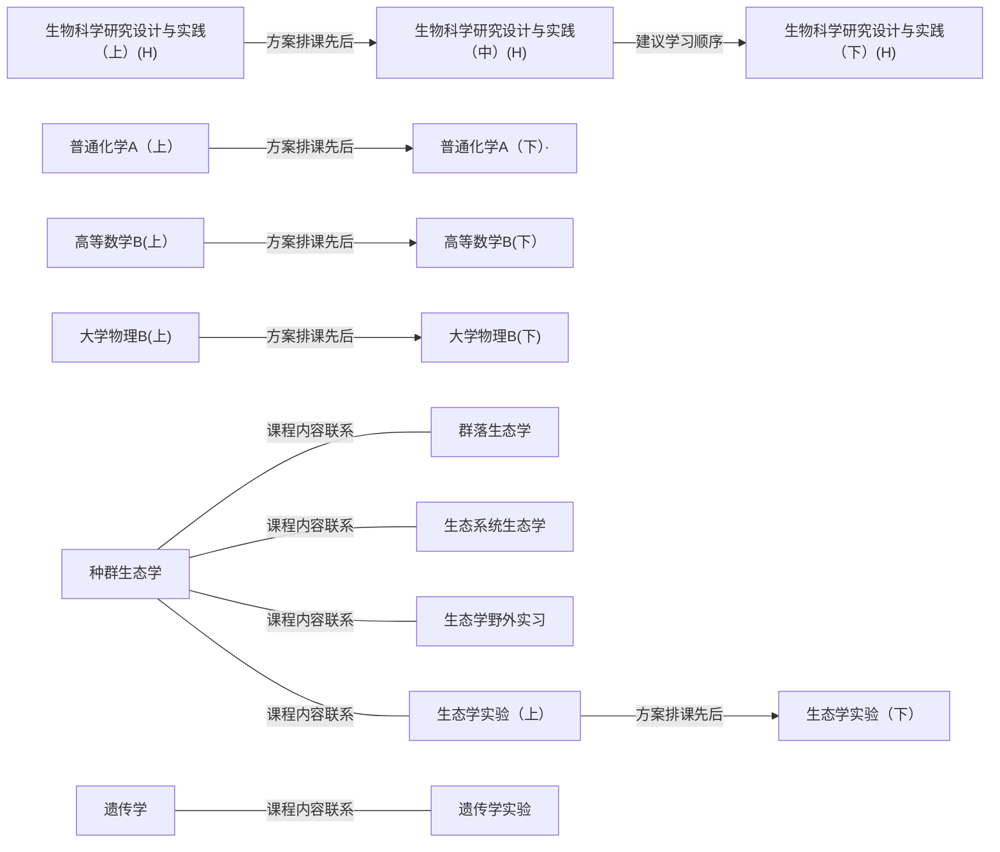

# 2025生态学-生态学本博融通培养方案（英才班适用）

生命科学学院 · 生态学 · 方案 97023 · 44 个不同课程或科研条目。

[官方 Word](../originals/plan-97023.docx) · [教务详情](https://fdjwgl.fudan.edu.cn/manager/bizType/2/major-program-search/info/97023?skipAuth=1) · [方案快照](../raw/plan-97023.json.gz) · [年级目录](../README.md)

## 修读导读

- **建议先学**　《生态学实验（上）》（`ECOL30008`） → 《生态学实验（下）》（`ECOL30009`）。题名列出连续册次或级别。保留前一阶段的观察记录、测量条件和误差分析，便于和后续练习比较。方案分别列在第5、6学期。

- **可以对照着读**　《种群生态学》（`ECOL30006`）与《群落生态学》（`ECOL30007`）。两门课的题名都涉及生态学。以同一生态现象为例，区分个体、种群和群落尺度下的问题。

- **查模块选课**　《生态系统生态学》（`ECOL30010`）、《动物生物学》（`ECOL30004`）列在“专业核心教育课程”中。原表见 `/courseModules/6`。

## 课程关系图

图中展示部分关系。下表保留全部已建立的课程对，来源位置使用本方案 JSON Pointer。

## 先修与内容联系

| 类型 | 起点 | 终点 | 依据 | 原表定位 |
| --- | --- | --- | --- | --- |
| 建议学习顺序 | 生物科学研究设计与实践（上）(H) (BIOL50055h) | 生物科学研究设计与实践（中）(H) (BIOL50056h) | 同方案的课程题名具有连续分册或序号。  | `/courseModules/16/planCourses/14`、`/courseModules/16/planCourses/12` |
| 建议学习顺序 | 生物科学研究设计与实践（中）(H) (BIOL50056h) | 生物科学研究设计与实践（下）(H) (BIOL50057h) | 同方案的课程题名具有连续分册或序号。  | `/courseModules/16/planCourses/12`、`/courseModules/16/planCourses/16` |
| 建议学习顺序 | 普通化学A（上） (CHEM10003) | 普通化学A（下） (CHEM10004) | 同方案的课程题名具有连续分册或序号。  | `/courseModules/5/planCourses/1`、`/courseModules/5/planCourses/2` |
| 建议学习顺序 | 生态学实验（上） (ECOL30008) | 生态学实验（下） (ECOL30009) | 同方案的课程题名具有连续分册或序号。  | `/courseModules/16/planCourses/23`、`/courseModules/16/planCourses/24` |
| 建议学习顺序 | 高等数学B(上） (MATH10004) | 高等数学B(下） (MATH10005) | 同方案的课程题名具有连续分册或序号。  | `/courseModules/5/planCourses/3`、`/courseModules/5/planCourses/4` |
| 建议学习顺序 | 大学物理B(上) (PHYS10003) | 大学物理B(下) (PHYS10004) | 同方案的课程题名具有连续分册或序号。  | `/courseModules/5/planCourses/5`、`/courseModules/5/planCourses/6` |
| 方案排课先后 | 生物科学研究设计与实践（上）(H) (BIOL50055h) | 生物科学研究设计与实践（中）(H) (BIOL50056h) | 同方案该课程全部明确数字学期均早于后者。  | `/courseModules/16/planCourses/14`、`/courseModules/16/planCourses/12` |
| 方案排课先后 | 普通化学A（上） (CHEM10003) | 普通化学A（下） (CHEM10004) | 同方案该课程全部明确数字学期均早于后者。  | `/courseModules/5/planCourses/1`、`/courseModules/5/planCourses/2` |
| 方案排课先后 | 生态学实验（上） (ECOL30008) | 生态学实验（下） (ECOL30009) | 同方案该课程全部明确数字学期均早于后者。  | `/courseModules/16/planCourses/23`、`/courseModules/16/planCourses/24` |
| 方案排课先后 | 高等数学B(上） (MATH10004) | 高等数学B(下） (MATH10005) | 同方案该课程全部明确数字学期均早于后者。  | `/courseModules/5/planCourses/3`、`/courseModules/5/planCourses/4` |
| 方案排课先后 | 大学物理B(上) (PHYS10003) | 大学物理B(下) (PHYS10004) | 同方案该课程全部明确数字学期均早于后者。  | `/courseModules/5/planCourses/5`、`/courseModules/5/planCourses/6` |
| 课程内容联系 | 生物化学实验 (BIOL30003) | 生物化学B (BIOL30013) | 本方案两门课程的题名均含“生物化学”，可据此对照这一主题。  | `/courseModules/16/planCourses/21`、`/courseModules/6/planCourses/6` |
| 课程内容联系 | 遗传学 (BIOL30008) | 遗传学实验 (BIOL30009) | 题名显示相同主题的课程与实验、实践或实习。  | `/courseModules/6/planCourses/5`、`/courseModules/16/planCourses/22` |
| 课程内容联系 | 有机化学 (CHEM20011) | 有机化学实验 (CHEM20012) | 题名显示相同主题的课程与实验、实践或实习。  | `/courseModules/6/planCourses/0`、`/courseModules/16/planCourses/15` |
| 课程内容联系 | 种群生态学 (ECOL30006) | 群落生态学 (ECOL30007) | 本方案两门课程的题名均含“生态学”，可据此对照这一主题。  | `/courseModules/6/planCourses/7`、`/courseModules/6/planCourses/8` |
| 课程内容联系 | 种群生态学 (ECOL30006) | 生态学实验（上） (ECOL30008) | 本方案两门课程的题名均含“生态学”，可据此对照这一主题。  | `/courseModules/6/planCourses/7`、`/courseModules/16/planCourses/23` |
| 课程内容联系 | 种群生态学 (ECOL30006) | 生态系统生态学 (ECOL30010) | 本方案两门课程的题名均含“生态学”，可据此对照这一主题。  | `/courseModules/6/planCourses/7`、`/courseModules/6/planCourses/9` |
| 课程内容联系 | 种群生态学 (ECOL30006) | 生态学野外实习 (ECOL30011) | 本方案两门课程的题名均含“生态学”，可据此对照这一主题。  | `/courseModules/6/planCourses/7`、`/courseModules/16/planCourses/26` |

本次未从可定位的明确表述中确认课程对课程预修。学期安排、系列分册与编辑建议均保留各自的依据。

## 课程表

同一课程在不同模块分别出现时，按原表逐行列出。季节字段保留原值。

| 课程 | 代码 | 学分 | 学期 | 模块 |
| --- | --- | ---: | --- | --- |
| 现代生物科学导论A | BIOL10001 | 3.0 | 第1学期 | 培养方案 / 专业培养课程 / 学科基础课程 |
| 普通化学A（上） | CHEM10003 | 2.0 | 第1学期 | 培养方案 / 专业培养课程 / 学科基础课程 |
| 普通化学A（下） | CHEM10004 | 2.0 | 第2学期 | 培养方案 / 专业培养课程 / 学科基础课程 |
| 高等数学B(上） | MATH10004 | 5.0 | 第1学期 | 培养方案 / 专业培养课程 / 学科基础课程 |
| 高等数学B(下） | MATH10005 | 5.0 | 第2学期 | 培养方案 / 专业培养课程 / 学科基础课程 |
| 大学物理B(上) | PHYS10003 | 4.0 | 第1学期 | 培养方案 / 专业培养课程 / 学科基础课程 |
| 大学物理B(下) | PHYS10004 | 4.0 | 第2学期 | 培养方案 / 专业培养课程 / 学科基础课程 |
| 有机化学 | CHEM20011 | 4.0 | 第3学期 | 培养方案 / 专业培养课程 / 专业核心教育课程 |
| 动物生物学 | ECOL30004 | 3.0 | 第3学期 | 培养方案 / 专业培养课程 / 专业核心教育课程 |
| 植物生物学 | ECOL30005 | 3.0 | 第4学期 | 培养方案 / 专业培养课程 / 专业核心教育课程 |
| 生物多样性科学导论 | BIOL30016 | 2.0 | 第3学期 | 培养方案 / 专业培养课程 / 专业核心教育课程 |
| 微生物学 | BIOL30006 | 3.0 | 第5学期 | 培养方案 / 专业培养课程 / 专业核心教育课程 |
| 遗传学 | BIOL30008 | 3.0 | 第5学期 | 培养方案 / 专业培养课程 / 专业核心教育课程 |
| 生物化学B | BIOL30013 | 3.0 | 第4学期 | 培养方案 / 专业培养课程 / 专业核心教育课程 |
| 种群生态学 | ECOL30006 | 2.0 | 第4学期 | 培养方案 / 专业培养课程 / 专业核心教育课程 |
| 群落生态学 | ECOL30007 | 2.0 | 第4学期 | 培养方案 / 专业培养课程 / 专业核心教育课程 |
| 生态系统生态学 | ECOL30010 | 2.0 | 第5学期 | 培养方案 / 专业培养课程 / 专业核心教育课程 |
| 毕业论文 | BIOL30001 | 2.0 | 第8学期 | 融合创新能力 |
| 复芏计划(FDUROP) | 102 | 0.0 |  | 融合创新能力 |
| 研究生学术活动 | 4 | 2.0 |  | 融合创新能力 |
| 研究生实践活动 | 5 | 2.0 |  | 融合创新能力 |
| 国际交流 | 7 | 0.0 |  | 融合创新能力 |
| 博士学位论文开题 | 1 | 0.0 |  | 融合创新能力 |
| 博士生资格考核 | 2 | 0.0 |  | 融合创新能力 |
| 博士论文中期考核 | 3 | 0.0 |  | 融合创新能力 |
| 博士学位论文预审 | 6 | 0.0 |  | 融合创新能力 |
| 基础物理实验 | PHYS10005 | 2.0 | 第2学期 | 融合创新能力 |
| 系统科研训练Ⅲ | BIOL50048 | 3.0 | AUTUMN | 融合创新能力 |
| 现代生物科学实验 | BIOL10003 | 1.0 | 第1学期 | 融合创新能力 |
| 生物科学研究设计与实践（中）(H) | BIOL50056h | 2.0 | 第5学期 | 融合创新能力 |
| 普通化学实验I | CHEM10005 | 1.0 | 第1学期 | 融合创新能力 |
| 生物科学研究设计与实践（上）(H) | BIOL50055h | 2.0 | 第3学期 | 融合创新能力 |
| 有机化学实验 | CHEM20012 | 2.0 | 第3学期 | 融合创新能力 |
| 生物科学研究设计与实践（下）(H) | BIOL50057h | 2.0 | AUTUMN | 融合创新能力 |
| 科学研究方法与论文写作 | BIOL50013 | 2.0 | SPRING | 融合创新能力 |
| 动物学实验 | ECOL30002 | 1.5 | 第3学期 | 融合创新能力 |
| 植物学实验 | ECOL30001 | 1.5 | 第4学期 | 融合创新能力 |
| 生态学野外研究方法与实践 | ECOL70005 | 3.0 |  | 融合创新能力 |
| 生物化学实验 | BIOL30003 | 1.5 | 第4学期 | 融合创新能力 |
| 遗传学实验 | BIOL30009 | 1.5 | 第5学期 | 融合创新能力 |
| 生态学实验（上） | ECOL30008 | 2.0 | 第5学期 | 融合创新能力 |
| 生态学实验（下） | ECOL30009 | 2.0 | 第6学期 | 融合创新能力 |
| 生物学野外实习 | ECOL30003 | 2.0 | SUMMER | 融合创新能力 |
| 生态学野外实习 | ECOL30011 | 1.0 | SUMMER | 融合创新能力 |
