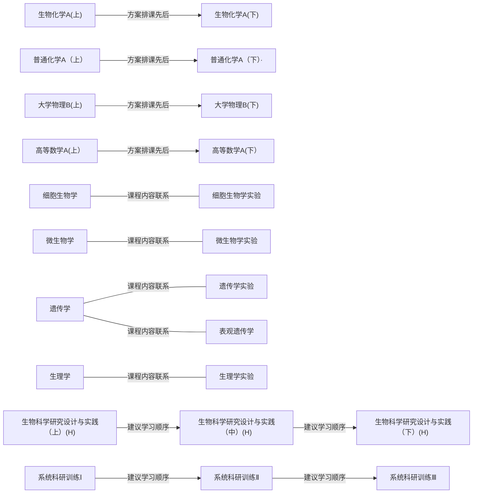

# 2025生物科学-生物学本博融通培养方案（相辉学堂适用）

生命科学学院 · 生物科学(相辉计划) · 方案 97027 · 84 个不同课程或科研条目。

[官方 Word](../originals/plan-97027.docx) · [教务详情](https://fdjwgl.fudan.edu.cn/manager/bizType/2/major-program-search/info/97027?skipAuth=1) · [方案快照](../raw/plan-97027.json.gz) · [年级目录](../README.md)

## 修读导读

- **建议先学**　《生物化学A(上)》（`BIOL30002`） → 《生物化学A(下)》（`BIOL30021`）。题名列出连续册次或级别。可沿用同一张结构与功能对照表，把后续分册涉及的分子和过程补进去。方案分别列在第4、5学期。

- **可以对照着读**　《遗传学》（`BIOL30008`）与《表观遗传学》（`BIOL50019`）。两门课的题名都涉及遗传学。围绕一个性状，区分观察到的遗传现象、解释模型和所需证据。

- **查模块选课**　《普通生物学》（`BIOL30019`）、《生理学》（`BIOL30010`）列在“专业核心教育课程”中。原表见 `/courseModules/6`。

## 课程关系图

图中展示部分关系。下表保留全部已建立的课程对，来源位置使用本方案 JSON Pointer。

## 先修与内容联系

| 类型 | 起点 | 终点 | 依据 | 原表定位 |
| --- | --- | --- | --- | --- |
| 建议学习顺序 | 生物化学A(上) (BIOL30002) | 生物化学A(下) (BIOL30021) | 同方案的课程题名具有连续分册或序号。  | `/courseModules/6/planCourses/4`、`/courseModules/6/planCourses/5` |
| 建议学习顺序 | 系统科研训练Ⅰ (BIOL50046) | 系统科研训练Ⅱ (BIOL50047) | 同方案的课程题名具有连续分册或序号。  | `/courseModules/19/planCourses/14`、`/courseModules/19/planCourses/16` |
| 建议学习顺序 | 系统科研训练Ⅱ (BIOL50047) | 系统科研训练Ⅲ (BIOL50048) | 同方案的课程题名具有连续分册或序号。  | `/courseModules/19/planCourses/16`、`/courseModules/19/planCourses/18` |
| 建议学习顺序 | 生物科学研究设计与实践（上）(H) (BIOL50055h) | 生物科学研究设计与实践（中）(H) (BIOL50056h) | 同方案的课程题名具有连续分册或序号。  | `/courseModules/10/planCourses/39`、`/courseModules/10/planCourses/40` |
| 建议学习顺序 | 生物科学研究设计与实践（中）(H) (BIOL50056h) | 生物科学研究设计与实践（下）(H) (BIOL50057h) | 同方案的课程题名具有连续分册或序号。  | `/courseModules/10/planCourses/40`、`/courseModules/10/planCourses/41` |
| 建议学习顺序 | 普通化学A（上） (CHEM10003) | 普通化学A（下） (CHEM10004) | 同方案的课程题名具有连续分册或序号。  | `/courseModules/5/planCourses/1`、`/courseModules/5/planCourses/2` |
| 建议学习顺序 | 高等数学A(上） (MATH10015) | 高等数学A(下） (MATH10016) | 同方案的课程题名具有连续分册或序号。  | `/courseModules/5/planCourses/5`、`/courseModules/5/planCourses/6` |
| 建议学习顺序 | 大学物理B(上) (PHYS10003) | 大学物理B(下) (PHYS10004) | 同方案的课程题名具有连续分册或序号。  | `/courseModules/5/planCourses/3`、`/courseModules/5/planCourses/4` |
| 方案排课先后 | 生物化学A(上) (BIOL30002) | 生物化学A(下) (BIOL30021) | 同方案该课程全部明确数字学期均早于后者。  | `/courseModules/6/planCourses/4`、`/courseModules/6/planCourses/5` |
| 方案排课先后 | 普通化学A（上） (CHEM10003) | 普通化学A（下） (CHEM10004) | 同方案该课程全部明确数字学期均早于后者。  | `/courseModules/5/planCourses/1`、`/courseModules/5/planCourses/2` |
| 方案排课先后 | 高等数学A(上） (MATH10015) | 高等数学A(下） (MATH10016) | 同方案该课程全部明确数字学期均早于后者。  | `/courseModules/5/planCourses/5`、`/courseModules/5/planCourses/6` |
| 方案排课先后 | 大学物理B(上) (PHYS10003) | 大学物理B(下) (PHYS10004) | 同方案该课程全部明确数字学期均早于后者。  | `/courseModules/5/planCourses/3`、`/courseModules/5/planCourses/4` |
| 课程内容联系 | 生物化学A(上) (BIOL30002) | 生物化学实验 (BIOL30003) | 本方案两门课程的题名均含“生物化学”，可据此对照这一主题。  | `/courseModules/6/planCourses/4`、`/courseModules/19/planCourses/11` |
| 课程内容联系 | 生物化学实验 (BIOL30003) | 生物化学A(下) (BIOL30021) | 本方案两门课程的题名均含“生物化学”，可据此对照这一主题。  | `/courseModules/19/planCourses/11`、`/courseModules/6/planCourses/5` |
| 课程内容联系 | 细胞生物学 (BIOL30004) | 细胞生物学实验 (BIOL30005) | 题名显示相同主题的课程与实验、实践或实习。  | `/courseModules/6/planCourses/6`、`/courseModules/19/planCourses/13` |
| 课程内容联系 | 微生物学 (BIOL30006) | 微生物学实验 (BIOL30007) | 题名显示相同主题的课程与实验、实践或实习。  | `/courseModules/6/planCourses/7`、`/courseModules/19/planCourses/15` |
| 课程内容联系 | 遗传学 (BIOL30008) | 遗传学实验 (BIOL30009) | 题名显示相同主题的课程与实验、实践或实习。  | `/courseModules/6/planCourses/8`、`/courseModules/19/planCourses/17` |
| 课程内容联系 | 遗传学 (BIOL30008) | 表观遗传学 (BIOL50019) | 本方案两门课程的题名均含“遗传学”，可据此对照这一主题。  | `/courseModules/6/planCourses/8`、`/courseModules/10/planCourses/3` |
| 课程内容联系 | 生理学 (BIOL30010) | 生理学实验 (BIOL30020) | 题名显示相同主题的课程与实验、实践或实习。  | `/courseModules/6/planCourses/3`、`/courseModules/19/planCourses/19` |
| 课程内容联系 | 生物信息学 (BIOL50012) | 生物信息学实验 (BIOL50045) | 题名显示相同主题的课程与实验、实践或实习。  | `/courseModules/10/planCourses/6`、`/courseModules/10/planCourses/14` |
| 课程内容联系 | 有机化学 (CHEM20011) | 有机化学实验 (CHEM20012) | 题名显示相同主题的课程与实验、实践或实习。  | `/courseModules/6/planCourses/0`、`/courseModules/19/planCourses/22` |
| 课程内容联系 | 分析化学 (CHEM20015) | 分析化学实验 (CHEM20016) | 题名显示相同主题的课程与实验、实践或实习。  | `/courseModules/6/planCourses/1`、`/courseModules/19/planCourses/23` |
| 课程内容联系 | 景观生态学 (ECOL50008) | 入侵生态学 (ECOL50015) | 本方案两门课程的题名均含“生态学”，可据此对照这一主题。  | `/courseModules/10/planCourses/25`、`/courseModules/10/planCourses/32` |
| 课程内容联系 | 土壤生态学 (ECOL50009) | 入侵生态学 (ECOL50015) | 本方案两门课程的题名均含“生态学”，可据此对照这一主题。  | `/courseModules/10/planCourses/26`、`/courseModules/10/planCourses/32` |
| 课程内容联系 | 化学生态学 (ECOL50010) | 入侵生态学 (ECOL50015) | 本方案两门课程的题名均含“生态学”，可据此对照这一主题。  | `/courseModules/10/planCourses/27`、`/courseModules/10/planCourses/32` |
| 课程内容联系 | 分子生态学 (ECOL50012) | 入侵生态学 (ECOL50015) | 本方案两门课程的题名均含“生态学”，可据此对照这一主题。  | `/courseModules/10/planCourses/29`、`/courseModules/10/planCourses/32` |

本次未从可定位的明确表述中确认课程对课程预修。学期安排、系列分册与编辑建议均保留各自的依据。

## 课程表

同一课程在不同模块分别出现时，按原表逐行列出。季节字段保留原值。

| 课程 | 代码 | 学分 | 学期 | 模块 |
| --- | --- | ---: | --- | --- |
| 现代生物科学导论A | BIOL10001 | 3.0 | 第1学期 | 培养方案 / 专业培养课程 / 学科基础课程 |
| 普通化学A（上） | CHEM10003 | 2.0 | 第1学期 | 培养方案 / 专业培养课程 / 学科基础课程 |
| 普通化学A（下） | CHEM10004 | 2.0 | 第2学期 | 培养方案 / 专业培养课程 / 学科基础课程 |
| 大学物理B(上) | PHYS10003 | 4.0 | 第1学期 | 培养方案 / 专业培养课程 / 学科基础课程 |
| 大学物理B(下) | PHYS10004 | 4.0 | 第2学期 | 培养方案 / 专业培养课程 / 学科基础课程 |
| 高等数学A(上） | MATH10015 | 5.0 | 第1学期 | 培养方案 / 专业培养课程 / 学科基础课程 |
| 高等数学A(下） | MATH10016 | 5.0 | 第2学期 | 培养方案 / 专业培养课程 / 学科基础课程 |
| 有机化学 | CHEM20011 | 4.0 | 第3学期 | 培养方案 / 专业培养课程 / 专业核心教育课程 |
| 分析化学 | CHEM20015 | 2.0 | 第3学期 | 培养方案 / 专业培养课程 / 专业核心教育课程 |
| 普通生物学 | BIOL30019 | 3.0 | 第3学期 | 培养方案 / 专业培养课程 / 专业核心教育课程 |
| 生理学 | BIOL30010 | 3.0 | 第4学期 | 培养方案 / 专业培养课程 / 专业核心教育课程 |
| 生物化学A(上) | BIOL30002 | 3.0 | 第4学期 | 培养方案 / 专业培养课程 / 专业核心教育课程 |
| 生物化学A(下) | BIOL30021 | 2.0 | 第5学期 | 培养方案 / 专业培养课程 / 专业核心教育课程 |
| 细胞生物学 | BIOL30004 | 3.0 | 第4学期 | 培养方案 / 专业培养课程 / 专业核心教育课程 |
| 微生物学 | BIOL30006 | 3.0 | 第5学期 | 培养方案 / 专业培养课程 / 专业核心教育课程 |
| 遗传学 | BIOL30008 | 3.0 | 第5学期 | 培养方案 / 专业培养课程 / 专业核心教育课程 |
| 分子生物学 | BIOL30014 | 2.0 | 第5学期 | 培养方案 / 专业培养课程 / 专业核心教育课程 |
| 生物统计学 | BIOL50004 | 3.0 | AUTUMN | 培养方案 / 专业进阶I / 专业进阶课程池 |
| 免疫学 | BIOL50005 | 2.0 | AUTUMN | 培养方案 / 专业进阶I / 专业进阶课程池 |
| 遗传分析原理 | BIOL50015 | 2.0 | AUTUMN | 培养方案 / 专业进阶I / 专业进阶课程池 |
| 表观遗传学 | BIOL50019 | 2.0 | AUTUMN | 培养方案 / 专业进阶I / 专业进阶课程池 |
| 基因组学 | BIOL50009 | 2.0 | AUTUMN | 培养方案 / 专业进阶I / 专业进阶课程池 |
| 神经生物学概论 | BIOL50011 | 2.0 | AUTUMN | 培养方案 / 专业进阶I / 专业进阶课程池 |
| 生物信息学 | BIOL50012 | 3.0 | SPRING | 培养方案 / 专业进阶I / 专业进阶课程池 |
| 工业酶与生物催化 | BIOL50024 | 2.0 | AUTUMN | 培养方案 / 专业进阶I / 专业进阶课程池 |
| 植物细胞与发育生物学 | BIOL50026 | 2.0 | AUTUMN | 培养方案 / 专业进阶I / 专业进阶课程池 |
| 发育生物学 | BIOL50030 | 3.0 | AUTUMN | 培养方案 / 专业进阶I / 专业进阶课程池 |
| 结构生物学 | BIOL50034 | 2.0 | SPRING | 培养方案 / 专业进阶I / 专业进阶课程池 |
| 病原生物学基础 | BIOL50037 | 2.0 | SPRING | 培养方案 / 专业进阶I / 专业进阶课程池 |
| 功能解剖学和组织学 | BIOL50042 | 3.0 | AUTUMN | 培养方案 / 专业进阶I / 专业进阶课程池 |
| 代谢生物学 | BIOL50043 | 3.0 | AUTUMN | 培养方案 / 专业进阶I / 专业进阶课程池 |
| 生物信息学实验 | BIOL50045 | 2.0 | AUTUMN | 培养方案 / 专业进阶I / 专业进阶课程池 |
| 药物设计学 | PHAR40004 | 1.0 | SPRING | 培养方案 / 专业进阶I / 专业进阶课程池 |
| 药物化学概论 | PHAR30030 | 2.0 | SPRING | 培养方案 / 专业进阶I / 专业进阶课程池 |
| 生物药剂学与药物动力学 | PHAR30036 | 2.0 | AUTUMN | 培养方案 / 专业进阶I / 专业进阶课程池 |
| 行为生态学 | ECOL50001 | 2.0 | AUTUMN | 培养方案 / 专业进阶I / 专业进阶课程池 |
| 生物地理学 | ECOL50002 | 2.0 | AUTUMN | 培养方案 / 专业进阶I / 专业进阶课程池 |
| 进化生物学 | BIOL50018 | 2.0 | SPRING | 培养方案 / 专业进阶I / 专业进阶课程池 |
| 全球变化生物学 | ECOL50004 | 2.0 | AUTUMN | 培养方案 / 专业进阶I / 专业进阶课程池 |
| 生物安全导论 | ECOL50005 | 2.0 | SPRING | 培养方案 / 专业进阶I / 专业进阶课程池 |
| 生物多样性科学导论 | BIOL30016 | 2.0 | AUTUMN | 培养方案 / 专业进阶I / 专业进阶课程池 |
| 自然地理学 | ECOL50007 | 2.0 | AUTUMN | 培养方案 / 专业进阶I / 专业进阶课程池 |
| 景观生态学 | ECOL50008 | 2.0 | SPRING | 培养方案 / 专业进阶I / 专业进阶课程池 |
| 土壤生态学 | ECOL50009 | 2.0 | AUTUMN | 培养方案 / 专业进阶I / 专业进阶课程池 |
| 化学生态学 | ECOL50010 | 2.0 | AUTUMN | 培养方案 / 专业进阶I / 专业进阶课程池 |
| 湿地生态学 | ECOL50011 | 2.0 | AUTUMN | 培养方案 / 专业进阶I / 专业进阶课程池 |
| 分子生态学 | ECOL50012 | 2.0 | AUTUMN | 培养方案 / 专业进阶I / 专业进阶课程池 |
| 保护生物学 | ECOL50013 | 2.0 | AUTUMN | 培养方案 / 专业进阶I / 专业进阶课程池 |
| 生态与社会 | ECOL50014 | 2.0 | SPRING | 培养方案 / 专业进阶I / 专业进阶课程池 |
| 入侵生态学 | ECOL50015 | 2.0 | AUTUMN | 培养方案 / 专业进阶I / 专业进阶课程池 |
| 生态遥感 | ECOL50016 | 2.0 | SPRING | 培养方案 / 专业进阶I / 专业进阶课程池 |
| 生物学野外实习 | ECOL30003 | 2.0 | SUMMER | 培养方案 / 专业进阶I / 专业进阶课程池 |
| 高级生化技术 | BIOL50002 | 1.5 | SUMMER | 培养方案 / 专业进阶I / 专业进阶课程池 |
| 基因工程实验 | BIOL50003 | 1.5 | AUTUMN | 培养方案 / 专业进阶I / 专业进阶课程池 |
| 人工智能生物学 | AIS310017 | 2.0 | AUTUMN | 培养方案 / 专业进阶I / 专业进阶课程池 |
| 科学研究方法与论文写作 | BIOL50013 | 2.0 | SPRING | 培养方案 / 专业进阶I / 专业进阶课程池 |
| 生物科学研究设计与实践（上）(H) | BIOL50055h | 2.0 | AUTUMN | 培养方案 / 专业进阶I / 专业进阶课程池 |
| 生物科学研究设计与实践（中）(H) | BIOL50056h | 2.0 | SPRING、AUTUMN | 培养方案 / 专业进阶I / 专业进阶课程池 |
| 生物科学研究设计与实践（下）(H) | BIOL50057h | 2.0 | AUTUMN | 培养方案 / 专业进阶I / 专业进阶课程池 |
| 相辉前沿专题 | MATH10025 | 2.0 | SPRING、AUTUMN | 融合创新能力 |
| 复芏计划(FDUROP) | 102 | 0.0 |  | 融合创新能力 |
| 研究生学术活动 | 4 | 2.0 |  | 融合创新能力 |
| 研究生实践活动 | 5 | 2.0 |  | 融合创新能力 |
| 国际交流 | 7 | 0.0 |  | 融合创新能力 |
| 博士学位论文开题 | 1 | 0.0 |  | 融合创新能力 |
| 博士生资格考核 | 2 | 0.0 |  | 融合创新能力 |
| 博士论文中期考核 | 3 | 0.0 |  | 融合创新能力 |
| 博士学位论文预审 | 6 | 0.0 |  | 融合创新能力 |
| 现代生物科学实验 | BIOL10003 | 1.0 | 第1学期 | 融合创新能力 |
| 毕业论文 | BIOL30001 | 2.0 | 第8学期 | 融合创新能力 |
| 生物化学实验 | BIOL30003 | 1.5 | 第4学期 | 融合创新能力 |
| 生命科学交叉前沿专题 | BIOL50020 | 2.0 | SPRING | 融合创新能力 |
| 细胞生物学实验 | BIOL30005 | 1.5 | 第4学期 | 融合创新能力 |
| 系统科研训练Ⅰ | BIOL50046 | 2.0 | SPRING | 融合创新能力 |
| 微生物学实验 | BIOL30007 | 1.5 | 第5学期 | 融合创新能力 |
| 系统科研训练Ⅱ | BIOL50047 | 3.0 | SUMMER | 融合创新能力 |
| 遗传学实验 | BIOL30009 | 1.5 | 第5学期 | 融合创新能力 |
| 系统科研训练Ⅲ | BIOL50048 | 3.0 | AUTUMN | 融合创新能力 |
| 生理学实验 | BIOL30020 | 1.5 | 第4学期 | 融合创新能力 |
| 普通生物学专业实验 | BIOL30023 | 2.0 | 第3学期 | 融合创新能力 |
| 普通化学实验I | CHEM10005 | 1.0 | 第1学期 | 融合创新能力 |
| 有机化学实验 | CHEM20012 | 2.0 | 第3学期 | 融合创新能力 |
| 分析化学实验 | CHEM20016 | 2.0 | 第3学期 | 融合创新能力 |
| 基础物理实验 | PHYS10005 | 2.0 | 第2学期 | 融合创新能力 |
