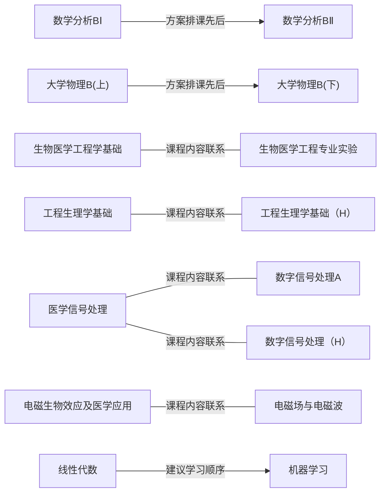

# 2023 生物医学工程2+X@普通本科生

生物医学工程与技术创新学院 · 生物医学工程 · 方案 67438 · 71 个不同课程或科研条目。

[官方 Word](../originals/plan-67438.docx) · [教务详情](https://fdjwgl.fudan.edu.cn/manager/bizType/2/major-program-search/info/67438?skipAuth=1) · [方案快照](../raw/plan-67438.json.gz) · [年级目录](../README.md)

## 修读导读

- **建议先学**　《线性代数》（`CS10003`） → 《机器学习》（`ICE50015`）。向量、矩阵及线性映射为理解学习模型提供数学准备。

- **可以对照着读**　《生物医学工程学基础》（`BME30003`）与《生物医学工程专业实验》（`BME50025`）。两门课的题名都涉及生物医学工程。选一个生理量，比较如何取得测量信号、如何表示，以及结果能回答什么医学问题。

- **查模块选课**　《生物医学工程学基础》（`BME30003`）、《概率、数理统计与随机过程》（`EST20002`）列在“专业核心教育课程”中。原表见 `/courseModules/4`。

## 课程关系图

图中展示部分关系。下表保留全部已建立的课程对，来源位置使用本方案 JSON Pointer。

## 先修与内容联系

| 类型 | 起点 | 终点 | 依据 | 原表定位 |
| --- | --- | --- | --- | --- |
| 建议学习顺序 | 线性代数 (CS10003) | 机器学习 (ICE50015) | 向量、矩阵及线性映射为理解学习模型提供数学准备。  | `/courseModules/3/planCourses/0`、`/courseModules/10/planCourses/22` |
| 建议学习顺序 | 数学分析BⅠ (MATH10012) | 数学分析BⅡ (MATH10013) | 同方案的课程题名具有连续分册或序号。  | `/courseModules/3/planCourses/3`、`/courseModules/3/planCourses/4` |
| 建议学习顺序 | 大学物理B(上) (PHYS10003) | 大学物理B(下) (PHYS10004) | 同方案的课程题名具有连续分册或序号。  | `/courseModules/3/planCourses/5`、`/courseModules/3/planCourses/6` |
| 方案排课先后 | 数学分析BⅠ (MATH10012) | 数学分析BⅡ (MATH10013) | 同方案该课程全部明确数字学期均早于后者。  | `/courseModules/3/planCourses/3`、`/courseModules/3/planCourses/4` |
| 方案排课先后 | 大学物理B(上) (PHYS10003) | 大学物理B(下) (PHYS10004) | 同方案该课程全部明确数字学期均早于后者。  | `/courseModules/3/planCourses/5`、`/courseModules/3/planCourses/6` |
| 课程内容联系 | 生物医学工程学基础 (BME30003) | 生物医学工程专业实验 (BME50025) | 本方案两门课程的题名均含“生物医学工程”，可据此对照这一主题。  | `/courseModules/4/planCourses/2`、`/courseModules/9/planCourses/6` |
| 课程内容联系 | 工程生理学基础 (BME50017) | 工程生理学基础（H） (BME50017h) | 本方案两门课程的题名均含“生理学”，可据此对照这一主题。  | `/courseModules/9/planCourses/1`、`/courseModules/11/planCourses/4` |
| 课程内容联系 | 医学信号处理 (BME50023) | 数字信号处理A (EST30002) | 本方案两门课程的题名均含“信号处理”，可据此对照这一主题。  | `/courseModules/9/planCourses/4`、`/courseModules/4/planCourses/6` |
| 课程内容联系 | 医学信号处理 (BME50023) | 数字信号处理（H） (EST30002h) | 本方案两门课程的题名均含“信号处理”，可据此对照这一主题。  | `/courseModules/9/planCourses/4`、`/courseModules/11/planCourses/3` |
| 课程内容联系 | 电磁生物效应及医学应用 (BME50024) | 电磁场与电磁波 (ICE50009) | 本方案两门课程的题名均含“电磁”，可据此对照这一主题。  | `/courseModules/10/planCourses/17`、`/courseModules/10/planCourses/26` |
| 课程内容联系 | 信号与通信系统 (EST20004) | 信号与通信系统（H） (EST20004h) | 本方案两门课程的题名均含“通信系统”，可据此对照这一主题。  | `/courseModules/4/planCourses/5`、`/courseModules/11/planCourses/1` |
| 课程内容联系 | 数据结构 (EST50016) | 数据结构与算法设计（H） (EST50016h) | 本方案两门课程的题名均含“数据结构”，可据此对照这一主题。  | `/courseModules/10/planCourses/21`、`/courseModules/11/planCourses/5` |

本次未从可定位的明确表述中确认课程对课程预修。学期安排、系列分册与编辑建议均保留各自的依据。

## 按原方案模块阅读

同一模块展示原表中的课程归属。模块内课程之间的先后仍须逐项查阅。

- **技术科学类基础课程**　线性代数、程序设计、电子系统导论、数学分析BⅠ、数学分析BⅡ、大学物理B(上)、大学物理B(下)、基础物理实验（原表模块 3）
- **荣誉项目**　工程生理学基础（H）、信号与通信系统（H）、高频与射频电子学（H）、信息论（H）、数字信号处理（H）、计算机原理与体系结构（H）、电子系统设计（H）、数据结构与算法设计（H）（原表模块 11）

## 课程表

同一课程在不同模块分别出现时，按原表逐行列出。季节字段保留原值。

| 课程 | 代码 | 学分 | 学期 | 模块 |
| --- | --- | ---: | --- | --- |
| 线性代数 | CS10003 | 3.0 | 第1学期 | 培养方案 / 专业培养课程 / 大类基础课程 / 技术科学类基础课程 |
| 程序设计 | CS10004 | 4.0 | 第1学期 | 培养方案 / 专业培养课程 / 大类基础课程 / 技术科学类基础课程 |
| 电子系统导论 | EST10003 | 3.0 | 第2学期 | 培养方案 / 专业培养课程 / 大类基础课程 / 技术科学类基础课程 |
| 数学分析BⅠ | MATH10012 | 5.0 | 第1学期 | 培养方案 / 专业培养课程 / 大类基础课程 / 技术科学类基础课程 |
| 数学分析BⅡ | MATH10013 | 5.0 | 第2学期 | 培养方案 / 专业培养课程 / 大类基础课程 / 技术科学类基础课程 |
| 大学物理B(上) | PHYS10003 | 4.0 | 第1学期 | 培养方案 / 专业培养课程 / 大类基础课程 / 技术科学类基础课程 |
| 大学物理B(下) | PHYS10004 | 4.0 | 第2学期 | 培养方案 / 专业培养课程 / 大类基础课程 / 技术科学类基础课程 |
| 基础物理实验 | PHYS10005 | 2.0 | 第2学期 | 培养方案 / 专业培养课程 / 大类基础课程 / 技术科学类基础课程 |
| 自动控制原理 | EST30003 | 3.0 | 第5学期 | 培养方案 / 专业培养课程 / 专业核心教育课程 |
| 概率、数理统计与随机过程 | EST20002 | 3.0 | 第3学期 | 培养方案 / 专业培养课程 / 专业核心教育课程 |
| 生物医学工程学基础 | BME30003 | 3.0 | 第5学期 | 培养方案 / 专业培养课程 / 专业核心教育课程 |
| 通信原理B | ICE30001 | 3.0 | 第5学期 | 培养方案 / 专业培养课程 / 专业核心教育课程 |
| 工程数学 | EST20003 | 4.0 | 第3学期 | 培养方案 / 专业培养课程 / 专业核心教育课程 |
| 信号与通信系统 | EST20004 | 3.0 | 第4学期 | 培养方案 / 专业培养课程 / 专业核心教育课程 |
| 数字信号处理A | EST30002 | 3.0 | 第5学期 | 培养方案 / 专业培养课程 / 专业核心教育课程 |
| 毕业论文 | EST40005 | 6.0 | 第8学期 | 培养方案 / 专业培养课程 / 专业核心教育课程 |
| 高频电子线路B | EST20005 | 3.0 | 第4学期 | 培养方案 / 专业培养课程 / 专业核心教育课程 |
| 信息论基础 | EST20008 | 3.0 | 第4学期 | 培养方案 / 专业培养课程 / 专业核心教育课程 |
| 数字逻辑基础 | EST20009 | 4.0 | 第3学期 | 培养方案 / 专业培养课程 / 专业核心教育课程 |
| 模拟电子学基础 | EST20010 | 4.0 | 第3学期 | 培养方案 / 专业培养课程 / 专业核心教育课程 |
| 模拟与数字电路实验 | EST40012 | 3.0 | 第4学期 | 培养方案 / 专业培养课程 / 专业核心教育课程 |
| 信号与系统实验 | ICE40005 | 2.0 | 第5学期 | 培养方案 / 专业培养课程 / 专业核心教育课程 |
| 微机原理与接口实验 | EST40017 | 3.0 | 第5学期 | 培养方案 / 专业培养课程 / 专业核心教育课程 |
| 生产实习 | EST40004 | 1.0 | 第7学期 | 培养方案 / 专业进阶模块I |
| 工程生理学基础 | BME50017 | 3.0 | 第6学期 | 培养方案 / 专业进阶模块I |
| 计算机体系结构 | EST30005 | 3.0 | 第6学期 | 培养方案 / 专业进阶模块I |
| 医学传感器 | BME50022 | 2.0 | 第5学期 | 培养方案 / 专业进阶模块I |
| 医学信号处理 | BME50023 | 2.0 | 第6学期 | 培养方案 / 专业进阶模块I |
| 高频电路实验 | EST40013 | 2.0 | 第6学期 | 培养方案 / 专业进阶模块I |
| 生物医学工程专业实验 | BME50025 | 3.0 | 第7学期 | 培养方案 / 专业进阶模块I |
| AI增强仿真学：理论与实践 | AIT310027 | 3.0 | AUTUMN | 培养方案 / 专业进阶模块II |
| 自动驾驶人工智能原理与实践 | AIT410017 | 2.0 | SPRING | 培养方案 / 专业进阶模块II |
| 医学超声技术 | AIT531030 | 2.0 | SPRING | 培养方案 / 专业进阶模块II |
| 电工实验 | EST40006 | 2.0 | SPRING、AUTUMN | 培养方案 / 专业进阶模块II |
| 电子系统设计 | EST50012 | 2.0 | SPRING、AUTUMN | 培养方案 / 专业进阶模块II |
| 多媒体技术 | EST40007 | 2.0 | SPRING、AUTUMN | 培养方案 / 专业进阶模块II |
| 计算机网络 | EST40008 | 2.0 | SPRING、AUTUMN | 培养方案 / 专业进阶模块II |
| 近代医学概论 | BME50018 | 2.0 | SPRING、AUTUMN | 培养方案 / 专业进阶模块II |
| 科技英语 | ICE50003 | 2.0 | SPRING、AUTUMN | 培养方案 / 专业进阶模块II |
| 可编程器件与硬件描述语言 | EST50013 | 2.0 | SPRING、AUTUMN | 培养方案 / 专业进阶模块II |
| 数据采集和处理系统 | EST40009 | 2.0 | SPRING、AUTUMN | 培养方案 / 专业进阶模块II |
| 心脏电生理与起搏 | BME50019 | 2.0 | SPRING、AUTUMN | 培养方案 / 专业进阶模块II |
| 医学成像技术 | BME50021 | 2.0 | SPRING、AUTUMN | 培养方案 / 专业进阶模块II |
| 光通信网络基础 | ICE50006 | 2.0 | SPRING、AUTUMN | 培养方案 / 专业进阶模块II |
| 数字图像处理B | ICE40003 | 2.0 | SPRING、AUTUMN | 培养方案 / 专业进阶模块II |
| 卫星与移动通信B | ICE40004 | 2.0 | SPRING、AUTUMN | 培养方案 / 专业进阶模块II |
| 网络科学导论 | EST50015 | 2.0 | SPRING、AUTUMN | 培养方案 / 专业进阶模块II |
| 电磁生物效应及医学应用 | BME50024 | 2.0 | SPRING、AUTUMN | 培养方案 / 专业进阶模块II |
| 工程图学及应用 | EST40010 | 2.0 | SPRING、AUTUMN | 培养方案 / 专业进阶模块II |
| 前沿讲座 | ICE50010 | 2.0 | SPRING、AUTUMN | 培养方案 / 专业进阶模块II |
| 通信编码原理与技术 | ICE50011 | 2.0 | SPRING、AUTUMN | 培养方案 / 专业进阶模块II |
| 数据结构 | EST50016 | 2.0 | SPRING、AUTUMN | 培养方案 / 专业进阶模块II |
| 机器学习 | ICE50015 | 2.0 | SPRING、AUTUMN | 培养方案 / 专业进阶模块II |
| 群体智能 | EST40016 | 2.0 | SPRING、AUTUMN | 培养方案 / 专业进阶模块II |
| 医学电子创新设计与实验 | BME30004 | 3.0 | AUTUMN | 培养方案 / 专业进阶模块II |
| 计算机视觉 | AIE310004 | 3.0 | SPRING、AUTUMN | 培养方案 / 专业进阶模块II |
| 电磁场与电磁波 | ICE50009 | 3.0 | AUTUMN | 培养方案 / 专业进阶模块II |
| 生物统计学 | BIOL50004 | 3.0 | AUTUMN | 培养方案 / 专业进阶模块II |
| 计算神经学 | CS50029 | 3.0 | AUTUMN | 培养方案 / 专业进阶模块II |
| 嵌入式处理器 | BME30002 | 3.0 | SPRING、AUTUMN | 培养方案 / 专业进阶模块II |
| 深度学习基础 | AIB310003 | 3.0 | SPRING、AUTUMN | 培养方案 / 专业进阶模块II |
| 脑机接口 | BME70010 | 3.0 | AUTUMN | 培养方案 / 专业进阶模块II |
| 神经生物学概论 | BIOL50011 | 2.0 | AUTUMN | 培养方案 / 专业进阶模块II |
| 高频与射频电子学（H） | EST20005h | 4.0 | 第4学期 | 培养方案 / 荣誉项目 |
| 信号与通信系统（H） | EST20004h | 4.0 | 第4学期 | 培养方案 / 荣誉项目 |
| 信息论（H） | EST20008h | 4.0 | 第4学期 | 培养方案 / 荣誉项目 |
| 数字信号处理（H） | EST30002h | 4.0 | 第5学期 | 培养方案 / 荣誉项目 |
| 工程生理学基础（H） | BME50017h | 4.0 | 第6学期 | 培养方案 / 荣誉项目 |
| 数据结构与算法设计（H） | EST50016h | 4.0 | 第6学期 | 培养方案 / 荣誉项目 |
| 计算机原理与体系结构（H） | EST30005h | 4.0 | 第6学期 | 培养方案 / 荣誉项目 |
| 电子系统设计（H） | EST50012h | 3.0 | 第7学期 | 培养方案 / 荣誉项目 |
