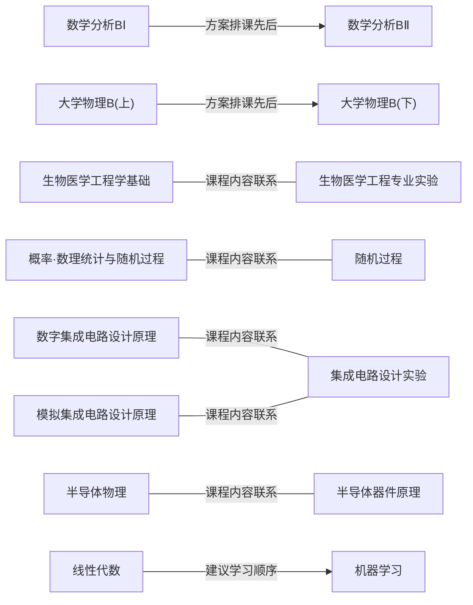

# 2024生物医学工程（智慧医药与芯片领军人才班）2+X@普通本科生

生物医学工程与技术创新学院 · 生物医学工程(智慧医药与芯片领军人才班) · 方案 73057 · 43 个不同课程或科研条目。

[官方 Word](../originals/plan-73057.docx) · [教务详情](https://fdjwgl.fudan.edu.cn/manager/bizType/2/major-program-search/info/73057?skipAuth=1) · [方案快照](../raw/plan-73057.json.gz) · [年级目录](../README.md)

## 修读导读

- **建议先学**　《线性代数》（`CS10003`） → 《机器学习》（`ICE50015`）。向量、矩阵及线性映射为理解学习模型提供数学准备。

- **可以对照着读**　《生物医学工程学基础》（`BME30003`）与《生物医学工程专业实验》（`BME50025`）。两门课的题名都涉及生物医学工程。选一个生理量，比较如何取得测量信号、如何表示，以及结果能回答什么医学问题。

- **查模块选课**　《生物芯片导论》（`BME30005`）、《生物医学工程学基础》（`BME30003`）列在“专业核心教育课程”中。原表见 `/courseModules/7`。

## 课程关系图

图中展示部分关系。下表保留全部已建立的课程对，来源位置使用本方案 JSON Pointer。

## 先修与内容联系

| 类型 | 起点 | 终点 | 依据 | 原表定位 |
| --- | --- | --- | --- | --- |
| 建议学习顺序 | 线性代数 (CS10003) | 机器学习 (ICE50015) | 向量、矩阵及线性映射为理解学习模型提供数学准备。  | `/courseModules/6/planCourses/3`、`/courseModules/12/planCourses/3` |
| 建议学习顺序 | 数学分析BⅠ (MATH10012) | 数学分析BⅡ (MATH10013) | 同方案的课程题名具有连续分册或序号。  | `/courseModules/6/planCourses/0`、`/courseModules/6/planCourses/2` |
| 建议学习顺序 | 大学物理B(上) (PHYS10003) | 大学物理B(下) (PHYS10004) | 同方案的课程题名具有连续分册或序号。  | `/courseModules/6/planCourses/4`、`/courseModules/6/planCourses/5` |
| 方案排课先后 | 数学分析BⅠ (MATH10012) | 数学分析BⅡ (MATH10013) | 同方案该课程全部明确数字学期均早于后者。  | `/courseModules/6/planCourses/0`、`/courseModules/6/planCourses/2` |
| 方案排课先后 | 大学物理B(上) (PHYS10003) | 大学物理B(下) (PHYS10004) | 同方案该课程全部明确数字学期均早于后者。  | `/courseModules/6/planCourses/4`、`/courseModules/6/planCourses/5` |
| 课程内容联系 | 生物医学工程学基础 (BME30003) | 生物医学工程专业实验 (BME50025) | 本方案两门课程的题名均含“生物医学工程”，可据此对照这一主题。  | `/courseModules/7/planCourses/1`、`/courseModules/7/planCourses/8` |
| 课程内容联系 | 概率、数理统计与随机过程 (EST20002) | 随机过程 (EST30008) | 本方案两门课程的题名均含“随机过程”，可据此对照这一主题。  | `/courseModules/7/planCourses/0`、`/courseModules/12/planCourses/6` |
| 课程内容联系 | 半导体物理 (ICSE20007) | 半导体器件原理 (ICSE30020) | 本方案两门课程的题名均含“半导体”，可据此对照这一主题。  | `/courseModules/12/planCourses/12`、`/courseModules/12/planCourses/13` |
| 课程内容联系 | 数字集成电路设计原理 (ICSE30021) | 集成电路设计实验 (ICSE40014) | 本方案两门课程的题名均含“集成电路”，可据此对照这一主题。  | `/courseModules/11/planCourses/2`、`/courseModules/11/planCourses/4` |
| 课程内容联系 | 模拟集成电路设计原理 (ICSE30022) | 集成电路设计实验 (ICSE40014) | 本方案两门课程的题名均含“集成电路”，可据此对照这一主题。  | `/courseModules/11/planCourses/3`、`/courseModules/11/planCourses/4` |

本次未从可定位的明确表述中确认课程对课程预修。学期安排、系列分册与编辑建议均保留各自的依据。

## 按原方案模块阅读

同一模块展示原表中的课程归属。模块内课程之间的先后仍须逐项查阅。

- **技术科学类基础课程（工科试验班等适用）**　现代生物科学导论A、线性代数、程序设计、数学分析BⅠ、数学分析BⅡ、大学物理B(上)、大学物理B(下)、基础物理实验（原表模块 6）

## 课程表

同一课程在不同模块分别出现时，按原表逐行列出。季节字段保留原值。

| 课程 | 代码 | 学分 | 学期 | 模块 |
| --- | --- | ---: | --- | --- |
| 数学分析BⅠ | MATH10012 | 5.0 | 第1学期 | 培养方案 / 专业培养课程 / 大类基础课程 / 技术科学类基础课程（工科试验班等适用） |
| 现代生物科学导论A | BIOL10001 | 3.0 | 第1学期 | 培养方案 / 专业培养课程 / 大类基础课程 / 技术科学类基础课程（工科试验班等适用） |
| 数学分析BⅡ | MATH10013 | 5.0 | 第2学期 | 培养方案 / 专业培养课程 / 大类基础课程 / 技术科学类基础课程（工科试验班等适用） |
| 线性代数 | CS10003 | 3.0 | 第1学期 | 培养方案 / 专业培养课程 / 大类基础课程 / 技术科学类基础课程（工科试验班等适用） |
| 大学物理B(上) | PHYS10003 | 4.0 | 第1学期 | 培养方案 / 专业培养课程 / 大类基础课程 / 技术科学类基础课程（工科试验班等适用） |
| 大学物理B(下) | PHYS10004 | 4.0 | 第2学期 | 培养方案 / 专业培养课程 / 大类基础课程 / 技术科学类基础课程（工科试验班等适用） |
| 基础物理实验 | PHYS10005 | 2.0 | 第2学期 | 培养方案 / 专业培养课程 / 大类基础课程 / 技术科学类基础课程（工科试验班等适用） |
| 程序设计 | CS10004 | 4.0 | 第1学期 | 培养方案 / 专业培养课程 / 大类基础课程 / 技术科学类基础课程（工科试验班等适用） |
| 概率、数理统计与随机过程 | EST20002 | 3.0 | 第3学期 | 培养方案 / 专业培养课程 / 专业核心教育课程 |
| 生物医学工程学基础 | BME30003 | 3.0 | 第3学期 | 培养方案 / 专业培养课程 / 专业核心教育课程 |
| 数字逻辑基础 | EST20009 | 4.0 | 第3学期 | 培养方案 / 专业培养课程 / 专业核心教育课程 |
| 模拟电子学基础 | EST20010 | 4.0 | 第3学期 | 培养方案 / 专业培养课程 / 专业核心教育课程 |
| 信号与系统 | EST20007 | 4.0 | 第4学期 | 培养方案 / 专业培养课程 / 专业核心教育课程 |
| 模拟与数字电路实验 | EST40012 | 3.0 | 第4学期 | 培养方案 / 专业培养课程 / 专业核心教育课程 |
| 细胞生物学 | BIOL30004 | 3.0 | 第4学期 | 培养方案 / 专业培养课程 / 专业核心教育课程 |
| 前沿讲座 | ICE50010 | 2.0 | 第4学期 | 培养方案 / 专业培养课程 / 专业核心教育课程 |
| 生物医学工程专业实验 | BME50025 | 3.0 | 第5学期 | 培养方案 / 专业培养课程 / 专业核心教育课程 |
| 生物芯片导论 | BME30005 | 3.0 | 第5学期 | 培养方案 / 专业培养课程 / 专业核心教育课程 |
| 药物化学 | CHEM30023 | 2.0 | 第5学期 | 培养方案 / 专业培养课程 / 专业核心教育课程 |
| 数字信号处理A | EST30002 | 3.0 | 第5学期 | 培养方案 / 专业培养课程 / 专业核心教育课程 |
| 毕业论文 | EST40005 | 6.0 | 第8学期 | 培养方案 / 专业培养课程 / 专业核心教育课程 |
| 医学成像技术 | BME50021 | 2.0 | AUTUMN | 培养方案 / 专业进阶路径（生物医学影像与芯片） / 专业进阶II |
| 嵌入式处理器与芯片系统设计 | ICSE20008 | 5.0 | SPRING | 培养方案 / 专业进阶路径（生物医学影像与芯片） / 专业进阶II |
| 数字集成电路设计原理 | ICSE30021 | 3.0 | AUTUMN | 培养方案 / 专业进阶路径（生物医学影像与芯片） / 专业进阶II |
| 模拟集成电路设计原理 | ICSE30022 | 3.0 | SPRING | 培养方案 / 专业进阶路径（生物医学影像与芯片） / 专业进阶II |
| 集成电路设计实验 | ICSE40014 | 3.0 | AUTUMN | 培养方案 / 专业进阶路径（生物医学影像与芯片） / 专业进阶II |
| 数字图像处理B | ICE40003 | 2.0 | SPRING、AUTUMN | 培养方案 / 专业进阶路径（生物医学影像与芯片） / 专业进阶II |
| 光生物医学 | OPTI40006 | 2.0 | AUTUMN | 培养方案 / 专业进阶路径（生物医学影像与芯片） / 专业进阶II |
| 创新创业大讲堂 | GEIN20007 | 2.0 | SPRING | 培养方案 / 专业进阶路径（生物医学影像与芯片） / 专业进阶II |
| 生物统计学 | BIOL50004 | 3.0 | AUTUMN | 培养方案 / 专业进阶路径（生物医学影像与芯片） / 专业进阶I+专业进阶III |
| 数据结构与算法设计 | EST30006 | 4.0 | AUTUMN | 培养方案 / 专业进阶路径（生物医学影像与芯片） / 专业进阶I+专业进阶III |
| 信息论基础 | EST20008 | 3.0 | SPRING | 培养方案 / 专业进阶路径（生物医学影像与芯片） / 专业进阶I+专业进阶III |
| 机器学习 | ICE50015 | 2.0 | AUTUMN | 培养方案 / 专业进阶路径（生物医学影像与芯片） / 专业进阶I+专业进阶III |
| 基因组学 | BIOL50009 | 2.0 | AUTUMN | 培养方案 / 专业进阶路径（生物医学影像与芯片） / 专业进阶I+专业进阶III |
| 神经网络与深度学习 | CS30064 | 3.0 | SPRING | 培养方案 / 专业进阶路径（生物医学影像与芯片） / 专业进阶I+专业进阶III |
| 随机过程 | EST30008 | 3.0 | AUTUMN | 培养方案 / 专业进阶路径（生物医学影像与芯片） / 专业进阶I+专业进阶III |
| 精准医疗概论 | BME50026 | 3.0 | SPRING | 培养方案 / 专业进阶路径（生物医学影像与芯片） / 专业进阶I+专业进阶III |
| 创新创业大讲堂 | GEIN20007 | 2.0 | SPRING | 培养方案 / 专业进阶路径（生物医学影像与芯片） / 专业进阶I+专业进阶III |
| AI在生物分子结构中的研究及应用 | AIS410014 | 2.0 | AUTUMN | 培养方案 / 专业进阶路径（生物医学影像与芯片） / 专业进阶I+专业进阶III |
| 医学传感器 | BME50022 | 2.0 | AUTUMN | 培养方案 / 专业进阶路径（生物医学影像与芯片） / 专业进阶I+专业进阶III |
| 神经生物学概论 | BIOL50011 | 2.0 | AUTUMN | 培养方案 / 专业进阶路径（生物医学影像与芯片） / 专业进阶I+专业进阶III |
| 半导体物理 | ICSE20007 | 4.0 | SPRING | 培养方案 / 专业进阶路径（生物医学影像与芯片） / 专业进阶I+专业进阶III |
| 半导体器件原理 | ICSE30020 | 4.0 | AUTUMN | 培养方案 / 专业进阶路径（生物医学影像与芯片） / 专业进阶I+专业进阶III |
| 嵌入式处理器与芯片系统设计 | ICSE20008 | 5.0 | SPRING | 培养方案 / 专业进阶路径（生物医学影像与芯片） / 专业进阶I+专业进阶III |
| 脑机接口 | BME70010 | 3.0 | AUTUMN | 培养方案 / 专业进阶路径（生物医学影像与芯片） / 专业进阶I+专业进阶III |
| 生物统计学 | BIOL50004 | 3.0 | AUTUMN | 培养方案 / 专业进阶路径（生物医药数据学方向） / 专业进阶I |
| 数据结构与算法设计 | EST30006 | 4.0 | AUTUMN | 培养方案 / 专业进阶路径（生物医药数据学方向） / 专业进阶I |
| 信息论基础 | EST20008 | 3.0 | SPRING | 培养方案 / 专业进阶路径（生物医药数据学方向） / 专业进阶I |
| 机器学习 | ICE50015 | 2.0 | AUTUMN | 培养方案 / 专业进阶路径（生物医药数据学方向） / 专业进阶I |
| 基因组学 | BIOL50009 | 2.0 | AUTUMN | 培养方案 / 专业进阶路径（生物医药数据学方向） / 专业进阶I |
| 神经网络与深度学习 | CS30064 | 3.0 | SPRING | 培养方案 / 专业进阶路径（生物医药数据学方向） / 专业进阶I |
| 随机过程 | EST30008 | 3.0 | AUTUMN | 培养方案 / 专业进阶路径（生物医药数据学方向） / 专业进阶I |
| 精准医疗概论 | BME50026 | 3.0 | SPRING | 培养方案 / 专业进阶路径（生物医药数据学方向） / 专业进阶I |
| 创新创业大讲堂 | GEIN20007 | 2.0 | SPRING、AUTUMN | 培养方案 / 专业进阶路径（生物医药数据学方向） / 专业进阶I |
| AI在生物分子结构中的研究及应用 | AIS410014 | 2.0 | AUTUMN | 培养方案 / 专业进阶路径（生物医药数据学方向） / 专业进阶I |
| 医学成像技术 | BME50021 | 2.0 | AUTUMN | 培养方案 / 专业进阶路径（生物医药数据学方向） / 专业进阶II+专业进阶III |
| 嵌入式处理器与芯片系统设计 | ICSE20008 | 5.0 | SPRING | 培养方案 / 专业进阶路径（生物医药数据学方向） / 专业进阶II+专业进阶III |
| 数字集成电路设计原理 | ICSE30021 | 3.0 | AUTUMN | 培养方案 / 专业进阶路径（生物医药数据学方向） / 专业进阶II+专业进阶III |
| 模拟集成电路设计原理 | ICSE30022 | 3.0 | SPRING | 培养方案 / 专业进阶路径（生物医药数据学方向） / 专业进阶II+专业进阶III |
| 集成电路设计实验 | ICSE40014 | 3.0 | AUTUMN | 培养方案 / 专业进阶路径（生物医药数据学方向） / 专业进阶II+专业进阶III |
| 数字图像处理B | ICE40003 | 2.0 | SPRING、AUTUMN | 培养方案 / 专业进阶路径（生物医药数据学方向） / 专业进阶II+专业进阶III |
| 光生物医学 | OPTI40006 | 2.0 | AUTUMN | 培养方案 / 专业进阶路径（生物医药数据学方向） / 专业进阶II+专业进阶III |
| 创新创业大讲堂 | GEIN20007 | 2.0 | SPRING、AUTUMN | 培养方案 / 专业进阶路径（生物医药数据学方向） / 专业进阶II+专业进阶III |
| 医学传感器 | BME50022 | 2.0 | AUTUMN | 培养方案 / 专业进阶路径（生物医药数据学方向） / 专业进阶II+专业进阶III |
| 神经生物学概论 | BIOL50011 | 2.0 | AUTUMN | 培养方案 / 专业进阶路径（生物医药数据学方向） / 专业进阶II+专业进阶III |
| 半导体物理 | ICSE20007 | 4.0 | SPRING | 培养方案 / 专业进阶路径（生物医药数据学方向） / 专业进阶II+专业进阶III |
| 半导体器件原理 | ICSE30020 | 4.0 | AUTUMN | 培养方案 / 专业进阶路径（生物医药数据学方向） / 专业进阶II+专业进阶III |
| 基因组学 | BIOL50009 | 2.0 | AUTUMN | 培养方案 / 专业进阶路径（生物医药数据学方向） / 专业进阶II+专业进阶III |
| 脑机接口 | BME70010 | 3.0 | SPRING | 培养方案 / 专业进阶路径（生物医药数据学方向） / 专业进阶II+专业进阶III |
| 医学传感器 | BME50022 | 2.0 | AUTUMN | 培养方案 / 专业进阶路径（生物医药传感技术） / 专业进阶III |
| 神经生物学概论 | BIOL50011 | 2.0 | AUTUMN | 培养方案 / 专业进阶路径（生物医药传感技术） / 专业进阶III |
| 半导体物理 | ICSE20007 | 4.0 | SPRING | 培养方案 / 专业进阶路径（生物医药传感技术） / 专业进阶III |
| 半导体器件原理 | ICSE30020 | 4.0 | AUTUMN | 培养方案 / 专业进阶路径（生物医药传感技术） / 专业进阶III |
| 嵌入式处理器与芯片系统设计 | ICSE20008 | 5.0 | SPRING | 培养方案 / 专业进阶路径（生物医药传感技术） / 专业进阶III |
| 基因组学 | BIOL50009 | 2.0 | AUTUMN | 培养方案 / 专业进阶路径（生物医药传感技术） / 专业进阶III |
| 脑机接口 | BME70010 | 3.0 | SPRING | 培养方案 / 专业进阶路径（生物医药传感技术） / 专业进阶III |
| 创新创业大讲堂 | GEIN20007 | 2.0 | SPRING | 培养方案 / 专业进阶路径（生物医药传感技术） / 专业进阶III |
| 生物统计学 | BIOL50004 | 3.0 | AUTUMN | 培养方案 / 专业进阶路径（生物医药传感技术） / 专业进阶I+专业进阶II |
| 数据结构与算法设计 | EST30006 | 4.0 | AUTUMN | 培养方案 / 专业进阶路径（生物医药传感技术） / 专业进阶I+专业进阶II |
| 信息论基础 | EST20008 | 3.0 | SPRING | 培养方案 / 专业进阶路径（生物医药传感技术） / 专业进阶I+专业进阶II |
| 机器学习 | ICE50015 | 2.0 | AUTUMN | 培养方案 / 专业进阶路径（生物医药传感技术） / 专业进阶I+专业进阶II |
| 基因组学 | BIOL50009 | 2.0 | AUTUMN | 培养方案 / 专业进阶路径（生物医药传感技术） / 专业进阶I+专业进阶II |
| 神经网络与深度学习 | CS30064 | 3.0 | SPRING | 培养方案 / 专业进阶路径（生物医药传感技术） / 专业进阶I+专业进阶II |
| 随机过程 | EST30008 | 3.0 | AUTUMN | 培养方案 / 专业进阶路径（生物医药传感技术） / 专业进阶I+专业进阶II |
| 精准医疗概论 | BME50026 | 3.0 | SPRING | 培养方案 / 专业进阶路径（生物医药传感技术） / 专业进阶I+专业进阶II |
| 创新创业大讲堂 | GEIN20007 | 2.0 | SPRING | 培养方案 / 专业进阶路径（生物医药传感技术） / 专业进阶I+专业进阶II |
| AI在生物分子结构中的研究及应用 | AIS410014 | 2.0 | AUTUMN | 培养方案 / 专业进阶路径（生物医药传感技术） / 专业进阶I+专业进阶II |
| 医学成像技术 | BME50021 | 2.0 | AUTUMN | 培养方案 / 专业进阶路径（生物医药传感技术） / 专业进阶I+专业进阶II |
| 嵌入式处理器与芯片系统设计 | ICSE20008 | 5.0 | SPRING | 培养方案 / 专业进阶路径（生物医药传感技术） / 专业进阶I+专业进阶II |
| 数字集成电路设计原理 | ICSE30021 | 3.0 | AUTUMN | 培养方案 / 专业进阶路径（生物医药传感技术） / 专业进阶I+专业进阶II |
| 模拟集成电路设计原理 | ICSE30022 | 3.0 | SPRING | 培养方案 / 专业进阶路径（生物医药传感技术） / 专业进阶I+专业进阶II |
| 集成电路设计实验 | ICSE40014 | 3.0 | AUTUMN | 培养方案 / 专业进阶路径（生物医药传感技术） / 专业进阶I+专业进阶II |
| 数字图像处理B | ICE40003 | 2.0 | SPRING、AUTUMN | 培养方案 / 专业进阶路径（生物医药传感技术） / 专业进阶I+专业进阶II |
| 光生物医学 | OPTI40006 | 2.0 | AUTUMN | 培养方案 / 专业进阶路径（生物医药传感技术） / 专业进阶I+专业进阶II |
| 生物统计学 | BIOL50004 | 3.0 | AUTUMN | 培养方案 / 专业进阶I（生物医药数据学方向） |
| 数据结构与算法设计 | EST30006 | 4.0 | AUTUMN | 培养方案 / 专业进阶I（生物医药数据学方向） |
| 信息论基础 | EST20008 | 3.0 | SPRING | 培养方案 / 专业进阶I（生物医药数据学方向） |
| 机器学习 | ICE50015 | 2.0 | AUTUMN | 培养方案 / 专业进阶I（生物医药数据学方向） |
| 基因组学 | BIOL50009 | 2.0 | AUTUMN | 培养方案 / 专业进阶I（生物医药数据学方向） |
| 神经网络与深度学习 | CS30064 | 3.0 | SPRING | 培养方案 / 专业进阶I（生物医药数据学方向） |
| 随机过程 | EST30008 | 3.0 | AUTUMN | 培养方案 / 专业进阶I（生物医药数据学方向） |
| 精准医疗概论 | BME50026 | 3.0 | SPRING | 培养方案 / 专业进阶I（生物医药数据学方向） |
| 创新创业大讲堂 | GEIN20007 | 2.0 | SPRING、AUTUMN | 培养方案 / 专业进阶I（生物医药数据学方向） |
| AI在生物分子结构中的研究及应用 | AIS410014 | 2.0 | AUTUMN | 培养方案 / 专业进阶I（生物医药数据学方向） |
| 医学成像技术 | BME50021 | 2.0 | AUTUMN | 培养方案 / 专业进阶II（生物医学影像与芯片） |
| 嵌入式处理器与芯片系统设计 | ICSE20008 | 5.0 | SPRING | 培养方案 / 专业进阶II（生物医学影像与芯片） |
| 数字集成电路设计原理 | ICSE30021 | 3.0 | AUTUMN | 培养方案 / 专业进阶II（生物医学影像与芯片） |
| 模拟集成电路设计原理 | ICSE30022 | 3.0 | SPRING | 培养方案 / 专业进阶II（生物医学影像与芯片） |
| 集成电路设计实验 | ICSE40014 | 3.0 | AUTUMN | 培养方案 / 专业进阶II（生物医学影像与芯片） |
| 数字图像处理B | ICE40003 | 2.0 | SPRING、AUTUMN | 培养方案 / 专业进阶II（生物医学影像与芯片） |
| 光生物医学 | OPTI40006 | 2.0 | AUTUMN | 培养方案 / 专业进阶II（生物医学影像与芯片） |
| 创新创业大讲堂 | GEIN20007 | 2.0 | SPRING、AUTUMN | 培养方案 / 专业进阶II（生物医学影像与芯片） |
| 医学传感器 | BME50022 | 2.0 | AUTUMN | 培养方案 / 专业进阶III（生物医药传感技术） |
| 神经生物学概论 | BIOL50011 | 2.0 | AUTUMN | 培养方案 / 专业进阶III（生物医药传感技术） |
| 半导体物理 | ICSE20007 | 4.0 | SPRING | 培养方案 / 专业进阶III（生物医药传感技术） |
| 半导体器件原理 | ICSE30020 | 4.0 | AUTUMN | 培养方案 / 专业进阶III（生物医药传感技术） |
| 嵌入式处理器与芯片系统设计 | ICSE20008 | 5.0 | SPRING | 培养方案 / 专业进阶III（生物医药传感技术） |
| 基因组学 | BIOL50009 | 2.0 | AUTUMN | 培养方案 / 专业进阶III（生物医药传感技术） |
| 脑机接口 | BME70010 | 3.0 | SPRING、AUTUMN | 培养方案 / 专业进阶III（生物医药传感技术） |
| 创新创业大讲堂 | GEIN20007 | 2.0 | SPRING、AUTUMN | 培养方案 / 专业进阶III（生物医药传感技术） |
