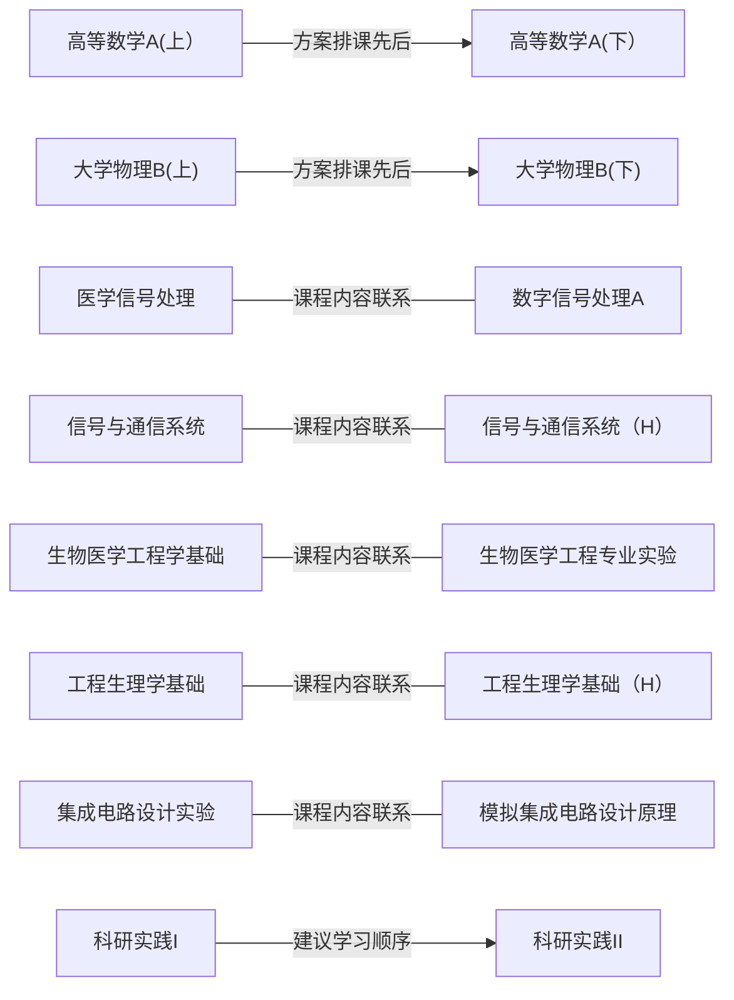

# 2025生物医学工程专业本科培养方案

生物医学工程与技术创新学院 · 生物医学工程 · 方案 97259 · 52 个不同课程或科研条目。

[官方 Word](../originals/plan-97259.docx) · [教务详情](https://fdjwgl.fudan.edu.cn/manager/bizType/2/major-program-search/info/97259?skipAuth=1) · [方案快照](../raw/plan-97259.json.gz) · [年级目录](../README.md)

## 课程关系图

图中展示部分关系。下表保留全部已建立的课程对，来源位置使用本方案 JSON Pointer。

## 先修与内容联系

| 类型 | 起点 | 终点 | 依据 | 原表定位 |
| --- | --- | --- | --- | --- |
| 建议学习顺序 | 科研实践I (52) | 科研实践II (53) | 同方案的课程题名具有连续分册或序号。  | `/courseModules/17/planCourses/0`、`/courseModules/17/planCourses/1` |
| 建议学习顺序 | 高等数学A(上） (MATH10015) | 高等数学A(下） (MATH10016) | 同方案的课程题名具有连续分册或序号。  | `/courseModules/5/planCourses/0`、`/courseModules/5/planCourses/1` |
| 建议学习顺序 | 大学物理B(上) (PHYS10003) | 大学物理B(下) (PHYS10004) | 同方案的课程题名具有连续分册或序号。  | `/courseModules/5/planCourses/2`、`/courseModules/5/planCourses/3` |
| 方案排课先后 | 高等数学A(上） (MATH10015) | 高等数学A(下） (MATH10016) | 同方案该课程全部明确数字学期均早于后者。  | `/courseModules/5/planCourses/0`、`/courseModules/5/planCourses/1` |
| 方案排课先后 | 大学物理B(上) (PHYS10003) | 大学物理B(下) (PHYS10004) | 同方案该课程全部明确数字学期均早于后者。  | `/courseModules/5/planCourses/2`、`/courseModules/5/planCourses/3` |
| 课程内容联系 | 生物医学工程学基础 (BME30003) | 生物医学工程专业实验 (BME50025) | 本方案两门课程的题名均含“生物医学工程”，可据此对照这一主题。  | `/courseModules/6/planCourses/3`、`/courseModules/17/planCourses/7` |
| 课程内容联系 | 工程生理学基础 (BME50017) | 工程生理学基础（H） (BME50017h) | 本方案两门课程的题名均含“生理学”，可据此对照这一主题。  | `/courseModules/6/planCourses/8`、`/courseModules/12/planCourses/3` |
| 课程内容联系 | 医学信号处理 (BME50023) | 数字信号处理A (EST30002) | 本方案两门课程的题名均含“信号处理”，可据此对照这一主题。  | `/courseModules/9/planCourses/4`、`/courseModules/6/planCourses/7` |
| 课程内容联系 | 医学信号处理 (BME50023) | 数字信号处理（H） (EST30002h) | 本方案两门课程的题名均含“信号处理”，可据此对照这一主题。  | `/courseModules/9/planCourses/4`、`/courseModules/12/planCourses/2` |
| 课程内容联系 | 信号与通信系统 (EST20004) | 信号与通信系统（H） (EST20004h) | 本方案两门课程的题名均含“通信系统”，可据此对照这一主题。  | `/courseModules/6/planCourses/4`、`/courseModules/12/planCourses/0` |
| 课程内容联系 | 集成电路设计实验 (EST40002) | 模拟集成电路设计原理 (ICSE30022) | 本方案两门课程的题名均含“集成电路”，可据此对照这一主题。  | `/courseModules/10/planCourses/6`、`/courseModules/10/planCourses/4` |

本次未从可定位的明确表述中确认课程对课程预修。学期安排、系列分册与编辑建议均保留各自的依据。

## 按原方案模块阅读

同一模块展示原表中的课程归属。模块内课程之间的先后仍须逐项查阅。

- **荣誉项目课程**　工程生理学基础（H）、信号与通信系统（H）、信息论（H）、数字信号处理（H）、电子系统设计（H）（原表模块 12）

## 课程表

同一课程在不同模块分别出现时，按原表逐行列出。季节字段保留原值。

| 课程 | 代码 | 学分 | 学期 | 模块 |
| --- | --- | ---: | --- | --- |
| 高等数学A(上） | MATH10015 | 5.0 | 第1学期 | 培养方案 / 专业培养课程 / 学科基础课程 |
| 高等数学A(下） | MATH10016 | 5.0 | 第2学期 | 培养方案 / 专业培养课程 / 学科基础课程 |
| 大学物理B(上) | PHYS10003 | 4.0 | 第1学期 | 培养方案 / 专业培养课程 / 学科基础课程 |
| 大学物理B(下) | PHYS10004 | 4.0 | 第2学期 | 培养方案 / 专业培养课程 / 学科基础课程 |
| 基础物理实验 | PHYS10005 | 2.0 | 第2学期 | 培养方案 / 专业培养课程 / 学科基础课程 |
| 线性代数 | CS10003 | 3.0 | 第1学期 | 培养方案 / 专业培养课程 / 学科基础课程 |
| 电路基础 | ICSE10001 | 3.0 | 第2学期 | 培养方案 / 专业培养课程 / 学科基础课程 |
| Python程序设计 | CS10002 | 2.0 | 第1学期 | 培养方案 / 专业培养课程 / 专业核心教育课程 |
| 概率、数理统计与随机过程 | EST20002 | 3.0 | 第3学期 | 培养方案 / 专业培养课程 / 专业核心教育课程 |
| 数字逻辑基础 | EST20009 | 4.0 | 第3学期 | 培养方案 / 专业培养课程 / 专业核心教育课程 |
| 生物医学工程学基础 | BME30003 | 3.0 | 第3学期 | 培养方案 / 专业培养课程 / 专业核心教育课程 |
| 信号与通信系统 | EST20004 | 3.0 | 第4学期 | 培养方案 / 专业培养课程 / 专业核心教育课程 |
| 信息论基础 | EST20008 | 3.0 | 第4学期 | 培养方案 / 专业培养课程 / 专业核心教育课程 |
| 医学成像技术 | BME50021 | 2.0 | 第5学期 | 培养方案 / 专业培养课程 / 专业核心教育课程 |
| 数字信号处理A | EST30002 | 3.0 | 第6学期 | 培养方案 / 专业培养课程 / 专业核心教育课程 |
| 工程生理学基础 | BME50017 | 3.0 | 第6学期 | 培养方案 / 专业培养课程 / 专业核心教育课程 |
| 模拟电子学基础 | EST10002 | 4.0 | 第3学期 | 培养方案 / 专业培养课程 / 专业核心教育课程 |
| 细胞生物学 | BIOL30004 | 3.0 | 第4学期 | 培养方案 / 专业进阶模块I |
| 生物芯片导论 | BME30005 | 3.0 | AUTUMN | 培养方案 / 专业进阶模块I |
| 嵌入式处理器 | BME30002 | 3.0 | 第4学期 | 培养方案 / 专业进阶模块I |
| 医学传感器 | BME50001 | 3.0 | 第5学期 | 培养方案 / 专业进阶模块I |
| 医学信号处理 | BME50023 | 2.0 | 第6学期 | 培养方案 / 专业进阶模块I |
| 神经生物学概论 | BIOL50011 | 2.0 | SPRING、AUTUMN | 培养方案 / 专业进阶模块I |
| 近代医学概论 | BME50018 | 2.0 | SPRING、AUTUMN | 培养方案 / 专业进阶模块I |
| 深度学习基础 | AIB310003 | 3.0 | SPRING、AUTUMN | 培养方案 / 专业进阶模块I |
| 数字图像处理B | ICE40003 | 2.0 | SPRING、AUTUMN | 培养方案 / 专业进阶模块I |
| 计算机视觉 | AIE310004 | 3.0 | SPRING、AUTUMN | 培养方案 / 专业进阶模块I |
| 电磁场与电磁波 | ICE50009 | 3.0 | SPRING、AUTUMN | 培养方案 / 专业进阶模块I |
| 脑机接口 | BME70010 | 3.0 | SPRING、AUTUMN | 培养方案 / 专业进阶模块I |
| 医学超声技术 | AIT531030 | 2.0 | SPRING | 培养方案 / 专业进阶模块I |
| 计算神经学 | CS50029 | 3.0 | SPRING、AUTUMN | 培养方案 / 专业进阶模块II |
| 生物统计学 | BIOL50004 | 3.0 | SPRING、AUTUMN | 培养方案 / 专业进阶模块II |
| 基因组学 | BIOL50009 | 2.0 | SPRING、AUTUMN | 培养方案 / 专业进阶模块II |
| AI在生物分子结构中的研究及应用 | AIS410014 | 2.0 | SPRING、AUTUMN | 培养方案 / 专业进阶模块II |
| 模拟集成电路设计原理 | ICSE30022 | 3.0 | SPRING、AUTUMN | 培养方案 / 专业进阶模块II |
| 半导体器件原理与工艺 | EST40003 | 3.0 | SPRING、AUTUMN | 培养方案 / 专业进阶模块II |
| 集成电路设计实验 | EST40002 | 3.0 | SPRING | 培养方案 / 专业进阶模块II |
| 信号与通信系统（H） | EST20004h | 4.0 | 第4学期 | 培养方案 / 荣誉项目课程 |
| 信息论（H） | EST20008h | 4.0 | 第4学期 | 培养方案 / 荣誉项目课程 |
| 数字信号处理（H） | EST30002h | 4.0 | 第6学期 | 培养方案 / 荣誉项目课程 |
| 工程生理学基础（H） | BME50017h | 4.0 | 第6学期 | 培养方案 / 荣誉项目课程 |
| 电子系统设计（H） | EST50012h | 3.0 | 第7学期 | 培养方案 / 荣誉项目课程 |
| 科研实践I | 52 | 3.0 |  | 融合创新能力 |
| 科研实践II | 53 | 3.0 |  | 融合创新能力 |
| 无学分讨论班 | 101 | 0.0 |  | 融合创新能力 |
| 复芏计划(FDUROP) | 102 | 0.0 |  | 融合创新能力 |
| 模拟与数字电路实验 | EST40012 | 3.0 | 第4学期 | 融合创新能力 |
| 毕业论文 | EST40035 | 2.0 | 第7学期、第8学期 | 融合创新能力 |
| 信号与系统实验 | ICE40005 | 2.0 | 第5学期 | 融合创新能力 |
| 生物医学工程专业实验 | BME50025 | 3.0 | 第5学期 | 融合创新能力 |
| 医学电子创新设计与实验 | BME30004 | 3.0 | 第5学期 | 融合创新能力 |
| 前沿讲座 | ICE50010 | 2.0 | 第2学期 | 融合创新能力 |
