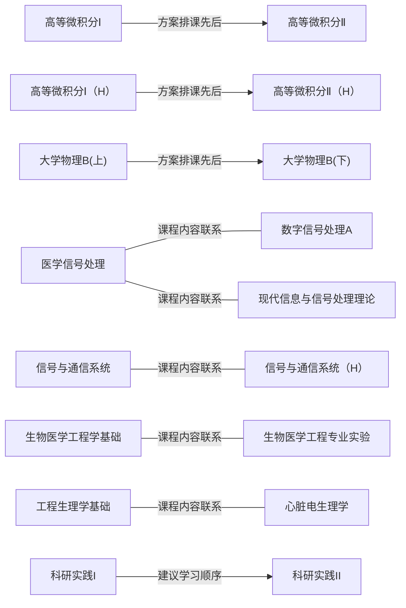

# 2025生物医学工程-生物医学工程 本博融通培养方案 （2025级生物芯影领军人才班适用）

生物医学工程与技术创新学院 · 生物医学工程 · 方案 97375 · 94 个不同课程或科研条目。

[官方 Word](../originals/plan-97375.docx) · [教务详情](https://fdjwgl.fudan.edu.cn/manager/bizType/2/major-program-search/info/97375?skipAuth=1) · [方案快照](../raw/plan-97375.json.gz) · [年级目录](../README.md)

## 修读导读

- **建议先学**　《大学物理B(上)》（`PHYS10003`） → 《大学物理B(下)》（`PHYS10004`）。题名列出连续册次或级别。可把前一册用过的物理量和建模假设列在一起，后续遇到相似问题时再比较。方案分别列在第1、2学期。

- **可以对照着读**　《生物医学工程学基础》（`BME30003`）与《生物医学工程专业实验》（`BME50025`）。两门课的题名都涉及生物医学工程。选一个生理量，比较如何取得测量信号、如何表示，以及结果能回答什么医学问题。

- **查模块选课**　《概率、数理统计与随机过程》（`EST20002`）、《模拟电子学基础》（`EST10002`）列在“专业核心教育课程”中。原表见 `/courseModules/6`。

## 课程关系图

图中展示部分关系。下表保留全部已建立的课程对，来源位置使用本方案 JSON Pointer。

## 先修与内容联系

| 类型 | 起点 | 终点 | 依据 | 原表定位 |
| --- | --- | --- | --- | --- |
| 建议学习顺序 | 科研实践I (52) | 科研实践II (53) | 同方案的课程题名具有连续分册或序号。  | `/courseModules/20/planCourses/0`、`/courseModules/20/planCourses/1` |
| 建议学习顺序 | 高等微积分Ⅰ (MATH20021) | 高等微积分Ⅱ (MATH20022) | 同方案的课程题名具有连续分册或序号。  | `/courseModules/5/planCourses/0`、`/courseModules/5/planCourses/2` |
| 建议学习顺序 | 高等微积分Ⅰ（H） (MATH20021h) | 高等微积分Ⅱ（H） (MATH20022h) | 同方案的课程题名具有连续分册或序号。  | `/courseModules/5/planCourses/1`、`/courseModules/5/planCourses/3` |
| 建议学习顺序 | 大学物理B(上) (PHYS10003) | 大学物理B(下) (PHYS10004) | 同方案的课程题名具有连续分册或序号。  | `/courseModules/5/planCourses/4`、`/courseModules/5/planCourses/5` |
| 方案排课先后 | 高等微积分Ⅰ (MATH20021) | 高等微积分Ⅱ (MATH20022) | 同方案该课程全部明确数字学期均早于后者。  | `/courseModules/5/planCourses/0`、`/courseModules/5/planCourses/2` |
| 方案排课先后 | 高等微积分Ⅰ（H） (MATH20021h) | 高等微积分Ⅱ（H） (MATH20022h) | 同方案该课程全部明确数字学期均早于后者。  | `/courseModules/5/planCourses/1`、`/courseModules/5/planCourses/3` |
| 方案排课先后 | 大学物理B(上) (PHYS10003) | 大学物理B(下) (PHYS10004) | 同方案该课程全部明确数字学期均早于后者。  | `/courseModules/5/planCourses/4`、`/courseModules/5/planCourses/5` |
| 课程内容联系 | 生物医学工程学基础 (BME30003) | 生物医学工程专业实验 (BME50025) | 本方案两门课程的题名均含“生物医学工程”，可据此对照这一主题。  | `/courseModules/6/planCourses/4`、`/courseModules/20/planCourses/15` |
| 课程内容联系 | 生物医学影像导论 (BME50004) | 医学影像数据处理与智能分析 (BME50010) | 本方案两门课程的题名均含“医学影像”，可据此对照这一主题。  | `/courseModules/11/planCourses/4`、`/courseModules/11/planCourses/3` |
| 课程内容联系 | 工程生理学基础 (BME50017) | 心脏电生理学 (BME60003) | 本方案两门课程的题名均含“生理学”，可据此对照这一主题。  | `/courseModules/6/planCourses/9`、`/courseModules/9/planCourses/21` |
| 课程内容联系 | 工程生理学基础（H） (BME50017h) | 心脏电生理学 (BME60003) | 本方案两门课程的题名均含“生理学”，可据此对照这一主题。  | `/courseModules/15/planCourses/3`、`/courseModules/9/planCourses/21` |
| 课程内容联系 | 医学信号处理 (BME50023) | 数字信号处理A (EST30002) | 本方案两门课程的题名均含“信号处理”，可据此对照这一主题。  | `/courseModules/9/planCourses/4`、`/courseModules/6/planCourses/8` |
| 课程内容联系 | 医学信号处理 (BME50023) | 数字信号处理（H） (EST30002h) | 本方案两门课程的题名均含“信号处理”，可据此对照这一主题。  | `/courseModules/9/planCourses/4`、`/courseModules/15/planCourses/2` |
| 课程内容联系 | 医学信号处理 (BME50023) | 现代信息与信号处理理论 (EST40021) | 本方案两门课程的题名均含“信号处理”，可据此对照这一主题。  | `/courseModules/9/planCourses/4`、`/courseModules/9/planCourses/12` |
| 课程内容联系 | 信号与通信系统 (EST20004) | 信号与通信系统（H） (EST20004h) | 本方案两门课程的题名均含“通信系统”，可据此对照这一主题。  | `/courseModules/6/planCourses/5`、`/courseModules/15/planCourses/0` |
| 课程内容联系 | 集成电路设计实验 (EST40002) | 模拟集成电路设计原理 (ICSE30022) | 本方案两门课程的题名均含“集成电路”，可据此对照这一主题。  | `/courseModules/12/planCourses/9`、`/courseModules/12/planCourses/1` |

本次未从可定位的明确表述中确认课程对课程预修。学期安排、系列分册与编辑建议均保留各自的依据。

## 按原方案模块阅读

同一模块展示原表中的课程归属。模块内课程之间的先后仍须逐项查阅。

- **医学影像与人工智能方向**　生物医学影像导论、医学影像数据处理与智能分析、起搏与心律失常电治疗、系统匹配与连接技术、现代医学信息处理、医学电子仪器、超声血流测量、近代医学超声进展、声学导论（原表模块 11）
- **生物医学传感技术与芯片方向**　心脑血管植介入器械创新前沿、BioMEMS器件、生物电子器件、集成电路设计实验、半导体器件原理与工艺、柔性电子学导论、低功耗无线芯片设计、AI辅助阵列化生物芯片设计方法、无线感知前沿技术：器件、电路与系统、模拟集成电路设计原理（原表模块 12）
- **生物医学数据学方向**　AI在生物分子结构中的研究及应用、医学大数据与人工智能、生物统计学、基因组学、实用生物信息学、多模态医学数据分析技术、中医工程、医用工程力学、数字健康与隐私保护技术、计算神经学（原表模块 13）
- **荣誉项目课程**　工程生理学基础（H）、信号与通信系统（H）、信息论（H）、数字信号处理（H）、电子系统设计（H）（原表模块 15）

## 课程表

同一课程在不同模块分别出现时，按原表逐行列出。季节字段保留原值。

| 课程 | 代码 | 学分 | 学期 | 模块 |
| --- | --- | ---: | --- | --- |
| 高等微积分Ⅰ | MATH20021 | 5.0 | 第1学期 | 培养方案 / 专业培养课程 / 学科基础课程 |
| 高等微积分Ⅰ（H） | MATH20021h | 6.0 | 第1学期 | 培养方案 / 专业培养课程 / 学科基础课程 |
| 高等微积分Ⅱ | MATH20022 | 5.0 | 第2学期 | 培养方案 / 专业培养课程 / 学科基础课程 |
| 高等微积分Ⅱ（H） | MATH20022h | 6.0 | 第2学期 | 培养方案 / 专业培养课程 / 学科基础课程 |
| 大学物理B(上) | PHYS10003 | 4.0 | 第1学期 | 培养方案 / 专业培养课程 / 学科基础课程 |
| 大学物理B(下) | PHYS10004 | 4.0 | 第2学期 | 培养方案 / 专业培养课程 / 学科基础课程 |
| 基础物理实验 | PHYS10005 | 2.0 | 第2学期 | 培养方案 / 专业培养课程 / 学科基础课程 |
| 电路基础 | ICSE10001 | 3.0 | 第2学期 | 培养方案 / 专业培养课程 / 学科基础课程 |
| 线性代数（理工类） | MATH10014 | 3.0 | 第1学期、AUTUMN | 培养方案 / 专业培养课程 / 学科基础课程 |
| Python程序设计 | CS10002 | 2.0 | 第1学期 | 培养方案 / 专业培养课程 / 专业核心教育课程 |
| 概率、数理统计与随机过程 | EST20002 | 3.0 | 第3学期 | 培养方案 / 专业培养课程 / 专业核心教育课程 |
| 数字逻辑基础 | EST20009 | 4.0 | 第3学期 | 培养方案 / 专业培养课程 / 专业核心教育课程 |
| 模拟电子学基础 | EST10002 | 4.0 | 第3学期 | 培养方案 / 专业培养课程 / 专业核心教育课程 |
| 生物医学工程学基础 | BME30003 | 3.0 | 第3学期 | 培养方案 / 专业培养课程 / 专业核心教育课程 |
| 信号与通信系统 | EST20004 | 3.0 | 第4学期 | 培养方案 / 专业培养课程 / 专业核心教育课程 |
| 信息论基础 | EST20008 | 3.0 | 第4学期 | 培养方案 / 专业培养课程 / 专业核心教育课程 |
| 医学成像技术 | BME50021 | 2.0 | 第5学期 | 培养方案 / 专业培养课程 / 专业核心教育课程 |
| 数字信号处理A | EST30002 | 3.0 | 第6学期 | 培养方案 / 专业培养课程 / 专业核心教育课程 |
| 工程生理学基础 | BME50017 | 3.0 | 第6学期 | 培养方案 / 专业培养课程 / 专业核心教育课程 |
| 细胞生物学 | BIOL30004 | 3.0 | 第4学期 | 培养方案 / 专业进阶模块I |
| 生物芯片导论 | BME30005 | 3.0 | AUTUMN | 培养方案 / 专业进阶模块I |
| 嵌入式处理器 | BME30002 | 3.0 | 第4学期 | 培养方案 / 专业进阶模块I |
| 医学传感器 | BME50001 | 3.0 | 第5学期 | 培养方案 / 专业进阶模块I |
| 医学信号处理 | BME50023 | 2.0 | 第6学期 | 培养方案 / 专业进阶模块I |
| 神经生物学概论 | BIOL50011 | 2.0 | AUTUMN | 培养方案 / 专业进阶模块I |
| 近代医学概论 | BME50018 | 2.0 | SPRING | 培养方案 / 专业进阶模块I |
| 深度学习基础 | AIB310003 | 3.0 | SPRING、AUTUMN | 培养方案 / 专业进阶模块I |
| 数字图像处理B | ICE40003 | 2.0 | SPRING、AUTUMN | 培养方案 / 专业进阶模块I |
| 计算机视觉 | AIE310004 | 3.0 | SPRING、AUTUMN | 培养方案 / 专业进阶模块I |
| 电磁场与电磁波 | ICE50009 | 3.0 | SPRING、AUTUMN | 培养方案 / 专业进阶模块I |
| 电子系统设计 | EST50012 | 2.0 | AUTUMN | 培养方案 / 专业进阶模块I |
| 现代信息与信号处理理论 | EST40021 | 3.0 | SPRING | 培养方案 / 专业进阶模块I |
| 医学超声技术 | AIT531030 | 2.0 | SPRING | 培养方案 / 专业进阶模块I |
| 科技英语与科研写作 | BME70005 | 2.0 | SPRING、AUTUMN | 培养方案 / 专业进阶模块I |
| 工程伦理 | AAST40021 | 2.0 | SPRING、AUTUMN | 培养方案 / 专业进阶模块I |
| 医学仪器和系统 | BME40001 | 3.0 | AUTUMN | 培养方案 / 专业进阶模块I |
| 生物成像技术 | BME50002 | 3.0 | SPRING、AUTUMN | 培养方案 / 专业进阶模块I |
| 模式识别 | EST60033 | 3.0 | AUTUMN | 培养方案 / 专业进阶模块I |
| 信号、图象处理及其在医学中应用 | BME60004 | 3.0 | SPRING | 培养方案 / 专业进阶模块I |
| 生物医学系统建模与仿真 | BME70016 | 3.0 | SPRING | 培养方案 / 专业进阶模块I |
| 心脏电生理学 | BME60003 | 3.0 | SPRING | 培养方案 / 专业进阶模块I |
| 脑机接口 | BME70010 | 3.0 | AUTUMN | 培养方案 / 专业进阶模块I |
| 现代医学信息处理 | BME70014 | 3.0 | AUTUMN | 培养方案 / 专业进阶模块II / 医学影像与人工智能方向 |
| 系统匹配与连接技术 | BME70013 | 3.0 | AUTUMN | 培养方案 / 专业进阶模块II / 医学影像与人工智能方向 |
| 起搏与心律失常电治疗 | BME70012 | 3.0 | SPRING | 培养方案 / 专业进阶模块II / 医学影像与人工智能方向 |
| 医学影像数据处理与智能分析 | BME50010 | 3.0 | SPRING | 培养方案 / 专业进阶模块II / 医学影像与人工智能方向 |
| 生物医学影像导论 | BME50004 | 3.0 | AUTUMN | 培养方案 / 专业进阶模块II / 医学影像与人工智能方向 |
| 声学导论 | EST70031 | 3.0 | AUTUMN | 培养方案 / 专业进阶模块II / 医学影像与人工智能方向 |
| 超声血流测量 | BME70019 | 3.0 | AUTUMN | 培养方案 / 专业进阶模块II / 医学影像与人工智能方向 |
| 近代医学超声进展 | BME70021 | 3.0 | AUTUMN | 培养方案 / 专业进阶模块II / 医学影像与人工智能方向 |
| 医学电子仪器 | BME70018 | 3.0 | AUTUMN | 培养方案 / 专业进阶模块II / 医学影像与人工智能方向 |
| 半导体器件原理与工艺 | EST40003 | 3.0 | AUTUMN | 培养方案 / 专业进阶模块II / 生物医学传感技术与芯片方向 |
| 模拟集成电路设计原理 | ICSE30022 | 3.0 | AUTUMN | 培养方案 / 专业进阶模块II / 生物医学传感技术与芯片方向 |
| 柔性电子学导论 | EST50010 | 3.0 | SPRING | 培养方案 / 专业进阶模块II / 生物医学传感技术与芯片方向 |
| BioMEMS器件 | BME70006 | 3.0 | SPRING | 培养方案 / 专业进阶模块II / 生物医学传感技术与芯片方向 |
| 低功耗无线芯片设计 | EST60004 | 3.0 | SPRING、AUTUMN | 培养方案 / 专业进阶模块II / 生物医学传感技术与芯片方向 |
| AI辅助阵列化生物芯片设计方法 | EST70003 | 3.0 | SPRING | 培养方案 / 专业进阶模块II / 生物医学传感技术与芯片方向 |
| 心脑血管植介入器械创新前沿 | BME70002 | 3.0 | SPRING | 培养方案 / 专业进阶模块II / 生物医学传感技术与芯片方向 |
| 无线感知前沿技术：器件、电路与系统 | EST80001 | 3.0 | SPRING、AUTUMN | 培养方案 / 专业进阶模块II / 生物医学传感技术与芯片方向 |
| 生物电子器件 | BME70022 | 3.0 | AUTUMN | 培养方案 / 专业进阶模块II / 生物医学传感技术与芯片方向 |
| 集成电路设计实验 | EST40002 | 3.0 | SPRING | 培养方案 / 专业进阶模块II / 生物医学传感技术与芯片方向 |
| 计算神经学 | IST70010 | 3.0 | AUTUMN | 培养方案 / 专业进阶模块II / 生物医学数据学方向 |
| 生物统计学 | BIOL50004 | 3.0 | AUTUMN | 培养方案 / 专业进阶模块II / 生物医学数据学方向 |
| 基因组学 | BIOL50009 | 2.0 | AUTUMN | 培养方案 / 专业进阶模块II / 生物医学数据学方向 |
| AI在生物分子结构中的研究及应用 | AIS410014 | 2.0 | SPRING、AUTUMN | 培养方案 / 专业进阶模块II / 生物医学数据学方向 |
| 中医工程 | BME60012 | 3.0 | SPRING | 培养方案 / 专业进阶模块II / 生物医学数据学方向 |
| 医用工程力学 | BME70004 | 3.0 | SPRING | 培养方案 / 专业进阶模块II / 生物医学数据学方向 |
| 多模态医学数据分析技术 | BME50013 | 3.0 | AUTUMN | 培养方案 / 专业进阶模块II / 生物医学数据学方向 |
| 数字健康与隐私保护技术 | BME70007 | 3.0 | AUTUMN | 培养方案 / 专业进阶模块II / 生物医学数据学方向 |
| 医学大数据与人工智能 | AIS410015 | 3.0 | SPRING、AUTUMN | 培养方案 / 专业进阶模块II / 生物医学数据学方向 |
| 实用生物信息学 | BIOL70006 | 3.0 | SPRING、AUTUMN | 培养方案 / 专业进阶模块II / 生物医学数据学方向 |
| 信号与通信系统（H） | EST20004h | 4.0 | 第4学期 | 培养方案 / 荣誉项目课程 |
| 信息论（H） | EST20008h | 4.0 | 第4学期 | 培养方案 / 荣誉项目课程 |
| 数字信号处理（H） | EST30002h | 4.0 | 第6学期 | 培养方案 / 荣誉项目课程 |
| 工程生理学基础（H） | BME50017h | 4.0 | 第6学期 | 培养方案 / 荣誉项目课程 |
| 电子系统设计（H） | EST50012h | 3.0 | 第7学期 | 培养方案 / 荣誉项目课程 |
| 科研实践I | 52 | 3.0 |  | 融合创新能力 |
| 科研实践II | 53 | 3.0 |  | 融合创新能力 |
| 无学分讨论班 | 101 | 0.0 |  | 融合创新能力 |
| 复芏计划(FDUROP) | 102 | 0.0 |  | 融合创新能力 |
| 研究生学术活动 | 4 | 2.0 |  | 融合创新能力 |
| 研究生实践活动 | 5 | 2.0 |  | 融合创新能力 |
| 专业外语 | 8 | 1.0 |  | 融合创新能力 |
| 国际交流 | 7 | 0.0 |  | 融合创新能力 |
| 博士学位论文开题 | 1 | 0.0 |  | 融合创新能力 |
| 博士生资格考核 | 2 | 0.0 |  | 融合创新能力 |
| 博士论文中期考核 | 3 | 0.0 |  | 融合创新能力 |
| 博士学位论文预审 | 6 | 0.0 |  | 融合创新能力 |
| 模拟与数字电路实验 | EST40012 | 3.0 | 第4学期 | 融合创新能力 |
| 毕业论文 | EST40035 | 2.0 | 第7学期、第8学期 | 融合创新能力 |
| 信号与系统实验 | ICE40005 | 2.0 | 第5学期 | 融合创新能力 |
| 生物医学工程专业实验 | BME50025 | 3.0 | 第5学期 | 融合创新能力 |
| 医学电子创新设计与实验 | BME30004 | 3.0 | 第5学期 | 融合创新能力 |
| 前沿讲座 | ICE50010 | 2.0 | 第2学期 | 融合创新能力 |
