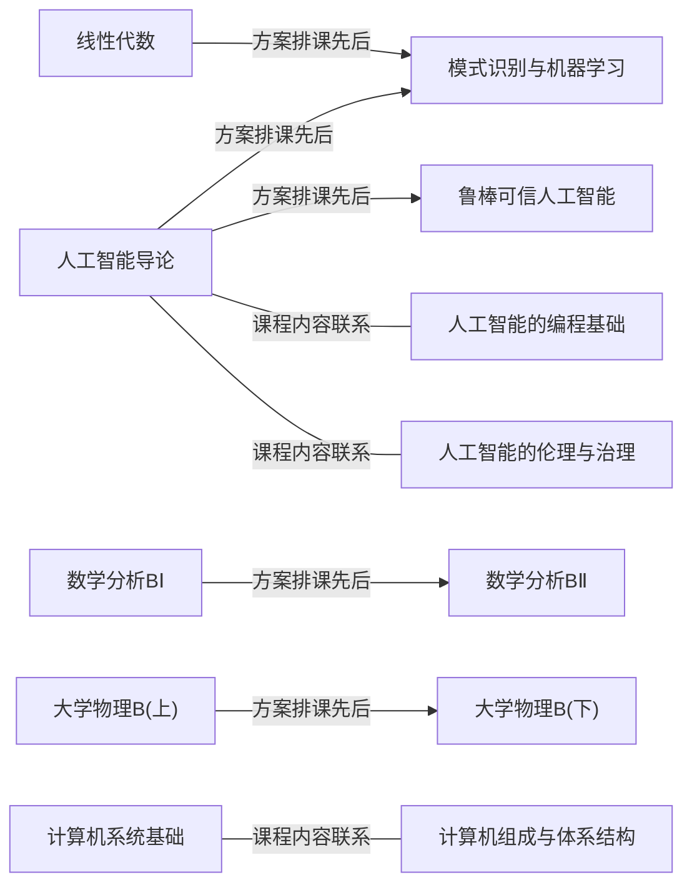

# 2024 人工智能（计算与智能领军人才班）专业教学培养方案（香农计划适用）

计算与智能创新学院 · 人工智能(计算与智能领军人才班)(香农计划) · 方案 72974 · 45 个不同课程或科研条目。

[官方 Word](../originals/plan-72974.docx) · [教务详情](https://fdjwgl.fudan.edu.cn/manager/bizType/2/major-program-search/info/72974?skipAuth=1) · [方案快照](../raw/plan-72974.json.gz) · [年级目录](../README.md)

## 修读导读

- **建议先学**　《人工智能导论》（`AIE310005`） → 《模式识别与机器学习》（`CS30037`）。人工智能问题与模型类别可为学习模式识别作准备。方案分别列在第4、5学期。

- **可以对照着读**　《计算机系统基础》（`CS10005`）与《计算机组成与体系结构》（`CS30052`）。处理器、存储与系统执行模型具有共同内容。

- **查模块选课**　《人工智能的编程基础》（`AIE310006`）、《信息论、控制论、系统论基础》（`AIE631001`）列在“专业核心教育课程”中。模块说明写明“要求修读48学分”。原表见 `/courseModules/6`。

## 课程关系图

图中展示部分关系。下表保留全部已建立的课程对，来源位置使用本方案 JSON Pointer。

## 先修与内容联系

| 类型 | 起点 | 终点 | 依据 | 原表定位 |
| --- | --- | --- | --- | --- |
| 建议学习顺序 | 人工智能导论 (AIE310005) | 人工智能的编程基础 (AIE310006) | “人工智能导论”题名标明基础层次，前置阅读可帮助了解“人工智能的编程基础”中的人工智能主题。  | `/courseModules/6/planCourses/6`、`/courseModules/6/planCourses/0` |
| 建议学习顺序 | 人工智能导论 (AIE310005) | 模式识别与机器学习 (CS30037) | 人工智能问题与模型类别可为学习模式识别作准备。  | `/courseModules/6/planCourses/6`、`/courseModules/6/planCourses/8` |
| 建议学习顺序 | 人工智能导论 (AIE310005) | 鲁棒可信人工智能 (CS30062) | “人工智能导论”题名标明基础层次，前置阅读可帮助了解“鲁棒可信人工智能”中的人工智能主题。  | `/courseModules/6/planCourses/6`、`/courseModules/13/planCourses/1` |
| 建议学习顺序 | 人工智能导论 (AIE310005) | 人工智能的伦理与治理 (PHIL50006) | “人工智能导论”题名标明基础层次，前置阅读可帮助了解“人工智能的伦理与治理”中的人工智能主题。  | `/courseModules/6/planCourses/6`、`/courseModules/6/planCourses/11` |
| 建议学习顺序 | 线性代数 (CS10003) | 模式识别与机器学习 (CS30037) | 向量表示和矩阵运算支持理解分类、回归等模型。  | `/courseModules/5/planCourses/2`、`/courseModules/6/planCourses/8` |
| 建议学习顺序 | 数学分析BⅠ (MATH10012) | 数学分析BⅡ (MATH10013) | 同方案的课程题名具有连续分册或序号。  | `/courseModules/5/planCourses/0`、`/courseModules/5/planCourses/1` |
| 建议学习顺序 | 大学物理B(上) (PHYS10003) | 大学物理B(下) (PHYS10004) | 同方案的课程题名具有连续分册或序号。  | `/courseModules/5/planCourses/3`、`/courseModules/5/planCourses/4` |
| 方案排课先后 | 人工智能导论 (AIE310005) | 模式识别与机器学习 (CS30037) | 同方案该课程全部明确数字学期均早于后者。  | `/courseModules/6/planCourses/6`、`/courseModules/6/planCourses/8` |
| 方案排课先后 | 人工智能导论 (AIE310005) | 鲁棒可信人工智能 (CS30062) | 同方案该课程全部明确数字学期均早于后者。  | `/courseModules/6/planCourses/6`、`/courseModules/13/planCourses/1` |
| 方案排课先后 | 线性代数 (CS10003) | 模式识别与机器学习 (CS30037) | 同方案该课程全部明确数字学期均早于后者。  | `/courseModules/5/planCourses/2`、`/courseModules/6/planCourses/8` |
| 方案排课先后 | 数学分析BⅠ (MATH10012) | 数学分析BⅡ (MATH10013) | 同方案该课程全部明确数字学期均早于后者。  | `/courseModules/5/planCourses/0`、`/courseModules/5/planCourses/1` |
| 方案排课先后 | 大学物理B(上) (PHYS10003) | 大学物理B(下) (PHYS10004) | 同方案该课程全部明确数字学期均早于后者。  | `/courseModules/5/planCourses/3`、`/courseModules/5/planCourses/4` |
| 课程内容联系 | 人工智能导论 (AIE310005) | 人工智能的编程基础 (AIE310006) | 本方案两门课程的题名均含“人工智能”，可据此对照这一主题。  | `/courseModules/6/planCourses/6`、`/courseModules/6/planCourses/0` |
| 课程内容联系 | 人工智能导论 (AIE310005) | 鲁棒可信人工智能 (CS30062) | 本方案两门课程的题名均含“人工智能”，可据此对照这一主题。  | `/courseModules/6/planCourses/6`、`/courseModules/13/planCourses/1` |
| 课程内容联系 | 人工智能导论 (AIE310005) | 人工智能的伦理与治理 (PHIL50006) | 本方案两门课程的题名均含“人工智能”，可据此对照这一主题。  | `/courseModules/6/planCourses/6`、`/courseModules/6/planCourses/11` |
| 课程内容联系 | 计算机系统基础 (CS10005) | 计算机组成与体系结构 (CS30052) | 处理器、存储与系统执行模型具有共同内容。  | `/courseModules/11/planCourses/5`、`/courseModules/6/planCourses/7` |

本次未从可定位的明确表述中确认课程对课程预修。学期安排、系列分册与编辑建议均保留各自的依据。

## 按原方案模块阅读

同一模块展示原表中的课程归属。模块内课程之间的先后仍须逐项查阅。

- **认知与行动**　AI在生物分子结构中的研究及应用、计算机系统基础、可编程控制系统设计、计算机网络、嵌入式操作系统、移动智能体编程实验、智能系统设计（原表模块 11）
- **感知与语言**　计算机系统基础、面向大模型的编程与并行学习算法、计算机网络、数字信号处理、数据挖掘技术、多模态大模型设计与实现（原表模块 12）
- **交互与安全**　计算机系统基础、计算机网络、鲁棒可信人工智能、信息物理融合系统、内生安全概论、模型安全对抗演练（原表模块 13）

## 课程表

同一课程在不同模块分别出现时，按原表逐行列出。季节字段保留原值。

| 课程 | 代码 | 学分 | 学期 | 模块 |
| --- | --- | ---: | --- | --- |
| 数学分析BⅠ | MATH10012 | 5.0 | 第1学期 | 培养方案 / 专业培养课程 / 大类基础课程 |
| 数学分析BⅡ | MATH10013 | 5.0 | 第2学期 | 培养方案 / 专业培养课程 / 大类基础课程 |
| 线性代数 | CS10003 | 3.0 | 第1学期 | 培养方案 / 专业培养课程 / 大类基础课程 |
| 大学物理B(上) | PHYS10003 | 4.0 | 第1学期 | 培养方案 / 专业培养课程 / 大类基础课程 |
| 大学物理B(下) | PHYS10004 | 4.0 | 第2学期 | 培养方案 / 专业培养课程 / 大类基础课程 |
| 基础物理实验 | PHYS10005 | 2.0 | 第2学期 | 培养方案 / 专业培养课程 / 大类基础课程 |
| 程序设计 | CS10004 | 4.0 | 第1学期 | 培养方案 / 专业培养课程 / 大类基础课程 |
| 电子系统导论 | EST10003 | 3.0 | 第2学期 | 培养方案 / 专业培养课程 / 大类基础课程 |
| 电路基础 | ICSE10001 | 3.0 | 第2学期 | 培养方案 / 专业培养课程 / 大类基础课程 |
| 现代生物科学导论A | BIOL10001 | 3.0 | 第1学期 | 培养方案 / 专业培养课程 / 大类基础课程 |
| 人工智能的编程基础 | AIE310006 | 2.0 | 第2学期 | 培养方案 / 专业培养课程 / 专业核心教育课程 |
| 信息论、控制论、系统论基础 | AIE631001 | 3.0 | 第2学期 | 培养方案 / 专业培养课程 / 专业核心教育课程 |
| 概率论与数理统计 | STAT30014 | 4.0 | 第3学期 | 培养方案 / 专业培养课程 / 专业核心教育课程 |
| 最优化方法 | MATH20008 | 3.0 | 第4学期 | 培养方案 / 专业培养课程 / 专业核心教育课程 |
| 数据结构 | CS20009 | 4.0 | 第3学期 | 培养方案 / 专业培养课程 / 专业核心教育课程 |
| 集合与图论 | CS30043 | 3.0 | 第3学期 | 培养方案 / 专业培养课程 / 专业核心教育课程 |
| 人工智能导论 | AIE310005 | 3.0 | 第4学期 | 培养方案 / 专业培养课程 / 专业核心教育课程 |
| 计算机组成与体系结构 | CS30052 | 4.0 | 第4学期 | 培养方案 / 专业培养课程 / 专业核心教育课程 |
| 模式识别与机器学习 | CS30037 | 3.0 | 第5学期 | 培养方案 / 专业培养课程 / 专业核心教育课程 |
| 操作系统 | CS30031 | 3.0 | 第5学期 | 培养方案 / 专业培养课程 / 专业核心教育课程 |
| 数据库引论 | CS20010 | 3.0 | 第4学期 | 培养方案 / 专业培养课程 / 专业核心教育课程 |
| 人工智能的伦理与治理 | PHIL50006 | 2.0 | 第4学期、第6学期 | 培养方案 / 专业培养课程 / 专业核心教育课程 |
| 并行分布式计算 | CS40021 | 3.0 | 第7学期 | 培养方案 / 专业培养课程 / 专业核心教育课程 |
| 毕业论文 | CS40009 | 6.0 | 第8学期 | 培养方案 / 专业培养课程 / 专业核心教育课程 |
| 本科生科研实践 | CS40022 | 2.0 | 第4学期、第5学期、第6学期、第7学期 | 培养方案 / 专业培养课程 / 专业核心教育课程 |
| 计算机视觉 | CS30034 | 3.0 | 第5学期 | 培养方案 / 专业进阶模块I |
| 自然语言处理与大语言模型 | AIE410002 | 3.0 | 第5学期 | 培养方案 / 专业进阶模块I |
| 智能系统与多智能体 | CS30061 | 2.0 | 第6学期 | 培养方案 / 专业进阶模块I |
| 强化学习算法与理论基础 | MATH50013 | 3.0 | 第6学期 | 培养方案 / 专业进阶模块I |
| 计算机图形学A | CS30019 | 3.0 | 第6学期 | 培养方案 / 专业进阶模块I |
| 可编程控制系统设计 | CS20016 | 2.0 | 第4学期 | 培养方案 / 专业进阶模块II / 认知与行动 |
| 嵌入式操作系统 | CS30063 | 2.0 | 第5学期 | 培养方案 / 专业进阶模块II / 认知与行动 |
| 智能系统设计 | EST40015 | 4.0 | 第7学期 | 培养方案 / 专业进阶模块II / 认知与行动 |
| 移动智能体编程实验 | CS40028 | 4.0 | 第7学期 | 培养方案 / 专业进阶模块II / 认知与行动 |
| AI在生物分子结构中的研究及应用 | AIS410014 | 2.0 | AUTUMN | 培养方案 / 专业进阶模块II / 认知与行动 |
| 计算机系统基础 | CS10005 | 3.0 | 第3学期 | 培养方案 / 专业进阶模块II / 认知与行动 |
| 计算机网络 | CS30036 | 3.0 | 第5学期 | 培养方案 / 专业进阶模块II / 认知与行动 |
| 数字信号处理 | CS30039 | 3.0 | 第6学期 | 培养方案 / 专业进阶模块II / 感知与语言 |
| 数据挖掘技术 | CS30042 | 3.0 | 第5学期 | 培养方案 / 专业进阶模块II / 感知与语言 |
| 面向大模型的编程与并行学习算法 | CS20015 | 3.0 | 第4学期 | 培养方案 / 专业进阶模块II / 感知与语言 |
| 多模态大模型设计与实现 | CS40027 | 4.0 | 第7学期 | 培养方案 / 专业进阶模块II / 感知与语言 |
| 计算机网络 | CS30036 | 3.0 | 第5学期 | 培养方案 / 专业进阶模块II / 感知与语言 |
| 计算机系统基础 | CS10005 | 3.0 | 第3学期 | 培养方案 / 专业进阶模块II / 感知与语言 |
| 信息物理融合系统 | CS40026 | 3.0 | 第7学期 | 培养方案 / 专业进阶模块II / 交互与安全 |
| 鲁棒可信人工智能 | CS30062 | 3.0 | 第6学期 | 培养方案 / 专业进阶模块II / 交互与安全 |
| 内生安全概论 | CSEC40010 | 3.0 | 第7学期 | 培养方案 / 专业进阶模块II / 交互与安全 |
| 模型安全对抗演练 | CSEC40011 | 4.0 | 第7学期 | 培养方案 / 专业进阶模块II / 交互与安全 |
| 计算机网络 | CS30036 | 3.0 | 第5学期 | 培养方案 / 专业进阶模块II / 交互与安全 |
| 计算机系统基础 | CS10005 | 3.0 | 第3学期 | 培养方案 / 专业进阶模块II / 交互与安全 |
