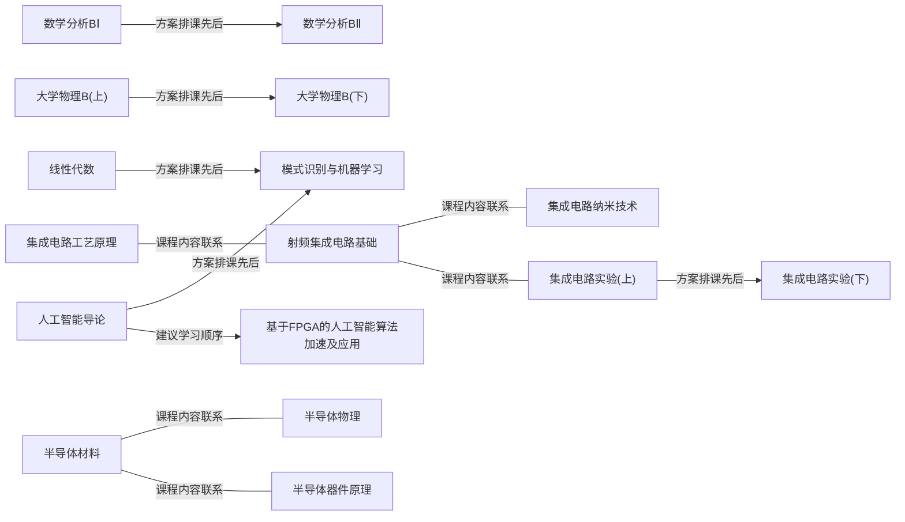

# 微电子科学与工程（集成电路领军人才班）专业教学培养方案（香农计划适用）

集成电路与微纳电子创新学院 · 微电子科学与工程(集成电路领军人才班)(香农计划) · 方案 72984 · 74 个不同课程或科研条目。

[官方 Word](../originals/plan-72984.docx) · [教务详情](https://fdjwgl.fudan.edu.cn/manager/bizType/2/major-program-search/info/72984?skipAuth=1) · [方案快照](../raw/plan-72984.json.gz) · [年级目录](../README.md)

## 修读导读

- **建议先学**　《集成电路实验(上)》（`ICSE40008`） → 《集成电路实验(下)》（`ICSE40009`）。题名列出连续册次或级别。可沿用前一阶段的实验记录格式，对照后来新增的测量方法和误差来源。方案分别列在第7、8学期。

- **可以对照着读**　《集成电路工艺原理》（`ICSE30010`）与《射频集成电路基础》（`ICSE30015`）。两门课的题名都涉及集成电路。用同一电路功能比较器件、工艺条件与电路性能之间的联系。

- **查模块选课**　《半导体物理》（`ICSE20007`）、《半导体器件原理》（`ICSE30020`）列在“专业核心教育课程”中。原表见 `/courseModules/2`。

## 课程关系图

图中展示部分关系。下表保留全部已建立的课程对，来源位置使用本方案 JSON Pointer。

## 先修与内容联系

| 类型 | 起点 | 终点 | 依据 | 原表定位 |
| --- | --- | --- | --- | --- |
| 建议学习顺序 | 线性代数 (CS10003) | 模式识别与机器学习 (CS30037) | 向量表示和矩阵运算支持理解分类、回归等模型。  | `/courseModules/3/planCourses/2`、`/courseModules/15/planCourses/2` |
| 建议学习顺序 | 集成电路实验(上) (ICSE40008) | 集成电路实验(下) (ICSE40009) | 同方案的课程题名具有连续分册或序号。  | `/courseModules/2/planCourses/8`、`/courseModules/2/planCourses/9` |
| 建议学习顺序 | 人工智能导论 (IST20002) | 模式识别与机器学习 (CS30037) | 人工智能问题与模型类别可为学习模式识别作准备。  | `/courseModules/15/planCourses/1`、`/courseModules/15/planCourses/2` |
| 建议学习顺序 | 人工智能导论 (IST20002) | 基于FPGA的人工智能算法加速及应用 (ICSE40018) | “人工智能导论”题名标明基础层次，前置阅读可帮助了解“基于FPGA的人工智能算法加速及应用”中的人工智能主题。  | `/courseModules/15/planCourses/1`、`/courseModules/10/planCourses/16` |
| 建议学习顺序 | 数学分析BⅠ (MATH10012) | 数学分析BⅡ (MATH10013) | 同方案的课程题名具有连续分册或序号。  | `/courseModules/3/planCourses/0`、`/courseModules/3/planCourses/1` |
| 建议学习顺序 | 大学物理B(上) (PHYS10003) | 大学物理B(下) (PHYS10004) | 同方案的课程题名具有连续分册或序号。  | `/courseModules/3/planCourses/3`、`/courseModules/3/planCourses/4` |
| 方案排课先后 | 线性代数 (CS10003) | 模式识别与机器学习 (CS30037) | 同方案该课程全部明确数字学期均早于后者。  | `/courseModules/3/planCourses/2`、`/courseModules/15/planCourses/2` |
| 方案排课先后 | 集成电路实验(上) (ICSE40008) | 集成电路实验(下) (ICSE40009) | 同方案该课程全部明确数字学期均早于后者。  | `/courseModules/2/planCourses/8`、`/courseModules/2/planCourses/9` |
| 方案排课先后 | 人工智能导论 (IST20002) | 模式识别与机器学习 (CS30037) | 同方案该课程全部明确数字学期均早于后者。  | `/courseModules/15/planCourses/1`、`/courseModules/15/planCourses/2` |
| 方案排课先后 | 数学分析BⅠ (MATH10012) | 数学分析BⅡ (MATH10013) | 同方案该课程全部明确数字学期均早于后者。  | `/courseModules/3/planCourses/0`、`/courseModules/3/planCourses/1` |
| 方案排课先后 | 大学物理B(上) (PHYS10003) | 大学物理B(下) (PHYS10004) | 同方案该课程全部明确数字学期均早于后者。  | `/courseModules/3/planCourses/3`、`/courseModules/3/planCourses/4` |
| 课程内容联系 | 模拟与数字电路实验 (EST40012) | 数字电路逻辑综合及描述方法概论 (ICSE20016) | 本方案两门课程的题名均含“数字电路”，可据此对照这一主题。  | `/courseModules/10/planCourses/9`、`/courseModules/10/planCourses/19` |
| 课程内容联系 | 半导体材料 (ICSE20003) | 半导体物理 (ICSE20007) | 本方案两门课程的题名均含“半导体”，可据此对照这一主题。  | `/courseModules/12/planCourses/0`、`/courseModules/2/planCourses/0` |
| 课程内容联系 | 半导体材料 (ICSE20003) | 特色工艺与功率半导体技术 (ICSE20012) | 本方案两门课程的题名均含“半导体”，可据此对照这一主题。  | `/courseModules/12/planCourses/0`、`/courseModules/11/planCourses/2` |
| 课程内容联系 | 半导体材料 (ICSE20003) | 半导体器件原理 (ICSE30020) | 本方案两门课程的题名均含“半导体”，可据此对照这一主题。  | `/courseModules/12/planCourses/0`、`/courseModules/2/planCourses/1` |
| 课程内容联系 | 集成电路发展概论 (ICSE30006) | 射频集成电路基础 (ICSE30015) | 本方案两门课程的题名均含“集成电路”，可据此对照这一主题。  | `/courseModules/12/planCourses/4`、`/courseModules/10/planCourses/2` |
| 课程内容联系 | 集成电路工艺原理 (ICSE30010) | 射频集成电路基础 (ICSE30015) | 本方案两门课程的题名均含“集成电路”，可据此对照这一主题。  | `/courseModules/2/planCourses/7`、`/courseModules/10/planCourses/2` |
| 课程内容联系 | 射频集成电路基础 (ICSE30015) | 集成电路纳米技术 (ICSE40003) | 本方案两门课程的题名均含“集成电路”，可据此对照这一主题。  | `/courseModules/10/planCourses/2`、`/courseModules/2/planCourses/11` |
| 课程内容联系 | 射频集成电路基础 (ICSE30015) | 集成电路实验(上) (ICSE40008) | 本方案两门课程的题名均含“集成电路”，可据此对照这一主题。  | `/courseModules/10/planCourses/2`、`/courseModules/2/planCourses/8` |
| 课程内容联系 | 基于FPGA的人工智能算法加速及应用 (ICSE40018) | 人工智能导论 (IST20002) | 本方案两门课程的题名均含“人工智能”，可据此对照这一主题。  | `/courseModules/10/planCourses/16`、`/courseModules/15/planCourses/1` |

本次未从可定位的明确表述中确认课程对课程预修。学期安排、系列分册与编辑建议均保留各自的依据。

## 按原方案模块阅读

同一模块展示原表中的课程归属。模块内课程之间的先后仍须逐项查阅。

- **集成电路设计**　模拟与数字电路实验、前沿讲座、智能硬件创新方法概论与基础实践、高频电子线路A、Perl语言入门和提高、嵌入式处理器与芯片系统设计、计算机软件基础、数字电路逻辑综合及描述方法概论、模拟电路测试原理、射频集成电路基础、FPGA结构原理和应用、可编程逻辑结构与设计原理、模拟集成电路设计自动化基础、数字集成电路设计自动化基础、存储器电路设计导论、超大规模集成电路物理设计中的数学方法、超低功耗集成电路设计、射频微波测试基础等20项（原表模块 10）
- **集成电路器件工艺**　特色工艺与功率半导体技术、光电子器件与集成、现代集成电路光刻技术导论、电子材料分析（原表模块 11）
- **集成电路公共基础及前沿**　前沿讲座、半导体材料、存储器技术、集成电路发展概论、EDA系统软件分析和设计方法学、先进封装、新型计算范式概论、器件可靠性原理与测试（原表模块 12）
- **计算机**　数据结构、计算机组成与体系结构（原表模块 14）
- **人工智能**　模式识别与机器学习、脑科学与类脑系统、人工智能导论（原表模块 15）
- **数学**　数学模型、数学物理方法A（原表模块 16）
- **电子信息科学与技术**　光通信网络基础、电磁场与电磁波（原表模块 17）
- **物理学**　计算物理基础、热力学与统计物理I、量子力学I、固体物理（原表模块 18）
- **化学材料学**　材料科学导论、薄膜技术、材料分析（原表模块 19）
- **生物学**　AI在生物分子结构中的研究及应用、生理学（原表模块 20）

## 课程表

同一课程在不同模块分别出现时，按原表逐行列出。季节字段保留原值。

| 课程 | 代码 | 学分 | 学期 | 模块 |
| --- | --- | ---: | --- | --- |
| 半导体物理 | ICSE20007 | 4.0 | 第4学期 | 培养方案 / 专业培养课程 / 专业核心教育课程 |
| 半导体器件原理 | ICSE30020 | 4.0 | 第5学期 | 培养方案 / 专业培养课程 / 专业核心教育课程 |
| 模拟电子线路 | ICSE20004 | 3.0 | 第3学期 | 培养方案 / 专业培养课程 / 专业核心教育课程 |
| 数字逻辑基础 | ICSE20005 | 4.0 | 第3学期 | 培养方案 / 专业培养课程 / 专业核心教育课程 |
| 信号与系统概论 | ICSE20006 | 3.0 | 第4学期 | 培养方案 / 专业培养课程 / 专业核心教育课程 |
| 数字集成电路设计原理 | ICSE30021 | 3.0 | 第5学期 | 培养方案 / 专业培养课程 / 专业核心教育课程 |
| 模拟集成电路设计原理 | ICSE30022 | 3.0 | 第6学期 | 培养方案 / 专业培养课程 / 专业核心教育课程 |
| 集成电路工艺原理 | ICSE30010 | 3.0 | 第6学期 | 培养方案 / 专业培养课程 / 专业核心教育课程 |
| 集成电路实验(上) | ICSE40008 | 3.0 | 第7学期 | 培养方案 / 专业培养课程 / 专业核心教育课程 |
| 集成电路实验(下) | ICSE40009 | 2.0 | 第8学期 | 培养方案 / 专业培养课程 / 专业核心教育课程 |
| 器件模型与SPICE仿真 | ICSE30002 | 3.0 | 第7学期 | 培养方案 / 专业培养课程 / 专业核心教育课程 |
| 集成电路纳米技术 | ICSE40003 | 2.0 | 第7学期 | 培养方案 / 专业培养课程 / 专业核心教育课程 |
| 集成电路封装与测试 | ICSE40004 | 3.0 | 第7学期 | 培养方案 / 专业培养课程 / 专业核心教育课程 |
| 毕业论文 | EST40005 | 6.0 | 第8学期 | 培养方案 / 专业培养课程 / 专业核心教育课程 |
| 集成电路技术演进透视 | EST30016 | 2.0 |  | 培养方案 / 专业培养课程 / 专业核心教育课程 |
| 数学分析BⅠ | MATH10012 | 5.0 | 第1学期 | 培养方案 / 专业培养课程 / 大类基础课程 |
| 数学分析BⅡ | MATH10013 | 5.0 | 第2学期 | 培养方案 / 专业培养课程 / 大类基础课程 |
| 线性代数 | CS10003 | 3.0 | 第1学期 | 培养方案 / 专业培养课程 / 大类基础课程 |
| 大学物理B(上) | PHYS10003 | 4.0 | 第1学期 | 培养方案 / 专业培养课程 / 大类基础课程 |
| 大学物理B(下) | PHYS10004 | 4.0 | 第2学期 | 培养方案 / 专业培养课程 / 大类基础课程 |
| 基础物理实验 | PHYS10005 | 2.0 | 第2学期 | 培养方案 / 专业培养课程 / 大类基础课程 |
| 程序设计 | CS10004 | 4.0 | 第1学期 | 培养方案 / 专业培养课程 / 大类基础课程 |
| 电子系统导论 | EST10003 | 3.0 | 第2学期 | 培养方案 / 专业培养课程 / 大类基础课程 |
| 电路基础 | ICSE10001 | 3.0 | 第2学期 | 培养方案 / 专业培养课程 / 大类基础课程 |
| 现代生物科学导论A | BIOL10001 | 3.0 | 第1学期 | 培养方案 / 专业培养课程 / 大类基础课程 |
| 嵌入式处理器与芯片系统设计 | ICSE20008 | 5.0 | 第4学期 | 培养方案 / 专业进阶模块I / 集成电路设计 |
| 超低功耗集成电路设计 | ICSE40005 | 3.0 | 第7学期 | 培养方案 / 专业进阶模块I / 集成电路设计 |
| 射频集成电路基础 | ICSE30015 | 2.0 | 第5学期 | 培养方案 / 专业进阶模块I / 集成电路设计 |
| 模拟电路测试原理 | ICSE30003 | 3.0 | 第5学期 | 培养方案 / 专业进阶模块I / 集成电路设计 |
| 电子标签与物联网 | ICSE40012 | 2.0 | SPRING、AUTUMN | 培养方案 / 专业进阶模块I / 集成电路设计 |
| 智能硬件创新方法概论与基础实践 | ICE50013 | 2.0 | SPRING、AUTUMN | 培养方案 / 专业进阶模块I / 集成电路设计 |
| 可编程逻辑结构与设计原理 | ICSE30017 | 2.0 | SPRING、AUTUMN | 培养方案 / 专业进阶模块I / 集成电路设计 |
| 模拟集成电路设计自动化基础 | ICSE30018 | 3.0 | SPRING、AUTUMN | 培养方案 / 专业进阶模块I / 集成电路设计 |
| 数字集成电路设计自动化基础 | ICSE30019 | 3.0 | SPRING、AUTUMN | 培养方案 / 专业进阶模块I / 集成电路设计 |
| 模拟与数字电路实验 | EST40012 | 3.0 | SPRING、AUTUMN | 培养方案 / 专业进阶模块I / 集成电路设计 |
| 计算机软件基础 | ICSE20014 | 3.0 | SPRING、AUTUMN | 培养方案 / 专业进阶模块I / 集成电路设计 |
| 超大规模集成电路物理设计中的数学方法 | ICSE30026 | 2.0 | SPRING、AUTUMN | 培养方案 / 专业进阶模块I / 集成电路设计 |
| 高频电子线路A | ICSE20001 | 4.0 | SPRING、AUTUMN | 培养方案 / 专业进阶模块I / 集成电路设计 |
| Perl语言入门和提高 | ICSE20002 | 2.0 | SPRING、AUTUMN | 培养方案 / 专业进阶模块I / 集成电路设计 |
| 前沿讲座 | ICE50010 | 2.0 | SPRING、AUTUMN | 培养方案 / 专业进阶模块I / 集成电路设计 |
| 射频微波测试基础 | ICSE40010 | 2.0 | SPRING、AUTUMN | 培养方案 / 专业进阶模块I / 集成电路设计 |
| 基于FPGA的人工智能算法加速及应用 | ICSE40018 | 2.0 | SPRING、AUTUMN | 培养方案 / 专业进阶模块I / 集成电路设计 |
| FPGA结构原理和应用 | ICSE30016 | 3.0 | SPRING、AUTUMN | 培养方案 / 专业进阶模块I / 集成电路设计 |
| 存储器电路设计导论 | ICSE30025 | 3.0 | SPRING、AUTUMN | 培养方案 / 专业进阶模块I / 集成电路设计 |
| 数字电路逻辑综合及描述方法概论 | ICSE20016 | 2.0 | SPRING、AUTUMN | 培养方案 / 专业进阶模块I / 集成电路设计 |
| 现代集成电路光刻技术导论 | ICSE30032 | 2.0 | 第5学期 | 培养方案 / 专业进阶模块I / 集成电路器件工艺 |
| 光电子器件与集成 | ICSE30004 | 3.0 | 第5学期 | 培养方案 / 专业进阶模块I / 集成电路器件工艺 |
| 特色工艺与功率半导体技术 | ICSE20012 | 2.0 | 第4学期 | 培养方案 / 专业进阶模块I / 集成电路器件工艺 |
| 电子材料分析 | MASE30015 | 3.0 | 第5学期 | 培养方案 / 专业进阶模块I / 集成电路器件工艺 |
| 半导体材料 | ICSE20003 | 2.0 | 第5学期 | 培养方案 / 专业进阶模块I / 集成电路公共基础及前沿 |
| 先进封装 | ICSE40006 | 2.0 | 第7学期 | 培养方案 / 专业进阶模块I / 集成电路公共基础及前沿 |
| 存储器技术 | ICSE30005 | 3.0 | 第5学期 | 培养方案 / 专业进阶模块I / 集成电路公共基础及前沿 |
| 新型计算范式概论 | ICSE40007 | 3.0 | 第6学期 | 培养方案 / 专业进阶模块I / 集成电路公共基础及前沿 |
| 集成电路发展概论 | ICSE30006 | 3.0 | 第5学期 | 培养方案 / 专业进阶模块I / 集成电路公共基础及前沿 |
| EDA系统软件分析和设计方法学 | ICSE30028 | 3.0 | 第6学期 | 培养方案 / 专业进阶模块I / 集成电路公共基础及前沿 |
| 器件可靠性原理与测试 | ICSE50008 | 3.0 | 第6学期 | 培养方案 / 专业进阶模块I / 集成电路公共基础及前沿 |
| 前沿讲座 | ICE50010 | 2.0 | 第3学期 | 培养方案 / 专业进阶模块I / 集成电路公共基础及前沿 |
| 计算机组成与体系结构 | CS30052 | 4.0 | 第4学期 | 培养方案 / 专业进阶模块II / 计算机 |
| 数据结构 | CS20009 | 4.0 | 第3学期 | 培养方案 / 专业进阶模块II / 计算机 |
| 脑科学与类脑系统 | CS50031 | 3.0 | 第5学期 | 培养方案 / 专业进阶模块II / 人工智能 |
| 人工智能导论 | IST20002 | 4.0 | 第4学期 | 培养方案 / 专业进阶模块II / 人工智能 |
| 模式识别与机器学习 | CS30037 | 3.0 | 第5学期 | 培养方案 / 专业进阶模块II / 人工智能 |
| 数学模型 | MATH20009 | 3.0 | 第4学期 | 培养方案 / 专业进阶模块II / 数学 |
| 数学物理方法A | PHYS20006 | 4.0 | 第4学期 | 培养方案 / 专业进阶模块II / 数学 |
| 电磁场与电磁波 | ICE50009 | 3.0 | 第6学期 | 培养方案 / 专业进阶模块II / 电子信息科学与技术 |
| 光通信网络基础 | ICE50006 | 2.0 | SPRING、AUTUMN | 培养方案 / 专业进阶模块II / 电子信息科学与技术 |
| 量子力学I | PHYS30010 | 4.0 | 第3学期 | 培养方案 / 专业进阶模块II / 物理学 |
| 固体物理 | PHYS30011 | 4.0 | 第4学期 | 培养方案 / 专业进阶模块II / 物理学 |
| 热力学与统计物理I | PHYS20013 | 4.0 | 第4学期 | 培养方案 / 专业进阶模块II / 物理学 |
| 计算物理基础 | PHYS20009 | 3.0 | 第5学期 | 培养方案 / 专业进阶模块II / 物理学 |
| 材料科学导论 | MASE20002 | 3.0 | 第3学期 | 培养方案 / 专业进阶模块II / 化学材料学 |
| 材料分析 | MASE30023 | 3.0 | 第6学期 | 培养方案 / 专业进阶模块II / 化学材料学 |
| 薄膜技术 | MASE30019 | 3.0 | 第6学期 | 培养方案 / 专业进阶模块II / 化学材料学 |
| 生理学 | BIOL30010 | 3.0 | 第4学期 | 培养方案 / 专业进阶模块II / 生物学 |
| AI在生物分子结构中的研究及应用 | AIS410014 | 2.0 | AUTUMN | 培养方案 / 专业进阶模块II / 生物学 |
