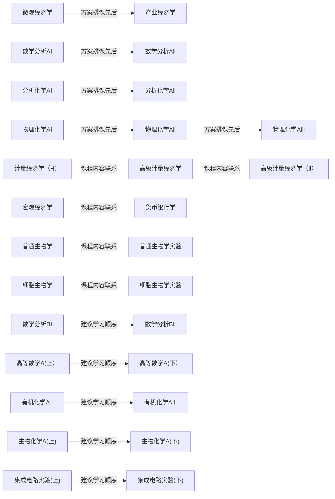

# 2025经济学（数理经济方向）专业本博融通培养方案（长水计划）（普通本科生）

经济学院 · 经济学(数理经济方向)(长水计划) · 方案 96978 · 129 个不同课程或科研条目。

[官方 Word](../originals/plan-96978.docx) · [教务详情](https://fdjwgl.fudan.edu.cn/manager/bizType/2/major-program-search/info/96978?skipAuth=1) · [方案快照](../raw/plan-96978.json.gz) · [年级目录](../README.md)

## 课程关系图

图中展示部分关系。下表保留全部已建立的课程对，来源位置使用本方案 JSON Pointer。

## 先修与内容联系

| 类型 | 起点 | 终点 | 依据 | 原表定位 |
| --- | --- | --- | --- | --- |
| 建议学习顺序 | 人工智能导论 (AIE310005) | 人工智能的编程基础 (AIE310006) | “人工智能导论”题名标明基础层次，前置阅读可帮助了解“人工智能的编程基础”中的人工智能主题。  | `/courseModules/24/planCourses/8`、`/courseModules/24/planCourses/0` |
| 建议学习顺序 | 人工智能导论 (AIE310005) | 人工智能的数学基础 (AIE310009) | “人工智能导论”题名标明基础层次，前置阅读可帮助了解“人工智能的数学基础”中的人工智能主题。  | `/courseModules/24/planCourses/8`、`/courseModules/24/planCourses/6` |
| 建议学习顺序 | 人工智能导论 (AIE310005) | 模式识别与机器学习 (AIE410001) | 人工智能问题与模型类别可为学习模式识别作准备。  | `/courseModules/24/planCourses/8`、`/courseModules/24/planCourses/2` |
| 建议学习顺序 | 人工智能导论 (AIE310005) | 人工智能生物学 (AIS310017) | “人工智能导论”题名标明基础层次，前置阅读可帮助了解“人工智能生物学”中的人工智能主题。  | `/courseModules/24/planCourses/8`、`/courseModules/23/planCourses/16` |
| 建议学习顺序 | 人工智能导论 (AIE310005) | 人工智能结构生物学 (AIS410006) | “人工智能导论”题名标明基础层次，前置阅读可帮助了解“人工智能结构生物学”中的人工智能主题。  | `/courseModules/24/planCourses/8`、`/courseModules/23/planCourses/17` |
| 建议学习顺序 | 生物化学A(上) (BIOL30002) | 生物化学A(下) (BIOL30021) | 同方案的课程题名具有连续分册或序号。  | `/courseModules/23/planCourses/4`、`/courseModules/23/planCourses/5` |
| 建议学习顺序 | 分析化学AⅠ (CHEM20001) | 分析化学AⅡ (CHEM20002) | 同方案的课程题名具有连续分册或序号。  | `/courseModules/22/planCourses/3`、`/courseModules/22/planCourses/4` |
| 建议学习顺序 | 物理化学AⅠ (CHEM20005) | 物理化学AⅡ (CHEM20006) | 同方案的课程题名具有连续分册或序号。  | `/courseModules/22/planCourses/5`、`/courseModules/22/planCourses/6` |
| 建议学习顺序 | 物理化学AⅡ (CHEM20006) | 物理化学AⅢ (CHEM30004) | 同方案的课程题名具有连续分册或序号。  | `/courseModules/22/planCourses/6`、`/courseModules/22/planCourses/7` |
| 建议学习顺序 | 有机化学A I (CHEM20013) | 有机化学A II (CHEM20014) | 同方案的课程题名具有连续分册或序号。  | `/courseModules/22/planCourses/8`、`/courseModules/22/planCourses/9` |
| 建议学习顺序 | 微观经济学 (ECON20003) | 产业经济学 (ECON30025) | 企业和市场结构是产业经济分析的基础。  | `/courseModules/9/planCourses/1`、`/courseModules/11/planCourses/7` |
| 建议学习顺序 | 集成电路实验(上) (ICSE40008) | 集成电路实验(下) (ICSE40009) | 同方案的课程题名具有连续分册或序号。  | `/courseModules/25/planCourses/0`、`/courseModules/25/planCourses/1` |
| 建议学习顺序 | 数学分析AⅠ (MATH10010) | 数学分析AⅡ (MATH10011) | 同方案的课程题名具有连续分册或序号。  | `/courseModules/20/planCourses/4`、`/courseModules/20/planCourses/5` |
| 建议学习顺序 | 数学分析BⅠ (MATH10012) | 数学分析BⅡ (MATH10013) | 同方案的课程题名具有连续分册或序号。  | `/courseModules/7/planCourses/0`、`/courseModules/7/planCourses/1` |
| 建议学习顺序 | 高等数学A(上） (MATH10015) | 高等数学A(下） (MATH10016) | 同方案的课程题名具有连续分册或序号。  | `/courseModules/8/planCourses/1`、`/courseModules/8/planCourses/0` |
| 建议学习顺序 | 线性代数 (MATH10017) | 模式识别与机器学习 (AIE410001) | 向量表示和矩阵运算支持理解分类、回归等模型。  | `/courseModules/9/planCourses/4`、`/courseModules/24/planCourses/2` |
| 方案排课先后 | 人工智能导论 (AIE310005) | 模式识别与机器学习 (AIE410001) | 同方案该课程全部明确数字学期均早于后者。  | `/courseModules/24/planCourses/8`、`/courseModules/24/planCourses/2` |
| 方案排课先后 | 生物化学A(上) (BIOL30002) | 生物化学A(下) (BIOL30021) | 同方案该课程全部明确数字学期均早于后者。  | `/courseModules/23/planCourses/4`、`/courseModules/23/planCourses/5` |
| 方案排课先后 | 分析化学AⅠ (CHEM20001) | 分析化学AⅡ (CHEM20002) | 同方案该课程全部明确数字学期均早于后者。  | `/courseModules/22/planCourses/3`、`/courseModules/22/planCourses/4` |
| 方案排课先后 | 物理化学AⅠ (CHEM20005) | 物理化学AⅡ (CHEM20006) | 同方案该课程全部明确数字学期均早于后者。  | `/courseModules/22/planCourses/5`、`/courseModules/22/planCourses/6` |
| 方案排课先后 | 物理化学AⅡ (CHEM20006) | 物理化学AⅢ (CHEM30004) | 同方案该课程全部明确数字学期均早于后者。  | `/courseModules/22/planCourses/6`、`/courseModules/22/planCourses/7` |
| 方案排课先后 | 有机化学A I (CHEM20013) | 有机化学A II (CHEM20014) | 同方案该课程全部明确数字学期均早于后者。  | `/courseModules/22/planCourses/8`、`/courseModules/22/planCourses/9` |
| 方案排课先后 | 微观经济学 (ECON20003) | 产业经济学 (ECON30025) | 同方案该课程全部明确数字学期均早于后者。  | `/courseModules/9/planCourses/1`、`/courseModules/11/planCourses/7` |
| 方案排课先后 | 集成电路实验(上) (ICSE40008) | 集成电路实验(下) (ICSE40009) | 同方案该课程全部明确数字学期均早于后者。  | `/courseModules/25/planCourses/0`、`/courseModules/25/planCourses/1` |
| 方案排课先后 | 数学分析AⅠ (MATH10010) | 数学分析AⅡ (MATH10011) | 同方案该课程全部明确数字学期均早于后者。  | `/courseModules/20/planCourses/4`、`/courseModules/20/planCourses/5` |
| 方案排课先后 | 线性代数 (MATH10017) | 模式识别与机器学习 (AIE410001) | 同方案该课程全部明确数字学期均早于后者。  | `/courseModules/9/planCourses/4`、`/courseModules/24/planCourses/2` |
| 课程内容联系 | 人工智能导论 (AIE310005) | 人工智能的编程基础 (AIE310006) | 本方案两门课程的题名均含“人工智能”，可据此对照这一主题。  | `/courseModules/24/planCourses/8`、`/courseModules/24/planCourses/0` |
| 课程内容联系 | 人工智能导论 (AIE310005) | 人工智能的数学基础 (AIE310009) | 本方案两门课程的题名均含“人工智能”，可据此对照这一主题。  | `/courseModules/24/planCourses/8`、`/courseModules/24/planCourses/6` |
| 课程内容联系 | 人工智能导论 (AIE310005) | 人工智能生物学 (AIS310017) | 本方案两门课程的题名均含“人工智能”，可据此对照这一主题。  | `/courseModules/24/planCourses/8`、`/courseModules/23/planCourses/16` |
| 课程内容联系 | 人工智能导论 (AIE310005) | 人工智能结构生物学 (AIS410006) | 本方案两门课程的题名均含“人工智能”，可据此对照这一主题。  | `/courseModules/24/planCourses/8`、`/courseModules/23/planCourses/17` |
| 课程内容联系 | 人工智能的数学基础 (AIE310009) | 模式识别与机器学习 (AIE410001) | 数学表达与学习模型的统计、优化工具可对照。  | `/courseModules/24/planCourses/6`、`/courseModules/24/planCourses/2` |
| 课程内容联系 | 生物化学A(上) (BIOL30002) | 生物化学实验 (BIOL30003) | 本方案两门课程的题名均含“生物化学”，可据此对照这一主题。  | `/courseModules/23/planCourses/4`、`/courseModules/23/planCourses/6` |
| 课程内容联系 | 生物化学实验 (BIOL30003) | 生物化学A(下) (BIOL30021) | 本方案两门课程的题名均含“生物化学”，可据此对照这一主题。  | `/courseModules/23/planCourses/6`、`/courseModules/23/planCourses/5` |
| 课程内容联系 | 细胞生物学 (BIOL30004) | 细胞生物学实验 (BIOL30005) | 题名显示相同主题的课程与实验、实践或实习。  | `/courseModules/23/planCourses/7`、`/courseModules/23/planCourses/8` |
| 课程内容联系 | 微生物学 (BIOL30006) | 微生物学实验 (BIOL30007) | 题名显示相同主题的课程与实验、实践或实习。  | `/courseModules/23/planCourses/11`、`/courseModules/23/planCourses/12` |
| 课程内容联系 | 遗传学 (BIOL30008) | 遗传学实验 (BIOL30009) | 题名显示相同主题的课程与实验、实践或实习。  | `/courseModules/23/planCourses/13`、`/courseModules/23/planCourses/14` |
| 课程内容联系 | 生理学 (BIOL30010) | 生理学实验 (BIOL30020) | 题名显示相同主题的课程与实验、实践或实习。  | `/courseModules/23/planCourses/9`、`/courseModules/23/planCourses/10` |
| 课程内容联系 | 普通生物学 (BIOL30019) | 普通生物学实验 (GEEC10037) | 题名显示相同主题的课程与实验、实践或实习。  | `/courseModules/23/planCourses/2`、`/courseModules/23/planCourses/3` |
| 课程内容联系 | 分析化学AⅠ (CHEM20001) | 分析化学 (CHEM20015) | 本方案两门课程的题名均含“分析化学”，可据此对照这一主题。  | `/courseModules/22/planCourses/3`、`/courseModules/23/planCourses/21` |
| 课程内容联系 | 分析化学AⅡ (CHEM20002) | 分析化学 (CHEM20015) | 本方案两门课程的题名均含“分析化学”，可据此对照这一主题。  | `/courseModules/22/planCourses/4`、`/courseModules/23/planCourses/21` |
| 课程内容联系 | 物理化学AⅠ (CHEM20005) | 物理化学AⅡ (CHEM20006) | 本方案两门课程的题名均含“物理化学”，可据此对照这一主题。  | `/courseModules/22/planCourses/5`、`/courseModules/22/planCourses/6` |
| 课程内容联系 | 物理化学AⅠ (CHEM20005) | 物理化学AⅢ (CHEM30004) | 本方案两门课程的题名均含“物理化学”，可据此对照这一主题。  | `/courseModules/22/planCourses/5`、`/courseModules/22/planCourses/7` |
| 课程内容联系 | 有机化学 (CHEM20011) | 有机化学实验 (CHEM20012) | 题名显示相同主题的课程与实验、实践或实习。  | `/courseModules/23/planCourses/19`、`/courseModules/23/planCourses/20` |
| 课程内容联系 | 有机化学 (CHEM20011) | 有机化学A I (CHEM20013) | 本方案两门课程的题名均含“有机化学”，可据此对照这一主题。  | `/courseModules/23/planCourses/19`、`/courseModules/22/planCourses/8` |
| 课程内容联系 | 有机化学 (CHEM20011) | 有机化学A II (CHEM20014) | 本方案两门课程的题名均含“有机化学”，可据此对照这一主题。  | `/courseModules/23/planCourses/19`、`/courseModules/22/planCourses/9` |
| 课程内容联系 | 分析化学 (CHEM20015) | 分析化学实验 (CHEM20016) | 题名显示相同主题的课程与实验、实践或实习。  | `/courseModules/23/planCourses/21`、`/courseModules/23/planCourses/22` |
| 课程内容联系 | 宏观经济学 (ECON20004) | 货币银行学 (ECON30021) | 共同主题为货币政策与宏观经济运行。  | `/courseModules/9/planCourses/2`、`/courseModules/17/planCourses/1` |
| 课程内容联系 | 计量经济学（H） (ECON30121h) | 高级计量经济学 (ECON40027) | 本方案两门课程的题名均含“计量经济”，可据此对照这一主题。  | `/courseModules/11/planCourses/3`、`/courseModules/18/planCourses/0` |
| 课程内容联系 | 高级计量经济学 (ECON40027) | 高级计量经济学（Ⅱ） (ECON60013) | 本方案两门课程的题名均含“计量经济”，可据此对照这一主题。  | `/courseModules/18/planCourses/0`、`/courseModules/18/planCourses/2` |
| 课程内容联系 | 集成电路实验(上) (ICSE40008) | 集成电路实验(下) (ICSE40009) | 本方案两门课程的题名均含“集成电路”，可据此对照这一主题。  | `/courseModules/25/planCourses/0`、`/courseModules/25/planCourses/1` |

本次未从可定位的明确表述中确认课程对课程预修。学期安排、系列分册与编辑建议均保留各自的依据。

## 按原方案模块阅读

同一模块展示原表中的课程归属。模块内课程之间的先后仍须逐项查阅。

- **数学分析B**　数学分析BⅠ、数学分析BⅡ（原表模块 7）
- **高等数学A**　高等数学A(上）、高等数学A(下）（原表模块 8）
- **方法模块**　时间序列分析的方法、随机过程、数量分析软件应用、海外学者专题、海外学者专题III（原表模块 15）
- **理论模块**　发展经济学(H)、信息经济学、经济学前沿专题(H)、数字经济概论（原表模块 16）
- **应用模块**　创新经济学、国际贸易(H)、货币银行学、劳动经济学(H)、资产定价（原表模块 17）
- **数学**　数据科学的逼近论基础、新型算法、高等代数Ⅰ、数学分析AⅠ、数学分析AⅡ、常微分方程、抽象代数、复变函数（原表模块 20）
- **物理**　大学物理实验Ⅰ、热力学与统计物理I、量子力学I（原表模块 21）
- **化学**　分析化学AⅠ、分析化学AⅡ、物理化学AⅠ、物理化学AⅡ、有机化学A I、有机化学A II、无机化学与化学分析实验、物理化学AⅢ、计算化学、纳米材料与功能器件、计算谱学原理（原表模块 22）
- **生物**　人工智能生物学、人工智能结构生物学、AI在生物分子结构中的研究及应用、生物化学A(上)、生物化学实验、细胞生物学、细胞生物学实验、微生物学、微生物学实验、遗传学、遗传学实验、生理学、分子生物学、普通生物学、生理学实验、生物化学A(下)、生物物理学、生物信息学等23项（原表模块 23）
- **人工智能**　计算机系统基础、计算机视觉、人工智能导论、人工智能的编程基础、数据结构、人工智能的数学基础、模式识别与机器学习、自然语言处理与大语言模型、人工智能前沿探索实践（原表模块 24）
- **微电子**　模拟电子线路、数字逻辑基础、信号与系统概论、集成电路实验(上)、集成电路实验(下)（原表模块 25）

## 课程表

同一课程在不同模块分别出现时，按原表逐行列出。季节字段保留原值。

| 课程 | 代码 | 学分 | 学期 | 模块 |
| --- | --- | ---: | --- | --- |
| 数学分析BⅠ | MATH10012 | 5.0 | SPRING、AUTUMN | 培养方案 / 专业培养课程 / 学科基础课程 / 数学类基础课程 / 数学分析B |
| 数学分析BⅡ | MATH10013 | 5.0 | SPRING、AUTUMN | 培养方案 / 专业培养课程 / 学科基础课程 / 数学类基础课程 / 数学分析B |
| 高等数学A(下） | MATH10016 | 5.0 | SPRING、AUTUMN | 培养方案 / 专业培养课程 / 学科基础课程 / 数学类基础课程 / 高等数学A |
| 高等数学A(上） | MATH10015 | 5.0 | SPRING、AUTUMN | 培养方案 / 专业培养课程 / 学科基础课程 / 数学类基础课程 / 高等数学A |
| 政治经济学 | ECON20006 | 3.0 | 第1学期 | 培养方案 / 专业培养课程 / 学科基础课程 / 学科基础课程 |
| 微观经济学 | ECON20003 | 3.0 | 第1学期 | 培养方案 / 专业培养课程 / 学科基础课程 / 学科基础课程 |
| 宏观经济学 | ECON20004 | 3.0 | 第2学期 | 培养方案 / 专业培养课程 / 学科基础课程 / 学科基础课程 |
| 会计学 | BA10003 | 3.0 | 第2学期 | 培养方案 / 专业培养课程 / 学科基础课程 / 学科基础课程 |
| 线性代数 | MATH10017 | 3.0 | 第2学期 | 培养方案 / 专业培养课程 / 学科基础课程 / 学科基础课程 |
| 概率论与数理统计 | ECON30016 | 3.0 | 第3学期 | 培养方案 / 专业培养课程 / 专业核心教育课程 / 专业核心教育课程 |
| 公司金融(H) | ECON30122h | 4.0 | 第3学期 | 培养方案 / 专业培养课程 / 专业核心教育课程 / 专业核心教育课程 |
| 经济史 | ECON30120 | 3.0 | 第3学期 | 培养方案 / 专业培养课程 / 专业核心教育课程 / 专业核心教育课程 |
| 计量经济学（H） | ECON30121h | 4.0 | 第4学期 | 培养方案 / 专业培养课程 / 专业核心教育课程 / 专业核心教育课程 |
| 财政学 | ECON30019 | 3.0 | 第4学期 | 培养方案 / 专业培养课程 / 专业核心教育课程 / 专业核心教育课程 |
| 国际经济学 | ECON30029 | 3.0 | 第4学期 | 培养方案 / 专业培养课程 / 专业核心教育课程 / 专业核心教育课程 |
| 当代中国经济 | ECON30024 | 3.0 | 第5学期 | 培养方案 / 专业培养课程 / 专业核心教育课程 / 专业核心教育课程 |
| 产业经济学 | ECON30025 | 3.0 | 第6学期 | 培养方案 / 专业培养课程 / 专业核心教育课程 / 专业核心教育课程 |
| 博弈论(H) | ECON30054h | 4.0 | 第3学期 | 培养方案 / 专业培养课程 / 专业核心教育课程 / 专业核心教育课程 |
| 截面与面板数据分析(H) | ECON40012h | 4.0 | 第5学期 | 培养方案 / 专业培养课程 / 专业核心教育课程 / 专业核心教育课程 |
| 微分方程 | ECON30067 | 3.0 | 第4学期 | 培养方案 / 专业培养课程 / 专业核心教育课程 / 专业核心教育课程 |
| 统计（机器）学习概论 | STAT30015 | 3.0 | 第5学期 | 培养方案 / 专业培养课程 / 专业核心教育课程 / 专业核心教育课程 |
| 人工智能与应用经济学 | AIS410005 | 3.0 | 第6学期 | 培养方案 / 专业培养课程 / 专业核心教育课程 / 专业核心教育课程 |
| 经济学中的动态和优化方法 | ECON60002 | 3.0 | 第7学期 | 培养方案 / 专业培养课程 / 专业核心教育课程 / 专业核心教育课程 |
| 高级微观经济学 | ECON40026 | 3.0 | 第7学期 | 培养方案 / 专业培养课程 / 专业核心教育课程 / 专业核心教育课程 |
| 高级宏观经济学 | ECON60007 | 3.0 | 第8学期 | 培养方案 / 专业培养课程 / 专业核心教育课程 / 专业核心教育课程 |
| 时间序列分析的方法 | ECON40004 | 3.0 | SPRING、AUTUMN | 培养方案 / 专业进阶I组 / 方法模块 |
| 随机过程 | ECON40006 | 3.0 | 第1学期 | 培养方案 / 专业进阶I组 / 方法模块 |
| 数量分析软件应用 | ECON40013 | 3.0 | SPRING、AUTUMN | 培养方案 / 专业进阶I组 / 方法模块 |
| 海外学者专题 | ECON50004 | 2.0 | SUMMER | 培养方案 / 专业进阶I组 / 方法模块 |
| 海外学者专题III | ECON50005 | 2.0 | SUMMER | 培养方案 / 专业进阶I组 / 方法模块 |
| 发展经济学(H) | ECON30026h | 4.0 | 第6学期 | 培养方案 / 专业进阶I组 / 理论模块 |
| 信息经济学 | ECON30081 | 2.0 | 第5学期 | 培养方案 / 专业进阶I组 / 理论模块 |
| 经济学前沿专题(H) | ECON40032h | 4.0 | 第6学期 | 培养方案 / 专业进阶I组 / 理论模块 |
| 数字经济概论 | MDE60003 | 3.0 | 第6学期 | 培养方案 / 专业进阶I组 / 理论模块 |
| 国际贸易(H) | ECON30018h | 4.0 | 第5学期 | 培养方案 / 专业进阶I组 / 应用模块 |
| 货币银行学 | ECON30021 | 3.0 | 第5学期 | 培养方案 / 专业进阶I组 / 应用模块 |
| 劳动经济学(H) | ECON30113h | 4.0 | 第5学期 | 培养方案 / 专业进阶I组 / 应用模块 |
| 资产定价 | ECON40017 | 3.0 | 第5学期 | 培养方案 / 专业进阶I组 / 应用模块 |
| 创新经济学 | ECON30013 | 3.0 | 第5学期 | 培养方案 / 专业进阶I组 / 应用模块 |
| 高级计量经济学 | ECON40027 | 3.0 | 第8学期 | 培养方案 / 专业进阶II组 |
| 高级微观经济学（II） | ECON60014 | 3.0 | 第8学期 | 培养方案 / 专业进阶II组 |
| 高级计量经济学（Ⅱ） | ECON60013 | 3.0 | 第9学期 | 培养方案 / 专业进阶II组 |
| 高级宏观经济学（II） | ECON60015 | 3.0 | 第9学期 | 培养方案 / 专业进阶II组 |
| 抽象代数 | MATH20015 | 4.0 | 第3学期 | 培养方案 / 理工核心课程池 / 数学 |
| 常微分方程 | MATH20014 | 4.0 | 第3学期 | 培养方案 / 理工核心课程池 / 数学 |
| 复变函数 | MATH20016 | 4.0 | 第4学期 | 培养方案 / 理工核心课程池 / 数学 |
| 高等代数Ⅰ | MATH10009 | 5.0 | 第1学期 | 培养方案 / 理工核心课程池 / 数学 |
| 数学分析AⅠ | MATH10010 | 5.0 | 第1学期 | 培养方案 / 理工核心课程池 / 数学 |
| 数学分析AⅡ | MATH10011 | 5.0 | 第2学期 | 培养方案 / 理工核心课程池 / 数学 |
| 新型算法 | AIS631004 | 3.0 | SPRING、AUTUMN | 培养方案 / 理工核心课程池 / 数学 |
| 数据科学的逼近论基础 | AIS631003 | 3.0 | SPRING、AUTUMN | 培养方案 / 理工核心课程池 / 数学 |
| 大学物理实验Ⅰ | PHYS10009 | 2.0 | 第1学期 | 培养方案 / 理工核心课程池 / 物理 |
| 热力学与统计物理I | PHYS20013 | 4.0 | 第4学期 | 培养方案 / 理工核心课程池 / 物理 |
| 量子力学I | PHYS30010 | 4.0 | 第5学期 | 培养方案 / 理工核心课程池 / 物理 |
| 计算化学 | CHEM30012 | 2.0 | AUTUMN | 培养方案 / 理工核心课程池 / 化学 |
| 计算谱学原理 | CHEM30033 | 2.0 | SPRING、AUTUMN | 培养方案 / 理工核心课程池 / 化学 |
| 纳米材料与功能器件 | CHEM30022 | 2.0 | AUTUMN | 培养方案 / 理工核心课程池 / 化学 |
| 分析化学AⅠ | CHEM20001 | 2.0 | 第3学期 | 培养方案 / 理工核心课程池 / 化学 |
| 分析化学AⅡ | CHEM20002 | 2.0 | 第4学期 | 培养方案 / 理工核心课程池 / 化学 |
| 物理化学AⅠ | CHEM20005 | 3.0 | 第3学期 | 培养方案 / 理工核心课程池 / 化学 |
| 物理化学AⅡ | CHEM20006 | 3.0 | 第4学期 | 培养方案 / 理工核心课程池 / 化学 |
| 物理化学AⅢ | CHEM30004 | 3.0 | 第5学期 | 培养方案 / 理工核心课程池 / 化学 |
| 有机化学A I | CHEM20013 | 4.0 | 第3学期 | 培养方案 / 理工核心课程池 / 化学 |
| 有机化学A II | CHEM20014 | 2.0 | 第4学期 | 培养方案 / 理工核心课程池 / 化学 |
| 无机化学与化学分析实验 | CHEM20021 | 4.0 | 第3学期 | 培养方案 / 理工核心课程池 / 化学 |
| 生物物理学 | BIOL50010 | 2.0 | AUTUMN | 培养方案 / 理工核心课程池 / 生物 |
| 生物信息学 | BIOL50012 | 3.0 | SPRING、AUTUMN | 培养方案 / 理工核心课程池 / 生物 |
| 普通生物学 | BIOL30019 | 3.0 | 第3学期 | 培养方案 / 理工核心课程池 / 生物 |
| 普通生物学实验 | GEEC10037 | 2.0 | 第3学期 | 培养方案 / 理工核心课程池 / 生物 |
| 生物化学A(上) | BIOL30002 | 3.0 | 第4学期 | 培养方案 / 理工核心课程池 / 生物 |
| 生物化学A(下) | BIOL30021 | 2.0 | 第5学期 | 培养方案 / 理工核心课程池 / 生物 |
| 生物化学实验 | BIOL30003 | 1.5 | 第4学期 | 培养方案 / 理工核心课程池 / 生物 |
| 细胞生物学 | BIOL30004 | 3.0 | 第4学期 | 培养方案 / 理工核心课程池 / 生物 |
| 细胞生物学实验 | BIOL30005 | 1.5 | 第4学期 | 培养方案 / 理工核心课程池 / 生物 |
| 生理学 | BIOL30010 | 3.0 | 第4学期 | 培养方案 / 理工核心课程池 / 生物 |
| 生理学实验 | BIOL30020 | 1.5 | 第4学期 | 培养方案 / 理工核心课程池 / 生物 |
| 微生物学 | BIOL30006 | 3.0 | 第5学期 | 培养方案 / 理工核心课程池 / 生物 |
| 微生物学实验 | BIOL30007 | 1.5 | 第5学期 | 培养方案 / 理工核心课程池 / 生物 |
| 遗传学 | BIOL30008 | 3.0 | 第5学期 | 培养方案 / 理工核心课程池 / 生物 |
| 遗传学实验 | BIOL30009 | 1.5 | 第5学期 | 培养方案 / 理工核心课程池 / 生物 |
| 分子生物学 | BIOL30014 | 2.0 | 第5学期 | 培养方案 / 理工核心课程池 / 生物 |
| 人工智能生物学 | AIS310017 | 2.0 | AUTUMN | 培养方案 / 理工核心课程池 / 生物 |
| 人工智能结构生物学 | AIS410006 | 2.0 | AUTUMN | 培养方案 / 理工核心课程池 / 生物 |
| AI在生物分子结构中的研究及应用 | AIS410014 | 2.0 | AUTUMN | 培养方案 / 理工核心课程池 / 生物 |
| 有机化学 | CHEM20011 | 4.0 | 第3学期 | 培养方案 / 理工核心课程池 / 生物 |
| 有机化学实验 | CHEM20012 | 2.0 | 第3学期 | 培养方案 / 理工核心课程池 / 生物 |
| 分析化学 | CHEM20015 | 2.0 | 第3学期 | 培养方案 / 理工核心课程池 / 生物 |
| 分析化学实验 | CHEM20016 | 2.0 | 第3学期 | 培养方案 / 理工核心课程池 / 生物 |
| 人工智能的编程基础 | AIE310006 | 2.0 | 第2学期 | 培养方案 / 理工核心课程池 / 人工智能 |
| 数据结构 | AIE310007 | 4.0 | 第3学期 | 培养方案 / 理工核心课程池 / 人工智能 |
| 模式识别与机器学习 | AIE410001 | 3.0 | 第5学期 | 培养方案 / 理工核心课程池 / 人工智能 |
| 自然语言处理与大语言模型 | AIE410002 | 3.0 | 第6学期 | 培养方案 / 理工核心课程池 / 人工智能 |
| 计算机视觉 | AIE310004 | 3.0 | 第7学期 | 培养方案 / 理工核心课程池 / 人工智能 |
| 人工智能前沿探索实践 | AIE531001 | 3.0 | 第7学期 | 培养方案 / 理工核心课程池 / 人工智能 |
| 人工智能的数学基础 | AIE310009 | 3.0 | 第3学期 | 培养方案 / 理工核心课程池 / 人工智能 |
| 计算机系统基础 | AIE210006 | 3.0 | 第3学期 | 培养方案 / 理工核心课程池 / 人工智能 |
| 人工智能导论 | AIE310005 | 3.0 | 第4学期 | 培养方案 / 理工核心课程池 / 人工智能 |
| 集成电路实验(上) | ICSE40008 | 3.0 | 第7学期 | 培养方案 / 理工核心课程池 / 微电子 |
| 集成电路实验(下) | ICSE40009 | 2.0 | 第8学期 | 培养方案 / 理工核心课程池 / 微电子 |
| 模拟电子线路 | ICSE20004 | 3.0 | 第3学期 | 培养方案 / 理工核心课程池 / 微电子 |
| 数字逻辑基础 | ICSE20005 | 4.0 | 第3学期 | 培养方案 / 理工核心课程池 / 微电子 |
| 信号与系统概论 | ICSE20006 | 3.0 | 第4学期 | 培养方案 / 理工核心课程池 / 微电子 |
| 研究生学术活动 | 4 | 1.0 |  | 融合创新能力 |
| 研究生实践活动 | 5 | 1.0 |  | 融合创新能力 |
| 博士学位论文开题 | 1 | 0.0 |  | 融合创新能力 |
| 博士论文中期考核 | 3 | 0.0 |  | 融合创新能力 |
| 博士学位论文预审 | 6 | 1.0 |  | 融合创新能力 |
| 博士生资格考核 | 2 | 0.0 |  | 融合创新能力 |
| 走进经济学系列讲座 | ECON10001 | 0.0 | 第2学期 | 融合创新能力 |
| 相辉前沿专题 | MATH10025 | 2.0 | SPRING、AUTUMN | 融合创新能力 |
| 中国经济学系列讲座 | ECON20002 | 1.0 | 第4学期 | 融合创新能力 |
| 科研实践（复芏计划） | ECON30002 | 2.0 | 第7学期 | 融合创新能力 |
| 毕业论文 | ECON30006 | 2.0 | 第8学期 | 融合创新能力 |
| 经济学讲座一 | ECON80003 | 1.0 | SPRING、AUTUMN | 融合创新能力 |
| 经济学讲座二 | ECON80004 | 1.0 | SPRING、AUTUMN | 融合创新能力 |
| 经济学讲座三 | ECON80005 | 1.0 | SPRING、AUTUMN | 融合创新能力 |
| 经济学讲座四 | ECON80006 | 1.0 | SPRING、AUTUMN | 融合创新能力 |
| 经济学讲座五 | ECON80007 | 1.0 | SPRING、AUTUMN | 融合创新能力 |
| 经济学讲座六 | ECON80008 | 1.0 | SPRING、AUTUMN | 融合创新能力 |
| 经济学讲座七 | ECON80009 | 1.0 | SPRING、AUTUMN | 融合创新能力 |
| 经济学讲座八 | ECON80010 | 1.0 | SPRING、AUTUMN | 融合创新能力 |
| 经济学讲座九 | ECON80011 | 1.0 | SPRING、AUTUMN | 融合创新能力 |
| 经济学讲座十 | ECON80012 | 1.0 | SPRING、AUTUMN | 融合创新能力 |
| 经济学讲座十一 | ECON80013 | 1.0 | SPRING、AUTUMN | 融合创新能力 |
| 经济学讲座十二 | ECON80014 | 1.0 | SPRING、AUTUMN | 融合创新能力 |
| 经济学讲座十三 | ECON80015 | 1.0 | SPRING、AUTUMN | 融合创新能力 |
| 经济学讲座十四 | ECON80016 | 1.0 | SPRING、AUTUMN | 融合创新能力 |
| 经济学讲座十五 | ECON80017 | 1.0 | SPRING、AUTUMN | 融合创新能力 |
| 经济学讲座十六 | ECON80018 | 1.0 | SPRING、AUTUMN | 融合创新能力 |
