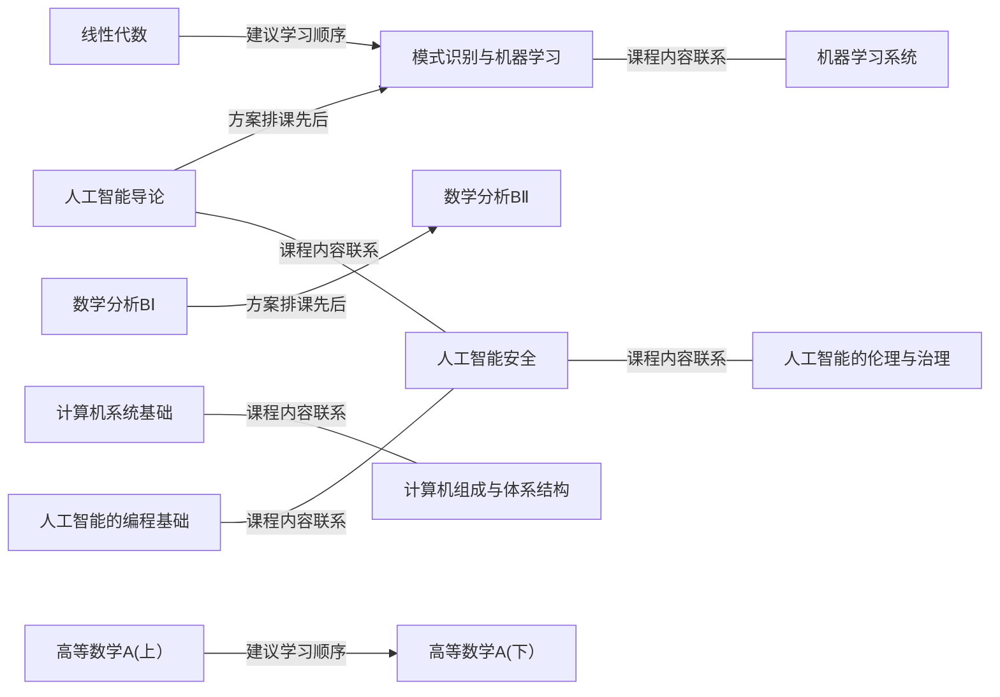

# 2025 人工智能-计算机科学与技术-网络空间安全本博融通培养方案（计算与智能领军人才试验班香农计划适用）

计算与智能创新学院 · 人工智能(计算与智能领军人才班)(香农计划) · 方案 97134 · 58 个不同课程或科研条目。

[官方 Word](../originals/plan-97134.docx) · [教务详情](https://fdjwgl.fudan.edu.cn/manager/bizType/2/major-program-search/info/97134?skipAuth=1) · [方案快照](../raw/plan-97134.json.gz) · [年级目录](../README.md)

## 修读导读

- **建议先学**　《人工智能导论》（`AIE310005`） → 《模式识别与机器学习》（`CS30037`）。人工智能问题与模型类别可为学习模式识别作准备。方案分别列在第4、5学期。

- **可以对照着读**　《计算机系统基础》（`CS10005`）与《计算机组成与体系结构》（`CS30052`）。处理器、存储与系统执行模型具有共同内容。

- **查模块选课**　《人工智能的编程基础》（`AIE310006`）、《信息论、控制论、系统论基础》（`AIE631001`）列在“专业核心教育课程”中。原表见 `/courseModules/7`。

## 课程关系图

图中展示部分关系。下表保留全部已建立的课程对，来源位置使用本方案 JSON Pointer。

## 先修与内容联系

| 类型 | 起点 | 终点 | 依据 | 原表定位 |
| --- | --- | --- | --- | --- |
| 建议学习顺序 | 人工智能导论 (AIE310005) | 模式识别与机器学习 (CS30037) | 人工智能问题与模型类别可为学习模式识别作准备。  | `/courseModules/7/planCourses/5`、`/courseModules/7/planCourses/11` |
| 建议学习顺序 | 线性代数 (CS10003) | 模式识别与机器学习 (CS30037) | 向量表示和矩阵运算支持理解分类、回归等模型。  | `/courseModules/6/planCourses/2`、`/courseModules/7/planCourses/11` |
| 建议学习顺序 | 数学分析BⅠ (MATH10012) | 数学分析BⅡ (MATH10013) | 同方案的课程题名具有连续分册或序号。  | `/courseModules/11/planCourses/0`、`/courseModules/11/planCourses/1` |
| 建议学习顺序 | 高等数学A(上） (MATH10015) | 高等数学A(下） (MATH10016) | 同方案的课程题名具有连续分册或序号。  | `/courseModules/6/planCourses/0`、`/courseModules/6/planCourses/1` |
| 方案排课先后 | 人工智能导论 (AIE310005) | 模式识别与机器学习 (CS30037) | 同方案该课程全部明确数字学期均早于后者。  | `/courseModules/7/planCourses/5`、`/courseModules/7/planCourses/11` |
| 方案排课先后 | 数学分析BⅠ (MATH10012) | 数学分析BⅡ (MATH10013) | 同方案该课程全部明确数字学期均早于后者。  | `/courseModules/11/planCourses/0`、`/courseModules/11/planCourses/1` |
| 课程内容联系 | 人工智能导论 (AIE310005) | 人工智能安全 (AIE831001) | 本方案两门课程的题名均含“人工智能”，可据此对照这一主题。  | `/courseModules/7/planCourses/5`、`/courseModules/10/planCourses/1` |
| 课程内容联系 | 人工智能的编程基础 (AIE310006) | 人工智能安全 (AIE831001) | 本方案两门课程的题名均含“人工智能”，可据此对照这一主题。  | `/courseModules/7/planCourses/0`、`/courseModules/10/planCourses/1` |
| 课程内容联系 | 人工智能安全 (AIE831001) | 人工智能的伦理与治理 (PHIL50006) | 本方案两门课程的题名均含“人工智能”，可据此对照这一主题。  | `/courseModules/10/planCourses/1`、`/courseModules/7/planCourses/13` |
| 课程内容联系 | 计算机系统基础 (CS10005) | 计算机组成与体系结构 (CS30052) | 处理器、存储与系统执行模型具有共同内容。  | `/courseModules/11/planCourses/15`、`/courseModules/7/planCourses/7` |
| 课程内容联系 | 模式识别与机器学习 (CS30037) | 机器学习系统 (CS30058) | 本方案两门课程的题名均含“机器学习”，可据此对照这一主题。  | `/courseModules/7/planCourses/11`、`/courseModules/7/planCourses/12` |

本次未从可定位的明确表述中确认课程对课程预修。学期安排、系列分册与编辑建议均保留各自的依据。

## 按原方案模块阅读

同一模块展示原表中的课程归属。模块内课程之间的先后仍须逐项查阅。

- **工学基础课程**　线性代数、程序设计、高等数学A(上）、高等数学A(下）、普通物理B（原表模块 6）

## 课程表

同一课程在不同模块分别出现时，按原表逐行列出。季节字段保留原值。

| 课程 | 代码 | 学分 | 学期 | 模块 |
| --- | --- | ---: | --- | --- |
| 高等数学A(上） | MATH10015 | 5.0 | AUTUMN | 培养方案 / 专业培养课程 / 学科基础课程 / 工学基础课程 |
| 高等数学A(下） | MATH10016 | 5.0 | SPRING | 培养方案 / 专业培养课程 / 学科基础课程 / 工学基础课程 |
| 线性代数 | CS10003 | 3.0 | AUTUMN | 培养方案 / 专业培养课程 / 学科基础课程 / 工学基础课程 |
| 程序设计 | CS10004 | 4.0 | 第1学期 | 培养方案 / 专业培养课程 / 学科基础课程 / 工学基础课程 |
| 普通物理B | PHYS10002 | 3.0 | 第2学期 | 培养方案 / 专业培养课程 / 学科基础课程 / 工学基础课程 |
| 人工智能的编程基础 | AIE310006 | 2.0 | 第2学期 | 培养方案 / 专业培养课程 / 专业核心教育课程 |
| 信息论、控制论、系统论基础 | AIE631001 | 3.0 | 第2学期 | 培养方案 / 专业培养课程 / 专业核心教育课程 |
| 数据结构 | CS20009 | 4.0 | 第3学期 | 培养方案 / 专业培养课程 / 专业核心教育课程 |
| 集合与图论 | CS30043 | 3.0 | 第3学期 | 培养方案 / 专业培养课程 / 专业核心教育课程 |
| 概率论与数理统计 | STAT30001 | 3.0 | 第3学期 | 培养方案 / 专业培养课程 / 专业核心教育课程 |
| 人工智能导论 | AIE310005 | 3.0 | 第4学期 | 培养方案 / 专业培养课程 / 专业核心教育课程 |
| 数据库系统 | CS20001 | 3.0 | 第4学期 | 培养方案 / 专业培养课程 / 专业核心教育课程 |
| 计算机组成与体系结构 | CS30052 | 4.0 | 第4学期 | 培养方案 / 专业培养课程 / 专业核心教育课程 |
| 最优化方法 | CS40005 | 3.0 | 第4学期 | 培养方案 / 专业培养课程 / 专业核心教育课程 |
| 操作系统 | CS30031 | 3.0 | 第5学期 | 培养方案 / 专业培养课程 / 专业核心教育课程 |
| 计算机网络 | CS30036 | 3.0 | 第5学期 | 培养方案 / 专业培养课程 / 专业核心教育课程 |
| 模式识别与机器学习 | CS30037 | 3.0 | 第5学期 | 培养方案 / 专业培养课程 / 专业核心教育课程 |
| 机器学习系统 | CS30058 | 3.0 | 第6学期 | 培养方案 / 专业培养课程 / 专业核心教育课程 |
| 人工智能的伦理与治理 | PHIL50006 | 2.0 | 第6学期 | 培养方案 / 专业培养课程 / 专业核心教育课程 |
| 强化学习 | CS70027 | 3.0 | 第7学期 | 培养方案 / 专业培养课程 / 专业核心教育课程 |
| AI数据工程 | CS70001 | 2.0 | 第8学期 | 培养方案 / 专业培养课程 / 专业核心教育课程 |
| 机器人学导论 | CS70012 | 3.0 | 第8学期 | 培养方案 / 专业培养课程 / 专业核心教育课程 |
| 科学研究概述与思维方法 | CS50015 | 2.0 | 第8学期 | 培养方案 / 专业培养课程 / 专业核心教育课程 |
| 认知科学导论 | CS70034 | 3.0 | 第8学期 | 培养方案 / 专业培养课程 / 专业核心教育课程 |
| 自然语言处理与大语言模型 | AIE410002 | 3.0 | 第5学期 | 培养方案 / 专业进阶模块I |
| 人工智能安全 | AIE831001 | 3.0 | 第5学期 | 培养方案 / 专业进阶模块I |
| 计算机视觉 | CS30034 | 3.0 | 第5学期 | 培养方案 / 专业进阶模块I |
| 数据科学基础 | CS10001 | 3.0 | 第6学期 | 培养方案 / 专业进阶模块I |
| 计算机图形学 | CS30006 | 3.0 | 第6学期 | 培养方案 / 专业进阶模块I |
| 数学分析BⅠ | MATH10012 | 5.0 | 第1学期 | 培养方案 / 专业进阶模块II |
| 数学分析BⅡ | MATH10013 | 5.0 | 第2学期 | 培养方案 / 专业进阶模块II |
| 代数结构与数理逻辑 | CS30015 | 3.0 | 第4学期 | 培养方案 / 专业进阶模块II |
| 计算理论基础 | CS30021 | 3.0 | 第5学期 | 培养方案 / 专业进阶模块II |
| 类脑智能与人工通用智能 | CS30060 | 2.0 | 第5学期 | 培养方案 / 专业进阶模块II |
| 编译 | CS30017 | 3.0 | 第6学期 | 培养方案 / 专业进阶模块II |
| 数据挖掘 | CS30005 | 3.0 | 第6学期 | 培养方案 / 专业进阶模块II |
| 软件工程 | CS20020 | 4.0 | 第6学期 | 培养方案 / 专业进阶模块II |
| 数字图像处理 | CS30004 | 3.0 | 第6学期 | 培养方案 / 专业进阶模块II |
| 信息检索导论 | CS40015 | 3.0 | 第7学期 | 培养方案 / 专业进阶模块II |
| 社会计算导论 | CS20013 | 3.0 | 第4学期、第6学期 | 培养方案 / 专业进阶模块II |
| 社交网络挖掘 | CS50019 | 3.0 | 第6学期、第7学期 | 培养方案 / 专业进阶模块II |
| 具身智能引论 | AIB310002 | 3.0 | SPRING、AUTUMN | 培养方案 / 专业进阶模块II |
| 人机交互 | CS30053 | 3.0 | SPRING、AUTUMN | 培养方案 / 专业进阶模块II |
| 脑科学导论 | AIS310018 | 3.0 | AUTUMN | 培养方案 / 专业进阶模块II |
| 计算机系统基础 | CS10005 | 3.0 | 第5学期 | 培养方案 / 专业进阶模块II |
| 复芏计划(FDUROP) | 102 | 0.0 |  | 融合创新能力 |
| 研究生学术活动 | 4 | 2.0 |  | 融合创新能力 |
| 研究生实践活动 | 5 | 1.0 |  | 融合创新能力 |
| 专业外语 | 8 | 0.0 |  | 融合创新能力 |
| 国际交流 | 7 | 0.0 |  | 融合创新能力 |
| 博士学位论文开题 | 1 | 0.0 |  | 融合创新能力 |
| 博士生资格考核 | 2 | 0.0 |  | 融合创新能力 |
| 博士论文中期考核 | 3 | 0.0 |  | 融合创新能力 |
| 博士学位论文预审 | 6 | 0.0 |  | 融合创新能力 |
| 课题组轮转 | CS20006 | 1.0 | 第4学期 | 融合创新能力 |
| 综合实践 | CS30010 | 3.0 | 第5学期 | 融合创新能力 |
| 前沿探索 | CS30011 | 3.0 | 第6学期 | 融合创新能力 |
| 毕业论文 | CS40009 | 6.0 | 第8学期 | 融合创新能力 |
