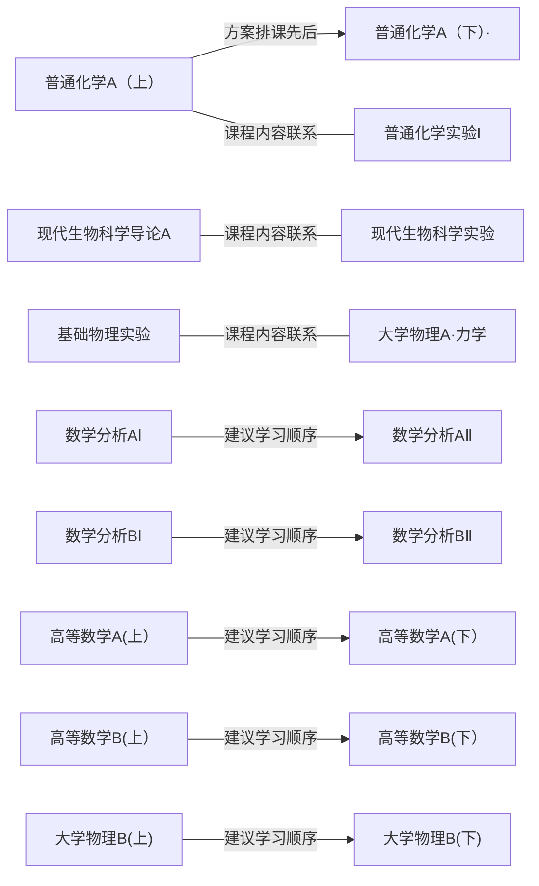

# 2024自然科学试验班培养方案

自然科学试验班 · 自然科学试验班 · 方案 72969 · 21 个不同课程或科研条目。

[官方 Word](../originals/plan-72969.docx) · [教务详情](https://fdjwgl.fudan.edu.cn/manager/bizType/2/major-program-search/info/72969?skipAuth=1) · [方案快照](../raw/plan-72969.json.gz) · [年级目录](../README.md)

## 课程关系图

图中展示部分关系。下表保留全部已建立的课程对，来源位置使用本方案 JSON Pointer。

## 先修与内容联系

| 类型 | 起点 | 终点 | 依据 | 原表定位 |
| --- | --- | --- | --- | --- |
| 建议学习顺序 | 普通化学A（上） (CHEM10003) | 普通化学A（下） (CHEM10004) | 同方案的课程题名具有连续分册或序号。  | `/courseModules/4/planCourses/19`、`/courseModules/4/planCourses/20` |
| 建议学习顺序 | 高等数学B(上） (MATH10004) | 高等数学B(下） (MATH10005) | 同方案的课程题名具有连续分册或序号。  | `/courseModules/4/planCourses/6`、`/courseModules/4/planCourses/7` |
| 建议学习顺序 | 数学分析AⅠ (MATH10010) | 数学分析AⅡ (MATH10011) | 同方案的课程题名具有连续分册或序号。  | `/courseModules/4/planCourses/0`、`/courseModules/4/planCourses/1` |
| 建议学习顺序 | 数学分析BⅠ (MATH10012) | 数学分析BⅡ (MATH10013) | 同方案的课程题名具有连续分册或序号。  | `/courseModules/4/planCourses/2`、`/courseModules/4/planCourses/3` |
| 建议学习顺序 | 高等数学A(上） (MATH10015) | 高等数学A(下） (MATH10016) | 同方案的课程题名具有连续分册或序号。  | `/courseModules/4/planCourses/4`、`/courseModules/4/planCourses/5` |
| 建议学习顺序 | 大学物理B(上) (PHYS10003) | 大学物理B(下) (PHYS10004) | 同方案的课程题名具有连续分册或序号。  | `/courseModules/4/planCourses/11`、`/courseModules/4/planCourses/12` |
| 方案排课先后 | 普通化学A（上） (CHEM10003) | 普通化学A（下） (CHEM10004) | 同方案该课程全部明确数字学期均早于后者。  | `/courseModules/4/planCourses/19`、`/courseModules/4/planCourses/20` |
| 课程内容联系 | 现代生物科学导论A (BIOL10001) | 现代生物科学实验 (BIOL10003) | 课程题名表明两门课均涉及现代生物科学，可从概念理解和实验观察两个角度联系。  | `/courseModules/4/planCourses/13`、`/courseModules/4/planCourses/14` |
| 课程内容联系 | 普通化学A（上） (CHEM10003) | 普通化学实验I (CHEM10005) | 课程题名将普通化学的基础知识和实验学习联系起来。  | `/courseModules/4/planCourses/19`、`/courseModules/4/planCourses/15` |
| 课程内容联系 | 基础物理实验 (PHYS10005) | 大学物理A：力学 (PHYS10006) | 力学量的描述与基础物理中的测量问题相联系，具体实验项目依当期大纲。  | `/courseModules/4/planCourses/16`、`/courseModules/4/planCourses/8` |

本次未从可定位的明确表述中确认课程对课程预修。学期安排、系列分册与编辑建议均保留各自的依据。

## 按原方案模块阅读

同一模块展示原表中的课程归属。模块内课程之间的先后仍须逐项查阅。

- **自然科学类基础课程**　现代生物科学导论A、现代生物科学实验、普通化学A（上）、普通化学A（下）、普通化学实验I、高等数学B(上）、高等数学B(下）、数学分析AⅠ、数学分析AⅡ、数学分析BⅠ、数学分析BⅡ、线性代数（理工类）、高等数学A(上）、高等数学A(下）、大学物理B(上)、大学物理B(下)、基础物理实验、大学物理A：力学等21项（原表模块 4）

## 课程表

同一课程在不同模块分别出现时，按原表逐行列出。季节字段保留原值。

| 课程 | 代码 | 学分 | 学期 | 模块 |
| --- | --- | ---: | --- | --- |
| 数学分析AⅠ | MATH10010 | 5.0 | AUTUMN | 培养方案 / 自然科学类基础课程 |
| 数学分析AⅡ | MATH10011 | 5.0 | SPRING | 培养方案 / 自然科学类基础课程 |
| 数学分析BⅠ | MATH10012 | 5.0 | AUTUMN | 培养方案 / 自然科学类基础课程 |
| 数学分析BⅡ | MATH10013 | 5.0 | SPRING | 培养方案 / 自然科学类基础课程 |
| 高等数学A(上） | MATH10015 | 5.0 | AUTUMN | 培养方案 / 自然科学类基础课程 |
| 高等数学A(下） | MATH10016 | 5.0 | SPRING | 培养方案 / 自然科学类基础课程 |
| 高等数学B(上） | MATH10004 | 5.0 | AUTUMN | 培养方案 / 自然科学类基础课程 |
| 高等数学B(下） | MATH10005 | 5.0 | SPRING | 培养方案 / 自然科学类基础课程 |
| 大学物理A：力学 | PHYS10006 | 4.0 | 第1学期 | 培养方案 / 自然科学类基础课程 |
| 大学物理A：热学 | PHYS10007 | 2.0 | 第2学期 | 培养方案 / 自然科学类基础课程 |
| 大学物理A：电磁学 | PHYS10008 | 4.0 | 第2学期 | 培养方案 / 自然科学类基础课程 |
| 大学物理B(上) | PHYS10003 | 4.0 | SPRING、AUTUMN | 培养方案 / 自然科学类基础课程 |
| 大学物理B(下) | PHYS10004 | 4.0 | SPRING、AUTUMN | 培养方案 / 自然科学类基础课程 |
| 现代生物科学导论A | BIOL10001 | 3.0 | SPRING、AUTUMN | 培养方案 / 自然科学类基础课程 |
| 现代生物科学实验 | BIOL10003 | 1.0 | 第1学期 | 培养方案 / 自然科学类基础课程 |
| 普通化学实验I | CHEM10005 | 1.0 | 第1学期 | 培养方案 / 自然科学类基础课程 |
| 基础物理实验 | PHYS10005 | 2.0 | 第2学期 | 培养方案 / 自然科学类基础课程 |
| 大学物理实验Ⅰ | PHYS10009 | 2.0 | AUTUMN | 培养方案 / 自然科学类基础课程 |
| 线性代数（理工类） | MATH10014 | 3.0 | SPRING、AUTUMN | 培养方案 / 自然科学类基础课程 |
| 普通化学A（上） | CHEM10003 | 2.0 | 第1学期 | 培养方案 / 自然科学类基础课程 |
| 普通化学A（下） | CHEM10004 | 2.0 | 第2学期 | 培养方案 / 自然科学类基础课程 |
